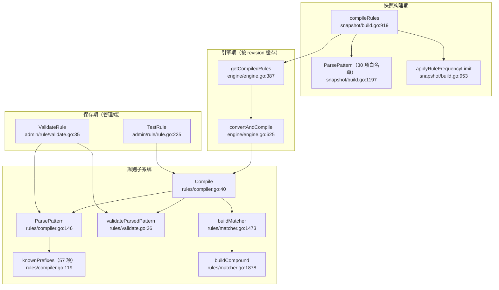
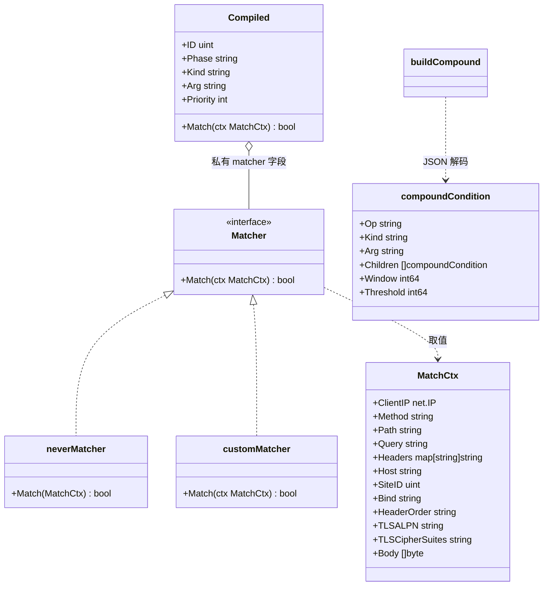
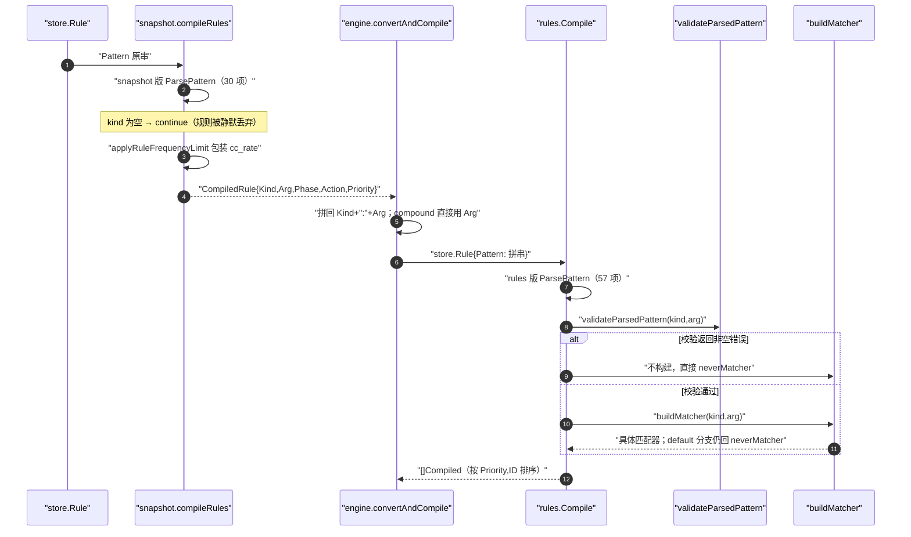
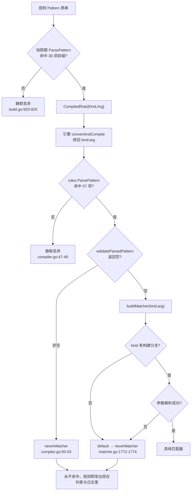
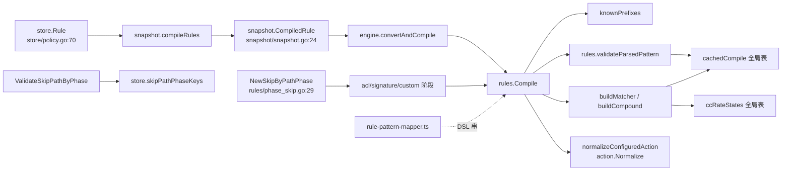

# 规则编译器扩展

> [返回 规则引擎扩展](规则引擎扩展.md) · [返回 扩展与插件系统](../扩展与插件系统.md)

<cite>
**本文档引用的文件**
- [internal/core/rules/compiler.go](file://internal/core/rules/compiler.go)
- [internal/core/rules/matcher.go](file://internal/core/rules/matcher.go)
- [internal/core/rules/validate.go](file://internal/core/rules/validate.go)
- [internal/core/rules/phases.go](file://internal/core/rules/phases.go)
- [internal/core/rules/phase_skip.go](file://internal/core/rules/phase_skip.go)
- [internal/core/rules/matcher_uncovered_test.go](file://internal/core/rules/matcher_uncovered_test.go)
- [internal/core/engine/engine.go](file://internal/core/engine/engine.go)
- [internal/core/action/action.go](file://internal/core/action/action.go)
- [internal/core/pipeline/pipeline.go](file://internal/core/pipeline/pipeline.go)
- [internal/snapshot/build.go](file://internal/snapshot/build.go)
- [internal/snapshot/snapshot.go](file://internal/snapshot/snapshot.go)
- [internal/store/policy.go](file://internal/store/policy.go)
- [internal/store/protection.go](file://internal/store/protection.go)
- [internal/admin/shared/json_bind.go](file://internal/admin/shared/json_bind.go)
- [internal/admin/rule/rule.go](file://internal/admin/rule/rule.go)
- [internal/admin/rule/validate.go](file://internal/admin/rule/validate.go)
- [internal/waf/owasp/normalize.go](file://internal/waf/owasp/normalize.go)
- [frontend/app/(dashboard)/rules/components/rule-pattern-mapper.ts](file://frontend/app/(dashboard)/rules/components/rule-pattern-mapper.ts)
- [frontend/scripts/check-rule-pattern-roundtrip.ts](file://frontend/scripts/check-rule-pattern-roundtrip.ts)
- [frontend/package.json](file://frontend/package.json)
- [README.md](file://README.md)
</cite>

## 目录

1. [简介](#简介)
2. [项目结构](#项目结构)
3. [核心组件](#核心组件)
4. [架构总览](#架构总览)
5. [详细组件分析](#详细组件分析)
6. [依赖关系分析](#依赖关系分析)
7. [性能考虑](#性能考虑)
8. [故障排查指南](#故障排查指南)
9. [结论](#结论)
10. [附录](#附录)

## 简介

本篇只回答一个问题：**要扩展「编译器」本身，改哪里、按什么顺序改、会踩什么坑**。
这里的「编译器」指把规则表达式（DSL 串或 JSON 复合条件）转换为可执行匹配器的两段代码：
快照构建期的 `compileRules` 与请求路径的 `rules.Compile`。

为避免与已完成文档重复，划界如下，遇到交叉一律以链接为准：

| 主题 | 归属文档 | 本篇是否展开 |
|------|----------|:------------:|
| 编译器全链路与执行时序 | [规则编译器（WAF 引擎系统）](../../WAF%20引擎系统/规则编译器.md) | ✗ 只取扩展所需事实 |
| 匹配器接口与字段族 | [匹配器开发](匹配器开发.md) | ✗ |
| 阶段链、短路语义、阶段注册 | [执行阶段系统](执行阶段系统.md) | ✗ |
| 动作类型与执行器 | [动作集成](动作集成.md) | ✗ |
| 扩展路线选型与两处 kind 白名单总览 | [规则引擎扩展](规则引擎扩展.md) | ✗ |
| 新增校验规则 / 归一化步骤 / 编译目标的改动点与陷阱 | 本篇 | ✓ |

本篇的三条结论先说在前面：编译是**两遍**的（快照期一遍、引擎期一遍），两遍各自持有
一份 kind 白名单；两处 fail-closed 都在**编译期**发生而不是运行期抛错，因此错误只表现为
「规则永不命中」而不是「规则保存失败」；校验函数的 `switch` **没有 default 分支**，
未登记的 kind 会直接通过校验。

**章节来源**
- [internal/core/rules/compiler.go:40-78](file://internal/core/rules/compiler.go#L40-L78)
- [internal/snapshot/build.go:920-934](file://internal/snapshot/build.go#L920-L934)
- [internal/core/rules/validate.go:123-257](file://internal/core/rules/validate.go#L123-L257)

## 项目结构

编译相关的代码分布在 5 个位置，理解「谁在什么时候调用谁」比理解单个函数更重要。



**图表来源**
- [internal/admin/rule/validate.go:34-75](file://internal/admin/rule/validate.go#L34-L75)
- [internal/admin/rule/rule.go:224-250](file://internal/admin/rule/rule.go#L224-L250)
- [internal/snapshot/build.go:920-934](file://internal/snapshot/build.go#L920-L934)
- [internal/core/engine/engine.go:386-430](file://internal/core/engine/engine.go#L386-L430)
- [internal/core/rules/compiler.go:40-170](file://internal/core/rules/compiler.go#L40-L170)
- [internal/core/rules/matcher.go:1473-1775](file://internal/core/rules/matcher.go#L1473-L1775)

| 文件 | 编译相关符号 | 规模 | 扩展时的角色 |
|------|--------------|:----:|--------------|
| `internal/core/rules/compiler.go` | `Compiled`、`Compile`、`ParsePattern`、`knownPrefixes`、`ensureCompiledMetadata` | 170 行 | kind 登记表与两遍编译的第二遍 |
| `internal/core/rules/validate.go` | `ValidatePattern`、`validateParsedPattern`、`validateCompoundNode`、`validateSimplePattern` | 257 行 | 校验规则的唯一改动点 |
| `internal/core/rules/matcher.go` | `Matcher`、`buildMatcher`、`buildCompound`、`cachedCompile`、`neverMatcher` | 1928 行 | 编译目标构造与兜底 |
| `internal/core/rules/phases.go` | `MatchCtx`、`ruleNeedsDerivedHeaders`、`normalizeConfiguredAction` | 1391 行 | 上下文取数与动作归一化 |
| `internal/snapshot/build.go` | `compileRules`、`ParsePattern`（独立实现）、`applyRuleFrequencyLimit` | 3071 行内 | 第一遍编译与频次包装 |
| `internal/core/engine/engine.go` | `compiledRulesKey`、`getCompiledRules`、`convertAndCompile`、`phasesCacheKey` | 646 行 | 缓存判据与二次解析 |
| `internal/store/protection.go` | `skipPathPhaseKeys`、`SkipPathPhaseKeys`、`IsSkipPathPhaseKey` | — | 第三处白名单（phase 维度） |

**章节来源**
- [internal/core/rules/compiler.go:12-170](file://internal/core/rules/compiler.go#L12-L170)
- [internal/core/rules/validate.go:25-257](file://internal/core/rules/validate.go#L25-L257)
- [internal/core/rules/matcher.go:21-23](file://internal/core/rules/matcher.go#L21-L23)
- [internal/snapshot/build.go:920-934](file://internal/snapshot/build.go#L920-L934)
- [internal/core/engine/engine.go:386-430](file://internal/core/engine/engine.go#L386-L430)
- [internal/store/protection.go:320-349](file://internal/store/protection.go#L320-L349)

## 核心组件

编译器的产物是 `rules.Compiled`：一个把「元数据 + 预构建匹配器」打包在一起的值类型。
匹配器字段是小写私有，因此 `Compiled` 只能在包内被完整构造，包外只能通过
`Compile` 或 `ensureCompiledMetadata` 得到，这条边界决定了扩展必须落在包内。

```go
// internal/core/rules/compiler.go:13-29（节选）
type Compiled struct {
	ID          uint
	Phase       string
	Action      action.Type
	Priority    int
	Kind        string
	Arg         string
	StatusCode  int
	RedirectTo  string
	CaptchaType string
	CaptchaMinutes int
	matcher        Matcher
	runtimeAction  action.Type
	ruleIDStr      string
	matchDesc      string
}

// internal/core/rules/matcher.go:21-23
type Matcher interface {
	Match(ctx MatchCtx) bool
}
```



**图表来源**
- [internal/core/rules/matcher.go:21-23](file://internal/core/rules/matcher.go#L21-L23)
- [internal/core/rules/phases.go:33-52](file://internal/core/rules/phases.go#L33-L52)
- [internal/core/rules/matcher.go:504-508](file://internal/core/rules/matcher.go#L504-L508)
- [internal/core/rules/compiler.go:13-37](file://internal/core/rules/compiler.go#L13-L37)
- [internal/core/rules/matcher.go:1878-1928](file://internal/core/rules/matcher.go#L1876-L1928)

**章节来源**
- [internal/core/rules/compiler.go:13-37](file://internal/core/rules/compiler.go#L13-L37)
- [internal/core/rules/matcher.go:21-23](file://internal/core/rules/matcher.go#L21-L23)
- [internal/core/rules/phases.go:33-52](file://internal/core/rules/phases.go#L33-L52)

## 架构总览

同一批规则会被编译两次：快照期把 `store.Rule` 压成 `snapshot.CompiledRule{Kind,Arg}`，
引擎期再由 `convertAndCompile` 把 `{Kind,Arg}` **重新拼回 `kind:arg` 字符串**、
用另一套 `ParsePattern` 再解析一次。理解这一点是一切扩展改动顺序的前提。



**图表来源**
- [internal/snapshot/build.go:920-934](file://internal/snapshot/build.go#L920-L934)
- [internal/snapshot/build.go:955-985](file://internal/snapshot/build.go#L955-L985)
- [internal/core/engine/engine.go:625-646](file://internal/core/engine/engine.go#L625-L646)
- [internal/core/rules/compiler.go:40-78](file://internal/core/rules/compiler.go#L40-L78)
- [internal/core/rules/validate.go:36-44](file://internal/core/rules/validate.go#L36-L44)
- [internal/core/rules/matcher.go:1473-1775](file://internal/core/rules/matcher.go#L1473-L1775)

**章节来源**
- [internal/snapshot/build.go:920-934](file://internal/snapshot/build.go#L920-L934)
- [internal/core/engine/engine.go:625-646](file://internal/core/engine/engine.go#L625-L646)

## 详细组件分析

### 两处 kind 白名单与一处 phase 白名单

同一份「允许的名字」在项目里存在三处独立集合，互不引用。扩展时三处都要看清，
但**只有前两处需要同时改**，第三处是 phase 维度、仅在新增阶段时涉及。

| 白名单 | 定义位置 | 条目 | 判定作用 | 缺失后果 |
|--------|----------|:----:|----------|----------|
| `rules.knownPrefixes` | `compiler.go:119-142` | 57 | 引擎期 `ParsePattern` 是否认这个 kind；校验期是否放行 | 规则在编译期被静默丢弃（`Compile` 里 `continue`） |
| `snapshot.ParsePattern` 内联 `prefixes` | `build.go:1205-1215` | 30 | 快照期是否把规则纳入 `CompiledRule` | 规则连快照都进不去，引擎期根本没有输入 |
| `store.skipPathPhaseKeys` | `protection.go:326-334` | 9 | 允许配置「按路径跳过」的 phase 名 | `ValidateSkipPathByPhase` 直接报 `unsupported phase` |

实测差集关系：`build.go` 的 30 项是 `knownPrefixes` 57 项的**真子集**，
差集恰为 **27 项**（`path_wildcard`、`body_wildcard`、`block_body_regex`、
`block_header_exact` 等只被引擎期接受）。这带来一条硬性约束：

> 新增 kind 若只补 `build.go` 不补 `compiler.go`，快照会接受但引擎会丢弃；
> 若只补 `compiler.go` 不补 `build.go`，规则可以在管理端保存并通过 `ValidateRule`，
> 却永远不会进入快照，表现为「保存成功但不生效」。
> 两种情况都不报错，这是全系统最难排的一类缺陷。

`skipPathPhaseKeys` 的第三个位置独立于规则 kind，它的消费点有两个：
`internal/admin/shared/json_bind.go:44-63` 的持久化前校验，
与 `engine.go:471-477` 的按阶段包装装饰器。`signature` 与 `custom` 有意不在其中，
因为用户自建规则本身可以直接停用（`protection.go:320-325` 的注释给出理由）。

**章节来源**
- [internal/core/rules/compiler.go:117-142](file://internal/core/rules/compiler.go#L117-L142)
- [internal/snapshot/build.go:1197-1222](file://internal/snapshot/build.go#L1197-L1222)
- [internal/store/protection.go:320-349](file://internal/store/protection.go#L320-L349)
- [internal/admin/shared/json_bind.go:44-63](file://internal/admin/shared/json_bind.go#L44-L63)
- [internal/core/engine/engine.go:471-477](file://internal/core/engine/engine.go#L469-L476)
- [internal/core/rules/compiler.go:46-49](file://internal/core/rules/compiler.go#L46-L49)

### 双重 fail-closed：静默丢弃与 neverMatcher

编译器没有任何 panic 路径，也没有任何错误返回值——它对「不认识」和「不合法」
统一采用两种静默兜底。下图是决策树，也是排障时的判定顺序。



**图表来源**
- [internal/snapshot/build.go:920-934](file://internal/snapshot/build.go#L920-L934)
- [internal/core/rules/compiler.go:46-53](file://internal/core/rules/compiler.go#L46-L53)
- [internal/core/engine/engine.go:625-646](file://internal/core/engine/engine.go#L625-L646)
- [internal/core/rules/matcher.go:1772-1774](file://internal/core/rules/matcher.go#L1772-L1774)
- [internal/core/rules/validate.go:36-44](file://internal/core/rules/validate.go#L36-L44)

两条兜底的语义差别很关键，扩展时必须写清自己落在哪一条：

- `neverMatcher`（`matcher.go:504-508`）是**已编译但恒假**：规则 ID、阶段、动作都在，
  前端仍显示「已启用」，因此从数据面看不出异常，只能靠 `POST /api/v1/rules/test` 复现。
- 静默丢弃（两处 `continue`）是**规则不存在**：连 `Compiled` 都没有，日志里也不会有归因。

```go
// internal/core/rules/compiler.go:46-53（实测形态，未改写）
kind, arg := ParsePattern(r.Pattern)
if kind == "" {
	continue
}
matcher := Matcher(&neverMatcher{})
if len(validateParsedPattern(kind, arg)) == 0 {
	matcher = buildMatcher(kind, arg)
}
```

`buildCompound` 同样在 `default` 与参数校验失败处回落 `neverMatcher`
（`matcher.go:1925-1927`），因此复合条件里嵌一个未知 `op` 也只会恒假而不是报错。

**章节来源**
- [internal/core/rules/compiler.go:46-53](file://internal/core/rules/compiler.go#L46-L53)
- [internal/core/rules/matcher.go:504-508](file://internal/core/rules/matcher.go#L504-L508)
- [internal/core/rules/matcher.go:1772-1774](file://internal/core/rules/matcher.go#L1772-L1774)
- [internal/core/rules/matcher.go:1878-1928](file://internal/core/rules/matcher.go#L1878-L1928)
- [internal/snapshot/build.go:920-934](file://internal/snapshot/build.go#L920-L934)

### 新增一类编译目标的流程（一）：登记与构建

「编译目标」指 `buildMatcher` 分派出来、被 `Compiled.matcher` 持有的具体类型。
第一半只解决「能被编译出来」，改动点固定为四处，顺序不可调。

| 步 | 动作 | 位置 | 判据 |
|:--:|------|------|------|
| 1 | 决定 kind 名与 arg 语法，并确认它不属于既有 57 项 | `compiler.go:119-142` | 命名与前缀不冲突（首个冒号为界） |
| 2 | 把 kind 加入 `knownPrefixes` 的规范清单 | `compiler.go:120-136` | `ParsePattern` 能返回该 kind |
| 3 | 实现匹配器类型与 `Match(MatchCtx) bool` | 新增于 `matcher.go` 匹配器族附近 | 空输入必须返回 false，不得 panic |
| 4 | 在 `buildMatcher` 加 `case`，非法参数回落 `neverMatcher` | `matcher.go:1473-1775` | `default` 分支保持原样，不得吞掉 |

```go
// 最小实现骨架：签名全部取自实测接口
// internal/core/rules/matcher.go:21-23 定义 Matcher；:1785-1808 提供 cachedCompile
type blockExtensionMatcher struct {
	exts map[string]struct{}
}

func (m *blockExtensionMatcher) Match(ctx MatchCtx) bool {
	if len(ctx.Path) == 0 || len(m.exts) == 0 {
		return false
	}
	// 仅示范取数口径：真实实现需明确大小写与多扩展名分隔规则。
	return false
}

// buildMatcher 内的分支写法（与既有 case 一致）
// case "block_upload_ext":
//     return &blockExtensionMatcher{exts: splitExtSet(arg)}
```

需要正则时必须复用 `cachedCompile`（`matcher.go:1785-1808`）而不是 `regexp.Compile`：
该缓存是一张**进程级、无淘汰**的全局表，只按 pattern 原文去重，
把同一表达式在每次快照重建时重新编译的开销消除掉；若绕过它，规则数量一多就会
在每次 revision 变更时产生成倍的编译抖动。

**章节来源**
- [internal/core/rules/compiler.go:117-142](file://internal/core/rules/compiler.go#L117-L142)
- [internal/core/rules/matcher.go:21-23](file://internal/core/rules/matcher.go#L21-L23)
- [internal/core/rules/matcher.go:1473-1775](file://internal/core/rules/matcher.go#L1473-L1775)
- [internal/core/rules/matcher.go:1785-1808](file://internal/core/rules/matcher.go#L1785-L1808)

### 新增一类编译目标的流程（二）：校验、归一化与回归

第二半解决「能被正确保存、能被正确执行、回归不破」。这一半才是失败高发区。

| 步 | 动作 | 位置 | 判据 / 命令 |
|:--:|------|------|-------------|
| 5 | 补 `validateSimplePattern` 的 `case`，否则保存期无参数校验 | `validate.go:123-257` | 空 arg 与非法 arg 都能给出中文错误 |
| 6 | 同步 `snapshot.ParsePattern` 的 30 项清单（若需进快照） | `build.go:1205-1215` | 快照 `CompiledRule` 中出现该 kind |
| 7 | 若匹配器读 Cookie/Referer/TLS/头顺序等派生字段，必须登记 | `phases.go:236-249` | `ruleNeedsDerivedHeaders` 返回 true |
| 8 | 若支持复合条件内嵌，确认 `buildCompound` 的叶子分支可达 | `matcher.go:1878-1928` | `{"kind":"...","arg":"..."}` 能编译 |
| 9 | 前端映射表补 `(target, method) → {kind, arg}` | `rule-pattern-mapper.ts:1-17` | 反解不落到 `uneditable` |
| 10 | 表驱动断言「不被编译成 neverMatcher」 | 参照 `matcher_uncovered_test.go:32-36` | 见下方命令 |
| 11 | 更新 [匹配器开发](匹配器开发.md) 的 kind 登记表与 DSL 速查 | 文档 | 与代码行号一致 |

第 7 步是整条链上最隐蔽的一处。`MatchCtx` 的派生字段（`HeaderOrder`、`TLSALPN`、
`TLSCipherSuites`）由 `fillMatchCtxFromPipeline` **按需填充**，而是否填充取决于
`compiledRulesNeedDerivedHeaders` 对整组规则的扫描结果（`phases.go:226-233`）。
新 kind 若读了这些字段却没登记，字段就是零值，匹配器恒不命中，
且**与「参数写错」的表现完全一样**。当前登记表只有 5 个 kind（`tls_alpn`、`tls_cipher_suite`、
`tls_cipher_suites`、`header_order_contains`、`header_order_regex`）加 `compound` 递归，
扩展时应把它们当对照样例。

第 9 步的原因写在前端文件头：UI 用 `{target, method, content}` 三元组，
后端消费 `{kind, arg}` 二元组，「任何新增 kind 必须先同步到 `knownPrefixes`、
再补到本映射表，否则会被后端白名单直接拒绝」（`rule-pattern-mapper.ts:12-14`）。
前端映射表还额外声明了不破坏既有 9 个 `matchMethods` / 13 个 `matchTargets` 的约束。

```bash
# 单点验证：规则能否编译、能否命中（管理端）
# 契约回归：前端映射与后端 DSL 的往返一致性（README.md:447）
cd frontend
bun run check:rule-pattern-roundtrip

# 后端全量口径（README.md:431-434）
CGO_ENABLED=1 go test -tags=quickjs -timeout=30m ./internal/core/rules/... ./internal/snapshot/...
```

**章节来源**
- [internal/core/rules/validate.go:123-257](file://internal/core/rules/validate.go#L123-L257)
- [internal/snapshot/build.go:1205-1215](file://internal/snapshot/build.go#L1205-L1215)
- [internal/core/rules/phases.go:226-249](file://internal/core/rules/phases.go#L226-L249)
- [internal/core/rules/matcher.go:1878-1928](file://internal/core/rules/matcher.go#L1878-L1928)
- [frontend/app/(dashboard)/rules/components/rule-pattern-mapper.ts:1-17](file://frontend/app/(dashboard)/rules/components/rule-pattern-mapper.ts#L1-L17)
- [internal/core/rules/matcher_uncovered_test.go:32-36](file://internal/core/rules/matcher_uncovered_test.go#L32-L36)
- [README.md:424-447](file://README.md#L424-L447)

### 新增一条 pattern 校验规则

校验层是唯一「会向管理端报错」的地方，扩展点集中在三个函数，彼此调用关系简单：

- `ValidatePattern(pattern) (kind, arg string, errs []string)`（`validate.go:26-32`）
  是对外入口，`admin/rule/validate.go:51-62` 与规则保存路径都用它；
- `validateParsedPattern(kind, arg)`（`validate.go:36-44`）是编译期的内部入口，
  返回值只看长度不看内容，**非空即降级为 `neverMatcher`**；
- 叶子校验 `validateSimplePattern`（`validate.go:123-257`）按 kind 分组给中文提示。

两个必须注意的实现事实：

1. **没有 `default` 分支**。`switch kind` 走完所有 `case` 后直接 `return ""`，
   所以一个已登记进 `knownPrefixes` 但没有校验分支的新 kind，会「无条件通过校验」。
   这不是 bug 而是既成事实，扩展者必须自己补 `case`，不能期待编译器兜底。
2. 校验函数会调用 `cachedCompile`（`validate.go:139-256` 多处），
   因此**一条非法正则在保存期就会写入正则缓存的编译尝试路径**（失败不入表，
   但成功入表且永不淘汰）。批量导入规则时，这条路径会放大缓存体积。

新增校验时的推荐写法与既有分支保持一致：先判空、再判格式、最后判可编译性，
错误串用中文且不包含用户输入的原始值（避免日志与响应中出现可控内容）。

**章节来源**
- [internal/core/rules/validate.go:25-44](file://internal/core/rules/validate.go#L25-L44)
- [internal/core/rules/validate.go:123-257](file://internal/core/rules/validate.go#L123-L257)
- [internal/admin/rule/validate.go:47-75](file://internal/admin/rule/validate.go#L47-L75)
- [internal/core/rules/matcher.go:1785-1808](file://internal/core/rules/matcher.go#L1785-L1808)

### 新增一个归一化步骤

编译链上有两类完全不同的「归一化」，扩展点不能混。

第一类是 **arg 归一化**，发生在 `ParsePattern` 内，规则很窄：
`strings.TrimLeftFunc(p, unicode.IsSpace)` 只剥前导空白（`compiler.go:149`），
JSON 分支额外 `TrimSpace`（:153），DSL 分支中**只有 `_wildcard` 后缀的 kind 保留 arg 原样**，
其余才 `strings.TrimSpace(arg)`（:164-167）。理由写在注释里：对通配符匹配器而言
首个冒号之后的空白是模式的一部分。新增 kind 若名字以 `_wildcard` 结尾，
会自动落入「不 trim」分支——这是命名即语义的隐式契约，改名等于改行为。

第二类是 **载荷归一化**，属于 OWASP 检测侧，入口
`normalizeTarget(s string, queryPlusAsSpace bool) string`（`internal/waf/owasp/normalize.go:62-192`）。
它是一条有严格顺序依赖的链，新增步骤必须插在正确位置而不是追加在末尾：

| 阶段 | 步骤 | 顺序约束（违反的后果） |
|:----:|------|------------------------|
| 1 | UTF-7 预解码（门限：结果须产生标记字符） | 必须先于 URL 解码，否则 `+ADw-` 被解成空格而整体漏检 |
| 2 | U+2215 归一为 `/` | 先于路径穿越判定 |
| 3 | overlong UTF-8 百分号与字节对归一 | 先于多层 URL 解码 |
| 4 | 至多三轮 URL 解码 | 首轮用 `queryPlusAsSpace` 语义 |
| 5 | 解码产物二次 overlong 归一 | 处理 `%25C0AE` 之类多层产物 |
| 6 | 多轮 HTML 实体解码 | 条件门限 `shouldDecodeHTMLEntities` |
| 7 | JS 转义解码（`\xNN`/`\uXXXX`/八进制） | 其后必须再接一轮 URL 解码 |
| 8 | JS 转义后再至多三轮 URL 解码 | 覆盖双重/三重编码 |
| 9 | UTF-7 终解码 | 处理 `charset=UTF-7` 载荷 |
| 10 | 小写化、`%uXXXX` 解码、零字节剥离 | 零字节须**剥离而非替换空格**，否则破坏词形 |
| 11 | 内嵌混淆标签剥离、SQL 注释剥离、空白折叠 | 三者顺序固定，折叠必须最后 |

新增步骤的自检口径：只对**确实出现该编码特征**的输入生效（沿用第 1、6 步的门限写法），
否则会把正常查询串改坏；任何「解码后可能引入新编码形态」的步骤之后，
必须重跑一次对应的 overlong/URL 解码环节。

**章节来源**
- [internal/core/rules/compiler.go:144-170](file://internal/core/rules/compiler.go#L144-L170)
- [internal/waf/owasp/normalize.go:58-192](file://internal/waf/owasp/normalize.go#L58-L192)

### 频次包装：由表单参数生成第二类编译目标

`applyRuleFrequencyLimit`（`build.go:955-985`）是快照期唯一会**改写 kind** 的步骤：
规则的 `window_seconds` 与 `request_count` 同时大于 0 时，把已解析的 `{kind,arg}`
包装成 `{"op":"cc_rate",...}` 复合条件，kind 从具体匹配器变成 `compound`。
这条路径有三个隐含约束，扩展时必须保持：

- 已是 `compound` 的规则**不叠加包装**，避免 `cc_rate` 嵌套 `cc_rate`（:956）；
- 包装发生在快照期，因此引擎期的 `knownPrefixes` 只需认 `compound`，不必认新语法；
- `cc_rate` 的共享状态挂在 `ccRateStates` 全局 `sync.Map` 上，键为
  `md5(child+window+threshold+duration_seconds)`（`matcher.go:1858-1875`），
  **不随快照 revision 清理**；改阈值会产生新状态，旧状态里的计数会继续驻留到自然过期。

`cc_rate` 与 `if/if_else` 的构建分支位于 `buildCompound`（`matcher.go:1898-1917`），
参数不合法（`len(children)!=1`、`window<=0`、`threshold<=0`）一律回落 `neverMatcher`，
与 `validateCompoundNode` 的错误串口径一一对应（`validate.go:76-92`）。
新增复合算子时，这两处必须同步：校验侧不加 `case`，任何未知 `op` 都会被
`validateCompoundNode` 的 `default` 判为「不支持的操作符」（`validate.go:99-101`），
这与简单 kind 的「无 default、无条件通过」恰好相反。

**章节来源**
- [internal/snapshot/build.go:936-954](file://internal/snapshot/build.go#L936-L954)
- [internal/core/rules/matcher.go:1858-1928](file://internal/core/rules/matcher.go#L1858-L1928)
- [internal/core/rules/validate.go:54-104](file://internal/core/rules/validate.go#L54-L104)
- [internal/core/rules/matcher.go:45-45](file://internal/core/rules/matcher.go#L45-L45)

### 编译产物元数据与缓存判据

编译结果的每条都带三份派生元数据，全部由编译器生成、供日志与归因使用：

| 字段 | 生成方式 | 位置 | 说明 |
|------|----------|------|------|
| `ruleIDStr` | `"rule:" + phase + ":" + kind` | `compiler.go:67` | 事件归因用，不含 arg，避免把用户输入写进 ID |
| `matchDesc` | `kind + ":" + arg`，`compound` 且 arg 超 60 字符时截为 `compound:{...}` | `compiler.go:68,80-85` | 展示用，防超长 JSON 刷屏 |
| `runtimeAction` | `normalizeConfiguredAction(string(action))` | `compiler.go:66`；实现 `phases.go:1301-1310` | `log→observe`，非法值→`intercept` |

`normalizeConfiguredAction` 是动作侧唯一的归一化点：非法动作**不会**降级成 observe，
而是升级为 `intercept`（fail-closed 取向），扩展动作时如果新增别名，必须同时改
`action.Normalize`（`action.go:28-44`）与此处，否则别名会在编译期被当成非法值。

包外手工构造的 `Compiled`（如单测、`TestRule` 路径）可能缺元数据，
由 `ensureCompiledMetadata`（`compiler.go:87-115`）在需要时做写时复制补齐；
`hit()` 里还有一份同构兜底（`phases.go:1312-1324`）。扩展时若新增元数据字段，
这三处（生成、补齐、兜底）都要加，缺一处就会出现「同一条规则在不同路径下归因串不同」。

缓存侧的判据决定了「改编译器后什么时候生效」：

| 缓存 | 键 | 失效判据 | 位置 |
|------|----|----------|------|
| 规则编译缓存 | `{siteID, policyID}` | 快照 `revision` 变化即整表重建 | `engine.go:34-37,387-430` |
| 阶段链缓存 | `{policyID, siteID, antiReplayEnabled}` | revision + `prot` 指针 + `lua` 指针 + `luaRevision` + `deps` 指针，四判据全等才复用 | `engine.go:60-64,455-463` |

两者都是 `atomic.Pointer` 无锁读 + 写时复制（`compiledWriteMu` / `phasesWriteMu`），
没有 LRU 也没有容量上限，容量预分配只发生在阶段链（`make([]pipeline.Phase, 0, 11)`，
`engine.go:467`）。因此编译器改动**不需要**考虑缓存击穿，但需要考虑
「同一 revision 下缓存永不重编译」——灰度时只能靠改配置推 revision。

**章节来源**
- [internal/core/rules/compiler.go:54-115](file://internal/core/rules/compiler.go#L54-L115)
- [internal/core/rules/phases.go:1301-1330](file://internal/core/rules/phases.go#L1301-L1330)
- [internal/core/action/action.go:28-44](file://internal/core/action/action.go#L28-L44)
- [internal/core/engine/engine.go:27-64](file://internal/core/engine/engine.go#L27-L64)
- [internal/core/engine/engine.go:386-430](file://internal/core/engine/engine.go#L386-L430)
- [internal/core/engine/engine.go:441-477](file://internal/core/engine/engine.go#L441-L477)
- [internal/core/pipeline/pipeline.go:276-296](file://internal/core/pipeline/pipeline.go#L276-L296)

## 依赖关系分析



**图表来源**
- [internal/core/engine/engine.go:625-646](file://internal/core/engine/engine.go#L625-L646)
- [internal/core/rules/phase_skip.go:18-35](file://internal/core/rules/phase_skip.go#L18-L35)
- [frontend/app/(dashboard)/rules/components/rule-pattern-mapper.ts:1-17](file://frontend/app/(dashboard)/rules/components/rule-pattern-mapper.ts#L1-L17)

编译器向上只依赖 `store` 与 `action` 两个包，向下不依赖引擎与快照——
`convertAndCompile` 的「快照结构体 → `store.Rule` → `Compiled`」中转，
正是为了让 `rules` 包保持不知道快照的存在（`engine.go:625-646`）。
扩展时应延续这个方向：不要在 `rules` 包里引入 `snapshot` 类型。

| 依赖方向 | 具体符号 | 扩展时的约束 |
|----------|----------|--------------|
| `rules → store` | `store.Rule`、`store.RulePhase` | 新增字段需同时改快照结构与 `convertAndCompile` 映射 |
| `rules → action` | `action.Type`、`Normalize`、`IsValid` | 新动作别名要两处同步，否则编译期被判非法并升级为 intercept |
| `snapshot → rules` | 无直接引用（自带 ParsePattern） | 双白名单必须手工保持一致，无编译期保障 |
| `engine → rules` | `Compile`、`Compiled.Match` | 缓存键不含 kind 集合，编译器改动需推 revision |
| admin → rules | `ValidatePattern`、`ParsePattern`、`Compile` | 校验与编译必须同时通过，否则保存成功却不生效 |
| 前端 → DSL 文本 | `translateRow`、`parsePatternToRows` | 契约由 `check:rule-pattern-roundtrip` 守护 |


**章节来源**
- [internal/core/engine/engine.go:625-646](file://internal/core/engine/engine.go#L625-L646)
- [internal/store/policy.go:70-97](file://internal/store/policy.go#L70-L97)
- [internal/snapshot/snapshot.go:24-36](file://internal/snapshot/snapshot.go#L24-L36)

## 性能考虑

- 编译代价的分布：单条规则的开销主要来自 `regexp.Compile`。`cachedCompile` 把同一 pattern
  的重复编译降为一次（`matcher.go:1785-1808`），但缓存无淘汰，
  规模上界等于历史上出现过的不同正则数量；若扩展中出现「arg 内嵌时间戳/随机值」的 kind，
  会让这张表无界增长，这类 kind 必须在归一化阶段把可变部分剥离。
- `cc_rate` 状态表同理无淘汰（`matcher.go:45`），且键含 child 条件的完整 JSON，
  频繁改阈值会让表按变更次数增长。
- 排序只在编译期做一次（`Priority` 升序、`ID` 升序，`compiler.go:71-76`），
  阶段执行按该顺序线性扫描并在命中时短路（`phases.go:112-134`），
  因此把高命中率规则放在小 `Priority` 上，收益直接体现在每请求的比较次数上。
- `ensureCompiledMetadata` 只在确实缺元数据时才复制切片（`compiler.go:91-102`），
  扩展字段时不要破坏这个「先扫描再复制」的判定，否则每次请求都会产生一次全量复制。
- `matchDesc` 对 `compound` 的 60 字符截断（`compiler.go:81-84`）是日志体积的主要防线，
  新增 kind 若 arg 可能很长（例如内嵌 base64），要同样在 `compiledMatchDesc` 里加规则。

**章节来源**
- [internal/core/rules/matcher.go:1785-1808](file://internal/core/rules/matcher.go#L1785-L1808)
- [internal/core/rules/matcher.go:45-45](file://internal/core/rules/matcher.go#L45-L45)
- [internal/core/rules/compiler.go:71-102](file://internal/core/rules/compiler.go#L71-L102)
- [internal/core/rules/phases.go:112-134](file://internal/core/rules/phases.go#L112-L134)

## 故障排查指南

按下表顺序排查，可以在半小时内区分「白名单缺失 / 校验降级 / 派生字段缺失 / 前端映射缺失」。

| 症状 | 最可能原因 | 定位手段 | 修复 |
|------|------------|----------|------|
| 保存成功但规则永不命中 | 只补了 `build.go` 未补 `knownPrefixes` | `POST /api/v1/rules/validate` 通过、`/rules/test` 不命中 | 补 `compiler.go:120-136` |
| 规则连列表快照都不生效 | 只补 `knownPrefixes` 未补快照清单 | 快照内无该 `CompiledRule` | 补 `build.go:1205-1215` |
| `ValidateRule` 通过但运行期恒假 | `validateSimplePattern` 无对应 `case`，或 `buildMatcher` 走 `default` | 单测断言 `*neverMatcher` | 补校验分支与构建分支 |
| TLS/头顺序类 kind 永不命中 | 未登记 `ruleNeedsDerivedHeaders` | 打印 `MatchCtx` 派生字段为零值 | 补 `phases.go:236-248` |
| 通配符模式带尾随空格却不匹配 | `_wildcard` 后缀 kind 不 trim arg（按设计） | 对比 `ParsePattern` 返回的 arg | 改模式文本，勿改编译器 |
| 前端只能查看不能保存该规则 | 反解落到 `uneditable` | `parsePatternToRows` 结果 | 补 `rule-pattern-mapper.ts` 双向映射 |
| 改阈值后旧计数仍在 | `ccRateStates` 不随 revision 清理 | `ccRateStateKey` 含 window/threshold | 接受过期或新增清理路径 |
| 跳过路径报 `unsupported phase` | phase 不在 `skipPathPhaseKeys` | `json_bind.go:52-54` | 补 `protection.go:326-334` 或在文档说明不可跳过 |

**章节来源**
- [internal/admin/rule/validate.go:34-75](file://internal/admin/rule/validate.go#L34-L75)
- [internal/admin/rule/rule.go:224-250](file://internal/admin/rule/rule.go#L224-L250)
- [internal/core/rules/compiler.go:144-170](file://internal/core/rules/compiler.go#L144-L170)
- [internal/core/rules/phases.go:236-249](file://internal/core/rules/phases.go#L236-L249)
- [internal/admin/shared/json_bind.go:44-63](file://internal/admin/shared/json_bind.go#L44-L63)
- [frontend/scripts/check-rule-pattern-roundtrip.ts:1-40](file://frontend/scripts/check-rule-pattern-roundtrip.ts#L1-L40)

## 结论

编译器扩展的本质是三件事：**让名字被认出来（两处 kind 白名单）、让参数被约束住
（`validateSimplePattern` 的显式 `case`）、让取数被准备好（`ruleNeedsDerivedHeaders`）**。
其中任何一环缺失都不会报错，只会让规则静默恒假，这与编译器「双重 fail-closed」的设计取向
直接相关——它优先保证不误伤流量，代价是把可观测性压力转给了扩展者。

本篇刻意没有重写匹配器族与阶段链的内容：接口口径见 [匹配器开发](匹配器开发.md)，
阶段注册与短路语义见 [执行阶段系统](执行阶段系统.md)，
端到端选型见 [规则引擎扩展](规则引擎扩展.md)。
下一步值得做的改进（未实施，仅登记）：为 `knownPrefixes` 与 `buildMatcher` 分支
加一个全局表驱动一致性断言，把当前靠人维持的隐式不变量变成测试约束。

**章节来源**
- [internal/core/rules/compiler.go:40-142](file://internal/core/rules/compiler.go#L40-L142)
- [internal/core/rules/validate.go:123-257](file://internal/core/rules/validate.go#L123-L257)

## 附录

### 编译链术语表

| 术语 | 指代 | 出处 |
|------|------|------|
| 编译目标 | `buildMatcher` 分派出的具体匹配器实例 | `matcher.go:1473-1775` |
| kind | DSL 首个冒号前的匹配器名 | `compiler.go:156-168` |
| arg | 首个冒号后的参数原文（`_wildcard` 不 trim） | `compiler.go:161-167` |
| 静默丢弃 | `kind == ""` 时 `continue`，规则不入产物表 | `compiler.go:47-49`、`build.go:923-925` |
| 恒假降级 | 校验失败或构建失败 → `neverMatcher` | `compiler.go:50-53`、`matcher.go:1772-1774` |
| 派生字段 | 需按需填充的 `HeaderOrder`/`TLSALPN`/`TLSCipherSuites` | `phases.go:72-110` |
| 频次包装 | 表单参数生成 `cc_rate` 复合条件 | `build.go:955-985` |

[本节为总结，无需特定文件来源]

### 验证命令速查

| 目的 | 命令 | 来源 |
|------|------|------|
| 前端 DSL 往返契约 | `bun run check:rule-pattern-roundtrip` | `frontend/package.json:17` |
| 规则包单测 | `go test -tags=quickjs ./internal/core/rules/...` | `README.md:433` |
| 快照构建回归 | `go test -tags=quickjs ./internal/snapshot/...` | `README.md:433` |
| 静态检查 | `CGO_ENABLED=1 go vet -tags=quickjs ./...` | `README.md:432` |
| 单条规则试跑 | `POST /api/v1/rules/test`（合成请求，不持久化） | `rule.go:224-250` |

**章节来源**
- [README.md:424-451](file://README.md#L424-L451)
- [frontend/package.json:13-23](file://frontend/package.json#L13-L23)
- [internal/admin/rule/rule.go:224-250](file://internal/admin/rule/rule.go#L224-L250)
