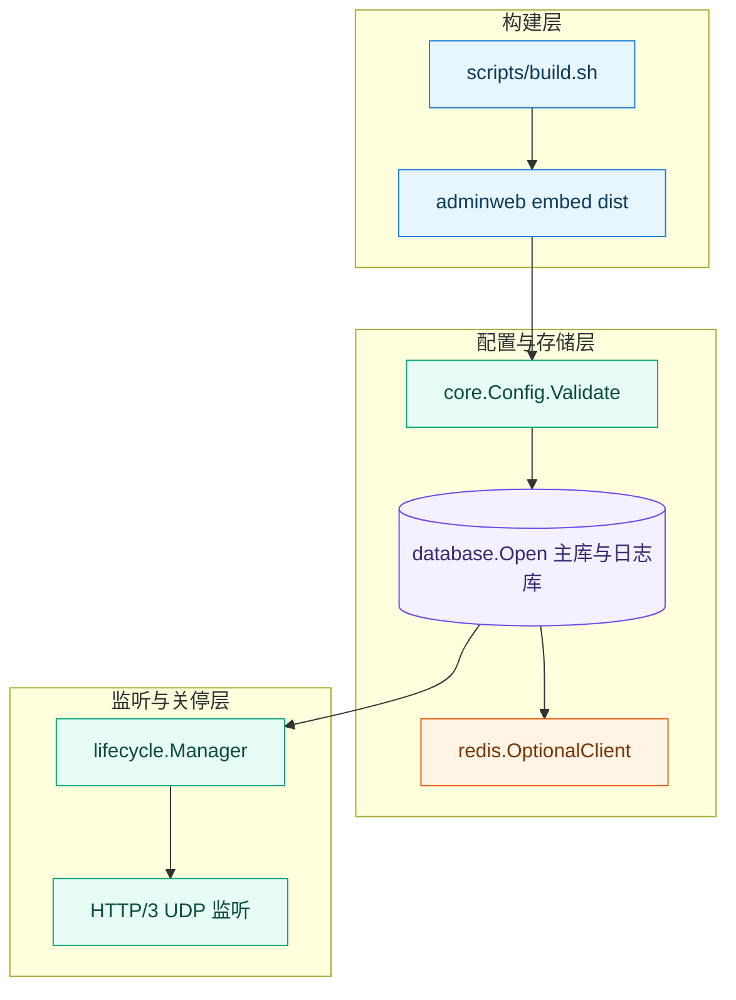
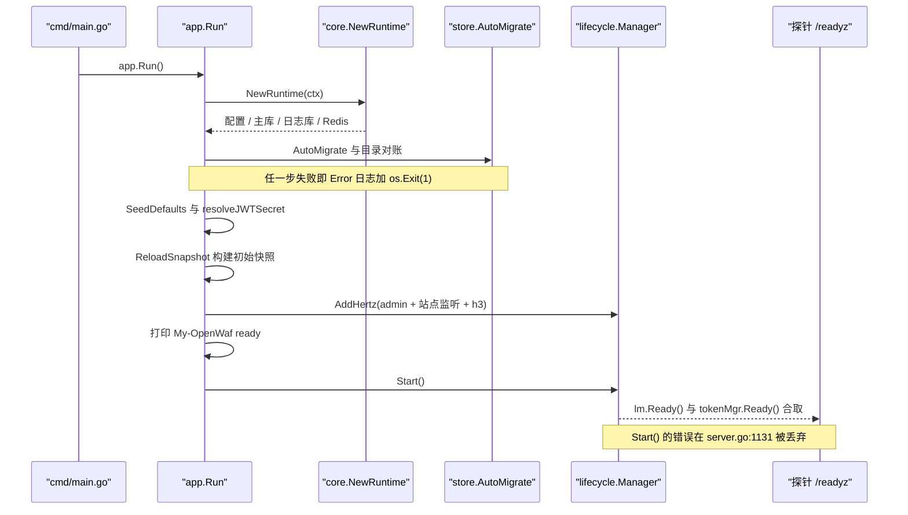
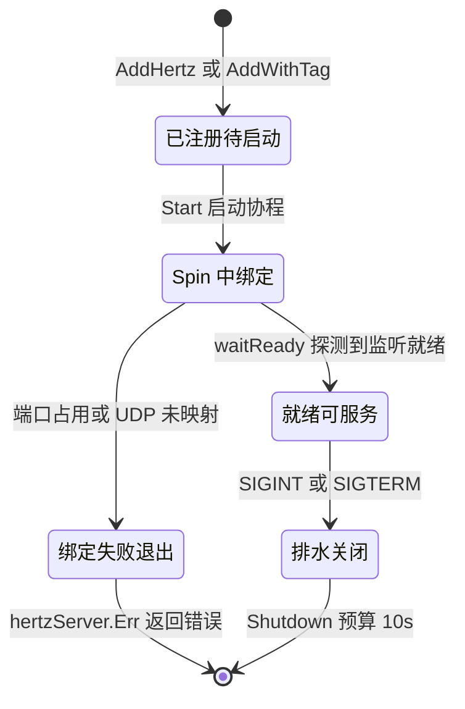
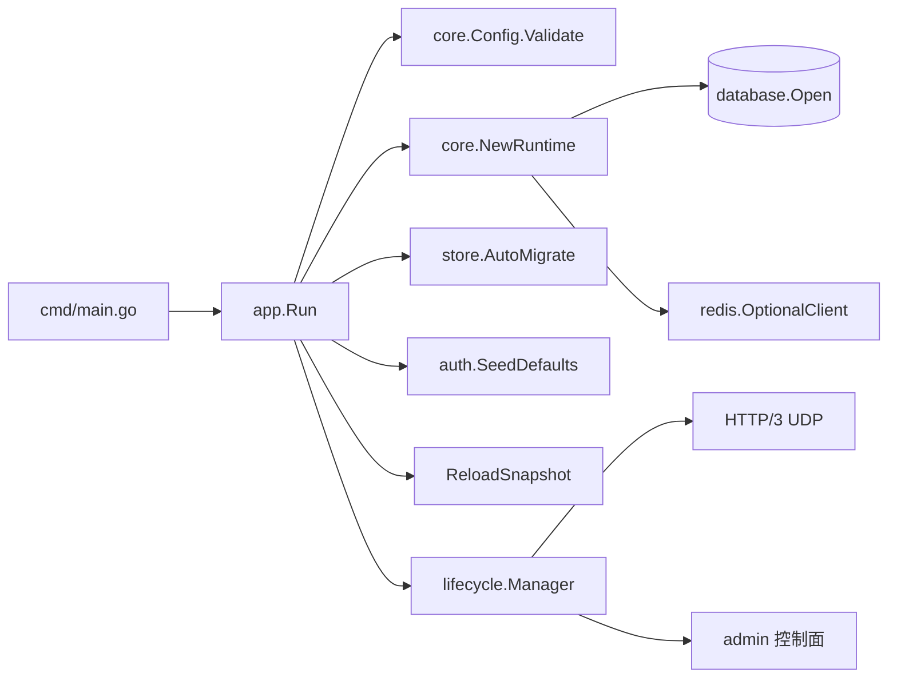
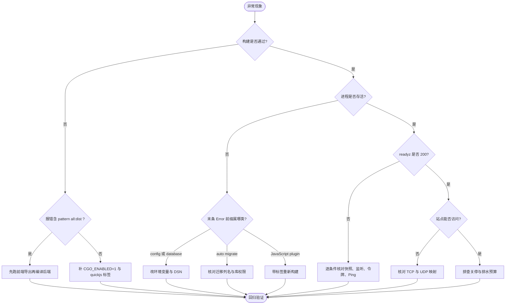

# 启动与依赖故障

<cite>
**本文档引用的文件**
- [main.go](file://cmd/main.go)
- [server.go](file://internal/app/server.go)
- [http3.go](file://internal/app/http3.go)
- [runtime.go](file://internal/core/runtime.go)
- [config.go](file://internal/core/config.go)
- [config_validate.go](file://internal/core/config_validate.go)
- [gorm.go](file://internal/core/database/gorm.go)
- [health.go](file://internal/core/health/health.go)
- [lifecycle.go](file://internal/core/lifecycle/lifecycle.go)
- [redis.go](file://internal/core/redis/redis.go)
- [pubsub.go](file://internal/core/redis/pubsub.go)
- [phases.go](file://internal/core/rules/phases.go)
- [redis.go](file://internal/waf/ratelimit/redis.go)
- [antireplay.go](file://internal/waf/antireplay/antireplay.go)
- [quickjs_cgo.go](file://internal/waf/jsplugin/quickjs_cgo.go)
- [quickjs_stub.go](file://internal/waf/jsplugin/quickjs_stub.go)
- [types.go](file://internal/waf/jsplugin/types.go)
- [geoip.go](file://internal/waf/bot/geoip/geoip.go)
- [fetch.go](file://internal/waf/bot/geoip/fetch.go)
- [version.go](file://internal/waf/challenge/powdata/version.go)
- [pow.go](file://internal/waf/challenge/pow/pow.go)
- [embed.go](file://internal/core/adminweb/embed.go)
- [seed.go](file://internal/store/auth/seed.go)
- [api_key_owner.go](file://internal/store/migrations/api_key_owner.go)
- [migrate.go](file://internal/store/migrate.go)
- [single_site.go](file://internal/store/migrations/single_site.go)
- [site.go](file://internal/store/site.go)
- [archiver.go](file://internal/observability/archiver.go)
- [unified_writer.go](file://internal/observability/unified_writer.go)
- [logger.go](file://internal/pkg/logger/logger.go)
- [router.go](file://internal/admin/router.go)
- [Dockerfile](file://Dockerfile)
- [.gitignore](file://.gitignore)
- [.dockerignore](file://.dockerignore)
- [build.sh](file://scripts/build.sh)
- [package.json](file://frontend/package.json)
- [Makefile](file://wasm-pow-solver/Makefile)
- [Cargo.toml](file://wasm-pow-solver/Cargo.toml)
- [go.mod](file://go.mod)
- [ci.yml](file://.github/workflows/ci.yml)
- [README.md](file://README.md)
- [故障排除.md](file://docs/故障排除/故障排除.md)
</cite>

## 目录
1. [简介](#简介)
2. [项目结构](#项目结构)
3. [核心组件](#核心组件)
4. [架构总览](#架构总览)
5. [详细组件分析](#详细组件分析)
6. [依赖关系分析](#依赖关系分析)
7. [性能考虑](#性能考虑)
8. [故障排查指南](#故障排查指南)
9. [结论](#结论)
10. [附录](#附录)

## 简介

本文覆盖 My-OpenWaf 的**构建期、启动期、依赖装配期、关停期**四类故障。系统是单进程双平面
（控制面 Admin + 数据面代理），启动主干为 `app.Run()` 的十六个串行阶段，任一致命阶段失败
都直接 `os.Exit(1)`，因此**退出时的最后一条日志就是根因位置**，无需回溯全量日志。
跨域分流与故障域索引见 [故障排除](故障排除.md)。

排查前置条件（缺任一项时条目按 `未知` 处理，不得直接给结论）：触发阶段（编译失败 /
进程起不来 / 起来了但 `/readyz` 非 200 / 关停卡住）、关联标识（PID 与管理端口，默认 `:9443`，
`internal/core/config.go:362-365`）、取数来源（启动日志、`data/waf.db`、`/status`）、影响面（单站点 bind 还是全局）。

**章节来源**
- [server.go:234-296](file://internal/app/server.go#L234-L296)
- [config.go:334-365](file://internal/core/config.go#L334-L365)

## 项目结构

排障视角按**失效传播层**分层，而非按 Go 包分层：先判定落在哪一层，再进该层实现文件取证。

```text
My-OpenWaf/
├── cmd/main.go                # 进程入口与 reset-admin-password 子命令
├── scripts/build.sh           # 前端 → WASM → 后端三步构建编排
├── internal/core/             # 配置、校验、数据库、生命周期、健康、Redis、adminweb
├── internal/app/              # Run() 启动主干与 HTTP/3 监听编排
├── internal/store/migrations/ # V2–V15 迁移与列补齐
└── internal/waf/              # jsplugin / bot / challenge 等可选后端
```

| 层 | 所在位置 | 主要失效模式 | 首要可观测点 | 对应条目 |
| --- | --- | --- | --- | --- |
| 构建层 | `scripts/build.sh`、`internal/core/adminweb` | 缺 `-tags=quickjs`、`dist` 不存在 | `go list` 选中的文件清单 | [T-01](#t-01-无-tag-或-cgo-关闭时-js-插件静默失效) |
| 配置层 | `internal/core/config_validate.go` | 驱动非法、DSN 空、bind 非法 | 启动日志 `core init failed` | [T-05](#t-05-mysql--postgresql-dsn-参数缺失) |
| 存储层 | `internal/core/database/gorm.go` | 目录不可写、DSN 缺参、迁移列名漂移 | `auto migrate failed` | [T-06](#t-06-sqlite-打开失败与-wal-残留) |
| 依赖层 | `internal/core/redis`、`internal/waf/bot/geoip` | Redis 不可达、GeoIP 库缺失 | `redis_enabled=false` | [T-07](#t-07-redis-不可用后限流与防重放行为漂移) |
| 监听层 | `internal/app/http3.go`、`server.go` | 端口占用、UDP 未映射 | `ss -lntp` / `ss -lnup` | [T-04](#t-04-数据面监听未起来含-http3-udp) |
| 关停层 | `internal/core/lifecycle.go` | 排水超预算、进程被 SIGKILL | `shutdown deadline exceeded` | [T-09](#t-09-优雅停机超预算) |



**图表来源**
- [build.sh:1-13](file://scripts/build.sh#L1-L13)
- [embed.go:10-18](file://internal/core/adminweb/embed.go#L10-L18)
- [runtime.go:36-142](file://internal/core/runtime.go#L36-L142)
- [lifecycle.go:185-203](file://internal/core/lifecycle/lifecycle.go#L185-L203)

**章节来源**
- [runtime.go:36-142](file://internal/core/runtime.go#L36-L142)
- [server.go:1040-1132](file://internal/app/server.go#L1040-L1132)

## 核心组件

只列参与故障传播与被观测的组件，不重复业务功能文档的组件清单。

| 组件 | 位置 | 故障期职责 | 可观测输出 | 失效影响 |
| --- | --- | --- | --- | --- |
| `app.Run` | [server.go:234](file://internal/app/server.go#L234) | 十六阶段编排，致命错误退出 | 末条 Error 日志 + 退出码 | 进程不存在 |
| `core.NewRuntime` | [runtime.go:36](file://internal/core/runtime.go#L36) | 配置校验、双库打开、Redis 引导 | `core init failed` 包装串 | 无法进入业务阶段 |
| `database.Open` | [gorm.go:30](file://internal/core/database/gorm.go#L30) | 方言分支与连接池 | 驱动级错误串 | 迁移与快照全败 |
| `lifecycle.Manager` | [lifecycle.go:66](file://internal/core/lifecycle/lifecycle.go#L66) | 启动等待就绪、优雅关停 | `server starting` / `shutdown error` | 监听半开 |
| `health.Checker` | [health.go:32](file://internal/core/health/health.go#L32) | 就绪四条件合取判定 | `/readyz` 200 或 503 | 编排层误判可接流量 |
| `redis.OptionalClient` | [redis.go:18](file://internal/core/redis/redis.go#L18) | 可选依赖，失败即 nil | `redis_enabled=false` | 限流与防重放语义漂移 |
| `jsplugin` 双实现 | [quickjs_cgo.go:1](file://internal/waf/jsplugin/quickjs_cgo.go#L1) | 按 tag 选后端 | `ErrCGODisabled` | JS 脚本永不执行 |
| `UnifiedWriter` | [unified_writer.go:702](file://internal/observability/unified_writer.go#L702) | 关停排水 8s+5s | `close timed out, abandoning drain` | 末批记录落库结果未知 |

上述组件的调用关系是单向的：`app.Run` 构造 `core.Runtime`、注册 `lifecycle.Manager`、
把 `lm.Ready()` 与 `tokenMgr.Ready()` 一起注入 `health.Checker`，因此 `/readyz` 的
四条判定实际横跨三层（快照、监听、令牌）。

**章节来源**
- [runtime.go:36-142](file://internal/core/runtime.go#L36-L142)
- [redis.go:18-42](file://internal/core/redis/redis.go#L18-L42)

## 架构总览

启动失败的可观测边界由 `os.Exit(1)` 的位置决定：退出点之前只有 stdout，之后才谈得上探针。



**图表来源**
- [server.go:234-300](file://internal/app/server.go#L234-L300)
- [server.go:1095-1132](file://internal/app/server.go#L1095-L1132)
- [lifecycle.go:185-227](file://internal/core/lifecycle/lifecycle.go#L185-L227)

## 详细组件分析

### 构建标签与 CGO 后端

QuickJS 是唯一 JS 执行后端，由两个条件共同门控：构建标签 `quickjs` **且** `CGO_ENABLED=1`
（`internal/waf/jsplugin/quickjs_cgo.go:1` 的 `//go:build cgo && quickjs`）。任一条件不满足即落到
stub（`quickjs_stub.go:1` 的 `//go:build !cgo || !quickjs`），`RuntimeAvailable()` 返回 false，
`NewEngine` 一律返回 `ErrCGODisabled`（`types.go:17`）。快照内已有脚本时该错误是致命的：
`server.go:433-436` 记录 `create JavaScript plugin engine failed` 后 `os.Exit(1)`。

| 构建参数 | 选中实现文件 | JS 后端 | 启动表现 |
| --- | --- | --- | --- |
| 默认（无 tag） | `quickjs_stub.go` | unavailable | 空脚本集可启动，已存脚本不执行 |
| `CGO_ENABLED=0` 加 `-tags=quickjs` | `quickjs_stub.go` | unavailable | 标签无效，易被误判为已启用 |
| `CGO_ENABLED=1` 加 `-tags=quickjs` | `quickjs_cgo.go` | quickjs | 正常，需 GCC 与 musl 或 glibc 头文件 |
| `CGO_ENABLED=1` 无 tag | `quickjs_stub.go` | unavailable | 与默认一致 |

`go list` 是判定实际编入哪种后端的唯一可靠手段。`README.md:297-309` 与 `scripts/build.sh:13`
的命令都带 `-tags=quickjs`，`Dockerfile:16` 同样带 tag 并先装 `gcc musl-dev`（`Dockerfile:10`）。
CI 的 Go 版本取自 `go.mod:3`（`go 1.27.2`），`README.md:295` 写的是 1.27.1+；
`go vet` 与全量测试带 tag（`ci.yml:76`、`ci.yml:79`），但 `dialect-migration` 作业既不带 tag
也不带 CGO，且没有任何作业 `needs` 它（`ci.yml:81`），旁路失败不阻断合并。

**章节来源**
- [quickjs_cgo.go:1-25](file://internal/waf/jsplugin/quickjs_cgo.go#L1-L25)
- [quickjs_stub.go:1-31](file://internal/waf/jsplugin/quickjs_stub.go#L1-L31)
- [types.go:16-32](file://internal/waf/jsplugin/types.go#L16-L32)
- [server.go:432-440](file://internal/app/server.go#L432-L440)
- [README.md:295-309](file://README.md#L295-L309)
- [go.mod:1-3](file://go.mod#L1-L3)
- [ci.yml:76-81](file://.github/workflows/ci.yml#L76-L81)

### 前端产物与 go:embed

`internal/core/adminweb/embed.go:12` 使用 `//go:embed all:dist`。`dist/` 是 Next.js 静态导出产物，
被 `.gitignore:12` 与 `.dockerignore:33` 双重排除（`git ls-files internal/core/adminweb/dist`
实测返回 0 行），因此**干净检出后直接 `go build ./...` 必然失败**：目录不存在报
`pattern all:dist: no matching files found`，目录存在但无可嵌入文件报
`pattern all:dist: cannot embed directory dist: contains no embeddable files`。
复制路径有两处重复：`frontend/package.json:8` 的 build 脚本内已 `rm -rf` 后 `cp -R out`，
`scripts/build.sh:7-8` 又做一次；镜像构建靠 `Dockerfile:15` 跨阶段 COPY 供给产物。

后果分两级：后端编译失败（致命），或 `adminweb.ResolveFS` 失败使 `NoRoute` 不注册
（`internal/admin/router.go:442-456` 在解析失败时直接 return），此时 API 可用但面板 404。
开发期可用 `MY_OPENWAF_ADMIN_STATIC_DIR` 指向磁盘目录绕开嵌入（`README.md:331`）。

**章节来源**
- [embed.go:10-31](file://internal/core/adminweb/embed.go#L10-L31)
- [router.go:442-456](file://internal/admin/router.go#L442-L456)
- [.gitignore:11-12](file://.gitignore#L11-L12)
- [.dockerignore:33-33](file://.dockerignore#L33-L33)
- [package.json:6-13](file://frontend/package.json#L6-L13)
- [build.sh:4-13](file://scripts/build.sh#L4-L13)
- [Dockerfile:7-16](file://Dockerfile#L7-L16)

### 启动阶段链与失败出口

十六阶段的失败分支就是排查索引：错误串前缀直接指向阶段。

| 步 | 动作 | 执行位置 | 输入 | 输出 | 失败分支 | 可观测点 |
| :---: | --- | --- | --- | --- | --- | --- |
| 1 | 读环境变量装配配置 | [config.go:334](file://internal/core/config.go#L334) | `MY_OPENWAF_*` | `core.Config` | 无，解析失败只告警 | section=config 的 Warn |
| 2 | 配置校验 | [config_validate.go:11](file://internal/core/config_validate.go#L11) | Config | 告警或 error | `unsupported db driver`、`database DSN is empty`、`invalid admin bind address` | `core init failed` |
| 3 | 打开主库 | [runtime.go:63](file://internal/core/runtime.go#L63) | Driver 与 DSN | `*gorm.DB` | `database: …` | 同上 |
| 4 | 读取库内 Redis 覆盖 | [runtime.go:71](file://internal/core/runtime.go#L71) | `system_settings` 行 | 新 Config | `redis config: …` | 同上 |
| 5 | 打开日志库 | [runtime.go:88](file://internal/core/runtime.go#L88) | LogDBDSN | `*gorm.DB` | `log database: …` | 同上 |
| 6 | 建可选 Redis 客户端 | [runtime.go:99](file://internal/core/runtime.go#L99) | Addr 与口令 | 客户端或 nil | 静默置 nil | `redis_enabled=false` |
| 7 | 主库迁移 | [server.go:249](file://internal/app/server.go#L249) | 模型集合 | 表结构 | `auto migrate failed` | 退出码 1 |
| 8 | 目录对账 | [server.go:253](file://internal/app/server.go#L253) | OWASP 与 CVE 内置目录 | 目录表 | `reconcile … catalog failed` | 退出码 1 |
| 9 | 日志库迁移 | [server.go:261](file://internal/app/server.go#L261) | 日志模型 | 表结构 | `log auto migrate failed` | 退出码 1 |
| 10 | 首启种子 | [server.go:267](file://internal/app/server.go#L267) | `admin_accounts` | 口令或空串 | `seed defaults failed` | FIRST RUN Banner |
| 11 | 解析 JWT 密钥 | [server.go:284](file://internal/app/server.go#L284) | env 或库行或随机 | 64 位 hex | `resolve persistent JWT secret failed` | 退出码 1 |
| 12 | 构建初始快照 | [server.go:293](file://internal/app/server.go#L293) | 站点与策略与证书 | Holder 内容 | `initial snapshot build failed` | `/readyz` 503 |
| 13 | 缓存与写队列装配 | [server.go:317](file://internal/app/server.go#L317) | 队列参数 | Writer 与 Queue | 无，容量钳制只告警 | `openwaf_writer_*` |
| 14 | JS 引擎保障 | [server.go:433](file://internal/app/server.go#L433) | 快照脚本集 | Engine 或错误 | `create JavaScript plugin engine failed` | 退出码 1 |
| 15 | 控制面与数据面注册 | [server.go:1052](file://internal/app/server.go#L1052) | AdminBind 与快照 bind | Hertz 实例 | 端口占用 panic、无 TLS 监听被跳过 | `ss -lntp` |
| 16 | 启动并等信号 | [server.go:1131](file://internal/app/server.go#L1131) | 全部注册项 | Spin 协程 | `Start()` 错误被丢弃 | `/readyz` 与 `/status` |

**章节来源**
- [server.go:234-440](file://internal/app/server.go#L234-L440)
- [server.go:1040-1132](file://internal/app/server.go#L1040-L1132)
- [config_validate.go:11-49](file://internal/core/config_validate.go#L11-L49)

### 监听绑定与 HTTP/3 UDP

控制面只有一个监听：`server.Default(server.WithHostPorts(rt.Config.AdminBind))`（`server.go:1052`），
**没有 `WithTLS` 选项**，因此 `:9443` 是明文 HTTP，`README.md:21` 与 `README.md:291` 的 HTTPS
表述与实现不符。数据面按快照里的站点 bind 逐个注册（`server.go:1095-1106`），
无有效 TLS 配置的 bind 被跳过并 Warn（`server.go:1102`）。

HTTP/3 是独立服务器，`http3.go:1161` 用 `net.ListenPacket("udp", s.bind)` 单独占口；
UDP 地址由 `http3BindForSite`（`http3.go:1905-1916`）推导：显式 `HTTP3Bind` 优先，
否则复用站点 TCP bind 的同端口。`Dockerfile:26` 只 `EXPOSE 9443`，`README.md:282-289`
的 `docker run` 也只映射 9443 TCP——容器内数据面端口（TCP 与 UDP）一律需自行映射，
缺 `-p <端口>:<端口>/udp` 时 h3 表现为「TCP 通、QUIC 全无响应」。



**图表来源**
- [lifecycle.go:169-227](file://internal/core/lifecycle/lifecycle.go#L169-L227)
- [lifecycle.go:289-298](file://internal/core/lifecycle/lifecycle.go#L289-L298)
- [http3.go:1146-1189](file://internal/app/http3.go#L1146-L1189)

绑定失败的两种形态不同：管理端口被占时 Hertz 在 Spin 协程内 panic
（`panic: create netpoll listener fail: listen tcp :9443: bind: address already in use`），
整进程崩溃，且崩溃前一行已打印 `My-OpenWaf ready`；UDP 绑定失败只记 `HTTP/3 server error`
并置 startErr（`http3.go:1167-1170`），进程继续运行。

**章节来源**
- [server.go:1052-1132](file://internal/app/server.go#L1052-L1132)
- [http3.go:1146-1219](file://internal/app/http3.go#L1146-L1219)
- [http3.go:1555-1605](file://internal/app/http3.go#L1555-L1605)
- [Dockerfile:22-27](file://Dockerfile#L22-L27)

### 存储连接、WAL 与迁移列名

SQLite 走 `openSQLite`（`gorm.go:73-109`）：DSN 为空时按 `DataDir/waf.db` 兜底，
启动会 `MkdirAll` 父目录（`gorm.go:78-80`），目录不可写报 `mkdir sqlite dir: …`。
PRAGMA 固定为 WAL、`busy_timeout(10000)`、`synchronous(NORMAL)`；主库
`cache_size(-64000)` 加 `foreign_keys(ON)`，日志库 `cache_size(-65536)` 加 `foreign_keys(OFF)`
且 `wal_autocheckpoint` 由 1000 页放宽到 4000 页（`gorm.go:89`、`gorm.go:94`）。
连接数固定 `sqliteMaxOpenConns = 8`（`gorm.go:113`），`ConnMaxLifetime(0)`。
GORM 自身日志级别是 Error、慢查询阈值 200ms（`gorm.go:32-37`），慢 SQL 默认不进日志。

MySQL 强制要求 DSN 含 `parseTime=True`，缺失时启动即失败（`gorm.go:120-125`）；
PostgreSQL 只有 DSN 出现 `pgbouncer=true` 才切简单协议（`gorm.go:151-159`），
不加该参数又挂在 PgBouncer transaction 池后，首次预编译语句会报
`prepared statement does not exist`。非 SQLite 连接池固定 25/10/30m（`gorm.go:60-67`）。

迁移侧存在已知列名漂移：模型字段 `TrustedCIDR`（`internal/store/site.go:93`）未指定列名，
GORM 命名策略把它拆成 `trusted_c_id_r`，而 `internal/store/migrations/single_site.go:63` 与
`:152` 按 `trusted_cidr` 拼 `ALTER TABLE` 与 `UPDATE`，判定入口是 `HasColumn` 循环
（`single_site.go:67-73`）。实测 `data/waf.db` 的 `sites` 表第 37 列即为 `trusted_c_id_r`。

```sql
-- 取自实测 data/waf.db：确认引擎、列名漂移与迁移标记
PRAGMA journal_mode;                 -- 期望 wal
SELECT cid, name FROM pragma_table_info('sites') WHERE name LIKE 'trusted%';
SELECT key FROM system_settings;     -- jwt_secret 与迁移标记同表
```

**章节来源**
- [gorm.go:30-159](file://internal/core/database/gorm.go#L30-L159)
- [site.go:90-95](file://internal/store/site.go#L90-L95)
- [single_site.go:55-75](file://internal/store/migrations/single_site.go#L55-L75)
- [single_site.go:145-160](file://internal/store/migrations/single_site.go#L145-L160)

### Redis 可选依赖与降级语义

`OptionalClient` 在 `Addr` 为空时返回 nil；地址不可达时 `rueidis.NewClient` 返回错误，
`redis.go:30-32` 吞掉错误返回 nil。随后 `redis.Ping(ctx, nil)` 直接返回 nil
（`redis.go:38-40`），于是 `runtime.go:104-116` 的 Warn 分支不会触发——
**配错 Redis 地址时启动日志是静音的**，唯一线索是 `My-OpenWaf ready` 行的 `redis_enabled=false`。

限流与防重放的降级方向相反，这是「Redis 挂了之后拦截率变化」的核心口径：

| 模块 | 位置 | 超时 | 失败语义 | 对外表现 |
| --- | --- | :---: | --- | --- |
| Redis 限流 | [redis.go:127](file://internal/waf/ratelimit/redis.go#L127) | 50ms | fail-open，`err != nil` 即放行 | 超限流量不再被拦 |
| Redis 限流（站点配额） | [redis.go:165](file://internal/waf/ratelimit/redis.go#L165) | 50ms | fail-open | 同上 |
| 防重放 nonce | [antireplay.go:140](file://internal/waf/antireplay/antireplay.go#L140) | 80ms | fail-closed | `phases.go:1314-1322` 直接 Intercept |
| 配置同步 | [pubsub.go:38](file://internal/core/redis/pubsub.go#L38) | 发布 2s | client 为 nil 时整体不启用 | 多节点不再同步 |

`ConfigSync.Subscribe`（`pubsub.go:86-122`）没有重连循环：`Receive` 因连接中断返回后订阅协程结束，
进程不会自动恢复同步。回环抑制只覆盖带 `source_id` 的 JSON 报文（`pubsub.go:114-116`）；
若外部直接向 `openwaf:config:reload` 发裸串 `reload`，`pubsub.go:98-104` 不判来源立即 reload，
发布者自身也会触发一次自身 reload。

**章节来源**
- [redis.go:18-42](file://internal/core/redis/redis.go#L18-L42)
- [runtime.go:99-131](file://internal/core/runtime.go#L99-L131)
- [pubsub.go:16-122](file://internal/core/redis/pubsub.go#L16-L122)
- [phases.go:1301-1322](file://internal/core/rules/phases.go#L1301-L1322)

### JWT 密钥、探针与首启凭据

`resolveJWTSecretWithRandomRead`（`server.go:1454-1477`）取序为：环境变量
`MY_OPENWAF_JWT_SECRET`、`system_settings` 的 `jwt_secret` 行、否则新生成 32 字节随机数并
hex 编码（64 字符）回写库。实测空库首启后 `system_settings` 只有三行：`jwt_secret`
（`length(value)` 为 64）与两条迁移标记行 `migration_v6_site_tls_min_version_inheritance`、
`migration_v11_site_antireplay_inheritance`。密钥随后用于三处：控制面 JWT、
动态防护密钥基（HKDF 派生，`server.go:1490`）与挑战 Cookie
（`challenge.SetChallengeSecret`，`server.go:299`），手工替换密钥会让两者同时失效。

就绪探针是四条件合取：快照非 nil（`health.go:33`）、`lm.Ready()`
（`lifecycle.go:230-243`，无注册项时返回 false）、`tokenMgr.Ready()`
（JWT 黑名单加载失败即不就绪，`server.go:629`）、主库 `Ping()` 成功（`health.go:39-43`）。
`/healthz`、`/readyz`、`/status`、`/metrics` 直接注册在 `adminSrv` 上
（`server.go:1053-1056`），位于鉴权中间件之外——`internal/admin/router.go:109-110`
只对 `/api/v1` 分组挂 `AuthMiddleware`。

首启凭据只有管理员口令：`SeedDefaults`（`internal/store/auth/seed.go:26-56`）仅在
`username='admin'` 计数为 0 时生成 16 字节随机口令并打印一次 Banner，**不预置任何 API Token**；
`seed.api_key_initialized` 只是设置白名单键（`internal/admin/system/settings.go:15`），无生产者。
V15 的令牌归属回填（`api_key_owner.go:21-51`）在 `AutoMigrate` 内执行（`migrate.go:110`），
而 `AutoMigrate` 早于 `SeedDefaults`（`server.go:249` 与 `:267`）：升级后首次启动若无 admin
账号，回填「无可回填目标」，旧令牌保持 `user_id=0`，要到下一次重启才被挂到 admin 名下。

**章节来源**
- [server.go:1450-1497](file://internal/app/server.go#L1450-L1497)
- [health.go:22-105](file://internal/core/health/health.go#L22-L105)
- [router.go:91-125](file://internal/admin/router.go#L91-L125)
- [seed.go:14-56](file://internal/store/auth/seed.go#L14-L56)
- [api_key_owner.go:9-51](file://internal/store/migrations/api_key_owner.go#L9-L51)
- [migrate.go:22-113](file://internal/store/migrate.go#L22-L113)

### GeoIP 与 WASM PoW 产物

GeoIP 只在 `bot.enabled` 为真时创建解析器（`server.go:466-474`）：`bot.enabled=false` 时
`geoResolver` 为 nil，reload 分支整体跳过，此时改库路径不会生效。启用时
`NewMaxMindResolver(botCfg.GeoIPDBPath, botCfg.GeoIPDBPath, …)`（`server.go:467`）
把**同一个文件同时当 city 库和 ASN 库**；打开失败会 Warn（`geoip.go:54`、`geoip.go:68`），
但 City 库没有 ASN 字段，`ScoreIP` 的 ASN 分支因 `rec.ASN != 0` 判定被静默跳过
（`geoip.go:160-168`），ASN 维度恒 0 分且无日志。库路径来自 `MY_OPENWAF_GEOIP_DB`
（`config.go:387`）。自动下载钩子 `GeoIPBootstrap`（`fetch.go:77-88`）在生产代码中
**没有调用点**，「缺库自动补齐」并不存在。

PoW 质询的 `pow.wasm` 与 `pow_glue.js` 是入库的二进制产物，页面按内容 hash 做缓存穿透
（`pow.go:45`、`pow.go:50`，版本串定义见 `powdata/version.go:15-36`）。
`wasm-pow-solver/Cargo.toml:8` 设了 `wasm-opt = false`，所以 `make optimize` 实际只做
terser 与混淆 JS glue；`Makefile:20-30` 默认复用已混淆的 `pow_glue.js` 并打印
「Rust 侧改动未生效」，需要 `FORCE_GLUE=1 make optimize` 才会从 `pkg/pow.js` 重新生成。

**章节来源**
- [server.go:461-474](file://internal/app/server.go#L461-L474)
- [geoip.go:44-168](file://internal/waf/bot/geoip/geoip.go#L44-L168)
- [fetch.go:69-88](file://internal/waf/bot/geoip/fetch.go#L69-L88)
- [version.go:15-36](file://internal/waf/challenge/powdata/version.go#L15-L36)
- [pow.go:44-51](file://internal/waf/challenge/pow/pow.go#L44-L51)
- [Makefile:8-30](file://wasm-pow-solver/Makefile#L8-L30)
- [Cargo.toml:7-8](file://wasm-pow-solver/Cargo.toml#L7-L8)

### 优雅停机与关停预算

`WaitForSignal` 只监听 SIGINT 与 SIGTERM（`lifecycle.go:290-298`），收到后以 10s 预算调用
`Shutdown`；`Shutdown` 对每个注册服务器并发调用 `Shutdown`，超时打印
`shutdown deadline exceeded`（`lifecycle.go:250-286`）。热重载移除单服务器用 500ms 预算
（`lifecycle.go:21`、`lifecycle.go:144-166`）。HTTP/3 服务器在 Shutdown 内关闭 PacketConn
并等待 Spin 协程退出（`http3.go:1191-1219`）。

`Run` 内的一串 `defer` 在 `WaitForSignal` 返回后逆序执行，最重的是统一写入器：Close 预算为
`unifiedWriterCloseTimeout(8s)` 加 `unifiedWriterCloseGrace(5s)` 共 13s
（`unified_writer.go:344-349`、`unified_writer.go:727-741`），超时后打印
`unified writer close timed out, abandoning drain` 并附四条队列长度，代价是那一批记录
落库结果未知。SIGKILL 会跳过全部预算，进程退出后 `data/*.db-wal`、`*.db-shm` 可能残留；
正常关闭时归档器执行 `PRAGMA optimize`、`wal_checkpoint(PASSIVE)` 与 `wal_checkpoint(TRUNCATE)`
（`internal/observability/archiver.go:446-472`）。

**章节来源**
- [lifecycle.go:144-298](file://internal/core/lifecycle/lifecycle.go#L144-L298)
- [http3.go:1191-1219](file://internal/app/http3.go#L1191-L1219)
- [unified_writer.go:340-349](file://internal/observability/unified_writer.go#L340-L349)
- [unified_writer.go:702-741](file://internal/observability/unified_writer.go#L702-L741)
- [archiver.go:446-472](file://internal/observability/archiver.go#L446-L472)
- [server.go:329-357](file://internal/app/server.go#L329-L357)

## 依赖关系分析



**图表来源**
- [runtime.go:36-142](file://internal/core/runtime.go#L36-L142)
- [server.go:1040-1132](file://internal/app/server.go#L1040-L1132)

| 依赖 | 用途 | 接入方式 | 配置来源 | 超时 | 重试 | 降级 | 可用性影响 |
| --- | --- | --- | --- | :---: | :---: | --- | --- |
| SQLite 或 MySQL 或 PG | 站点与策略主库 | GORM | `MY_OPENWAF_DSN` | 未设置（风险） | 无 | 无 | 启动致命退出 |
| 日志库 | 访问、安全、drop 记录 | GORM 第二连接 | `MY_OPENWAF_LOG_DSN` | 未设置（风险） | 无 | 无 | 启动致命退出 |
| Redis | 分布式限流、nonce、KV | rueidis 客户端 | env 或 `redis_config` | 拨号 5s、写 3s | 无 | nil 降级 | 限流放行、防重放拦截 |
| Redis Pub/Sub | 多节点配置同步 | `ConfigSync` | 同上 | 发布 2s | 无重连 | 静默失联 | 节点配置漂移 |
| MaxMind 库 | Bot 地理与 ASN 评分 | maxminddb 文件 | `MY_OPENWAF_GEOIP_DB` | 无 | 无 | 打开失败告警 | ASN 静默 0 分 |
| QuickJS CGO | JS 插件执行 | cgo 静态编译 | 构建标签 | 无 | 无 | stub 返回错误 | 脚本不执行 |
| Let's Encrypt | 证书签发续期 | `RenewLoop` | `acme_config` | 未设置（风险） | 12h 轮询 | 人工介入 | 新证书不签发 |

**章节来源**
- [redis.go:22-29](file://internal/core/redis/redis.go#L22-L29)
- [pubsub.go:65-122](file://internal/core/redis/pubsub.go#L65-L122)
- [geoip.go:44-81](file://internal/waf/bot/geoip/geoip.go#L44-L81)
- [server.go:1057-1059](file://internal/app/server.go#L1057-L1059)

## 性能考虑

- **启动期同步迁移**：`AutoMigrate` 与两个目录对账串行在主线程，旧库体积大时首包延迟可达数十秒；把大库升级放进停流窗口。
- **日志库 WAL 膨胀**：`wal_autocheckpoint` 为 4000 页，高写入下 `*.db-wal` 仍会短时膨胀；保持归档器每小时维护开启，磁盘水位单独告警。
- **可选依赖静默降级**：Redis 建连失败不告警，容量评估时易被忽略；把 `redis_enabled` 作为部署校验项。

[本节为通用指导，无需特定文件来源]

## 故障排查指南

### 通用诊断流程

先分层收敛，再取证定级。严重度判定完全复用问题检测口径：
严重＝凭据入库、越权可达、数据可能丢失；高＝错误被吞没或外部输入无校验；
中＝职责重叠或核心路径缺覆盖；低＝命名与注释类。



**图表来源**
- [server.go:234-300](file://internal/app/server.go#L234-L300)
- [embed.go:10-18](file://internal/core/adminweb/embed.go#L10-L18)
- [health.go:32-44](file://internal/core/health/health.go#L32-L44)
- [http3.go:1146-1189](file://internal/app/http3.go#L1146-L1189)

| 层 | 判定问题 | 取证命令或入口 | 命中后的下一动作 | 排除条件 |
| :---: | --- | --- | --- | --- |
| 1 | 后端能否编译 | `go build` 报错文本 | 缺 dist 先跑 `scripts/build.sh` | 已产出二进制 |
| 2 | 进程是否存活 | 启动日志末行 | 按错误前缀回到对应阶段 | 有 `My-OpenWaf ready` |
| 3 | 监听是否就位 | `ss -lntp` 与 `ss -lnup` | 查端口占用与 UDP 映射 | 目标端口在监听 |
| 4 | 是否可接流量 | `curl -sS http://127.0.0.1:9443/readyz` | 核对四条就绪条件 | 返回 200 |

管理面探针自检（四个探针均无鉴权，只能暴露在可信网段）：

```bash
curl -sS http://127.0.0.1:9443/healthz
curl -sS http://127.0.0.1:9443/readyz
curl -sS http://127.0.0.1:9443/status
```

**预期输出形态**：依次 `{"status":"ok"}`、`{"status":"ready"}`（不就绪为
`{"status":"not ready"}` 且 HTTP 503）、`{"alive":true,"ready":true,"revision":0,"sites":0,
"listeners":0,"goroutines":36,"heap_alloc":45141376,"go_version":"go1.27.2","num_cpu":8}`；
`sites` 与 `listeners` 为 0 即快照无可用监听。误用 HTTPS 会得到
`curl: (35) TLS connect error: error:0A00010B:SSL routines::wrong version number`。

```bash
ss -lntp | rg ':9443'
ss -lnup | rg ':443'
sqlite3 data/waf.db '.tables'
```

**预期输出形态**：`ss -lntp` 命中行形如
`LISTEN 0 4096 *:9443 *:* users:(("my-openwaf",pid=…,fd=14))`；`ss -lnup` 无输出即 UDP 未映射
或 h3 未注册；`.tables` 至少列出 `sites policies system_settings admin_accounts admin_api_keys`。

```bash
gofmt -l .
CGO_ENABLED=1 go vet -tags=quickjs ./...
go list -f '{{.GoFiles}}' ./internal/waf/jsplugin
CGO_ENABLED=1 go list -tags=quickjs -f '{{.GoFiles}}' ./internal/waf/jsplugin
```

**预期输出形态**：`gofmt -l .` 无输出；`go vet` 无诊断；两条 `go list` 分别为
`[faults.go plan_contract.go quickjs_stub.go script.go types.go]` 与
`[faults.go plan_contract.go quickjs_cgo.go script.go types.go]`，差一个文件即后端选择正确。
（命令原文见 `README.md:431-433` 与 `scripts/build.sh:13`，输出为本仓库实测。）

**章节来源**
- [README.md:422-452](file://README.md#L422-L452)
- [server.go:1052-1056](file://internal/app/server.go#L1052-L1056)
- [health.go:47-105](file://internal/core/health/health.go#L47-L105)
- [config.go:334-365](file://internal/core/config.go#L334-L365)

### 常见问题与解决方案

#### T-01 无 tag 或 CGO 关闭时 JS 插件静默失效

- **症状**：面板保存的 JS 脚本不生效，试运行报 `jsplugin: cgo is required for QuickJS execution`；快照内已有脚本时进程启动即退出。
- **原因**：`//go:build cgo && quickjs` 要求两条件同时成立，缺一即编进 stub；脚本集非空时 `ensureJSEngine` 的错误是致命的（`server.go:433-436`）。
- **排查**：`go list -f '{{.GoFiles}}' ./internal/waf/jsplugin` 期望出现 `quickjs_cgo.go`，看到 `quickjs_stub.go` 即选错后端；再检索启动日志 `create JavaScript plugin engine failed`。
- **方案**：统一按 `CGO_ENABLED=1 go build -tags=quickjs -o bin/my-openwaf ./cmd/...`（`scripts/build.sh:13`）构建，镜像需先装 `gcc musl-dev`（`Dockerfile:10`）；应急可先停用该脚本让进程起来，再换二进制。
- **定位依据**：[quickjs_stub.go:1-31](file://internal/waf/jsplugin/quickjs_stub.go#L1-L31)、[server.go:432-440](file://internal/app/server.go#L432-L440)

#### T-02 干净检出后后端编译失败

- **症状**：`go build ./...` 报 `pattern all:dist: no matching files found`，目录存在但为空时变体是 `cannot embed directory dist: contains no embeddable files`。
- **原因**：`//go:embed all:dist` 要求目录存在且含可嵌入文件，而 `dist/` 不入库。
- **排查**：`test -f internal/core/adminweb/dist/index.html && echo OK` 期望 `OK`；`git ls-files internal/core/adminweb/dist | wc -l` 期望 `0`，据此确认产物必须本地生成。
- **方案**：先 `cd frontend && bun install --frozen-lockfile && bun run build`（`frontend/package.json:8` 已内置 out 到 dist 的复制）再 `go build`；CI 与镜像分别由 `scripts/build.sh:7-8` 与 `Dockerfile:15` 完成同一件事。
- **定位依据**：[embed.go:10-18](file://internal/core/adminweb/embed.go#L10-L18)、[Dockerfile:14-16](file://Dockerfile#L14-L16)

#### T-03 管理端口被占，日志已写 ready 却进程 panic

- **症状**：日志顺序为 `My-OpenWaf ready` 紧接
  `panic: create netpoll listener fail: listen tcp :9443: bind: address already in use`，整进程退出。
- **原因**：Spin 协程内的 panic 无人 recover，而 `server.go:1131` 丢弃了 `Start()` 的错误，
  所以 ready 文本并不代表绑定成功。
- **排查**：`ss -lntp | rg ':9443'` 命中其他 PID 即冲突；比对日志中 ready 行与 panic 行的
  相对顺序，区分绑定失败与业务崩溃。
- **方案**：用 `MY_OPENWAF_ADMIN_BIND` 换口（校验在 `config_validate.go:28-30`，
  必须 `host:port` 形式）或停掉占用进程；编排层应以 `/readyz` 而非日志文本为就绪判据。
- **定位依据**：[server.go:1052-1132](file://internal/app/server.go#L1052-L1132)、[config_validate.go:27-30](file://internal/core/config_validate.go#L27-L30)

#### T-04 数据面监听未起来（含 HTTP/3 UDP）

- **症状**：站点域名连不通但控制面正常；或 HTTPS 通、QUIC 无响应；
  日志出现 `skipping site listener without valid TLS config` 或 `HTTP/3 server error`。
- **原因**：数据面按快照 bind 逐个注册，无有效证书即跳过；h3 另占一个 UDP 口，
  而镜像只 `EXPOSE 9443`，示例 `docker run` 只映射 9443 TCP。
- **排查**：`curl -sS http://127.0.0.1:9443/status` 看 `listeners` 与 `sites`；
  `ss -lnup | rg ':443'` 无输出即 UDP 未映射或 h3 未注册。
- **方案**：补站点证书或先关该站 HTTP/3；容器追加与站点 TCP 同端口的 UDP 映射
  （`-p 443:443/udp`，推导规则见 `http3.go:1905-1916`）。
- **定位依据**：[http3.go:1146-1219](file://internal/app/http3.go#L1146-L1219)、[server.go:1095-1122](file://internal/app/server.go#L1095-L1122)

#### T-05 MySQL 或 PostgreSQL DSN 参数缺失

- **症状**：MySQL 启动报 `mysql DSN must include parseTime=True so DATETIME columns scan into time.Time`；PG 挂 PgBouncer transaction 池后首次查询报 `prepared statement does not exist`。
- **原因**：`openMySQL` 在启动阶段硬校验 `parseTime=True`；PG 只有 DSN 含 `pgbouncer=true` 才切简单协议。
- **排查**：`printf '%s\n' "$MY_OPENWAF_DSN"` 期望含 `parseTime=True`（MySQL）或 `pgbouncer=true`（池化部署）；驱动拼写错误会在 `config_validate.go:15-20` 提前失败，检索 `unsupported MY_OPENWAF_DB_DRIVER`。
- **方案**：按 `README.md:318` 补参数——MySQL 用 `…?charset=utf8mb4&parseTime=True&loc=Local`，PgBouncer 加 `pgbouncer=true`；非 SQLite 连接池固定 25/10/30m，无需额外参数。
- **定位依据**：[gorm.go:115-159](file://internal/core/database/gorm.go#L115-L159)、[README.md:315-323](file://README.md#L315-L323)

#### T-06 SQLite 打开失败与 WAL 残留

- **症状**：`core init failed: database: mkdir sqlite dir: …`；或崩溃重启后残留
  `waf.db-wal`、`waf.db-shm`，首包明显变慢。
- **原因**：DSN 为空时按 `DataDir/waf.db` 兜底并 `MkdirAll`；WAL 残留只在非正常关闭
  （SIGKILL 或 panic）时出现，归档器的 `wal_checkpoint` 未执行。
- **排查**：`sqlite3 data/waf.db 'PRAGMA journal_mode;'` 期望 `wal`；
  `sqlite3 data/waf.db '.tables'` 缺表即迁移未跑完。
- **方案**：把 `MY_OPENWAF_DATA` 指向可写卷（`Dockerfile:27` 已声明 `VOLUME`）；
  停止只用 `SIGTERM`（`lifecycle.go:290-298`）触发排水，残留 WAL 由下次启动自动回收。
- **定位依据**：[gorm.go:73-113](file://internal/core/database/gorm.go#L73-L113)、[archiver.go:446-472](file://internal/observability/archiver.go#L446-L472)

#### T-07 Redis 不可用后限流与防重放行为漂移

- **症状**：启动日志没有任何 Redis 告警，但超限流量不再被拦；同时开启防重放的站点出现 `request replay detected or invalid nonce`。
- **原因**：地址不可达时 `NewClient` 报错被吞、`Ping(nil)` 恒成功，Warn 分支不触发；限流 fail-open（50ms），防重放 fail-closed（80ms 后 Intercept）。
- **排查**：`curl -sS http://127.0.0.1:9443/status` 并检索日志 `redis_enabled=`，期望 `true`；`nc -vz <redis_host> 6379` 期望 `succeeded`。`ConfigSync` 无重连，恢复后不会自动回到同步态。
- **方案**：修正 `MY_OPENWAF_REDIS_ADDR` 后重启（库内 `redis_config` 优先于 env，见 `runtime.go:71-75`）；多节点部署必须把 Redis 当强依赖，失联期间用 `/readyz` 与拦截率复核。
- **定位依据**：[redis.go:18-42](file://internal/core/redis/redis.go#L18-L42)、[pubsub.go:86-122](file://internal/core/redis/pubsub.go#L86-L122)

#### T-08 升级后既有 API 令牌失效一次

- **症状**：升级后首次启动旧令牌全部 401，重启第二次后同一批令牌恢复。
- **原因**：`V15MigrateAPIKeyOwner` 只在存在 admin 账号时回填，而它早于 `SeedDefaults` 执行，
  全新库首启没有回填目标。
- **排查**：`sqlite3 data/waf.db 'SELECT count(*) FROM admin_api_keys WHERE user_id=0;'`
  期望升级完成后为 `0`；`sqlite3 data/waf.db '.tables'` 确认 `admin_accounts` 与
  `admin_api_keys` 均存在（实测 `admin_api_keys` 含 `user_id INTEGER` 列）。
- **方案**：升级窗口内安排两次启动，或首启完成后手动重启一次；面板重建令牌是最短路径，
  `SeedDefaults` 不会自动生成 API Token。
- **定位依据**：[api_key_owner.go:9-51](file://internal/store/migrations/api_key_owner.go#L9-L51)、[migrate.go:104-118](file://internal/store/migrate.go#L104-L118)

#### T-09 优雅停机超预算

- **症状**：`SIGTERM` 后进程 10s 内不退出，日志出现 `shutdown deadline exceeded`；
  或写入器报 `unified writer close timed out, abandoning drain` 并给出四条队列长度。
- **原因**：生命周期对每个服务器共用 10s 预算，统一写入器另需 8s 加 5s，两者叠加即最坏关停时长。
- **排查**：`timeout 20 sh -c 'kill -TERM <pid>; wait'` 观察退出耗时是否逼近上限；
  `curl -sS http://127.0.0.1:9443/metrics | rg openwaf_writer_` 关注 dropped 与队列长度。
- **方案**：先降写入压力或调小批量（`rt.Config.Queue` 系列，装配点 `server.go:329-347`）再重启；
  容器 `stop_grace_period` 必须大于 13s，避免 SIGKILL 打断排水。
- **定位依据**：[lifecycle.go:245-298](file://internal/core/lifecycle/lifecycle.go#L245-L298)、[unified_writer.go:702-741](file://internal/observability/unified_writer.go#L702-L741)

| 编号 | 类别 | 严重度 | 标题 | 位置 | 影响 | 建议 |
| --- | --- | :---: | --- | --- | --- | --- |
| I-01 | 架构设计 | 高 | `lm.Start()` 返回错误被丢弃 | [server.go:1131](file://internal/app/server.go#L1131) | 监听未起仍打印 ready | 以 readyz 为就绪判据 |
| I-02 | 代码质量 | 高 | Redis 地址错误时启动日志静音 | [redis.go:30](file://internal/core/redis/redis.go#L30) | 限流静默 fail-open | NewClient 失败也告警 |
| I-03 | 最佳实践 | 高 | 管理端口实际无 TLS | [server.go:1052](file://internal/app/server.go#L1052) | 按文档用 https 必失败 | 文档改 http 或挂 TLS |
| I-04 | 架构设计 | 中 | V15 早于 SeedDefaults | [migrate.go:110](file://internal/store/migrate.go#L110) | 升级首启令牌失效一次 | 种子后再执行回填 |
| I-05 | 代码质量 | 中 | 迁移列名与 GORM 列名不一致 | [single_site.go:63](file://internal/store/migrations/single_site.go#L63) | 老库升级后字段仍缺 | 显式 column 标签 |
| I-06 | 架构设计 | 中 | `GeoIPBootstrap` 无生产调用点 | [fetch.go:77](file://internal/waf/bot/geoip/fetch.go#L77) | 缺库不会自动补齐 | 接入启动链或删钩子 |
| I-07 | 性能 | 中 | 同一库兼作 city 与 ASN | [server.go:467](file://internal/app/server.go#L467) | ASN 维度静默 0 分 | 分开两路径并校验类型 |
| I-08 | 最佳实践 | 中 | 干净检出 embed 构建失败 | [embed.go:12](file://internal/core/adminweb/embed.go#L12) | 新环境编译即失败 | 占位文件或前置导出步骤 |
| I-09 | 最佳实践 | 低 | `make optimize` 复用旧混淆 glue | [Makefile:20](file://wasm-pow-solver/Makefile#L20) | Rust 侧改动不生效 | 默认 FORCE_GLUE |
| I-10 | 架构设计 | 中 | `ConfigSync` 无重连且裸串自环 | [pubsub.go:86](file://internal/core/redis/pubsub.go#L86) | 多节点配置漂移 | 加重连与来源校验 |

`类别` 取值限于 `代码质量`、`架构设计`、`安全`、`性能`、`最佳实践`；
`严重度` 与修复时限完全复用问题检测的判定标准，本文不另设门槛。

**章节来源**
- [server.go:1131-1131](file://internal/app/server.go#L1131-L1131)
- [single_site.go:55-75](file://internal/store/migrations/single_site.go#L55-L75)
- [server.go:461-474](file://internal/app/server.go#L461-L474)
- [Makefile:8-30](file://wasm-pow-solver/Makefile#L8-L30)

## 结论

My-OpenWaf 把致命失败集中在十六个串行阶段，且每阶段错误都有唯一前缀，配合三个探针可在两条命令内
定位到具体阶段；可选依赖（Redis、GeoIP、QuickJS）的降级方向明确，但静音程度不一，必须靠显式检查项补齐。

- **优势 1**：配置校验前置（`config_validate.go`），非法驱动与非法 bind 在打开数据库前失败。
- **优势 2**：降级语义成体系——限流放行、防重放拦截、Redis 缺失退回本地窗口，均有固定超时。
- **建议**：把 `redis_enabled`、`listeners>0`、`/readyz 200` 纳入部署后自检清单；
  文档与实现关于 HTTPS 的矛盾应在源头修正，而不是靠读者记忆例外。

[本节为总结，无需特定文件来源]

## 附录

### 启动与依赖配置项

| 配置项 | 类型 | 默认值 | 必填 | 作用域 | 生效方式 | 安全等级 | 说明 |
| --- | --- | --- | :---: | --- | --- | --- | --- |
| `MY_OPENWAF_DB_DRIVER` | string | `sqlite` | 否 | 进程 | 重启 | 普通 | 接受 sqlite、mysql、postgres，postgresql 为别名 |
| `MY_OPENWAF_DSN` | string | `./data/waf.db` | 是 | 进程 | 重启 | 敏感 | MySQL 必须含 parseTime，PgBouncer 加 pgbouncer |
| `MY_OPENWAF_LOG_DSN` | string | `./data/waf_logs.db` | 否 | 进程 | 重启 | 敏感 | 独立日志库连接串 |
| `MY_OPENWAF_DATA` | string | `./data` | 否 | 进程 | 重启 | 普通 | DSN 为空时的库文件父目录，也是 GeoIP 自举目录 |
| `MY_OPENWAF_ADMIN_BIND` | string | `:9443` | 否 | 控制面 | 重启 | 普通 | 明文 HTTP，非 HTTPS |
| `MY_OPENWAF_REDIS_ADDR` | string | 空 | 否 | 进程 | 重启或 redis-config | 敏感 | 库内 redis_config 优先级高于 env |
| `MY_OPENWAF_JWT_SECRET` | string | 无 | 否 | 进程 | 重启 | **机密** | 未设置时生成 32 字节随机值 hex 落库，严禁外发 |
| `MY_OPENWAF_GEOIP_DB` | string | 空 | 否 | Bot 阶段 | 重启或 reload | 普通 | 当前同一路径兼作 city 与 ASN，建议分别准备 |
| `MY_OPENWAF_LOG_LEVEL` | string | `info` | 否 | 进程 | 重启 | 普通 | 非 debug、warn、error 一律回落 info |
| `MY_OPENWAF_LOG_FILE` | string | 空 | 否 | 进程 | 重启 | 普通 | 空则只写 stdout，打开失败回退 stdout 并打 stderr |
| `MY_OPENWAF_PPROF_BIND` | string | 空 | 否 | 进程 | 重启 | 敏感 | 仅排障临时开启，取到证据即关闭 |
| `MY_OPENWAF_ADMIN_STATIC_DIR` | string | 空（内嵌） | 否 | 控制面 | 重启 | 普通 | 指向磁盘前端产物，绕开 embed 缺失 |

**章节来源**
- [config.go:334-365](file://internal/core/config.go#L334-L365)
- [README.md:315-341](file://README.md#L315-L341)
- [logger.go:149-198](file://internal/pkg/logger/logger.go#L149-L198)
- [main.go:29-49](file://cmd/main.go#L29-L49)

### 口令与令牌自救命令

```bash
# 忘记首启口令：不启动服务直接重置（cmd/main.go:16-21）
./bin/my-openwaf reset-admin-password admin '<新口令>'
```

**预期输出形态**：`Admin password reset successfully for admin`。该命令会独立打开运行时并
跑一次 `AutoMigrate`（`server.go:193-232`），因此库文件权限与列名漂移问题会在这条命令上
提前暴露，可作为升级前的低成本预检。

**章节来源**
- [main.go:13-28](file://cmd/main.go#L13-L28)
- [server.go:193-232](file://internal/app/server.go#L193-L232)
