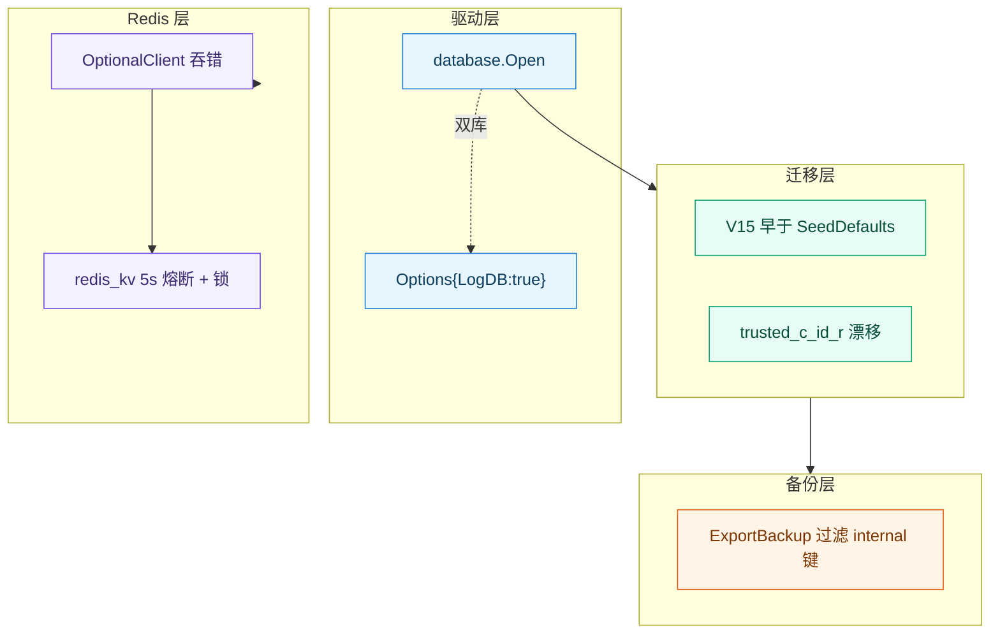
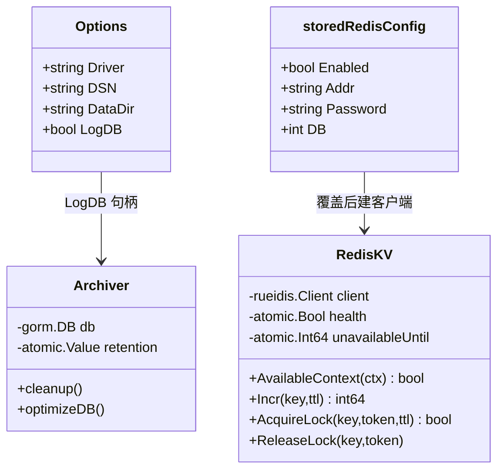
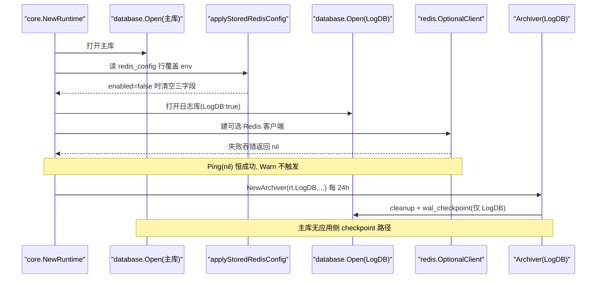
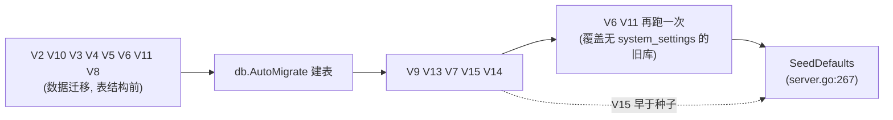
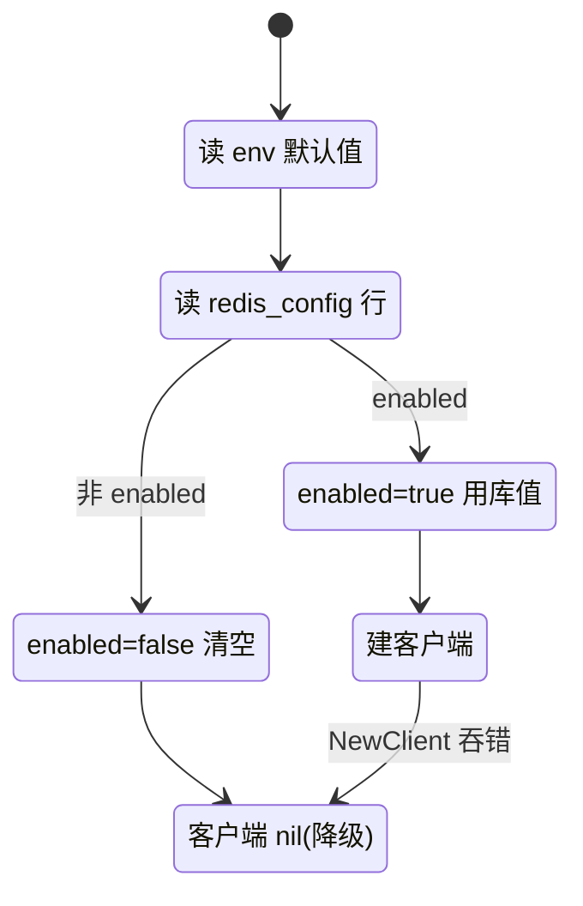
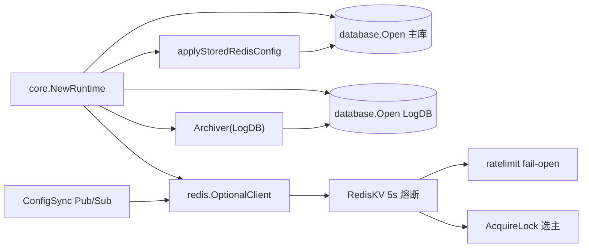
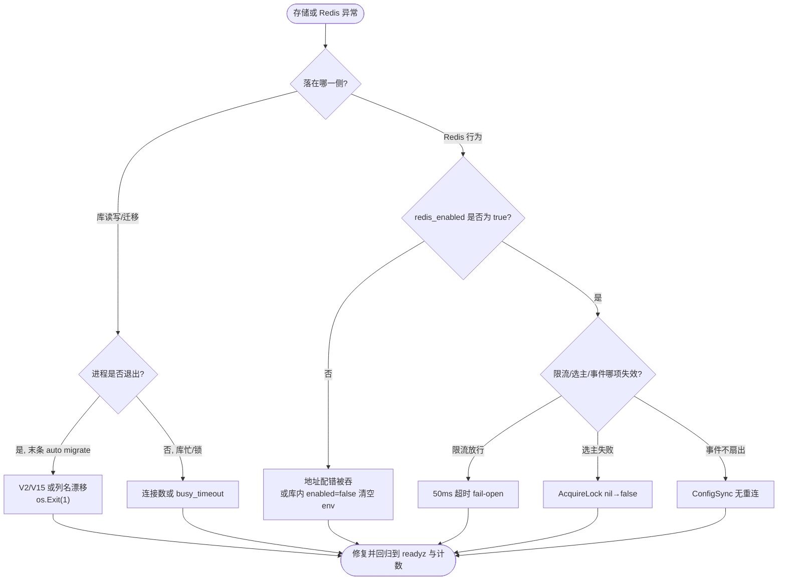

# 存储与Redis故障

<cite>
**本文档引用的文件**
- [runtime.go](file://internal/core/runtime.go)
- [config.go](file://internal/core/config.go)
- [gorm.go](file://internal/core/database/gorm.go)
- [migrate.go](file://internal/store/migrate.go)
- [server.go](file://internal/app/server.go)
- [single_site.go](file://internal/store/migrations/single_site.go)
- [site.go](file://internal/store/site.go)
- [backup.go](file://internal/store/backup.go)
- [backup.go](file://internal/admin/system/backup.go)
- [settings.go](file://internal/admin/system/settings.go)
- [redis.go](file://internal/core/redis/redis.go)
- [pubsub.go](file://internal/core/redis/pubsub.go)
- [redis_kv.go](file://internal/cache/redis_kv.go)
- [hot_cache.go](file://internal/cache/hot_cache.go)
- [unified_writer.go](file://internal/observability/unified_writer.go)
- [archiver.go](file://internal/observability/archiver.go)
- [redis.go](file://internal/waf/ratelimit/redis.go)
- [resource_aggregator.go](file://internal/dataplane/resource_aggregator.go)
- [README.md](file://README.md)
- [故障排除.md](file://docs/故障排除/故障排除.md)
- [启动与依赖故障.md](file://docs/故障排除/启动与依赖故障.md)
</cite>

## 目录
1. [简介](#简介)
2. [项目结构](#项目结构)
3. [核心组件](#核心组件)
4. [架构总览](#架构总览)
5. [详细组件分析](#详细组件分析)
6. [依赖关系分析](#依赖关系分析)
7. [性能考虑](#性能考虑)
8. [故障排查指南](#故障排查指南)
9. [结论](#结论)
10. [附录](#附录)

## 简介

本文覆盖 My-OpenWaf **运行期**的存储与 Redis 故障域：三库连接与方言差异、迁移注册表与致命退出、
备份/恢复的脱敏边界、Redis 可选客户端的静默降级、键族与限流/选主/事件语义、保留清理现状。
它与同域的 [启动与依赖故障](启动与依赖故障.md) 划界明确：那篇管「进程起不起得来、依赖装配那一刻」，
本篇管「起来之后读写与降级对不对」。跨域分流见 [故障排除](故障排除.md)。

系统是单进程双库 + 可选 Redis：主库 `waf.db`（站点/策略/账号/系统设置）、日志库 `waf_logs.db`
（访问/安全/drop/bot），二者由**同一个** `database.Open` 按 `Options{LogDB:true}` 分别打开，
**没有独立的 `OpenLogDB` 函数**（`internal/core/runtime.go:88-93`）。Redis 走 rueidis，是可选依赖。

排查前置条件，缺一按 `未知` 处理：故障落在哪一库/哪个键、关联标识（`X-Request-ID` 与系统设置 `key`）、
最近一次迁移或导入动作、影响面（单库可达性还是限流全局降级）。

**章节来源**
- [runtime.go:63-93](file://internal/core/runtime.go#L63-L93)
- [启动与依赖故障.md:315-347](file://docs/故障排除/启动与依赖故障.md#L315-L347)

## 项目结构

排障按**存储与状态传播层**分层：驱动 → 迁移 → 备份 → Redis 客户端 → Redis 键语义 → 事件与保留。

```text
存储与Redis故障
├── 驱动层    internal/core/database/gorm.go        # Open/Options{LogDB}、PRAGMA、连接池
├── 迁移层    internal/store/migrate.go             # V2–V15，15 函数 / 14 文件
├── 备份层    internal/store/backup.go + admin/system/backup.go  # 18 对象、脱敏边界
├── 客户端层  internal/core/redis + cache/redis_kv.go           # OptionalClient、熔断、锁
├── 键语义层  internal/cache/* + waf/ratelimit + dataplane       # 前缀、Incr、LTRIM、选主
└── 保留层    internal/observability/archiver.go               # 清理、优化、checkpoint
```

| 故障域 | 所在位置 | 主要失效模式 | 首要可观测点 | 对应条目 |
| --- | --- | --- | --- | --- |
| 驱动与连接池 | `gorm.go` | DSN 缺参、PRAGMA 差异、连接耗尽 | `PRAGMA journal_mode`、慢查询阈值 | [T-01](#t-01-主库-cp-成备份后恢复报库忙或数据损坏) |
| 迁移 | `migrate.go` + `migrations/` | 列名漂移 SELECT 失败、V15 早于种子 | `auto migrate failed` 退出码 1 | [T-02](#t-02-老库升级在-v2-迁移处退出) |
| 备份/恢复 | `store/backup.go` + `admin/system/backup.go` | 令牌失效、密码 [redacted] | 导出 JSON 缺 jwt_secret 行 | [T-03](#t-03-换机恢复后全部令牌失效) |
| Redis 可达 | `core/redis` + `runtime.go` | 建连失败静音、enabled=false 清空 env | `redis_enabled=false` | [T-04](#t-04-redis-地址配错却毫无日志) |
| Redis 键语义 | `cache` + `ratelimit` + `dataplane` | 限流放行、选主失败、键族混乱 | `redis-cli --scan --pattern 'openwaf:*'` | [T-05](#t-05-多节点配置漂移或事件不扇出) |
| 事件与保留 | `observability/archiver.go` | 某表越攒越大、保留键无消费方 | `bot_score_logs` 行数只增不减 | [T-06](#t-06-bot_score_logs-永不清理) |



`-.->` 表「同一次 Open 调用、靠 Options 标志切分支」的双库关系；`classDef` 区分驱动/迁移/备份/Redis 四类收敛边界。

**图表来源**
- [gorm.go:30-113](file://internal/core/database/gorm.go#L30-L113)
- [migrate.go:104-118](file://internal/store/migrate.go#L104-L118)
- [redis.go:18-42](file://internal/core/redis/redis.go#L18-L42)

**章节来源**
- [runtime.go:63-97](file://internal/core/runtime.go#L63-L97)
- [migrate.go:22-139](file://internal/store/migrate.go#L22-L139)

## 核心组件

只列参与存储/状态故障传播与被观测的组件。

| 组件 | 位置 | 故障期职责 | 可观测输出 | 失效影响 |
| --- | --- | --- | --- | --- |
| `database.Open` | [gorm.go:30-71](file://internal/core/database/gorm.go#L30-L71) | 方言分支与连接池 | 驱动级错误串 | 启动致命退出 |
| `openSQLite` | [gorm.go:73-109](file://internal/core/database/gorm.go#L73-L109) | WAL/busy_timeout/PRAGMA | `mkdir sqlite dir` | 库不可用 |
| `AutoMigrate` | [migrate.go:22-124](file://internal/store/migrate.go#L22-L124) | 15 个迁移函数编排 | `auto migrate failed` | 表结构缺列 |
| `applyStoredRedisConfig` | [runtime.go:164-194](file://internal/core/runtime.go#L164-L194) | 库内 redis_config 覆盖 env | 覆盖/清空 | enabled=false 抹掉 env |
| `OptionalClient` | [redis.go:18-42](file://internal/core/redis/redis.go#L18-L42) | 可选客户端，吞错返 nil | `redis_enabled=false` | 限流放行/防重放拦截 |
| `RedisKV` | [redis_kv.go:28-93](file://internal/cache/redis_kv.go#L28-L93) | 5s 熔断 + Lua + 锁 | `AvailableContext` | 选主/计数失效 |
| `Archiver` | [archiver.go:146-472](file://internal/observability/archiver.go#L146-L472) | 清理 + checkpoint | 仅作用于 LogDB | 主库无 checkpoint |
| `ExportBackup` | [store/backup.go:93-163](file://internal/store/backup.go#L93-L163) | 18 对象导出 | 缺 jwt_secret | 换机令牌失效 |



`Options.LogDB` 是布尔标志而非独立函数：主库与日志库共用 `database.Open`，靠它切 PRAGMA 分支
（`gorm.go:90-95`）；`storedRedisConfig.Enabled=false` 会让 `applyStoredRedisConfig` 把三个 Redis 字段清零。

**图表来源**
- [gorm.go:22-95](file://internal/core/database/gorm.go#L22-L95)
- [redis_kv.go:28-93](file://internal/cache/redis_kv.go#L28-L93)
- [runtime.go:153-194](file://internal/core/runtime.go#L153-L194)

**章节来源**
- [redis.go:18-42](file://internal/core/redis/redis.go#L18-L42)
- [archiver.go:146-156](file://internal/observability/archiver.go#L146-L156)

## 架构总览

一次运行期重载如何触达两库与 Redis，决定了证据从哪一层开始取。



关键事实：`OptionalClient` 吞掉 `NewClient` 错误返回 nil（`redis.go:30-32`），随后 `Ping(ctx, nil)`
直接返回 nil（`redis.go:38-40`），于是 `runtime.go:104-116` 的告警分支不会触发；
`Archiver` 构造在 `server.go:354` 传入 `rt.LogDB`，checkpoint 只清日志库 WAL。

**图表来源**
- [runtime.go:99-131](file://internal/core/runtime.go#L99-L131)
- [redis.go:18-42](file://internal/core/redis/redis.go#L18-L42)
- [server.go:354-354](file://internal/app/server.go#L354-L354)

## 详细组件分析

### 三库驱动、连接池与 PRAGMA

`Open`（`internal/core/database/gorm.go:30-71`）按 `opt.Driver` 分 sqlite/mysql/postgres，
非法驱动报 `unsupported MY_OPENWAF_DB_DRIVER`。非 SQLite 连接池固定 `25/10/30m/5m`（`gorm.go:60-67`）。

SQLite 走 `openSQLite`（`gorm.go:73-109`）：DSN 空时按 `DataDir/waf.db` 兜底并 `MkdirAll` 父目录。
主库与日志库 PRAGMA 不同，由 `opt.LogDB` 切换：

| 维度 | 主库 | 日志库 | 位置 |
| --- | --- | --- | --- |
| journal_mode | WAL | WAL | [gorm.go:89](file://internal/core/database/gorm.go#L89) |
| busy_timeout | 10000ms | 10000ms | [gorm.go:89](file://internal/core/database/gorm.go#L89) |
| synchronous | NORMAL | NORMAL | [gorm.go:89](file://internal/core/database/gorm.go#L89) |
| cache_size | -64000 | -65536 | [gorm.go:94](file://internal/core/database/gorm.go#L94) |
| foreign_keys | ON | OFF | [gorm.go:94](file://internal/core/database/gorm.go#L94) |
| wal_autocheckpoint | 1000 页 | 4000 页 | [gorm.go:94](file://internal/core/database/gorm.go#L94) |
| 最大连接数 | 8 | 8 | [gorm.go:103-113](file://internal/core/database/gorm.go#L103-L113) |

GORM 自身日志级别是 `logger.Error`、慢查询阈值 `200ms`（`gorm.go:31-37`），且 `PrepareStmt:true`、
`SkipDefaultTransaction:true`。MySQL 在启动阶段硬校验 DSN 含 `parseTime=True`（`gorm.go:123-124`），
PostgreSQL 仅当 DSN 出现 `pgbouncer=true` 才切简单协议（`gorm.go:157-159`）。

```sql
-- 取自实测：区分主库与日志库的引擎与列名漂移
PRAGMA journal_mode;                              -- 期望 wal
SELECT cid, name FROM pragma_table_info('sites')
 WHERE name LIKE 'trusted%';                     -- 期望 trusted_c_id_r
PRAGMA busy_timeout;                              -- 期望 10000
```

**章节来源**
- [gorm.go:30-113](file://internal/core/database/gorm.go#L30-L113)
- [gorm.go:115-159](file://internal/core/database/gorm.go#L115-L159)
- [site.go:93-93](file://internal/store/site.go#L93-L93)
- [README.md:317-318](file://README.md#L317-L318)

### 迁移注册表与致命退出

`AutoMigrate`（`migrate.go:22-124`）与 `AutoMigrateLogs`（`migrate.go:126-139`）合计调度
**15 个迁移函数、跨 14 个文件**，其中 V13 拆为主库（`V13MigrateCVERuleReferences`）与日志库
（`V13MigrateSecurityEventRuleInfo`）两个函数。



**图表来源**
- [migrate.go:22-139](file://internal/store/migrate.go#L22-L139)
- [server.go:249-267](file://internal/app/server.go#L249-L267)

两处在排障上很关键：**V15 早于 `SeedDefaults`**——`V15MigrateAPIKeyOwner` 在 `migrate.go:110` 执行，
而 `SeedDefaults` 在 `server.go:267`，全新库首启没有 admin 可回填，旧令牌保持 `user_id=0`，
要到下一次重启才挂到 admin 名下（升级首启令牌失效一次）。**列名漂移可致致命退出**——模型
`TrustedCIDR` 被 GORM 拆成列名 `trusted_c_id_r`（`store/site.go:93`），而迁移脚本按 `trusted_cidr`
拼 `ALTER/UPDATE`（`migrations/single_site.go:63`、`:129`），判定入口 `HasColumn` 循环
（`single_site.go:67-73`）；老库若在 V2 的 SELECT 处失败，`AutoMigrate` 报错后 `server.go:250-251` 直接
`os.Exit(1)`。

**章节来源**
- [migrate.go:22-139](file://internal/store/migrate.go#L22-L139)
- [single_site.go:55-75](file://internal/store/migrations/single_site.go#L55-L75)
- [single_site.go:129-152](file://internal/store/migrations/single_site.go#L129-L152)
- [server.go:249-267](file://internal/app/server.go#L249-L267)

### 备份与恢复的脱敏边界

`store.ExportBackup`（`backup.go:93-163`）逐表加载 `BackupModels()` 返回的 **18 类配置对象**
（证书/策略/OWASP规则配置/规则/站点/监听/名单/威胁情报/CVE×2/应用路由/访问控制×4/Lua/JS/系统设置），
任一表缺失即整体失败。恢复侧 `ImportBackup`（`backup.go:174+`）在单事务内按主键 upsert 或整体替换。

脱敏发生在管理面 `admin/system/backup.go:30-47`：导出后先 `filterInternalSettingItems`
**剔除 `jwt_secret`**（内部键，`settings.go:13-16`），再 `redactSettingItem` 把 `redis_config`
的 `password` 替换成 `[redacted]`（`settings.go:60-76`），并掩码威胁情报认证头与 OAuth client_secret。

| 备份对象/字段 | 是否随备份走 | 换机后果 | 位置 |
| --- | :---: | --- | --- |
| `jwt_secret` | 否（内部键剔除） | 全部令牌失效 | [admin/system/settings.go:13-16](file://internal/admin/system/settings.go#L13-L16) |
| `redis_config.password` | 置 `[redacted]` | 导入后必须重设 | [admin/system/settings.go:60-76](file://internal/admin/system/settings.go#L60-L76) |
| 站点/规则/策略 | 是 | 正常恢复 | [store/backup.go:119-120](file://internal/store/backup.go#L119-L120) |
| 运行日志/会话/管理员凭证 | 否 | — | [admin/system/backup.go:24-25](file://internal/admin/system/backup.go#L24-L25) |

还有一条易被忽略的硬边界：**主库没有应用侧 WAL checkpoint 路径**（`Archiver` 只跑在 `rt.LogDB`，
`server.go:354`），因此直接 `cp data/waf.db` 时主库可能仍有未合并的 `-wal`，得到的不是自洽快照。

**章节来源**
- [store/backup.go:58-163](file://internal/store/backup.go#L58-L163)
- [admin/system/backup.go:30-47](file://internal/admin/system/backup.go#L30-L47)
- [admin/system/settings.go:13-90](file://internal/admin/system/settings.go#L13-L90)

### Redis 静默降级与库内覆盖

`OptionalClient`（`core/redis/redis.go:18-42`）在 `Addr` 为空时返回 nil；地址不可达时
`rueidis.NewClient` 报错被吞（`redis.go:30-32`）返回 nil，`Ping(ctx,nil)` 恒成功（`redis.go:38-40`），
`runtime.go:104-116` 的告警分支不触发——**配错地址时启动日志静音**。

库内 `redis_config` 优先于环境变量：`applyStoredRedisConfig`（`runtime.go:164-194`）读 `system_settings`
的 `redis_config` 行，若 `enabled && addr==""` 直接报错；若 `!enabled` 则把 `RedisAddr/Password/DB`
全部清零（`runtime.go:189-193`），**而不是忽略该行**。引导阶段先清这三字段再校验
（`runtime.go:41-43`），应用库内覆盖后再校验一次（`runtime.go:80`）。



中文状态名走 `state "中文" as ID` 别名；`CLEAR→NIL` 与 `DIAL→NIL(吞错)` 是两种「最终无 Redis」
但成因不同的路径，排障时要区分「你关的」和「你配错被吞的」。

**图表来源**
- [redis.go:18-42](file://internal/core/redis/redis.go#L18-L42)
- [runtime.go:164-194](file://internal/core/runtime.go#L164-L194)

**章节来源**
- [redis.go:18-42](file://internal/core/redis/redis.go#L18-L42)
- [runtime.go:38-43](file://internal/core/runtime.go#L38-L43)
- [runtime.go:99-131](file://internal/core/runtime.go#L99-L131)

### Redis 键族、限流、Lua 与选主

键前缀实为**三套并存**，而非单一命名：

| 前缀 | 归属模块 | 代表键 | 位置 |
| --- | --- | --- | --- |
| `openwaf:` | 缓存/限流/事件/配置同步 | `openwaf:request:rl:*`、`openwaf:config:reload` | [redis_kv.go:16](file://internal/cache/redis_kv.go#L16) |
| `owaf:` | 挑战/升级/Lua/访问会话 | `owaf:captcha:*`、`owaf:escalation:*` | [redis_kv.go:16](file://internal/cache/redis_kv.go#L16) 之外各模块自带 |
| `waf:` | 防重放 nonce | `waf:nonce:spent:*`、`waf:nonce:idem:*` | [redis_kv.go:16](file://internal/cache/redis_kv.go#L16) 之外各模块自带 |

`HotCache` 另占 `openwaf:hot:`（`hot_cache.go:39`）。Lua 插件 KV 用前缀 `owaf:lua:` 但经由
`RedisKV` 再加 `openwaf:`，落库为**双层 `openwaf:owaf:lua:*`**——排障按单层前缀 SCAN 会漏。

限流是进程级窗口 + Redis 后端：`ratelimit/redis.go:124-127` 在 `!enabled || windowS<=0 || maxReqs<=0`
时 `return true`（放行），否则单命令超时 50ms、出错 fail-open。`Incr` 走 Lua 固定窗口脚本
（`redis_kv.go:20-26`：`INCR` 后 `value==1` 才 `PEXPIRE`）。空实例走 **5s 熔断**：失败置
`unavailableUntil=now+redisKVFailureBackoff`（`redis_kv.go:17/93`），`AvailableContext` 期间返 false。
事件扇出用 `LTRIM` 上限 `openwaf:security_events`/`access_logs` 99999、`drop_events`/`bot_scores` 49999，
TTL 7 天（`unified_writer.go:1103-1151`）。选主用 `AcquireLock`（SET NX PX，1s 超时，
`redis_kv.go:367-381`），键 `openwaf:recorded_res:sink_lock`、TTL 30s（`resource_aggregator.go:35-36`）；
`ReleaseLock` 用 Lua compare-and-delete（`redis_kv.go:392-400`）。

**章节来源**
- [redis_kv.go:16-93](file://internal/cache/redis_kv.go#L16-L93)
- [redis_kv.go:365-401](file://internal/cache/redis_kv.go#L365-L401)
- [hot_cache.go:39-40](file://internal/cache/hot_cache.go#L39-L40)
- [unified_writer.go:1103-1151](file://internal/observability/unified_writer.go#L1103-L1151)
- [ratelimit/redis.go:120-127](file://internal/waf/ratelimit/redis.go#L120-L127)
- [resource_aggregator.go:35-36](file://internal/dataplane/resource_aggregator.go#L35-L36)

### 事件写入与保留清理现状

`Archiver`（`observability/archiver.go`）每 **24 小时**一轮（`defaultArchiverIntervalSeconds`，
`archiver.go:53-57`），启动时不预跑清理（循环先 `case <-timer.C` 才动作，`archiver.go:232-236`）。
`cleanup()`（`archiver.go:331-400`）删除：`security_events`（341）、`access_logs`（359）、
`drop_events`（373）以及复用 `DropEventDays` 的威胁情报同步日志（388）。

三处「配置存在但无人消费」的缺口需如实标注：

| 项 | 现状 | 证据 | 运维含义 |
| --- | --- | --- | --- |
| `bot_score_logs` 清理 | 无删除分支 | `cleanup()` 只删三表（[archiver.go:341-400](file://internal/observability/archiver.go#L341-L400)） | 日志库只增不减，需外部清理 |
| `stats_retention_days` | 无消费方 | 仅 `RetentionConfig.StatsDays` 定义与归一化（[archiver.go:29](file://internal/observability/archiver.go#L29)） | 设了不生效 |
| `SetRetention` | 生产无调用方 | 仅定义（[archiver.go:195-202](file://internal/observability/archiver.go#L195-L202)），循环走 `refreshRetentionFromDB` | 动态改保留需走重启 |
| 保留专用端点 | 无 | 只能 `POST /api/v1/settings/:key` | 改保留天数走通用设置 |

**章节来源**
- [archiver.go:25-57](file://internal/observability/archiver.go#L25-L57)
- [archiver.go:195-236](file://internal/observability/archiver.go#L195-L236)
- [archiver.go:331-400](file://internal/observability/archiver.go#L331-L400)
- [unified_writer.go:1103-1151](file://internal/observability/unified_writer.go#L1103-L1151)

## 依赖关系分析



外部依赖的超时与降级方向是存储/Redis 故障的核心口径，缺省值全部实测填写。

| 依赖 | 用途 | 接入方式 | 配置来源 | 超时 | 重试 | 降级 | 可用性影响 |
| --- | --- | --- | --- | :---: | :---: | --- | --- |
| 主库 | 站点/策略/账号 | GORM | `MY_OPENWAF_DSN` | 未设置（风险） | 无 | 无 | 启动致命退出 |
| 日志库 | 事件记录 | GORM `Options{LogDB}` | `MY_OPENWAF_LOG_DSN` | 未设置（风险） | 无 | 无 | 记录不落盘 |
| Redis KV | 限流/计数/锁 | rueidis | env 或 `redis_config` | 单命令 50ms、锁 1s | 无 | nil→本地/放行 | 限流放行、选主失败 |
| Redis 事件扇出 | 多节点事件 | List+LTRIM | 同上 | 写 3s | 无 | 静默 | 事件不扇出 |
| Redis Pub/Sub | 配置重载同步 | `ConfigSync` | 同上 | 发布 2s | 无重连 | 静默失联 | 节点配置漂移 |
| 熔断层 | 故障快速失败 | `unavailableUntil` | 常量 | 5s 回退 | 自动 | `AvailableContext=false` | 期间走本地 |

**图表来源**
- [runtime.go:99-131](file://internal/core/runtime.go#L99-L131)
- [pubsub.go:16-122](file://internal/core/redis/pubsub.go#L16-L122)
- [redis_kv.go:62-93](file://internal/cache/redis_kv.go#L62-L93)

**章节来源**
- [gorm.go:30-71](file://internal/core/database/gorm.go#L30-L71)
- [ratelimit/redis.go:120-127](file://internal/waf/ratelimit/redis.go#L120-L127)

## 性能考虑

- **双库连接数固定 8**：`sqliteMaxOpenConns=8`（`gorm.go:113`）且 `ConnMaxLifetime(0)`；高并发写入下
  连接耗尽会表现为 `database is locked` 前抖动，`busy_timeout` 已到 10s 上限，进一步应分库或降写入。
- **日志库 WAL 膨胀**：`wal_autocheckpoint` 放宽到 4000 页（`gorm.go:94`），两次 archiver 维护之间
  `-wal` 仍可能短时膨胀到数十 MB；保持 24h 归档开启并为磁盘水位单独告警。
- **`bot_score_logs` 无清理**：该表只增不减，长期会拖大日志库与 crash 恢复时间，需外部定期 DELETE。

[本节为通用指导，无需特定文件来源]

## 故障排查指南

### 通用诊断流程

先用决策树收敛到「哪一库/哪个键」，再取证定级。严重度复用问题检测四档
（严重＝数据可能丢失或凭据入库；高＝错误被吞没或无校验；中＝配置无消费方/缺覆盖；低＝命名）。



**图表来源**
- [redis.go:18-42](file://internal/core/redis/redis.go#L18-L42)
- [runtime.go:164-194](file://internal/core/runtime.go#L164-L194)
- [migrate.go:104-118](file://internal/store/migrate.go#L104-L118)

分层定位：每层只回答一个是/否问题。

| 步 | 判定问题 | 取证命令或入口 | 命中后的下一动作 | 排除条件 |
| :---: | --- | --- | --- | --- |
| 1 | 进程是否因迁移退出 | 末条 `auto migrate failed` | 核对列名漂移与库权限 | 进程存活 |
| 2 | 双库是否都可读 | `sqlite3 data/waf.db 'PRAGMA journal_mode;'` | 进 Redis 域 | 返回 `wal` |
| 3 | Redis 是否在用 | `curl /status` 看 `redis_enabled` | 查 env 与 `redis_config` | 为 `true` |
| 4 | 限流是否降级 | `redis-cli --scan --pattern 'openwaf:request:*'` | 查 50ms 超时 | 键在涨 |
| 5 | 事件是否扇出/清理 | `redis-cli llen openwaf:security_events` | 查 ConfigSync | 长度有变化 |

存储与 Redis 自检（命令须在有 Redis 与已建库的运行环境执行，预期输出形态如下）：

```bash
sqlite3 data/waf.db 'PRAGMA journal_mode;'
sqlite3 data/waf.db "SELECT key FROM system_settings WHERE key IN ('jwt_secret','redis_config');"
sqlite3 data/waf_logs.db 'SELECT count(*) FROM bot_score_logs;'
```

**预期输出形态**：第一条 `wal`；第二条返回 `redis_config` 但**不返回** `jwt_secret`（导出会剔除，
但库内首启后 `jwt_secret` 行应存在——若库内也缺，说明密钥解析异常）；第三条为整数，
重复执行应只增不减，佐证 `bot_score_logs` 无清理分支。

```bash
redis-cli --scan --pattern 'openwaf:*' | head
redis-cli llen openwaf:security_events
redis-cli get openwaf:recorded_res:sink_lock
curl -sS http://127.0.0.1:9443/readyz
```

**预期输出形态**：SCAN 列出 `openwaf:request:rl:*`、`openwaf:hot:*`、`openwaf:config:reload` 订阅等；
`llen` 返回不超过 99999 的整数；`get` 返回当前 sink 节点 token（无输出即无人持锁或 Redis 不可用）；
`/readyz` 返回 `{"status":"ready"}`，503 表示就绪四条件之一未满足。

**章节来源**
- [archiver.go:331-400](file://internal/observability/archiver.go#L331-L400)
- [gorm.go:73-113](file://internal/core/database/gorm.go#L73-L113)
- [redis_kv.go:365-401](file://internal/cache/redis_kv.go#L365-L401)
- [unified_writer.go:1103-1151](file://internal/observability/unified_writer.go#L1103-L1151)

### 常见问题与解决方案

条目形状固定为**症状 / 原因 / 排查 / 方案**，附「定位依据」指向文件行号。

#### T-01 主库 cp 成备份后恢复报库忙或数据损坏

- **症状**：`cp data/waf.db backup.db` 后用 backup.db 启动，报 `database disk image is malformed` 或长期 `SQLITE_BUSY`。
- **原因**：主库无应用侧 WAL checkpoint（`Archiver` 只跑 `rt.LogDB`，`server.go:354`），`cp` 时未合并的
  `-wal` 被漏掉，得到的不是自洽库。
- **排查**：`sqlite3 data/waf.db 'PRAGMA wal_checkpoint(TRUNCATE);'` 手动落盘后再 `cp`；核对是否残留 `-wal`。
- **方案**：用面板 `POST /api/v1/backup` 走 18 对象逻辑备份；要冷备库文件，先 checkpoint 或用
  `VACUUM INTO`，不要直接 `cp`。
- **定位依据**：[archiver.go:446-472](file://internal/observability/archiver.go#L446-L472)、[server.go:354-354](file://internal/app/server.go#L354-L354)

#### T-02 老库升级在 V2 迁移处退出

- **症状**：升级二进制后首次启动直接退出，末条 `auto migrate failed`，错误指向 `no such column: trusted_cidr`。
- **原因**：模型列名 `trusted_c_id_r` 与迁移脚本 `trusted_cidr` 不一致，V2 的 SELECT 在 `AutoMigrate`
  首步失败，`server.go:250-251` `os.Exit(1)`。
- **排查**：`sqlite3 data/waf.db "SELECT name FROM pragma_table_info('sites') WHERE name LIKE 'trusted%';"`
  期望 `trusted_c_id_r`；比对 `single_site.go:63` 与 `:129` 的列名。
- **方案**：给 `TrustedCIDR` 补显式 `column:trusted_cidr` 标签后重迁移（不改代码时，先用带兼容查询的
  二进制），或在升级前对旧库做一次列名映射。
- **定位依据**：[single_site.go:55-75](file://internal/store/migrations/single_site.go#L55-L75)、[site.go:93-93](file://internal/store/site.go#L93-L93)

#### T-03 换机恢复后全部令牌失效

- **症状**：备份导入新节点后，控制面所有 API Token 与已签 JWT 全 401。
- **原因**：`jwt_secret` 属内部键不入备份（`admin/system/backup.go:38` + `settings.go:13-16`），
  新节点解析出不同的随机密钥。
- **排查**：比对两库 `SELECT length(value) FROM system_settings WHERE key='jwt_secret';`（应为 64 hex，
  且两机不同）。
- **方案**：换机前先在新节点设同样的 `MY_OPENWAF_JWT_SECRET` 再重启，令密钥来源对齐；
  或恢复后重建 API Token（`SeedDefaults` 不会自动生成）。
- **定位依据**：[store/backup.go:78-84](file://internal/store/backup.go#L78-L84)、[admin/system/settings.go:13-16](file://internal/admin/system/settings.go#L13-L16)

#### T-04 Redis 地址配错却毫无日志

- **症状**：启动日志无任何 Redis 报错，但超限流量不再被拦、防重放站点开始误拦。
- **原因**：`OptionalClient` 吞掉建连错误返 nil（`redis.go:30-32`），`Ping(nil)` 恒成功，告警分支不触发；
  或库内 `redis_config` 的 `enabled=false` 把 env 三字段清空（`runtime.go:189-193`）。
- **排查**：`curl -sS http://127.0.0.1:9443/status` 检索 `redis_enabled`；`nc -vz <host> 6379` 验连通；
  `sqlite3 data/waf.db "SELECT value FROM system_settings WHERE key='redis_config';"` 看 `enabled`。
- **方案**：修 `MY_OPENWAF_REDIS_ADDR` 后重启（库内优先 env），若库内 `enabled=false` 必须显式置真；
  多节点部署把 Redis 当强依赖，失联期间用 `/readyz` 与拦截率复核。
- **定位依据**：[redis.go:18-42](file://internal/core/redis/redis.go#L18-L42)、[runtime.go:164-194](file://internal/core/runtime.go#L164-L194)

#### T-05 多节点配置漂移或事件不扇出

- **症状**：A 节点改了规则，B 节点不更新；或某类事件在新节点看不到。
- **原因**：`ConfigSync` 无重连（`pubsub.go:86-122`），断连后订阅协程结束不自动恢复；事件扇出键
  LTRIM 到 99999/49999 且 7 天 TTL（`unified_writer.go:1103-1151`），旧事件过期。
- **排查**：`redis-cli publish openwaf:config:reload reload` 观察各节点是否 reload；
  裸 `reload` 串不判来源会触发发布节点自环（`pubsub.go:98-104`）。
- **方案**：把 Redis 视为强依赖并监控 `AvailableContext`；失联期间人工在所有节点触发重载，
  或加重连与来源校验。
- **定位依据**：[pubsub.go:16-122](file://internal/core/redis/pubsub.go#L16-L122)、[unified_writer.go:1103-1151](file://internal/observability/unified_writer.go#L1103-L1151)

#### T-06 bot_score_logs 永不清理

- **症状**：日志库体积持续增长，`bot_score_logs` 行数只增不减，设了保留天数也不掉。
- **原因**：`cleanup()` 只删 `security_events/access_logs/drop_events`（`archiver.go:341-400`），
  没有 `bot_score_logs` 分支；`stats_retention_days` 字段无任何消费方。
- **排查**：`sqlite3 data/waf_logs.db 'SELECT count(*) FROM bot_score_logs;'` 间隔执行对比是否下降。
- **方案**：当前需外部定期 `DELETE FROM bot_score_logs WHERE created_at < ...`；根因上应补清理分支或
  消费 `stats_retention_days`，登记到问题检测。
- **定位依据**：[archiver.go:25-57](file://internal/observability/archiver.go#L25-L57)、[archiver.go:331-400](file://internal/observability/archiver.go#L331-L400)

| 编号 | 类别 | 严重度 | 标题 | 位置 | 影响 | 建议 |
| --- | --- | :---: | --- | --- | --- | --- |
| I-01 | 架构设计 | 严重 | 主库无应用侧 checkpoint | [archiver.go:446-472](file://internal/observability/archiver.go#L446-L472) | `cp` 误当备份可丢数据 | 提供主库 checkpoint 路径 |
| I-02 | 代码质量 | 高 | Redis 建连失败被吞、Ping(nil) 恒成功 | [redis.go:30](file://internal/core/redis/redis.go#L30) | 限流静默 fail-open | 建连失败也告警 |
| I-03 | 架构设计 | 高 | 库内 `enabled=false` 清空 env | [runtime.go:189-193](file://internal/core/runtime.go#L189-L193) | 环境变量被无声覆盖 | 区分「关」与「未配」 |
| I-04 | 代码质量 | 高 | 迁移列名与 GORM 列名不一致 | [single_site.go:63](file://internal/store/migrations/single_site.go#L63) | 老库升级 os.Exit(1) | 显式 column 标签 |
| I-05 | 最佳实践 | 中 | `bot_score_logs` 无清理分支 | [archiver.go:331-400](file://internal/observability/archiver.go#L331-L400) | 日志库只增不减 | 补删除分支 |
| I-06 | 代码质量 | 中 | `stats_retention_days` 无消费方 | [archiver.go:29](file://internal/observability/archiver.go#L29) | 设了不生效 | 接入清理或删除字段 |
| I-07 | 架构设计 | 中 | `SetRetention` 生产无调用方 | [archiver.go:195-202](file://internal/observability/archiver.go#L195-L202) | 动态改保留需重启 | 接管理端点 |
| I-08 | 架构设计 | 中 | Lua 键双层前缀 `openwaf:owaf:lua:` | [redis_kv.go:16](file://internal/cache/redis_kv.go#L16) | 按单层前缀运维会漏 | 统一前缀策略 |
| I-09 | 最佳实践 | 中 | `ConfigSync` 无重连且裸串自环 | [pubsub.go:86](file://internal/core/redis/pubsub.go#L86) | 多节点配置漂移 | 加重连与来源校验 |
| I-10 | 安全 | 中 | 换机 `jwt_secret` 不入备份 | [admin/system/backup.go:38](file://internal/admin/system/backup.go#L38) | 全令牌失效 | 文档明示需对齐密钥 |

`类别` 取值限于 `代码质量`、`架构设计`、`安全`、`性能`、`最佳实践`；
`严重度` 与修复时限完全复用问题检测口径，本文不另设门槛。

**章节来源**
- [redis.go:18-42](file://internal/core/redis/redis.go#L18-L42)
- [runtime.go:164-194](file://internal/core/runtime.go#L164-L194)
- [single_site.go:55-75](file://internal/store/migrations/single_site.go#L55-L75)
- [archiver.go:25-400](file://internal/observability/archiver.go#L25-L400)

## 结论

存储侧的可靠性来自「同一函数双库、PRAGMA 分主从、迁移有顺序」，但风险集中在
**主库无 checkpoint、列名漂移、V15 早于种子**三处；Redis 侧的可选性带来优雅降级，代价是
**建连失败静音、库内 enabled=false 清空 env、键族三套并存、事件/保留有无人消费的缺口**。
这些问题不致命，但都会让「读写正常」与「语义正确」分叉。

- **优势 1**：双库共用 `database.Open`，连接池与日志级别集中可控，方言差异有明确启动期校验。
- **优势 2**：降级方向成体系——限流 fail-open、防重放 fail-closed、选主与扇出各自有超时与 TTL。
- **建议**：把 `redis_enabled`、`bot_score_logs` 行数、`jwt_secret` 对齐纳入部署验收；
  文档与实现关于列名、备份范围的矛盾应在源头修正，而非靠读者记忆例外。

[本节为总结，无需特定文件来源]

## 附录

### 存储与 Redis 运行参数速查

| 配置项 | 类型 | 默认值 | 必填 | 作用域 | 生效方式 | 安全等级 | 说明 |
| --- | --- | --- | :---: | --- | --- | --- | --- |
| `sqliteMaxOpenConns` | const | 8 | 否 | 双库 | 编译期 | 普通 | 非单连接，WAL 读并发上限 |
| `busy_timeout` | pragma | 10000ms | 否 | 双库 | 重启 | 普通 | 锁竞争最长等待 |
| `wal_autocheckpoint` | pragma | 主 1000 / 日志 4000 页 | 否 | 按库 | 重启 | 普通 | 日志库放宽以抑制 -wal |
| `parseTime` | DSN 参数 | 无 | 是(MySQL) | mysql | 重启 | 普通 | 缺失启动即失败 |
| `pgbouncer` | DSN 参数 | 无 | 否(PG 池化) | postgres | 重启 | 普通 | 出现即切简单协议 |
| `redisKVFailureBackoff` | const | 5s | 否 | Redis KV | 编译期 | 普通 | 出错后快速失败窗口 |
| 限流单命令超时 | const | 50ms | 否 | 限流 | 编译期 | 普通 | 超时即 fail-open 放行 |
| `LTRIM` 上限 | const | 99999 / 49999 | 否 | 事件扇出 | 编译期 | 普通 | security/access 与 drop/bot 分档 |
| 事件 List TTL | const | 7 天 | 否 | 事件扇出 | 编译期 | 普通 | 旧事件自动过期 |
| sink 锁 TTL | const | 30s | 否 | 选主 | 编译期 | 普通 | 键 `openwaf:recorded_res:sink_lock` |
| archiver 间隔 | const | 24h | 否 | 日志库 | 编译期 | 普通 | 启动不预跑清理 |
| `stats_retention_days` | setting | 7 | 否 | 日志库 | 重启 | 普通 | 当前无消费方，设了不生效 |

**章节来源**
- [gorm.go:89-113](file://internal/core/database/gorm.go#L89-L113)
- [redis_kv.go:16-17](file://internal/cache/redis_kv.go#L16-L17)
- [ratelimit/redis.go:127-127](file://internal/waf/ratelimit/redis.go#L127-L127)
- [archiver.go:29-57](file://internal/observability/archiver.go#L29-L57)

### 备份与恢复最小自检

```bash
# 导出（管理端口明文 HTTP，需带令牌）：核对是否剔除 jwt_secret、脱敏 redis_config
curl -sS -H "Authorization: Bearer {token}" http://127.0.0.1:9443/api/v1/backup/export \
  | command grep -o 'jwt_secret' | wc -l          # 期望 0（内部键已剔除）
```

**预期输出形态**：输出 `0`，即导出体不含 `jwt_secret`；`redis_config` 中的 `password` 为 `[redacted]`。
若需让恢复后令牌继续有效，先在新节点设同样的 `MY_OPENWAF_JWT_SECRET` 再导入并重启。

**章节来源**
- [store/backup.go:58-163](file://internal/store/backup.go#L58-L163)
- [admin/system/backup.go:30-47](file://internal/admin/system/backup.go#L30-L47)
