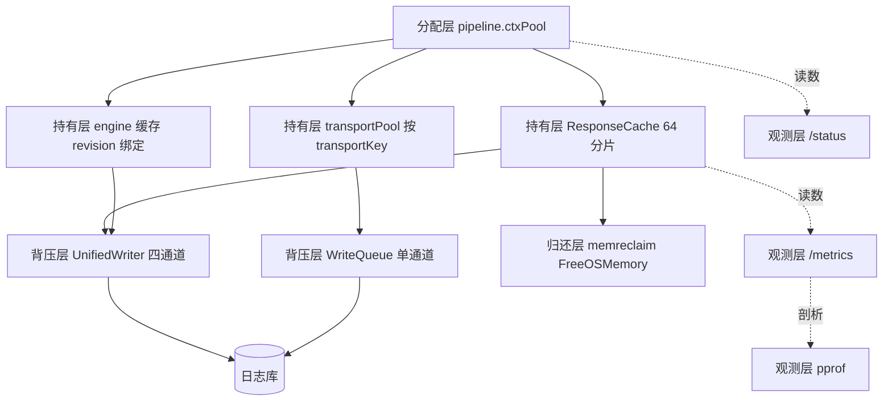
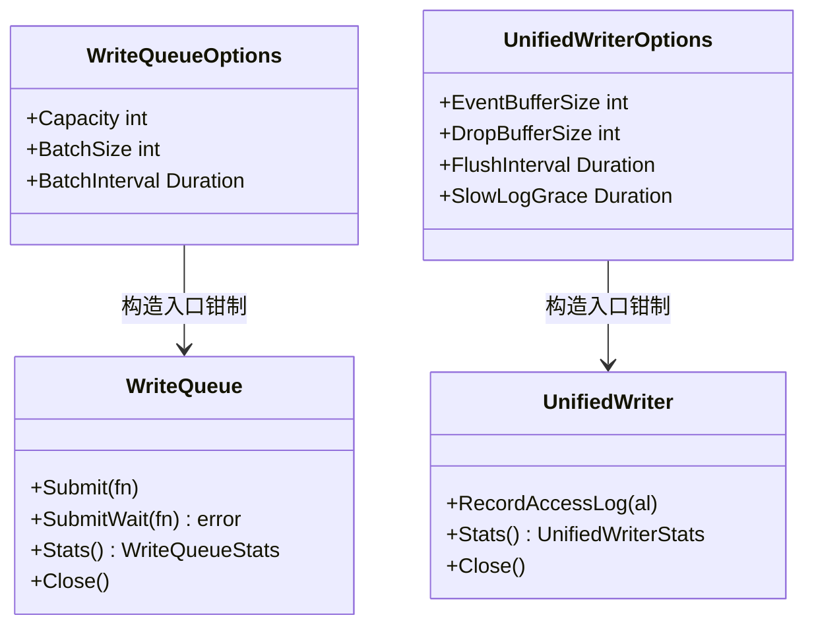
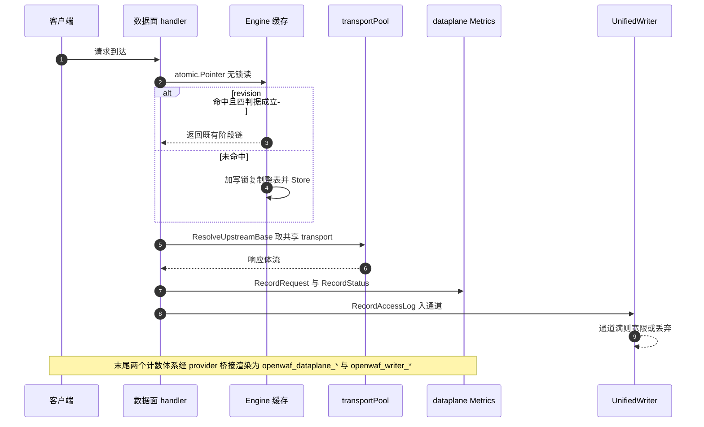
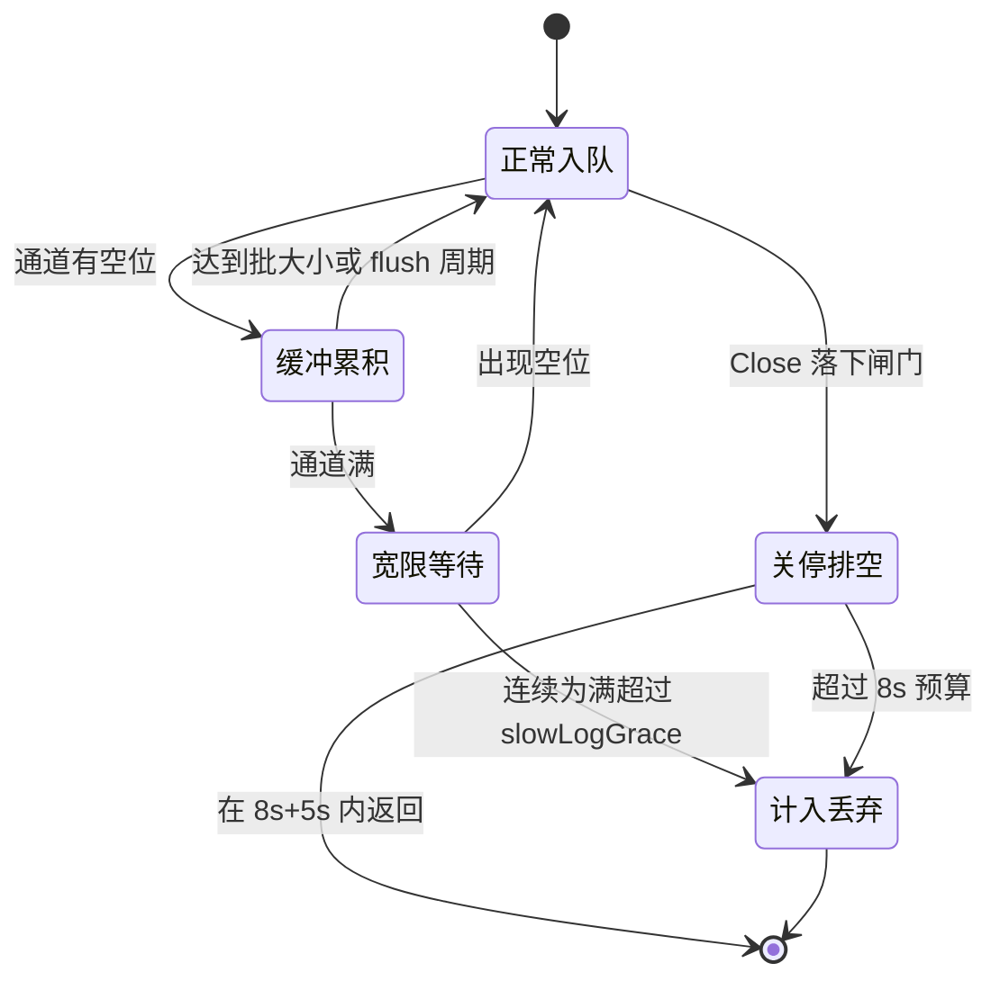
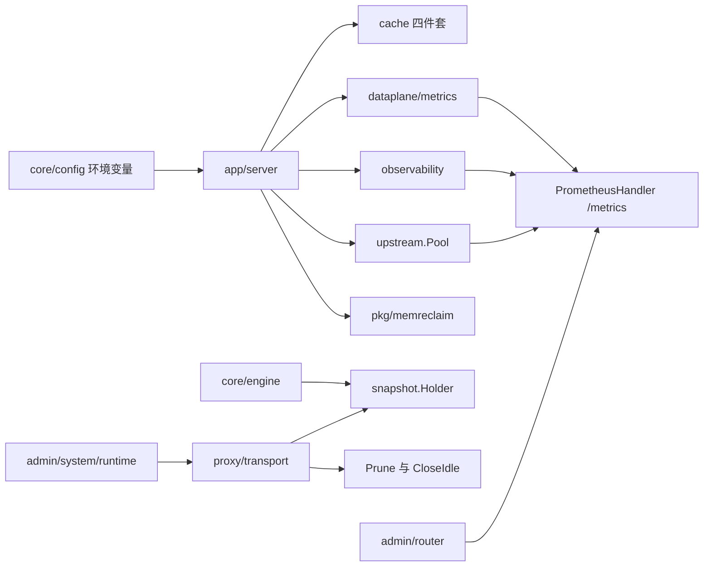
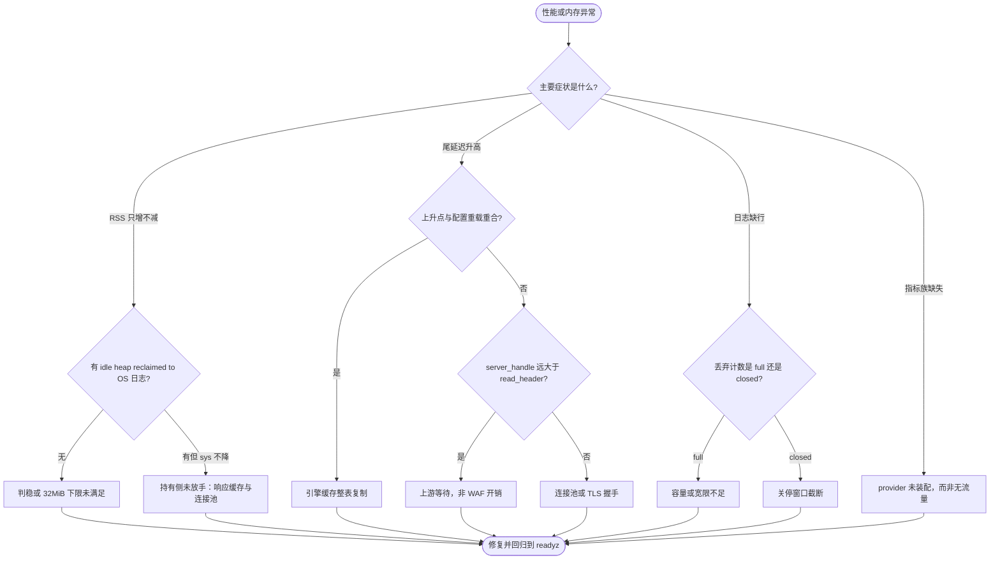

# 性能与内存排查

<cite>
**本文档引用的文件**
- [memreclaim.go](file://internal/pkg/memreclaim/memreclaim.go)
- [layer.go](file://internal/cache/layer.go)
- [query_cache.go](file://internal/cache/query_cache.go)
- [hot_cache.go](file://internal/cache/hot_cache.go)
- [response_cache.go](file://internal/cache/response_cache.go)
- [transport.go](file://internal/proxy/transport/transport.go)
- [health.go](file://internal/upstream/health.go)
- [health.go](file://internal/core/health/health.go)
- [write_queue.go](file://internal/observability/write_queue.go)
- [unified_writer.go](file://internal/observability/unified_writer.go)
- [http_trace.go](file://internal/observability/http_trace.go)
- [metrics.go](file://internal/observability/metrics.go)
- [metrics.go](file://internal/dataplane/metrics/metrics.go)
- [engine.go](file://internal/core/engine/engine.go)
- [pool.go](file://internal/core/pipeline/pool.go)
- [server.go](file://internal/app/server.go)
- [config.go](file://internal/core/config.go)
- [router.go](file://internal/admin/router.go)
- [runtime.go](file://internal/admin/system/runtime.go)
- [main.go](file://cmd/main.go)
- [qps-diagnose.ps1](file://scripts/qps-diagnose.ps1)
- [README.md](file://README.md)
- [故障排除.md](file://docs/故障排除/故障排除.md)
- [存储与Redis故障.md](file://docs/故障排除/存储与Redis故障.md)
</cite>

## 目录
1. [简介](#简介)
2. [项目结构](#项目结构)
3. [核心组件](#核心组件)
4. [架构总览](#架构总览)
5. [详细组件分析](#详细组件分析)
6. [依赖关系分析](#依赖关系分析)
7. [性能考虑](#性能考虑)
8. [故障排查指南](#故障排查指南)
9. [结论](#结论)
10. [附录](#附录)

## 简介

本文覆盖 My-OpenWaf 的**性能与内存故障域**：RSS 峰值后不回落、上游连接池占用、四层缓存命中率异常、引擎缓存
的写时复制放大、异步写路径的背压与丢弃、分阶段耗时的读法与误读、pprof 与 `/metrics` 取证路径。
同域划界，不得混用取证入口：[启动与依赖故障](启动与依赖故障.md) 管进程起不起得来，[存储与Redis故障](存储与Redis故障.md)
管双库读写与 Redis 降级，[规则误杀与漏杀](规则误杀与漏杀.md) 管判定是否符合预期，[证书与TLS故障](证书与TLS故障.md)
管握手与选证；[故障排除](故障排除.md) 的决策树把「伴随延迟或内存上升」这一支直接导向本篇。
跨域侧的设计意图与装配细节分别由 [性能监控与调优](../数据平面处理/性能监控与调优.md)、[缓存与性能优化](../系统架构设计/缓存与性能优化.md)、[性能指标收集](../监控与可观测性/性能指标收集.md) 与 [连接池管理](../扩展与插件系统/存储后端扩展/连接池管理.md) 承载，本篇只给取证路径，不复制其表格。

排查前置条件，缺一按 `未知` 处理：故障形态（吞吐下降/延迟上升/RSS 增长/goroutine 增长）、发生时点是否与
配置重载或上游变更重合、影响面（单站点还是全监听）、是否具备管理端口访问权。

**数值口径**：容量、超时、周期、阈值一律取自源码常量与构造函数默认值并逐条给行号；**凡无实测支撑的性能
数字一律写 `—` 并注明未统计**，不用推断值冒充实测。少数数字来自源码注释已记录的实测（宽限档位对比、
阶段耗时标定、负耗时复现），本文按「注释记录的实测」引用并给行号，不表述为本次测量结果。

**章节来源**
- [故障排除.md:408-451](file://docs/故障排除/故障排除.md#L408-L451)
- [存储与Redis故障.md:40-56](file://docs/故障排除/存储与Redis故障.md#L40-L56)

## 项目结构

排障按**资源生命周期**分层而非按 Go 包堆叠：谁分配 → 谁持有 → 谁归还 → 谁可观测。

```text
性能与内存排查
├── 分配层    internal/core/pipeline/pool.go         # RequestCtx 复用池与容量上限
├── 持有层    internal/cache/ + proxy/transport/     # 四层缓存 + 三类连接池
├── 缓存层    internal/core/engine/engine.go         # atomic.Pointer 无锁读 + 写时复制
├── 背压层    internal/observability/                # WriteQueue / UnifiedWriter 丢弃与宽限
├── 归还层    internal/pkg/memreclaim/               # 周期观察 heap 稳定后 FreeOSMemory
└── 观测层    /metrics + /status + pprof             # 指标族、运行时快照、剖析
```

| 排障层 | 位置 | 主要失效模式 | 首要可观测点 | 对应条目 |
| --- | --- | --- | --- | --- |
| 分配层 | `core/pipeline/pool.go` | 池对象容量被单个超大请求永久抬高 | `openwaf_memory_alloc_bytes` | [核心组件](#核心组件) |
| 持有层 | `cache/`、`proxy/transport/` | 容量默认值过小或过大、池项不回收 | `owaf_cache_*`、`upstream_transport_pools` | [P-02](#p-02-四类缓存的容量判据与失效模式)、[P-03](#p-03-三类上游连接池的真值) |
| 缓存与观测层 | `core/engine/`、`observability/metrics.go` | 整表复制放大、取错指标名 | `openwaf_goroutines`、`/metrics` | [P-04](#p-04-引擎缓存的无锁读与写时复制)、[P-06](#p-06-分阶段耗时瀑布与语义边界) |
| 背压层 | `observability/` | 队列满即丢、关停窗口截断 | `openwaf_writer_dropped_total` | [P-05](#p-05-异步写路径的背压与丢弃语义) |
| 归还层 | `pkg/memreclaim/` | 判据不满足导致 RSS 粘滞 | 日志 `idle heap reclaimed to OS` | [P-01](#p-01-内存归还的三判据) |



**图表来源**
- [pool.go:12-28](file://internal/core/pipeline/pool.go#L12-L28)
- [response_cache.go:57-71](file://internal/cache/response_cache.go#L57-L71)
- [transport.go:90-115](file://internal/proxy/transport/transport.go#L90-L115)
- [engine.go:96-104](file://internal/core/engine/engine.go#L96-L104)

虚线是「被动暴露」，实线是「主动持有」：`/metrics`、`/status`、`pprof` 不改变任何对象生命周期，
而 `FreeOSMemory` 真实影响进程向操作系统归还的内存量。

**章节来源**
- [pool.go:12-28](file://internal/core/pipeline/pool.go#L12-L28)
- [memreclaim.go:26-98](file://internal/pkg/memreclaim/memreclaim.go#L26-L98)
- [server.go:316-365](file://internal/app/server.go#L316-L365)

## 核心组件

只列参与性能与内存故障传播、且自身有可观测出口的组件。

| 组件 | 位置 | 职责 | 关键默认值 | 失效影响 |
| --- | --- | --- | --- | --- |
| `memreclaim.Start` | [memreclaim.go:26-98](file://internal/pkg/memreclaim/memreclaim.go#L26-L98) | 周期观察 heap 稳定后归还空闲页 | 周期 2m、稳定 2 轮、可归还 32MiB | RSS 峰值后粘滞 |
| `pipeline.ctxPool` | [pool.go:20-113](file://internal/core/pipeline/pool.go#L20-L113) | 复用 `RequestCtx` | 头 map 上限 128 键 | 峰值后容量残留 |
| `cache` 四件套 | [layer.go:29-39](file://internal/cache/layer.go#L29-L39)、[query_cache.go:24-57](file://internal/cache/query_cache.go#L24-L57)、[hot_cache.go:16-53](file://internal/cache/hot_cache.go#L16-L53)、[response_cache.go:57-107](file://internal/cache/response_cache.go#L57-L107) | 快照/查询/热/响应四层 | ristretto 1e4 与 1MiB、8192 条与 5s、Redis 退避 5s、64MiB 与 60s | 命中率塌陷、大响应挤占堆 |
| `Engine` 缓存 | [engine.go:96-104](file://internal/core/engine/engine.go#L96-L104) | 编译规则与阶段链缓存 | 按 revision 整表替换，**无 LRU/MaxCost** | 重载后写放大 |
| `WriteQueue` 与 `UnifiedWriter` | [write_queue.go:119-198](file://internal/observability/write_queue.go#L119-L198)、[unified_writer.go:131-405](file://internal/observability/unified_writer.go#L131-L405) | 仓储异步写 + 可观测四通道落库 | 256/64/50ms 与 16384/8192/256/3s/宽限 30s | 队列满静默丢、访问日志缺失 |
| `HTTPTrace` | [http_trace.go:200-358](file://internal/observability/http_trace.go#L200-L358) | Hertz 分阶段耗时 | 14 个微秒档 + `+Inf` | 阶段语义误读 |
| `transportPool` | [transport.go:154-178](file://internal/proxy/transport/transport.go#L154-L178) | 上游连接复用 | 256/32/30s | 空闲连接内存 |



**图表来源**
- [write_queue.go:119-198](file://internal/observability/write_queue.go#L119-L198)
- [unified_writer.go:131-205](file://internal/observability/unified_writer.go#L131-L205)
- [metrics.go:13-125](file://internal/dataplane/metrics/metrics.go#L13-L125)
- [http_trace.go:200-204](file://internal/observability/http_trace.go#L200-L204)

两条写路径都遵循「Options 在构造函数入口一次性钳制，运行期不再判边界」的同一形态，因此排障时看到的生效值可能
与 env 原值不同——钳制会打 WARN（`logClampWarnings`）。另需分清 `dataplane.Metrics` 与 `observability.HTTPTrace`
是**两套体系**而非一条链路：前者是数据面原子计数器与 10×1s 环形缓冲，后者是 Hertz Tracer 直方图，不得互相扣减。

**章节来源**
- [server.go:304-365](file://internal/app/server.go#L304-L365)
- [server.go:481-561](file://internal/app/server.go#L481-L561)

## 架构总览

一次请求的性能与内存足迹，取决于「读缓存 → 建链 → 转发 → 记账 → 落库」每一级是否有界。



**图表来源**
- [engine.go:386-431](file://internal/core/engine/engine.go#L386-L431)
- [transport.go:800-856](file://internal/proxy/transport/transport.go#L800-L856)
- [server.go:489-507](file://internal/app/server.go#L489-L507)
- [metrics.go:182-186](file://internal/observability/metrics.go#L182-L186)

四个**只有此处存在**的排障要点：`Engine` 的无锁读与「加写锁复制整表再 Store」构成写放大窗口；取共享 transport
决定空闲连接内存量；`UnifiedWriter` 入队是全链路唯一静默丢数据的环节；`SetDataPlaneMetricsProvider` 与
`SetUnifiedWriterStatsProvider` 是两条独立装配线，任一条未挂载即整族指标缺失。

**章节来源**
- [handler.go:52-56](file://internal/dataplane/handler.go#L52-L56)
- [unified_writer.go:575-629](file://internal/observability/unified_writer.go#L575-L629)

## 详细组件分析

### P-01 内存归还的三判据

`memreclaim.Start` 是进程级单例协程（`server.go:364` 启动、`defer` 停掉），不直接「释放内存」，而是**判定何时值得归还**：

| 判据 | 代码位置 | 默认值 | 不满足时 |
| --- | --- | --- | --- |
| 检查周期 `Interval` | [memreclaim.go:27-30](file://internal/pkg/memreclaim/memreclaim.go#L27-L30) | 2 分钟 | 非正数回落默认 |
| 连续稳定轮数 `IdleRounds` | [memreclaim.go:31-34](file://internal/pkg/memreclaim/memreclaim.go#L31-L34) | 2 | 判稳失败则继续等待 |
| 可归还下限 `MinHeapReleased` | [memreclaim.go:35-38](file://internal/pkg/memreclaim/memreclaim.go#L35-L38) | 32MiB | 低于阈值不触发 |

判稳口径是 `HeapInuse` 与上一轮比较，1MiB 以内抖动算稳定（`jitter`，:64-71）；可归还量按
`HeapIdle - HeapReleased` 计算（:75-78）；触发后调 `debug.FreeOSMemory()` 并重读 `MemStats`，以
`idle heap reclaimed to OS` 一条 **Info** 日志输出六个字段（:79-89）。

排障结论有三条硬事实：其一，**判据全为编译期默认值**——`Config` 只有 `Logger` 被赋值，另三个字段未从
`rt.Config` 注入，无环境变量可调，最快启动后 4 分钟才可能首次触发；其二，**日志是唯一成功信号**，判据不
满足时静默 `continue`，缺该条日志有两种解释（负载未稳定、可归还量不足 32MiB），需结合
`openwaf_memory_sys_bytes` 区分；其三，**进程未设 GC 调优旋钮**——非测试代码没有
`debug.SetGCPercent`/`debug.SetMemoryLimit` 调用点，`GOGC`、`GOMEMLIMIT` 只能靠环境变量生效。

**章节来源**
- [memreclaim.go:26-98](file://internal/pkg/memreclaim/memreclaim.go#L26-L98)
- [server.go:363-365](file://internal/app/server.go#L363-L365)
- [pool.go:12-17](file://internal/core/pipeline/pool.go#L12-L17)

### P-02 四类缓存的容量判据与失效模式

四层缓存的**驱逐依据完全不同**，把它们当成同一个缓存是取数错误的根源。

| 缓存 | 载体 | 容量口径 | 失效依据 | 命中指标 | 代码位置 |
| --- | --- | --- | --- | --- | --- |
| `Layer` 快照层 | ristretto | `MaxCost` 1MiB、`NumCounters` 1e4、`BufferItems` 64 | 版本键 `snapshot:{rev}`，`Revision` 不符即拒写 | 无 | [layer.go:29-51](file://internal/cache/layer.go#L29-L51) |
| `QueryCache` | 进程内 map | 8192 条、键 ≤64KiB、TTL 5s | 满则先内联清过期，仍满则**跳过写入** | `{cache="query"}` | [query_cache.go:97-121](file://internal/cache/query_cache.go#L97-L121) |
| `HotCache` | Redis | 无本地容量 | 5s 熔断窗口，故障计入 `errs` 不计 `misses` | `{cache="hot"}` 含 `errors` | [hot_cache.go:16-41](file://internal/cache/hot_cache.go#L16-L41) |
| `ResponseCache` | 进程内 64 分片 | 64MiB、TTL 60s、`maxEntries = maxSize/1024` | 超容量先驱逐过期项再按序驱逐 | `{cache="response"}` | [response_cache.go:57-107](file://internal/cache/response_cache.go#L57-L107) |

两个踩空点：**ristretto 参数只属于快照层**，规则缓存与阶段链缓存没有 LRU 与 MaxCost，把它们的行为往
`layer.go:30-34` 上靠是错的；**`errs` 与 `misses` 分离是刻意的**——`hot_cache.go:27-31` 写明若把 Redis 故障
也算未命中，整体故障时命中率显示 0%，看起来像缓存未生效而非依赖不可用；`server.go:556-558` 只给 `hot` 层填
`Errors`，另两层恒为 0。另记：`QueryCache` 容量满时**不写缓存**也不淘汰旧值（`storeLocked` 在 :105-107 直接
`return`），大表 COUNT 退化为每次直查，命中率下降但没有正确性问题。

**章节来源**
- [layer.go:18-62](file://internal/cache/layer.go#L18-L62)
- [query_cache.go:14-127](file://internal/cache/query_cache.go#L14-L127)
- [hot_cache.go:16-74](file://internal/cache/hot_cache.go#L16-L74)
- [response_cache.go:57-107](file://internal/cache/response_cache.go#L57-L107)

### P-03 三类上游连接池的真值

连接池参数分散在三个不同文件，历史文档常把三者混为一谈。**唯一权威取值如下**：

| 池 | 位置 | MaxIdleConns | PerHost | MaxConns | IdleConnTimeout | 其它 |
| --- | --- | :---: | :---: | :---: | :---: | --- |
| 主 transport | [transport.go:154-178](file://internal/proxy/transport/transport.go#L154-L178) | 256 | 32 | 256 | 30s | 16KiB 读写缓冲、`ExpectContinue` 1s、TLS 握手 10s、响应头 30s |
| h2c 单例 | [transport.go:871-877](file://internal/proxy/transport/transport.go#L871-L877) | 512 | 128 | 未设 | 90s | 进程级单例，`SetUnencryptedHTTP2(true)` |
| 探活 transport | [health.go:661-677](file://internal/upstream/health.go#L661-L677) | 128 | 32 | 32 | 90s | TLS 握手 10s、TCP keepalive 30s、`ExpectContinue` 1s |

主池的 256/32/30s 相对 `net/http` 默认是**刻意调小**的：:155-156 写明 512/128 与 90s「更节省高并发后的空闲
连接内存」「让峰值后的 idle conn 更快释放」。HTTPS 分支另挂一份 `tls.NewLRUClientSessionCache(32)`，
容量与 `MaxIdleConnsPerHost` 对齐（:188）。

三条运维入口都在快照重载链上（`server.go:890-896`）：`PruneInactiveUpstreamTransports`（:1044）按当前快照
**逐条**上游构造活跃键集合，:1048-1051 明确警告只取首条会把多上游站点的在用 transport 判为不活跃并删除；
`CloseIdleUpstreamTransports`（:1137）仅在上游端点集合变化时经 `snapshotUpstreamSetChanged` 调用，遍历必须
「锁内复制到切片、锁外调用」，否则与修剪的 `delete`、建池的赋值并发会触发 **不可 recover** 的
`concurrent map iteration and map write` 致命错误（:1153-1155）；`UpstreamTransportPoolStatsSnapshot`（:1244）
在每次重载后取四把读锁的池规模，经 `runtimeTransportPools` 汇总为 `upstream_transport_pools` 由
`GET /api/v1/runtime-config` 暴露（runtime.go:157、:198-210），这是唯一能直接看到池项数量的出口。
另需记住：`SharedTransportForUpstream`（:131）在产线代码中**没有调用点**，真实入口是
`ResolveUpstreamBase`（:800），按前者追调用链会走空。

**章节来源**
- [transport.go:131-188](file://internal/proxy/transport/transport.go#L131-L188)
- [transport.go:858-1167](file://internal/proxy/transport/transport.go#L858-L1167)
- [transport.go:1229-1280](file://internal/proxy/transport/transport.go#L1229-L1280)
- [health.go:21-27](file://internal/upstream/health.go#L21-L27)
- [server.go:868-896](file://internal/app/server.go#L868-L896)

### P-04 引擎缓存的无锁读与写时复制

`Engine` 用两个 `atomic.Pointer` 快照持有编译规则与阶段链缓存（engine.go:96-104），**不是 RWMutex 读锁**：
热路径只有一次 `Load()`，不加锁、无缓存行争用（:390-396、:458-464）。

写路径是写时复制：`compiledWriteMu` 串行化，先判断 revision 是否变化，变化则**从头重建 map**，
未变化则**复制全部现有条目**再追加新条目，最后 `Store` 新的不可变快照（:412-428；阶段链同构，:532-545）。
由此得到两个性能结论：**重载后首批请求有 O(N) 写放大**（N 为该 revision 下已缓存条目数，每个未命中整表
复制一次，站点越多尾延迟抬升越明显，之后收敛）；**缓存规模上界由快照决定而不是 LRU 决定**——条目数是
「站点 × 策略」量级，revision 一变旧表整体丢弃，不会跨代次累积。

阶段链命中要过**四判据**（engine.go:461）：`entry.prot == prot`、`entry.lua == lp`、
`entry.luaRevision == luaRevision`、`entry.deps == deps`。只看 `revision` 相等就判定命中是错的——
Lua 脚本增删改可能不改快照代次，必须靠 `luaRevision` 让缓存失效（:44-51 注释）。
阶段链按最大规模预分配容量 11（:467），与实测的 11 阶段链一致。

**章节来源**
- [engine.go:32-113](file://internal/core/engine/engine.go#L32-L113)
- [engine.go:380-431](file://internal/core/engine/engine.go#L380-L431)
- [engine.go:440-467](file://internal/core/engine/engine.go#L440-L467)

### P-05 异步写路径的背压与丢弃语义

两条异步写路径的**丢弃策略不同**，混为一谈会错判数据缺失原因。

| 旋钮 | `WriteQueue` | `UnifiedWriter` | 上限 |
| --- | :---: | :---: | --- |
| 通道容量 | 256 | 事件/访问 16384、drop/bot 8192 | 各 1M |
| 批大小 | 64 | 256 | 各 10000 |
| flush 周期 | 50ms（无上限） | 3s（≤60s） | 两者上界口径不同 |
| 队列满 | **直接丢弃** | 宽限 30s 后退回丢弃 | 宽限 ≤5m |
| 关停预算 | `Close` 排空 | 8s 排空 + 5s 宽限 | — |

取值来源：`write_queue.go:104-127` 与 `unified_writer.go:113-129`（默认与上限）、:172
（`defaultSlowLogGrace = 30s`）、:341-349（`unifiedWriterCloseTimeout = 8s`、`CloseGrace = 5s`，注释说明
取值须落在 lifecycle 的 10s 关停窗口内）；`BatchSize` 由 64 上调到 256 基于 SQLite 写径审计（:123 注释）。
**宽限默认值不是 0，这一点有实测支撑**：源码注释记录了「128 并发、400 万行日志库」基线下默认档曾丢弃
539077/1055962 条（51.1%），且默认档与最大档同基线结果一致（最长连续饱和段仅 1.7s），因此 30s 是
「实测饱和段的 17 倍安全边际」与「拖慢上界」的折中（:155-172）。要恢复历史的「满即丢」语义，
把 `MY_OPENWAF_QUEUE_SLOW_LOG_GRACE` 显式设为 `0`——配置层在 :497-504 会同时置
`SlowLogGraceDisabled = true`，所以 **env 口径下的 0 是关闭**；而结构体口径下的 0 表示**未配置**，
会被 `effectiveSlowLogGrace` 回落成 30s（:190-205）。两个口径不能混说。

两类丢弃的告警文案刻意不同，必须分开查：`observability queue full, record dropped`（背压，动作是扩容或降载）
与 `observability writer closed, record dropped`（关停闸门已落下，动作是事后核对损失）——:332-339 把这条区分
写成了常量注释。`WriteQueue.Submit` 非阻塞，满即 `dropped_full_total` 加一并限频告警 10s
（`write_queue.go:300-325`、:67）；需确认的写走 `SubmitWait`，满时同步回退并计入 `sync_fallback_total`（:332-365）。



**图表来源**
- [unified_writer.go:329-350](file://internal/observability/unified_writer.go#L329-L350)
- [unified_writer.go:544-629](file://internal/observability/unified_writer.go#L544-L629)
- [unified_writer.go:702-746](file://internal/observability/unified_writer.go#L702-L746)
- [write_queue.go:300-325](file://internal/observability/write_queue.go#L300-L325)

**章节来源**
- [write_queue.go:104-198](file://internal/observability/write_queue.go#L104-L198)
- [write_queue.go:296-401](file://internal/observability/write_queue.go#L296-L401)
- [unified_writer.go:113-205](file://internal/observability/unified_writer.go#L113-L205)
- [unified_writer.go:329-372](file://internal/observability/unified_writer.go#L329-L372)
- [config.go:223-249](file://internal/core/config.go#L223-L249)、[config.go:497-504](file://internal/core/config.go#L497-L504)

### P-06 分阶段耗时瀑布与语义边界

`HTTPTrace` 是 Hertz `Tracer` 的实现，仅在 `MY_OPENWAF_TRACE_ENABLED=true` 时注册（config.go:407-414、
server.go:482-488）。五个阶段名与 Hertz 事件一一对应：`total`、`read_header`、`read_body`、`server_handle`、
`write`（http_trace.go:15-23），后四个需 `LevelDetailed` 才采得到（:78-83）。

三个必须知道的语义边界。**其一，`server_handle` 含上游往返**，不是「WAF 自身开销」：权威说明在
`HTTPTracePhaseServerHandleDoc`（:85-114），括号覆盖整个 handler 周期而数据面是**同步**等上游的；
注释记录的实测判据是同一实例只换上游——上游瞬时 200 时 `server_handle` 0.378ms，
上游固定延迟 300ms 时 301.204ms，而 `read_header` 纹丝不动。把它当成 WAF 开销会让优化打错目标。

**其二，`proto="unknown"` 是免费的对端信号**：keep-alive 空闲回收路径上的请求根本没被解析，协议读不到
全落在这里，高并发停摆时客户端批量超时断开走的正是这条路（:25-38）。因此 `samples_total`（含 unknown）
等于 Finish 调用次数，只有 `phase="total"` 且协议非 unknown 才是真正被处理过的请求数，两者之差是连接层放弃量。

**其三，负耗时被拒绝并单独计数**：`observe` 对负值加 `invalid` 而不累加（:146-154），起因是
`x01n/http2` fork v0.3.0 的 `ServerHandleFinish` 会读到陈旧时间戳；
`openwaf_httptrace_phase_invalid_total` 非零即「框架事件配对有问题」的外部信号，该阶段的 `count`/`sum`
只覆盖有效样本。

直方图桶上界依次为 50、100、250、500、1000、2500、5000、10000、25000、50000、100000、250000、500000、1000000
微秒，加一个 `+Inf` 共 15 桶（:53-58）；低延迟段刻意比毫秒档更细，否则 `read_header` 与 `write` 会落进同一格。
采集侧用微秒整型累加，避免浮点原子长期漂移。

**章节来源**
- [http_trace.go:15-114](file://internal/observability/http_trace.go#L15-L114)
- [http_trace.go:146-164](file://internal/observability/http_trace.go#L146-L164)
- [http_trace.go:284-426](file://internal/observability/http_trace.go#L284-L426)
- [config.go:407-414](file://internal/core/config.go#L407-L414)

### P-07 指标族与取数入口

`/metrics` 只在管理端口（`server.go:1056`），由 `observability.PrometheusHandler` 渲染。真实族与权威名如下，
**旧的四类计数名（`openwaf_requests_total` 等）已移除，不得引用**：

| 族 | 前缀 | 渲染位置 | 数据源 |
| --- | --- | --- | --- |
| 进程级 | `openwaf_{uptime_seconds,goroutines,memory_alloc_bytes,memory_sys_bytes,gc_pause_total_ns}` | [metrics.go:274-299](file://internal/observability/metrics.go#L274-L299) | `runtime` 直读 |
| 数据面 | `openwaf_dataplane_{qps,requests_total,status_total,waf_actions_total,builtin_hits_total,unique_ips_total,attack_ips_total,uptime_seconds}` | [metrics.go:402-453](file://internal/observability/metrics.go#L402-L453) | `dataplane/metrics.Summary()` 桥接 |
| 缓存 | `owaf_cache_{hits,misses,errors}_total{cache=query\|hot\|response}` | [metrics.go:530-552](file://internal/observability/metrics.go#L530-L552) | 三个 `HitStats()` |
| 写入器 | `openwaf_writer_*` | [metrics.go:771-818](file://internal/observability/metrics.go#L771-L818) | `UnifiedWriter.Stats()` |
| 写队列 | `openwaf_write_queue_*` | [metrics.go:843-915](file://internal/observability/metrics.go#L843-L915) | `WriteQueue.Stats()` |
| 阶段耗时 | `openwaf_httptrace_*` | [metrics.go:661-751](file://internal/observability/metrics.go#L661-L751) | `HTTPTrace.Stats()` |
| 上游 | `openwaf_upstream_*` | [metrics.go:455-493](file://internal/observability/metrics.go#L455-L493) | `Pool.Snapshot()`，探测延迟不可扣减用户请求 |

`metrics.go:263-273` 记录移除原因：包内曾输出恒为 0 的 `openwaf_requests_total`（其 `RecordRequest` 没有
生产调用点），同一语义两条路径各持一份计数会制造第二真相，因此**请求总量只读
`openwaf_dataplane_requests_total`**。`/status` 输出九个字段（core/health/health.go:94-104），每次调用都做
`runtime.ReadMemStats`，`Ready()` 还做一次 DB `Ping()`（:39-43），所以高频监控应走 `/metrics`。

**暴露面必须如实提示**：`/healthz`、`/readyz`、`/status`、`/metrics` 四条路由注册在 `adminSrv` 的全局
中间件之上，而鉴权中间件只挂在 `api` 分组（`admin/router.go:91-92` 只有 `SecurityHeaders` 与
`AccessLog`，:110 才是 `AuthMiddleware`）。也就是说这四个端点**无鉴权**，同网段可达即可读到站点数、
配置代次与运行时内存指标。pprof 更甚：`MY_OPENWAF_PPROF_BIND` 非空即裸监听，`cmd/main.go:29-49` 无任何认证。

**章节来源**
- [metrics.go:262-299](file://internal/observability/metrics.go#L262-L299)
- [metrics.go:402-552](file://internal/observability/metrics.go#L402-L552)
- [metrics.go:661-915](file://internal/observability/metrics.go#L661-L915)
- [core/health/health.go:31-105](file://internal/core/health/health.go#L31-L105)
- [router.go:91-110](file://internal/admin/router.go#L91-L110)
- [server.go:1052-1056](file://internal/app/server.go#L1052-L1056)
- [main.go:29-49](file://cmd/main.go#L29-L49)

## 依赖关系分析



**图表来源**
- [server.go:481-561](file://internal/app/server.go#L481-L561)、[server.go:890-896](file://internal/app/server.go#L890-L896)
- [metrics.go:182-186](file://internal/observability/metrics.go#L182-L186)、[runtime.go:157-210](file://internal/admin/system/runtime.go#L157-L210)

| 依赖方 | 被依赖方 | 依赖形式 | 方向风险 | 排障含义 |
| --- | --- | --- | --- | --- |
| `app/server.go` | `cache` 四件套 | 构造注入 | 无环 | 缓存默认值在构造函数兜底，非 env 决定 |
| `app/server.go` | `observability.Metrics` | 9 个 provider 闭包 | 单向 | provider 未挂载 → 指标族缺失而非 0 |
| `core/engine` 与 `proxy/transport` | `snapshot` | `Load()` 无锁读、活跃键集合来源 | 单向 | revision 变更即整表重建；逐条上游计入，误删即在用连接中断 |
| `admin/system/runtime.go` | `proxy/transport` | 池统计只读 | 单向 | 池规模的唯一可见出口 |
| `observability` | `dataplane/metrics` | 无直接依赖 | 解耦 | 靠闭包适配，不反向 import |

**章节来源**
- [server.go:304-365](file://internal/app/server.go#L304-L365)
- [server.go:1052-1056](file://internal/app/server.go#L1052-L1056)
- [transport.go:1044-1057](file://internal/proxy/transport/transport.go#L1044-L1057)

## 性能考虑

**问题**：RSS 峰值后长期不回落（`FreeOSMemory` 需连续 2 轮判稳且可归还量超 32MiB）；重载后首批请求尾延迟
升高（同 revision 下每次未命中都整表复制）；高并发时访问日志缺行（`WriteQueue` 容量仅 256 且满即丢，
`UnifiedWriter` 宽限到点后仍丢）；上游空闲连接内存（主池 30s、h2c 与探活池 90s，口径不同不可混用）；
关停窗口截断（`UnifiedWriter` 只有 8s 排空预算）。

**优化**：按域调参而不是全局调——队列走 `MY_OPENWAF_QUEUE_*`（八个变量，`config.go:223-249` 列出并在解析时
告警），响应缓存走 `MY_OPENWAF_RESPONSE_CACHE_MB`/`_TTL_SEC`（:430-441）；用 `GOGC`、`GOMEMLIMIT` 做运行器层
约束（代码内无 setter，env 是唯一路径）；多上游站点变更前先读 `upstream_transport_pools`，确认池项与
「站点×上游条数」同量级；关停前先摘流量，使 8s 预算覆盖实际积压。

**效果**：宽限默认 30s 相对 0 的收益有源码注释记录的实测支撑（丢弃 51.1% → 0），且默认档与最大档无差异，
不必顶到 5m 上限（`unified_writer.go:155-172`）；其余各项量化收益本次未做基准，一律记为 `—`（未统计），
需要具体数字处应以 `scripts/qps-diagnose.ps1` 或 pprof 在同一基线复测后填写，不得沿用推断值。

[本节为总结，无需特定文件来源]

## 故障排查指南

### 通用诊断流程

先用决策树把症状收敛到单一资源维度再取证定级。定级复用问题检测四档：严重＝数据可能丢失或无鉴权可达，
高＝错误被吞没，中＝配置无覆盖入口，低＝命名与注释。



**图表来源**
- [memreclaim.go:64-89](file://internal/pkg/memreclaim/memreclaim.go#L64-L89)
- [engine.go:412-428](file://internal/core/engine/engine.go#L412-L428)
- [http_trace.go:85-114](file://internal/observability/http_trace.go#L85-L114)
- [unified_writer.go:329-350](file://internal/observability/unified_writer.go#L329-L350)
- [write_queue.go:300-325](file://internal/observability/write_queue.go#L300-L325)

开放在正文的问题检测结果汇总（位置必填、可复核）：

| 编号 | 类别 | 严重度 | 标题 | 位置 | 影响 | 建议 |
| :---: | :---: | :---: | --- | --- | --- | --- |
| M-01 | 性能 | 高 | 回收三判据不可配置 | `pkg/memreclaim/memreclaim.go:27-38`、`app/server.go:364` | 峰值后 RSS 至少 4 分钟才可能回落 | 接入配置注入或明确文档化 |
| M-02 | 性能 | 中 | 引擎缓存整表复制 | `core/engine/engine.go:412-428` | 重载后首批尾延迟随站点数上升 | 站点数大时灰度重载并观测 |
| M-03 | 可靠性 | 高 | 写队列容量 256 且满即丢 | `observability/write_queue.go:112`、`:300-325` | 仓储异步写静默丢失 | 按 QPS 调 `MY_OPENWAF_QUEUE_WRITE_CAPACITY` |
| M-04 | 安全 | 高 | 四个探针与 pprof 无鉴权 | `admin/router.go:91-110`、`cmd/main.go:29-49` | 同网段可读站点数、代次、内存 | 网段隔离或反代加白 |
| M-05 | 质量 | 中 | 三池参数分散易误读 | `proxy/transport/transport.go:157-161`、`:872-874`、`upstream/health.go:667-671` | 排障取错基准值 | 以本篇表格为准并核对行号 |
| M-06 | 可靠性 | 低 | 关停排空预算固定 8s | `observability/unified_writer.go:344` | 高积压时尾部记录被放弃 | 先摘流量再发关停信号 |

分层定位：每层只回答一个是/否问题，答案决定下一层。

| 步 | 判定问题 | 取证命令或入口 | 命中后的下一动作 | 排除条件 |
| :---: | --- | --- | --- | --- |
| 1 | 进程资源水位是否异常 | `GET /status` 的 `goroutines` 与 `heap_alloc` | 开 pprof 定位分配点 | 两者平稳 |
| 2 | 指标族是否齐备、耗时落在哪一段 | `GET /metrics` 数族名与 `openwaf_httptrace_phase_duration_seconds_count` | 检查 provider 装配、按 `server_handle` 语义拆分 | 七族都在且已开启 trace |
| 3 | 写入是否丢弃 | `openwaf_writer_dropped_total` 按 type | 查容量与宽限配置 | 增量为 0 |
| 4 | 上游池规模是否合理 | `GET /api/v1/runtime-config` 的 `upstream_transport_pools` | 比对站点×上游条数 | 同量级 |

第一步与第三步取证（管理端口默认 `:9443`，明文 HTTP 且无鉴权）：

```bash
curl -sS http://127.0.0.1:9443/status
curl -sS http://127.0.0.1:9443/metrics | grep -E '^openwaf_(memory_alloc_bytes|memory_sys_bytes|goroutines|gc_pause_total_ns) '
curl -sS http://127.0.0.1:9443/metrics | grep -E '^openwaf_(writer_dropped_total|write_queue_dropped_full_total|write_queue_sync_fallback_total)'
```

**预期输出形态**：第一条返回单个 JSON 对象，含 `alive`、`ready`、`revision`、`sites`、`listeners`、
`goroutines`、`heap_alloc`、`go_version`、`num_cpu` 九个键，例如 `{"alive":true,"ready":true,"revision":7,
"sites":3,"listeners":3,"goroutines":<整数>,"heap_alloc":<字节数>,"go_version":"go1.27.x","num_cpu":<核数>}`；
`sites`/`listeners` 明显大于配置条数说明快照异常，`goroutines` 只增不减指向连接或协程泄漏。第二条恰好 4 行，
形如 `openwaf_memory_alloc_bytes 20971520`；一行都没有说明端口不对，`memory_alloc_bytes` 长期贴近
`memory_sys_bytes` 则说明内存被真实持有，应转 P-02/P-03。第三条返回
`openwaf_writer_dropped_total{type="..."}` 四行（security_event、access_log、drop_event、bot_score），加
`openwaf_write_queue_dropped_full_total 0` 与 `openwaf_write_queue_sync_fallback_total 0`；全 0 表示写入侧无
丢弃，此时访问日志仍缺行应转向采样率（`MY_OPENWAF_ACCESSLOG_SAMPLING`）而不是背压。

**章节来源**
- [core/health/health.go:75-105](file://internal/core/health/health.go#L75-L105)
- [metrics.go:274-299](file://internal/observability/metrics.go#L274-L299)
- [metrics.go:771-915](file://internal/observability/metrics.go#L771-L915)
- [runtime.go:157-210](file://internal/admin/system/runtime.go#L157-L210)
- [故障排除.md:397-451](file://docs/故障排除/故障排除.md#L397-L451)

### 常见问题与解决方案

条目形状固定为**症状 / 原因 / 排查 / 方案**，附「定位依据」指向文件行号。

#### T-01 RSS 峰值后长时间不回落

- **症状**：突发流量结束后 `openwaf_memory_sys_bytes` 长时间维持高位。
- **原因**：需连续 2 轮（每轮 2 分钟）判稳且 `HeapIdle-HeapReleased ≥ 32MiB` 才调 `FreeOSMemory()`，
  条件不满足就静默跳过，日志无提示。
- **排查**：`grep 'idle heap reclaimed to OS' 日志`；`memory_alloc_bytes` 接近 `memory_sys_bytes`
  说明是被真实持有而非未归还。
- **方案**：先排除持有侧（响应缓存、上游池、引擎缓存条目数）；确属归还问题用 `GOMEMLIMIT` 约束堆上界。
- **定位依据**：[memreclaim.go:64-89](file://internal/pkg/memreclaim/memreclaim.go#L64-L89)、[server.go:364-365](file://internal/app/server.go#L364-L365)

#### T-02 重载后首批请求明显变慢

- **症状**：配置重载后头几个请求尾延迟抬升，随后自行收敛；站点越多越明显。
- **原因**：同 revision 下每次缓存插入都复制整张 map（`engine.go:421-425`），次数与已缓存条目数成正比。
- **排查**：把 `/status` 的 `sites` 与 `revision` 与尾延迟曲线对齐；`/readyz` 应保持 200。
- **方案**：大批量站点变更分批重载；不要为此给引擎缓存加 LRU——规模上界由快照决定，
  加淘汰只会引入第二套失效判据。
- **定位依据**：[engine.go:386-431](file://internal/core/engine/engine.go#L386-L431)、[engine.go:458-467](file://internal/core/engine/engine.go#L458-L467)

#### T-03 访问日志缺行但无任何报错

- **症状**：面板请求数与数据库行数不符，日志里既无写失败也无 `record dropped`。
- **原因**：三处静默点之一——`WriteQueue.Submit` 满即丢、`UnifiedWriter` 宽限到点后丢、访问日志被抽样。
  安全事件、拦截、4xx/5xx 恒全量，只有正常成功访问的审计行会被抽样。
- **排查**：分别看 `openwaf_write_queue_dropped_full_total`、`openwaf_writer_dropped_total{type="access_log"}`
  与 `MY_OPENWAF_ACCESSLOG_SAMPLING` 实际取值。
- **方案**：背压则调 `MY_OPENWAF_QUEUE_WRITE_CAPACITY`/`MY_OPENWAF_QUEUE_EVENT_BUFFER_SIZE` 或把采样设回 1；
  两类丢弃文案不合并处理。
- **定位依据**：[write_queue.go:300-325](file://internal/observability/write_queue.go#L300-L325)、[unified_writer.go:332-339](file://internal/observability/unified_writer.go#L332-L339)、[config.go:371-375](file://internal/core/config.go#L371-L375)

#### T-04 上游连接池内存偏高或站点变更后连接被中断

- **症状**：删除某条上游后短窗口内出现 5xx；或池项数量远高于站点数。
- **原因**：三池空闲口径不同（主 30s、h2c 与探活 90s）；修剪按快照**逐条**上游构造活跃键，
  未计入活跃集（例如只取首条）时在用 transport 会被误删。
- **排查**：`GET /api/v1/runtime-config` 读 `upstream_transport_pools` 的 `total_transports`/`total_clients`
  与「站点 × 上游条数」比对，并比对前后 `revision`。
- **方案**：只有端点集合真正变化时才期望 `CloseIdleUpstreamTransports` 被调用（`server.go:893-895`）。
- **定位依据**：[transport.go:154-178](file://internal/proxy/transport/transport.go#L154-L178)、[transport.go:1044-1057](file://internal/proxy/transport/transport.go#L1044-L1057)、[transport.go:1153-1155](file://internal/proxy/transport/transport.go#L1153-L1155)

#### T-05 命中率突然变成 0%

- **症状**：`owaf_cache_misses_total{cache="hot"}` 暴涨，看上去像缓存失效。
- **原因**：`HotCache` 刻意把 Redis 故障与「键不存在」分成两个计数器，外部面板常只看命中率。
- **排查**：先看 `owaf_cache_errors_total{cache="hot"}` 是否同步增长；再看 `redis_enabled` 与 5s 熔断窗口。
- **方案**：面板把 `errors` 与 `misses` 分开展示；确认为依赖不可用时按 [存储与Redis故障](存储与Redis故障.md)
  的可达性条目处理。
- **定位依据**：[hot_cache.go:24-41](file://internal/cache/hot_cache.go#L24-L41)、[server.go:550-561](file://internal/app/server.go#L550-L561)

#### T-06 分阶段耗时看不出 WAF 瓶颈

- **症状**：`server_handle` 均值很高，优化了规则链却没变化。
- **原因**：该阶段覆盖整个 handler 周期含同步上游往返，探针不提供纯 WAF 计算时间。
- **排查**：比对同协议 `read_header`（与上游无关）是否同步抬升；逐请求看访问日志 `upstream_latency_ms`；
  `openwaf_upstream_*_latency_ms` 是主动探测延迟，**不可用于扣减**。
- **方案**：用「关闭全部保护项的干跑」做差分（上游两侧抵消），或按 `HTTPTracePhaseServerHandleDoc` 解释。
- **定位依据**：[http_trace.go:85-114](file://internal/observability/http_trace.go#L85-L114)、[http_trace.go:38](file://internal/observability/http_trace.go#L38)

#### T-07 `openwaf_httptrace_phase_invalid_total` 非零

- **症状**：某阶段均值明显偏小，`invalid` 持续增长。
- **原因**：`x01n/http2` fork v0.3.0 把上一次的 `ServerHandleFinish` 读成早于本次 `ServerHandleStart`；
  采集侧拒绝负值并计数，作为框架缺陷的外部可见信号。
- **排查**：只在 `proto="HTTP/2.0"` 检查该指标；h1 也非零则应回到事件配对本身。
- **方案**：守卫不删（删掉会让均值持续被拉负）；fork 修复配对时序后该值应长期为 0，届时连同指标移除。
- **定位依据**：[http_trace.go:127-154](file://internal/observability/http_trace.go#L127-L154)、[http_trace.go:369-405](file://internal/observability/http_trace.go#L369-L405)

#### T-08 `/metrics` 或 pprof 被误当作安全边界

- **症状**：外部扫描能取到 `/status` 与 `/metrics`，或 pprof 端口暴露在内网。
- **原因**：四个探针注册在全局中间件层（只有安全头与访问日志），鉴权只在 `api` 分组生效。
- **排查**：不带令牌请求 `http://{管理地址}/metrics`，能取到正文即无鉴权成立；再确认 `MY_OPENWAF_ADMIN_BIND`。
- **方案**：管理端口限制在回环或管理网段或用反代加白；pprof **用完即关**，长期剖析改走带鉴权采集侧。
- **定位依据**：[router.go:91-110](file://internal/admin/router.go#L91-L110)、[server.go:1052-1056](file://internal/app/server.go#L1052-L1056)、[main.go:29-49](file://cmd/main.go#L29-L49)

**章节来源**
- [memreclaim.go:26-98](file://internal/pkg/memreclaim/memreclaim.go#L26-L98)
- [engine.go:380-431](file://internal/core/engine/engine.go#L380-L431)
- [transport.go:1044-1167](file://internal/proxy/transport/transport.go#L1044-L1167)
- [http_trace.go:85-154](file://internal/observability/http_trace.go#L85-L154)

## 结论

本篇把「性能与内存」从故障排除总览的决策树终点落成可执行排查路径，成果包括：

- 固化**三类连接池真值**（256/32/30s、512/128/90s、128/32/90s+MaxConns 32）与两个修剪入口的硬约束；
- 澄清**四层缓存的驱逐依据互不相同**：ristretto 参数只属快照层，规则与阶段链缓存无 LRU；
- 明确引擎缓存的**无锁读 + 写时复制**代价与四判据命中条件；
- 区分**两类丢弃文案**与关停预算，把「日志缺行」拆成队列、通道、采样三种成因；钉死 `server_handle` 语义边界
  与 `unknown`/`invalid` 两个诊断信号，并列出已移除指标名。

设计原则落点：KISS 是「每层只回答一个是否问题」的定位表；YAGNI 是不给引擎缓存提议 LRU；DRY 是指标族名与
池参数各只有一处权威表格，兄弟文档只链接不复制；SRP 是按资源生命周期而非按包分层。已知限制：回收三判据与
关停预算均为编译期常量、无覆盖入口；本次未做基准，所有量化收益记为 `—`（未统计），引用到的数字均来自源码
注释记录的实测并给了行号。下一步：补同一基线下队列容量与宽限档位对照数据，把 `upstream_transport_pools` 与
`openwaf_writer_*` 做成固定面板，并按 T-08 的暴露面结论补管理端口访问控制建议。

[本节为总结，无需特定文件来源]

## 附录

### 性能与内存配置项速查

| 配置项 | 类型 | 默认值 | 必填 | 作用域 | 生效方式 | 安全等级 | 说明 |
| --- | --- | --- | :---: | --- | --- | --- | --- |
| `MY_OPENWAF_ADMIN_BIND` | string | `:9443` | 否 | 控制面 | 重启 | 敏感 | 探针与 API 共用，建议绑回环 |
| `MY_OPENWAF_PPROF_BIND` | string | 空 | 否 | 进程 | 重启 | **敏感** | 非空即裸监听，无鉴权 |
| `MY_OPENWAF_QUEUE_EVENT_BUFFER_SIZE` | int | 16384（drop/bot 通道 8192） | 否 | 可观测通道 | 重启 | 普通 | 上限各 1M |
| `MY_OPENWAF_QUEUE_BATCH_SIZE` | int | 256 | 否 | 落库批次与周期 | 重启 | 普通 | 批 ≤10000；周期 3s，≤60s |
| `MY_OPENWAF_QUEUE_SLOW_LOG_GRACE` | duration | 30s | 否 | 入队宽限 | 重启 | 普通 | 上限 5m；显式 0 关闭 |
| `MY_OPENWAF_QUEUE_WRITE_CAPACITY` | int | 256 | 否 | 仓储队列 | 重启 | 普通 | 满即丢，按 QPS 调 |
| `MY_OPENWAF_QUEUE_WRITE_BATCH_SIZE` | int | 64 | 否 | 仓储批次 | 重启 | 普通 | 上限 10000 |
| `MY_OPENWAF_QUEUE_WRITE_INTERVAL` | duration | 50ms | 否 | 仓储周期 | 重启 | 普通 | 无上限 |
| `MY_OPENWAF_RESPONSE_CACHE_MB` / `_TTL_SEC` | int | 64 / 60 | 否 | 响应缓存 | 重启 | 普通 | 只定容量与默认 TTL，是否缓存由站点规则 |
| `MY_OPENWAF_ACCESSLOG_SAMPLING` | int | 1 | 否 | 访问日志 | 重启 | 普通 | 1 为全量；安全事件不受影响 |
| `MY_OPENWAF_TRACE_ENABLED` / `_LEVEL` | string | 空（关）/ `detailed` | 否 | 阶段耗时 | 重启 | 普通 | 非 `true` 则整族缺失；级别仅认 `base`/`detailed` |
| `GOGC` / `GOMEMLIMIT` | env | 运行器默认 | 否 | 进程 | 重启 | 普通 | 代码无 setter，仅 env 生效 |
| 探活间隔与超时；回收周期、稳定轮数、下限 | const | 10s 与 2s；2m 与 2 与 32MiB | 否 | 上游探活、内存归还 | 编译期 | 普通 | 两组均无覆盖入口（`server.go:370-375`） |

**章节来源**
- [config.go:223-249](file://internal/core/config.go#L223-L249)
- [config.go:362-441](file://internal/core/config.go#L362-L441)
- [memreclaim.go:27-38](file://internal/pkg/memreclaim/memreclaim.go#L27-L38)
- [write_queue.go:104-127](file://internal/observability/write_queue.go#L104-L127)
- [unified_writer.go:113-172](file://internal/observability/unified_writer.go#L113-L172)
- [README.md:311-340](file://README.md#L311-L340)

### 剖析与回归自检

按需开 pprof（先确认只对内可达）：

```bash
MY_OPENWAF_PPROF_BIND=127.0.0.1:6060 ./bin/my-openwaf >/tmp/owaf.log 2>&1 &
curl -sS http://127.0.0.1:6060/debug/pprof/heap -o /tmp/owaf-heap.pb.gz
go tool pprof -top -nodecount=20 /tmp/owaf-heap.pb.gz
```

**预期输出形态**：第二条退出码 0 且产出非空 `.pb.gz`；第三条打印按扁平字节排序的函数列表，首行形如
`Flat  Flat%  Cum  Cum%  函数名`；进程日志另有一行 `pprof listening on 127.0.0.1:6060`（`main.go:44`）。
用完务必停进程或去掉该变量。单实例压测与指标差分（Windows PowerShell，参数取自 `qps-diagnose.ps1:1-14`）：

```powershell
./scripts/qps-diagnose.ps1 -TargetUrl 'http://127.0.0.1/' `
  -MetricsUrl 'http://127.0.0.1:9443/metrics' -Requests 1000 -Concurrency 40
```

**预期输出形态**：依次打印 `Load summary`（snake_case 键：`rps`、`duration_ms`、`latency_p50_ms`、
`latency_p95_ms`、`latency_p99_ms`、`completed`、`errors`）、`Metric delta` 三列表（行名取自脚本 :376-404，含
`dataplane_qps_1s`、`writer_dropped_*`、`upstream_average_latency_ms`）与 `Diagnostic hints`；提示词可能是
`writer_drops_detected`、`writer_flush_errors_detected`、`upstream_unhealthy_detected`、
`upstream_latency_high`（平均延迟 >1000ms），全未命中时为 `no_immediate_metrics_alarm`。
脚本先在仓库根 `go build` 临时压测器，无 Go 工具链时直接失败。

回归自检（本次已在本机执行通过，四包全 `ok`，`internal/observability` 约需 96 秒）：

```bash
go test ./internal/pkg/memreclaim/ ./internal/observability/ \
  ./internal/proxy/transport/ ./internal/cache/ -count=1
```

**预期输出形态**：四行 `ok` 开头的包级结果；出现 `FAIL` 说明改动触及对应判据。注意 `memreclaim` 的
`TestStartStop` 显式传 20ms/1 轮/1 字节绕开生产窗口，通过不代表线上会触发回收。

**章节来源**
- [main.go:29-49](file://cmd/main.go#L29-L49)
- [qps-diagnose.ps1:1-14](file://scripts/qps-diagnose.ps1#L1-L14)
- [qps-diagnose.ps1:370-466](file://scripts/qps-diagnose.ps1#L370-L466)
- [memreclaim.go:26-38](file://internal/pkg/memreclaim/memreclaim.go#L26-L38)

