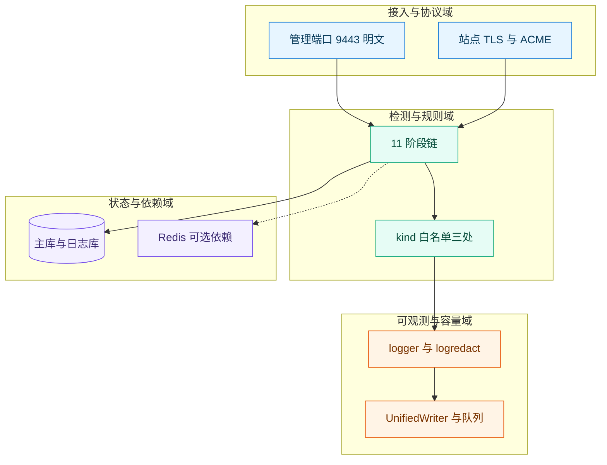
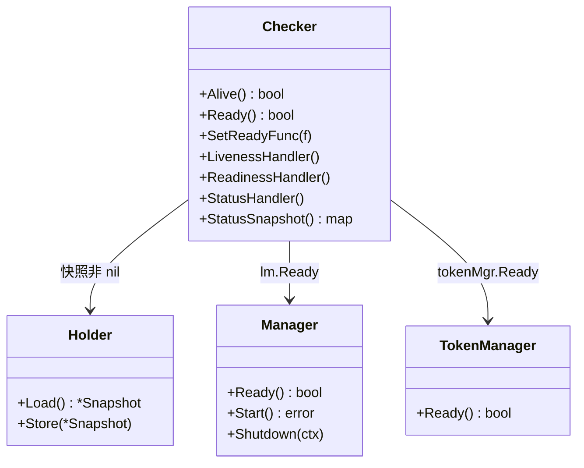
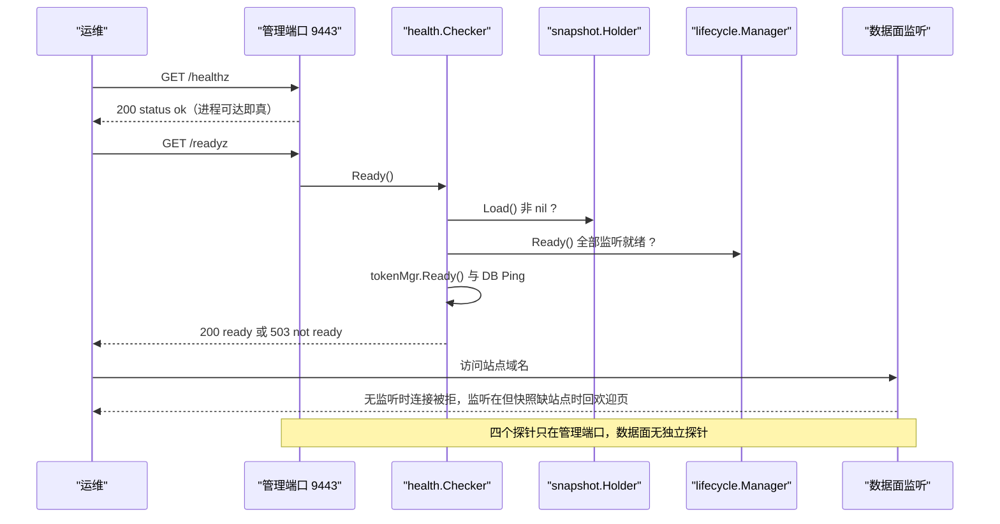
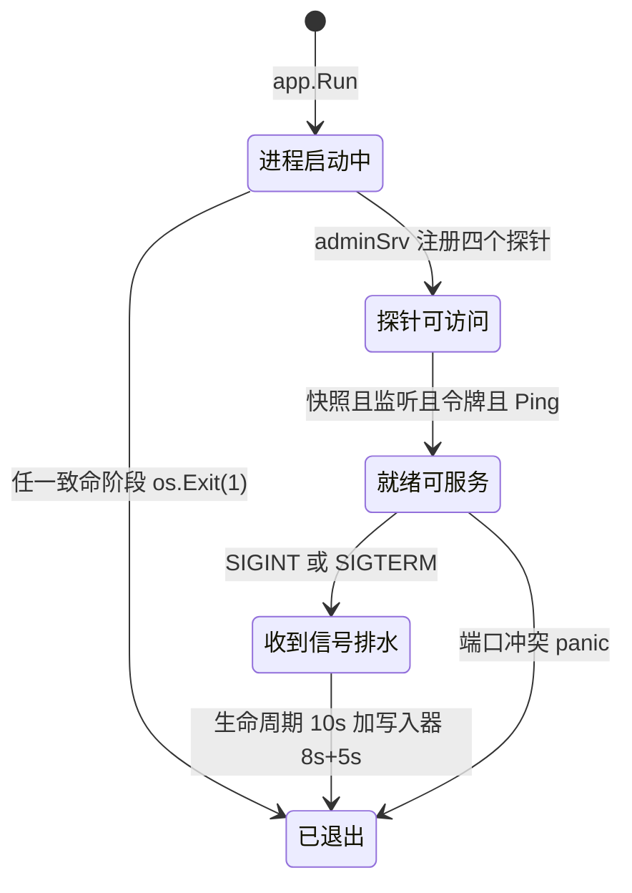
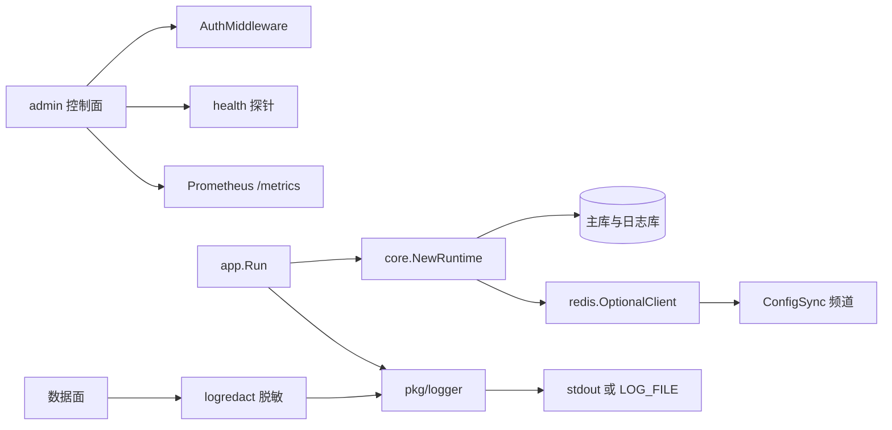
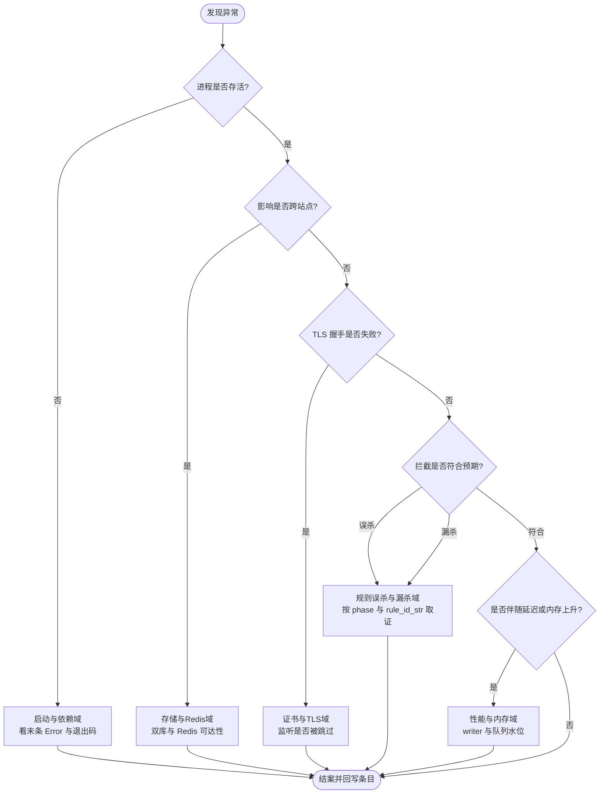

# 故障排除

<cite>
**本文档引用的文件**
- [main.go](file://cmd/main.go)
- [server.go](file://internal/app/server.go)
- [runtime.go](file://internal/core/runtime.go)
- [config.go](file://internal/core/config.go)
- [config_validate.go](file://internal/core/config_validate.go)
- [health.go](file://internal/core/health/health.go)
- [lifecycle.go](file://internal/core/lifecycle/lifecycle.go)
- [redis.go](file://internal/core/redis/redis.go)
- [pubsub.go](file://internal/core/redis/pubsub.go)
- [logger.go](file://internal/pkg/logger/logger.go)
- [sanitize.go](file://internal/dataplane/logredact/sanitize.go)
- [access_log.go](file://internal/dataplane/access_log.go)
- [router.go](file://internal/admin/router.go)
- [network.go](file://internal/admin/system/network.go)
- [settings.go](file://internal/admin/system/settings.go)
- [seed.go](file://internal/store/auth/seed.go)
- [api_key_owner.go](file://internal/store/migrations/api_key_owner.go)
- [migrate.go](file://internal/store/migrate.go)
- [unified_writer.go](file://internal/observability/unified_writer.go)
- [Dockerfile](file://Dockerfile)
- [README.md](file://README.md)
- [启动与依赖故障.md](file://docs/故障排除/启动与依赖故障.md)
- [index.md](file://docs/index.md)
</cite>

> [返回文档总索引](../index.md)

## 目录
1. [简介](#简介)
2. [项目结构](#项目结构)
3. [核心组件](#核心组件)
4. [架构总览](#架构总览)
5. [详细组件分析](#详细组件分析)
6. [依赖关系分析](#依赖关系分析)
7. [性能考虑](#性能考虑)
8. [故障排查指南](#故障排查指南)
9. [结论](#结论)
10. [附录](#附录)

## 简介

本篇是「故障排除」域的**同名总览**，面向值守工程师、接入方运维与二次开发者，给出 My-OpenWaf
五个故障域的分类、分流判据与索引，并落实三条最容易踩空的事实：**管理端口是明文 HTTP**、
**四个探针无需鉴权**、**首启只产出管理员口令**。单个域的具体条目在子文档中展开，
本篇只做分流与定位，不重复其取证细节。

排查遵循固定顺序：快速定位（落在哪个域）→ 证据采集（探针、日志、库）→ 根因判定（代码事实）
→ 修复验证（回归到探针与指标）。前置条件四项，缺任一项时条目按 `未知` 处理：
触发时间与可观测载体（stdout 或 `MY_OPENWAF_LOG_FILE`）、请求关联标识（`X-Request-ID`）、
最近一次配置变更来源（管理 API 或环境变量）、影响面（单站点 / 全局）。

**章节来源**
- [server.go:234-300](file://internal/app/server.go#L234-L300)
- [health.go:22-105](file://internal/core/health/health.go#L22-L105)
- [README.md:278-291](file://README.md#L278-L291)

## 项目结构

故障域按**症状归属**划分，而不是按 Go 包划分；下表即本域的子文档索引与命名契约。

```text
docs/故障排除/
├── 故障排除.md            # 本篇：域分类、分流决策树、端口与探针事实
├── 启动与依赖故障.md      # 已建档：构建 tag、embed、监听、存储、Redis、密钥、停机
├── 规则误杀与漏杀.md      # 规划中：阶段链、kind 白名单、TestRule 覆盖不足
├── 证书与TLS故障.md       # 规划中：证书加载、SNI、ACME、TLS 版本下限
├── 存储与Redis故障.md     # 规划中：WAL、连接池、限流与同步语义
└── 性能与内存故障.md      # 规划中：队列水位、写入器丢弃、内存与 goroutine
```

| 故障域 | 主要代码位置 | 典型症状 | 首要可观测点 | 子文档 |
| --- | --- | --- | --- | --- |
| 启动与依赖 | `internal/app`、`internal/core` | 进程退出、端口不监听、依赖静默降级 | 末条 Error 与退出码、`/readyz` | [启动与依赖故障](启动与依赖故障.md) |
| 规则误杀与漏杀 | `internal/core/rules`、`internal/snapshot` | 正常请求被拦、攻击放行、dry-run 通过但线上无效 | 安全事件的 `phase` 与 `rule_id_str` | 规则误杀与漏杀（规划中） |
| 证书与 TLS | `internal/app/buildListenerTLS`、`internal/acme` | 握手失败、监听被跳过、续期不生效 | `skipping site listener without valid TLS config` | 证书与TLS故障（规划中） |
| 存储与 Redis | `internal/core/database`、`internal/waf/ratelimit` | 迁移报错、锁等待、限流不生效 | `PRAGMA journal_mode`、`redis_enabled` | 存储与Redis故障（规划中） |
| 性能与内存 | `internal/observability`、`internal/cache` | 首包变慢、RSS 粘滞、日志丢弃 | `/metrics` 的 `openwaf_writer_*` | 性能与内存故障（规划中） |



**图表来源**
- [server.go:1052-1056](file://internal/app/server.go#L1052-L1056)
- [runtime.go:63-131](file://internal/core/runtime.go#L63-L131)
- [unified_writer.go:340-349](file://internal/observability/unified_writer.go#L340-L349)

**章节来源**
- [config.go:362-365](file://internal/core/config.go#L362-L365)
- [router.go:109-125](file://internal/admin/router.go#L109-L125)

## 核心组件

只列故障期间被观测或参与传播的组件。

| 组件 | 位置 | 故障期职责 | 可观测输出 | 失效影响 |
| --- | --- | --- | --- | --- |
| 探针注册 | [server.go:1053](file://internal/app/server.go#L1053) | 在管理端口暴露四个探针 | HTTP 200/503 | 无法判定就绪 |
| `health.Checker` | [health.go:32](file://internal/core/health/health.go#L32) | 就绪四条件合取 | `{"status":"ready"}` | 半开进程被误判可用 |
| `lifecycle.Manager` | [lifecycle.go:230](file://internal/core/lifecycle/lifecycle.go#L230) | 汇总各监听就绪态 | `true` 或 `false` | 无注册项时恒不就绪 |
| `TokenManager` | [server.go:629](file://internal/app/server.go#L629) | JWT 黑名单加载态 | 不就绪则 `/readyz` 503 | 鉴权面按失败关闭 |
| `snapshot.Holder` | [health.go:33](file://internal/core/health/health.go#L33) | 快照是否已构建 | `/status` 的 `revision` 与 `sites` | 站点全部不匹配 |
| `pkg/logger` | [logger.go:68](file://internal/pkg/logger/logger.go#L68) | 分段落盘与级别控制 | stdout 或日志文件 | 证据缺失 |
| `logredact` | [sanitize.go:206](file://internal/dataplane/logredact/sanitize.go#L206) | 请求头、请求体、片段脱敏 | `[redacted]` 占位 | 敏感值入日志 |
| `SeedDefaults` | [seed.go:26](file://internal/store/auth/seed.go#L26) | 首启建 admin 并打印口令 | FIRST RUN Banner | 无法登录面板 |



**图表来源**
- [health.go:14-105](file://internal/core/health/health.go#L14-L105)
- [server.go:595-629](file://internal/app/server.go#L595-L629)

**章节来源**
- [logger.go:52-125](file://internal/pkg/logger/logger.go#L52-L125)
- [seed.go:14-56](file://internal/store/auth/seed.go#L14-L56)

## 架构总览

一个「进程在跑但站点不通」的失败传播路径，决定了证据从哪一层开始取。



**图表来源**
- [health.go:47-105](file://internal/core/health/health.go#L47-L105)
- [server.go:1052-1063](file://internal/app/server.go#L1052-L1063)
- [lifecycle.go:230-243](file://internal/core/lifecycle/lifecycle.go#L230-L243)

## 详细组件分析

### 端口与绑定事实

控制面只有一个监听，装配语句是
`adminSrv := server.Default(server.WithHostPorts(rt.Config.AdminBind))`
（`internal/app/server.go:1052`），**未挂任何 TLS 选项**，因此 `MY_OPENWAF_ADMIN_BIND`
默认值 `:9443`（`internal/core/config.go:362-365`）上是明文 HTTP。
`README.md:21` 的「默认管理端口 `:9443`（HTTPS）」与 `README.md:291` 的
「启动后访问 `https://localhost:9443`」两处表述与实现不符，正确用法是 `http://`。
绑定地址必须在 `net.SplitHostPort` 下成形，否则启动阶段就失败
（`internal/core/config_validate.go:28-30`，错误串 `invalid admin bind address`）。

| 端口 | 来源 | 协议 | TLS | 说明 |
| --- | --- | --- | --- | --- |
| `:9443` | `MY_OPENWAF_ADMIN_BIND` 默认值 | TCP | 无 | 控制面 API 与四个探针 |
| 站点 bind | 快照 `SiteRuntime.Bind` | TCP | 由站点证书决定 | 无有效 TLS 配置时该监听被跳过 |
| h3 UDP | 站点同端口或显式 `HTTP3Bind` | UDP | TLS 1.3 | 容器需自行映射 `端口/udp` |
| pprof | `MY_OPENWAF_PPROF_BIND` | TCP | 无 | 仅排障临时开启 |

数据面监听没有独立端口：HTTP/3 用 `net.ListenPacket("udp", s.bind)` 单独占口，
`Dockerfile` 只 `EXPOSE 9443`，因此容器化部署时数据面 TCP 与 UDP 均需自行映射。

**章节来源**
- [server.go:1052-1132](file://internal/app/server.go#L1052-L1132)
- [config.go:362-365](file://internal/core/config.go#L362-L365)
- [config_validate.go:27-37](file://internal/core/config_validate.go#L27-L37)
- [Dockerfile:22-27](file://Dockerfile#L22-L27)
- [README.md:21-21](file://README.md#L21-L21)

### 探针语义与就绪判定

四个探针直接注册在 `adminSrv` 上：`/healthz`、`/readyz`、`/status`、`/metrics`
（`internal/app/server.go:1053-1056`）。鉴权中间件只挂在 `/api/v1` 分组
（`internal/admin/router.go:109-110`），**因此四个探针全部无鉴权**，
管理端口必须限制在可信网段或前置反代鉴权。

`/readyz` 是四条判定的合取，缺一即 503：

1. 快照非 nil：`c.holder.Load() == nil` 直接返回 false（`health.go:33`）；
2. `lm.Ready()`：全部已注册服务器报告监听就绪，**注册表为空时返回 false**
   （`lifecycle.go:230-243`）；
3. `tokenMgr.Ready()`：持久化 JWT 黑名单加载失败即不就绪，中间件按失败关闭处理
   （`server.go:626-629`）；
4. 主库 `Ping()`：取 `sqlDB` 后 `Ping() == nil`（`health.go:39-43`）。

`/status` 返回的字段全部来自 `StatusSnapshot()`（`health.go:75-105`）：
`alive`、`ready`、`revision`、`sites`、`listeners`、`goroutines`、`heap_alloc`、
`go_version`、`num_cpu`。其中 `revision` 为 0 且 `sites` 为 0 表示快照里没有站点，
`listeners` 按 bind 去重统计，是判断「数据面到底起了几个口」的最快指标。

**章节来源**
- [health.go:32-105](file://internal/core/health/health.go#L32-L105)
- [server.go:1052-1063](file://internal/app/server.go#L1052-L1063)
- [router.go:109-110](file://internal/admin/router.go#L109-L110)
- [lifecycle.go:229-243](file://internal/core/lifecycle/lifecycle.go#L229-L243)

### 日志去向、级别与脱敏

日志由 `internal/pkg/logger`（483 行）统一装配：`init()` 按环境解析级别与输出目标，
`New(section)` 为每个子系统派生带 `section` 属性的 logger（`logger.go:52-70`），
`Configure(Config{Level,FilePath,AlsoStdout,Color})` 重建全局 handler
（`logger.go:109-125`），`Banner(lines...)` 用于首启凭据这类必须显眼输出的场景
（`logger.go:451`）。级别只认 `DEBUG`、`WARN`/`WARNING`、`ERROR`，其余一律回落 INFO
（`logger.go:187-198`），因此把 `MY_OPENWAF_LOG_LEVEL` 写成 `verbose` 不会报错，
只会静默按 info 执行——排障时要先确认级别真的生效。

输出去向三种：默认 stdout；设 `MY_OPENWAF_LOG_FILE` 后写文件（目录自动创建，
打开失败回退 stdout 并往 stderr 打印 `logger: failed to open log file …`，
`logger.go:155-183`）；`MY_OPENWAF_LOG_ALSO_STDOUT=1` 时双写。**日志文件没有轮转策略**，
长驻部署需外部 logrotate 或容器日志驱动兜底。级别可经 `POST /api/v1/log-config`
即时改写（`internal/admin/system/network.go:266-295` 调 `logger.Configure`），
该端点不触发快照重载，改动立即生效。

数据面落库前的脱敏由 `internal/dataplane/logredact`（实现单文件 `sanitize.go` 325 行）负责：
`SanitizeLogText` 对请求头、请求体预览与命中片段做替换，命中
`authorization`、`proxy-authorization`、`cookie`、`set-cookie`、`password`、`token`、
`secret`、`api_key` 等键时替换为 `[redacted]`（`sanitize.go:13-15`、`sanitize.go:206-216`）；
查询串走 `SanitizeQueryString`（`sanitize.go:60`）。调用点在访问日志记录路径上
（`internal/dataplane/access_log.go:173-178`），请求体是否被截断由
`RequestBodyTruncated` 标记（`access_log.go:167-171`），命中片段长度上限由检测层保证。

**章节来源**
- [logger.go:52-198](file://internal/pkg/logger/logger.go#L52-L198)
- [logger.go:451-483](file://internal/pkg/logger/logger.go#L451-L483)
- [network.go:266-295](file://internal/admin/system/network.go#L266-L295)
- [sanitize.go:13-216](file://internal/dataplane/logredact/sanitize.go#L13-L216)
- [access_log.go:160-180](file://internal/dataplane/access_log.go#L160-L180)

### 首启流程与凭据

首启主干（`internal/app/server.go:234` 起）与失败出口如下，
每步失败都会打一条 Error 并 `os.Exit(1)`。

| 步 | 动作 | 执行位置 | 输入 | 输出 | 失败分支 | 可观测点 |
| :---: | --- | --- | --- | --- | --- | --- |
| 1 | 配置装配与校验 | [runtime.go:55](file://internal/core/runtime.go#L55) | 环境变量 | 合法 Config | `config: …` | `core init failed` |
| 2 | 打开主库与日志库 | [runtime.go:63](file://internal/core/runtime.go#L63) | DSN | 两个 GORM 句柄 | `database: …` | 同上 |
| 3 | Redis 可选接入 | [runtime.go:99](file://internal/core/runtime.go#L99) | Addr | 客户端或 nil | 静默 nil | `redis_enabled=false` |
| 4 | 主库迁移与目录对账 | [server.go:249](file://internal/app/server.go#L249) | 模型 | 表结构与目录 | `auto migrate failed` | 退出码 1 |
| 5 | 首启种子 | [server.go:267](file://internal/app/server.go#L267) | `admin_accounts` | admin 与口令 | `seed defaults failed` | FIRST RUN Banner |
| 6 | 解析 JWT 密钥 | [server.go:284](file://internal/app/server.go#L284) | env 或库 | 64 位 hex | `resolve persistent JWT secret failed` | 退出码 1 |
| 7 | 构建初始快照 | [server.go:293](file://internal/app/server.go#L293) | 站点与策略 | Holder 内容 | `initial snapshot build failed` | `/readyz` 503 |
| 8 | 控制面与数据面注册 | [server.go:1052](file://internal/app/server.go#L1052) | AdminBind 与 bind | Hertz 实例 | 端口占用 panic | `ss -lntp` |
| 9 | 启动并等信号 | [server.go:1131](file://internal/app/server.go#L1131) | 注册项 | Spin 协程 | `Start()` 错误被丢弃 | `/readyz` |

凭据语义有两条硬边界：**`SeedDefaults` 只在 `username='admin'` 计数为 0 时生成 16 字节
随机口令并打印一次 Banner，不预置任何 API Token**（`internal/store/auth/seed.go:26-56`；
`README.md:291` 的「打印初始管理凭据与 API Token」表述偏宽），
`seed.api_key_initialized` 仅是设置白名单键（`internal/admin/system/settings.go:15`），无生产者；
口令丢失可用 `./bin/my-openwaf reset-admin-password [username] <新口令>` 在不启动服务的情况下重置
（`cmd/main.go:16-21`）。另一条是 **V15 令牌归属回填早于 `SeedDefaults`**：
`AutoMigrate` 在 `server.go:249` 执行、`SeedDefaults` 在 `:267`，
`migrations.V15MigrateAPIKeyOwner`（`internal/store/migrations/api_key_owner.go:21-51`）
只回填 `user_id=0` 且需要已存在 admin 账号，因此**升级后第一次启动既有令牌会失效一次**，
第二次重启才自愈（`migrate.go:110`）。

**章节来源**
- [server.go:234-300](file://internal/app/server.go#L234-L300)
- [seed.go:14-56](file://internal/store/auth/seed.go#L14-L56)
- [api_key_owner.go:9-51](file://internal/store/migrations/api_key_owner.go#L9-L51)
- [migrate.go:22-113](file://internal/store/migrate.go#L22-L113)
- [main.go:13-28](file://cmd/main.go#L13-L28)

### 进程可观测生命周期

关停与启动共用同一套判定，是「半开进程」最容易被误读的一段。



**图表来源**
- [lifecycle.go:245-298](file://internal/core/lifecycle/lifecycle.go#L245-L298)
- [unified_writer.go:340-349](file://internal/observability/unified_writer.go#L340-L349)
- [health.go:32-44](file://internal/core/health/health.go#L32-L44)

排水预算叠加即最坏关停时长：`lifecycle` 对每个服务器用 10s
（`lifecycle.go:18`、`lifecycle.go:250-286`），`Run` 的 `defer` 链里统一写入器另需
`unifiedWriterCloseTimeout(8s) + unifiedWriterCloseGrace(5s)`
（`unified_writer.go:344-349`、`unified_writer.go:727-741`），
超时只告警 `abandoning drain` 并附四条队列长度，不强杀进程。

**章节来源**
- [lifecycle.go:144-298](file://internal/core/lifecycle/lifecycle.go#L144-L298)
- [unified_writer.go:702-741](file://internal/observability/unified_writer.go#L702-L741)

## 依赖关系分析



**图表来源**
- [runtime.go:36-142](file://internal/core/runtime.go#L36-L142)
- [router.go:91-125](file://internal/admin/router.go#L91-L125)
- [pubsub.go:16-122](file://internal/core/redis/pubsub.go#L16-L122)

| 依赖 | 用途 | 接入方式 | 配置来源 | 超时 | 重试 | 降级 | 可用性影响 |
| --- | --- | --- | --- | :---: | :---: | --- | --- |
| 主库 | 站点、策略、账号 | GORM | `MY_OPENWAF_DSN` | 未设置（风险） | 无 | 无 | 启动致命退出 |
| 日志库 | 访问、安全、drop 记录 | GORM 第二连接 | `MY_OPENWAF_LOG_DSN` | 未设置（风险） | 无 | 无 | 记录不落盘 |
| Redis | 限流、nonce、KV、事件扇出 | rueidis | env 或 `redis_config` | 拨号 5s、写 3s | 无 | 置 nil | 限流放行、防重放拦截 |
| Redis Pub/Sub | 多节点重载同步 | `ConfigSync` | 同上 | 发布 2s | 无重连 | 静默失联 | 节点配置漂移 |
| 管理端口 | API 与探针 | Hertz | `MY_OPENWAF_ADMIN_BIND` | 未设置（风险） | 无 | 无 | 面板与探针不可达 |

**章节来源**
- [redis.go:18-42](file://internal/core/redis/redis.go#L18-L42)
- [access_log.go:160-180](file://internal/dataplane/access_log.go#L160-L180)

## 性能考虑

- **探针成本**：`/status` 每次调用都会 `runtime.ReadMemStats`，会短暂 STW；
  抓取间隔不宜低于 10s，高频监控应改用 `/metrics` 的常驻计数器。
- **无鉴权暴露面**：四个探针与 `/metrics` 全部无鉴权，公网直挂会泄露站点数、
  代次与运行时内存指标，必须网段隔离或反代加白。
- **日志双写放大**：`MY_OPENWAF_LOG_ALSO_STDOUT=1` 在文件写入之外再加一份 stdout，
  容器采集侧会重复计流，仅排障期间开启。

[本节为通用指导，无需特定文件来源]

## 故障排查指南

### 通用诊断流程

第一步用决策树把症状收敛到单一域，再进对应子文档取证；定级完全复用问题检测的
四档标准（严重＝凭据入库、越权可达、数据可能丢失；高＝错误被吞没或无校验；
中＝职责重叠或核心路径缺覆盖；低＝命名与注释）。



**图表来源**
- [server.go:234-300](file://internal/app/server.go#L234-L300)
- [health.go:32-44](file://internal/core/health/health.go#L32-L44)
- [runtime.go:99-131](file://internal/core/runtime.go#L99-L131)

分层定位：每层只回答一个是/否问题，答案决定下一层。

| 层 | 判定问题 | 取证命令或入口 | 命中后的下一动作 | 排除条件 |
| :---: | --- | --- | --- | --- |
| 1 | 进程与端口是否就绪 | `ss -lntp` 与 `/healthz` | 进启动与依赖域 | 端口在监听 |
| 2 | 快照是否可用 | `/status` 的 `sites` 与 `revision` | 查迁移与站点配置 | 数量与预期一致 |
| 3 | 依赖是否降级 | `grep redis_enabled` 启动日志 | 进存储与 Redis 域 | 为 `true` |
| 4 | 请求是否到达 | 访问日志按 `X-Request-ID` 检索 | 查上游与路由匹配 | 日志有记录 |
| 5 | 动作是否符合预期 | 安全事件的 `phase` 与 `action` | 进规则误杀与漏杀域 | 已确认命中源 |

管理面自检（默认端口 `:9443`，实测在临时端口 `:19443` 上完成，命令与输出形态一致）：

```bash
curl -sS http://127.0.0.1:9443/healthz
curl -sS http://127.0.0.1:9443/readyz
curl -sS http://127.0.0.1:9443/status
```

**预期输出形态**：`{"status":"ok"}`、`{"status":"ready"}`（不就绪为 `{"status":"not ready"}`
且 HTTP 503）、`{"alive":true,"ready":true,"revision":0,"sites":0,"listeners":0,
"goroutines":36,"heap_alloc":45141376,"go_version":"go1.27.2","num_cpu":8}`。
对明文端口误用 HTTPS 的实测输出是
`curl: (35) TLS connect error: error:0A00010B:SSL routines::wrong version number`。

```bash
curl -sS http://127.0.0.1:9443/metrics | head -5
curl -sS -o /dev/null -w '%{http_code}\n' http://127.0.0.1:9443/api/v1/sites
sqlite3 data/waf.db '.tables'
```

**预期输出形态**：`/metrics` 首行是 `# HELP openwaf_uptime_seconds Seconds since process start`，
证明该端点无需令牌即可读取；未带凭据访问 `/api/v1/sites` 返回 `401`，
说明鉴权只覆盖 `/api/v1` 分组；`.tables` 至少列出 `sites policies system_settings
admin_accounts admin_api_keys`。

**章节来源**
- [server.go:1052-1063](file://internal/app/server.go#L1052-L1063)
- [router.go:109-110](file://internal/admin/router.go#L109-L110)
- [health.go:75-105](file://internal/core/health/health.go#L75-L105)

### 常见问题与解决方案

总览层只保留跨域通用条目，域内细节见对应子文档。

#### 面板打不开：用 `https://` 访问明文端口

- **症状**：浏览器报 `ERR_SSL_PROTOCOL_ERROR`，`curl -v https://localhost:9443/` 报
  `wrong version number`；日志里没有任何请求记录。
- **原因**：`adminSrv` 未挂 TLS（`server.go:1052`），`:9443` 是 HTTP；
  README 的 HTTPS 表述是文档缺陷而非实现。
- **排查**：`curl -sS http://127.0.0.1:9443/healthz` 期望 `{"status":"ok"}`；
  换 `https://` 期望复现上述 TLS 错误。
- **方案**：统一改用 `http://`，或在前面挂一层反向代理做 TLS 终止并限制来源网段；
  不要为探针放开公网。
- **定位依据**：[README.md:21-21](file://README.md#L21-L21)、[server.go:1052-1056](file://internal/app/server.go#L1052-L1056)

#### 进程在跑但 `/readyz` 一直 503

- **症状**：`/healthz` 200、`/readyz` 503，`/status` 里 `sites` 与 `listeners` 为 0。
- **原因**：四条件之一未成立——快照未加载（`initial snapshot build failed` 后已退出，
  或站点全部无证书被跳过）、`lm.Ready()` 为 false（无注册监听，
  `lifecycle.go:233-235`）、`tokenMgr.Ready()` 为 false（黑名单加载失败）、主库 Ping 失败。
- **排查**：`curl -sS http://127.0.0.1:9443/status` 看四字段；
  `grep -E 'skipping site listener|initial snapshot build failed' 启动日志`。
- **方案**：按缺失的那一条修——补站点证书、修库权限、或重启让令牌黑名单重新加载；
  修复后以 `/readyz` 200 为唯一验收标准，不以日志文本 `My-OpenWaf ready` 为准。
- **定位依据**：[health.go:32-44](file://internal/core/health/health.go#L32-L44)、[server.go:626-629](file://internal/app/server.go#L626-L629)

#### 忘记首启口令，面板无法登录

- **症状**：FIRST RUN Banner 已滚出终端，`admin` 口令不可得。
- **原因**：口令只在 `RowsAffected > 0` 时打印一次（`store/auth/seed.go:49-52`），
  库中只存 bcrypt 哈希，不可回读。
- **排查**：`sqlite3 data/waf.db 'SELECT username, role FROM admin_accounts;'`
  期望看到 `admin|admin`。
- **方案**：`./bin/my-openwaf reset-admin-password admin '<新口令>'`
  （`cmd/main.go:16-21`），该命令自带一次 `AutoMigrate`，可顺带验证库可用性。
- **定位依据**：[seed.go:26-56](file://internal/store/auth/seed.go#L26-L56)、[main.go:13-28](file://cmd/main.go#L13-L28)

#### 日志级别设了不生效，或日志文件无限增长

- **症状**：`MY_OPENWAF_LOG_LEVEL=verbose` 后调试行仍不出现；或 `waf.log` 涨到数 GB。
- **原因**：级别解析只认 `DEBUG`/`WARN`/`WARNING`/`ERROR`，其余回落 INFO
  （`logger.go:187-198`）；文件写入是 `O_APPEND` 单文件，无轮转（`logger.go:169`）。
- **排查**：`grep -c ' DBG ' 日志文件` 期望大于 0，为 0 即级别未被识别；
  `curl -sS http://127.0.0.1:9443/metrics | rg openwaf_writer_` 观察写入水位。
- **方案**：级别串改成 `debug`；长驻部署为日志目录配 logrotate 或容器日志轮转，
  排障结束把级别调回 `info`，避免 debug 全量落盘放大体积。
- **定位依据**：[logger.go:155-198](file://internal/pkg/logger/logger.go#L155-L198)

| 编号 | 类别 | 严重度 | 标题 | 位置 | 影响 | 建议 |
| --- | --- | :---: | --- | --- | --- | --- |
| I-01 | 安全 | 高 | 四个探针无鉴权，含 `/metrics` | [server.go:1053](file://internal/app/server.go#L1053) | 运行时指标与站点规模外泄 | 网段隔离或反代加白 |
| I-02 | 最佳实践 | 高 | README 宣称管理端口为 HTTPS | [README.md:291](file://README.md#L291) | 首次接入即连接失败 | 文档改 http 或实现挂 TLS |
| I-03 | 架构设计 | 高 | `Start()` 错误被丢弃 | [server.go:1131](file://internal/app/server.go#L1131) | 半开进程被编排层判为可用 | 就绪判定统一走 readyz |
| I-04 | 代码质量 | 中 | 日志级别非法值静默回落 | [logger.go:195](file://internal/pkg/logger/logger.go#L195) | 排障期拿不到 debug 行 | 非法值产出一条 Warn |
| I-05 | 最佳实践 | 中 | 日志文件无轮转 | [logger.go:169](file://internal/pkg/logger/logger.go#L169) | 磁盘写满风险 | 外部 logrotate 兜底 |
| I-06 | 架构设计 | 中 | V15 早于 `SeedDefaults` | [migrate.go:110](file://internal/store/migrate.go#L110) | 升级首启令牌失效一次 | 种子后再回填 |
| I-07 | 代码质量 | 中 | Redis 地址错误时启动静音 | [redis.go:30](file://internal/core/redis/redis.go#L30) | 限流静默 fail-open | 建连失败也告警 |

`类别` 取值限于 `代码质量`、`架构设计`、`安全`、`性能`、`最佳实践`。
上述条目均为已核对到行列的真实事实，尚未改动任何代码；后续按域拆分登记到
问题检测报告，本文只保留与「定位」直接相关的部分。

**章节来源**
- [server.go:1052-1132](file://internal/app/server.go#L1052-L1132)
- [logger.go:155-198](file://internal/pkg/logger/logger.go#L155-L198)
- [redis.go:18-42](file://internal/core/redis/redis.go#L18-L42)
- [README.md:278-291](file://README.md#L278-L291)

## 结论

本域的价值在于把「进程到底算不算起来了」这件事标准化：`/healthz` 只证明进程可达，
`/readyz` 的四条合取才证明可以接流量，`/status` 的 `sites` 与 `listeners` 则把快照与
监听数量变成可读数字。配合分段落盘的结构化日志与落库前脱敏，绝大多数故障都能在
两三条命令内定位到具体阶段与域。

- **优势 1**：启动阶段的错误串唯一且致命即退出，根因定位成本低。
- **优势 2**：可选依赖的降级方向明确（限流放行、防重放拦截），不会双向摇摆。
- **建议**：把 `/readyz` 与 `redis_enabled` 作为部署验收硬条件；
  子文档新增条目时同步回写本域的索引表与决策树分支，避免域划分漂移。

[本节为总结，无需特定文件来源]

## 附录

### 探针与端口配置项

| 配置项 | 类型 | 默认值 | 必填 | 作用域 | 生效方式 | 安全等级 | 说明 |
| --- | --- | --- | :---: | --- | --- | --- | --- |
| `MY_OPENWAF_ADMIN_BIND` | string | `:9443` | 否 | 控制面 | 重启 | 普通 | 明文 HTTP，探针与 API 共用 |
| `MY_OPENWAF_LOG_LEVEL` | string | `info` | 否 | 进程 | 重启或 log-config | 普通 | 仅认 debug、warn、error，其余回落 info |
| `MY_OPENWAF_LOG_FILE` | string | 空 | 否 | 进程 | 重启 | 普通 | 空则只写 stdout，无轮转 |
| `MY_OPENWAF_LOG_ALSO_STDOUT` | string | 空 | 否 | 进程 | 重启 | 普通 | 置 `1` 时文件与 stdout 双写 |
| `MY_OPENWAF_PPROF_BIND` | string | 空 | 否 | 进程 | 重启 | 敏感 | 打开即暴露运行时剖析，用完即关 |
| `MY_OPENWAF_JWT_SECRET` | string | 无 | 否 | 进程 | 重启 | **机密** | 真实值严禁写入文档与工单 |
| `MY_OPENWAF_REDIS_ADDR` | string | 空 | 否 | 进程 | 重启或 redis-config | 敏感 | 不可达时静默降级为无 Redis |

**章节来源**
- [config.go:334-365](file://internal/core/config.go#L334-L365)
- [README.md:315-341](file://README.md#L315-L341)
- [main.go:29-49](file://cmd/main.go#L29-L49)

### 子文档索引与状态

| 子文档 | 覆盖范围 | 状态 | 首个自检命令 |
| --- | --- | --- | --- |
| [启动与依赖故障](启动与依赖故障.md) | 构建 tag、embed、监听绑定、双库、Redis、JWT、停机预算 | 已建档 | `go list -f '{{.GoFiles}}' ./internal/waf/jsplugin` |
| 规则误杀与漏杀 | 阶段链顺序、kind 白名单三处、TestRule 覆盖不全 | 规划中 | `sqlite3 data/waf_logs.db 'select phase, count(*) from security_events group by phase;'` |
| 证书与TLS故障 | 证书加载与跳过、SNI 与自签、ACME 续期、TLS 版本下限 | 规划中 | `curl -sS http://127.0.0.1:9443/status` |
| 存储与Redis故障 | 连接池、WAL、DSN 参数、限流与同步语义、事件写入队列 | 规划中 | `sqlite3 data/waf.db 'PRAGMA journal_mode;'` |
| 性能与内存故障 | 队列水位、写入器丢弃、内存回收、goroutine 增长 | 规划中 | `curl -sS http://127.0.0.1:9443/metrics` |

规划中的四篇按上表命名落档，链接在本篇内暂以纯文本给出以避免死链；
命名与范围一经合入即为契约，不得另立同义文件名。

**章节来源**
- [启动与依赖故障.md:1-40](file://docs/故障排除/启动与依赖故障.md#L1-L40)
- [index.md:9-22](file://docs/index.md#L9-L22)
