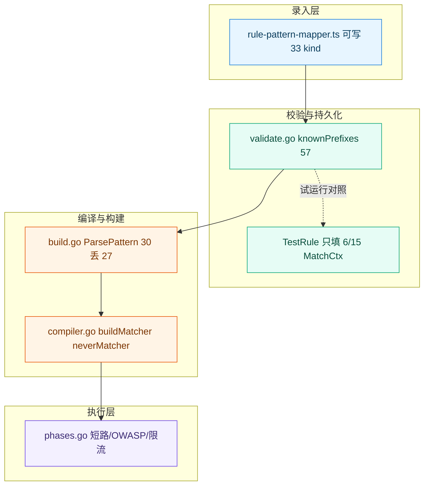
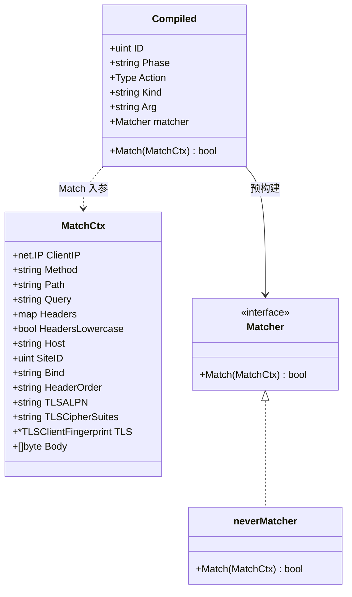
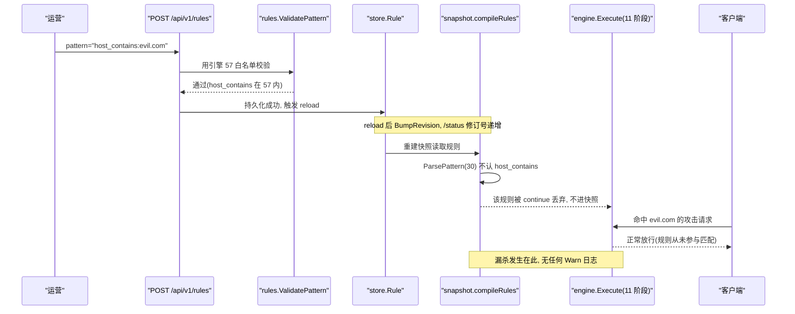
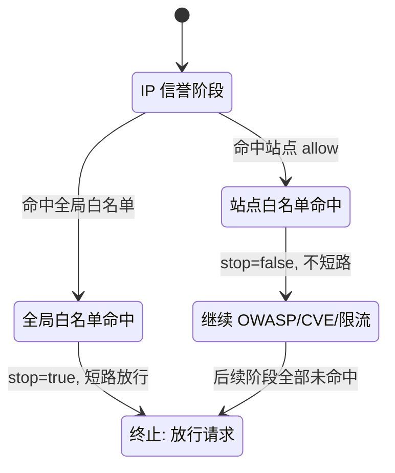
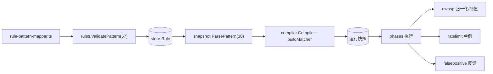
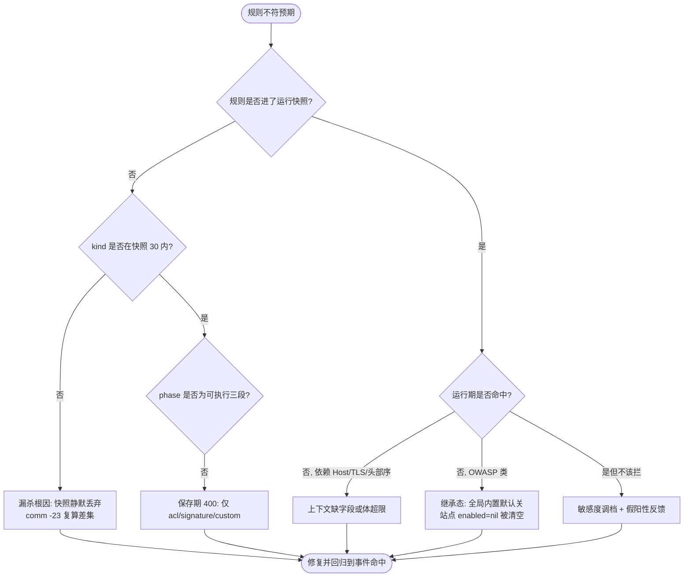

# 规则误杀与漏杀

<cite>
**本文档引用的文件**
- [compiler.go](file://internal/core/rules/compiler.go)
- [matcher.go](file://internal/core/rules/matcher.go)
- [phases.go](file://internal/core/rules/phases.go)
- [validate.go](file://internal/core/rules/validate.go)
- [build.go](file://internal/snapshot/build.go)
- [protection.go](file://internal/store/protection.go)
- [site.go](file://internal/store/site.go)
- [site.go](file://internal/admin/site/site.go)
- [json_bind.go](file://internal/admin/shared/json_bind.go)
- [rule.go](file://internal/admin/rule/rule.go)
- [owasp.go](file://internal/waf/owasp/owasp.go)
- [patterns.go](file://internal/waf/owasp/patterns.go)
- [normalize.go](file://internal/waf/owasp/normalize.go)
- [handler.go](file://internal/dataplane/handler.go)
- [false_positive.go](file://internal/admin/event/false_positive.go)
- [false_positive.go](file://internal/store/falsepositive/false_positive.go)
- [ratelimit.go](file://internal/waf/ratelimit/ratelimit.go)
- [server.go](file://internal/app/server.go)
- [rule-pattern-mapper.ts](file://frontend/app/(dashboard)/rules/components/rule-pattern-mapper.ts)
- [故障排除.md](file://docs/故障排除/故障排除.md)
- [启动与依赖故障.md](file://docs/故障排除/启动与依赖故障.md)
</cite>

## 目录
1. [简介](#简介)
2. [项目结构](#项目结构)
3. [核心组件](#核心组件)
4. [架构总览](#架构总览)
5. [详细组件分析](#详细组件分析)
6. [依赖关系分析](#依赖关系分析)
7. [性能考虑](#性能考虑)
8. [故障排查指南](#故障排查指南)
9. [结论](#结论)
10. [附录](#附录)

## 简介

本文面向值守与策略运营工程师，专治 My-OpenWaf 检测面的两类反直觉现象：**误杀**（正常流量被拦）与
**漏杀**（攻击或自建规则「保存成功、试运行通过，线上却从不命中」）。它与同域的
[故障排除](故障排除.md)（域分流与端口/探针事实）、[启动与依赖故障](启动与依赖故障.md)（进程能否起来）
互补：那两篇解决「服务在不在」，本篇解决「在跑的规则到底生效没有」。

系统检测面是一条 **11 阶段链**（`ip_reputation → anti_replay → acl → lua_pre → owasp_default →
cve → bot → browser_sign → rate_limit → signature → custom`，定义在 `internal/core/engine/engine.go:465-548`），
本篇只讨论「规则是否进入运行快照、进入后是否命中、命中后是否短路」这三段，
不涉及阶段顺序本身（顺序与每阶段职责见「处理阶段详解」域）。

排查前置条件四项，缺一按 `未知` 处理：触发时间与可观测载体（安全事件的 `phase` 与 `rule_id_str`）、
请求关联标识（**只有 `X-Request-ID`，不存在 `X-WAF-Action` 响应头**）、最近一次规则/防护变更来源（管理 API
或 `system_settings`）、影响面（单站点还是全局）。

**章节来源**
- [phases.go:33-52](file://internal/core/rules/phases.go#L33-L52)
- [handler.go:57-57](file://internal/dataplane/handler.go#L57-L57)
- [故障排除.md:44-54](file://docs/故障排除/故障排除.md#L44-L54)

## 项目结构

排障视角按「规则从录入到生效要穿过哪几道白名单」分层，而不是按 Go 包分层。一条自建 DSL 规则
从前端表单到运行快照要依次经过：前端映射 → 保存期校验（引擎白名单）→ 持久化 → 快照编译（快照白名单）
→ 引擎构建匹配器（引擎白名单）→ 阶段执行。任一环节的取值集合不一致，就会在不同环节留下不同的「失效」。

```text
规则误杀与漏杀
├── 录入层    frontend/.../rule-pattern-mapper.ts        # target/method → {kind,arg}
├── 校验层    internal/core/rules/validate.go            # knownPrefixes(57) 保存期判定
├── 持久化层  internal/admin/rule/rule.go + TestRule      # 试运行只填 6/15 字段
├── 编译层    internal/snapshot/build.go                  # ParsePattern(30) 在此静默丢弃
├── 构建层    internal/core/rules/compiler.go + matcher.go # neverMatcher 双重 fail-closed
└── 执行层    internal/core/rules/phases.go + owasp/*      # 短路、敏感度、归一化、体抽取
```

| 故障域 | 所在位置 | 典型失效 | 首要可观测点 | 对应条目 |
| --- | --- | --- | --- | --- |
| kind 白名单不一致 | `build.go` 编译层 vs `compiler.go` 引擎层 | 规则保存成功但永不进快照 | `/status` 修订号在涨、事件里却无该 `rule_id_str` | [T-01](#t-01-自建规则保存成功却从不命中) |
| 试运行覆盖不足 | `internal/admin/rule/rule.go` | TLS/Host/头部序类「测试通过线上不命中」 | `TestRule` 返回体只有 `matched/kind/arg` | [T-02](#t-02-试运行通过线上恒不命中) |
| 正则降级静默 | `compiler.go`、`matcher.go` | 非法或越界 kind 退化为恒不命中 | 无日志，仅表现为不拦截 | [T-03](#t-03-越界-or-非法正则静默-nevermatcher) |
| 短路语义误解 | `phases.go` ACL/IP 信誉 | 加了 `allow`/站点白名单仍被拦 | 事件 `category=whitelist` 但未终止 | [T-04](#t-04-加了-allow-仍被拦) |
| OWASP 默认与继承 | `protection.go`、`store/site.go`、`admin/site/site.go` | 配了 OWASP 不生效、或全局意外生效 | 站点 `owasp_enabled` 为 nil 时从属字段被清空 | [T-05](#t-05-owasp-配了不生效或全局意外生效) |
| 限流站点覆盖 | `build.go`、`server.go`、`ratelimit.go` | 站点改 window/max 不生效 | 后端窗口是进程级单例、只取全局值 | [T-06](#t-06-站点级限流看似不生效) |



节点标签用引号包裹、占位写在引号内；`-.->` 表示「试运行与实际生效路径不同」的对照关系，
`classDef`/`:::` 区分录入/校验/编译/执行四层收敛边界。

**图表来源**
- [rule-pattern-mapper.ts:72-131](file://frontend/app/(dashboard)/rules/components/rule-pattern-mapper.ts#L72-L131)
- [validate.go:123-126](file://internal/core/rules/validate.go#L123-L126)
- [build.go:1197-1222](file://internal/snapshot/build.go#L1197-L1222)
- [phases.go:112-129](file://internal/core/rules/phases.go#L112-L129)

**章节来源**
- [compiler.go:119-142](file://internal/core/rules/compiler.go#L119-L142)
- [rule.go:224-267](file://internal/admin/rule/rule.go#L224-L267)

## 核心组件

只列参与「是否生效」判定与被观测的组件，不重复业务功能文档的组件清单。

| 组件 | 位置 | 失效期职责 | 可观测输出 | 失效影响 |
| --- | --- | --- | --- | --- |
| `knownPrefixes`（引擎侧） | [compiler.go:119-142](file://internal/core/rules/compiler.go#L119-L142) | 57 项 kind 判定，保存期与构建期共用 | 不在表内即 `ParsePattern` 返空 | 决定能否被引擎识别 |
| `ParsePattern`（快照侧） | [build.go:1197-1222](file://internal/snapshot/build.go#L1197-L1222) | 30 项前缀，独立一份 | 越界 kind 返 `"",""` | `compileRules` 直接 `continue` |
| `compileRules` | [build.go:920-936](file://internal/snapshot/build.go#L920-L936) | 把 store.Rule 编进快照 | 静默丢弃，无 Warn | 规则不入快照即永不执行 |
| `buildMatcher` / `neverMatcher` | [matcher.go:583-587](file://internal/core/rules/matcher.go#L583-L587) | 无法识别的 kind 兜底恒 false | 无日志 | 「配了不生效」同源 |
| `MatchCtx` | [phases.go:33-52](file://internal/core/rules/phases.go#L33-L52) | 15 字段匹配上下文 | 运行期填满，试运行仅 6 | 缺字段类恒不命中 |
| `TestRule` | [rule.go:224-267](file://internal/admin/rule/rule.go#L224-L267) | dry-run | `{matched,kind,arg}` | 测试通过≠线上生效 |
| `clearInheritedProtectionOverrides` | [site.go:505-523](file://internal/admin/site/site.go#L505-L523) | 三态从属字段清理 | 父开关 nil 时清空从属 | 误把从属值当覆盖 |
| `falsepositive.FalsePositiveReport` | [false_positive.go:16-43](file://internal/store/falsepositive/false_positive.go#L16-L43) | 误报反馈闭环载体 | 按 `security_event_id` 去重 | 缺反馈难定位敏感度 |



`MatchCtx` 实为 14 个导出字段加 1 个私有 `reqCtx`，合计 15；试运行只填 6 个，
差集字段（Host、TLS 系列、HeaderOrder、SiteID、Bind、HeadersLowercase）留零值，
故依赖这些字段的 kind 在 dry-run 中恒不命中。`Matcher` 接口签名是 `Match(MatchCtx)`，
并非旧文档描述的 5 参数形式。

**图表来源**
- [compiler.go:13-29](file://internal/core/rules/compiler.go#L13-L29)
- [phases.go:33-52](file://internal/core/rules/phases.go#L33-L52)
- [matcher.go:583-587](file://internal/core/rules/matcher.go#L583-L587)

**章节来源**
- [compiler.go:39-78](file://internal/core/rules/compiler.go#L39-L78)
- [build.go:920-936](file://internal/snapshot/build.go#L920-L936)

## 架构总览

一条「正常但用了越界 kind」的请求如何一路走到放行，决定了「漏杀」的证据从哪一层开始取。



证据链的关键点是：保存接口与试运行都读引擎侧 57 白名单（`compiler.go:119-142`），
而运行快照读快照侧 30 白名单（`build.go:1205-1215`）；两套集合之间的 27 项差集，
正是「API 返回 201、修订号在涨、`/status` 一切正常，但规则从不命中」的物理位置。

**图表来源**
- [rule.go:98-137](file://internal/admin/rule/rule.go#L98-L137)
- [validate.go:123-139](file://internal/core/rules/validate.go#L123-L139)
- [build.go:920-936](file://internal/snapshot/build.go#L920-L936)
- [build.go:1197-1222](file://internal/snapshot/build.go#L1197-L1222)

**章节来源**
- [build.go:920-936](file://internal/snapshot/build.go#L920-L936)
- [compiler.go:39-78](file://internal/core/rules/compiler.go#L39-L78)

## 详细组件分析

### kind 白名单三处不一致（漏杀头号根因）

「漏杀」绝大多数不是引擎算错，而是规则根本没进到引擎里。同一个「什么 kind 合法」的问题，
代码里有**三处互相独立、无人比对**的白名单：

| 白名单 | 位置 | 条目数 | 作用阶段 | 命中差集后果 |
| --- | --- | :---: | --- | --- |
| 引擎 `knownPrefixes` | [compiler.go:119-142](file://internal/core/rules/compiler.go#L119-L142) | 57 | 保存期校验 + 引擎构建 | 判定「合法」，规则入库 |
| 快照 `prefixes` | [build.go:1205-1215](file://internal/snapshot/build.go#L1205-L1215) | 30 | 快照编译 `compileRules` | 不在表内 → `continue` 静默丢弃 |
| skip-path phase 集 | [protection.go:326-336](file://internal/store/protection.go#L326-L336) | 9 | 站点级跳过路径校验 | phase 名越界 → 保存期 400 |

前两处是 **kind** 轴（57 与 30），第三处是 **phase** 轴（9 项，且经 `json_bind.go:44-63` 的
`ValidateSkipPathByPhase` 校验）。57 减 30 的差集恰为 27 项，全部在 `compileRules`
（[build.go:923-926](file://internal/snapshot/build.go#L923-L926)）被丢弃。可用如下命令现场复算：

```bash
# 引擎 57 与快照 30 取差集，应得 27 项且反向为空
sed -n '/kinds := \[\]string{/,/^\t}/p' internal/core/rules/compiler.go \
  | tr -s '"' '\n' | tr -d ' \t' | sed -n -E '/^[a-z0-9_]+$/p' | sed -E '/^kinds$/d' | sort -u > /tmp/engine.txt
sed -n '/prefixes := \[\]string{/,/^\t}/p' internal/snapshot/build.go \
  | tr -s '":' '\n' | tr -d ' \t' | sed -n -E '/^[a-z0-9_]+$/p' | sed -E '/^prefixes$/d' | sort -u > /tmp/snap.txt
comm -23 /tmp/engine.txt /tmp/snap.txt    # 引擎认、快照丢
comm -13 /tmp/engine.txt /tmp/snap.txt    # 应为空（快照是引擎子集）
```

**预期输出形态**：`/tmp/engine.txt` 为 57 行、`/tmp/snap.txt` 为 30 行；`comm -23` 输出
27 行（`geo_block`、`block_header_exact`、`path_wildcard`、`host_contains`、`full_url_regex`、
`block_multipart` 等），`comm -13` 无输出。这 27 项就是「保存期合法、快照期蒸发」的清单。

前端更糟一层：`rule-pattern-mapper.ts` 的可写路径能产出 **33 个 kind**，全部落在引擎 57 内
（所以表单校验与 API 都放行），但其中 **21 个不在快照 30 内**——它们在 UI 里能保存、能试跑，
落库后被快照编译丢弃：

```bash
# 前端可写 kind 与快照 30 的差集，应得 21 项
command grep -oE 'kind: "[a-z0-9_]+"' 'frontend/app/(dashboard)/rules/components/rule-pattern-mapper.ts' \
  | sed -E 's/kind: "([a-z0-9_]+)"/\1/' | sort -u > /tmp/fe.txt
comm -23 /tmp/fe.txt /tmp/snap.txt    # 前端可写但快照会丢
```

**预期输出形态**：`/tmp/fe.txt` 为 33 行；差集 21 行，含 `geo_block`、`host_contains`、
`host_regex`、`host_wildcard`、`path_contains`、`path_wildcard`、`full_url_*` 四类、
`query_param_regex`、`query_param_not_exact`、`body_wildcard`、`body_not_exact`、
`block_header_exact/prefix/not_exact`、`header_wildcard`。这 21 项是 27 项差集的子集，
也是前端用户最常踩的「配了不生效」。

**章节来源**
- [compiler.go:119-142](file://internal/core/rules/compiler.go#L119-L142)
- [build.go:920-936](file://internal/snapshot/build.go#L920-L936)
- [build.go:1197-1222](file://internal/snapshot/build.go#L1197-L1222)
- [protection.go:323-352](file://internal/store/protection.go#L323-L352)
- [json_bind.go:44-63](file://internal/admin/shared/json_bind.go#L44-L63)
- [rule-pattern-mapper.ts:199-459](file://frontend/app/(dashboard)/rules/components/rule-pattern-mapper.ts#L199-L459)

### TestRule 试运行覆盖不足

`TestRule`（[rule.go:224-267](file://internal/admin/rule/rule.go#L224-L267)）用引擎侧
`rules.ParsePattern`（57）解析 pattern，再用 `rules.Compile` 构建匹配器，但只把
`MatchCtx` 填了 6 个字段：

| MatchCtx 字段 | 试运行是否填 | 缺失导致的恒不命中 kind |
| --- | :---: | --- |
| ClientIP / Method / Path / Query / Headers / Body | 是 | 仅 IP、方法、路径、查询、头部、请求体类可验证 |
| Host | 否 | `host`、`host_full`、`host_regex`、`host_contains`、`host_not_contains`、`host_not_exact` |
| TLS / TLSALPN / TLSCipherSuites | 否 | `tls_ja3`、`tls_ja3_hash`、`tls_ja4`、`tls_version`、`tls_sni`、`tls_alpn`、`tls_cipher_suites` |
| HeaderOrder | 否 | `header_order_contains`、`header_order_regex` |
| HeadersLowercase | 否 | 头部大小写敏感判定可能误判 |
| SiteID / Bind | 否 | `cc_rate` 计数键维度缺失 |

运行期由 `fillMatchCtxFromPipeline`（[phases.go:72-104](file://internal/core/rules/phases.go#L72-L104)）
填满这些字段，而 dry-run 不填——于是 TLS/Host/头部序类规则「试运行 matched=false」并非规则错，
而是上下文缺；反之某条越界 kind 若恰好只依赖 Body，dry-run 可能 matched=true 而线上被快照丢弃。
两个方向都说明：**试运行结果不能作为线上生效的验收标准**。

**章节来源**
- [rule.go:224-267](file://internal/admin/rule/rule.go#L224-L267)
- [phases.go:33-52](file://internal/core/rules/phases.go#L33-L52)
- [phases.go:72-104](file://internal/core/rules/phases.go#L72-L104)

### 越界或非法正则静默 neverMatcher

`Compile`（[compiler.go:39-78](file://internal/core/rules/compiler.go#L39-L78)）对每条规则设
`matcher := Matcher(&neverMatcher{})`，只有 `validateParsedPattern` 无错误时才 `buildMatcher`
替换；`buildMatcher` 的 `default` 分支同样回落 `neverMatcher`
（[matcher.go:583-587](file://internal/core/rules/matcher.go#L583-L587) 定义，恒返回 false）。
这是**双重 fail-closed**：保存期若绕过、构建期仍会降级成恒不命中，绝不退化成「恒命中」。

正则类 kind（`*_regex`）经 `cachedCompile`（[matcher.go:1906-1930](file://internal/core/rules/matcher.go#L1906-L1930)）
编译，缓存上限 `regexCacheMaxEntries = 4096`，达上限时**整表换掉**而非逐条 LRU；
非法正则 `regexp.Compile` 报错后 `buildMatcher` 返回 `neverMatcher`。这意味着：一条写错正则的
`body_regex` 规则会静默失效、不留错误——只有把 pattern 单独送 `/api/v1/rules/validate` 才会拿到错误串。

**章节来源**
- [compiler.go:39-78](file://internal/core/rules/compiler.go#L39-L78)
- [matcher.go:583-587](file://internal/core/rules/matcher.go#L583-L587)
- [matcher.go:1881-1930](file://internal/core/rules/matcher.go#L1881-L1930)

### ACL allow 与站点白名单不短路

`executeCompiledPhase`（[phases.go:112-129](file://internal/core/rules/phases.go#L112-L129)）
的形参 `allowShortCircuit` 在函数体内**未被使用**，是否终止阶段链完全由命中动作
`r.IsTerminal()` 决定。ACL 里的 `allow` 是非终端动作，命中后仍继续往下走 OWASP/CVE/限流——
所以「在 ACL 加了 allow 却仍被 OWASP 拦」并非 Bug，而是 `allow` 本就不短路。

IP 信誉阶段同理：站点白名单命中返回 `action.Result{Type: action.Allow}, false`
（[phases.go:406-423](file://internal/core/rules/phases.go#L406-L423)），第二个返回值 `false`
即「不终止」；只有全局白名单在 `accessgate` 层以 `stop=true` 短路。真正能终止链的是终端动作：
drop/intercept/rate_limit 与四类挑战（`TerminalPriority` 90/80/70/60）。



中文状态名走 `state "中文" as ID` 别名形式；`stop` 布尔位是「是否终止阶段链」的唯一开关，
与动作类型（allow/intercept）解耦。

**图表来源**
- [phases.go:112-129](file://internal/core/rules/phases.go#L112-L129)
- [phases.go:406-423](file://internal/core/rules/phases.go#L406-L423)

**章节来源**
- [phases.go:112-129](file://internal/core/rules/phases.go#L112-L129)
- [phases.go:406-423](file://internal/core/rules/phases.go#L406-L423)

### OWASP 配了不生效或全局意外生效

这是「误杀/漏杀」里最隐蔽的一族，根因是**两套默认值方向相反**叠加**三态继承**。

- 全局默认 `ProtectionConfig`（[protection.go:159-202](file://internal/store/protection.go#L159-L202)）
  **没有给 `builtin_owasp_enabled` 赋值**，Go 零值即为 `false`——全局内置 OWASP 默认关闭；
  灵敏度默认 `mid`、动作默认 `intercept`（`owasp.go` 侧 6 档）。
- 站点级 `AttackProtectionConfig`（[protection.go:468-476](file://internal/store/protection.go#L468-L476)）
  默认 `OWASPEnabled: true`。两侧默认相反，是「这台站点在检、那台不在」的直接来源。

三态合并只看 `*bool` 是否为 nil：`build.go:725-734` 仅当 `site.OWASPEnabled != nil` 才读覆盖灵敏度与动作；
而 `store.Site.OWASPEnabled` 是 `*bool`（[site.go:76-76](file://internal/store/site.go#L76-L76)）。
保存期 `clearInheritedProtectionOverrides`（[admin/site/site.go:509-512](file://internal/admin/site/site.go#L509-L512)）
会在 `OWASPEnabled == nil` 时清空 `OWASPSensitivity` 与 `OWASPAction`——**继承态下你设的从属值根本存不下**。

敏感度共 6 档，经 `normalizeSensitivityLevel` 归一后映射为分数阈值
（[owasp.go:840-892](file://internal/waf/owasp/owasp.go#L840-L892)）：

| 档位（含别名） | 阈值分 | 语义 |
| --- | :---: | --- |
| `off` / `none` | 停用 | 该类不检 |
| `low` | 7 | 仅高分命中 |
| `mid` / `medium`（默认） | 4 | 折中 |
| `high` | 3 | 较敏感 |
| `very_high` | 2 | 很敏感 |
| `strict` | 1 | 最敏感，误杀面最大 |

检测语义三条硬约束：规则 ID 必须带 `owasp:` 前缀（[patterns.go:90-95](file://internal/waf/owasp/patterns.go#L90-L95)，如 `owasp:sqli:001`）；
归一化里 **UTF-7 预解码排在 URL 解码之前**（[normalize.go:62-74](file://internal/waf/owasp/normalize.go#L62-L74)，否则 `+ADw-` 被 URL 解码破坏而整体漏检）；
体抽取有硬上限——JSON 递归 `depth>10 或 len(vals)>100` 剪枝、multipart 至多 20 段、每段值 `LimitReader 4096`
（[phases.go:1155-1156](file://internal/core/rules/phases.go#L1155-L1156)、[phases.go:1226-1241](file://internal/core/rules/phases.go#L1226-L1241)），
超长体超出部分不参与 OWASP，是「大请求体漏杀」的物理上限。

**章节来源**
- [protection.go:159-202](file://internal/store/protection.go#L159-L202)
- [protection.go:468-476](file://internal/store/protection.go#L468-L476)
- [site.go:76-84](file://internal/store/site.go#L76-L84)
- [build.go:725-734](file://internal/snapshot/build.go#L725-L734)
- [admin/site/site.go:505-523](file://internal/admin/site/site.go#L505-L523)
- [owasp.go:840-892](file://internal/waf/owasp/owasp.go#L840-L892)
- [patterns.go:90-95](file://internal/waf/owasp/patterns.go#L90-L95)
- [normalize.go:62-74](file://internal/waf/owasp/normalize.go#L62-L74)
- [phases.go:1155-1156](file://internal/core/rules/phases.go#L1155-L1156)
- [phases.go:1226-1241](file://internal/core/rules/phases.go#L1226-L1241)

### 站点级限流看似不生效

限流计数键是 `bind|siteID|归一化Host|clientIP`（[phases.go:63-70](file://internal/core/rules/phases.go#L63-L70)），
bot 行为分另用带 `|bot` 后缀的独立键。站点覆盖读取受两条限制：
`rate_limit_enabled` 为 `*bool`（nil=继承），window/max 为 `int` 且**只有 >0 才覆盖**
（[build.go:748-759](file://internal/snapshot/build.go#L748-L759)）。

更关键的是运行期：`reqRL`/`errRL` 是**进程级单例**，热重载时
`applyProtectionRuntimeConfig(currentSnapshot.Protection)` 只把**全局** window/max/action
喂给 `Reconfigure`（[server.go:637-640](file://internal/app/server.go#L637-L640)、[server.go:883-884](file://internal/app/server.go#L883-L884)），
站点覆盖仅影响入链判定与动作，不改共享窗口的秒数与配额；`Reconfigure`
（[ratelimit.go:80-94](file://internal/waf/ratelimit/ratelimit.go#L80-L94)）原地改参数、不清既有 `windows`。
因此「把某站点窗口从 60 改到 5」通常看不到限流节奏变化——不是没生效，是窗口维度本就取全局。

**章节来源**
- [phases.go:63-70](file://internal/core/rules/phases.go#L63-L70)
- [build.go:748-759](file://internal/snapshot/build.go#L748-L759)
- [server.go:637-640](file://internal/app/server.go#L637-L640)
- [server.go:883-884](file://internal/app/server.go#L883-L884)
- [ratelimit.go:80-94](file://internal/waf/ratelimit/ratelimit.go#L80-L94)

### 假阳性反馈闭环

误杀确认后走三层：前端页面 `frontend/app/(dashboard)/false-positives/` →
管理面 `CreateFalsePositive`（[event/false_positive.go:52-105](file://internal/admin/event/false_positive.go#L52-L105)）→
存储模型 `FalsePositiveReport`（[store/falsepositive/false_positive.go](file://internal/store/falsepositive/false_positive.go)）。
请求体只收 `security_event_id` + `note`，其余快照字段（`RequestID`、`RuleIDStr`、`Category`、
`ClientIP`、`Host`、`Path`、`MatchDesc`）由后端从日志库回填，按 `security-event:<id>` 去重
（[event/false_positive.go:80-95](file://internal/admin/event/false_positive.go#L80-L95)），状态取
`pending/confirmed/rejected`（[event/false_positive.go:131-135](file://internal/admin/event/false_positive.go#L131-L135)）。
其中 `RequestID` 即 `X-Request-ID`，是把一条误报串回单次请求全链路的唯一标识。

注意：观察模式（`observe`）与事件时间线**只统计终止动作**，被标记为观察但未终止的命中不进
drop/intercept 计数，排查时不要拿观察计数当「实际拦截量」。

**章节来源**
- [event/false_positive.go:41-105](file://internal/admin/event/false_positive.go#L41-L105)
- [event/false_positive.go:111-148](file://internal/admin/event/false_positive.go#L111-L148)
- [store/falsepositive/false_positive.go:16-43](file://internal/store/falsepositive/false_positive.go#L16-L43)

## 依赖关系分析



依赖矩阵把「取值集合是否一致」当作首要风险列：两处 kind 白名单与一处 phase 白名单之间没有
编译期约束，任何一处新增而不通知其余两处，都会在某个环节留下静默缺口。

| 依赖 | 用途 | 接入方式 | 配置来源 | 一致性风险 | 失效影响 | 可用性影响 |
| --- | --- | --- | --- | --- | --- | --- |
| 引擎 kind 白名单 | 判定 kind 合法 | 常量表 | `compiler.go:119-142` | 57 vs 30 差 27 | 快照丢规则 | 漏杀 |
| 快照 kind 白名单 | 编译入快照 | 常量表 | `build.go:1205-1215` | 未与引擎比对 | `compileRules` continue | 规则蒸发 |
| skip-path phase 集 | 跳过路径校验 | 常量表 + JSON | `protection.go:326-336` | phase 名越界 400 | 保存被拒 | 配置漂移 |
| OWASP 归一化 | 解码后匹配 | 进程内 | `normalize.go:62-74` | UTF-7 顺序错则漏检 | 编码绕过 | 漏杀 |
| 限流单例 | 计数窗口 | 进程级 | `server.go:883-884` | 站点覆盖不改全局窗口 | 站点级误判 | 限流失准 |

**图表来源**
- [compiler.go:119-142](file://internal/core/rules/compiler.go#L119-L142)
- [build.go:1197-1222](file://internal/snapshot/build.go#L1197-L1222)
- [phases.go:63-70](file://internal/core/rules/phases.go#L63-L70)

**章节来源**
- [validate.go:123-126](file://internal/core/rules/validate.go#L123-L126)
- [server.go:637-640](file://internal/app/server.go#L637-L640)

## 性能考虑

- **正则缓存换表**：`regexCache` 上限 4096，达上限整体重建
  （[matcher.go:1924-1927](file://internal/core/rules/matcher.go#L1924-L1927)）。`/api/v1/rules/test`
  与 `/validate` 会把未持久化的任意 pattern 灌进缓存，压测或脚本轮询时可能把真实规则的正则挤出去，
  表现为「偶发重新编译」，建议试跑用固定 pattern 集。
- **体抽取上限**：OWASP 只扫到 48KiB 采样、JSON 深 10 层、值超 100 个即剪枝、multipart 每段截 4096，
  超出即不检——这是漏杀与耗时的折中点，超大请求体的规则要显式接受「不覆盖深/大字段」。
- **观察模式放大日志**：把误杀类规则长期挂 `observe` 会让命中进事件但不进拦截计数，
  时间线只统计终止动作，复盘时要区分两者口径，避免误读拦截率。

[本节为通用指导，无需特定文件来源]

## 故障排查指南

### 通用诊断流程

先用决策树把症状收敛到「规则没进快照 / 进了但不命中 / 命中了但不该拦」三支，再取证。
严重度复用问题检测四档（严重＝凭据入库或越权可达；高＝错误被吞没或输入无校验；
中＝职责重叠或核心路径缺覆盖；低＝命名与注释）。



**图表来源**
- [build.go:920-936](file://internal/snapshot/build.go#L920-L936)
- [protection.go:159-202](file://internal/store/protection.go#L159-L202)
- [rule.go:298-307](file://internal/admin/rule/rule.go#L298-L307)

分层定位：每层只回答一个是/否问题，答案决定下一层。

| 层 | 判定问题 | 取证命令或入口 | 命中后的下一动作 | 排除条件 |
| :---: | --- | --- | --- | --- |
| 1 | kind 在不在快照 30 内 | `comm -23` 差集脚本 | 改用 30 内等价 kind 或走 compound 叶子 | 不在 27 差集内 |
| 2 | phase 在不在可执行三段 | 看 API 400 串 | 改 `acl/signature/custom` | 已是三段 |
| 3 | 规则是否入快照 | `curl /status` 看 `revision` 与 `sites` | 检索安全事件 `rule_id_str` | 修订号已涨 |
| 4 | 依赖字段是否被填 | 比对 6/15 MatchCtx 清单 | 用真实流量验证而非 dry-run | 字段在 6 个内 |
| 5 | 是否被全局覆盖 | 比对 `applyProtectionRuntimeConfig` 取全局 | 区分入链覆盖与单例窗口 | 非限流窗口类 |

快照与修订自检（管理端口明文 HTTP，详见 [故障排除](故障排除.md)）：

```bash
curl -sS http://127.0.0.1:9443/status | tr ',' '\n' | sed -n -E '/revision|"sites"/p'
command grep -c 'continue' internal/snapshot/build.go
```

**预期输出形态**：`/status` 行内含 `"revision":<非0>` 与 `"sites":<站点数>`；改一条规则后
`revision` 应递增，若递增而该规则的事件从不出现，即坐实快照层丢弃。第二条返回 `build.go` 中
`continue` 的总行数（本仓库实测 18），其中 `compileRules` 的 `kind=="" continue`
（`build.go:924`）即静默丢弃分支所在。

**章节来源**
- [build.go:920-936](file://internal/snapshot/build.go#L920-L936)
- [rule.go:298-307](file://internal/admin/rule/rule.go#L298-L307)
- [phases.go:33-52](file://internal/core/rules/phases.go#L33-L52)

### 常见问题与解决方案

条目形状固定为**症状 / 原因 / 排查 / 方案**，另附「定位依据」指向文件行号；多条目汇总到文末表。

#### T-01 自建规则保存成功却从不命中

- **症状**：`POST /api/v1/rules` 返回 201，`/status` 的 `revision` 随保存递增，但带真实攻击载荷的请求
  从不产生该 `rule_id_str` 的安全事件；UI 试运行也可能显示 matched。
- **原因**：所用 kind 在引擎 57 内（校验、试运行都过）却不在快照 30 内，被 `compileRules` 的
  `kind=="" continue` 静默丢弃；前端可写的 21 个越界 kind（`host_contains`、`path_wildcard`、
  `full_url_regex`、`geo_block` 等）全在此列。
- **排查**：跑差集脚本确认 kind 在不在 `/tmp/snap.txt`；`command grep -nE '<kind>:' internal/snapshot/build.go`
  无输出即快照不认。
- **方案**：改用 30 内等价 kind（如 `host_contains` → 用快照支持的 `block_header`/`host` 或 `compound`
  JSON 叶子 `{kind,arg}` 绕开前缀判定）；或把缺的前缀补进 `build.go` 并补一条 `comm` 一致性自检。
- **定位依据**：[build.go:923-926](file://internal/snapshot/build.go#L923-L926)、[compiler.go:119-142](file://internal/core/rules/compiler.go#L119-L142)

#### T-02 试运行通过线上恒不命中

- **症状**：`/api/v1/rules/test` 返回 `matched:true`，线上却对该请求放行；或对 TLS 指纹规则恒 `matched:false`。
- **原因**：dry-run 只填 6/15 `MatchCtx`，依赖 Host/TLS/HeaderOrder 的 kind 在试运行里上下文缺；
  而真正线上不命中的，多半又叠加了 T-01 的快照丢弃。
- **排查**：比对 MatchCtx 字段表（本文「TestRule 试运行覆盖不足」）；用一次真实命中流量看安全事件，
  而不是信 dry-run。
- **方案**：把试运行当「语法/编译检查」而非「生效验证」；判定生效以事件里出现该 `rule_id_str` 为准。
- **定位依据**：[rule.go:251-259](file://internal/admin/rule/rule.go#L251-L259)、[phases.go:72-104](file://internal/core/rules/phases.go#L72-L104)

#### T-03 越界或非法正则静默 neverMatcher

- **症状**：`body_regex` 类规则一条都不命中，且没有任何错误日志。
- **原因**：正则编译失败或 kind 越界，`buildMatcher` 回落 `neverMatcher`
  （[matcher.go:583-587](file://internal/core/rules/matcher.go#L583-L587)），恒 false；
  或缓存达 4096 触发换表后偶发未命中。
- **排查**：单独 `curl -sS http://127.0.0.1:9443/api/v1/rules/validate` 送该 pattern 看是否返错；
  确认 kind 在 30 内。
- **方案**：改正则或换快照支持的 kind；试跑脚本避免灌入海量唯一 pattern 挤占缓存。
- **定位依据**：[compiler.go:50-53](file://internal/core/rules/compiler.go#L50-L53)、[matcher.go:1906-1930](file://internal/core/rules/matcher.go#L1906-L1930)

#### T-04 加了 allow 仍被拦

- **症状**：ACL 加了 `allow` 或 IP 进站点白名单，请求仍被 OWASP/限流拦截。
- **原因**：`allow` 是非终端动作、`executeCompiledPhase` 的 `allowShortCircuit` 形参未被使用，
  站点白名单 `stop=false` 不短路；只有全局白名单在 accessgate 层 `stop=true` 才终止。
- **排查**：看事件是否出现 `category=whitelist` 但仍继续命中后续阶段。
- **方案**：需要「完全放行」就用全局白名单或在 accessgate 配置；站点白名单只表达 IP 信誉层放行。
- **定位依据**：[phases.go:112-129](file://internal/core/rules/phases.go#L112-L129)、[phases.go:406-423](file://internal/core/rules/phases.go#L406-L423)

#### T-05 OWASP 配了不生效或全局意外生效

- **症状**：给站点设了 OWASP 灵敏度却看不到拦截；或没开某站却被 OWASP 拦。
- **原因**：全局 `builtin_owasp_enabled` 默认 false，站点 `AttackProtectionConfig` 默认 true，两侧相反；
  站点 `OWASPEnabled` 为 nil（继承）时保存期会清空从属字段，合并仅在非 nil 时读覆盖。
- **排查**：查站点 `owasp_enabled` 是否为 true 指针；`sqlite3 data/waf.db 'select key from system_settings where key='"'"'builtin_owasp_enabled'"'"';'` 看全局值。
- **方案**：站点要生效必须显式把「覆盖启用」置真再设档位；继承态下调档不生效属设计，需改用覆盖模式。
- **定位依据**：[protection.go:159-202](file://internal/store/protection.go#L159-L202)、[admin/site/site.go:505-523](file://internal/admin/site/site.go#L505-L523)

#### T-06 站点级限流看似不生效

- **症状**：改了站点限流窗口/配额，限流节奏不变。
- **原因**：window/max 仅 >0 才覆盖入链判定，且共享 `reqRL/errRL` 单例的窗口只取全局值；
  `Reconfigure` 不清既有窗口。
- **排查**：改全局窗口对比；看是否只动了站点值。
- **方案**：调整全局 `RequestRateLimitWindow/Max` 或按站点维度接受「入链与动作可覆盖、窗口取全局」的现状。
- **定位依据**：[build.go:748-759](file://internal/snapshot/build.go#L748-L759)、[server.go:883-884](file://internal/app/server.go#L883-L884)

| 编号 | 类别 | 严重度 | 标题 | 位置 | 影响 | 建议 |
| --- | --- | :---: | --- | --- | --- | --- |
| I-01 | 架构设计 | 高 | 三处 kind/phase 白名单不一致，无编译期约束 | [build.go:1205-1215](file://internal/snapshot/build.go#L1205-L1215) | 规则静默蒸发（漏杀） | 单一来源或加 comm 自检 |
| I-02 | 代码质量 | 高 | `TestRule` 只填 6/15 MatchCtx | [rule.go:251-259](file://internal/admin/rule/rule.go#L251-L259) | 试运行误导判断 | 填全上下文或标注局限 |
| I-03 | 代码质量 | 中 | `neverMatcher` 降级无日志 | [matcher.go:583-587](file://internal/core/rules/matcher.go#L583-L587) | 越界/坏正则静默失效 | 降级时产出一条 Warn |
| I-04 | 架构设计 | 中 | `allowShortCircuit` 形参未使用 | [phases.go:112-129](file://internal/core/rules/phases.go#L112-L129) | allow 语义被误解 | 删死参或按名短路 |
| I-05 | 最佳实践 | 高 | OWASP 全局默认关与站点默认开相反 | [protection.go:468-476](file://internal/store/protection.go#L468-L476) | 配了不生效/意外生效 | 统一默认并在 UI 标注 |
| I-06 | 架构设计 | 中 | 限流窗口单例只取全局 | [server.go:883-884](file://internal/app/server.go#L883-L884) | 站点覆盖看似无效 | 文档说明或按站点分窗 |
| I-07 | 代码质量 | 中 | 正则缓存达上限整体换表 | [matcher.go:1924-1927](file://internal/core/rules/matcher.go#L1924-L1927) | 偶发重新编译抖动 | LRU 或隔离试跑键 |

`类别` 取值限于 `代码质量`、`架构设计`、`安全`、`性能`、`最佳实践`；
`严重度` 与修复时限完全复用问题检测口径，本文不另设门槛。

**章节来源**
- [build.go:920-936](file://internal/snapshot/build.go#L920-L936)
- [rule.go:224-267](file://internal/admin/rule/rule.go#L224-L267)
- [protection.go:159-202](file://internal/store/protection.go#L159-L202)
- [phases.go:63-70](file://internal/core/rules/phases.go#L63-L70)

## 结论

规则「不生效」的根因高度集中在**取值集合不一致**：引擎 57 / 快照 30 / 前端可写 33（越界 21）/
skip-path phase 9 之间没有任何编译期约束，差集落在 `compileRules` 的静默 `continue` 上，
配合 `neverMatcher` 双重 fail-closed 与 6/15 的试运行上下文，形成了「保存成功、测试通过、线上蒸发」
这条主链。OWASP 的两套相反默认值与三态继承，则解释了「配了不生效 / 没配却生效」。

- **优势 1**：降级方向一致偏向「不命中」（neverMatcher），不会因坏规则放大误杀。
- **优势 2**：误报有闭环（`FalsePositiveReport` + `X-Request-ID`），敏感度可按 6 档调。
- **建议**：把 kind/phase 白名单收口到单一来源并加 `comm` 自检进 CI；判「生效」以事件命中为准，
  不以 dry-run 与 API 201 为准。

[本节为总结，无需特定文件来源]

## 附录

### 检测面关键配置项

| 配置项 | 类型 | 默认值 | 必填 | 作用域 | 生效方式 | 安全等级 | 说明 |
| --- | --- | --- | :---: | --- | --- | --- | --- |
| `builtin_owasp_enabled` | bool | 关 | 否 | 全局 | 重载 | 普通 | 零值 false，内置 OWASP 全局默认不开 |
| `owasp_enabled` | *bool | nil=继承 | 否 | 站点 | 重载 | 普通 | nil 时保存期清空从属字段 |
| `owasp_sensitivity` | string | `mid` | 否 | 站点/全局 | 重载 | 普通 | 6 档 off/low/mid/high/very_high/strict |
| `owasp_action` | string | `intercept` | 否 | 站点/全局 | 重载 | 普通 | 命中动作 |
| `rate_limit_enabled` | *bool | nil=继承 | 否 | 站点 | 重载 | 普通 | nil 继承全局开关 |
| `rate_limit_window` | int | 0 | 否 | 站点 | 重载 | 普通 | >0 才覆盖入链；共享窗口仍取全局 |
| `rate_limit_max` | int | 0 | 否 | 站点 | 重载 | 普通 | 同上 |
| `skip_path_by_phase` | *string | nil=继承 | 否 | 站点 | 重载 | 普通 | phase 名须属 9 项集，越界保存期 400 |

**章节来源**
- [protection.go:159-202](file://internal/store/protection.go#L159-L202)
- [protection.go:459-476](file://internal/store/protection.go#L459-L476)
- [site.go:76-90](file://internal/store/site.go#L76-L90)
- [json_bind.go:44-63](file://internal/admin/shared/json_bind.go#L44-L63)

### kind 差集速查

快照 30 与引擎 57 的 27 项差集（保存期合法、快照期蒸发），以及前端可写但被快照丢的 21 项越界，
均以前文 `comm -23` 脚本现场生成，命令与预期输出一行对应：

```bash
# 速查：引擎认、快照丢（27）；前端可写、快照丢（21）
comm -23 /tmp/engine.txt /tmp/snap.txt | tr '\n' ' '; echo "  <- 27 项"
comm -23 /tmp/fe.txt /tmp/snap.txt     | tr '\n' ' '; echo "  <- 21 项"
```

**预期输出形态**：第一行 27 个 kind，第二行 21 个 kind；若两者行数变化，说明白名单已被改动，
应回到「kind 白名单三处不一致」一节重新核对，并把结果回写问题检测报告。

**章节来源**
- [compiler.go:119-142](file://internal/core/rules/compiler.go#L119-L142)
- [build.go:1205-1215](file://internal/snapshot/build.go#L1205-L1215)
- [rule-pattern-mapper.ts:199-459](file://frontend/app/(dashboard)/rules/components/rule-pattern-mapper.ts#L199-L459)
