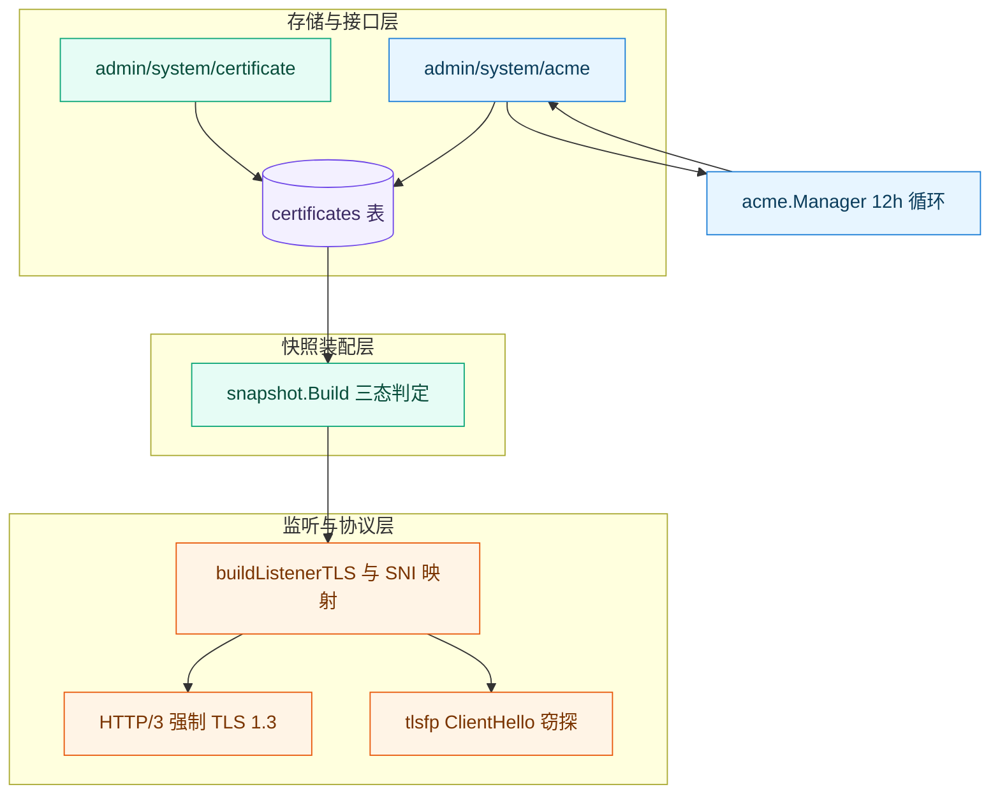
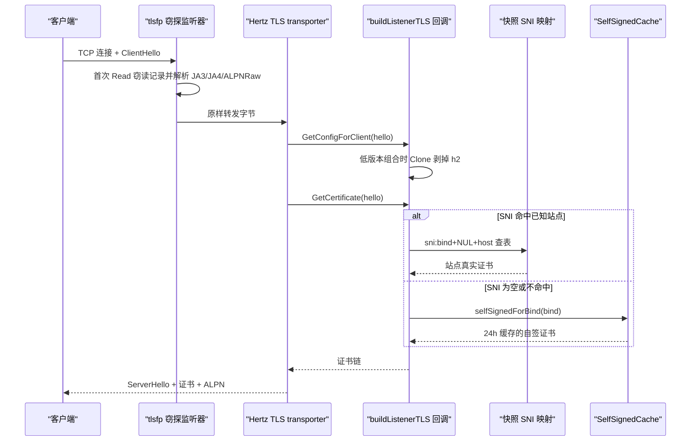
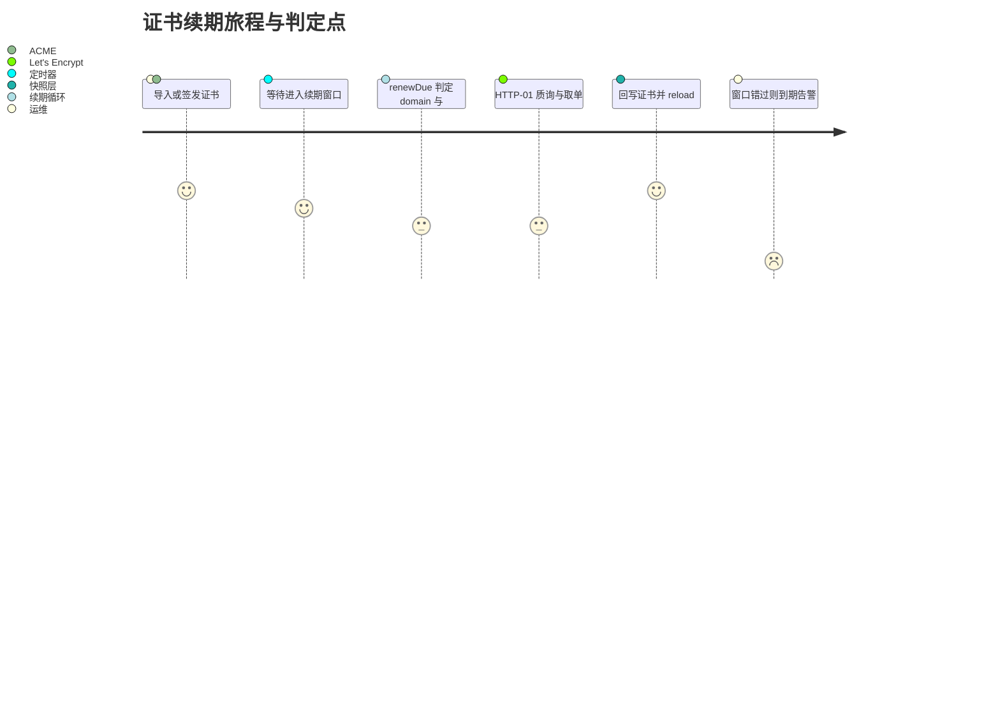
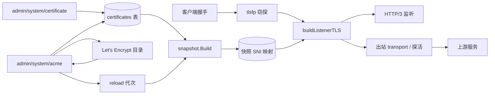
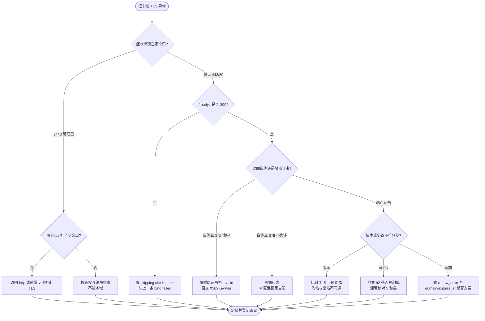

# 证书与TLS故障

<cite>
**本文档引用的文件**
- [server.go](file://internal/app/server.go)
- [http3.go](file://internal/app/http3.go)
- [tls_fingerprint_policy.go](file://internal/app/tls_fingerprint_policy.go)
- [acme.go](file://internal/acme/acme.go)
- [selfsigned.go](file://internal/acme/selfsigned.go)
- [cipher_suites.go](file://internal/tlsmeta/cipher_suites.go)
- [version.go](file://internal/tlsmeta/version.go)
- [tls.go](file://internal/snapshot/tls.go)
- [build.go](file://internal/snapshot/build.go)
- [snapshot.go](file://internal/snapshot/snapshot.go)
- [certificate.go](file://internal/store/certificate.go)
- [acme.go](file://internal/admin/system/acme.go)
- [certificate.go](file://internal/admin/system/certificate/certificate.go)
- [runtime.go](file://internal/admin/system/runtime.go)
- [router.go](file://internal/admin/router.go)
- [tls_fingerprint_listener.go](file://internal/dataplane/tlsfp/tls_fingerprint_listener.go)
- [handler.go](file://internal/dataplane/handler.go)
- [endpoints.go](file://internal/dataplane/endpoints.go)
- [alpn_raw_mixed_mode_test.go](file://internal/dataplane/alpn_raw_mixed_mode_test.go)
- [health.go](file://internal/upstream/health.go)
- [transport.go](file://internal/upstream/transport.go)
- [transport.go](file://internal/proxy/transport/transport.go)
- [shield.go](file://internal/waf/challenge/shield.go)
- [health.go](file://internal/core/health/health.go)
- [http3_test.go](file://internal/app/http3_test.go)
- [transport_test.go](file://internal/upstream/transport_test.go)
- [snapshot_test.go](file://internal/snapshot/snapshot_test.go)
- [README.md](file://README.md)
- [故障排除.md](file://docs/故障排除/故障排除.md)
- [启动与依赖故障.md](file://docs/故障排除/启动与依赖故障.md)
</cite>

## 目录
1. [简介](#简介)
2. [项目结构](#项目结构)
3. [核心组件](#核心组件)
4. [架构总览](#架构总览)
5. [详细组件分析](#详细组件分析)
6. [依赖关系分析](#依赖关系分析)
7. [性能考虑](#性能考虑)
8. [故障排查指南](#故障排查指南)
9. [结论](#结论)
10. [附录](#附录)

## 简介

本篇覆盖 My-OpenWaf 的**证书与 TLS**故障域：证书入库与回显边界、快照期三态判定、监听级 SNI 选证
与自签兜底、TLS 版本上下限与密码套件、ALPN 与 h2/h2c/h3 协商、HTTP/3 与 0-RTT、ACME 申请与续期窗口、
ClientHello 指纹窃探，以及证书变更与质询链的耦合。跨域分流与端口/探针事实见 [故障排除](故障排除.md)；
构建期、监听绑定与停机预算见 [启动与依赖故障](启动与依赖故障.md)，本篇不重复其表格。

两条必须先记住的事实。其一，**管理面与数据面是两套 TLS 处境**：控制面 `adminSrv` 未挂任何 TLS 选项
（`internal/app/server.go:1052`），`README.md:21` 的「默认管理端口 `:9443`（HTTPS）」与
`README.md:291` 的「启动后访问 `https://localhost:9443`」均为文档缺陷——用数据面的证书思路去排查
一个根本没有 TLS 的端口会全程走偏。其二，**TLS 版本下限在四条路径上不一致**，实测结论见
[TLS-04](#tls-04-tls-版本下限与密码套件)，它是「上游状态页健康但真实请求 502」的根因。

前置条件：触发时机（握手阶段还是首包之后）、关联标识（`X-Request-ID`，握手阶段无此标识）、
最近一次证书或 TLS 配置变更来源、影响面（单站点 bind 还是全局）；缺任一项时条目按 `未知` 处理。

**章节来源**
- [server.go:1052-1056](file://internal/app/server.go#L1052-L1056)
- [README.md:21-21](file://README.md#L21-L21)
- [README.md:291-291](file://README.md#L291-L291)

## 项目结构

排障按**证书生效层次**分层：库里的 PEM 只有在快照装配成功、且监听真正建起来之后才会进入握手；
任一层断链都表现为「证书明明配了但握手不对」。

```text
internal/store/certificate.go      # 证书模型：source/domain/expires_at/renew_error
internal/admin/system/{certificate/,acme.go}   # CRUD 与 ACME 配置、续期循环
internal/acme/                     # 申请与 ShouldRenewAt；SelfSignedCache 自签兜底
internal/snapshot/{tls.go,build.go}            # 生效值继承链与三态判定
internal/app/{server.go,http3.go}  # buildListenerTLS / 监听协调 / h3 强制 TLS 1.3
internal/dataplane/tlsfp/          # ClientHello 窃探监听器（JA3/JA4/ALPNRaw）
internal/tlsmeta/                  # 版本与套件目录、规范化与可配置性判定
```

| 层 | 所在位置 | 主要失效模式 | 首要可观测点 | 对应条目 |
| --- | --- | --- | --- | --- |
| 存储层 | `internal/store/certificate.go` | 私钥不回显导致重存失败、`expires_at` 为空 | `certificates` 表 | [TLS-01](#tls-01-证书入库私钥回显与生命周期) |
| 快照与监听层 | `internal/snapshot/build.go`、`internal/app/server.go` | `certificate_not_found`、`invalid_certificate_or_key`、同 bind 默认站点漂移、监听被跳过 | 快照诊断项与 `skipping site listener without valid TLS config` | [TLS-02](#tls-02-快照三态监听跳过与标签重启) |
| 协议层 | `internal/tlsmeta/`、`internal/app/http3.go` | 版本下限不一致、套件被静默丢弃 | `TLS listener configured` 的 `min_tls` | [TLS-04](#tls-04-tls-版本下限与密码套件) |
| 协商层 | `internal/app/server.go` | h2 被剥离、drop 降级、h3 未广播 | `next_protos`、`X-OWAF-Drop-Degraded` | [TLS-05](#tls-05-alpn-与-h2h2ch3-协商) |
| 签发层 | `internal/acme/`、`internal/admin/system/acme.go` | HTTP-01 打不通、续期窗口不命中 | `certificates.renew_error` | [TLS-06](#tls-06-acme-申请续期窗口与-http-01) |
| 观测层 | `internal/dataplane/tlsfp/` | 指纹为空、握手前窃读等待 | `client_hello_fingerprint_enabled` | [TLS-07](#tls-07-clienthello-窃探指纹与质询耦合) |



**图表来源**
- [certificate.go:19-39](file://internal/store/certificate.go#L19-L39)
- [build.go:336-420](file://internal/snapshot/build.go#L336-L420)
- [server.go:1659-1745](file://internal/app/server.go#L1659-L1745)
- [http3.go:869-877](file://internal/app/http3.go#L869-L877)

**章节来源**
- [certificate.go:19-39](file://internal/store/certificate.go#L19-L39)
- [server.go:785-795](file://internal/app/server.go#L785-L795)

## 核心组件

只列参与证书生命周期与握手指举的组件；检测类组件见安全防护功能域文档。

| 组件 | 位置 | 故障期职责 | 可观测输出 | 失效影响 | 依赖 |
| --- | --- | --- | --- | --- | --- |
| `store.Certificate` | [certificate.go:19](file://internal/store/certificate.go#L19) | 持久化 PEM 与续期元数据 | `source`、`expires_at`、`renew_error` | 站点无可用证书 | GORM |
| `certificate` 处理器 | [certificate.go:44](file://internal/admin/system/certificate/certificate.go#L44) | 校验密钥对并清空回显私钥 | 400 `invalid certificate/key pair` | 证书无法入库 | `tls.X509KeyPair` |
| `snapshot.Build` | [build.go:336](file://internal/snapshot/build.go#L336) | 二次校验并给出三态 | `SiteTLSCertBySNI` 与诊断 | 监听被整体跳过 | `store.Certificate` |
| `buildListenerTLS` | [server.go:1659](file://internal/app/server.go#L1659) | 组装监听级 `tls.Config` | `TLS listener configured` | 返回 nil 即不建监听 | `tlsmeta` |
| `SelfSignedCache` | [selfsigned.go:19](file://internal/acme/selfsigned.go#L19) | IP 直连与未知 SNI 兜底 | `无站点证书，仅使用自签证书` | 兜底失败则监听为 nil | `GenerateSelfSigned` |
| `ACMEManagerStore` | [acme.go:37](file://internal/admin/system/acme.go#L37) | manager 缓存与续期循环 | `/certificates/acme/status` | 续期不驱动重载 | `acme.Manager` |
| `acme.Manager` | [acme.go:30](file://internal/acme/acme.go#L30) | HTTP-01 订单与质询表 | `证书申请成功`/`证书续期失败` | 只影响 ACME 证书 | Let's Encrypt |
| `tlsfp` 窃探监听器 | [tls_fingerprint_listener.go:16](file://internal/dataplane/tlsfp/tls_fingerprint_listener.go#L16) | 握手前解析 ClientHello | `ALPNRaw`、JA3/JA4 | 指纹类规则不命中 | `waf/bot/tlsfp` |

替换边界：`ACMEManagerStore`、`acme.Manager`、`SelfSignedCache`（`internal/app/server.go:78`）
均为进程级单例，因此**多实例部署时同一 bind 的自签证书在每个节点各不相同**，属可替换性缺口而非故障。

**章节来源**
- [acme.go:185-320](file://internal/admin/system/acme.go#L185-L320)
- [server.go:78-78](file://internal/app/server.go#L78-L78)

## 架构总览

「配了证书但浏览器仍报自签」的证据链跨五个组件，定位从 `GetCertificate` 的返回值开始。



**图表来源**
- [server.go:1736-1800](file://internal/app/server.go#L1736-L1800)
- [snapshot.go:298-300](file://internal/snapshot/snapshot.go#L298-L300)
- [tls_fingerprint_listener.go:67-95](file://internal/dataplane/tlsfp/tls_fingerprint_listener.go#L67-L95)
- [selfsigned.go:27-76](file://internal/acme/selfsigned.go#L27-L76)

## 详细组件分析

### TLS-01 证书入库、私钥回显与生命周期

`store.Certificate.KeyPEM` 带 `json:"key_pem"`，但所有读路径都在返回前手动清空：列表
`items[i].KeyPEM = ""`（`internal/admin/system/certificate/certificate.go:61`）、详情
`item.KeyPEM = ""`（`:77`）、ACME 路径复用 `RedactCertificatePrivateKey`（`:44-48`）。
写路径相反：`CreateCertificate` 必须先 `tls.X509KeyPair(cert_pem, key_pem)` 通过才落库
（`:91-96`），而 `UpdateCertificate` 先把库内完整记录读进 `existing` 再 `BindJSON` 覆盖
（`:217-223`），所以**只提交 `cert_pem` 时旧私钥仍参与校验**——两条路径语义不同，
照 Create 的直觉去 Update 会误判为「必须重传私钥」。`Source` 默认 `manual`（`:105-107`），
`Domain` 空时从 CN/SAN 推导（`:272-281`），`ExpiresAt` 空时取 `parsed.NotAfter`（`:109-111`）。

证书元数据可直接用 SQL 核对（表结构由 `AutoMigrate` 生成，下面两条均已在临时库现场执行通过）：

```sql
-- 到期倒计时与续期错误：key_pem 不入选，避免私钥进入终端回显
SELECT c.id, c.domain, c.source, c.auto_renew,
       datetime(c.expires_at) AS expires_at,
       CAST(julianday(c.expires_at) - julianday('now') AS INTEGER) AS days_left,
       substr(coalesce(c.renew_error, ''), 1, 48) AS renew_error
FROM certificates AS c
WHERE c.deleted_at IS NULL
ORDER BY days_left NULLS FIRST;

-- TLS 监听挂了却没绑证书：这批 bind 必然走自签兜底
SELECT l.bind, l.cert_id, s.host
FROM site_listeners AS l JOIN sites AS s ON s.id = l.site_id
WHERE l.deleted_at IS NULL AND l.enabled = 1
  AND l.tls_enabled = 1 AND l.cert_id IS NULL;
```

**预期输出形态**：第一条的 `days_left` 为 NULL 表示 `expires_at` 未填（手动导入或历史数据），这些行
**会被自动续期循环直接跳过**（见 TLS-06）；`renew_error` 非空即最近一次续期失败，文本已在入库前脱敏
并按 rune 边界截到 512 字节（`internal/admin/system/acme.go:82`、`:127-158`），与列定义
`gorm:"size:512"` 对齐（`internal/store/certificate.go:38`）。第二条返回零行才算闭环。



**图表来源**
- [acme.go:398-442](file://internal/admin/system/acme.go#L398-L442)
- [acme.go:288-300](file://internal/acme/acme.go#L288-L300)

**章节来源**
- [certificate.go:44-125](file://internal/admin/system/certificate/certificate.go#L44-L125)
- [certificate.go:210-281](file://internal/admin/system/certificate/certificate.go#L210-L281)
- [certificate.go:19-39](file://internal/store/certificate.go#L19-L39)
- [acme.go:74-158](file://internal/admin/system/acme.go#L74-L158)

### TLS-02 快照三态、监听跳过与标签重启

快照对每个启用 TLS 的监听做三态判定（`internal/snapshot/build.go:341-367`）：`CertID == nil` →
`unconfigured`；`certByID` 查不到 → `invalid` + `certificate_not_found`；`tls.X509KeyPair` 失败 →
`invalid` + `invalid_certificate_or_key`，且 `cert_pem` 或 `key_pem` 为空串时收敛为
`empty_certificate_or_key`（`:369-372`）。只有 `valid` 才写入 `SiteTLSCertBySNI`（`:420-422`），
键为 `sni:` + bind + `\x00` + 归一化主机（`internal/snapshot/snapshot.go:298-300`）。

监听层唯一失败出口是一条 Warn：`buildDataServerWithHTTP3Plans` 返回 nil 时打
`skipping site listener without valid TLS config`（`internal/app/server.go:787`，初装配在 `:1102`）。
**该文案有误导性**：同一个 nil 也可能来自 `net.Listen` 失败（`:1524-1531`，另有
`data listener bind failed` Error）或自签生成失败（`:1694-1699`），必须回查上一条 Error 才能定因。
证书变更则**必然导致监听重启**：`siteListenerFingerprint` 把每个站点的 `cert_material` 计入哈希
（`:2052-2061`），标签变化即 `lm.Remove(name)` 后重建（`:767-777`）——所以「换完证书长连接被断」
是装配模型而非 bug；反之日志里没有 `restarting site listener due to config change`，
说明快照里的证书确实没变。

**章节来源**
- [build.go:336-422](file://internal/snapshot/build.go#L336-L422)
- [server.go:762-795](file://internal/app/server.go#L762-L795)
- [server.go:1524-1531](file://internal/app/server.go#L1524-L1531)
- [server.go:2037-2061](file://internal/app/server.go#L2037-L2061)

### TLS-03 监听装配、SNI 选证与自签兜底

`buildListenerTLS` 的装配顺序决定行为：先按 `sni:<bind>\x00` 前缀收集本 bind 的 SNI 映射
（`internal/app/server.go:1668-1676`），再取站点默认证书（优先 `siteRT.TLSConfig.Certificates[0]`，
否则用 `siteRT.Certificate` 现解，`:1679-1689`），两者皆空才生成自签兜底（`:1692-1700`）。
`GetCertificate` 分支（`:1770-1790`）：SNI 为空 → `TLSDefaults.SelfSignedOnIP` 为真时直接自签，
否则回站点默认证书；SNI 不命中 → 自签。一个 bind 只能有一个默认站点：`listenerRuntimesByBind`
按 bind 收敛，后来者仅在自己是 TLS 而当前者不是 TLS 时替换（`:1313-1328`），因此把已有 TLS 站点
改成明文时默认站点可能漂到别的站点上，表现是「裸 IP 访问返回了别的站点的默认证书」。
自签缓存按 bind 存 24 小时（`internal/acme/selfsigned.go:57-75`），证书有效期 365 天且 `NotBefore`
前移 1 小时（`:92-95`），SAN 恒定追加 `127.0.0.1`、`::1`、`localhost`（`:110-112`）——同一 bind
的自签证书 24 小时内稳定，且**它永远不是站点真实证书**，浏览器告警不等于配置错误。

**章节来源**
- [server.go:1659-1800](file://internal/app/server.go#L1659-L1800)
- [server.go:1313-1328](file://internal/app/server.go#L1313-L1328)
- [selfsigned.go:27-118](file://internal/acme/selfsigned.go#L27-L118)

### TLS-04 TLS 版本下限与密码套件

版本串解析在 `internal/tlsmeta/version.go`：`ParseVersion` 接受 `1.2`、`TLSv1.2`、`0x0303`、十进制
线值等写法（`:40-95`），`CanonicalVersionName` 输出 `TLS10`/`TLS12`/`TLS13`（`:19-31`），
`NormalizeRuntimeVersionToken` 把 `SSL3` 判为不可用（`:104-113`）。`EffectiveSiteTLS` 的继承链是
「站点值 → 全局 `TLSDefaults` → 代码默认」，代码默认写的是 `MinVersion: "TLS10"`
（`internal/snapshot/tls.go:84-95`），`snapshot_test.go:86` 把这条断言钉死。

下表为本篇实测结论：定义位置即唯一定义点，三条测试已现场跑通（
`go test ./internal/upstream/ -run TestHTTPSClientTLSConfigSupportsTLS10Upstream`、
`go test ./internal/app/ -run 'TestNewHTTP3ServerForcesTLS13AndH3ALPN|TestNewHTTP3ServerLoopbackTransportSupportsLegacyTLSRange'`
均 PASS）。

| 路径 | 方向 | 实际下限 | 定义位置 | 行为证据 | 故障表征 |
| --- | --- | --- | --- | --- | --- |
| 站点监听 `tls.Config` | 入站 | TLS 1.0（缺省继承） | [server.go:1707](file://internal/app/server.go#L1707-L1711) | `snapshot_test.go:522-525` | 旧客户端可连 |
| 快照内站点 TLS 副本 | 入站 | TLS 1.2（解析失败兜底） | [build.go:389](file://internal/snapshot/build.go#L389-L392) | 兜底常数 | 与上一行不同源 |
| HTTP/3 监听 | 入站 | TLS 1.3（强制抬升） | [http3.go:872](file://internal/app/http3.go#L872-L877) | `http3_test.go:451` | 老客户端拿不到 h3 |
| 主转发 transport | 出站 | TLS 1.2 | [transport.go:183](file://internal/proxy/transport/transport.go#L183) | `transport_test.go:74-75` | 仅支持 1.0/1.1 的上游被拒 |
| 探活 HTTPS client | 出站 | TLS 1.0 + legacy 套件 | [transport.go:37](file://internal/upstream/transport.go#L37) | `transport_test.go:8-14` | 状态页健康但真实 502 |
| h3 上游 transport | 出站 | TLS 1.3 | [transport.go:908](file://internal/proxy/transport/transport.go#L908) | 常数 | 上游需支持 1.3 |
| h3 探活 client | 出站 | TLS 1.3 | [health.go:683](file://internal/upstream/health.go#L681-L686) | 常数 | 探测协议错配 |
| h3 回环 transport | 内部 | TLS 1.0 + 跳过校验 | [http3.go:1110](file://internal/app/http3.go#L1108-L1112) | `http3_test.go:509` | 明文口径不可比对 |

结论：**同一进程内共存三个 TLS 下限（1.0 / 1.2 / 1.3），且探活路径比主转发低两个版本**。
`HTTPSClientTLSConfig`（`internal/upstream/transport.go:33-44`）还挂了
`legacyHTTPSClientCipherSuites()`（`:46-66`，把 TLS 1.0–1.2 套件含不安全套件全部收进来），
因此「上游状态页绿灯 + 真实请求 TLS 握手失败」是这条错配的标准形态。

套件侧的静默降级同样关键：`ParseTLSConfigCipherSuites` 只保留支持 TLS 1.0–1.2 的套件，
**TLS 1.3 专用套件被有意排除**（`internal/tlsmeta/cipher_suites.go:56-65`、`:104-112`、`:161-190`），
因为 `crypto/tls` 不提供 1.3 套件开关。若列表**全部**是 1.3 套件，解析结果为 `nil`，
`tls.Config.CipherSuites` 为 nil 即回落 Go 默认集合，配置等价于没填；
`InvalidTLSConfigCipherSuiteToken`（`:137-158`）可给出首个非法标识用于诊断。运行态能力清单在
`internal/admin/system/runtime.go:215-235` 按 `tls_1_0`…`tls_1_3` 与套件、曲线逐项给出。

**章节来源**
- [version.go:11-113](file://internal/tlsmeta/version.go#L11-L113)
- [cipher_suites.go:56-190](file://internal/tlsmeta/cipher_suites.go#L56-L190)
- [tls.go:84-95](file://internal/snapshot/tls.go#L84-L95)
- [tls.go:363-399](file://internal/snapshot/tls.go#L363-L399)
- [server.go:1707-1741](file://internal/app/server.go#L1707-L1741)
- [transport.go:33-66](file://internal/upstream/transport.go#L33-L66)
- [runtime.go:215-235](file://internal/admin/system/runtime.go#L215-L235)

### TLS-05 ALPN 与 h2/h2c/h3 协商

TCP 侧 ALPN 两级生成：站点 `alpn` 为空时取 `TLSDefaults.DefaultALPN`（含
`HasExplicitDefaultALPN` 三态判断，`internal/snapshot/tls.go:318-326`），再由
`tcpTLSALPNProtocols` 从 TCP 候选里剔除 `h3`（`internal/app/server.go:1869-1890`），因为 h3 只在
UDP 上协商。随后 `GetConfigForClient` 走 `tcpTLSConfigForClientHello`：基线含 `h2` 且
（服务端最大版本 < 1.2 **或** ClientHello 声明的最大版本 < 1.2）才 `Clone` 剥掉 `h2`
（`:1900-1916`），否则返回 nil 沿用基线——**只在低版本组合下降级，不主动升级**。
`maxTLSVersionBelow` 把 `maxVer == 0` 判为「不低于」（`:1923-1925`），未显式设上限时不会剥 h2。

h2 上有一个已知行为缺口：连接已升级为 h2 后命中 drop 无法发 RST_STREAM，于是降级 403 并打
`X-OWAF-Drop-Degraded: h2-h3-no-stream-reset`（`internal/dataplane/handler.go:838-840`）；
「配了丢包却收到 403」时这条响应头是唯一判据。

h3 侧：站点 TLS 配置被 `Clone` 后强制 `NextProtos = ["h3"]` 并抬到 1.3
（`internal/app/http3.go:869-877`），QUIC 固定 `MaxIdleTimeout` 30s、`KeepAlivePeriod` 15s、
`MaxIncomingStreams` 256（`:879-897`）；`Alt-Svc` 广播由 `buildHTTP3AltSvcAdvertisementWithPlans`
决定（`:1618-1622`），独立 h3 TLS 配置在 `:1804-1806` 再次钉死 1.3。0-RTT 由
`quic.Config.Allow0RTT` 透传（`:884-886`），判定集中在 `snapshot.H3Allow0RTT`，环境变量
`MY_OPENWAF_H3_ALLOW_0RTT` 优先于配置（`internal/snapshot/tls.go:277-303`）。

因果链是单向的：站点 `alpn` 为空 → 继承全局 `DefaultALPN`（`HasExplicitDefaultALPN` 三态，
`internal/snapshot/tls.go:318-326`）→ TCP 侧剔除 `h3`（`internal/app/server.go:1869-1890`）→
基线含 `h2` 且服务端或 ClientHello 最大版本 < 1.2 时 `Clone` 剥掉 `h2`（`:1900-1916`）→
协商落到 `http/1.1` → 5 秒盾在 `RequireHTTP2` 下恒判失败
（`internal/waf/challenge/shield.go:77-97`）。整条链上只有第一步和最后一步会留日志，
中间三步全靠生效值推断，因此核对顺序不能颠倒。

指纹语义由 `internal/dataplane/alpn_raw_mixed_mode_test.go:16-22` 的契约测试守住：`ALPNRaw` 是
ClientHello 声明列表、`ALPN` 是协商结果，协商成 `http/1.1` 后 `ALPNRaw` 仍必须报告 `h2`（`:47-60`）。

**章节来源**
- [server.go:1869-1925](file://internal/app/server.go#L1869-L1925)
- [http3.go:869-897](file://internal/app/http3.go#L869-L897)
- [handler.go:838-840](file://internal/dataplane/handler.go#L838-L840)
- [alpn_raw_mixed_mode_test.go:16-60](file://internal/dataplane/alpn_raw_mixed_mode_test.go#L16-L60)

### TLS-06 ACME 申请、续期窗口与 HTTP-01

`internal/acme/acme.go` 只实现 HTTP-01：`ObtainCertificate` 在授权挑战里只挑 `http-01`
（`:145-153`），拿不到即报 `no http-01 challenge found`。质询响应存进程内存表 `m.challenges`
并用 `defer` 在订单结束时删除（`:161-172`）——**令牌不跨进程、不跨节点，且只在一次申请期间存在**。
两个真实公开路径都不是 `Manager.HandleHTTP01Challenge`（无生产调用点，`:249-271` 仅被测试引用）：
控制面 `h.GET("/.well-known/acme-challenge/:token", …)`（`internal/admin/router.go:425-436`）落在
**明文** `:9443`；数据面在站点匹配之前拦截同一路径（`internal/dataplane/handler.go:91` →
`internal/dataplane/endpoints.go:112-133`），因此绕过 WAF 与站点路由，但**只在承载该请求的那个监听上生效**。

续期窗口 `ShouldRenewAt`（`internal/acme/acme.go:288-300`）：`renewBefore <= 0` 或 `expiresAt` 为
零值都返回 true（未知即尝试）。运行期实际走 `renewDue`，它对 `Domain == ""` 或 `ExpiresAt == nil`
的证书**直接跳过**（`internal/admin/system/acme.go:411-415`），与包内语义相反——手动导入且没填
domain/到期时间的证书永远不会被自动续。

循环与重载事实：`go acmeStore.RenewLoop(acmeCtx, 12*time.Hour)`（`internal/app/server.go:1057-1059`），
`RenewLoop` 先立刻跑一轮再进 ticker（`internal/admin/system/acme.go:371-381`）。
`UpdateACMEConfig` **确实调用 reload**（`internal/admin/router.go:397` →
`internal/admin/system/acme.go:521-527`），但 `acme_config` 不在 `Build` 的读取集里，这次 reload
只是多推一个代次、不改快照内容；配置真正生效靠 `Manager()` 的缓存键（Email / DirectoryURL /
CAA 三项，`:185-193`）在下次取用时重建。`ACMEConfig` 默认 `Enabled=false`、`AutoRenew=true`、
`RenewBeforeDays=30`、DirectoryURL 为生产端点（`:177-184`）；`renew_before_days <= 0` 保存时被硬拒
（`:503-506`），开 `caa_check_enabled` 却不给 `caa_dns_server` 同样 400（`:508-516`）。
`ACMEStatus` 会对历史遗留的 `renew_error` 再过一次脱敏（`:735-741`）；`GetACMEConfig` 在 `readGroup`
（`internal/admin/router.go:134`）而 `ACMEStatus`/`UpdateACMEConfig` 在 `adminGroup`（`:397-398`）。

**章节来源**
- [acme.go:113-230](file://internal/acme/acme.go#L113-L230)
- [acme.go:249-300](file://internal/acme/acme.go#L249-L300)
- [acme.go:371-442](file://internal/admin/system/acme.go#L371-L442)
- [acme.go:464-527](file://internal/admin/system/acme.go#L464-L527)
- [router.go:132-138](file://internal/admin/router.go#L132-L138)
- [router.go:397-436](file://internal/admin/router.go#L397-L436)
- [endpoints.go:112-134](file://internal/dataplane/endpoints.go#L112-L134)

### TLS-07 ClientHello 窃探、指纹与质询耦合

`needsTLSClientHelloFingerprint` 恒为真（除非 `MY_OPENWAF_H2WS_PEEKER_OFF=1`），所以
**所有 TLS 监听都会被 `TLSFingerprintListener` 包一层**
（`internal/app/tls_fingerprint_policy.go:26-31`；装配点 `internal/app/server.go:1538-1543`）。
关键顺序是 `peekConn.Read` 首次调用时才 `readTLSFingerprintPrefix(c.Conn)`——
**先窃读 ClientHello，再交给 Hertz 握手**（`tls_fingerprint_listener.go:67-76`）。
三条排障事实由此产生：窃读是阻塞读，TCP 分片慢时表现为「TLS 握手变慢」而 WAF 耗时指标无变化；
记录首字节非 `0x16`、长度 ≤ 0 或 > `16*1024`、`ParseTLSClientHello` 出错三者都
**静默返回空指纹**（`:178-205`）；前缀缓冲走 `sync.Pool` 而非每连接分配（`:48-52`、`:151-156`）。
握手结果经 `SetTLSHandshakeInfoOnConn` 沿包装链回写版本/SNI/协商 ALPN（`:159-177`），
只写 `ALPN` 不动 `ALPNRaw`（`:132-140`）。

质询链的耦合点在协议判定：5 秒盾的 `shieldProtocolAllowed` 在 `RequireHTTP2` 为真时只接受 `h2`、
`RequireHTTP3` 为真时只接受 `h3`、`AllowHTTP1=false` 时拒绝 `http/1.1`
（`internal/waf/challenge/shield.go:77-97`），而这些开关由 `applyProtectionRuntimeConfig` 在每次重载
写入进程级 `shieldMgr`（`internal/app/server.go:640-653`）。因此把 `max_tls_version` 降到 TLS 1.1
或从 ALPN 去掉 h2，会让 5 秒盾永远过不了（因果链见 TLS-05），日志里只有挑战反复失败而无 TLS 线索。

就绪判定也受本域影响：`/readyz` 的四条合取（快照非 nil ∧ `lm.Ready()` ∧ `tokenMgr.Ready()` ∧
主库 Ping，`internal/core/health/health.go:31-44`）里前两条都可能被证书故障打破——站点全部无有效
TLS 配置时监听被跳过，`lm.Ready()` 因注册表为空返回 false，于是**证书故障可以伪装成「服务没起来」**；
`/status` 的 `listeners` 是最快判别字段（`health.go:75-105`）。

**章节来源**
- [tls_fingerprint_policy.go:26-31](file://internal/app/tls_fingerprint_policy.go#L26-L31)
- [tls_fingerprint_listener.go:16-205](file://internal/dataplane/tlsfp/tls_fingerprint_listener.go#L16-L205)
- [shield.go:77-97](file://internal/waf/challenge/shield.go#L77-L97)
- [server.go:640-653](file://internal/app/server.go#L640-L653)
- [health.go:31-44](file://internal/core/health/health.go#L31-L44)

## 依赖关系分析



**图表来源**
- [acme.go:52-100](file://internal/acme/acme.go#L52-L100)
- [acme.go:297-340](file://internal/admin/system/acme.go#L297-L340)
- [server.go:1659-1745](file://internal/app/server.go#L1659-L1745)

| 依赖 | 用途 | 接入方式 | 配置来源 | 超时 | 重试 | 降级 | 可用性影响 |
| --- | --- | --- | --- | :---: | :---: | --- | --- |
| Let's Encrypt 目录 | 订单与质询 | `x/crypto/acme` | `directory_url` | 未设置（风险） | 下一个 12h tick | 记 `renew_error` | 仅影响 ACME 证书 |
| 公网 80/443 可达 | HTTP-01 回连 | CA 主动发起 | 站点 bind 与安全组 | CA 侧决定 | 无 | 申请失败 | 新证书无法签发 |
| CAA DNS 查询 | 签发前校验 | `caa.go` 策略 | `caa_check_enabled` + `caa_dns_server` | `defaultCAAQueryTimeout` | 无 | 关闭即跳过 | 开启时 DNS 不可达即拒发 |
| 主库 `certificates` | 证书与私钥 | GORM | `MY_OPENWAF_DSN` | 未设置（风险） | 无 | 无 | 启动即致命退出 |
| 上游 TLS 端点 | mTLS 与版本协商 | `transport.go` 池 | `upstream_tls_*` | 握手 10s | 无 | 取证书失败仅告警 | 出站握手失败返 502 |

**章节来源**
- [acme.go:52-53](file://internal/acme/acme.go#L52-L53)
- [transport.go:176-197](file://internal/proxy/transport/transport.go#L176-L197)

## 性能考虑

- **握手期回调开销** 问题：`GetCertificate` 每次握手都做 SNI 归一化与查表，若不先判级别，`slog`
  可变参数会在调用点装箱，默认 info 级别下每次握手白产生一批堆分配
  （`internal/app/server.go:1759-1772`）/ 优化：保持 `Enabled(ctx, LevelDebug)` 前置判断
  / 效果：关闭调试日志时零额外分配（实测数据：未统计，仓库无该场景基准）。
- **自签生成成本** 问题：ECDSA P-256 密钥与证书在缓存未命中时现生成，24h 过期后首包承担该成本
  （`internal/acme/selfsigned.go:57-76`）/ 优化：按 bind 缓存稳定指针 / 效果：同一 bind 每天至多一次生成开销。
- **监听重启即断连** 问题：`cert_material` 计入监听标签，换证必然 `Remove` 后重建
  （`internal/app/server.go:767-777`、`:2052-2061`）/ 优化：批量换证放低峰、一次一个 bind
  / 效果：长连接抖动收敛到可预测窗口（改善量实测数据：未统计）。

[本节为通用指导，无需特定文件来源]

## 故障排查指南

### 通用诊断流程

先判面（管理面还是数据面），再判层次（库 → 快照 → 监听 → 协议 → 签发），最后按四档定级：
严重＝私钥外泄或凭据入库；高＝错误被吞没；中＝核心路径缺覆盖；低＝命名与注释。



**图表来源**
- [server.go:1052-1056](file://internal/app/server.go#L1052-L1056)
- [server.go:785-795](file://internal/app/server.go#L785-L795)
- [build.go:336-422](file://internal/snapshot/build.go#L336-L422)
- [acme.go:411-415](file://internal/admin/system/acme.go#L411-L415)

分层定位：每层只回答一个是/否问题，答案决定下一层。

| 层 | 判定问题 | 取证命令或入口 | 命中后的下一动作 | 排除条件 |
| :---: | --- | --- | --- | --- |
| 1 | 是不是拿 HTTPS 打明文管理口 | `curl -kv https://127.0.0.1:9443/healthz` | 改回 `http://` 或加反代 | 明文返回 200 |
| 2 | 数据面监听是否建成 | `ss -lntup` 与 `/status` 的 `listeners` | 回查 `bind failed` | 端口在监听 |
| 3 | 返回的是哪张证书 | `openssl s_client -servername` 看 subject | 进快照层核对三态 | subject 与站点一致 |
| 4 | 版本与 ALPN 是否符预期 | `openssl s_client -tls1_2 -alpn h2` | 比对 TLS 下限矩阵 | 版本与协议双符合 |
| 5 | 上游侧是否版本错配 | 探活结果与真实请求错误码对比 | 读 `HTTPSClientTLSConfig` | 两条路径结果一致 |
| 6 | 续期是否真被触发 | `certificates.renew_error` 与 `acme/status` | 补 `domain` 与 `expires_at` | 窗口内已成功 |

面与端口自检（实测在临时端口 `:19443` 上完成，命令与输出形态一致；后两条是对明文口误用 HTTPS 的
实测错误串，环境为 OpenSSL 4.0.3 / curl 8.22）：

```bash
curl -sS http://127.0.0.1:9443/healthz
curl -sS http://127.0.0.1:9443/readyz
curl -sS http://127.0.0.1:9443/status
curl -kv -m 8 https://127.0.0.1:9443/healthz
printf 'Q\n' | openssl s_client -connect 127.0.0.1:9443 2>&1 | head -3
```

**预期输出形态**：前三条依次为 `{"status":"ok"}`、`{"status":"ready"}`（不就绪为
`{"status":"not ready"}` + HTTP 503）、`{"alive":true,"go_version":"go1.27.2","goroutines":36,
"heap_alloc":51853512,"listeners":0,"num_cpu":8,"ready":true,"revision":0,"sites":0}`——
`listeners` 为 0 而 `sites` 非 0 即「站点配了但监听全被跳过」，直接进第 2 层。后两条分别为
`curl: (35) TLS connect error: error:0A00010B:SSL routines::wrong version number` 与
`error:0A00010B:SSL routines:tls_validate_record_header:wrong version number` 加
`no peer certificate available`，证明该端口没有 TLS，而不是证书有问题。

**章节来源**
- [server.go:1052-1063](file://internal/app/server.go#L1052-L1063)
- [health.go:31-44](file://internal/core/health/health.go#L31-L44)
- [http3.go:1108-1112](file://internal/app/http3.go#L1108-L1112)

### 常见问题与解决方案

条目按症状 / 原因 / 排查 / 方案四段，末行定位依据指向具体行号。

#### TLS-01：证书保存成功但握手返回自签

- **症状**：`openssl s_client` 的 subject 是 `My-OpenWAF`；`/status` 的 `sites` 正常、端口在听。
- **原因**：快照层把该证书判为 `invalid`，`SiteTLSCertBySNI` 无条目，于是走 `selfSignedForBind`
  （`internal/snapshot/build.go:362-378`、`internal/app/server.go:1692-1700`、`:1778-1790`）；
  常见触发是密钥与证书不匹配，或私钥是 PKCS#8 而 PEM 头写成 `EC PRIVATE KEY`。
- **排查**：`sqlite3 data/waf.db "select id,domain,source,expires_at from certificates where deleted_at is null;"`
  期望目标行存在且 `expires_at` 非空；`openssl x509 -in leaf.pem -noout -modulus | md5sum` 与
  `openssl rsa -in key.pem -noout -modulus | md5sum` 期望两值相同；
  `grep -E 'certificate_not_found|invalid_certificate_or_key|empty_certificate_or_key' 启动日志` 期望命中其一。
- **方案**：`POST /api/v1/certificates` 同批重传 `cert_pem` 与 `key_pem`
  （`internal/admin/system/certificate/certificate.go:91-96`），再 `POST /api/v1/certificates/{id}/apply-to-sites`；
  验收标准是 subject 变为站点证书且日志出现 `restarting site listener due to config change`。
- **定位依据**：[build.go:336-422](file://internal/snapshot/build.go#L336-L422)、[server.go:1770-1790](file://internal/app/server.go#L1770-L1790)

#### TLS-02：换证后出现 `skipping site listener without valid TLS config`

- **症状**：日志出现该 Warn，对应 bind 不再监听；真实错误常在它之后才出现。
- **原因**：nil 的三个出口共用这一条文案——`net.Listen` 失败（`internal/app/server.go:1524-1531`）、
  `buildListenerTLS` 返回 nil（`:1536-1540`）、自签生成失败（`:1694-1699`）。
- **排查**：`grep -B2 'skipping site listener' 启动日志` 期望看到上一条 Error；
  `ss -lntp | grep ':443'` 期望端口缺席；`MY_OPENWAF_LOG_LEVEL=debug` 重启后期望出现
  `TLS listener configured` 及其 `min_tls`/`next_protos`。
- **方案**：按上一条 Error 分支处置——端口占用回查 [启动与依赖故障](启动与依赖故障.md) 的监听条目；
  `buildListenerTLS` 为 nil 只可能是快照为 nil，回查重载链；自签失败回查熵源。
- **定位依据**：[server.go:785-795](file://internal/app/server.go#L785-L795)、[server.go:1524-1540](file://internal/app/server.go#L1524-L1540)

#### TLS-03：IP 直连或未知域名拿到自签证书

- **症状**：用 IP 或拼错的子域访问返回自签；正确域名的访问正常。
- **原因**：设计如此。SNI 为空时由 `SelfSignedOnIP` 决定直接自签，SNI 不命中映射也自签
  （`internal/app/server.go:1776-1790`），目的是防 IP 扫描泄露域名；自签 SAN 恒含 `localhost`
  与 `127.0.0.1`（`internal/acme/selfsigned.go:110-112`）。
- **排查**：`openssl s_client -connect IP:443 -servername 正确域名` 期望站点证书；去掉 `-servername`
  期望自签——两条结果对比即确认可观测边界。
- **方案**：接入侧必须带 SNI；确需 IP 直连可信任时导入含该 IP SAN 的证书，而不是关掉
  `self_signed_on_ip`（关掉后 SNI 为空会回落站点默认证书，域名泄露面反而扩大）。
- **定位依据**：[server.go:1776-1790](file://internal/app/server.go#L1776-L1790)、[selfsigned.go:96-112](file://internal/acme/selfsigned.go#L96-L112)

#### TLS-04：上游状态页健康但真实请求 502

- **症状**：`upstream-status` 显示 healthy，代理请求稳定 502 或上游 TLS 握手失败，仅发生在启用 HTTPS 上游的站点。
- **原因**：探活 client 下限是 TLS 1.0 且带 legacy 套件全集（`internal/upstream/transport.go:33-66`，
  由 `internal/upstream/health.go:697` 装配），真实转发下限是 TLS 1.2
  （`internal/proxy/transport/transport.go:183`）；只接受 TLS 1.0/1.1 的老上游被探活判活、被转发拒绝。
- **排查**：`openssl s_client -connect 上游IP:443 -tls1_2` 期望报 `no protocols available` 或握手失败；
  `openssl s_client -connect 上游IP:443 -tls1` 期望握手成功——两条结果之差即根因。
- **方案**：优先把上游升到 TLS 1.2+（唯一不改代码的收敛方案）；临时可改用 h2c 或明文上游并以内网隔离承载，
  或换支持 1.3 的 h3 上游（`internal/proxy/transport/transport.go:900-912`）；不要把探活结果当分发配置的可信来源。
- **定位依据**：[transport.go:33-66](file://internal/upstream/transport.go#L33-L66)、[health.go:693-699](file://internal/upstream/health.go#L693-L699)

#### TLS-05：限制到 TLS 1.0/1.1 后 h2 消失且 5 秒盾永远过不了

- **症状**：`curl --http2 -k` 回落 `HTTP/1.1`；开盾的站点反复回到挑战页且无 TLS 报错。
- **原因**：服务端或 ClientHello 最大版本 < TLS 1.2 时 `tcpTLSConfigForClientHello` `Clone` 剥掉 `h2`
  （`internal/app/server.go:1900-1916`、`:1923-1941`）；而盾的 `shieldProtocolAllowed` 在 `RequireHTTP2`
  下只接受 h2（`internal/waf/challenge/shield.go:77-97`）。降级与判定分别成立，叠加后不留 TLS 线索。
- **排查**：`openssl s_client -connect 域名:443 -alpn h2 -tls1_1 2>&1 | grep ALPN` 期望 `No ALPN negotiated`；
  换 `-tls1_2` 期望 `ALPN protocol: h2`；`curl -sS http://127.0.0.1:9443/status` 确认监听与站点数不受影响。
- **方案**：把 `min_tls_version` 提到 `TLS12`（同时满足合规与 h2），或关 `require_http2` 并保留
  `allow_http1`；两侧必须同批改，否则故障只是从协议挪到质询。
- **定位依据**：[server.go:1900-1941](file://internal/app/server.go#L1900-L1941)、[shield.go:77-97](file://internal/waf/challenge/shield.go#L77-L97)

#### TLS-06：ACME 申请失败或证书永不自续

- **症状**：`POST /api/v1/certificates/acme/apply` 返 500 且 `renew failed:` 带 CA 文本；或到期前
  `renew_error` 始终为空、`last_renew_at` 从不更新。
- **原因**：三类各解释一半。(a) HTTP-01 由 CA 主动回连，数据面只在承载该请求的监听上应答
  （`internal/dataplane/endpoints.go:112-133`），仅开 443 的站点接不到明文回连；令牌又只在申请进程
  内存里（`internal/acme/acme.go:161-172`），多节点不共享。(b) `renewDue` 跳过 `domain == ""` 或
  `expires_at IS NULL` 的证书（`internal/admin/system/acme.go:411-415`）。(c) `ACMEConfig.Enabled`
  默认为假（`:177-184`），未打开时 `Manager()` 直接返回 `ACME is disabled`（`:281-285`）。
- **排查**：`curl -sS http://127.0.0.1:9443/api/v1/certificates/acme/config -H "Authorization: Bearer {令牌}"`
  期望 `"enabled":true`；`sqlite3 data/waf.db "select id,domain,auto_renew,expires_at,renew_error from
  certificates where source='acme';"` 期望 `domain` 与 `expires_at` 均非空；
  `curl -sS http://127.0.0.1:9443/api/v1/certificates/acme/status -H "Authorization: Bearer {令牌}"`
  期望 `items[].error` 为空。
- **方案**：为域名保留一个明文 80 监听；单节点执行续期、其余靠 Redis `openwaf:config:reload` 同步；
  手动证书要自续必须先补 `domain` 与 `expires_at`；紧急时 `POST /api/v1/certificates/{id}/renew`
  手动触发，该端点只接受 `source='acme'`（`internal/admin/system/acme.go:658-662`）。
- **定位依据**：[acme.go:405-442](file://internal/admin/system/acme.go#L405-L442)、[acme.go:145-172](file://internal/acme/acme.go#L145-L172)

#### TLS-07：TLS 指纹全空或 JA3 规则不命中

- **症状**：访问日志有记录但指纹字段为空；指纹类规则永不命中；TLS 耗时上升而 WAF 耗时不变。
- **原因**：窃读是握手前的阻塞读，记录类型非 `0x16`、长度非法（≤0 或 >16KiB）、或
  `ParseTLSClientHello` 失败都静默返空（`internal/dataplane/tlsfp/tls_fingerprint_listener.go:178-205`）；
  或设了 `MY_OPENWAF_H2WS_PEEKER_OFF=1` 整体摘除该层（`internal/app/tls_fingerprint_policy.go:27-29`）。
- **排查**：`grep client_hello_fingerprint_enabled 启动日志` 期望 `true`；
  `curl -sS 'http://127.0.0.1:9443/api/v1/fingerprints?page=1&page_size=5' -H "Authorization: Bearer {令牌}"`
  期望返回聚合行（该端点是访问日志聚合，不是独立指纹库）；
  `openssl s_client -connect 域名:443 -tls1_3 </dev/null` 期望握手正常。
- **方案**：确认未设摘除变量；对超大 ClientHello（大量 GREASE 扩展）接受指纹缺失，改用 header 顺序类
  规则兜底；不要把 `ALPN` 当 `ALPNRaw` 用（`internal/dataplane/alpn_raw_mixed_mode_test.go:47-60`）。
- **定位依据**：[tls_fingerprint_listener.go:67-95](file://internal/dataplane/tlsfp/tls_fingerprint_listener.go#L67-L95)、[tls_fingerprint_policy.go:26-31](file://internal/app/tls_fingerprint_policy.go#L26-L31)

问题检测结果汇总，编号与上文条目一一对应，且不与 [故障排除](故障排除.md) 的 I-01…I-07 重叠：

| 编号 | 类别 | 严重度 | 标题 | 位置 | 影响 | 建议 |
| --- | --- | :---: | --- | --- | --- | --- |
| TLS-01 | 最佳实践 | 高 | 私钥不回显但 Update 依赖库内旧值 | [certificate.go:217](file://internal/admin/system/certificate/certificate.go#L217) | 换证时误判必须重传私钥 | 明确两路径差异 |
| TLS-02 | 代码质量 | 高 | 三种 nil 出口共用同一跳过文案 | [server.go:787](file://internal/app/server.go#L787) | 端口占用被误读为证书故障 | 分支独立文案 |
| TLS-03 | 架构设计 | 低 | IP 直连恒自签 | [server.go:1776](file://internal/app/server.go#L1776-L1790) | 非故障但常被报障 | 附录说明预期边界 |
| TLS-04 | 安全 | 高 | 探活 TLS 1.0 与转发 TLS 1.2 错配 | [transport.go:37](file://internal/upstream/transport.go#L37) | 假健康与真实 502 | 统一下限 |
| TLS-05 | 架构设计 | 高 | 低版本剥 h2 与盾协议要求互相放大 | [shield.go:77](file://internal/waf/challenge/shield.go#L77-L97) | 质询永久失败且无 TLS 线索 | 保存期交叉校验 |
| TLS-06 | 代码质量 | 高 | 续期循环跳过缺 domain/expires_at 的证书 | [acme.go:411](file://internal/admin/system/acme.go#L411-L415) | 到期后静默失效 | 保存期强制补全 |
| TLS-07 | 性能 | 中 | ClientHello 窃读为阻塞读 | [tls_fingerprint_listener.go:67](file://internal/dataplane/tlsfp/tls_fingerprint_listener.go#L67-L76) | 握手前额外等待 | 补耗时可观测点 |
| TLS-08 | 最佳实践 | 中 | TLS 1.3 套件配置被静默排除 | [cipher_suites.go:104](file://internal/tlsmeta/cipher_suites.go#L104-L112) | 全 1.3 列表等价未配置 | 保存期给可见提示 |
| TLS-09 | 文档 | 中 | README 称管理端口为 HTTPS | [README.md:291](file://README.md#L291) | 首次接入即握手失败 | 改 http 或实现挂 TLS |

`类别` 取值限于 `代码质量`、`架构设计`、`安全`、`性能`、`最佳实践`、`文档`。上述条目均已核对到行列，
未改动任何代码。

**章节来源**
- [certificate.go:44-125](file://internal/admin/system/certificate/certificate.go#L44-L125)
- [build.go:336-422](file://internal/snapshot/build.go#L336-L422)
- [acme.go:398-442](file://internal/admin/system/acme.go#L398-L442)
- [transport.go:176-197](file://internal/proxy/transport/transport.go#L176-L197)

## 结论

本域的可定位性来自三个稳定出口：`/status` 的 `listeners` 数量、`TLS listener configured` 日志里的
`min_tls`/`max_tls`/`next_protos`/`cipher_suite_count`、以及 `certificates` 表的
`source`/`expires_at`/`renew_error` 三元组。

- **优势 1**：三态判定与私钥回显边界集中在单一函数，判定路径唯一、可静态核对。
- **优势 2**：SNI 选证与自签兜底分离，接入侧错误不会泄露真实域名。
- **建议**：把 TLS 下限统一到一个口径（推荐入站与出站均 TLS 1.2，h3 保持 1.3）；把
  `skipping site listener …` 按三个出口拆成独立文案；保存 ACME 配置时同步校验 `domain` 与
  `expires_at`，杜绝「保存成功但永不自续」。

[本节为总结，无需特定文件来源]

## 附录

### 证书与 TLS 配置项速查

| 配置项 | 类型 | 默认值 | 必填 | 作用域 | 生效方式 | 安全等级 | 说明 |
| --- | --- | --- | :---: | --- | --- | --- | --- |
| `sites.cert_id` | uint | NULL | 否 | 站点 | 重载 | 普通 | NULL 且 TLS 开启即 `unconfigured` |
| `sites.min_tls_version` | string | 继承 `TLS10` | 否 | 站点 | 重载 | 普通 | 接受 `1.2`/`TLSv1.2`/`0x0303` 等写法 |
| `sites.max_tls_version` | string | 继承 `TLS13` | 否 | 站点 | 重载 | 普通 | 低于 1.2 会剥掉 ALPN 里的 h2 |
| `certificates.source` | string | `manual` | 否 | 证书 | 即时 | 普通 | 仅 `acme` 可调续期端点 |
| `certificates.auto_renew` | bool | `false` | 否 | 证书 | 12h 循环 | 普通 | 需 `domain` 与 `expires_at` 同时非空 |
| `acme_config.enabled` | bool | `false` | 否 | 进程 | 保存即 reload | 普通 | 关闭时 `Manager()` 报 disabled |
| `acme_config.renew_before_days` | int | `30` | 是 | 进程 | 下次 tick | 普通 | `<=0` 保存期被拒 400 |
| `MY_OPENWAF_H2WS_PEEKER_OFF` | string | 空 | 否 | 进程 | 重启 | 敏感 | 置 `1` 摘除 ClientHello 窃探 |
| `MY_OPENWAF_H3_ALLOW_0RTT` | string | 空 | 否 | 进程 | 重启 | 敏感 | 0-RTT 有重放风险，默认不开 |

**章节来源**
- [certificate.go:19-39](file://internal/store/certificate.go#L19-L39)
- [tls.go:84-95](file://internal/snapshot/tls.go#L84-L95)
- [version.go:40-95](file://internal/tlsmeta/version.go#L40-L95)
- [acme.go:177-227](file://internal/admin/system/acme.go#L177-L227)
- [acme.go:503-516](file://internal/admin/system/acme.go#L503-L516)
- [tls.go:277-303](file://internal/snapshot/tls.go#L277-L303)

### 端点索引与取证命令

| 端点 | 方法 | 分组 | 用途 | 鉴权 | 位置 |
| --- | :---: | :---: | --- | :---: | --- |
| `/api/v1/certificates` | GET/POST | readGroup / opsGroup | 列表（私钥不回显）/ 新建（校验密钥对） | 是 | [router.go:132](file://internal/admin/router.go#L132)、[router.go:267](file://internal/admin/router.go#L267) |
| `/api/v1/certificates/{id}/update` | POST | opsGroup | 更新（沿用库内私钥） | 是 | [router.go:268](file://internal/admin/router.go#L268) |
| `/api/v1/certificates/{id}/apply-to-sites` | POST | opsGroup | 批量绑定匹配站点 | 是 | [router.go:269](file://internal/admin/router.go#L269) |
| `/api/v1/certificates/acme/apply` | POST | opsGroup | HTTP-01 申请 | 是 | [router.go:271](file://internal/admin/router.go#L271) |
| `/api/v1/certificates/acme/config` | POST | adminGroup | 保存配置并 reload | 仅 admin | [router.go:397](file://internal/admin/router.go#L397) |
| `/api/v1/certificates/acme/status` | GET | adminGroup | 回显状态与 `renew_error` | 仅 admin | [router.go:398](file://internal/admin/router.go#L398) |
| `/.well-known/acme-challenge/{token}` | GET | 无鉴权 | 控制面 HTTP-01 应答 | 否 | [router.go:425](file://internal/admin/router.go#L425) |

写操作全为 POST（无 PUT/DELETE 路由），`{id}/renew` 只接受 `source='acme'`；凭据以
`Authorization: Bearer {令牌}` 传入，真实值严禁写入工单。

```bash
# 站点证书与版本（把 域名 换成实际监听域名）
openssl s_client -connect 域名:443 -servername 域名 -tls1_3 </dev/null 2>&1 | sed -n '1,25p'
openssl s_client -connect 域名:443 -servername 域名 -alpn h2 </dev/null 2>&1 | grep -E 'subject=|ALPN'
echo | openssl s_client -connect 域名:443 -servername 域名 2>/dev/null | openssl x509 -noout -dates -subject
ss -lntup | grep -E ':443|:80'
curl -sS -o /dev/null -w '%{http_code} %{ssl_verify_result} %{http_version}\n' https://域名/
```

**预期输出形态**：第一组应出现 `SSL handshake has written` 且 subject 为站点证书；`-alpn h2` 给出
`ALPN protocol: h2`，把站点上限降到 1.1 后同一命令应显示未协商 ALPN；第二组给出 `notBefore=`/`notAfter=`
两行，`notAfter` 与库里 `expires_at` 一致才算闭环；`ss` 至少列出目标 TCP 口，UDP 缺席说明 h3 未监听；
`curl -w` 的 `ssl_verify_result` 非 `0` 即证书链不可信。

本篇不覆盖：监听绑定与端口占用全链路、停机预算、构建期 CGO 与 embed（见
[启动与依赖故障](启动与依赖故障.md)）；跨域分流与探针、日志、首启凭据事实（见
[故障排除](故障排除.md)）；队列水位与内存回收（见 [性能与内存排查](性能与内存排查.md)）；
gRPC 与 WebSocket 隧道协议细节（见数据平面处理域）。

**章节来源**
- [router.go:132-138](file://internal/admin/router.go#L132-L138)
- [router.go:267-272](file://internal/admin/router.go#L267-L272)
- [router.go:397-436](file://internal/admin/router.go#L397-L436)
- [故障排除.md:61-82](file://docs/故障排除/故障排除.md#L61-L82)
- [启动与依赖故障.md:76-100](file://docs/故障排除/启动与依赖故障.md#L76-L100)
