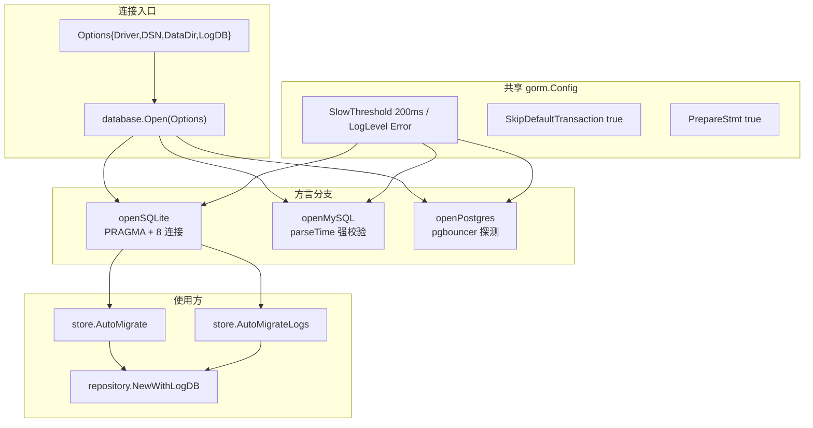
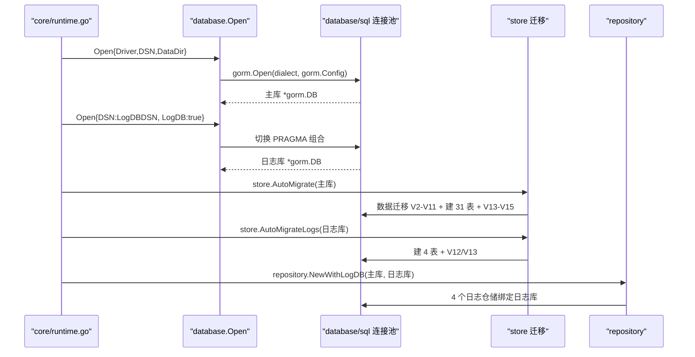
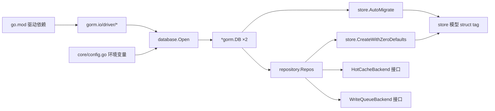
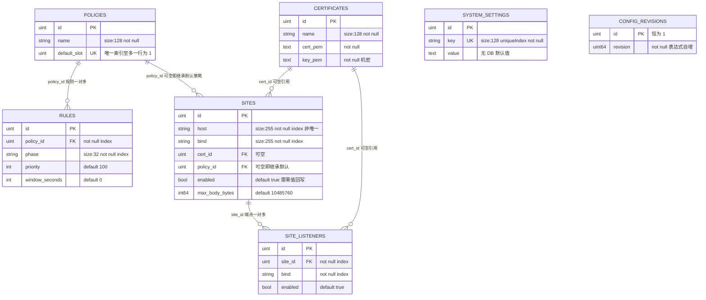

# GORM 配置与使用

> [返回 数据存储层](数据存储层.md)

<cite>
**本文档引用的文件**
- [internal/core/database/gorm.go](file://internal/core/database/gorm.go)
- [internal/store/migrate.go](file://internal/store/migrate.go)
- [internal/store/repository/repository.go](file://internal/store/repository/repository.go)
- [internal/store/zero_defaults.go](file://internal/store/zero_defaults.go)
- [go.mod](file://go.mod)
- [internal/core/runtime.go](file://internal/core/runtime.go)
- [internal/core/config.go](file://internal/core/config.go)
- [README.md](file://README.md)
- [internal/store/migrations/single_site.go](file://internal/store/migrations/single_site.go)
- [internal/store/repository/site/site.go](file://internal/store/repository/site/site.go)
- [internal/store/repository/drop_event.go](file://internal/store/repository/drop_event.go)
- [internal/store/repository/bot/bot_score.go](file://internal/store/repository/bot/bot_score.go)
- [internal/store/site.go](file://internal/store/site.go)
- [internal/store/policy.go](file://internal/store/policy.go)
- [internal/store/migrate.go](file://internal/store/migrate.go)
- [internal/store/migrate.go](file://internal/store/migrate.go)
- [internal/store/repository/repository.go](file://internal/store/repository/repository.go)
- [internal/store/site.go](file://internal/store/site.go)
- [internal/store/events.go](file://internal/store/events.go)
- [internal/store/events.go](file://internal/store/events.go)
- [internal/store/system.go](file://internal/store/system.go)
- [internal/store/migrations/site_tls_inheritance_defaults.go](file://internal/store/migrations/site_tls_inheritance_defaults.go)
- [internal/store/repository/rule.go](file://internal/store/repository/rule.go)
- [internal/store/certificate.go](file://internal/store/certificate.go)
- [internal/store/js_plugin.go](file://internal/store/js_plugin.go)
- [internal/store/luaplugin/lua_plugin.go](file://internal/store/luaplugin/lua_plugin.go)
- [internal/store/cve/cve.go](file://internal/store/cve/cve.go)
- [internal/store/approute/app_route.go](file://internal/store/approute/app_route.go)
- [internal/store/repository/setting/system_settings.go](file://internal/store/repository/setting/system_settings.go)
</cite>

## 目录

1. [简介](#简介)
2. [项目结构](#项目结构)
3. [核心组件](#核心组件)
4. [架构总览](#架构总览)
5. [详细组件分析](#详细组件分析)
6. [依赖关系分析](#依赖关系分析)
7. [性能考虑](#性能考虑)
8. [故障排查指南](#故障排查指南)
9. [结论](#结论)
10. [附录](#附录)

## 简介

本篇聚焦 GORM 在本项目中的落地方式：一份全局 `gorm.Config`、一个 `Open` 入口、三条方言分支，以及两条容易被忽略的本地约定——**零值默认回写**与**主库/日志库分离**。目标是让开发者在换驱动、加模型、写仓储时不必再猜配置。

三个设计约束决定了本层形态：其一，SQLite 是默认且零运维路径，必须与 MySQL/PostgreSQL 共用同一套模型标签；其二，`default:` 标签既是建表默认值又是 Go 侧意图表达，直接 `db.Create` 会破坏「显式关闭」语义；其三，配置表与日志表写入频率相差三四个数量级，不能共用一条连接池。

## 项目结构

GORM 相关代码按「连接 → 配置 → 模型 → 访问」四段分布，没有第五处入口。

| 目录/文件 | 行数 | 职责 | 关键符号 |
|-----------|:----:|------|----------|
| `internal/core/database/gorm.go` | 310 | 驱动分支、连接池、PRAGMA、DSN 脱敏 | `Open:30`、`Options:22`、`maskDSN:162` |
| `internal/core/runtime.go` | 前 141 行 | 两次 `Open` 组装主库与日志库 | `NewRuntime:63-97` |
| `internal/core/config.go` | 驱动/DSN 段 | 环境变量解析与默认值 | `LoadConfigFromEnv:334` |
| `internal/store/migrate.go` | 168 | 结构迁移编排与修订号 | `AutoMigrate:22`、`AutoMigrateLogs:126`、`BumpRevision:141` |
| `internal/store/zero_defaults.go` | 169 | 默认值双向处理 | `ApplyModelDefaults:35`、`CreateWithZeroDefaults:90` |
| `internal/store/repository/` | 3206 + 子包 | 仓储聚合与注入点 | `NewWithLogDB:60`、`SetHotCache:93` |

驱动版本与来源均为 `go.mod` 实测：

| 层 | 模块 | 版本 | go.mod 行 |
|----|------|------|:---------:|
| ORM | `gorm.io/gorm` | v1.31.2 | `go.mod:37` |
| SQLite | `github.com/glebarez/sqlite` | v1.11.0 | `go.mod:14` |
| SQLite 内核 | `modernc.org/sqlite` | v1.60.1（间接） | `go.mod:76` |
| MySQL | `gorm.io/driver/mysql` | v1.6.0 | `go.mod:35` |
| MySQL 驱动 | `github.com/go-sql-driver/mysql` | v1.10.1 | `go.mod:15` |
| PostgreSQL | `gorm.io/driver/postgres` | v1.6.3 | `go.mod:36` |
| 连接池实现 | `database/sql` | Go 1.27.2 标准库 | `go.mod:3` |



**图表来源**
- [internal/core/database/gorm.go:22-71](file://internal/core/database/gorm.go#L22-L71)
- [internal/core/database/gorm.go:73-149](file://internal/core/database/gorm.go#L73-L149)
- [internal/store/migrate.go:22-139](file://internal/store/migrate.go#L22-L139)
- [internal/store/repository/repository.go:60-90](file://internal/store/repository/repository.go#L60-L90)

**章节来源**
- [internal/core/database/gorm.go:21-71](file://internal/core/database/gorm.go#L21-L71)
- [internal/store/migrate.go:22-139](file://internal/store/migrate.go#L22-L139)
- [internal/store/zero_defaults.go:35-90](file://internal/store/zero_defaults.go#L35-L90)
- [go.mod:13-37](file://go.mod#L13-L37)

## 核心组件

组件清单只列 GORM 使用面上的实体，不含业务仓储。

| 组件 | 位置 | 形态 | 一句话职责 |
|------|------|------|------------|
| `Options` | `gorm.go:22` | 结构体 | 驱动、DSN、数据目录、日志库标记四元组 |
| `Open` | `gorm.go:30` | 函数 | 唯一连接入口，返回调优后的 `*gorm.DB` |
| `openSQLite` | `gorm.go:73` | 函数 | 拼 PRAGMA、按 `LogDB` 切换组合、固定 8 连接 |
| `openMySQL` | `gorm.go:115` | 函数 | 强校验 `parseTime=True`，开启原生改名语义 |
| `openPostgres` | `gorm.go:134` | 函数 | 按 DSN 探测 PgBouncer，错误信息统一脱敏 |
| `preferSimpleProtocolFromDSN` | `gorm.go:157` | 函数 | `pgbouncer=true` → 简单协议 |
| `maskDSN` | `gorm.go:162` | 函数 | URL / MySQL 私有格式 / 关键字三种形态遮蔽口令 |
| `ApplyModelDefaults` | `zero_defaults.go:35` | 函数 | 反序列化前把 struct 默认值填进零值字段 |
| `CreateWithZeroDefaults` | `zero_defaults.go:90` | 函数 | 插入后把被默认值顶替的零值列写回 |
| `AutoMigrate` | `migrate.go:22` | 函数 | 31 张配置表的结构与索引 |
| `AutoMigrateLogs` | `migrate.go:126` | 函数 | 4 张日志表 + V12/V13 |
| `BumpRevision` | `migrate.go:141` | 函数 | 单行修订号自增 |

GORM 配置项逐条取自代码，而非默认值猜测：

| 配置项 | 取值 | 位置 | 影响 |
|--------|------|------|------|
| `Logger.LogLevel` | `logger.Error` | `gorm.go:34` | 只输出错误级 SQL，避免高 QPS 日志放大 |
| `Logger.SlowThreshold` | `200ms` | `gorm.go:33` | 慢查询告警阈值 |
| `Logger.IgnoreRecordNotFoundError` | `true` | `gorm.go:35` | `First` 未命中不打错误日志 |
| `SkipDefaultTransaction` | `true` | `gorm.go:38` | 单条 INSERT 不再隐式包事务 |
| `PrepareStmt` | `true` | `gorm.go:39` | 预处理语句缓存，重复查询复用执行计划 |
| 非 SQLite 连接池 | 25 / 10 / 30min / 5min | `gorm.go:63-66` | 最大打开、最大空闲、最长存活、最长空闲 |
| SQLite 连接池 | 8 / 8 / 0 | `gorm.go:103-105`、`:113` | 连接不轮换，避免文件锁抖动 |
| MySQL `DontSupportRenameIndex/Column` | 均为 `false` | `gorm.go:129-130` | 走 MySQL 8+ 原生 `ALTER`，低版本自动回退 |

**章节来源**
- [internal/core/database/gorm.go:22-160](file://internal/core/database/gorm.go#L22-L160)
- [internal/core/database/gorm.go:111-131](file://internal/core/database/gorm.go#L111-L131)
- [internal/store/zero_defaults.go:35-169](file://internal/store/zero_defaults.go#L35-L169)
- [internal/store/migrate.go:22-168](file://internal/store/migrate.go#L22-L168)

## 架构总览

一次启动里 GORM 被打开两次，随后依次做结构迁移、日志表迁移与仓储装配。



**图表来源**
- [internal/core/runtime.go:63-141](file://internal/core/runtime.go#L63-L141)
- [internal/store/migrate.go:22-139](file://internal/store/migrate.go#L22-L139)
- [internal/store/repository/repository.go:60-90](file://internal/store/repository/repository.go#L60-L90)

日志库不存在独立的 `OpenLogDB` 函数：它复用同一个 `Open`，仅由 `Options.LogDB` 布尔位切换 PRAGMA（`gorm.go:90-95`）。任何文档若写成两个函数即为错误。

**章节来源**
- [internal/core/runtime.go:63-97](file://internal/core/runtime.go#L63-L97)
- [internal/core/database/gorm.go:89-95](file://internal/core/database/gorm.go#L89-L95)
- [internal/store/migrate.go:126-139](file://internal/store/migrate.go#L126-L139)

## 详细组件分析

### 连接配置与方言分支

`Open` 的分支语义有两处容易被忽略：空驱动等价于 `sqlite`（`case "sqlite", ""`），`postgresql` 是 `postgres` 的合法别名。

```go
// internal/core/database/gorm.go:45-54
switch opt.Driver {
case "sqlite", "":
	db, err = openSQLite(opt, gcfg)
case "mysql":
	db, err = openMySQL(opt, gcfg)
case "postgres", "postgresql":
	db, err = openPostgres(opt, gcfg)
default:
	return nil, fmt.Errorf("unsupported MY_OPENWAF_DB_DRIVER %q (use sqlite, mysql, postgres)", opt.Driver)
}
```

SQLite 的两套 PRAGMA 对应两种写入模式，主库强调外键与较快 checkpoint，日志库关掉外键并把 checkpoint 窗口收紧到 2000 页：

| PRAGMA | 主库 | 日志库 | 作用 |
|--------|:----:|:------:|------|
| `journal_mode` | WAL | WAL | 写期间仍可并发读 |
| `busy_timeout` | 10000 | 10000 | 锁竞争最长等 10 秒而非立刻 `SQLITE_BUSY` |
| `synchronous` | NORMAL | NORMAL | 持久性与吞吐折中 |
| `cache_size` | -64000 | -65536 | 页缓存约 64 MB |
| `foreign_keys` | ON | OFF | 日志库为 append-only，省掉约束检查 |
| `wal_autocheckpoint` | 1000 | 2000 | 控制 WAL 堆积规模 |

DSN 与口令一律占位，实际取值来自环境变量：

```bash
# 主库（sqlite 空 DSN 时回退到 DataDir/waf.db）
export MY_OPENWAF_DB_DRIVER=sqlite
export MY_OPENWAF_DSN='{路径}/data/waf.db'
export MY_OPENWAF_LOG_DSN='{路径}/data/waf_logs.db'
export MY_OPENWAF_DATA='{路径}/data'

# MySQL：parseTime=True 缺失会在启动阶段直接报错
export MY_OPENWAF_DB_DRIVER=mysql
export MY_OPENWAF_DSN='{user}:{password}@tcp({host}:{port})/openwaf?charset=utf8mb4&parseTime=True&loc=Local'

# PostgreSQL：走 PgBouncer 事务池时必须加 pgbouncer=true
export MY_OPENWAF_DB_DRIVER=postgres
export MY_OPENWAF_DSN='postgres://{user}:{password}@{host}:{port}/openwaf?sslmode=disable&pgbouncer=true'
```

**章节来源**
- [internal/core/database/gorm.go:45-95](file://internal/core/database/gorm.go#L45-L95)
- [internal/core/database/gorm.go:115-159](file://internal/core/database/gorm.go#L115-L159)
- [internal/core/config.go:334-360](file://internal/core/config.go#L334-L360)
- [README.md:314-322](file://README.md#L314-L322)

### DSN 校验与错误脱敏

MySQL 分支把只在首次查询才暴露的问题提前到启动期：`parseTime=True` 缺失时 `DATETIME` 会被扫描成 `[]byte`，而模型字段是 `time.Time`。

| 校验点 | 触发条件 | 报错文本要点 | 位置 |
|--------|----------|--------------|------|
| MySQL DSN 为空 | `DSN` 去空格后为空串 | `mysql requires MY_OPENWAF_DSN` | `gorm.go:117-119` |
| MySQL 缺 `parseTime` | 不含小写 `parsetime=true` | `mysql DSN must include parseTime=True` | `gorm.go:123-125` |
| PostgreSQL DSN 为空 | 同上 | `postgres requires MY_OPENWAF_DSN` | `gorm.go:136-138` |
| 驱动名非法 | 不在四值集合内 | `unsupported MY_OPENWAF_DB_DRIVER` | `gorm.go:52-53` |
| PgBouncer 探测 | 含 `pgbouncer=true` | 无报错，切简单协议 | `gorm.go:157-159` |

`maskDSN` 覆盖三种 DSN 语法，确保错误信息、日志与管理面回显都不泄露口令：先按 URL 解析并遮蔽 `user:pass` 与 `password/passwd/pwd/sslpassword` 查询参数，再退回 go-sql-driver 私有格式，最后逐关键字扫描带引号值。

```go
// internal/core/database/gorm.go:123-125：把运行期错误提前到启动期
if !strings.Contains(strings.ToLower(dsn), "parsetime=true") {
	return nil, fmt.Errorf("mysql DSN must include parseTime=True so DATETIME columns scan into time.Time (got %q)", maskDSN(dsn))
}

// internal/core/database/gorm.go:201-210：连接失败时把错误串里的 DSN 一并替换
func maskDatabaseOpenError(err error, dsn string) error {
	if err == nil {
		return nil
	}
	message := err.Error()
	if dsn != "" {
		message = strings.ReplaceAll(message, dsn, maskDSN(dsn))
	}
	return errors.New(maskDSN(message))
}
```

**章节来源**
- [internal/core/database/gorm.go:115-159](file://internal/core/database/gorm.go#L115-L159)
- [internal/core/database/gorm.go:161-222](file://internal/core/database/gorm.go#L161-L222)

### 事务与批量写入

`SkipDefaultTransaction=true` 意味着单条写入不再被隐式包事务，因此**所有跨表或多步的一致性要求必须显式使用 `db.Transaction`**。项目里的三类用法：

| 场景 | 位置 | 做法 | 原因 |
|------|------|------|------|
| 版本化数据迁移 | `single_site.go:17` | `db.Transaction` 包裹加列、搬数据、改名备份 | 任一失败必须整体回滚，不留半迁移状态 |
| 站点级联删除 | `repository/site/site.go:82` | 事务内先删 `site_listeners` 再删 `sites` | 无外键约束，悬挂监听器会进快照 |
| 策略默认槽切换 | `repository/policy/policy.go:50` | 事务内清空旧槽再置新槽 | `default_slot` 上有唯一索引 |

```go
// internal/store/migrations/single_site.go:34-40：备份式「可回滚」而非真正回滚
timestamp := time.Now().Format("20060102_150405")
if err := tx.Exec(fmt.Sprintf("ALTER TABLE listeners RENAME TO listeners_backup_%s", timestamp)).Error; err != nil {
	return fmt.Errorf("failed to backup listeners table: %w", err)
}
```

日志类仓储的写入统一走批量：`AccessLogRepo.BatchCreate`、`SecurityEventRepo.BatchCreate`、`BotScoreRepo.BatchCreate`、`DropEventRepo.BatchCreate`，并在配置了写队列时把批量插入提交给队列异步执行。

**章节来源**
- [internal/store/migrations/single_site.go:10-44](file://internal/store/migrations/single_site.go#L10-L44)
- [internal/store/repository/site/site.go:82-89](file://internal/store/repository/site/site.go#L82-L89)
- [internal/store/repository/drop_event.go:68-89](file://internal/store/repository/drop_event.go#L68-L89)
- [internal/store/repository/bot/bot_score.go:39-44](file://internal/store/repository/bot/bot_score.go#L39-L44)

### 零值默认与显式关闭

GORM 在 `Create` 时把「有 `default` 标签且当前是 Go 零值」的字段视作未设置，写入默认值；`OnConflict{UpdateAll:true}` 也会排除这些列。后果是用户显式关闭的东西被静默打开，因此本地约定是：**创建一律走 `CreateWithZeroDefaults`，反序列化前一律走 `ApplyModelDefaults`**。

| 模型字段 | `default` 标签 | 不回写的后果 | 正确入口 |
|----------|:--------------:|--------------|----------|
| `Site.Enabled` | `true` | 新建「暂不启用」站点立刻对外服务 | `SiteRepo.Create`（`site.go:52`） |
| `Site.MaxBodyBytes` | `10485760` | 显式设 0 被改回 10 MB | 同上 |
| `Site.MaintenanceStatus` | `503` | 自定义状态码丢失 | 同上 |
| `Site.BlockStatus` | `403` | 自定义拦截码丢失 | 同上 |
| `Site.CacheEnabled` | `false` | 无（零值即默认） | 同上 |
| `Rule.Priority` | `100` | 规则排序被打乱，抢跑规则落到末尾 | `RuleRepo.Create`（`rule.go:96`） |
| `Rule.Enabled` | `true` | 新建停用规则直接生效 | 同上 |
| `IPListEntry.Enabled` | `true` | 停用的名单条目重新生效 | `IPListRepo.Create` |
| `CVERuleRecord.Enabled` | `false` | 未审批 CVE 规则被启用 | `CVERuleRepo` |
| `BotScoreLog.Dangerous` | `false` | 无 | `BotScoreRepo.Create` |

```sql
-- AutoMigrate 依据 struct tag 生成的默认值（SQLite 方言实测片段）
-- internal/store/policy.go:81-96 的 Rule
CREATE TABLE `rules` (
  `priority` integer DEFAULT 100,
  `enabled` numeric DEFAULT true,
  `status_code` integer DEFAULT 0,
  `window_seconds` integer DEFAULT 0,
  `request_count` integer DEFAULT 0,
  `captcha_minutes` integer DEFAULT 0
);

-- internal/store/site.go:50-52 与 :120-123 的 Site
CREATE TABLE `sites` (
  `enabled` numeric DEFAULT true,
  `tls_enabled` numeric DEFAULT false,
  `maintenance_status` integer DEFAULT 503,
  `block_status` integer DEFAULT 403,
  `max_body_bytes` integer DEFAULT 10485760
);
```

**章节来源**
- [internal/store/zero_defaults.go:21-64](file://internal/store/zero_defaults.go#L21-L64)
- [internal/store/zero_defaults.go:67-169](file://internal/store/zero_defaults.go#L67-L169)
- [internal/store/site.go:49-52](file://internal/store/site.go#L49-L52)
- [internal/store/site.go:114-124](file://internal/store/site.go#L114-L124)
- [internal/store/policy.go:81-96](file://internal/store/policy.go#L81-L96)
- [internal/store/repository/site/site.go:48-56](file://internal/store/repository/site/site.go#L48-L56)

### 模型与表清单

GORM 侧的表清单只有一处权威来源：`AutoMigrate` 的模型切片。仓储聚合 `Repos` 决定每张表由谁读写、绑哪条连接。

| 表 | 模型 | AutoMigrate 行 | 绑定库 | 仓储 |
|----|------|:--------------:|:------:|------|
| `sites` | `Site` | `migrate.go:56` | 主库 | `SiteRepo` |
| `site_listeners` | `SiteListener` | `migrate.go:57` | 主库 | `SiteListenerRepo` |
| `certificates` | `Certificate` | `migrate.go:53` | 主库 | `CertificateRepo` |
| `policies` | `Policy` | `migrate.go:54` | 主库 | `PolicyRepo` |
| `rules` | `Rule` | `migrate.go:55` | 主库 | `RuleRepo` |
| `system_settings` | `SystemSettings` | `migrate.go:58` | 主库 | `SystemSettingsRepo` |
| `config_revisions` | `ConfigRevision` | `migrate.go:60` | 主库 | 直接 SQL（`BumpRevision`） |
| `admin_accounts` | `auth.AdminAccount` | `migrate.go:61` | 主库 | `AdminAccountRepo` |
| `admin_api_keys` | `auth.AdminAPIKey` | `migrate.go:59` | 主库 | `AdminAPIKeyRepo` |
| `refresh_tokens` | `auth.RefreshToken` | `migrate.go:62` | 主库 | `RefreshTokenRepo` |
| `ip_list_entries` | `iplist.IPListEntry` | `migrate.go:64` | 主库 | `IPListRepo` |
| `cve_rules` | `cve.CVERuleRecord` | `migrate.go:71` | 主库 | `CVERuleRepo` |
| `recorded_resources` | `approute.RecordedResource` | `migrate.go:75` | 主库 | `RecordedResourceRepo` |
| `security_events` | `SecurityEvent` | `migrate.go:128` | 日志库 | `SecurityEventRepo` |
| `access_logs` | `AccessLog` | `migrate.go:129` | 日志库 | `AccessLogRepo` |
| `drop_events` | `DropEvent` | `migrate.go:130` | 日志库 | `DropEventRepo` |
| `bot_score_logs` | `BotScoreLog` | `migrate.go:131` | 日志库 | `BotScoreRepo` |

**章节来源**
- [internal/store/migrate.go:52-89:52-89](file://internal/store/migrate.go#L52-L89#52)
- [internal/store/migrate.go:127-132:127-132](file://internal/store/migrate.go#L127-L132#127)
- [internal/store/repository/repository.go:60-90:60-90](file://internal/store/repository/repository.go#L60-L90#60)
- [internal/store/site.go:38-147:38-147](file://internal/store/site.go#L38-L147#38)
- [internal/store/events.go:15-129:15-129](file://internal/store/events.go#L15-L129#15)
- [internal/store/migrate.go:52-89](file://internal/store/migrate.go#L52-L89)
- [internal/store/migrate.go:127-132](file://internal/store/migrate.go#L127-L132)
- [internal/store/repository/repository.go:60-90](file://internal/store/repository/repository.go#L60-L90)
- [internal/store/site.go:38-147](file://internal/store/site.go#L38-L147)
- [internal/store/events.go:15-129](file://internal/store/events.go#L15-L129)

### 模型字段明细

以最常改动的两张表为例，字段与 struct tag 逐条对应。

`sites`（`internal/store/site.go:38-147`）：

| 字段 | 类型 | 约束 | 默认 | 说明 |
|------|------|------|------|------|
| `id` | `uint` | `primaryKey` | 自增 | 主键 |
| `deleted_at` | `gorm.DeletedAt` | `index` | NULL | 软删除标记 |
| `host` | `string` | `size:255;not null;index` | — | 站点域名匹配串 |
| `bind` | `string` | `size:255;not null;index` | — | 监听端点，路由键组成 |
| `enabled` | `bool` | `default:true` | true | 显式 false 需零值回写 |
| `cert_id` | `*uint` | 可空 | NULL | 未关联证书 |
| `bot_protection_enabled` | `*bool` | `default:null` | NULL | 三态：NULL 继承全局 |
| `xff_mode` | `string` | `size:64` | `strip_all_and_set_remote` | V10 归一非法值 |
| `max_body_bytes` | `int64` | `default:10485760` | 10 MB | 0 表示不限，需零值回写 |
| `cache_rules` | `string` | `type:text` | — | JSON 数组，上限 64 KiB |
| `maintenance_status` | `int` | `default:503` | 503 | 维护模式状态码 |
| `block_status` | `int` | `default:403` | 403 | 拦截状态码 |

`access_logs`（`internal/store/events.go:79-129`）：

| 字段 | 类型 | 约束 | 默认 | 说明 |
|------|------|------|------|------|
| `id` | `uint` | `primaryKey`、复合索引第 3 位 | 自增 | 与 `site_id,created_at` 组成 `idx_al_site_created_id` |
| `created_at` | `time.Time` | 三个索引 | 自动 | GORM 自动时间戳 |
| `site_id` | `uint` | 复合索引第 1 位 | 0 | 无站点匹配时为 0 |
| `status_code` | `int` | `index:idx_al_status` | 0 | 响应码 |
| `waf_action` | `string` | `size:32;index` | — | 最终判定动作 |
| `fingerprint_key` | `string` | `type:char(64);index` | — | 九字段摘要，`BeforeSave` 维护 |
| `request_headers` | `string` | `type:text` | — | 已脱敏截断的审计字段 |
| `response_headers` | `string` | `type:text` | — | 同上 |
| `visitor_fusion_evidence_sufficient` | `bool` | `default:false` + 复合索引第 1 位 | false | 指纹窗口聚合用 |

```sql
-- 复合索引是列表页排序分页的支撑，命名由 struct tag 指定
-- internal/store/events.go:80-82
CREATE INDEX `idx_al_site_created_id` ON `access_logs`(`site_id`,`created_at`,`id`);
CREATE INDEX `idx_al_site_created`    ON `access_logs`(`created_at`,`site_id`);
CREATE INDEX `idx_al_fingerprint_key` ON `access_logs`(`fingerprint_key`);
```

**章节来源**
- [internal/store/site.go:38-147](file://internal/store/site.go#L38-L147)
- [internal/store/events.go:79-129](file://internal/store/events.go#L79-L129)
- [internal/store/system.go:31-34](file://internal/store/system.go#L31-L34)
- [internal/store/repository/repository.go:60-90](file://internal/store/repository/repository.go#L60-L90)

## 依赖关系分析



**图表来源**
- [internal/core/database/gorm.go:13-19](file://internal/core/database/gorm.go#L13-L19)
- [internal/core/config.go:334-360](file://internal/core/config.go#L334-L360)
- [internal/store/zero_defaults.go:90-146](file://internal/store/zero_defaults.go#L90-L146)
- [internal/store/repository/repository.go:9-26](file://internal/store/repository/repository.go#L9-L26)

依赖要点：`Options` 定义在 `core/database` 而非 `core`，是为了避免 `core → database → core` 的导入环（`gorm.go:21` 注释明确说明）；`repository` 侧的缓存与写队列同样以本地接口声明，规避 `repository → cache/observability → repository` 的环。

| 依赖 | 版本 | 是否必需 | 缺失表现 |
|------|------|:--------:|----------|
| `gorm.io/gorm` | v1.31.2 | 必需 | 编译失败 |
| `glebarez/sqlite` | v1.11.0 | 必需（默认路径） | 无驱动可用 |
| `gorm.io/driver/mysql` | v1.6.0 | 选装 | 仅 mysql 驱动报错 |
| `gorm.io/driver/postgres` | v1.6.3 | 选装 | 仅 postgres 驱动报错 |
| `golang.org/x/crypto/bcrypt` | v0.58.0 | 必需 | 口令哈希无法生成 |

**章节来源**
- [internal/core/database/gorm.go:13-27](file://internal/core/database/gorm.go#L13-L27)
- [internal/store/repository/repository.go:9-26](file://internal/store/repository/repository.go#L9-L26)
- [go.mod:13-37](file://go.mod#L13-L37)

## 性能考虑

- **单条写入成本**：`SkipDefaultTransaction=true` 取消每条 INSERT 的事务包裹；代价是写入原子性由调用方负责，跨表操作必须显式开事务。
- **计划复用**：`PrepareStmt=true` 让重复的仓储查询复用预处理语句，PostgreSQL 走 PgBouncer 时必须用简单协议牺牲这一收益，二者不可兼得。
- **连接规模**：非 SQLite 固定 25 打开 / 10 空闲 / 30 分钟存活 / 5 分钟空闲；SQLite 固定 8 且 `ConnMaxLifetime(0)`，因为文件连接轮换只会带来锁抖动。
- **日志噪音**：GORM 日志级别为 `Error`，慢查询阈值 200 ms；`IgnoreRecordNotFoundError=true` 避免 `First` 未命中刷错误日志。
- **批量落盘**：日志写路径统一 `CreateInBatches`，配合写队列合并高频操作，降低 SQLite 写锁争用。
- **计数成本**：列表页 `COUNT(*)` 由 `CountCache` 承接，按 `al_count:v2`、`se_count:v2`、`de_count` 前缀隔离失效。

[本节为总结，无需特定文件来源]

## 故障排查指南

| 症状 | 根因 | 排查 | 方案 |
|------|------|------|------|
| `unsupported MY_OPENWAF_DB_DRIVER` | 驱动名拼错或大小写外取值 | `echo $MY_OPENWAF_DB_DRIVER` | 取 `sqlite`/`mysql`/`postgres`/`postgresql`/空 |
| `mysql DSN must include parseTime=True` | 缺参数 | 检查 DSN 查询段 | 补 `parseTime=True&loc=Local` |
| `prepared statement ... does not exist` | PgBouncer 事务池 + 预编译 | 连接池模式 | DSN 加 `pgbouncer=true` |
| `mkdir sqlite dir` 失败 | 数据目录不可写 | 检查挂载与权限 | 修正 `MY_OPENWAF_DATA` 或目录属主 |
| 保存「停用」后仍生效 | 直接 `db.Create` 丢零值 | 确认创建入口 | 走 `CreateWithZeroDefaults` |
| 规则顺序异常 | `priority` 0 被写成 100 | 查 `rules.priority` | 同上；列表按 `phase + priority + id` 排序 |
| `SQLITE_BUSY` | 写锁竞争 | 确认 WAL 与 `busy_timeout` | 保持 PRAGMA，减少长事务 |
| PostgreSQL 迁移列失败 | 旧版本不支持 `ALTER COLUMN DROP DEFAULT` | 看 V5 报错文本 | V5 已按方言分支并忽略可容忍错误 |

```bash
# 连通性与 PRAGMA 自检（SQLite 路径）
sqlite3 '{路径}/data/waf.db' "PRAGMA journal_mode; PRAGMA busy_timeout;"
sqlite3 '{路径}/data/waf.db' "SELECT name FROM sqlite_master WHERE type='table' ORDER BY name;"
# 预期输出含 wal、10000，表数量 31
```

**章节来源**
- [internal/core/database/gorm.go:52-125](file://internal/core/database/gorm.go#L52-L125)
- [internal/core/database/gorm.go:151-159](file://internal/core/database/gorm.go#L151-L159)
- [internal/store/migrations/site_tls_inheritance_defaults.go:17-55](file://internal/store/migrations/site_tls_inheritance_defaults.go#L17-L55)
- [internal/store/zero_defaults.go:67-146](file://internal/store/zero_defaults.go#L67-L146)
- [internal/store/repository/rule.go:18-62](file://internal/store/repository/rule.go#L18-L62)

## 结论

本层对 GORM 的使用可以概括为四句话：一个连接入口两份句柄，一套 `gorm.Config` 三方方言，一处 `AutoMigrate` 清单三十五张表，一条零值回写约定守住显式关闭语义。KISS 体现在不引入连接池抽象层与多租户路由；YAGNI 体现在不实现真正的 down migration，而以带时间戳的备份表换取回滚窗口；DRY 体现在 `CreateWithZeroDefaults` 取代此前分散在 5 个仓储的重复补偿；SOLID 的依赖倒置体现在 `WriteQueueBackend`/`HotCacheBackend` 两个本地接口。

后续若增加方言，只需在 `Open` 的 switch 加分支并补 `maskDSN` 兼容形态，不必改动模型与仓储——这是当前边界划分的主要收益。

## 附录

### 模型与表映射

GORM 侧只有两类映射：默认命名策略推出的表名，以及 5 个显式 `TableName`。连接配置不改变映射结果，只改变建表时的方言类型。



**图表来源**
- [internal/store/site.go:38-147](file://internal/store/site.go#L38-L147)
- [internal/store/site.go:248-261](file://internal/store/site.go#L248-L261)
- [internal/store/policy.go:10-97](file://internal/store/policy.go#L10-L97)
- [internal/store/certificate.go:19-39](file://internal/store/certificate.go#L19-L39)
- [internal/store/system.go:3-34](file://internal/store/system.go#L3-L34)
- [internal/store/migrate.go:52-89](file://internal/store/migrate.go#L52-L89)

`SYSTEM_SETTINGS` 与 `CONFIG_REVISIONS` 是独立实体，与站点之间没有外键：前者用 `protection` 键承载全局默认值供站点继承，后者用单行修订号驱动快照重建。映射规则三句话：结构体名转 snake_case 复数（`Site` → `sites`）；字段名转 snake_case 列名（`MaxBodyBytes` → `max_body_bytes`）；显式表名只有 `js_plugins`、`lua_plugins`、`cve_rules`、`application_route_rules`、`recorded_resources` 五处。JSON 标签与列名可以不同，对外契约以 JSON 为准，建表以 `column:` 或字段名为准。

**章节来源**
- [internal/store/site.go:38-261](file://internal/store/site.go#L38-L261)
- [internal/store/policy.go:10-97](file://internal/store/policy.go#L10-L97)
- [internal/store/js_plugin.go:44](file://internal/store/js_plugin.go#L44)
- [internal/store/luaplugin/lua_plugin.go:45](file://internal/store/luaplugin/lua_plugin.go#L45)
- [internal/store/cve/cve.go:35](file://internal/store/cve/cve.go#L35)
- [internal/store/approute/app_route.go:55](file://internal/store/approute/app_route.go#L55)

### 环境变量速查

| 变量 | 默认值 | 说明 | 出处 |
|------|--------|------|------|
| `MY_OPENWAF_DB_DRIVER` | `sqlite` | 驱动名，空值等价 sqlite | `config.go:355-358` |
| `MY_OPENWAF_DSN` | `{DataDir}/waf.db` | 主库连接串，MySQL 必含 `parseTime=True` | `config.go:335-345` |
| `MY_OPENWAF_LOG_DSN` | `{DataDir}/waf_logs.db` | 日志库连接串，别名 `MY_OPENWAF_LOG_DB` | `config.go:347-353` |
| `MY_OPENWAF_DATA` | `./data` | sqlite 默认落盘目录 | `config.go:339-342` |
| `MY_OPENWAF_REDIS_ADDR` | 空 | Redis 可选地址 | `config.go:513` |

**章节来源**
- [internal/core/config.go:334-360](file://internal/core/config.go#L334-L360)
- [README.md:314-322](file://README.md#L314-L322)

### 常用操作定位

| 操作 | 入口 | 备注 |
|------|------|------|
| 新建站点 | `SiteRepo.Create`（`site/site.go:52`） | 走零值回写 |
| 全量站点 | `SiteRepo.ListAll`（`site/site.go:28`） | 勿用 `List(0,0)`，会命中 `LIMIT 0` |
| 按策略列规则 | `RuleRepo.ListByPolicy`（`rule.go:64`） | 排序 `phase CASE + priority + id` |
| 系统设置读写 | `SystemSettingsRepo.Get/Set`（`setting/system_settings.go:38-51`） | `Set` 为 `key` 冲突更新 |
| 触发快照重载 | `store.BumpRevision`（`migrate.go:141`） | 单行 `id=1` 自增 |

**章节来源**
- [internal/store/repository/site/site.go:13-107](file://internal/store/repository/site/site.go#L13-L107)
- [internal/store/repository/rule.go:64-119](file://internal/store/repository/rule.go#L64-L119)
- [internal/store/repository/setting/system_settings.go:38-62](file://internal/store/repository/setting/system_settings.go#L38-L62)
- [internal/store/migrate.go:141-168](file://internal/store/migrate.go#L141-L168)
