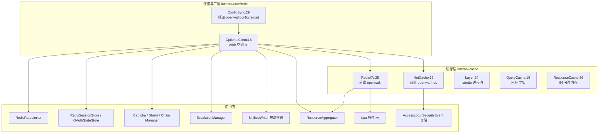
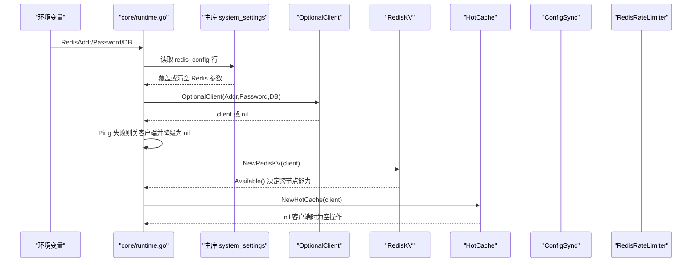
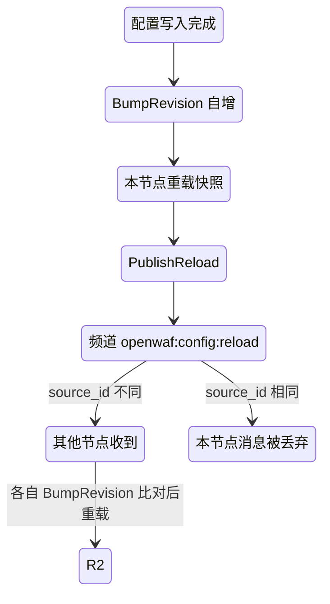
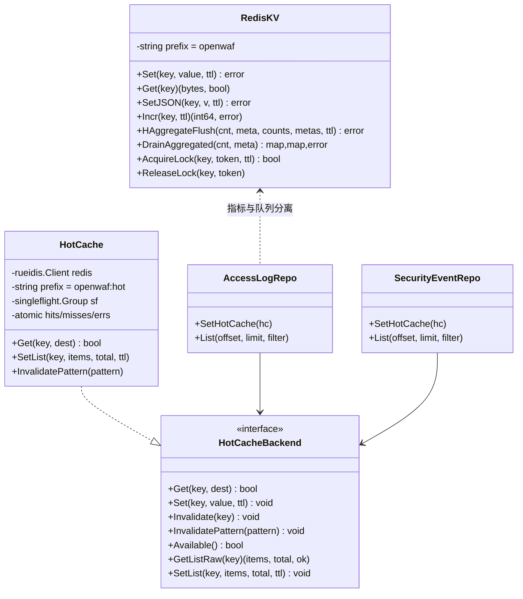
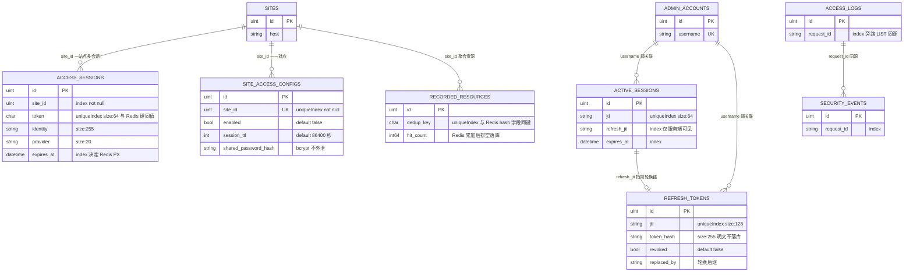
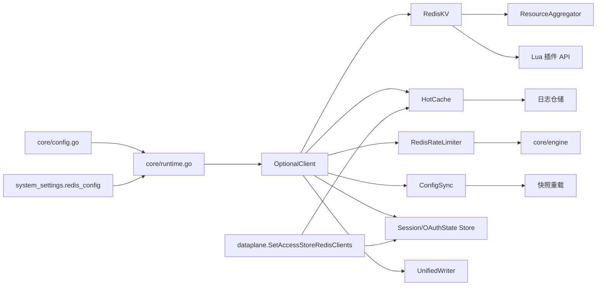

# Redis 集成

> [返回 数据存储层](数据存储层.md)

<cite>
**本文档引用的文件**
- [internal/core/redis/redis.go](file://internal/core/redis/redis.go)
- [internal/core/redis/pubsub.go](file://internal/core/redis/pubsub.go)
- [internal/cache/redis_kv.go](file://internal/cache/redis_kv.go)
- [internal/cache/hot_cache.go](file://internal/cache/hot_cache.go)
- [internal/cache/layer.go](file://internal/cache/layer.go)
- [internal/waf/ratelimit/redis.go](file://internal/waf/ratelimit/redis.go)
- [internal/waf/accessgate/store_redis.go](file://internal/waf/accessgate/store_redis.go)
- [internal/waf/challenge/captcha.go](file://internal/waf/challenge/captcha.go)
- [internal/store/access/access_control.go](file://internal/store/access/access_control.go)
- [internal/store/auth/auth.go](file://internal/store/auth/auth.go)
- [internal/store/approute/app_route.go](file://internal/store/approute/app_route.go)
- [internal/store/events.go](file://internal/store/events.go)
- [internal/store/system.go](file://internal/store/system.go)
- [internal/store/access/access_control.go](file://internal/store/access/access_control.go)
- [internal/store/auth/auth.go](file://internal/store/auth/auth.go)
- [internal/store/approute/app_route.go](file://internal/store/approute/app_route.go)
- [internal/store/events.go](file://internal/store/events.go)
- [internal/store/system.go](file://internal/store/system.go)
- [internal/core/runtime.go](file://internal/core/runtime.go)
- [internal/core/config.go](file://internal/core/config.go)
- [internal/app/server.go](file://internal/app/server.go)
- [internal/waf/ratelimit/ratelimit.go](file://internal/waf/ratelimit/ratelimit.go)
- [internal/store/migrate.go](file://internal/store/migrate.go)
- [internal/store/repository/repository.go](file://internal/store/repository/repository.go)
- [internal/store/repository/access_log.go](file://internal/store/repository/access_log.go)
- [internal/store/repository/security_event.go](file://internal/store/repository/security_event.go)
- [internal/waf/challenge/shield.go](file://internal/waf/challenge/shield.go)
- [internal/waf/challenge/chain.go](file://internal/waf/challenge/chain.go)
- [internal/waf/escalation/escalation.go](file://internal/waf/escalation/escalation.go)
- [internal/waf/luaplugin/api.go](file://internal/waf/luaplugin/api.go)
- [internal/observability/unified_writer.go](file://internal/observability/unified_writer.go)
- [internal/dataplane/resource_aggregator.go](file://internal/dataplane/resource_aggregator.go)
- [internal/dataplane/access_control.go](file://internal/dataplane/access_control.go)
- [go.mod](file://go.mod)
- [README.md](file://README.md)
</cite>

## 目录

1. [简介](#简介)
2. [项目结构](#项目结构)
3. [核心组件](#核心组件)
4. [架构总览](#架构总览)
5. [详细组件分析](#详细组件分析)
6. [依赖关系分析](#依赖关系分析)
7. [性能考虑](#性能考虑)
8. [故障排查指南](#故障排查指南)
9. [结论](#结论)
10. [附录](#附录)

## 简介

Redis 在本项目中是**完全可选的横向能力层**：客户端由 `OptionalClient` 创建，地址为空即返回 nil，所有使用方都以 nil 检查开头。它承担四类职责——跨节点配置重载广播、分布式滑动窗口限流、读穿透热缓存、一次性会话与质询状态存储，另加日志事件的旁路推送与资源聚合的跨节点卸载。

与数据库的关系是「镜像而非替代」：管理员会话、访问控制会话都有对应的 SQL 表，Redis 侧只承载需要跨节点或跨进程重启仍然有效的那部分状态；限流计数、递进封禁计数则只存在于 Redis 或只存在于本地内存，两者语义等价但精度不同。

## 项目结构

Redis 能力按「连接 → 键空间 → 使用方」三层组织，客户端只创建一个实例。

| 模块 | 路径 | 行数 | 职责 | 关键符号 |
|------|------|:----:|------|----------|
| 可选客户端 | `internal/core/redis/redis.go` | 42 | 地址判空、拨号与写超时、禁用内置缓存 | `OptionalClient:18`、`Ping:37` |
| 配置广播 | `internal/core/redis/pubsub.go` | 132 | 频道发布订阅、回环抑制 | `configSyncChannel:16`、`PublishReload:65`、`Subscribe:86` |
| 通用 KV | `internal/cache/redis_kv.go` | 401 | 前缀、TTL、原子计数、hash 聚合、分布式锁 | `redisPrefix:16`、`Incr:182`、`AcquireLock:367` |
| 热缓存 | `internal/cache/hot_cache.go` | 前 130 行 | 读穿透、singleflight、熔断与命中率 | `hotCachePrefix:39`、`Get:77` |
| 限流后端 | `internal/waf/ratelimit/redis.go` | 194 | 有序集合滑动窗口 Lua | `slidingWindowScript:77`、`Allow:115` |
| 会话存储 | `internal/waf/accessgate/store_redis.go` | 546 | 访问控制会话与 OAuth state | `accessSessionKeyPrefix:16`、`accessRedisOperationTimeout:20` |
| 质询状态 | `internal/waf/challenge/{captcha,shield,chain}.go` | — | 验证码/5 秒盾/链式会话 | `prefix:207`、`:200`、`:155` |
| 旁路推送 | `internal/observability/unified_writer.go` | 前 1152 行 | 日志列表 LPUSH + LTRIM + EXPIRE | `pushToRedis:1094` |
| 聚合卸载 | `internal/dataplane/resource_aggregator.go` | 前 291 行 | hash 累加、sink 选主 | `aggregatorRedisCountKey:28`、`aggregatorSinkLockKey:35` |



**图表来源**
- [internal/core/redis/redis.go:18-42](file://internal/core/redis/redis.go#L18-L42)
- [internal/core/redis/pubsub.go:16-132](file://internal/core/redis/pubsub.go#L16-L132)
- [internal/cache/redis_kv.go:16-39](file://internal/cache/redis_kv.go#L16-L39)
- [internal/cache/hot_cache.go:16-53](file://internal/cache/hot_cache.go#L16-L53)
- [internal/cache/layer.go:24-39](file://internal/cache/layer.go#L24-L39)

**章节来源**
- [internal/core/redis/redis.go:11-42](file://internal/core/redis/redis.go#L11-L42)
- [internal/cache/redis_kv.go:15-39](file://internal/cache/redis_kv.go#L15-L39)
- [internal/cache/layer.go:1-39](file://internal/cache/layer.go#L1-L39)
- [internal/waf/ratelimit/redis.go:13-37](file://internal/waf/ratelimit/redis.go#L13-L37)

## 核心组件

组件清单按「键空间归属」划分，前缀体系两套并存：`openwaf:`（KV 与热缓存、广播、旁路列表）与 `owaf:`（安全状态）。

| 组件 | 位置 | 键空间 | 依赖客户端为 nil 时 |
|------|------|--------|--------------------|
| `OptionalClient` | `redis.go:18` | — | 返回 nil |
| `ConfigSync` | `pubsub.go:29` | 频道 `openwaf:config:reload` | `NewConfigSync` 返回 nil |
| `RedisKV` | `redis_kv.go:28` | `openwaf:` + 调用方键 | `Available()` 恒 false |
| `HotCache` | `hot_cache.go:16` | `openwaf:hot:` + 列表键 | 空操作实例，直接回源 |
| `RedisRateLimiter` | `ratelimit/redis.go:13` | `{prefix}:rl:{key}` | 工厂返回 nil，回落本地 |
| `RedisSessionStore` | `accessgate/store_redis.go:58` | `owaf:access:session:{token}` | 等价于内存实现 |
| `RedisOAuthStateStore` | `accessgate/store_redis.go:318` | `owaf:access:oauth-state:{state}` | 同上 |
| `CaptchaManager` | `challenge/captcha.go:201` | `owaf:captcha:{sessionID}` | 走内存 sessions |
| `ShieldSession` | `challenge/shield.go:200` | `owaf:shield:{id}` | 走内存分支 |
| `ChainManager` | `challenge/chain.go:155` | `owaf:chain:{sessionID}` | 走内存分支 |
| `EscalationManager` | `escalation/escalation.go:82` | `owaf:escalation:{ip}:{siteID}` | `recordHitLocal` |
| `UnifiedWriter` 旁路 | `unified_writer.go:1094` | `openwaf:{security_events,...}` | 跳过推送 |
| `ResourceAggregator` | `resource_aggregator.go:28` | `openwaf:recorded_res:*` | 本地聚合 |
| Lua 脚本 KV | `luaplugin/api.go:18` | `owaf:lua:{key}` | `kv.available()` 为假 |

### Redis 用途表

TTL 全部取自代码里的显式参数，未写 TTL 的即为不过期。

| 键前缀 | 数据结构 | TTL | 使用方:行 |
|--------|----------|-----|-----------|
| `openwaf:config:reload` | Pub/Sub 频道 | 无（消息瞬时） | `pubsub.go:16`、`:79`、`:91` |
| `openwaf:` + 业务键 | String（`SET PX`） | 调用方传入 | `redis_kv.go:114` |
| `openwaf:` + 计数键 | String（`INCR` + 首次 `PEXPIRE`，Lua） | 调用方传入 | `redis_kv.go:20-26`、`:197` |
| `openwaf:recorded_res:counts` / `:meta` | Hash（`HINCRBY` / `HSET`） | 10 分钟 | `redis_kv.go:234-265`、`resource_aggregator.go:28-29`、`:39` |
| `openwaf:recorded_res:sink_lock` | String（`SET NX PX`） | 30 秒 | `redis_kv.go:374`、`resource_aggregator.go:35-36` |
| `openwaf:hot:` + 列表键 | String（JSON `{items,total}`） | 列表 5 秒；指纹结果 5 秒 | `hot_cache.go:39`、`access_log.go:333`、`:387`、`security_event.go:115`、`:157` |
| `openwaf:request:rl:` + 限流键 | ZSET + Lua 滑动窗口 | `window + 1` 秒 | `ratelimit/redis.go:77-92`、`:88`、`:130`；前缀 `server.go:383` |
| `openwaf:error:rl:` + 限流键 | ZSET + Lua | `window + 1` 秒 | 同上，前缀 `server.go:384` |
| `openwaf:security_events` | LIST（`LPUSH` + `LTRIM 0 99999`） | 7 天 | `unified_writer.go:1117-1121`、`:1130`、`:1103` |
| `openwaf:access_logs` | LIST（同上） | 7 天 | `unified_writer.go:1137` |
| `openwaf:drop_events` | LIST（`LTRIM 0 49999`） | 7 天 | `unified_writer.go:1144` |
| `openwaf:bot_scores` | LIST（`LTRIM 0 49999`） | 7 天 | `unified_writer.go:1151` |
| `owaf:access:session:` + token | String（会话 JSON） | `PX` 至会话过期时刻 | `store_redis.go:16`、`:136` |
| `owaf:access:oauth-state:` + state | String（一次性，Lua 取后删） | `PX` 至 state 过期 | `store_redis.go:17`、`:400`、`:456` |
| `owaf:captcha:` + 会话 ID | String | `PX` 为管理器 timeout（默认 120 秒） | `captcha.go:207`、`:202-204`、`:597` |
| `owaf:shield:` + 会话 ID | String | `PX` 为签发时 `TimeoutSecs` | `shield.go:200`、`:646` |
| `owaf:chain:` + 会话 ID | String | 10 分钟常量 | `chain.go:74`、`:155`、`:682` |
| `owaf:escalation:` + IP + 站点 | String（`INCR` + `EXPIRE` 管道） | `windowSecs` | `escalation/escalation.go:82-91`、`:127` |
| `owaf:lua:` + 脚本键 | String | 默认 5 分钟，上限 24 小时 | `luaplugin/api.go:18`、`:25-29` |

**章节来源**
- [internal/core/redis/pubsub.go:16-121](file://internal/core/redis/pubsub.go#L16-L121)
- [internal/cache/redis_kv.go:15-401](file://internal/cache/redis_kv.go#L15-L401)
- [internal/cache/hot_cache.go:38-103](file://internal/cache/hot_cache.go#L38-L103)
- [internal/waf/ratelimit/redis.go:77-192](file://internal/waf/ratelimit/redis.go#L77-L192)
- [internal/waf/accessgate/store_redis.go:14-475](file://internal/waf/accessgate/store_redis.go#L14-L475)
- [internal/waf/challenge/captcha.go:201-597](file://internal/waf/challenge/captcha.go#L201-L597)

### 数据表清单（与 Redis 状态相关的落库表）

Redis 侧状态凡需要持久化审计的，都有对应表；下列是本专题涉及的表。

| 表名 | 模型 | 定义位置:行 | 主键 | 索引 | 写入方 |
|------|------|-------------|------|------|--------|
| `system_settings` | `SystemSettings` | `store/system.go:4` | `id` | `key` 唯一 | `SystemSettingsRepo.Set`（`redis_config` 键） |
| `access_sessions` | `access.AccessSession` | `store/access/access_control.go:72` | `id` | `token` 唯一、`site_id`、`expires_at` | 访问控制仓储 |
| `site_access_configs` | `access.SiteAccessConfig` | `store/access/access_control.go:20` | `id` | `site_id` 唯一 | `AccessControlRepo.SaveSiteAccessConfig` |
| `active_sessions` | `auth.ActiveSession` | `store/auth/auth.go:70` | `id` | `jti` 唯一、`expires_at` | 管理面会话管理 |
| `refresh_tokens` | `auth.RefreshToken` | `store/auth/auth.go:38` | `id` | `jti` 唯一 | `RefreshTokenRepo` |
| `token_blacklists` | `auth.TokenBlacklist` | `store/auth/auth.go:51` | `id` | `jti` 唯一、`expires_at` | 吊销流程 |
| `recorded_resources` | `approute.RecordedResource` | `store/approute/app_route.go:58` | `id` | `dedup_key` 唯一 | `RecordedResourceRepo.Upsert`（Redis hash 排空后落库） |
| `access_logs` | `AccessLog` | `store/events.go:79` | `id` | 三列复合等 | `AccessLogRepo`（旁路 LIST 同源） |

**章节来源**
- [internal/store/access/access_control.go:20-80:20-80](file://internal/store/access/access_control.go#L20-L80#20)
- [internal/store/auth/auth.go:28-82:28-82](file://internal/store/auth/auth.go#L28-L82#28)
- [internal/store/approute/app_route.go:57-98:57-98](file://internal/store/approute/app_route.go#L57-L98#57)
- [internal/store/events.go:15-129:15-129](file://internal/store/events.go#L15-L129#15)
- [internal/store/system.go:4-8:4-8](file://internal/store/system.go#L4-L8#4)
- [internal/store/access/access_control.go:20-80](file://internal/store/access/access_control.go#L20-L80)
- [internal/store/auth/auth.go:28-82](file://internal/store/auth/auth.go#L28-L82)
- [internal/store/approute/app_route.go:57-98](file://internal/store/approute/app_route.go#L57-L98)
- [internal/store/events.go:15-129](file://internal/store/events.go#L15-L129)
- [internal/store/system.go:4-8](file://internal/store/system.go#L4-L8)

### 字段明细（`redis_config` 配置）

Redis 连接参数有两个来源，数据库中的 `redis_config` 行优先于环境变量。

| 字段 | 类型 | 约束 | 默认 | 说明 |
|------|------|------|------|------|
| `enabled` | `bool` | 必填 | false | 为假时把地址、口令、库号一律清零 |
| `addr` | `string` | 启用时非空 | — | 空地址 + 启用视为配置错误 |
| `password` | `string` | `omitempty` | 空 | 机密，禁止出现在响应与日志 |
| `db` | `int` | `>= 0` | 0 | 负值报错 |
| `MY_OPENWAF_REDIS_ADDR` | 环境变量 | — | 空 | 被库中配置覆盖 |
| `MY_OPENWAF_REDIS_PASSWORD` | 环境变量 | — | 空 | 同上 |
| `MY_OPENWAF_REDIS_DB` | 环境变量 | 整数 | 0 | 解析失败按 0 |

```sql
-- 配置载体表（store/system.go:4-8）
CREATE TABLE `system_settings` (
  `id` integer PRIMARY KEY AUTOINCREMENT,
  `key` text NOT NULL,
  `value` text
);
CREATE UNIQUE INDEX `idx_system_settings_key` ON `system_settings`(`key`);
-- 键值示例：key = 'redis_config'，value 为脱敏后的 JSON 文本
-- {"enabled":true,"addr":"{host}:{port}","db":0}

-- 会话持久化表（store/access/access_control.go:72-80），
-- Redis 键 owaf:access:session:{token} 与之同 token
CREATE TABLE `access_sessions` (
  `id` integer PRIMARY KEY AUTOINCREMENT,
  `site_id` integer NOT NULL,
  `token` char(64) NOT NULL,
  `identity` text,
  `provider` text,
  `expires_at` datetime,
  `created_at` datetime
);
CREATE UNIQUE INDEX `idx_access_sessions_token` ON `access_sessions`(`token`);
CREATE INDEX `idx_access_sessions_site_id` ON `access_sessions`(`site_id`);
CREATE INDEX `idx_access_sessions_expires_at` ON `access_sessions`(`expires_at`);
```

**章节来源**
- [internal/core/runtime.go:153-199](file://internal/core/runtime.go#L153-L199)
- [internal/core/config.go:275-277](file://internal/core/config.go#L275-L277)
- [internal/core/config.go:513-515](file://internal/core/config.go#L513-L515)
- [internal/store/system.go:3-28](file://internal/store/system.go#L3-L28)
- [internal/store/access/access_control.go:19-80](file://internal/store/access/access_control.go#L19-L80)
- [internal/store/auth/auth.go:38-82](file://internal/store/auth/auth.go#L38-L82)

## 架构总览

启动顺序决定可用性判定：先开主库读 `redis_config`，再建 Redis 客户端，最后创建热缓存与 KV 包装。



**图表来源**
- [internal/core/runtime.go:63-141](file://internal/core/runtime.go#L63-L141)
- [internal/core/redis/redis.go:18-42](file://internal/core/redis/redis.go#L18-L42)
- [internal/app/server.go:304-325](file://internal/app/server.go#L304-L325)

限流后端的构造是一个显式的回落链：Redis 限流器构造成功用它，否则用本地限流器，两者实现同一个 `RateLimiterBackend` 接口。

```go
// internal/app/server.go:123-128
func buildRateLimiterBackend(client rueidis.Client, prefix string, windowSec, maxReqs int, enabled bool) ratelimit.RateLimiterBackend {
	if rl := ratelimit.NewRedisRateLimiter(client, prefix, windowSec, maxReqs, enabled); rl != nil {
		return rl
	}
	return ratelimit.NewRateLimiter(windowSec, maxReqs, enabled)
}
```

**章节来源**
- [internal/app/server.go:123-128](file://internal/app/server.go#L123-L128)
- [internal/waf/ratelimit/ratelimit.go:10-36](file://internal/waf/ratelimit/ratelimit.go#L10-L36)
- [internal/waf/ratelimit/redis.go:22-37](file://internal/waf/ratelimit/redis.go#L22-L37)
- [internal/core/runtime.go:99-131](file://internal/core/runtime.go#L99-L131)

## 详细组件分析

### 可选客户端与健康判定

`OptionalClient` 只做两件事：地址判空、构造带超时的客户端。`DisableCache: true` 关闭 rueidis 内置响应缓存，因为本项目自己管理键空间与失效。

| 参数 | 取值 | 位置 | 说明 |
|------|------|------|------|
| `InitAddress` | 单元素列表 | `redis.go:23` | 不支持多哨兵/集群地址 |
| `Password` | 配置值 | `redis.go:24` | 机密 |
| `SelectDB` | 配置值 | `redis.go:25` | 库号 |
| `Dialer.Timeout` | 5 秒 | `redis.go:26` | 拨号超时 |
| `ConnWriteTimeout` | 3 秒 | `redis.go:27` | 写超时 |
| `DisableCache` | `true` | `redis.go:28` | 关闭客户端内置缓存 |
| 失败返回 | nil | `redis.go:30-32` | 不返回错误，静默降级 |

熔断由使用方各自维护：`RedisKV` 与 `HotCache` 都在命令出错时写入 5 秒的不可用窗口，期间直接判定不可用，避免每个请求都等一次超时。

```go
// internal/cache/redis_kv.go:16-17、:82-97
const (
	redisPrefix           = "openwaf:"
	redisKVFailureBackoff = 5 * time.Second
)

func (r *RedisKV) noteCommandResult(client rueidis.Client, err error) {
	// 成功或 nil（键不存在）都恢复健康；真正的命令失败才打开熔断窗口
	if err == nil || errors.Is(err, rueidis.Nil) {
		r.health.Store(true)
		r.unavailableUntil.Store(0)
	} else {
		r.health.Store(false)
		r.unavailableUntil.Store(time.Now().Add(redisKVFailureBackoff).UnixNano())
	}
}
```

**章节来源**
- [internal/core/redis/redis.go:11-42](file://internal/core/redis/redis.go#L11-L42)
- [internal/cache/redis_kv.go:15-97](file://internal/cache/redis_kv.go#L15-L97)
- [internal/cache/hot_cache.go:16-53](file://internal/cache/hot_cache.go#L16-L53)
- [internal/core/runtime.go:99-116](file://internal/core/runtime.go#L99-L116)

### 配置重载广播与回环抑制

频道固定为 `openwaf:config:reload`（`pubsub.go:16`），消息体是含 `source_id` 与 `action` 的 JSON（`:19-22`）。发布端带 2 秒超时且失败只记警告（`:77-81`）；订阅端除了忽略非 `reload` 动作，还会丢弃自己发出的消息（`:114-116`），避免「改一次配置重载两次」。

```go
// internal/core/redis/pubsub.go:111-120
if event.Action != configSyncActionReload {
	return
}
if event.SourceID != "" && event.SourceID == cs.sourceID {
	return
}
cs.log.Info("received config sync reload")
if err := reload(); err != nil {
	cs.log.Error("config sync reload failed", slog.Any("err", err))
}
```



**图表来源**
- [internal/core/redis/pubsub.go:64-122](file://internal/core/redis/pubsub.go#L64-L122)
- [internal/store/migrate.go:141-160](file://internal/store/migrate.go#L141-L160)
- [internal/app/server.go:835-866](file://internal/app/server.go#L835-L866)

`sourceID` 为空时由 8 字节随机数生成（`:45-47`、`:56-62`）；`Subscribe` 在 `Close()` 前阻塞，并在新建订阅者时把客户端关闭挂到停止通道上（`:93-96`）。运行时热替换 Redis 客户端会重建 `ConfigSync`（`server.go:835-845`）。

**章节来源**
- [internal/core/redis/pubsub.go:16-132](file://internal/core/redis/pubsub.go#L16-L132)
- [internal/app/server.go:476-478](file://internal/app/server.go#L476-L478)
- [internal/app/server.go:835-866](file://internal/app/server.go#L835-L866)

### 分布式滑动窗口限流

限流键由前缀 + `:rl:` + 业务键拼成（`ratelimit/redis.go:130`），业务键为 `bind|siteID|host|clientIP`，与本地限流器共用同一键构造逻辑。窗口以毫秒 ZSET 成员承载，Lua 脚本内先按 `now - window` 清理、再判配额、放行则 `ZADD` 并把 TTL 设为 `window + 1` 秒。

```lua
-- internal/waf/ratelimit/redis.go:77-92
local key = KEYS[1]
local now = tonumber(ARGV[1])
local window = tonumber(ARGV[2])
local limit = tonumber(ARGV[3])

local min_ts = now - window
redis.call('ZREMRANGEBYSCORE', key, '-inf', min_ts)
local count = redis.call('ZCARD', key)
if count < limit then
    redis.call('ZADD', key, now, now .. ':' .. math.random(1, 1000000))
    redis.call('EXPIRE', key, window + 1)
    return 1
end
return 0
```

| 方法 | 语义 | 超时 | Redis 出错时 |
|------|------|:----:|--------------|
| `Allow` | 判配额并计数 | 50 ms | 返回 true（放行） |
| `Increment` | 只计数并返回 | 50 ms | 返回 0 |
| `IsOverLimit` | 只判超配额 | 50 ms | 返回 false |
| `Reconfigure` | 改窗口与配额 | — | 非法组合强制禁用 |
| `SetEnabled` | 开关 | — | 拒绝启用非法组合 |

**章节来源**
- [internal/waf/ratelimit/redis.go:13-194](file://internal/waf/ratelimit/redis.go#L13-L194)
- [internal/app/server.go:383-384](file://internal/app/server.go#L383-L384)
- [internal/app/server.go:1241-1244](file://internal/app/server.go#L1241-L1244)

### 热缓存与读穿透

`HotCache` 只服务于日志类列表查询，键为 `openwaf:hot:` + 含 offset/limit 的命名空间键，值是一次 JSON 编码的 `{items,total}`。写侧通过 `SetList` 落 5 秒 TTL；读侧命中即跳过 `COUNT` 与明细查询。



**图表来源**
- [internal/store/repository/repository.go:16-26](file://internal/store/repository/repository.go#L16-L26)
- [internal/cache/hot_cache.go:16-103](file://internal/cache/hot_cache.go#L16-L103)
- [internal/cache/redis_kv.go:28-401](file://internal/cache/redis_kv.go#L28-L401)

`Repos.SetHotCache` 只注入两个仓储（`repository.go:93-96`），这是接口被隔离的直接证据：drop 与 bot 仓储不使用热缓存。

**章节来源**
- [internal/cache/hot_cache.go:16-103](file://internal/cache/hot_cache.go#L16-L103)
- [internal/store/repository/repository.go:16-26](file://internal/store/repository/repository.go#L16-L26)
- [internal/store/repository/repository.go:92-103](file://internal/store/repository/repository.go#L92-L103)
- [internal/store/repository/access_log.go:326-400](file://internal/store/repository/access_log.go#L326-L400)
- [internal/store/repository/security_event.go:109-160](file://internal/store/repository/security_event.go#L109-L160)

### 会话、质询与递进封禁状态

一次性状态一律「写时带 TTL、读时二次判过期」：会话与 OAuth state 在命令失败时回落内存实现，递进封禁回落本地计数表，Lua 脚本侧 `kv.available()` 返回假即策略降级。Redis 与内存两条路径语义等价，差别只在跨节点可见性。

所有访问控制命令的超时被压到 100 ms（`store_redis.go:20`），因为它们在请求路径上；全量吊销与过期清理走 `SCAN` 游标而非 `KEYS`（`:249`、`:284`），避免阻塞主线程。

**章节来源**
- [internal/waf/accessgate/store_redis.go:14-543](file://internal/waf/accessgate/store_redis.go#L14-L543)
- [internal/waf/challenge/captcha.go:201-215](file://internal/waf/challenge/captcha.go#L201-L215)
- [internal/waf/challenge/shield.go:200-200](file://internal/waf/challenge/shield.go#L200-L200)
- [internal/waf/challenge/chain.go:73-74](file://internal/waf/challenge/chain.go#L73-L74)
- [internal/waf/escalation/escalation.go:82-140](file://internal/waf/escalation/escalation.go#L82-L140)
- [internal/waf/luaplugin/api.go:16-29](file://internal/waf/luaplugin/api.go#L16-L29)

### 旁路推送与聚合卸载

日志落库成功后，同一批数据会被 JSON 编码推入四个列表键，供外部消费者读取；每次写入都伴随 `LTRIM` 与 `EXPIRE`，因此列表规模与存活期都有硬上限（7 天）。实时看板并不读这些列表，它走 `RealtimeHub` 轮询数据库。

| 列表键 | 保留长度 | 命令 | 位置 |
|--------|:--------:|------|------|
| `openwaf:security_events` | 100000 | `LPUSH` + `LTRIM 0 99999` | `unified_writer.go:1146`、`:1123-1139` |
| `openwaf:access_logs` | 100000 | 同上 | `:1178` |
| `openwaf:drop_events` | 50000 | `LTRIM 0 49999` | `:1197` |
| `openwaf:bot_scores` | 50000 | 同上 | `:1204` |

资源聚合走「hash 累加 + 单点排空」：各节点每 2 秒把本地计数 `HINCRBY` 到 `openwaf:recorded_res:counts`，只有抢到 30 秒锁的 sink 节点每 5 秒用 Lua 原子地读出并删除计数与元数据两个 hash，再落库。这解决的是「多节点各自计数会丢」而不是性能缓存。

**章节来源**
- [internal/observability/unified_writer.go:1094-1160](file://internal/observability/unified_writer.go#L1094-L1160)
- [internal/dataplane/resource_aggregator.go:24-39](file://internal/dataplane/resource_aggregator.go#L24-L39)
- [internal/dataplane/resource_aggregator.go:188-291](file://internal/dataplane/resource_aggregator.go#L188-L291)
- [internal/cache/redis_kv.go:219-289](file://internal/cache/redis_kv.go#L219-L289)

### 会话状态的库侧对应

Redis 承载的会话与令牌状态，凡需要持久审计的都有落库对应表；两者以同一标识关联，而不是互为备份。



**图表来源**
- [internal/store/access/access_control.go:20-80](file://internal/store/access/access_control.go#L20-L80)
- [internal/store/auth/auth.go:28-82](file://internal/store/auth/auth.go#L28-L82)
- [internal/store/approute/app_route.go:57-98](file://internal/store/approute/app_route.go#L57-L98)
- [internal/store/events.go:15-129](file://internal/store/events.go#L15-L129)
- [internal/waf/accessgate/store_redis.go:16-17](file://internal/waf/accessgate/store_redis.go#L16-L17)
- [internal/dataplane/resource_aggregator.go:28-39](file://internal/dataplane/resource_aggregator.go#L28-L39)

对应关系有三条口径：`access_sessions.token` 与 `owaf:access:session:{token}` 同值，会话有效期由 `expires_at` 决定 Redis 的 `PX` 长度；`active_sessions.refresh_jti` 只用于服务端精确撤销，与 `owaf:` 键空间无关；`recorded_resources.hit_count` 是 Redis 计数 hash 排空后的累加结果，不代表实时值。

**章节来源**
- [internal/store/access/access_control.go:19-94](file://internal/store/access/access_control.go#L19-L94)
- [internal/store/auth/auth.go:15-89](file://internal/store/auth/auth.go#L15-L89)
- [internal/waf/accessgate/store_redis.go:14-20](file://internal/waf/accessgate/store_redis.go#L14-L20)
- [internal/waf/accessgate/store_redis.go:97-184](file://internal/waf/accessgate/store_redis.go#L97-L184)
- [internal/dataplane/resource_aggregator.go:24-39](file://internal/dataplane/resource_aggregator.go#L24-L39)
- [internal/store/approute/app_route.go:57-98](file://internal/store/approute/app_route.go#L57-L98)

## 依赖关系分析

Redis 不进入任何数据库事务，因此它可以整体缺席；反过来，凡是「必须一致」的状态都落库而非落 Redis。



**图表来源**
- [internal/core/runtime.go:63-141](file://internal/core/runtime.go#L63-L141)
- [internal/app/server.go:700-702](file://internal/app/server.go#L700-L702)
- [internal/dataplane/access_control.go:30-37](file://internal/dataplane/access_control.go#L30-L37)
- [internal/app/server.go:1208-1244](file://internal/app/server.go#L1208-L1244)

| 依赖 | 版本 | 必需性 | 缺失影响 |
|------|------|:------:|----------|
| `github.com/redis/rueidis` | v1.0.78 | 编译必需 | 无客户端类型 |
| `golang.org/x/sync/singleflight` | v0.24.0 | 编译必需 | 热缓存无防击穿 |
| `github.com/dgraph-io/ristretto` | v0.2.0 | 编译必需 | 快照层进程内缓存缺失（与 Redis 无关） |
| Redis 服务 | 部署项 | 可选 | 全链路降级到本地内存与数据库 |

**章节来源**
- [go.mod:11-34](file://go.mod#L11-L34)
- [internal/cache/layer.go:10-39](file://internal/cache/layer.go#L10-L39)
- [internal/cache/hot_cache.go:12-14](file://internal/cache/hot_cache.go#L12-L14)

## 性能考虑

- **问题**：Redis 抖动会把管理面接口拖成串行等待。
  **优化**：`HotCache`/`RedisKV` 各自 5 秒熔断窗口 + 单命令 1 秒超时；热缓存侧把「键不存在」与「依赖故障」分开计数。
  **效果**：故障期间直接回源数据库，命中率指标也不会被误读成 0%。
- **问题**：限流在请求路径上，不能因 Redis 变慢而放大延迟。
  **优化**：单命令 50 ms 超时 + Lua 原子一次往返；失败 fail-open。
  **效果**：限流降级为放行而非 5xx，代价是配额精度下降。
- **问题**：全量吊销若用 `KEYS` 会阻塞 Redis 主线程。
  **优化**：`SCAN` 游标 + `COUNT 128` 分批删除。
  **效果**：命令延迟可控。
- **问题**：日志旁路列表无限增长。
  **优化**：`LTRIM` 固定长度 + 7 天 `EXPIRE`。
  **效果**：内存占用上界确定。
- **问题**：快照结构体序列化到 Redis 成本高且无意义。
  **优化**：快照留在进程内 ristretto（`NumCounters 1e4`、`MaxCost 1<<20`、`BufferItems 64`），跨节点一致走广播。
  **效果**：避免大对象编解码，一致性由修订号保证。

[本节为总结，无需特定文件来源]

## 故障排查指南

| 症状 | 根因 | 排查 | 方案 |
|------|------|------|------|
| 启动日志 `redis unavailable, continuing without redis` | Ping 失败且地址非空 | 连通性与认证 | 视为降级运行，非致命 |
| 配了地址但功能不生效 | 库中 `redis_config.enabled` 为假 | 查 `system_settings` 该行 | 环境变量会被库配置覆盖 |
| 启用后报 `redis addr is required when enabled` | 启用但地址空 | 核对地址 | 补地址或关闭启用位 |
| 改配置后其他节点不重载 | 频道/订阅未建立 | 看 `received config sync reload` | 检查客户端与 `ConfigSync` 重建 |
| 本节点重载两次 | 回环未抑制（旧消息无 `source_id`） | 看消息体 | 属兼容路径，新版消息带 ID |
| 限流形同虚设 | Redis 错误被 fail-open | 看命令延迟与错误计数 | 修网络或改用本地限流 |
| 多节点资源命中偏少 | 未抢到 sink 锁或 hash 被排空 | 看 `recorded_res:sink_lock` | 属设计，锁 30 秒轮换 |
| Lua 脚本 `kv.set` 无效 | 超 TTL/体积上限 | 看 `owaf:lua:` 键与限制 | 键 256、值 64 KiB、TTL 上限 24 小时 |

```bash
# 连通性、键空间与熔断状态自检
redis-cli -h {host} -p {port} -a '{password}' PING
redis-cli -h {host} -p {port} -a '{password}' --scan --pattern 'openwaf:*' | head -20
redis-cli -h {host} -p {port} -a '{password}' --scan --pattern 'owaf:*' | head -20
redis-cli -h {host} -p {port} -a '{password}' PUBSUB CHANNELS 'openwaf:config:reload'
# 预期：PONG；两个前缀系列键；频道被订阅时返回通道名
```

**章节来源**
- [internal/core/runtime.go:99-131](file://internal/core/runtime.go#L99-L131)
- [internal/core/runtime.go:164-199](file://internal/core/runtime.go#L164-L199)
- [internal/core/redis/pubsub.go:97-121](file://internal/core/redis/pubsub.go#L97-L121)
- [internal/waf/ratelimit/redis.go:115-192](file://internal/waf/ratelimit/redis.go#L115-L192)
- [internal/waf/luaplugin/api.go:16-29](file://internal/waf/luaplugin/api.go#L16-L29)

## 结论

Redis 集成的骨架是「一个可选客户端 + 两套键前缀 + 三种降级语义」：`openwaf:` 放缓存与广播，`owaf:` 放安全状态；缓存类失败即回源，限流类失败放行，状态类失败落内存。KISS 体现在没有引入哨兵/集群与客户端内置缓存；YAGNI 体现在不做分布式事务与缓存一致性协议，跨节点一致交给修订号加广播；DRY 体现在 `HotCacheBackend`、`RateLimiterBackend`、`SessionStore` 三处接口把「有 Redis」和「无 Redis」收敛为同一调用面；DIP 体现在仓储依赖接口而非 `cache` 包，避免导入环。

需要注意的边界是：热缓存与旁路列表都是尽力而为，不能作为审计真相；任何需要持久证明的状态都必须落库。

## 附录

### 超时与上限速查

| 用途 | 取值 | 位置 |
|------|:----:|------|
| 客户端拨号 / 写超时 | 5 秒 / 3 秒 | `redis.go:26-27` |
| 配置发布超时 | 2 秒 | `pubsub.go:77` |
| KV 单命令 / 聚合命令超时 | 1 秒 / 2 秒 | `redis_kv.go:101-132`、`:239`、`:274` |
| 熔断回退窗口 | 5 秒 | `redis_kv.go:17`、`hot_cache.go:40` |
| 限流命令超时 | 50 ms | `ratelimit/redis.go:127`、`:153`、`:180` |
| 访问控制命令超时（含清理） | 100 ms / 2 秒 | `store_redis.go:20`、`:245` |
| 旁路推送超时 | 5 秒 | `unified_writer.go:1101` |
| 脚本键 TTL 上限 | 24 小时 | `luaplugin/api.go:27` |

**章节来源**
- [internal/core/redis/redis.go:22-33](file://internal/core/redis/redis.go#L22-L33)
- [internal/core/redis/pubsub.go:77-79](file://internal/core/redis/pubsub.go#L77-L79)
- [internal/cache/redis_kv.go:100-158](file://internal/cache/redis_kv.go#L100-L158)
- [internal/waf/ratelimit/redis.go:127-187](file://internal/waf/ratelimit/redis.go#L127-L187)
- [internal/observability/unified_writer.go:1101-1103](file://internal/observability/unified_writer.go#L1101-L1103)
- [internal/waf/luaplugin/api.go:25-29](file://internal/waf/luaplugin/api.go#L25-L29)

### 配置项

| 配置项 | 类型 | 默认值 | 必填 | 作用域 | 生效方式 | 安全等级 | 说明 |
|--------|------|--------|:----:|--------|----------|----------|------|
| `MY_OPENWAF_REDIS_ADDR` | string | 空 | 否 | 进程 | 重启或热重载 | 普通 | 空即禁用 |
| `MY_OPENWAF_REDIS_PASSWORD` | string | 空 | 否 | 进程 | 同上 | 机密 | 明文不入库不显示 |
| `MY_OPENWAF_REDIS_DB` | int | 0 | 否 | 进程 | 同上 | 普通 | 负值非法 |
| `redis_config.enabled` | bool | false | 否 | 全局 | 覆盖环境变量 | 普通 | 关闭时清空地址 |
| `redis_config.addr` | string | — | 启用时必填 | 全局 | 同上 | 普通 | 主机:端口 |
| `redis_config.db` | int | 0 | 否 | 全局 | 同上 | 普通 | 库号 |

**章节来源**
- [internal/core/config.go:275-277](file://internal/core/config.go#L275-L277)
- [internal/core/config.go:513-515](file://internal/core/config.go#L513-L515)
- [internal/core/runtime.go:153-198](file://internal/core/runtime.go#L153-L198)
- [README.md:314-322](file://README.md#L314-L322)
