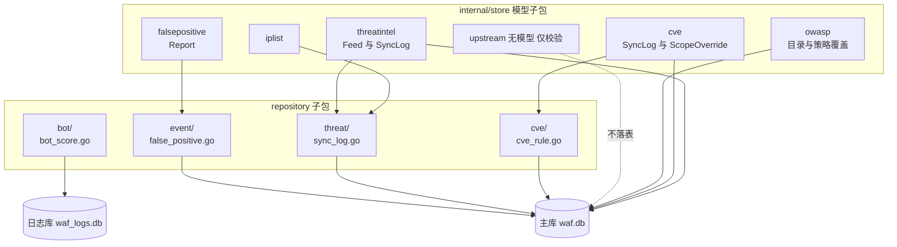
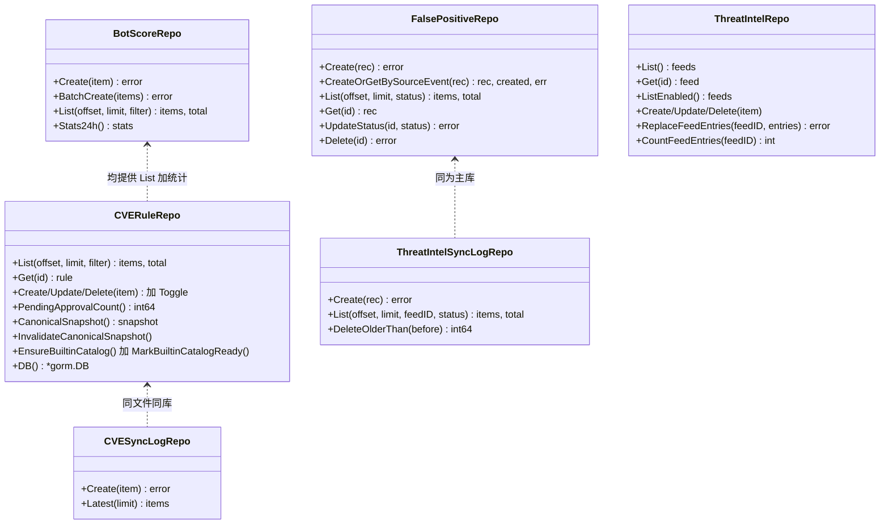
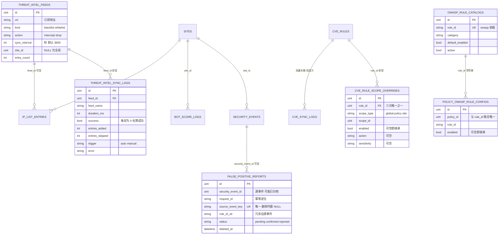
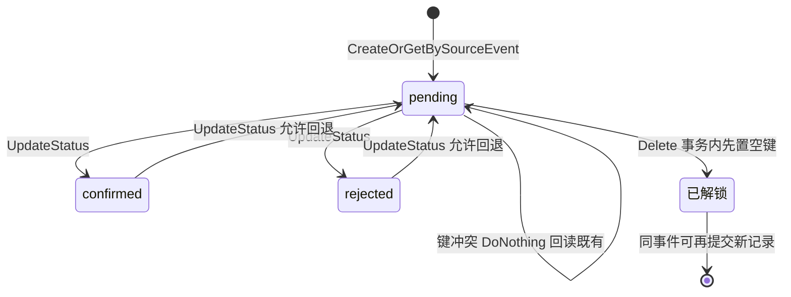
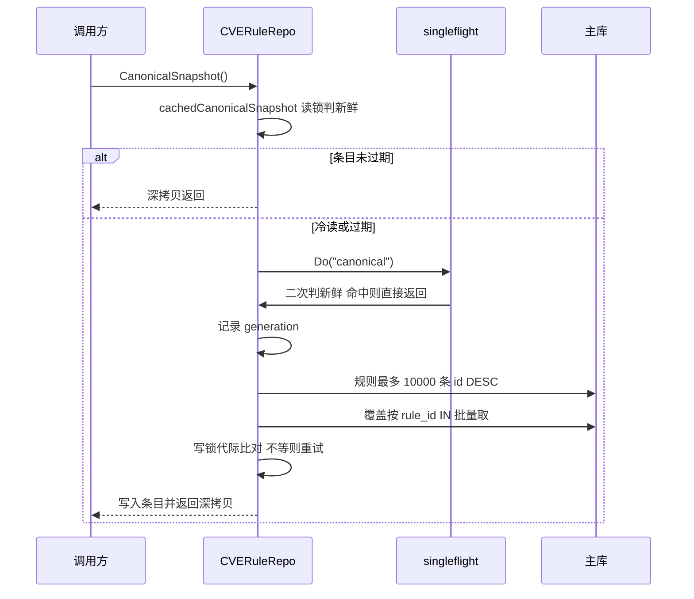
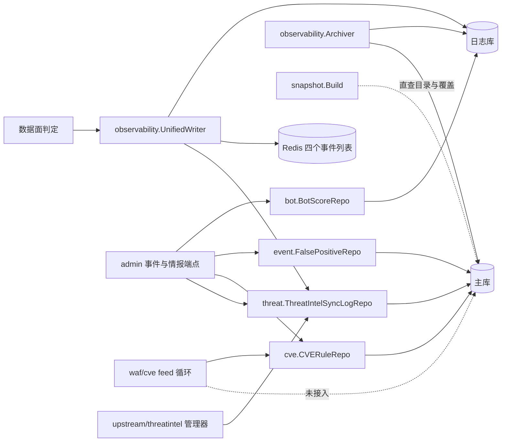
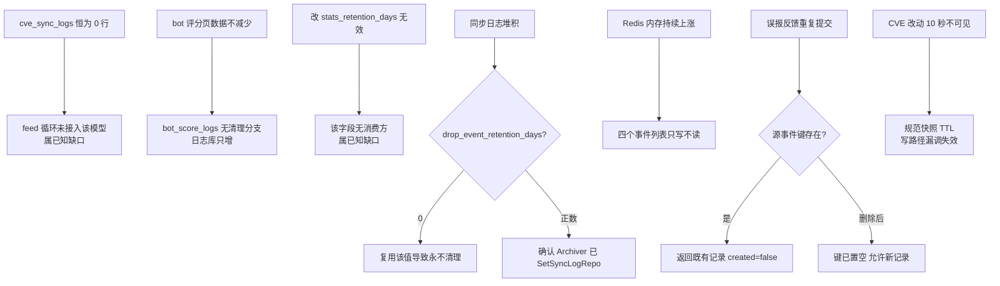

# 事件与情报仓储

> [返回 仓储层](仓储层.md) ｜ [返回 数据存储层](../数据存储层.md)

<cite>
**本文档引用的文件**
- [false_positive.go](file://internal/store/repository/event/false_positive.go)
- [bot_score.go](file://internal/store/repository/bot/bot_score.go)
- [cve_rule.go](file://internal/store/repository/cve/cve_rule.go)
- [threat_intel_sync_log.go](file://internal/store/repository/threat/threat_intel_sync_log.go)
- [threat_intel.go](file://internal/store/repository/threat/threat_intel.go)
- [aliases.go](file://internal/store/repository/aliases.go)
- [repository.go](file://internal/store/repository/repository.go)
- [security_event.go](file://internal/store/repository/security_event.go)
- [access_log.go](file://internal/store/repository/access_log.go)
- [threat_intel.go](file://internal/store/threatintel/threat_intel.go)
- [threat_intel_sync_log.go](file://internal/store/threatintel/threat_intel_sync_log.go)
- [false_positive.go](file://internal/store/falsepositive/false_positive.go)
- [upstream_mtls.go](file://internal/store/upstream/upstream_mtls.go)
- [access_control.go](file://internal/store/access/access_control.go)
- [owasp.go](file://internal/store/owasp/owasp.go)
- [cve.go](file://internal/store/cve/cve.go)
- [cve_scope.go](file://internal/store/cve/cve_scope.go)
- [lua_plugin.go](file://internal/store/luaplugin/lua_plugin.go)
- [ip_list.go](file://internal/store/iplist/ip_list.go)
- [events.go](file://internal/store/events.go)
- [migrate.go](file://internal/store/migrate.go)
- [backup.go](file://internal/store/backup.go)
- [cve_model_parity_test.go](file://internal/store/cve_model_parity_test.go)
- [archiver.go](file://internal/observability/archiver.go)
- [archiver_test.go](file://internal/observability/archiver_test.go)
- [unified_writer.go](file://internal/observability/unified_writer.go)
- [manager.go](file://internal/waf/threatintel/manager.go)
- [false_positive.go](file://internal/admin/event/false_positive.go)
- [cve_scope.go](file://internal/admin/detect/cverules/cve_scope.go)
- [router.go](file://internal/admin/router.go)
</cite>

## 目录

1. [简介](#简介)
2. [项目结构](#项目结构)
3. [核心组件](#核心组件)
4. [架构总览](#架构总览)
5. [详细组件分析](#详细组件分析)
6. [依赖关系分析](#依赖关系分析)
7. [性能考虑](#性能考虑)
8. [故障排查指南](#故障排查指南)
9. [结论](#结论)
10. [附录](#附录)

## 简介

本篇覆盖 `internal/store/repository/` 中承载「运行结果与外部情报」的四个子包——`event/false_positive.go`、`bot/`（139 行）、`cve/`（311 行）、`threat/threat_intel_sync_log.go`（132 行）——以及 `internal/store/` 下八个模型子包：`threatintel`（69 行）、`falsepositive`（43 行）、`upstream`（53 行）、`access`（94 行）、`owasp`（38 行）、`cve`（71 行）、`luaplugin`（50 行）、`iplist`（30 行）。

这组代码有三个与其他仓储明显不同的特征，也是本篇的主线。第一，**跨库路由**：`BotScoreRepo` 落在日志库，其余三个落在主库，同一 `Repos` 结构里两种数据库并存。第二，**写入与查询分离在两个体系**：事件表由 `internal/observability/UnifiedWriter` 批量写入，仓储只提供读侧与少量状态更新，本篇涉及的四个仓储没有任何一个是事件的写入入口。第三，**保留与清理链路存在实测缺口**，四项缺口在「故障排查指南」如实登记。

`internal/store/upstream` 需要特别说明：它**不定义任何 GORM 模型、不对应任何表**，只提供站点上游 mTLS 凭据的规范化与校验函数，因此本篇把它按「模型子包里的非模型模块」处理，不列入数据表清单。

同目录的 [策略与名单仓储](策略与名单仓储.md) 覆盖 `policy`/`iplist`/`acl`/`plugin` 四组与其九张表，[认证与站点仓储](认证与站点仓储.md) 覆盖凭据与站点，[仓储层](仓储层.md) 是装配总览；`SecurityEventRepo`、`AccessLogRepo`、`DropEventRepo` 三个纯事件仓储的方法清单不在本篇展开，本篇只在「保留与清理链路的实测缺口」与依赖分析中引用它们的职责边界；写入侧形状见 [数据访问层设计](../数据访问层设计.md)。

**章节来源**
- [repository.go:60-90](file://internal/store/repository/repository.go#L60-L60)
- [repository.go:28-54](file://internal/store/repository/repository.go#L28-L54)
- [migrate.go:52-89](file://internal/store/migrate.go#L52-L89)
- [migrate.go:126-139](file://internal/store/migrate.go#L126-L139)
- [upstream_mtls.go:1-53](file://internal/store/upstream/upstream_mtls.go#L1-L53)

## 项目结构



**图表来源**
- [repository.go:60-90](file://internal/store/repository/repository.go#L60-L90)
- [migrate.go:52-89](file://internal/store/migrate.go#L52-L89)
- [aliases.go:96-130](file://internal/store/repository/aliases.go#L96-L130)

| 子包 | 文件 | 行数 | 表 | 落库 |
|------|------|:----:|----|------|
| `repository/event/` | `false_positive.go` | 6 个方法 | `false_positive_reports` | 主库 |
| `repository/bot/` | `bot_score.go` | 4 个方法 | `bot_score_logs` | 日志库 |
| `repository/cve/` | `cve_rule.go` | 14 个方法 | `cve_rules`、`cve_rule_scope_overrides`、`cve_sync_logs` | 主库 |
| `repository/threat/` | `threat_intel_sync_log.go` | 3 个方法 | `threat_intel_sync_logs` | 主库 |
| `store/threatintel/` | 2 个文件 | 69 | `threat_intel_feeds`、`threat_intel_sync_logs` | 主库 |
| `store/falsepositive/` | 1 个文件 | 43 | `false_positive_reports` | 主库 |
| `store/cve/` | 2 个文件 | 71 | `cve_rules`（映射）、`cve_sync_logs`、`cve_rule_scope_overrides` | 主库 |
| `store/owasp/` | 1 个文件 | 38 | `owasp_rule_catalogs`、`policy_owasp_rule_configs` | 主库 |
| `store/upstream/` | 1 个文件 | 53 | 无表，仅校验函数 | — |
| `store/access/`、`store/luaplugin/`、`store/iplist/` | 3 个文件 | 174 | 5 张访问控制表、`lua_plugins`、`ip_list_entries` | 主库 |

`repository/cve/cve_rule.go` 单文件定义了两个仓储类型（`CVERuleRepo` 与 `CVESyncLogRepo`），是本组唯一的多类型文件。

**章节来源**
- [cve_rule.go:31-45](file://internal/store/repository/cve/cve_rule.go#L31-L45)
- [cve_rule.go:297-311](file://internal/store/repository/cve/cve_rule.go#L297-L311)
- [threat_intel_sync_log.go:14-26](file://internal/store/repository/threat/threat_intel_sync_log.go#L14-L26)
- [false_positive.go:15-22](file://internal/store/repository/event/false_positive.go#L15-L22)

## 核心组件



**图表来源**
- [false_positive.go:25-118](file://internal/store/repository/event/false_positive.go#L25-L118)
- [bot_score.go:34-96](file://internal/store/repository/bot/bot_score.go#L34-L96)
- [cve_rule.go:49-311](file://internal/store/repository/cve/cve_rule.go#L49-L311)
- [threat_intel_sync_log.go:24-71](file://internal/store/repository/threat/threat_intel_sync_log.go#L24-L71)

| 组件 | 职责 | 独有机制 |
|------|------|----------|
| `FalsePositiveRepo` | 误报反馈的幂等落库与审查状态流转 | `ON CONFLICT DO NOTHING` 加删除时解锁 |
| `BotScoreRepo` | Bot 评分日志的批量写入与多维过滤 | 13 项过滤条件的组合器 |
| `CVERuleRepo` | CVE 规则读写加作用域视图 | 10 秒有界快照缓存加代际失效 |
| `CVESyncLogRepo` | CVE feed 同步记录 | 仅两方法，当前无写入方 |
| `ThreatIntelSyncLogRepo` | 情报订阅源同步审计与分批清理 | 5000 一批加 50 毫秒间歇 |
| `ThreatIntelRepo` | 订阅源配置 | 与 `ip_list_entries.feed_id` 构成替换闭环 |

**章节来源**
- [false_positive.go:31-49](file://internal/store/repository/event/false_positive.go#L31-L49)
- [bot_score.go:98-139](file://internal/store/repository/bot/bot_score.go#L98-L139)
- [cve_rule.go:71-132](file://internal/store/repository/cve/cve_rule.go#L71-L132)
- [threat_intel_sync_log.go:52-71](file://internal/store/repository/threat/threat_intel_sync_log.go#L52-L71)

## 架构总览

事件与情报链路是「一条写入流加四条读取流」：数据面产生记录，统一写入器批量落库并镜像到 Redis 列表，管理端与归档器分别从两侧读取。



**图表来源**
- [false_positive.go:16-43](file://internal/store/falsepositive/false_positive.go#L16-L43)
- [threat_intel.go:12-33](file://internal/store/threatintel/threat_intel.go#L12-L33)
- [threat_intel_sync_log.go:11-36](file://internal/store/threatintel/threat_intel_sync_log.go#L11-L36)
- [cve_scope.go:11-25](file://internal/store/cve/cve_scope.go#L11-L25)
- [cve.go:10-46](file://internal/store/cve/cve.go#L10-L46)
- [owasp.go:5-38](file://internal/store/owasp/owasp.go#L5-L38)
- [events.go:251-277](file://internal/store/events.go#L251-L277)

`cve_sync_logs` 与 `cve_rules` 之间是「无键关联」：`CVESyncLog` 只有 `source`/`status`/`rules_added` 而无 `rule_id`，记录的是 feed 级结果，与 `threat_intel_sync_logs` 的 `feed_id` 形成对照。`bot_score_logs` 与 `cve_sync_logs` 的字段明细分别见「字段明细」与「数据表清单」。

**章节来源**
- [cve.go:37-46](file://internal/store/cve/cve.go#L37-L46)
- [threat_intel_sync_log.go:15-16](file://internal/store/threatintel/threat_intel_sync_log.go#L15-L16)

## 详细组件分析

### 数据表清单

| 表名 | 模型 | 仓储 | 库 | 主索引组 | 软删除 |
|------|------|------|:--:|----------|:------:|
| `false_positive_reports` | `falsepositive.FalsePositiveReport` | `event.FalsePositiveRepo` | 主库 | `source_event_key` 唯一，另 7 个单列索引 | 是 |
| `bot_score_logs` | `store.BotScoreLog` | `bot.BotScoreRepo` | **日志库** | `site_id`/`request_id`/`client_ip`/`total_score`/`created_at`/`tls_ja3_hash`/`tls_ja4` | 否 |
| `threat_intel_sync_logs` | `threatintel.ThreatIntelSyncLog` | `threat.ThreatIntelSyncLogRepo` | 主库 | `feed_id`/`success`/`trigger` | 否 |
| `threat_intel_feeds` | `threatintel.ThreatIntelFeed` | `threat.ThreatIntelRepo` | 主库 | `site_id` | 否 |
| `cve_rules` | `store/cve.CVERuleRecord` 与 `waf/cve.CVERuleModel` | `cve.CVERuleRepo` | 主库 | `cve_id` | 是 |
| `cve_rule_scope_overrides` | `cve.CVERuleScopeOverride` | 由 `CVERuleRepo` 同读同删 | 主库 | `ux_cve_rule_scope` 三元唯一 | 否 |
| `cve_sync_logs` | `cve.CVESyncLog` | `cve.CVESyncLogRepo` | 主库 | 无 | 否 |
| `owasp_rule_catalogs` | `owasp.OWASPRuleCatalog` | 由 `owasprules` 读快照 | 主库 | `rule_id` 唯一，另两个复合索引 | 否 |
| `policy_owasp_rule_configs` | `owasp.PolicyOWASPRuleConfig` | 同上 | 主库 | `ux_policy_owasp_rule` 二元唯一 | 否 |

`cve_rules` 是唯一**由两个结构体映射同一张表**的表：`store/cve.CVERuleRecord` 负责建表与加列（进 `AutoMigrate` 清单），运行时读写用 `internal/waf/cve.CVERuleModel`。字段集必须两侧一致，否则会出现「列不存在于表中」，该约束由 `TestCVERuleModelsShareColumnSet` 守住（cve_model_parity_test.go:10-26），注释里记录了历史事故：`References` 只加在运行时模型上，导致全新部署在 CVE 目录装载时报 `table cve_rules has no column named references`。

**章节来源**
- [cve.go:9-35](file://internal/store/cve/cve.go#L9-L35)
- [migrate.go:69-88](file://internal/store/migrate.go#L69-L88)
- [cve_model_parity_test.go](file://internal/store/cve_model_parity_test.go)
- [owasp.go:5-38](file://internal/store/owasp/owasp.go#L5-L38)

### 字段明细

```sql
-- 以下 DDL 从运行库 sqlite_master 实测导出（方言 SQLite），机密列已省略
CREATE TABLE false_positive_reports (
    id                integer PRIMARY KEY AUTOINCREMENT,
    created_at        datetime,
    updated_at        datetime,
    deleted_at        datetime,
    security_event_id integer,
    request_id        text,
    source_event_key  text,                       -- 唯一，删除时置 NULL 以解锁
    rule_id_str       text,
    category          text,
    client_ip         text,
    host              text,
    path              text,
    match_desc        text,
    submitted_by      text,
    note              text,
    status            text DEFAULT "pending"      -- pending / confirmed / rejected
);
CREATE UNIQUE INDEX idx_false_positive_source_event_key
    ON false_positive_reports(source_event_key);

CREATE TABLE threat_intel_sync_logs (
    id             integer PRIMARY KEY AUTOINCREMENT,
    created_at     datetime,
    feed_id        integer NOT NULL,
    feed_name      text,
    started_at     datetime,
    finished_at    datetime,
    duration_ms    integer,
    success        numeric,
    entries_added  integer,
    entries_skipped integer,
    lines_read     integer,
    trigger        text,                          -- auto / manual
    error          text
);
CREATE INDEX idx_threat_intel_sync_logs_feed_id  ON threat_intel_sync_logs(feed_id);
CREATE INDEX idx_threat_intel_sync_logs_success  ON threat_intel_sync_logs(success);
CREATE INDEX idx_threat_intel_sync_logs_trigger  ON threat_intel_sync_logs(trigger);

-- bot_score_logs 落在日志库，评分明细逐列展开便于归因查询
CREATE TABLE bot_score_logs (
    id integer PRIMARY KEY AUTOINCREMENT,
    site_id integer, request_id text, client_ip text, host text, path text,
    user_agent text, tls_ja3_hash text, tls_ja4 text, tls_version text, tls_sni text,
    tls_alpn text, header_order text, total_score integer, ua_score integer,
    geoip_score integer, fingerprint_score integer, behavior_score integer,
    ip_rep_score integer, is_high_risk numeric, dangerous numeric DEFAULT false,
    danger_reasons text, action text, details text, created_at datetime
);
```

| 字段 | 表 | 可空 | 语义要点 |
|------|----|:----:|----------|
| `source_event_key` | `false_positive_reports` | 是（删除后置空） | 仅作按源事件原子去重用，`json:"-"` 不对外暴露 |
| `security_event_id` | `false_positive_reports` | 是 | 只记 ID，不建外键：源事件可能已被归档清理 |
| `rule_id_str`/`category`/`client_ip`/`host`/`path`/`match_desc` | `false_positive_reports` | 是 | 冗余快照，保证原事件消失后反馈仍可审查 |
| `feed_name` | `threat_intel_sync_logs` | 是 | 同样是冗余：feed 改名或删除后历史日志仍可读 |
| `success` | `threat_intel_sync_logs` | 否 | 真值表示拉取与解析都成功，**条目为 0 也算成功** |
| `entries_skipped` | `threat_intel_sync_logs` | 否 | 格式非法被跳过的行数，与 `lines_read` 一起定位源质量 |
| `trigger` | `threat_intel_sync_logs` | 是 | `auto` 与 `manual` 共用一张表，运维可分辨手动同步成本 |
| `scope_type` 加 `scope_id` | `cve_rule_scope_overrides` | 否 | 三元唯一 `(rule_id, scope, scope_id)`；`scope_type` 取 `global`/`policy`/`site` |
| `enabled`/`action`/`sensitivity`/`status_code`/`redirect_to`/`captcha_type` | `cve_rule_scope_overrides` | 是 | 逐列可空即「该列继承」，不是整行继承 |
| `is_high_risk` | `bot_score_logs` | 否 | 与 `total_score` 分别建索引，供统计与阈值查询 |
| `details` | `bot_score_logs` | 是 | TEXT 大字段，列表读取会返回，注意负载 |
| `tls_sni_presence` | `bot_score_logs` 等 | — | `gorm:"-"`，不落库，仅在写 Redis 镜像时即时计算 |

**章节来源**
- [threat_intel_sync_log.go:11-36](file://internal/store/threatintel/threat_intel_sync_log.go#L11-L36)
- [cve_scope.go:5-25](file://internal/store/cve/cve_scope.go#L5-L25)
- [owasp.go:5-38](file://internal/store/owasp/owasp.go#L5-L38)
- [events.go:251-277](file://internal/store/events.go#L251-L277)

### 仓储清单

| 方法 | 仓储 | 语义 | 调用方 |
|------|------|------|--------|
| `Create(rec)` | FalsePositive | 无幂等的裸插入 | **无生产调用方** |
| `CreateOrGetBySourceEvent` | FalsePositive | `ON CONFLICT DO NOTHING` 后回读 | `POST /false-positives` |
| `List(offset, limit, status)` | FalsePositive | `created_at DESC` | `GET /false-positives` |
| `Get(id)` | FalsePositive | 主键读 | 状态与删除前置校验 |
| `UpdateStatus(id, status)` | FalsePositive | 行数 0 时补一次存在性确认 | `POST /false-positives/:id/status` |
| `Delete(id)` | FalsePositive | 事务内先解锁再软删 | `POST /false-positives/:id/delete` |
| `Create(item)` / `BatchCreate(items)` | BotScore | 单条与 `CreateInBatches(…, 100)` | 写入器与测试 |
| `List(offset, limit, f)` | BotScore | 13 项过滤，`id DESC` | `GET /bot-scores`、请求追踪 |
| `Stats24h()` | BotScore | 一条聚合 SQL 出四个指标 | `GET /bot-stats` |
| `CanonicalSnapshot()` / `InvalidateCanonicalSnapshot()` | CVERule | 10 秒有界深拷贝快照；失效置空条目并递增代际 | 作用域视图构建；写路径与备份导入 |
| `List/Get/Create/Update/Delete/Toggle` | CVERule | 写后一律失效快照 | CVE 规则端点 |
| `PendingApprovalCount()` / `DB()` | CVERule | 未审批计数；把句柄透传给 feed 循环 | 规则统计与 CVE 同步 |
| `EnsureBuiltinCatalog()` / `MarkBuiltinCatalogReady()` | CVERule | 「每实例一次」兜底与启动免触发 | `admin/detect/cverules/cve_scope.go:162`、`server.go:302`
| `Create(rec)` / `List` / `DeleteOlderThan` | ThreatIntelSyncLog | 追加、分页审计、分批清理 | 同步管理器、管理端、归档器 |
| `List` / `Get` / `ListEnabled` / `Create` / `Update` / `Delete` | ThreatIntel | 订阅源配置读写 | 订阅源端点与同步管理器 |
| `ReplaceFeedEntries(feedID, entries)` | ThreatIntel | 事务内全量替换该源条目 | `waf/threatintel.Manager` |
| `CountFeedEntries(feedID)` | ThreatIntel | 统计该源当前条目数 | **无生产调用方** |

`BotScoreRepo.Create` 与 `BatchCreate` 都在仓储内，但生产写入路径是 `UnifiedWriter` 的直接批量 flush，`Create` 主要用于测试与单条补写；`FalsePositiveRepo.Create` 与 `CreateOrGetBySourceEvent` 是同一语义的两份实现，管理端只走后者。

**章节来源**
- [false_positive.go:25-118](file://internal/store/repository/event/false_positive.go#L25-L118)
- [bot_score.go:34-96](file://internal/store/repository/bot/bot_score.go#L34-L96)
- [cve_rule.go:49-311](file://internal/store/repository/cve/cve_rule.go#L49-L311)
- [threat_intel_sync_log.go:24-71](file://internal/store/repository/threat/threat_intel_sync_log.go#L24-L71)
- [router.go:185-218](file://internal/admin/router.go#L185-L218)
- [router.go:365-415](file://internal/admin/router.go#L365-L415)

### 误报反馈的幂等与解锁

反馈记录的可重复提交与可撤销，靠一个「隐藏唯一键」实现，状态流转如下。



**图表来源**
- [false_positive.go:31-49](file://internal/store/repository/event/false_positive.go#L31-L49)
- [false_positive.go:79-118](file://internal/store/repository/event/false_positive.go#L79-L118)

两个细节决定了这套设计是否成立。`UpdateStatus` 不能只看 `RowsAffected`：未开启 `CLIENT_FOUND_ROWS` 的 MySQL 在「新状态等于原状态」时返回 0 行受影响，因此方法补了一次 `Count` 存在性确认，才把真正的缺行折叠成 `gorm.ErrRecordNotFound`。`Delete` 则**先置空 `source_event_key` 再软删**，并用软删的行数判存在性——因为置空一个本就为 `NULL` 的列可能返回 0 行，而写 `deleted_at` 必然改变列值、各驱动都会如实返回 1；整个动作包在事务里，记录不存在时回滚，置空不留痕迹。

**章节来源**
- [false_positive.go:79-118](file://internal/store/repository/event/false_positive.go#L79-L118)

### CVE 规范快照的代际缓存

`CVERuleRepo` 是本组唯一自带进程内缓存的仓储：规则表可能被 NVD feed 一次性改写上千行，而作用域视图每次构建都要「全量规则加全量覆盖」两次查询。



**图表来源**
- [cve_rule.go:71-105](file://internal/store/repository/cve/cve_rule.go#L71-L105)
- [cve_rule.go:107-157](file://internal/store/repository/cve/cve_rule.go#L107-L157)
- [cve_rule.go:14-17](file://internal/store/repository/cve/cve_rule.go#L14-L17)

缓存正确性押在两处：条目 TTL 固定 10 秒、规则条数封顶 10000；以及 `InvalidateCanonicalSnapshot` 同时置空条目与递增代际，使**在途加载**不会把失效前读到的旧数据发布出去（写锁内比对 `generation` 不等就 `continue` 重试）。所有写方法（`Create`/`Update`/`Delete`/`Toggle`/`EnsureBuiltinCatalog`）都必须在成功后调失效，这是该仓储的硬约束，新增写方法忘记调用即会产生最长 10 秒的脏读窗口。返回值一律经 `cloneCVERuleCanonicalSnapshot` 深拷贝，含逐字段克隆 `*bool`/`*string` 指针，调用方修改不会污染缓存。

**章节来源**
- [cve_rule.go:14-17](file://internal/store/repository/cve/cve_rule.go#L14-L17)
- [cve_rule.go:107-132](file://internal/store/repository/cve/cve_rule.go#L107-L132)
- [cve_rule.go:159-201](file://internal/store/repository/cve/cve_rule.go#L159-L201)

### 情报同步日志与保留复用

`ThreatIntelSyncLogRepo.DeleteOlderThan` 用「子查询取 5000 个 id、按 id 批删、不足一批即止、批间睡 50 毫秒」的循环来避免长事务锁表，返回值累计删除条数。`SecurityEventRepo.DeleteOlderThan`（security_event.go:410-432）与 `AccessLogRepo` 的同名方法采用逐字相同的形状，只在每批之后多做一次缓存失效（计数缓存与聚合缓存）；同步日志仓储没有缓存，因此少了这一步——这是同一模式的三处实例，不是三套实现。

调用侧有一条需要注意的复用：归档器把同步日志的保留期**复用 `drop_event_retention_days`**，而不是独立配置项——理由是同属「运维辅助日志」。因此把 `drop_event_retention_days` 设成 0（永不清理）会连带让同步日志永不删除，配置页若按字面理解会误判。

`ThreatIntelFeed` 与 `IPListEntry` 构成一条替换闭环：feed 按 `sync_interval` 触发，成功后由 `ThreatIntelRepo.ReplaceFeedEntries` 在事务内**全量替换**该 `feed_id` 下的条目（`threat/threat_intel.go:58`，调用点 `waf/threatintel/manager.go:187`），条目上的 `feed_id` 即归属标记，手动添加的条目该列为 `NULL`，因此永不被同步覆盖。同一仓储的 `CountFeedEntries` 用于回写 `entry_count`，但目前只被测试调用，生产侧的条目数由替换结果直接得知。

**章节来源**
- [threat_intel_sync_log.go:52-71](file://internal/store/repository/threat/threat_intel_sync_log.go#L52-L71)
- [security_event.go:410-432](file://internal/store/repository/security_event.go#L410-L432)
- [access_log.go:856-879](file://internal/store/repository/access_log.go#L856-L879)
- [threat_intel.go:18-71](file://internal/store/repository/threat/threat_intel.go#L18-L71)
- [manager.go:187](file://internal/waf/threatintel/manager.go#L187)
- [manager.go:42-65](file://internal/waf/threatintel/manager.go#L42-L65)
- [archiver.go:187-190](file://internal/observability/archiver.go#L187-L190)
- [archiver.go:385-400](file://internal/observability/archiver.go#L385-L400)
- [threat_intel.go:5-11](file://internal/store/threatintel/threat_intel.go#L5-L11)
- [ip_list.go:29-29](file://internal/store/iplist/ip_list.go#L29-L29)

### 按作用域可空覆盖的统一模式

`cve_rule_scope_overrides` 与 `policy_owasp_rule_configs` 用的是同一个形状：一行代表「某作用域下某条规则」，六个配置列全部是指针，`NULL` 即该列继承。

| 维度 | `cve_rule_scope_overrides` | `policy_owasp_rule_configs` |
|------|----------------------------|------------------------------|
| 唯一键 | `(rule_id, scope, scope_id)` | `(policy_id, rule_id)` |
| 作用域层数 | 全局 / 策略 / 站点 三层 | 仅策略一层 |
| 规则标识 | `uint rule_id` 外键式 | `string rule_id` 指向目录 |
| 可空列 | 6 个 | 9 个，含 `whitelist` 与 `note` |
| 读取入口 | `CanonicalSnapshot` | `owasprules` 读快照 |
| 级联清理 | `CVERuleRepo.Delete` 同事务删覆盖 | 无级联，按策略行留存 |

两者都刻意不用「整行存在即覆盖」：CVE 规则被 feed 更新时，只覆盖用户真正改过的列，其余继续跟随 feed，避免一次 NVD 同步把用户调过的动作冲掉。差异在级联：`CVERuleRepo.Delete` 会在同一事务里先删作用域覆盖，因为数据库没有外键约束，注释明确写出「否则重建同一规则会继续携带已删除规则的旧配置」。OWASP 侧没有对应的删除方法，策略删除后 `policy_owasp_rule_configs` 的行会留存——这是本篇实测到的第二处不一致。

**章节来源**
- [cve_scope.go:5-25](file://internal/store/cve/cve_scope.go#L5-L25)
- [owasp.go:22-38](file://internal/store/owasp/owasp.go#L22-L38)
- [cve_rule.go:264-278](file://internal/store/repository/cve/cve_rule.go#L264-L278)

### store/upstream 与其他模型子包的非仓储职责

`internal/store/upstream/upstream_mtls.go` 提供 `NormalizeSiteUpstreamMTLS(certPEM, keyPEM)`，返回解析后的 `tls.Certificate`、规范化文本、是否已配置、是否变化、是否超限与错误。它**不落表**：两列 PEM 实际挂在 `store.Site` 上，本模块只做校验与规范化，被控制面写路径与数据面取配置两处共用。约束为：单字段上限 256 KiB、两字段必须成对、未配置且内容未变时 `changed=false`，使热路径只跑空白检查，不触发 `X509KeyPair`、SHA 或大字符串分配。同类地，`store/iplist`、`store/luaplugin`、`store/access` 除模型外还各带常量与校验函数（`IPListBlack`/`IPListWhite`、`ValidLuaStage`、访问动作常量），是「模型加领域函数」的包，不是「模型加仓储」的包。

**章节来源**
- [upstream_mtls.go:9-53](file://internal/store/upstream/upstream_mtls.go#L9-L53)
- [ip_list.go:9-14](file://internal/store/iplist/ip_list.go#L9-L14)
- [lua_plugin.go:45-50](file://internal/store/luaplugin/lua_plugin.go#L45-L50)
- [access_control.go:5-17](file://internal/store/access/access_control.go#L5-L17)

### 保留与清理链路的实测缺口

四项缺口全部经现场核对确认，均为「配置或结构存在、消费方缺失」，不影响读写正确性但会误导运维判断。

| 缺口 | 证据 | 影响 |
|------|------|------|
| `bot_score_logs` 无清理分支 | `Archiver` 只持有 `repo`/`accessRepo`/`dropRepo`/`syncLogRepo` 四个删除入口，无 Bot 仓储；`runCleanup` 四个分支不含它 | 日志库中的评分表**只增不减**，是唯一无保留机制的事件表 |
| `stats_retention_days` 无消费方 | 字段在 `RetentionConfig` 定义、被 `normalizeRetentionDays` 清洗、赋默认 7，但 `runCleanup` 不读 `cfg.StatsDays` | 设置页可保存该值，实际无任何统计被清理 |
| `SetRetention` 无生产调用方 | 唯一调用点是 `archiver_test.go`；生产侧靠 `loadRetentionConfig` 读 `retention_config` 设置键 | 保留配置只能走 `POST /api/v1/settings/:key`，无专用端点 |
| 四个事件列表只写不读 | `pushToRedis` 对 `openwaf:security_events`、`openwaf:access_logs`、`openwaf:drop_events`、`openwaf:bot_scores` 做 `LPUSH` 加 `LTRIM`（上限 99999/49999）与 7 天 `EXPIRE`；全库无 `LRANGE` 或 `LPOP` | Redis 内存被持续占用，无任何消费者 |

另有三项同源的「无调用方」方法，属可删可接的悬挂接口：`cve.CVESyncLogRepo` 的 `Create` 与 `Latest` 都没有调用方，`internal/waf/cve/` 全包不引用该模型，现场库里 `cve_sync_logs` 为 0 行而 `owasp_rule_catalogs` 有 556 行，证明 feed 循环确实未接入该表；`FalsePositiveRepo.Create` 被 `CreateOrGetBySourceEvent` 取代后无生产调用点；`ThreatIntelRepo.CountFeedEntries` 只在测试中使用。

**章节来源**
- [archiver.go:26-47](file://internal/observability/archiver.go#L26-L47)
- [archiver.go:108-111](file://internal/observability/archiver.go#L108-L111)
- [archiver.go:341-400](file://internal/observability/archiver.go#L341-L400)
- [unified_writer.go:1094-1152](file://internal/observability/unified_writer.go#L1094-L1152)
- [archiver_test.go:74-130](file://internal/observability/archiver_test.go#L74-L130)
- [cve_rule.go:303-311](file://internal/store/repository/cve/cve_rule.go#L303-L311)

## 依赖关系分析



**图表来源**
- [repository.go:71-89](file://internal/store/repository/repository.go#L71-L89)
- [unified_writer.go:920-930](file://internal/observability/unified_writer.go#L920-L930)
- [archiver.go:39-43](file://internal/observability/archiver.go#L39-L43)
- [router.go:185-222](file://internal/admin/router.go#L185-L222)

| 依赖 | 说明 |
|------|------|
| `Repos.BotScore` → 日志库 | `NewWithLogDB` 路由到 `logDB` 的唯一情报类仓储 |
| `Repos.{CVERule,CVESyncLog,ThreatIntel,ThreatIntelSyncLog,FalsePositive}` → 主库 | 配置域实体，参与备份导出 |
| `BackupData` → 六个模型切片 | `threat_intel_feeds`、`cve_rule_records`、`cve_rule_scope_overrides`、`ip_list_entries` 等被导出；`false_positive_reports` **不在**备份清单内 |
| `Archiver` → `ThreatIntelSyncLogRepo` | `SetSyncLogRepo` 后置注入，非构造参数；`CVERuleRepo` 反向调用 `waf/cve.ReconcileBuiltinCatalog` |
| `waf/threatintel.Manager` → 两个 threat 仓储 | 自建 `NewThreatIntelSyncLogRepo(db)`，每次同步写一条日志，是同步日志唯一生产写入方 |
| `admin/detect/{cverules,owasprules}` → 两个规则目录 | 读快照与统计，写覆盖 |

`BackupData` 不含 `FalsePositiveReport` 值得注意：误报反馈是主库配置域的持久数据，但不进备份，跨实例迁移会丢失审查记录，与「反馈用于规则调优反馈闭环」的定位有落差。

**章节来源**
- [backup.go:33-56](file://internal/store/backup.go#L33-L56)
- [archiver.go:187-190](file://internal/observability/archiver.go#L187-L190)
- [cve_rule.go:49-61](file://internal/store/repository/cve/cve_rule.go#L49-L61)

## 性能考虑

- **问题**：`BotScoreRepo.List` 无列裁剪，`details` 与 `header_order` 等 TEXT/大字段随行返回。**优化**：管理端应限定页大小，需要单条明细走 `Get` 或请求追踪路径。**效果**：避免列表页放大日志库 I/O。
- **问题**：`Stats24h` 是全表条件聚合，依赖 `created_at` 索引。**优化**：只在仪表板与 bot 统计卡调用，勿放入高频轮询。**效果**：单条聚合 SQL 出四指标，无多次往返。
- **问题**：`CanonicalSnapshot` 每次返回深拷贝。**优化**：10 秒 TTL 与 `singleflight` 合并冷读已把两次查询压到每 10 秒一次。**效果**：千级规则规模下视图构建不随请求数增长。
- **问题**：`DeleteOlderThan` 批删之间 `Sleep(50ms)`。**优化**：批大小 5000 与间歇组合，把长事务拆成短事务。**效果**：清理期间读写不被长时间阻塞。

四个事件列表的「只写不读」在这里同时是性能问题与容量问题：`LTRIM` 只限长度不限元素大小，安全事件与访问日志都带 TEXT 列，序列化后的 JSON 可能显著放大 Redis 内存占用，7 天 TTL 只在键不再被写入时才起作用。

**章节来源**
- [bot_score.go:46-96](file://internal/store/repository/bot/bot_score.go#L46-L96)
- [cve_rule.go:71-105](file://internal/store/repository/cve/cve_rule.go#L71-L105)
- [threat_intel_sync_log.go:55-70](file://internal/store/repository/threat/threat_intel_sync_log.go#L55-L70)
- [unified_writer.go:1099-1125](file://internal/observability/unified_writer.go#L1099-L1125)

## 故障排查指南



**图表来源**
- [archiver.go:187-190](file://internal/observability/archiver.go#L187-L190)
- [archiver.go:341-400](file://internal/observability/archiver.go#L341-L400)
- [unified_writer.go:1126-1152](file://internal/observability/unified_writer.go#L1126-L1152)
- [false_positive.go:31-49](file://internal/store/repository/event/false_positive.go#L31-L49)
- [cve_rule.go:107-114](file://internal/store/repository/cve/cve_rule.go#L107-L114)

| 症状 | 根因 | 排查动作 | 处理方案 |
|------|------|----------|----------|
| 反馈提交后拿到旧记录 | 幂等命中 | 看返回的 `created` 标记 | 属预期，先删旧记录再提 |
| 删除反馈报 404 | 记录不存在 | 事务已回滚，键未残留 | 直接确认列表 |
| 状态更新报 404 但行存在 | 驱动返回 0 行受影响 | 检查是否同值重复提交 | 方法已内置存在性复查 |
| CVE 规则改动后统计不变 | 快照未过期 | 等 10 秒或触发写路径 | 确认写方法调了失效 |
| 备份导入后 CVE 视图仍旧 | 未失效快照 | 看 `router.go` 导入回调 | 导入回调已调 `InvalidateCanonicalSnapshot` |
| 同步日志缺 `feed_name` | feed 未设名或历史行 | 对照 `feeds.name` | 属冗余字段，可为空 |
| 订阅源条目被意外清掉 | 手动条目误填 `feed_id` | 查 `ip_list_entries.feed_id` | 手动条目必须为 `NULL` |
| 日志库膨胀 | 评分表无清理 | 对比事件表与评分表行数 | 目前需手工清理 |
| Redis 键数量异常 | 事件列表无消费者 | `LRANGE` 手工确认内容 | 按需删除镜像或接消费者 |

需要区分「未接入」与「未触发」：`threat_intel_sync_logs` 为 0 行说明尚未配置或尚未同步过，属正常空态；`cve_sync_logs` 为 0 行是模型未被 feed 代码引用所致，两者不能一起归因为「功能没开」。

**章节来源**
- [false_positive.go:84-118](file://internal/store/repository/event/false_positive.go#L84-L118)
- [cve_rule.go:107-132](file://internal/store/repository/cve/cve_rule.go#L107-L132)
- [threat_intel.go:28-32](file://internal/store/threatintel/threat_intel.go#L28-L32)
- [ip_list.go:29-30](file://internal/store/iplist/ip_list.go#L29-L30)
- [router.go:381-388](file://internal/admin/router.go#L381-L388)

## 结论

本篇补齐四个仓储子包与八个模型子包，覆盖 9 张表、约 660 行仓储代码与 448 行模型定义，并把七项「结构存在、消费方缺失」的实测缺口一次性登记清楚（四项保留与清理链路缺口加三项悬挂方法）。

- **KISS**：三个情报类仓储保持「一个类型一个 `*gorm.DB`」的极简形态，没有引入接口层与通用基类。
- **单一职责**：`store/upstream` 只做校验不落表，`store/iplist` 与 `store/luaplugin` 只放模型加领域函数，仓储与模型的包边界一致。
- **DRY 的两面**：`cve_rule_scope_overrides` 与 `policy_owasp_rule_configs` 共用「逐列可空即继承」的形状，避免整行覆盖被同步冲掉；但 `FalsePositiveRepo.Create` 与 `CreateOrGetBySourceEvent` 并存、`store/cve.CVERuleRecord` 与 `waf/cve.CVERuleModel` 双映射同表，都只靠测试而非机制守住一致性。
- **YAGNI 的违反**：Redis 四个事件列表与 `cve_sync_logs`、`stats_retention_days` 属提前建好但无人使用的结构，应删除或补齐消费方，二选一。

建议顺序：先给 `bot_score_logs` 接入清理分支（唯一无保留机制的事件表，风险最高），再决定 Redis 事件列表是接消费者还是移除，最后处理 `CVESyncLogRepo` 的接入或删除。

**章节来源**
- [false_positive.go:25-49](file://internal/store/repository/event/false_positive.go#L25-L49)
- [cve.go:28-35](file://internal/store/cve/cve.go#L28-L35)
- [archiver.go:341-400](file://internal/observability/archiver.go#L341-L400)

## 附录

### 保留与归档配置速查

| 配置键（`retention_config`） | JSON 字段 | 默认 | 消费方 |
|------|-----------|:----:|--------|
| 安全事件保留 | `security_event_retention_days` | 30 | `runCleanup` 第一分支 |
| 访问日志保留 | `access_log_retention_days` | 30 | 第二分支 |
| 阻断事件保留 | `drop_event_retention_days` | 30 | 第三分支，**同时复用给同步日志** |
| 统计保留 | `stats_retention_days` | 7 | **无消费方** |
| 清理间隔 | 独立设置键，默认 24 小时 | 24h | `Archiver.interval` |

`0` 表示永不清理；负值与超大值由 `normalizeRetentionDays` 折回边界并写警告日志，上限取 `time.Duration` 可表示的整天数，防止 cutoff 计算整数溢出。

**章节来源**
- [archiver.go:24-30](file://internal/observability/archiver.go#L24-L30)
- [archiver.go:52-58](file://internal/observability/archiver.go#L52-L58)

### 枚举取值速查

| 字段 | 允许取值 | 定义位置 |
|------|----------|----------|
| `false_positive_reports.status` | `pending` / `confirmed` / `rejected` | `store/falsepositive/false_positive.go:41-42` |
| `threat_intel_feeds.kind` | `blacklist` / `whitelist` | `store/threatintel/threat_intel.go:19` |
| `threat_intel_feeds.action` | `intercept` / `drop` | `store/threatintel/threat_intel.go:20` |
| `threat_intel_sync_logs.trigger` | `auto` / `manual` | `store/threatintel/threat_intel_sync_log.go:32` |
| `cve_sync_logs.source` | `nvd` / `github` | `store/cve/cve.go:40` |
| `cve_sync_logs.status` | `success` / `failed` / `running` | `store/cve/cve.go:41` |
| `cve_rule_scope_overrides.scope` | `global` / `policy` / `site` | `store/cve/cve_scope.go:5-9` |
| `owasp_rule_catalogs.default_action` | 内置动作集合，默认 `intercept` | `store/owasp/owasp.go:14` |

**章节来源**
- [false_positive.go:41-42](file://internal/store/falsepositive/false_positive.go#L41-L42)
- [threat_intel.go:19-27](file://internal/store/threatintel/threat_intel.go#L19-L27)
- [cve.go:38-46](file://internal/store/cve/cve.go#L38-L46)
- [cve_scope.go:5-9](file://internal/store/cve/cve_scope.go#L5-L9)
- [owasp.go:12-17](file://internal/store/owasp/owasp.go#L12-L17)
- [archiver.go:24-30](file://internal/observability/archiver.go#L24-L30)
- [archiver.go:52-58](file://internal/observability/archiver.go#L52-L58)

### 相关文档

| 文档 | 关系 |
|------|------|
| [仓储层](仓储层.md) | 上级总览与装配顺序 |
| [策略与名单仓储](策略与名单仓储.md) | 兄弟篇：`iplist`、`acl`、`plugin`、`policy` |
| [认证与站点仓储](认证与站点仓储.md) | 兄弟篇：凭据与站点域仓储 |
| [安全事件 API](../../管理 API 系统/安全事件 API.md) | 事件读取端点的契约 |
| [CVE 规则管理 API](../../管理 API 系统/CVE%20规则管理%20API.md) | `CVERuleRepo` 的端点侧 |
| [IP 黑白名单管理 API](../../管理 API 系统/IP%20黑白名单管理%20API.md) | feed 替换闭环的另一端 |
| [CVE 数据源同步](../../安全防护功能/CVE%20漏洞检测/CVE%20数据源同步.md) | `cve_sync_logs` 应接入而未接入处 |
| [监控与可观测性](../../监控与可观测性/监控与可观测性.md) | 统一写入器与归档器全貌 |
| [事件归档系统](../../监控与可观测性/事件归档系统.md) | 归档器与保留配置的运行时视角 |

[本节为索引，无需特定文件来源]

### 验证命令

```bash
# 仓储层测试（含 CVE 快照并发与同步日志归档）
go test ./internal/store/repository/...

# 模型奇偶校验：cve_rules 两侧字段集必须一致
go test ./internal/store/ -run Parity

# 归档器保留配置与清理分支
go test ./internal/observability/ -run Archiver

# 误报反馈端点回归
go test ./internal/admin/event/ -run FalsePositive
```

**章节来源**
- [cve_model_parity_test.go](file://internal/store/cve_model_parity_test.go)
- [archiver_test.go:74-130](file://internal/observability/archiver_test.go#L74-L130)
- [threat_intel_sync_log_archive_test.go](file://internal/store/repository/threat/threat_intel_sync_log_archive_test.go)
