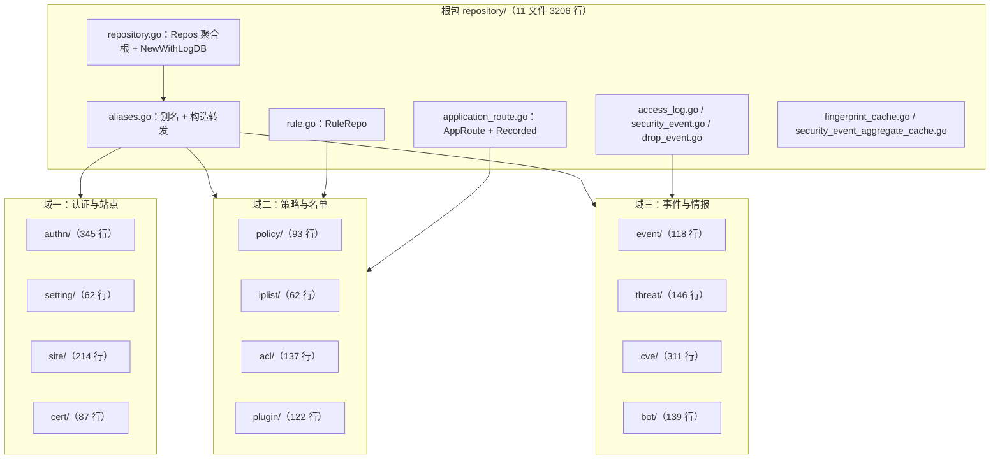
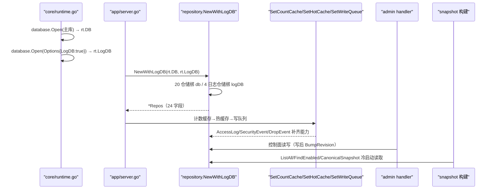
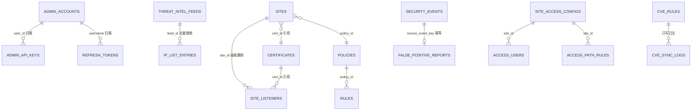
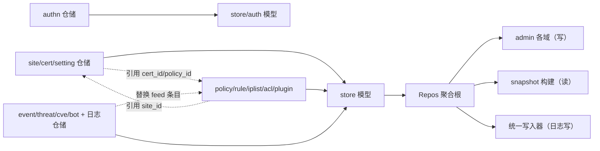

# 仓储层

> [返回 数据存储层](../数据存储层.md) ｜ [返回数据访问层设计](../数据访问层设计.md)

<cite>
**本文档引用的文件**
- [internal/store/repository/repository.go](file://internal/store/repository/repository.go)
- [internal/store/repository/aliases.go](file://internal/store/repository/aliases.go)
- [internal/store/repository/rule.go](file://internal/store/repository/rule.go)
- [internal/store/repository/access_log.go](file://internal/store/repository/access_log.go)
- [internal/store/repository/security_event.go](file://internal/store/repository/security_event.go)
- [internal/store/repository/drop_event.go](file://internal/store/repository/drop_event.go)
- [internal/store/repository/application_route.go](file://internal/store/repository/application_route.go)
- [internal/store/repository/fingerprint_cache.go](file://internal/store/repository/fingerprint_cache.go)
- [internal/store/repository/authn/admin_account.go](file://internal/store/repository/authn/admin_account.go)
- [internal/store/repository/authn/admin_api_key.go](file://internal/store/repository/authn/admin_api_key.go)
- [internal/store/repository/authn/refresh_token.go](file://internal/store/repository/authn/refresh_token.go)
- [internal/store/repository/setting/system_settings.go](file://internal/store/repository/setting/system_settings.go)
- [internal/store/repository/site/site.go](file://internal/store/repository/site/site.go)
- [internal/store/repository/site/site_listener.go](file://internal/store/repository/site/site_listener.go)
- [internal/store/repository/cert/certificate.go](file://internal/store/repository/cert/certificate.go)
- [internal/store/repository/policy/policy.go](file://internal/store/repository/policy/policy.go)
- [internal/store/repository/iplist/ip_list.go](file://internal/store/repository/iplist/ip_list.go)
- [internal/store/repository/acl/access_control.go](file://internal/store/repository/acl/access_control.go)
- [internal/store/repository/bot/bot_score.go](file://internal/store/repository/bot/bot_score.go)
- [internal/store/repository/cve/cve_rule.go](file://internal/store/repository/cve/cve_rule.go)
- [internal/store/repository/event/false_positive.go](file://internal/store/repository/event/false_positive.go)
- [internal/store/repository/threat/threat_intel.go](file://internal/store/repository/threat/threat_intel.go)
- [internal/store/repository/threat/threat_intel_sync_log.go](file://internal/store/repository/threat/threat_intel_sync_log.go)
- [internal/store/repository/plugin/js_plugin.go](file://internal/store/repository/plugin/js_plugin.go)
- [internal/store/repository/plugin/lua_plugin.go](file://internal/store/repository/plugin/lua_plugin.go)
- [internal/store/site.go](file://internal/store/site.go)
- [internal/store/system.go](file://internal/store/system.go)
- [internal/store/certificate.go](file://internal/store/certificate.go)
- [internal/store/zero_defaults.go](file://internal/store/zero_defaults.go)
- [internal/store/backup.go](file://internal/store/backup.go)
- [internal/store/auth/auth.go](file://internal/store/auth/auth.go)
- [internal/store/auth/seed.go](file://internal/store/auth/seed.go)
- [internal/store/migrations/single_site.go](file://internal/store/migrations/single_site.go)
- [internal/core/database/gorm.go](file://internal/core/database/gorm.go)
- [internal/core/runtime.go](file://internal/core/runtime.go)
- [internal/app/server.go](file://internal/app/server.go)
- [internal/admin/site/site.go](file://internal/admin/site/site.go)
</cite>

## 目录

1. [简介](#简介)
2. [项目结构](#项目结构)
3. [核心组件](#核心组件)
4. [架构总览](#架构总览)
5. [详细组件分析](#详细组件分析)
6. [依赖关系分析](#依赖关系分析)
7. [性能考虑](#性能考虑)
8. [故障排查指南](#故障排查指南)
9. [结论](#结论)
10. [附录](#附录)

## 简介

仓储层是按**领域**组织的持久化对象集合。它把 `internal/store/repository/` 根包（聚合根、门面与体量最大的日志仓储）与 12 个领域子包的 24 个仓储，划成三个可独立理解、可独立排障的业务域：认证与站点、策略与名单、事件与情报。每个域回答一个明确问题——"这个域的哪些表由谁写、由谁读、走哪条连接"。

本文是 `仓储层/` 目录的索引与总览，只做**按域拆分的仓储清单与职责**。跨域的构造与库路由机制、写模型（零值回写）与注入接口的实现细节属于 [数据访问层设计](../数据访问层设计.md)，实体列与索引的完整字段清单属于 [数据库模型设计](../数据库模型设计.md)，本文不重复其表格，只在需要处以链接指向。

三个域各有一篇深读文档：

| 域文档 | 覆盖子包 | 深读重点 |
|--------|----------|----------|
| [认证与站点仓储](认证与站点仓储.md) | `authn` `setting` `site` `cert` | 口令/令牌秘密处理、站点三态继承、监听器级联 |
| [策略与名单仓储](策略与名单仓储.md) | `policy` `iplist` `acl` `plugin` + 根包 `rule.go` `application_route.go` | 规则执行序、名单全局/站点态、访问控制 5 表 |
| [事件与情报仓储](事件与情报仓储.md) | `event` `threat` `cve` `bot` + 根包 `access_log.go` `security_event.go` `drop_event.go` | 聚合统计、方言分桶、写队列与指纹缓存 |

**章节来源**
- [internal/store/repository/repository.go](file://internal/store/repository/repository.go)
- [internal/store/repository/aliases.go](file://internal/store/repository/aliases.go)

## 项目结构

仓储层文件分两类落位：根包保留聚合根 `Repos`、门面 `aliases.go`、跨方言 helper 与日志大表；实体仓储下沉到 12 个子包，根包用类型别名再导出以保持调用点不变。



**图表来源**
- [internal/store/repository/repository.go](file://internal/store/repository/repository.go)
- [internal/store/repository/aliases.go](file://internal/store/repository/aliases.go)

子包与根包文件行数为现场统计（`wc -l`，不含 `_test.go`），非测试源合计如下：

| 域 | 子包/根文件 | 文件数 | 行数 | 仓储数 |
|----|-------------|:------:|:----:|:------:|
| 聚合与门面 | `repository.go` `aliases.go` | 2 | 251 | — |
| 认证与站点 | `authn`(3) `setting`(1) `site`(2) `cert`(1) | 7 | 708 | 7 |
| 策略与名单 | `policy`(1) `iplist`(1) `acl`(1) `plugin`(2) + `rule.go` `application_route.go` | 8 | 746 | 8 |
| 事件与情报 | `event`(1) `threat`(2) `cve`(1) `bot`(1) + `access_log.go` `security_event.go` `drop_event.go` | 10 | 2635 | 9 |
| 缓存层 | `fingerprint_cache.go` `security_event_aggregate_cache.go` | 2 | 595 | — |

> 实测子包为 **12 个**（`acl` `authn` `bot` `cert` `cve` `event` `iplist` `plugin` `policy` `setting` `site` `threat`），非旧文档所称 13；`Repos` 聚合根字段共 **24** 个，与仓储数一致。

**章节来源**
- [internal/store/repository/repository.go](file://internal/store/repository/repository.go)
- [internal/store/repository/aliases.go](file://internal/store/repository/aliases.go)
- [internal/store/repository/access_log.go](file://internal/store/repository/access_log.go)

## 核心组件

`Repos` 聚合根是访问层的唯一入口对象，24 个字段一一对应一个仓储，字段的绑定库（`db` 主库 / `logDB` 日志库）即该仓储的能力边界。下表按域列出全量仓储清单，"读写方"列指明谁写入、谁读取，这是本文区别于 [数据访问层设计](../数据访问层设计.md) 中"仓储→表→连接"表的视角。

| 仓储 | 文件:行 | 负责表 | 关键方法 | 读写方 |
|------|---------|--------|----------|--------|
| `SiteRepo` | `site/site.go:9` | `sites` | `ListAll` `FindEnabled` `Create` `DeleteWithListeners` `ApplyCertificate` | 写 admin/site，读 snapshot 构建 |
| `SiteListenerRepo` | `site/site_listener.go:9` | `site_listeners` | `AllEnabled` `ListEnabledBySites` `CreateLegacyReplacement` | 写 admin/listener，读 reconcileListeners |
| `CertificateRepo` | `cert/certificate.go:11` | `certificates` | `GetByID` `ListAutoRenew` `UpdateCert` `GetByDomain` | 写 admin/certificate+acme，读 buildTLS |
| `SystemSettingsRepo` | `setting/system_settings.go:10` | `system_settings` | `Get` `Set` `All` `Transaction` | 写 admin/system，读 snapshot/Build |
| `AdminAccountRepo` | `authn/admin_account.go:10` | `admin_accounts` | `VerifyPassword` `Create` `UpdateRole` `CountByRole` | 写 admin/auth，读登录 |
| `AdminAPIKeyRepo` | `authn/admin_api_key.go:16` | `admin_api_keys` | `Create` `Verify` `ListByUser` | 写 admin/apikey，读 middleware |
| `RefreshTokenRepo` | `authn/refresh_token.go:14` | `refresh_tokens` | `Rotate` `RevokeFamily` `CleanExpired` | 写 auth TokenManager，读刷新 |
| `PolicyRepo` | `policy/policy.go:9` | `policies` | `GetDefault` `SetDefault` `ReferenceCounts` | 写 admin/system，读 snapshot |
| `RuleRepo` | `rule.go:20` | `rules` | `ListFiltered` `BatchCreate` `FindPriorityConflict` | 写 admin/rule，读引擎编译 |
| `IPListRepo` | `iplist/ip_list.go:10` | `ip_list_entries` | `AllEnabledForSite` `AllEnabledGlobal` `Create` | 写 admin/iplist+threat，读 acl 阶段 |
| `AccessControlRepo` | `acl/access_control.go:10` | 访问控制 5 表 | `GetSiteAccessConfig` `CreateAccessUser` `CreateAccessPathRule` | 写 admin/access，读 accessgate |
| `JSPluginRepo` | `plugin/js_plugin.go:10` | `js_plugins` | `ListEnabled` `Toggle` | 写 admin/jsplugin，读 jsplugin 引擎 |
| `LuaPluginRepo` | `plugin/lua_plugin.go:10` | `lua_plugins` | `ListEnabled` `Toggle` | 写 admin/luaplugin，读 lua 编译 |
| `ApplicationRouteRuleRepo` | `application_route.go:13` | `application_route_rules` | `ListBySitePaged` `Create` | 写 admin/site，读 snapshot 路由 |
| `RecordedResourceRepo` | `application_route.go:68` | `recorded_resources` | `Upsert` `ClearSite` | 写数据面观测，读 admin/observability |
| `SecurityEventRepo` | `security_event.go:14` | `security_events` | `List` `CategoryStats` `Timeline` `TopIPs` | 写统一写入器，读 admin/event |
| `AccessLogRepo` | `access_log.go:16` | `access_logs` | `List` `ListFingerprints` `VisitorKindStats` | 写统一写入器，读 admin/realtime |
| `DropEventRepo` | `drop_event.go:12` | `drop_events` | `List` `Stats24h` `DeleteOlderThan` | 写 drop 阶段，读 admin/drop |
| `BotScoreRepo` | `bot/bot_score.go:11` | `bot_score_logs` | `List` `BatchCreate` `Stats24h` | 写 bot 阶段，读 admin/bot |
| `CVERuleRepo` | `cve/cve_rule.go:31` | `cve_rules`（运行期模型） | `CanonicalSnapshot` `List` `Toggle` | 写 admin/cverules+feed，读引擎 |
| `CVESyncLogRepo` | `cve/cve_rule.go:297` | `cve_sync_logs` | `Create` `Latest` | 只写 feed，读 admin/policy |
| `ThreatIntelRepo` | `threat/threat_intel.go:12` | `threat_intel_feeds` | `ListEnabled` `ReplaceFeedEntries` `CountFeedEntries` | 写 admin/threatintel，读同步器 |
| `ThreatIntelSyncLogRepo` | `threat/threat_intel_sync_log.go:14` | `threat_intel_sync_logs` | `Create` `List` `DeleteOlderThan` | 只写同步器，读 admin/threatintel |
| `FalsePositiveRepo` | `event/false_positive.go:15` | `false_positive_reports` | `CreateOrGetBySourceEvent` `UpdateStatus` `Delete` | 写 admin/event，读误报页 |

> 特别说明：不存在 `FingerprintRepo`。TLS 指纹聚合是 `AccessLogRepo.ListFingerprints`（`access_log.go:526`）的能力，进程内结果缓存由 `fingerprint_cache.go` 承担，不是独立仓储。

**章节来源**
- [internal/store/repository/repository.go](file://internal/store/repository/repository.go)
- [internal/store/repository/access_log.go](file://internal/store/repository/access_log.go)
- [internal/store/repository/cve/cve_rule.go](file://internal/store/repository/cve/cve_rule.go)
- [internal/store/repository/threat/threat_intel_sync_log.go](file://internal/store/repository/threat/threat_intel_sync_log.go)

## 架构总览

聚合根在启动阶段一次构造，绑定两条 `*gorm.DB`，随后按固定顺序注入可选能力。日志类仓储（`SecurityEvent` `AccessLog` `BotScore` `DropEvent`）走 `logDB`，其余 20 个走 `db`。不存在 `OpenLogDB` 这样的独立函数——日志库由 `core/runtime.go` 以 `database.Options{LogDB: true}` 打开后交给 `NewWithLogDB`。



**图表来源**
- [internal/store/repository/repository.go](file://internal/store/repository/repository.go)
- [internal/core/runtime.go](file://internal/core/runtime.go)
- [internal/app/server.go](file://internal/app/server.go)

日志库可选退化是本层的显式约定：`New(db)` 等于 `NewWithLogDB(db, db)`；`NewWithLogDB` 内 `logDB == nil` 时回落为单库。这样单库测试与生产双库共用同一构造路径。

**章节来源**
- [internal/store/repository/repository.go](file://internal/store/repository/repository.go)
- [internal/core/runtime.go](file://internal/core/runtime.go)

## 详细组件分析

### 认证与站点域

域一负责"谁能改配置"与"改哪个站点"两件事：`authn` 三个仓储把口令、API 令牌、刷新令牌的秘密处理约束在层内（bcrypt 哈希入库、明文只在签发瞬间返回），`site`/`cert`/`setting` 负责配置类读写。该域的深读见 [认证与站点仓储](认证与站点仓储.md)。

站点实体的三态继承是本域最易踩坑之处：`Site` 的 `OWASPEnabled` `CVEEnabled` `RateLimitEnabled` `AntiReplayEnabled` 等为 `*bool`、`ChallengeAction` `SiteCaptchaType` `SkipPathByPhase` `AntiReplayCookieMode` 为 `*string`，`nil` 一律表示"继承全局 `ProtectionConfig`"。其从属字段由 `internal/admin/site/site.go:505` 的 `clearInheritedProtectionOverrides` 在保存前清空，避免"开关继承、档位却残留站点值"的半覆盖态。

```sql
-- 现场实测：AutoMigrate 由 Site.TrustedCIDR（site.go:93，无 column 标签）生成列名为 trusted_c_id_r
CREATE TABLE `sites` (
  ...
  `xff_mode` text DEFAULT "strip_all_and_set_remote",
  `trusted_c_id_r` text,
  `client_ip_header_order` text,
  ...
);
CREATE INDEX `idx_sites_bind` ON `sites`(`bind`);
CREATE INDEX `idx_sites_host` ON `sites`(`host`);
CREATE INDEX `idx_sites_listener_id` ON `sites`(`listener_id`);
CREATE INDEX `idx_sites_deleted_at` ON `sites`(`deleted_at`);
```

**章节来源**
- [internal/store/site.go](file://internal/store/site.go)
- [internal/admin/site/site.go](file://internal/admin/site/site.go)
- [internal/store/repository/site/site.go](file://internal/store/repository/site/site.go)

### 策略与名单域

域二负责"用什么规则拦、按什么顺序拦、放行/阻断谁"。`policy` 与根包 `rule.go` 管理策略与规则，`iplist` 与 `acl` 管理名单与站点访问控制，`plugin` 管理 JS/Lua 边缘脚本，根包 `application_route.go` 管理应用路由与观测到的资源。`RuleRepo` 的列表排序不是简单 `priority`，而是把执行阶段写进 SQL（`rule.go:18` 的 `ruleExecutionOrderClause`）。深读见 [策略与名单仓储](策略与名单仓储.md)。

一处必须登记的写模型缺陷：`RuleRepo.BatchCreate`（`rule.go:24-28`）走裸 `tx.Create(&items)`，而非 `CreateWithZeroDefaults`。GORM v1.31.2 在 INSERT 时把带 `default` 标签且当前为零值的字段当作"未设置"并套用默认值，于是批量新建里 `priority = 0` 会被改成 `100`、`enabled = false` 会被改成 `true`；单条 `Create`（`rule.go:96`）用零值回写规避了此问题，批量路径没有。

```sql
-- 单条创建的补偿语义（CreateWithZeroDefaults，zero_defaults.go:95-157）示意
-- 先按 default 标签插入（GORM 可能把 priority=0 写成 100），
-- 再在同一事务内 UpdateColumns 把调用方真实的零值回写：
UPDATE `rules` SET `priority` = 0, `enabled` = false WHERE `id` = ?;

-- 系统设置以 key 为唯一键做冲突更新（setting/system_settings.go:47-50）
INSERT INTO `system_settings` (`key`, `value`) VALUES (?, ?)
ON CONFLICT (`key`) DO UPDATE SET `value` = excluded.`value`;
```

**章节来源**
- [internal/store/repository/rule.go](file://internal/store/repository/rule.go)
- [internal/store/zero_defaults.go](file://internal/store/zero_defaults.go)
- [internal/store/repository/setting/system_settings.go](file://internal/store/repository/setting/system_settings.go)
- [internal/store/repository/policy/policy.go](file://internal/store/repository/policy/policy.go)

### 事件与情报域

域三负责"发生了什么、谁在攻击、情报是否更新"。日志大表仓储 `security_event`/`access_log`/`drop_event` 位于根包（体量大、读路径含多级缓存），`event`/`threat`/`cve`/`bot` 子包负责误报反馈、订阅源、CVE 规则与 Bot 评分。聚合统计与方言分桶只在 `SecurityEventRepo` 内实现。深读见 [事件与情报仓储](事件与情报仓储.md)。

清理路径统一为"子查询取 id + 分批删除 + 每批休眠"，例如 `ThreatIntelSyncLogRepo.DeleteOlderThan`（`threat/threat_intel_sync_log.go:53-71`）批大小 5000、每批休眠 50 毫秒，避免长事务锁风险。日志仓储的三级缓存读路径与方言分桶细节见 [事件与情报仓储](事件与情报仓储.md) 与 [数据访问层设计](../数据访问层设计.md)，本文不重复。

**章节来源**
- [internal/store/repository/threat/threat_intel_sync_log.go](file://internal/store/repository/threat/threat_intel_sync_log.go)
- [internal/store/repository/bot/bot_score.go](file://internal/store/repository/bot/bot_score.go)
- [internal/store/repository/cve/cve_rule.go](file://internal/store/repository/cve/cve_rule.go)
- [internal/store/repository/event/false_positive.go](file://internal/store/repository/event/false_positive.go)

### 数据表清单（按域与归属库）

35 张表 = 主库 31 + 日志库 4，全部 snake_case。软删除以 `deleted_at` 索引列表达；日志表为硬删除（保留期到点物理删）。完整字段清单见 [数据库模型设计](../数据库模型设计.md)，此处只给域归属与承载仓储。

| 表名 | 归属域 | 归属库 | 承载仓储 | 软删除 |
|------|--------|:------:|----------|:------:|
| `sites` `site_listeners` `certificates` | 认证与站点 | 主库 | `Site`/`SiteListener`/`Certificate` | 是 |
| `admin_accounts` `admin_api_keys` `refresh_tokens` | 认证与站点 | 主库 | `authn` 三仓储 | 部分（api_key 有） |
| `system_settings` `config_revisions` | 认证与站点 | 主库 | `SystemSettings`（revision 由 migrate） | 否 |
| `policies` `rules` `policy_owasp_rule_configs` | 策略与名单 | 主库 | `Policy`/`Rule` | 是 |
| `ip_list_entries` `threat_intel_feeds` `threat_intel_sync_logs` | 策略与名单/事件 | 主库 | `IPList`/`ThreatIntel` | 是 |
| `cve_rules` `cve_rule_scope_overrides` `cve_sync_logs` | 事件与情报 | 主库 | `CVERule`/`CVESyncLog` | 是 |
| `bot_score_logs` `access_logs` `security_events` `drop_events` | 事件与情报 | 日志库 | 四个日志仓储 | 否（硬删） |
| `site_access_configs` `access_providers` `access_users` `access_path_rules` `access_sessions` | 策略与名单 | 主库 | `AccessControl` | 混合 |
| `application_route_rules` `recorded_resources` | 策略与名单 | 主库 | `AppRouteRule`/`RecordedResource` | 是 |
| `js_plugins` `lua_plugins` | 策略与名单 | 主库 | `JSPlugin`/`LuaPlugin` | 是 |
| `false_positive_reports` `owasp_rule_catalogs` | 事件与情报 | 主库 | `FalsePositive`（目录 migrate） | 是 |
| `token_blacklists` `login_attempts` `active_sessions` | 认证与站点 | 主库 | auth 层（非 repository 仓储） | 否 |

**章节来源**
- [internal/store/repository/repository.go](file://internal/store/repository/repository.go)
- [internal/store/migrations/single_site.go](file://internal/store/migrations/single_site.go)

### 列名与迁移的不一致（如实登记）

`Site.TrustedCIDR` 无 `column` 标签（`internal/store/site.go:93`），AutoMigrate 依默认命名把连续大写拆成 `trusted_c_id_r`（现场 `PRAGMA table_info('sites')` 实测 65 列，含此列）；而 V2 迁移脚本 `addSiteColumns` 却给 `sites` 补 `trusted_cidr` 列（`single_site.go:63`），`migrateForwardingProfileData` 的 SELECT 读 `fp.trusted_c_id_r`（`single_site.go:129`）、UPDATE 写 `sites.trusted_cidr`（`single_site.go:152`）。后果是老库恢复时：若历史 `forwarding_profiles` 表实际列名是 `trusted_cidr`，`fp.trusted_c_id_r` 查询在 V2 迁移内 SELECT 失败，`store.AutoMigrate` 返回错误，`server.go:249-252` 直接 `os.Exit(1)`。列名口径与命名拆分必须一致，属已登记待修项，本文只如实记录不改码。

另一处悬挂注释：`SiteForwardingRule`/`SiteHeaderOp`（`internal/store/site.go:278-296`）的注释仍写"以 JSON 形式存放在 Site.ForwardingRules / Site.HeaderOps 中"，但 `Site` 结构体已无这两个字段，注释指向已删除字段。

备份口径补充：全库无应用侧 `PRAGMA wal_checkpoint` 调用点，日志库靠 DSN `wal_autocheckpoint(2000)`（`internal/core/database/gorm.go:94`）自动检查点；主库备份走 `store.ExportBackup`/`ImportBackup` 的逻辑导出（`backup.go`），并非文件 `cp`——直接 `cp waf.db` 会漏掉 WAL 中未落盘的页，不是有效备份。

**章节来源**
- [internal/store/site.go](file://internal/store/site.go)
- [internal/store/migrations/single_site.go](file://internal/store/migrations/single_site.go)
- [internal/app/server.go](file://internal/app/server.go)
- [internal/core/database/gorm.go](file://internal/core/database/gorm.go)
- [internal/store/backup.go](file://internal/store/backup.go)

### 领域实体关系

三域之外没有第二套关系真相：跨域引用只有证书、策略、名单三类外键向。下图把主外键按域画成实体关系，供排障时快速定位"删哪张表会连带谁"。级联删除仅 `SiteRepo.DeleteWithListeners` 一处承担跨表事务。



**图表来源**
- [internal/store/repository/repository.go](file://internal/store/repository/repository.go)
- [internal/store/repository/threat/threat_intel.go](file://internal/store/repository/threat/threat_intel.go)
- [internal/store/repository/event/false_positive.go](file://internal/store/repository/event/false_positive.go)
- [internal/store/repository/acl/access_control.go](file://internal/store/repository/acl/access_control.go)

**章节来源**
- [internal/store/repository/site/site.go](file://internal/store/repository/site/site.go)
- [internal/store/repository/site/site_listener.go](file://internal/store/repository/site/site_listener.go)

## 依赖关系分析

域之间的耦合集中在两处外键引用：站点域引用证书与策略，名单/访问控制引用站点。数据面（snapshot 构建、引擎编译）与事件域解耦——数据面只从主库读配置，日志仓储只被管理面读、被统一写入器写。



**图表来源**
- [internal/store/repository/repository.go](file://internal/store/repository/repository.go)
- [internal/store/repository/threat/threat_intel.go](file://internal/store/repository/threat/threat_intel.go)

跨域引用不改变绑定库：`ThreatIntelRepo.ReplaceFeedEntries` 虽写 `ip_list_entries`（名单域表），但它绑主库 `db`，与 `IPListRepo` 同库，替换与查询不会跨连接。

| 依赖方向 | 载体 | 是否同库 | 说明 |
|----------|------|:--------:|------|
| 名单域 → 事件域 | `ThreatIntelRepo` 写 `ip_list_entries` | 是 | feed 派生条目与手动条目同表 |
| 站点域 → 证书域 | `Site.ApplyCertificate` | 是 | 站点引用 `cert_id` |
| 站点域 → 策略域 | `Site.NormalizePolicyID` | 是 | 校验 `policy_id` 存在 |
| 事件域 → 名单域 | 情报同步落 `ip_list_entries` | 是 | 见上第一行 |
| 日志域 → 认证域 | `FalsePositive` 引 `security_event` | 否（跨库读） | 误报反馈在主库、源事件在日志库 |

**章节来源**
- [internal/store/repository/threat/threat_intel.go](file://internal/store/repository/threat/threat_intel.go)
- [internal/store/repository/site/site.go](file://internal/store/repository/site/site.go)
- [internal/store/repository/event/false_positive.go](file://internal/store/repository/event/false_positive.go)

## 性能考虑

- **问题**：全量场景误用 `SiteRepo.List(0,0)` 命中 `LIMIT 0` 返回空集。**优化**：提供 `ListAll` 明确全量语义，snapshot 构建只走它。**效果**：消除冷启动站点漏配。
- **问题**：批量新建规则套用 GORM 默认值，破坏 `priority` 抢占顺序。**优化**：单条走 `CreateWithZeroDefaults`；批量应同样回写（当前缺陷见策略域）。**效果**：优先级与启停如实落库。
- **问题**：管理端渲染一页站点时 `SiteListenerRepo` 扫描全表。**优化**：`ListEnabledBySites(siteIDs)` 按页站点过滤。**效果**：监听器读取随页大小而非表大小增长。
- **问题**：日志大表列表每页付一次 `COUNT(*)` 与宽列扫描。**优化**：三级缓存与投影列（详见 [事件与情报仓储](事件与情报仓储.md)）。**效果**：翻页只付一次计数成本。

[本节为总结，无需特定文件来源]

## 故障排查指南

| 症状 | 根因 | 排查 | 方案 |
|------|------|------|------|
| 升级老库后进程直接退出 | V2 迁移 SELECT `fp.trusted_c_id_r` 失败 | 查 `forwarding_profiles` 实际列名 | 对齐列名或跳过 V2 单站点迁移 |
| 站点可信 CIDR 不生效 | 数据落在 `trusted_c_id_r`、迁移写 `trusted_cidr` | `PRAGMA table_info('sites')` | 统一列名口径（登记项） |
| 批量导入规则优先级全变 100 | `BatchCreate` 走裸 `tx.Create` | 核对 `rule.go:24-28` | 批量补零值回写 |
| 站点 OWASP 档位覆盖了继承的开关 | 未走 `clearInheritedProtectionOverrides` | 检查保存入口 | 经 admin/site 校验链保存 |
| 找不到 `FingerprintRepo` | 本就不存在 | `rg FingerprintRepo` 为空 | 用 `AccessLogRepo.ListFingerprints` |
| 用 `cp waf.db` 备份后恢复缺最新行 | WAL 未落盘页丢失 | 查 `wal_autocheckpoint` | 走 `ExportBackup` 逻辑导出 |

```bash
# 域内仓储与命名一致性自检
go test ./internal/store/repository/... -count=1
sqlite3 data/waf.db "PRAGMA table_info('sites');" | grep -i trusted
sqlite3 data/waf.db ".schema refresh_tokens" | grep UNIQUE
rg -n "FingerprintRepo|OpenLogDB" internal/store internal/core   # 预期：均无输出
```

**章节来源**
- [internal/store/migrations/single_site.go](file://internal/store/migrations/single_site.go)
- [internal/store/repository/rule.go](file://internal/store/repository/rule.go)
- [internal/store/backup.go](file://internal/store/backup.go)

## 结论

仓储层按"认证与站点 / 策略与名单 / 事件与情报"三域划分后，24 个仓储各自有了清晰的责任边界与读写方归属，KISS 与 SRP 得以在文档与代码两侧同时可读：单域一篇深读、跨域机制一处说明。DRY 体现在零值回写、命名拆分、库路由三处公共逻辑各只写一次并被全域共享；OCP 体现在新增一个域只需增子包并往 `Repos` 加字段，不改既有仓储。

当前主要技术债有三：`trusted_c_id_r` 与迁移脚本的列名不一致（可致老库恢复期 `os.Exit(1)`）、`RuleRepo.BatchCreate` 未做零值回写、`SiteForwardingRule`/`SiteHeaderOp` 的悬挂注释。三者均已如实登记，修复应配套迁移与回归测试，不在本文范围内展开。

[本节为总结，无需特定文件来源]

## 附录

### 领域到子包映射速查

| 域 | 子包 | 根包补充 | 深读文档 |
|----|------|----------|----------|
| 认证与站点 | `authn` `setting` `site` `cert` | — | [认证与站点仓储](认证与站点仓储.md) |
| 策略与名单 | `policy` `iplist` `acl` `plugin` | `rule.go` `application_route.go` | [策略与名单仓储](策略与名单仓储.md) |
| 事件与情报 | `event` `threat` `cve` `bot` | `access_log.go` `security_event.go` `drop_event.go` | [事件与情报仓储](事件与情报仓储.md) |

**章节来源**
- [internal/store/repository/aliases.go](file://internal/store/repository/aliases.go)

### 聚合根字段明细（`Repos`）

`Repos` 24 个字段是访问层能力清单，绑定库由 `NewWithLogDB` 决定。

| 字段 | 仓储类型 | 绑定库 | 域 |
|------|----------|:------:|----|
| `Site` `SiteListener` | `*SiteRepo` `*SiteListenerRepo` | db | 认证与站点 |
| `Certificate` | `*CertificateRepo` | db | 认证与站点 |
| `SystemSettings` | `*SystemSettingsRepo` | db | 认证与站点 |
| `AdminAccount` `AdminAPIKey` `RefreshToken` | `authn` 三仓储 | db | 认证与站点 |
| `Policy` `Rule` | `*PolicyRepo` `*RuleRepo` | db | 策略与名单 |
| `IPList` `AccessControl` | `*IPListRepo` `*AccessControlRepo` | db | 策略与名单 |
| `LuaPlugin` `JSPlugin` | `*LuaPluginRepo` `*JSPluginRepo` | db | 策略与名单 |
| `AppRouteRule` `RecordedResource` | `application_route` 两仓储 | db | 策略与名单 |
| `CVERule` `CVESyncLog` | `*CVERuleRepo` `*CVESyncLogRepo` | db | 事件与情报 |
| `ThreatIntel` `ThreatIntelSyncLog` `FalsePositive` | 事件域三仓储 | db | 事件与情报 |
| `SecurityEvent` `AccessLog` `DropEvent` `BotScore` | 日志四仓储 | logDB | 事件与情报 |

**章节来源**
- [internal/store/repository/repository.go](file://internal/store/repository/repository.go)

### 相关文档

- 跨域构造与注入接口实现：[数据访问层设计](../数据访问层设计.md)
- 全量实体列与索引：[数据库模型设计](../数据库模型设计.md)
- 迁移编排与代次：[数据迁移管理](../数据迁移管理.md)
- GORM 与方言参数：[GORM 配置与使用](../GORM%20配置与使用.md)

[本节为总结，无需特定文件来源]
