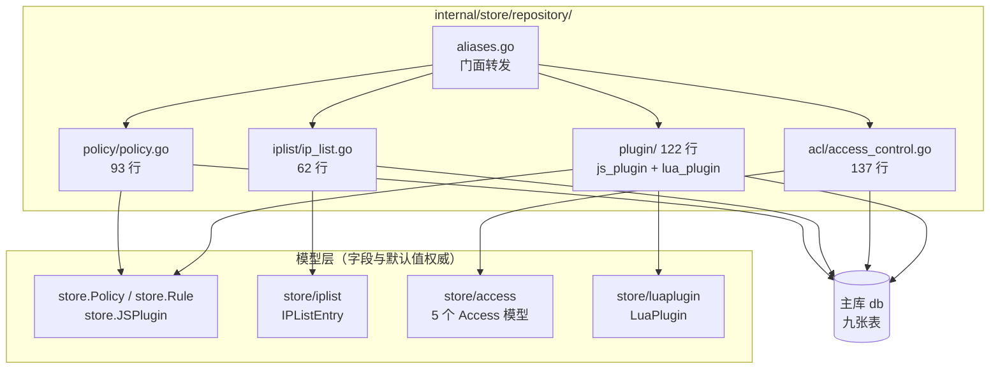
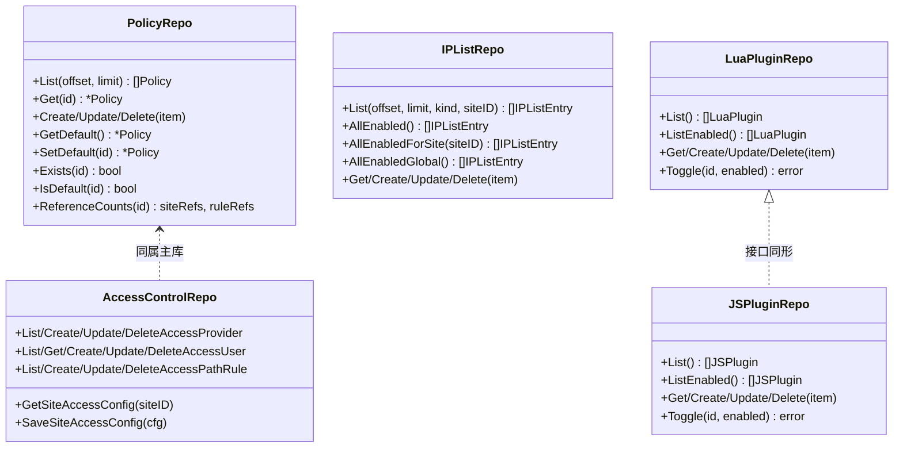
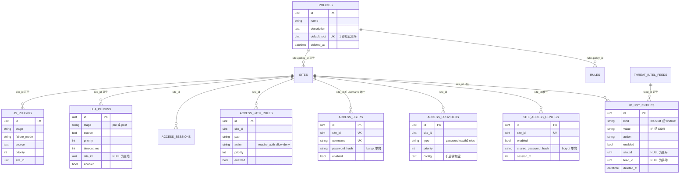
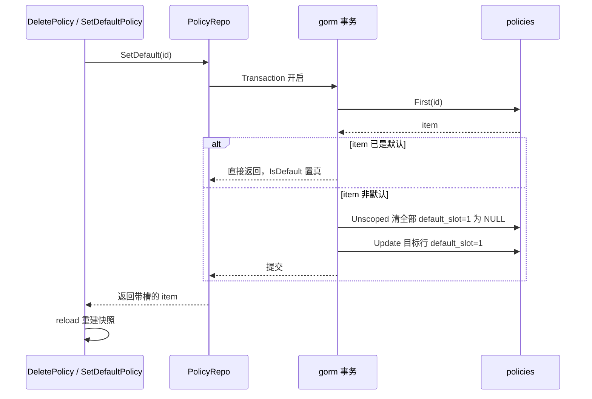
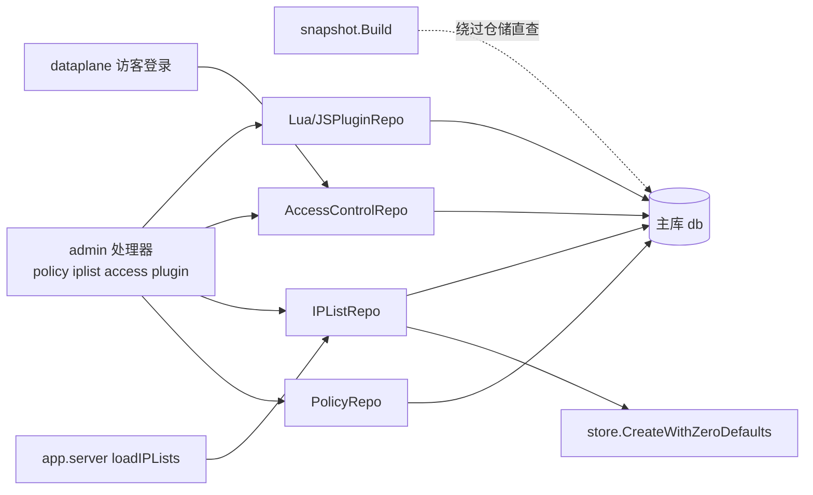
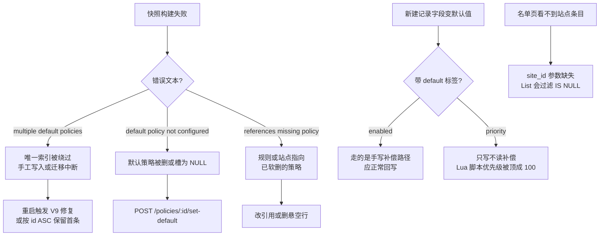

# 策略与名单仓储

> [返回 仓储层](仓储层.md) ｜ [返回 数据存储层](../数据存储层.md)

<cite>
**本文档引用的文件**
- [policy.go](file://internal/store/repository/policy/policy.go)
- [ip_list.go](file://internal/store/repository/iplist/ip_list.go)
- [access_control.go](file://internal/store/repository/acl/access_control.go)
- [lua_plugin.go](file://internal/store/repository/plugin/lua_plugin.go)
- [js_plugin.go](file://internal/store/repository/plugin/js_plugin.go)
- [aliases.go](file://internal/store/repository/aliases.go)
- [repository.go](file://internal/store/repository/repository.go)
- [application_route.go](file://internal/store/repository/application_route.go)
- [rule.go](file://internal/store/repository/rule.go)
- [policy.go](file://internal/store/policy.go)
- [js_plugin.go](file://internal/store/js_plugin.go)
- [ip_list.go](file://internal/store/iplist/ip_list.go)
- [access_control.go](file://internal/store/access/access_control.go)
- [lua_plugin.go](file://internal/store/luaplugin/lua_plugin.go)
- [zero_defaults.go](file://internal/store/zero_defaults.go)
- [backup.go](file://internal/store/backup.go)
- [migrate.go](file://internal/store/migrate.go)
- [default_policy.go](file://internal/store/migrations/default_policy.go)
- [access_control.go](file://internal/store/migrations/access_control.go)
- [build.go](file://internal/snapshot/build.go)
- [server.go](file://internal/app/server.go)
- [policy.go](file://internal/admin/system/policy/policy.go)
- [iplist.go](file://internal/admin/system/iplist/iplist.go)
- [lua_plugin.go](file://internal/admin/system/luaplugin/lua_plugin.go)
- [js_plugin.go](file://internal/admin/system/jsplugin/js_plugin.go)
- [access.go](file://internal/admin/access/access.go)
- [users.go](file://internal/admin/access/users.go)
- [providers.go](file://internal/admin/access/providers.go)
- [path_rules.go](file://internal/admin/access/path_rules.go)
- [access_control.go](file://internal/dataplane/access_control.go)
- [gorm.go](file://internal/core/database/gorm.go)
- [router.go](file://internal/admin/router.go)
- [migrations_test.go](file://internal/store/migrations/migrations_test.go)
- [zero_defaults_atomicity_test.go](file://internal/store/zero_defaults_atomicity_test.go)
- [dialect_migration_test.go](file://internal/store/dialect_migration_test.go)
- [antireplay_build_test.go](file://internal/snapshot/antireplay_build_test.go)
</cite>

## 目录

1. [简介](#简介)
2. [项目结构](#项目结构)
3. [核心组件](#核心组件)
4. [架构总览](#架构总览)
5. [详细组件分析](#详细组件分析)
6. [依赖关系分析](#依赖关系分析)
7. [性能考虑](#性能考虑)
8. [故障排查指南](#故障排查指南)
9. [结论](#结论)
10. [附录](#附录)

## 简介

本篇覆盖 `internal/store/repository/` 中承担「检测配置载体」职责的四个子包：`policy/`（93 行）、`iplist/`（62 行）、`acl/`（137 行）、`plugin/`（122 行，含 `js_plugin.go` 54 行与 `lua_plugin.go` 68 行），合计 414 行。它们管理九张表：`policies`、`rules` 的归属域、`ip_list_entries`、`site_access_configs`、`access_providers`、`access_users`、`access_path_rules`、`access_sessions`、`lua_plugins` 与 `js_plugins`。

这四个仓储有两条共同约束。其一是**只依赖主库**：`NewWithLogDB` 把 `SecurityEvent`、`AccessLog`、`BotScore`、`DropEvent` 四个路由到 `logDB`，本篇四组一律接 `db`（repository.go:65-89）。其二是**模型定义在仓储包之外**：`store.Policy`、`store.Rule`、`store.JSPlugin` 在 `internal/store` 根，`IPListEntry`、`Access*`、`LuaPlugin` 分别在 `internal/store/iplist`、`internal/store/access`、`internal/store/luaplugin` 子包，仓储只做查询与写入，不承载字段语义。

同目录的认证、站点、证书、事件、规则仓储分别由 [认证与站点仓储](认证与站点仓储.md) 与 [事件与情报仓储](事件与情报仓储.md) 覆盖；仓储层整体装配与命名策略见 [仓储层](仓储层.md) 总览，本篇不重复其别名机制表格。

**章节来源**
- [repository.go:56-90](file://internal/store/repository/repository.go#L56-L90)
- [aliases.go:41-45](file://internal/store/repository/aliases.go#L41-L45)
- [aliases.go:76-80](file://internal/store/repository/aliases.go#L76-L80)
- [aliases.go:132-148](file://internal/store/repository/aliases.go#L132-L148)

## 项目结构

四个子包与模型子包形成「一域两层」的对应关系：仓储包只持有 `*gorm.DB`，模型包只持有结构体与约束标签。



**图表来源**
- [aliases.go:41-148](file://internal/store/repository/aliases.go#L41-L148)
- [migrate.go:52-89](file://internal/store/migrate.go#L52-L89)

| 层 | 文件 | 行数 | 承载内容 |
|----|------|:----:|----------|
| 仓储门面 | `internal/store/repository/aliases.go` | 137 | 类型别名与构造函数转发 |
| 策略仓储 | `internal/store/repository/policy/policy.go` | 93 | 8 个方法，含默认槽事务切换 |
| 名单仓储 | `internal/store/repository/iplist/ip_list.go` | 62 | 7 个方法，含三档作用域读法 |
| 访问控制仓储 | `internal/store/repository/acl/access_control.go` | 137 | 14 个方法，四类实体齐备 |
| 插件仓储 | `internal/store/repository/plugin/` | 122 | JS 与 Lua 两套同形接口 |
| 模型 | `internal/store/policy.go` | 97 起 | `Policy`、`Rule`、阶段与动作枚举 |
| 模型 | `internal/store/iplist/ip_list.go` | 30 | `IPListEntry` 与 kind 常量 |
| 模型 | `internal/store/access/access_control.go` | 94 | 5 个访问控制模型与动作常量 |
| 模型 | `internal/store/luaplugin/lua_plugin.go` | 50 | `LuaPlugin` 与阶段校验 |

**章节来源**
- [policy.go:9-11](file://internal/store/repository/policy/policy.go#L9-L11)
- [ip_list.go:10-12](file://internal/store/repository/iplist/ip_list.go#L10-L12)
- [access_control.go:9-15](file://internal/store/repository/acl/access_control.go#L9-L15)
- [lua_plugin.go:9-14](file://internal/store/repository/plugin/lua_plugin.go#L9-L14)
- [migrate.go:52-89](file://internal/store/migrate.go#L52-L89)

## 核心组件

四个仓储都是 `struct{ db *gorm.DB }` 的具体类型，不是接口：调用方直接依赖实现，测试用真实 SQLite 库而非 mock。方法集合彼此不同形，但命名遵循同一动词表。



**图表来源**
- [policy.go:13-93](file://internal/store/repository/policy/policy.go#L13-L93)
- [ip_list.go:14-62](file://internal/store/repository/iplist/ip_list.go#L14-L62)
- [access_control.go:18-137](file://internal/store/repository/acl/access_control.go#L18-L137)
- [lua_plugin.go:17-68](file://internal/store/repository/plugin/lua_plugin.go#L17-L68)
- [js_plugin.go:17-54](file://internal/store/repository/plugin/js_plugin.go#L17-L54)

| 仓储 | 方法数 | 分页 | 排序 | 软删除 | 事务 |
|------|:------:|:----:|------|:------:|:----:|
| `PolicyRepo` | 10 | `offset`/`limit` | `id ASC` | 是 | `SetDefault` |
| `IPListRepo` | 8 | `offset`/`limit` | `id DESC` | 是 | 无 |
| `AccessControlRepo` | 15 | 否 | `priority ASC, id ASC` | 否 | 无 |
| `LuaPluginRepo` | 7 | 否 | `stage ASC, priority ASC, id ASC` | 是 | 无 |
| `JSPluginRepo` | 7 | 否 | `stage ASC, priority ASC, id ASC` | 是 | 无 |

**章节来源**
- [policy.go:13-93](file://internal/store/repository/policy/policy.go#L13-L93)
- [ip_list.go:14-62](file://internal/store/repository/iplist/ip_list.go#L14-L62)
- [access_control.go:18-137](file://internal/store/repository/acl/access_control.go#L18-L137)
- [js_plugin.go:17-54](file://internal/store/repository/plugin/js_plugin.go#L17-L54)

## 架构总览

九张表全部以站点或策略为聚合根，没有一个多对多连接表：作用域一律用可空外键表达，`NULL` 即「全局」。



**图表来源**
- [policy.go:10-97](file://internal/store/policy.go#L10-L97)
- [ip_list.go:17-30](file://internal/store/iplist/ip_list.go#L17-L30)
- [access_control.go:19-80](file://internal/store/access/access_control.go#L19-L80)
- [lua_plugin.go:17-45](file://internal/store/luaplugin/lua_plugin.go#L17-L45)
- [js_plugin.go:25-44](file://internal/store/js_plugin.go#L25-L44)
- [migrate.go:52-89](file://internal/store/migrate.go#L52-L89)

关系全部是「逻辑外键」：模型只写 `gorm:"index"`，没有 `constraint:OnDelete` 声明，跨表完整性由应用层与快照构建期检查保证（见「依赖关系分析」）。因此删策略不会级联删规则，而是被 `ReferenceCounts` 事先拦住。

**章节来源**
- [policy.go:76-97](file://internal/store/policy.go#L76-L97)
- [access_control.go:20-80](file://internal/store/access/access_control.go#L20-L80)

## 详细组件分析

### 数据表清单

| 表名 | 模型 | 所属仓储 | 主键 | 唯一约束 | 普通索引 | 软删除 | 纳入备份 |
|------|------|----------|:----:|----------|----------|:------:|:--------:|
| `policies` | `store.Policy` | `PolicyRepo` | `id` | `ux_policies_default_slot` | `deleted_at` | 是 | 是 |
| `rules` | `store.Rule` | `RuleRepo`（归属域在此） | `id` | — | `policy_id`、`phase`、`deleted_at` | 是 | 是 |
| `ip_list_entries` | `iplist.IPListEntry` | `IPListRepo` | `id` | — | `kind`、`value`、`site_id`、`feed_id`、`deleted_at` | 是 | 是 |
| `site_access_configs` | `access.SiteAccessConfig` | `AccessControlRepo` | `id` | `site_id` | — | 否 | 是 |
| `access_providers` | `access.AccessProvider` | `AccessControlRepo` | `id` | — | `site_id` | 否 | 是 |
| `access_users` | `access.AccessUser` | `AccessControlRepo` | `id` | `ux_access_user_site_name`（`site_id`+`username`） | — | 否 | 是 |
| `access_path_rules` | `access.AccessPathRule` | `AccessControlRepo` | `id` | — | `site_id` | 否 | 是 |
| `access_sessions` | `access.AccessSession` | 不经本篇仓储 | `id` | `token` | `site_id`、`expires_at` | 否 | 否 |
| `lua_plugins` | `luaplugin.LuaPlugin` | `LuaPluginRepo` | `id` | — | `stage`、`site_id`、`deleted_at` | 是 | 是 |
| `js_plugins` | `store.JSPlugin` | `JSPluginRepo` | `id` | — | `stage`、`site_id`、`deleted_at` | 是 | 是 |

`access_sessions` 是本篇唯一的例外：模型定义在 `internal/store/access/access_control.go:71-80`，但 `AccessControlRepo` 未提供任何会话方法，会话由数据面直接读写，因此它不出现在仓储清单表里，也不进备份导出（`BackupData` 无该字段）。

**章节来源**
- [migrate.go:52-89](file://internal/store/migrate.go#L52-L89)
- [backup.go:33-56](file://internal/store/backup.go#L33-L56)
- [policy.go:10-20](file://internal/store/policy.go#L10-L20)
- [ip_list.go:17-30](file://internal/store/iplist/ip_list.go#L17-L30)
- [access_control.go:19-94](file://internal/store/access/access_control.go#L19-L94)
- [js_plugin.go:25-44](file://internal/store/js_plugin.go#L25-L44)

### 字段明细

`policies` 与 `ip_list_entries` 的完整字段口径如下，其余表按同一口径在附录展开。

| 表 | 字段 | 类型与约束 | 默认 | 语义 |
|----|------|------------|:----:|------|
| `policies` | `id` | `primaryKey` | 自增 | 被 `rules.policy_id`、`sites.policy_id` 引用 |
| | `created_at` / `updated_at` | `time.Time` | 自动 | GORM 自动时间戳 |
| | `deleted_at` | `gorm.DeletedAt`，`index` | `NULL` | 软删除标记，JSON 序列化时隐藏 |
| | `name` | `size:128; not null` | — | 显示名 |
| | `description` | `type:text` | — | 备注 |
| | `default_slot` | `*uint`，`uniqueIndex:ux_policies_default_slot` | `NULL` | 仅默认策略取 1；JSON 隐藏 |
| | `is_default` | `gorm:"-"` | 派生 | `AfterFind` 钩子按 `default_slot == 1` 填充 |
| `ip_list_entries` | `kind` | `IPListKind`，`size:16; not null; index` | — | `blacklist` / `whitelist` |
| | `value` | `size:64; not null; index` | — | IP 或 CIDR 文本 |
| | `note` | `size:255` | — | 运维备注 |
| | `enabled` | `bool` | `default:true` | 受零值默认保护 |
| | `action` | `string` | `default:'intercept'` | `intercept` 或 `block` |
| | `site_id` | `*uint`，`index` | `NULL` | `NULL` 为全局条目 |
| | `feed_id` | `*uint`，`index` | `NULL` | `NULL` 为手动添加，有值表示订阅源产出 |

`default_slot` 用可空唯一索引表达「至多一条默认策略」，而不是布尔列：布尔列会允许多行同时为真，可空唯一列把约束交给数据库，非默认行全部取 `NULL`，多个 `NULL` 不冲突。派生的 `IsDefault` 带 `gorm:"-"`，不入库，仅用于响应。

访问控制三张子表的机密字段一律 `json:"-"`：`SiteAccessConfig.SharedPasswordHash`、`AccessUser.PasswordHash` 是 bcrypt 单向哈希；`AccessProvider.Config` 是 JSON 文本，其中的 `client_secret` 必须由上层以 AES-GCM 可逆加密后再写入，明文不得落库也不得出现在响应里。

**章节来源**
- [policy.go:10-25](file://internal/store/policy.go#L10-L25)
- [ip_list.go:16-30](file://internal/store/iplist/ip_list.go#L16-L30)
- [access_control.go:19-94](file://internal/store/access/access_control.go#L19-L94)

### 仓储清单

| 方法 | 仓储 | 关键 SQL 语义 | 调用方 |
|------|------|----------------|--------|
| `List(offset, limit)` | Policy | `Count` 后 `Offset/Limit`，`id ASC` | `GET /policies` |
| `Get(id)` | Policy | `First` 按主键 | `GET /policies/:id`、`Update` |
| `GetDefault()` | Policy | `WHERE default_slot = 1 LIMIT 1` | `GET /policies/default` |
| `SetDefault(id)` | Policy | 事务内先清后设，清槽用 `Unscoped()` | `POST /policies/:id/set-default` |
| `IsDefault(id)` | Policy | 复用 `Get` 判槽 | `DeletePolicy` 前置拦截 |
| `ReferenceCounts(id)` | Policy | 两次 `Count`，`rules` 缺表时返回 0 | `DeletePolicy` 引用校验 |
| `Exists(id)` | Policy | `Count == 1`，`id == 0` 直接假 | **无调用方** |
| `Create/Update/Delete` | Policy | `Create`/`Save`/软 `Delete` | 策略增改删 |
| `List(offset, limit, kind, siteID)` | IPList | `siteID == nil` 走 `site_id IS NULL` | `GET /ip-lists` |
| `AllEnabledGlobal()` | IPList | `enabled = true AND site_id IS NULL` | `server.loadIPLists` |
| `AllEnabled()` | IPList | `enabled = true`（不分成作用域） | **无调用方** |
| `AllEnabledForSite(siteID)` | IPList | `enabled AND (site_id IS NULL OR site_id = ?)` | **无调用方** |
| `Create/Update/Delete` | IPList | `Create` 走零值默认补偿 | 名单增改删 |
| `GetSiteAccessConfig(siteID)` | AccessControl | `WHERE site_id = ?`，缺行返 `ErrRecordNotFound` | 配置读写两路 |
| `SaveSiteAccessConfig(cfg)` | AccessControl | `Save`（有主键即更新） | `POST /sites/:id/access` |
| `List/Create/Update/DeleteAccessProvider` | AccessControl | `priority ASC, id ASC` | 提供方增删改查 |
| `GetAccessUserByName(siteID, username)` | AccessControl | `site_id AND username` | **数据面登录** |
| `List/Create/Update/DeleteAccessUser` | AccessControl | `id ASC` | 用户增删改查 |
| `List/Create/Update/DeleteAccessPathRule` | AccessControl | `priority ASC, id ASC` | 路径规则增删改查 |
| `List()` / `ListEnabled()` / `Toggle(id, enabled)` | Lua/JS Plugin | `stage ASC, priority ASC, id ASC`；Toggle 用 `UpdateColumn` | 快照编译、插件页与 `POST /…/:id/toggle` |

两处「只写不读」的方法需要如实登记：`PolicyRepo.Exists`（policy.go:41-48）在全库无任何调用点，含测试；`IPListRepo.AllEnabled` 与 `AllEnabledForSite`（ip_list.go:35-44）同样没有生产调用方——快照构建绕过仓储直接查表，数据面预加载只需要全局条目，两个方法的语义已被 `snapshot.loadSiteIPLists` 与 `AllEnabledGlobal` 分别覆盖。

**章节来源**
- [policy.go:13-93](file://internal/store/repository/policy/policy.go#L13-L93)
- [ip_list.go:14-62](file://internal/store/repository/iplist/ip_list.go#L14-L62)
- [access_control.go:18-137](file://internal/store/repository/acl/access_control.go#L18-L137)
- [lua_plugin.go:17-68](file://internal/store/repository/plugin/lua_plugin.go#L17-L68)
- [js_plugin.go:17-54](file://internal/store/repository/plugin/js_plugin.go#L17-L54)
- [build.go:1596-1606](file://internal/snapshot/build.go#L1596-L1606)
- [server.go:1331-1345](file://internal/app/server.go#L1331-L1345)

### 默认策略的原子切换

`SetDefault` 是本组唯一使用事务的方法，因为「清除旧默认」与「设置新默认」之间若被并发读打断，快照构建会同时看到零个或两个默认策略。



**图表来源**
- [policy.go:50-74](file://internal/store/repository/policy/policy.go#L50-L74)
- [policy.go:56-64](file://internal/store/repository/policy/policy.go#L56-L64)
- [default_policy.go:27-57](file://internal/store/migrations/default_policy.go#L27-L57)

清槽必须带 `Unscoped()` 是软删除带来的必要补偿：被软删的默认策略行仍在表里，若不清槽，唯一索引会阻止新策略取得槽位。启动期 `V9EnsureDefaultPolicy` 做的是同一件事的批量修复版本，它还会在存在多条 `default_slot = 1` 时按 `id ASC` 保留第一条、释放其余，并把引用缺失或为 0 的规则与站点重新指回默认策略。

`DeletePolicy` 的三道防线顺序固定：先 `IsDefault` 拦下默认策略（409），再 `ReferenceCounts` 拦下仍被站点或规则引用的策略（400 并返回 `site_refs`/`rule_refs`），最后才软删；`ReferenceCounts` 对 `rules` 表用 `HasTable` 探活，空库首次启动不会报错。

**章节来源**
- [policy.go:50-74](file://internal/store/repository/policy/policy.go#L50-L74)
- [policy.go:76-93](file://internal/store/repository/policy/policy.go#L76-L93)
- [policy.go:123-158](file://internal/admin/system/policy/policy.go#L123-L158)

### 名单作用域与 NULL 语义

`IPListRepo.List` 的 `siteID *uint` 参数不是「可选过滤」，而是**强制二选一**：传 `nil` 会显式加上 `site_id IS NULL`，因此不带 `site_id` 的管理页列表只看得到全局条目，站点条目必须带站点号查。这一行为与站点级三态一致——`NULL` 是「全局」这个确定取值，不是「未设置」。

三个批量读法的集合关系是严格包含：`AllEnabledGlobal()` ⊂ `AllEnabled()`，`AllEnabledForSite(s)` = `AllEnabledGlobal()` ∪ 该站点条目。快照侧用的是第四种读法——`loadSiteIPLists` 直接查全表 `enabled = true ORDER BY id ASC`，再按 `site_id` 在内存里分桶，这样一次查询能同时喂给所有站点。

```sql
-- 由模型标签推导的等价建表语句（默认方言为 SQLite，见 core/database/gorm.go:46-51）
CREATE TABLE ip_list_entries (
    id          INTEGER PRIMARY KEY AUTOINCREMENT,
    created_at  datetime,
    updated_at  datetime,
    deleted_at  datetime,
    kind        varchar(16) NOT NULL,                 -- blacklist / whitelist
    value       varchar(64) NOT NULL,                 -- IP 或 CIDR
    note        varchar(255),
    enabled     boolean DEFAULT true,
    action      varchar(32) DEFAULT 'intercept',      -- intercept / block
    site_id     INTEGER,                              -- NULL = 全局条目
    feed_id     INTEGER                               -- NULL = 手动添加
);
CREATE INDEX idx_ip_list_entries_kind      ON ip_list_entries(kind);
CREATE INDEX idx_ip_list_entries_value     ON ip_list_entries(value);
CREATE INDEX idx_ip_list_entries_site_id   ON ip_list_entries(site_id);
CREATE INDEX idx_ip_list_entries_feed_id   ON ip_list_entries(feed_id);
CREATE INDEX idx_ip_list_entries_deleted_at ON ip_list_entries(deleted_at);

CREATE TABLE policies (
    id            INTEGER PRIMARY KEY AUTOINCREMENT,
    created_at    datetime,
    updated_at    datetime,
    deleted_at    datetime,
    name          varchar(128) NOT NULL,
    description   text,
    default_slot  INTEGER UNIQUE                  -- ux_policies_default_slot，至多一行取 1
);

-- 默认槽修复：释放软删除行的槽位，再把悬空引用指回默认策略
UPDATE policies SET default_slot = NULL
 WHERE deleted_at IS NOT NULL AND default_slot IS NOT NULL;
UPDATE rules SET policy_id = ?
 WHERE policy_id IS NULL OR policy_id = 0
    OR NOT EXISTS (SELECT 1 FROM policies p
                   WHERE p.id = rules.policy_id AND p.deleted_at IS NULL);
```

**图表来源**
- [ip_list.go:17-30](file://internal/store/iplist/ip_list.go#L17-L30)
- [policy.go:10-20](file://internal/store/policy.go#L10-L20)
- [default_policy.go:29-68](file://internal/store/migrations/default_policy.go#L29-L68)

`value` 上的索引是点查导向：数据面按客户端 IP 命中名单时按值匹配，管理页检索也按值过滤，而 `site_id` 与 `feed_id` 的索引服务于分桶与订阅源回收。`action` 列的 `block` 是 legacy 别名，归一化后与 `intercept` 同义。

**章节来源**
- [ip_list.go:14-49](file://internal/store/repository/iplist/ip_list.go#L14-L49)
- [build.go:1596-1621](file://internal/snapshot/build.go#L1596-L1621)
- [default_policy.go:27-68](file://internal/store/migrations/default_policy.go#L27-L68)
- [gorm.go:46-53](file://internal/core/database/gorm.go#L46-L53)
- [iplist.go:35-51](file://internal/admin/system/iplist/iplist.go#L35-L51)

### 零值默认补偿的三种写法

带 `gorm:"default:…"` 标签的字段在 INSERT 时会被 GORM 当成「调用方没设」而改写成默认值，这是本组仓储最容易踩的坑。`store.CreateWithZeroDefaults`（zero_defaults.go:95 起）用「先快照、后回写、同一事务」来解决，但本篇四组里只有一部分用了它。

| 写法 | 使用点 | 覆盖字段 | 是否漏项 |
|------|--------|----------|:--------:|
| 通用助手 `CreateWithZeroDefaults` | `IPListRepo.Create`、`RuleRepo.Create`、`SiteRepo.Create`、`SiteListenerRepo`（含事务版）、`ThreatIntelRepo.Create` | schema 内全部带默认值字段 | 否 |
| 手写插入后回写 | `acl` 三个 `Create…`、`LuaPluginRepo.Create`、`ApplicationRouteRuleRepo.Create` | 仅 `enabled` | **是** |
| 裸 `db.Create` | `PolicyRepo.Create`、`JSPluginRepo.Create` | 无 | 取决于模型 |

手写模式的漏项是具体的：`LuaPlugin.Priority` 带 `gorm:"default:100"`，走手写模式只回写 `Enabled`，因此**显式创建 `priority = 0` 的 Lua 脚本会落库成 100**，而排序是 `priority ASC`，本该抢先用最优先执行的脚本被挤到默认优先级之后。`JSPluginRepo.Create` 用裸 `Create` 是安全的——`JSPlugin` 的 `Enabled` 与 `Priority` 都没有 `default` 标签（js_plugin.go:34-36）；`PolicyRepo.Create` 同理，`Policy` 没有带默认值的列。

**章节来源**
- [zero_defaults.go:67-115](file://internal/store/zero_defaults.go#L67-L115)
- [ip_list.go:57-60](file://internal/store/repository/iplist/ip_list.go#L57-L60)
- [access_control.go:37-127](file://internal/store/repository/acl/access_control.go#L37-L127)
- [lua_plugin.go:38-54](file://internal/store/repository/plugin/lua_plugin.go#L38-L54)
- [js_plugin.go:37-40](file://internal/store/repository/plugin/js_plugin.go#L37-L40)
- [policy.go:30](file://internal/store/repository/policy/policy.go#L30)
- [lua_plugin.go:31-42](file://internal/store/luaplugin/lua_plugin.go#L31-L42)
- [js_plugin.go:31-41](file://internal/store/js_plugin.go#L31-L41)

### 插件执行顺序与阶段语义

Lua 与 JS 插件仓储接口同形，但阶段语义不同：`LuaPlugin.Stage` 取 `pre`（ACL 之后、OWASP 之前）或 `post`（全部内置阶段之后），由 `ValidLuaStage` 校验；排序键固定为 `stage ASC, priority ASC, id ASC`，`id` 兜底是为了让同优先级脚本的顺序稳定，避免每次重载后执行序抖动。

`ListEnabled()` 是快照编译与运行时装载的唯一取数入口，`Toggle` 用 `UpdateColumn` 绕过模型钩子直接写列，因此切换开关不会刷新 `updated_at` 之外的任何字段——这与 `Update(item)` 走 `Save`（整行覆盖）形成有意区分：运维只想翻开关时不应把并发改过的源码一起写回去。

**章节来源**
- [lua_plugin.go:9-31](file://internal/store/luaplugin/lua_plugin.go#L9-L31)
- [lua_plugin.go:23-31](file://internal/store/repository/plugin/lua_plugin.go#L23-L31)
- [lua_plugin.go:64-68](file://internal/store/repository/plugin/lua_plugin.go#L64-L68)
- [js_plugin.go:23-54](file://internal/store/repository/plugin/js_plugin.go#L23-L54)

### 访问控制仓储的两端复用

`AccessControlRepo` 是本组唯一同时被控制面与数据面调用的仓储：管理端点用它做四类实体的增删改查，而 `internal/dataplane/access_control.go:209` 在访客登录时直接调 `GetAccessUserByName(siteID, username)` 校验口令。因此该仓储的查询形状处于请求路径上，但只涉及低频登录，不需要缓存。

`GetSiteAccessConfig` 把 `ErrRecordNotFound` 原样返回而不是折叠成 `nil, nil`，调用方据此区分「未配置」与「读库失败」：`SaveSiteAccessConfig` 用 `Save`，配置行首次写入时由调用方构造新对象，因此站点开关的「未配置」与「已关闭」在库内是两种状态（前者无行、后者有行且 `enabled = false`）。

**章节来源**
- [access_control.go:17-29](file://internal/store/repository/acl/access_control.go#L17-L29)
- [access_control.go:70-77](file://internal/store/repository/acl/access_control.go#L70-L77)
- [access_control.go:209](file://internal/dataplane/access_control.go#L209)
- [access.go:71-137](file://internal/admin/access/access.go#L71-L137)
- [path_rules.go:51-110](file://internal/admin/access/path_rules.go#L51-L110)

## 依赖关系分析



**图表来源**
- [build.go:47-74](file://internal/snapshot/build.go#L47-L74)
- [server.go:1331-1336](file://internal/app/server.go#L1331-L1336)
- [access_control.go:209](file://internal/dataplane/access_control.go#L209)

| 依赖 | 方向 | 强度 | 说明 |
|------|------|:----:|------|
| `Repos` → 四个仓储 | 组合字段 | 强 | `NewWithLogDB` 一律传主库 `db` |
| `aliases.go` → 四个子包 | 类型别名 | 弱 | 保持 `repository.NewXxxRepo` 调用形式 |
| admin 处理器 → 仓储 | 直接依赖实现 | 强 | 无接口层，测试用真实 SQLite |
| `snapshot.Build` → 表 | 绕过仓储 | 强 | 用裸 `db.Find` 自行分桶，见下方说明 |
| `dataplane` → `AccessControlRepo` | 请求路径 | 中 | 仅访客登录一处 |
| `app.server` → `IPListRepo` | 启动期一次 | 弱 | 预加载全局名单到信誉库 |
| 仓储 → `store.CreateWithZeroDefaults` | 反射 | 中 | 仅 `IPListRepo` 使用 |

`snapshot.Build` 绕过仓储直接查表，是本章最值得说明的架构事实：策略、规则、名单、访问控制配置都经 `db.Find` 载入并就地分桶（build.go:57、1596、187），因此仓储方法的修改不会影响快照内容，反之快照需要的读法也没有对应的仓储方法——这正是 `AllEnabled`/`AllEnabledForSite` 沦为无调用方的直接原因。同时 `Build` 会校验引用完整性：规则指向不存在的策略直接返回 `rule %d references missing policy %d`，站点同理，出现两个默认槽则报 `multiple default policies configured`，一个都没有则报 `default policy not configured`（build.go:66、129、270、72）。这等于把数据库未声明的外键约束，在快照构建期补成了强制校验。

**章节来源**
- [repository.go:28-90](file://internal/store/repository/repository.go#L28-L90)
- [build.go:47-74](file://internal/snapshot/build.go#L47-L74)
- [build.go:122-135](file://internal/snapshot/build.go#L122-L135)
- [build.go:266-275](file://internal/snapshot/build.go#L266-L275)
- [build.go:1596-1606](file://internal/snapshot/build.go#L1596-L1606)

## 性能考虑

- **问题**：`PolicyRepo.List` 与 `IPListRepo.List` 都是「先 `Count` 再 `Find`」两次往返。**优化**：分页总量只在列表页需要，保持现状即可；不要把它挪到每次快照构建里。**效果**：管理页每页两次查询，与数据面无关。
- **问题**：`IPListRepo.List` 对 `site_id` 的过滤在 `nil` 分支用 `IS NULL`，走 `idx_ip_list_entries_site_id` 可用。**优化**：保留可空列而非用 0 表示全局，避免哨兵值参与索引扫描。**效果**：全局与站点条目都可走索引等值查找。
- **问题**：`ReferenceCounts` 每次删策略都会全表 `Count` 两遍。**优化**：用 `HasTable` 先探活避免空库报错，`policy_id` 已建索引使计数为索引扫描。**效果**：策略数量级增长时删除校验仍可用。
- **问题**：`SetDefault` 的清槽语句无 `WHERE id <> ?` 限制，会更新当前持槽行。**优化**：事务内两条语句合并提交，中间态不外露。**效果**：读侧要么看到旧默认、要么看到新默认。

`ip_list_entries` 与 `lua_plugins` 都是「一次全量载入、内存分桶」的取数模式，因此索引应服务于等值过滤而非排序：`ListEnabled` 的 `ORDER BY stage, priority, id` 在 SQLite 上是扫描后排序，数据量小可接受，不应把它当作高频查询路径来调优。

**章节来源**
- [policy.go:13-23](file://internal/store/repository/policy/policy.go#L13-L23)
- [policy.go:76-85](file://internal/store/repository/policy/policy.go#L76-L85)
- [ip_list.go:14-33](file://internal/store/repository/iplist/ip_list.go#L14-L33)
- [lua_plugin.go:17-31](file://internal/store/repository/plugin/lua_plugin.go#L17-L31)
- [build.go:1596-1606](file://internal/snapshot/build.go#L1596-L1606)

## 故障排查指南



**图表来源**
- [build.go:64-73](file://internal/snapshot/build.go#L64-L73)
- [build.go:127-131](file://internal/snapshot/build.go#L127-L131)
- [default_policy.go:35-57](file://internal/store/migrations/default_policy.go#L35-L57)
- [ip_list.go:19-23](file://internal/store/repository/iplist/ip_list.go#L19-L23)
- [lua_plugin.go:38-54](file://internal/store/repository/plugin/lua_plugin.go#L38-L54)

| 症状 | 根因 | 排查动作 | 处理方案 |
|------|------|----------|----------|
| 重载报 `multiple default policies configured` | `default_slot` 出现两行 1 | 查 `SELECT id,deleted_at,default_slot FROM policies` | 重启触发 V9，或手工把多余行置 `NULL` |
| 重载报 `default policy not configured` | 无行持槽 | 同上 | 调 `set-default` 端点 |
| 删策略返 409 | 目标是默认策略 | `IsDefault` 判定 | 先切默认再删 |
| 删策略返 400 带 `site_refs` | 仍被站点或规则引用 | 看响应两个计数 | 迁移引用后再删 |
| 删策略成功但重载失败 | reload 在事务外 | 响应含 `config applied` | 重试 `POST /api/v1/reload` |
| 站点名单条目在列表页看不到 | 未带 `site_id` 查询 | 确认请求参数 | 带站点号查询 |
| 新建停用条目却生效 | 该仓储未做零值补偿 | 查库 `enabled` 实际值 | 创建后立即调 update |
| Lua 脚本 `priority` 传 0 变 100 | 手写补偿只覆盖 `enabled` | 查库 `priority` | 用 1 起步，或改用通用助手 |
| 插件执行顺序每次重载后变化 | 未按 `stage,priority,id` 排序取数 | 对比 `ListEnabled` 与页面顺序 | 确认走仓储 `ListEnabled` |
| 访客登录 404 | 站点与用户名组合不存在 | 查 `access_users` 唯一索引行 | 在对应站点下建用户 |
| 会话表数据进备份 | 设计排除 | 查 `BackupData` 字段 | 属预期，会话不入备份 |

需要如实登记的实测缺口共三项，均不影响当前行为但会误导后续改动：一是 `PolicyRepo.Exists` 无任何调用方，策略引用完整性实际由 `snapshot.Build` 检查；二是 `IPListRepo.AllEnabled` 与 `AllEnabledForSite` 只写不读，快照侧另有直查表的第四种读法；三是本篇四组仓储没有接口抽象，`Repos` 直接持有具体类型，替换后端需要改装配点而非实现一个接口。

**章节来源**
- [build.go:53-74](file://internal/snapshot/build.go#L53-L74)
- [policy.go:123-158](file://internal/admin/system/policy/policy.go#L123-L158)
- [ip_list.go:35-44](file://internal/store/repository/iplist/ip_list.go#L35-L44)
- [lua_plugin.go:38-54](file://internal/store/repository/plugin/lua_plugin.go#L38-L54)
- [access_control.go:70-77](file://internal/store/repository/acl/access_control.go#L70-L77)

## 结论

本篇把四个仓储、九张表、414 行仓储代码与四组模型的契约补齐，重点是三条此前散落的规则：可空唯一列表达默认槽、`NULL` 表达全局作用域、零值默认补偿的三种写法及其覆盖差异。

- **单一职责**：仓储只做查询与写入，字段语义与默认值留在模型标签，跨表完整性留给快照构建期校验。
- **依赖倒置的边界取舍**：`Repos` 持有具体类型而非接口，换来调用点简单与测试直接；代价是替换后端要改装配点，已在缺口项如实标注。
- **DRY 的未完成项**：`CreateWithZeroDefaults` 的注释明确写出「手写方案在本仓库已重复 5 次并漏掉 5 处」，本篇实测确认 `acl` 三处、`lua_plugin` 一处、`application_route` 一处仍是手写模式，`LuaPlugin.Priority` 是仍在生效的具体漏项。
- **KISS**：未给四个仓储引入通用基类或泛型 CRUD；`List/Get/Create/Update/Delete` 的形状相似但语义各异，合并反而会抹平 `siteID == nil` 这类必须显式表达的分支。

下一步建议按收益排序：把 `lua_plugin`、`acl`、`application_route` 三处手写补偿改为通用助手，可一次性消除 `Priority` 类漏项；删除 `PolicyRepo.Exists` 与 `IPListRepo` 的两个无调用方法，或让快照构建改走仓储以消除第二取数路径。

**章节来源**
- [zero_defaults.go:82-84](file://internal/store/zero_defaults.go#L82-L84)
- [policy.go:41-48](file://internal/store/repository/policy/policy.go#L41-L48)
- [ip_list.go:35-44](file://internal/store/repository/iplist/ip_list.go#L35-L44)

## 附录

### 迁移与建表顺序

| 步骤 | 函数 | 作用对象 | 顺序约束 |
|:----:|------|----------|----------|
| V7 | `V7MigrateAccessControl` | 5 张 `access*` / `site_access_configs` 表 | 在 `AutoMigrate` 之后幂等执行 |
| V8 | `V8MigrateRecordedResourceDedupKey` | 记录资源去重键 | 必须在 `AutoMigrate` 之前 |
| V9 | `V9EnsureDefaultPolicy` | `policies.default_slot` 与悬空引用 | 在 `AutoMigrate` 之后 |
| V13 | `V13MigrateCVERuleReferences` | CVE 引用列 | 在 CVE catalog reconcile 之前 |

`AutoMigrate` 的模型清单里，本篇四组的注册顺序为 `Policy`（第 2 位）、`Rule`（第 3 位）、`iplist.IPListEntry`、五个 `access.*`、`luaplugin.LuaPlugin`、`JSPlugin`（最后两位）；`V9EnsureDefaultPolicy` 紧跟整个清单之后执行，因此新建库会在首次启动即获得一条 `Default Policy`。

```sql
-- V7 覆盖的访问控制表（等价 DDL 节选，机密列不输出明文）
CREATE TABLE site_access_configs (
    id                   INTEGER PRIMARY KEY AUTOINCREMENT,
    site_id              INTEGER NOT NULL UNIQUE,
    enabled              boolean DEFAULT false,
    shared_password_hash varchar(255),          -- bcrypt 单向
    session_ttl          INTEGER DEFAULT 86400,
    created_at           datetime,
    updated_at           datetime
);
CREATE TABLE access_users (
    id            INTEGER PRIMARY KEY AUTOINCREMENT,
    site_id       INTEGER NOT NULL,
    username      varchar(100) NOT NULL,
    password_hash varchar(255) NOT NULL,        -- bcrypt 单向
    enabled       boolean DEFAULT true,
    created_at    datetime,
    updated_at    datetime,
    UNIQUE (site_id, username)                   -- ux_access_user_site_name
);
-- access_providers / access_path_rules 同形：site_id 建普通索引，
-- access_path_rules.action 默认 'require_auth'，access_sessions.token 唯一。
```

**章节来源**
- [migrate.go:45-106](file://internal/store/migrate.go#L45-L106)
- [access_control.go:13-88](file://internal/store/migrations/access_control.go#L13-L88)
- [default_policy.go:22-71](file://internal/store/migrations/default_policy.go#L22-L71)

### 枚举取值速查

| 字段 | 允许取值 | 定义位置 |
|------|----------|----------|
| `ip_list_entries.kind` | `blacklist` / `whitelist` | `store/iplist/ip_list.go:12-13` |
| `ip_list_entries.action` | `intercept` / `block`（后者为 legacy） | `store/iplist/ip_list.go:27` |
| `rules.phase` | `acl` / `rate_limit` / `owasp_default` / `signature` / `custom` | `store/policy.go:30-34` |
| `site_access_configs` 提供方 `type` | `password` / `oauth2` / `oidc` | `store/access/access_control.go:7-9` |
| `access_path_rules.action` | `require_auth` / `allow` / `deny` | `store/access/access_control.go:14-16` |
| `lua_plugins.stage` | `pre` / `post` | `store/luaplugin/lua_plugin.go:12-15` |
| `js_plugins.failure_mode` | 由控制面契约校验 | `store/js_plugin.go:39` |

**章节来源**
- [ip_list.go:9-14](file://internal/store/iplist/ip_list.go#L9-L14)
- [policy.go:27-35](file://internal/store/policy.go#L27-L35)
- [access_control.go:5-17](file://internal/store/access/access_control.go#L5-L17)
- [lua_plugin.go:9-15](file://internal/store/luaplugin/lua_plugin.go#L9-L15)

### 相关文档

| 文档 | 关系 |
|------|------|
| [仓储层](仓储层.md) | 上级总览：装配、命名策略与统一约定 |
| [认证与站点仓储](认证与站点仓储.md) | 同目录兄弟篇，覆盖 `authn`/`site`/`cert`/`setting` |
| [事件与情报仓储](事件与情报仓储.md) | 同目录兄弟篇，覆盖日志库路由的仓储 |
| [数据库模型设计](../数据库模型设计.md) | 全量模型与 31 个模型的清单 |
| [数据迁移管理](../数据迁移管理.md) | V2–V15 迁移链完整说明 |
| [多数据库支持](../多数据库支持.md) | SQLite / MySQL / PostgreSQL 方言差异 |
| [策略管理 API](../../管理 API 系统/策略管理 API.md) | `PolicyRepo` 的端点侧契约 |
| [IP 黑白名单管理 API](../../管理 API 系统/IP%20黑白名单管理%20API.md) | `IPListRepo` 的端点侧契约 |

[本节为索引，无需特定文件来源]

### 验证命令

```bash
# 仓储与模型层测试（含零值默认原子性回归）
go test ./internal/store/...

# 快照构建期的策略与名单引用校验
go test ./internal/snapshot/ -run Build

# 迁移链幂等性
go test ./internal/store/migrations/

# 方言建表回归
go test ./internal/store/ -run Dialect
```

**章节来源**
- [migrations_test.go:21-40](file://internal/store/migrations/migrations_test.go#L21-L40)
- [zero_defaults_atomicity_test.go:54-96](file://internal/store/zero_defaults_atomicity_test.go#L54-L96)
- [dialect_migration_test.go:25](file://internal/store/dialect_migration_test.go#L25)
- [antireplay_build_test.go:18](file://internal/snapshot/antireplay_build_test.go#L18)
