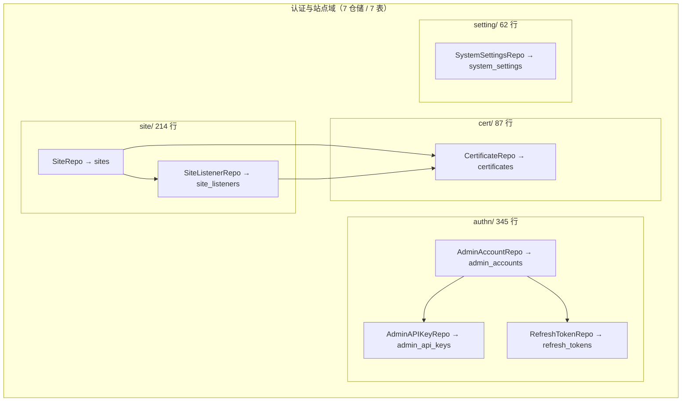
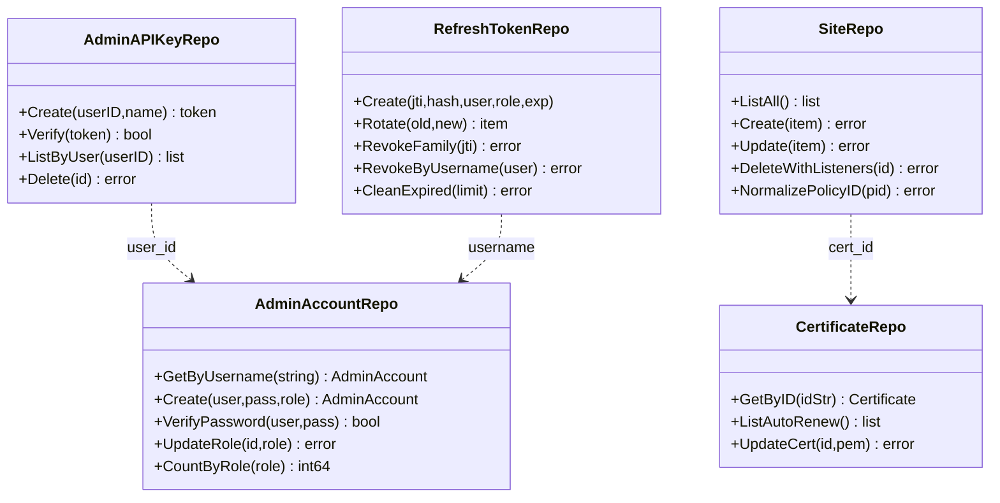
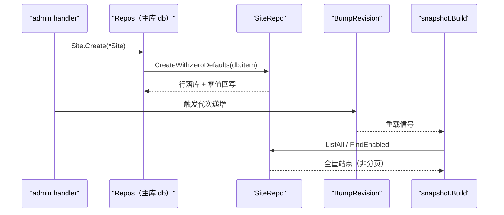
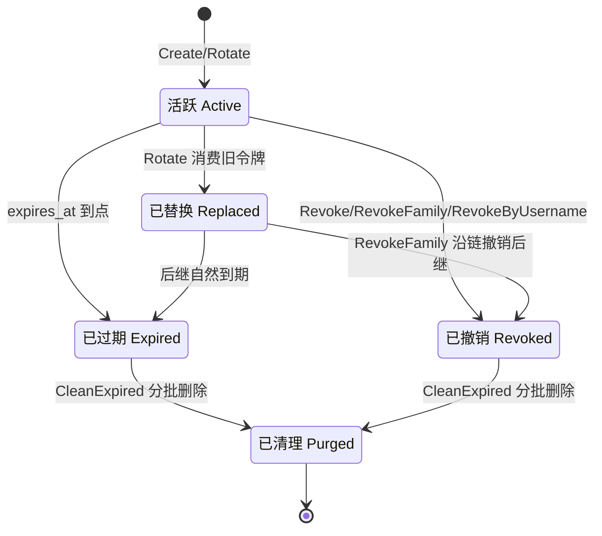
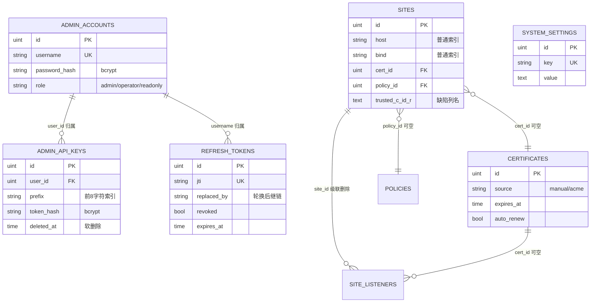
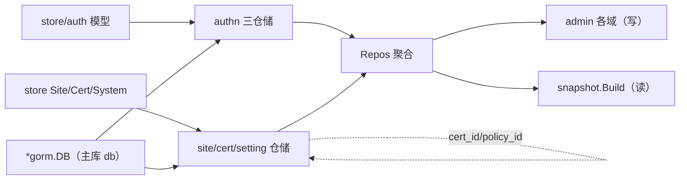

# 认证与站点仓储

> [返回 仓储层](仓储层.md) ｜ [返回 数据存储层](../数据存储层.md)

<cite>
**本文档引用的文件**
- [internal/store/repository/repository.go](file://internal/store/repository/repository.go)
- [internal/store/repository/aliases.go](file://internal/store/repository/aliases.go)
- [internal/store/repository/authn/admin_account.go](file://internal/store/repository/authn/admin_account.go)
- [internal/store/repository/authn/admin_api_key.go](file://internal/store/repository/authn/admin_api_key.go)
- [internal/store/repository/authn/refresh_token.go](file://internal/store/repository/authn/refresh_token.go)
- [internal/store/repository/setting/system_settings.go](file://internal/store/repository/setting/system_settings.go)
- [internal/store/repository/site/site.go](file://internal/store/repository/site/site.go)
- [internal/store/repository/site/site_listener.go](file://internal/store/repository/site/site_listener.go)
- [internal/store/repository/cert/certificate.go](file://internal/store/repository/cert/certificate.go)
- [internal/store/auth/auth.go](file://internal/store/auth/auth.go)
- [internal/store/auth/seed.go](file://internal/store/auth/seed.go)
- [internal/store/site.go](file://internal/store/site.go)
- [internal/store/system.go](file://internal/store/system.go)
- [internal/store/certificate.go](file://internal/store/certificate.go)
- [internal/store/zero_defaults.go](file://internal/store/zero_defaults.go)
- [internal/store/migrations/single_site.go](file://internal/store/migrations/single_site.go)
- [internal/admin/site/site.go](file://internal/admin/site/site.go)
- [internal/core/runtime.go](file://internal/core/runtime.go)
- [internal/app/server.go](file://internal/app/server.go)
- [internal/core/database/gorm.go](file://internal/core/database/gorm.go)
</cite>

## 目录

1. [简介](#简介)
2. [项目结构](#项目结构)
3. [核心组件](#核心组件)
4. [架构总览](#架构总览)
5. [详细组件分析](#详细组件分析)
6. [依赖关系分析](#依赖关系分析)
7. [性能考虑](#性能考虑)
8. [故障排查指南](#故障排查指南)
9. [结论](#结论)
10. [附录](#附录)

## 简介

本文深读仓储层第一域——认证与站点。它覆盖 4 个子包共 7 个仓储、7 张主库表：`authn`（`AdminAccountRepo` `AdminAPIKeyRepo` `RefreshTokenRepo`）、`setting`（`SystemSettingsRepo`）、`site`（`SiteRepo` `SiteListenerRepo`）、`cert`（`CertificateRepo`）。全部绑定主库 `db`，与日志库无关。

本域承担两类截然不同又常伴的写读职责：认证仓储把秘密处理约束在层内（口令 bcrypt、API 令牌只存哈希与前缀、刷新令牌只存哈希与轮换链）；站点与配置仓储把 65 列的站点实体与键值设置如实落库，其中站点防护字段的三态继承（`nil`=继承全局）是最易写错之处。跨域的构造、注入接口与零值回写机制见 [数据访问层设计](../数据访问层设计.md)，本文只讲本域职责与方法细节。

**章节来源**
- [internal/store/repository/authn/refresh_token.go](file://internal/store/repository/authn/refresh_token.go)
- [internal/store/repository/site/site.go](file://internal/store/repository/site/site.go)

## 项目结构

本域代码分布在 4 个子包，根包 `aliases.go` 把每个仓储以带等号的类型别名再导出，使外部 `repository.NewXxxRepo` 与 `*repository.XxxRepo` 写法保持不变。



**图表来源**
- [internal/store/repository/aliases.go](file://internal/store/repository/aliases.go)
- [internal/store/repository/site/site.go](file://internal/store/repository/site/site.go)
- [internal/store/repository/site/site_listener.go](file://internal/store/repository/site/site_listener.go)

依赖箭头表达的是引用列，不是导入关系：`sites.cert_id`/`sites.policy_id`、`site_listeners.cert_id`、`admin_api_keys.user_id`、`refresh_tokens.username`。仓储本身互不 import，跨表引用由调用方在同一事务或多次调用中编排。

**章节来源**
- [internal/store/repository/aliases.go](file://internal/store/repository/aliases.go)

## 核心组件

7 个仓储的能力一览，"读写方"列指明谁写入、谁读取。方法名与行号均来自实际读取的源文件。

| 仓储 | 文件:行 | 负责表 | 关键方法 | 读写方 |
|------|---------|--------|----------|--------|
| `AdminAccountRepo` | `authn/admin_account.go:10` | `admin_accounts` | `VerifyPassword` `Create` `UpdatePasswordByID` `UpdateRole` `CountByRole` | 写 admin/auth，读登录校验 |
| `AdminAPIKeyRepo` | `authn/admin_api_key.go:16` | `admin_api_keys` | `Create` `Verify` `ListByUser` `Delete` | 写 admin/apikey，读 API 中间件 |
| `RefreshTokenRepo` | `authn/refresh_token.go:14` | `refresh_tokens` | `Rotate` `RevokeFamily` `RevokeByUsername` `CleanExpired` | 写 TokenManager，读刷新流程 |
| `SiteRepo` | `site/site.go:9` | `sites` | `ListAll` `Create` `Update` `ApplyCertificate` `DeleteWithListeners` `NormalizePolicyID` | 写 admin/site，读 snapshot |
| `SiteListenerRepo` | `site/site_listener.go:9` | `site_listeners` | `ListEnabledBySites` `ApplyCertificateToTLSListeners` `CreateLegacyReplacement` | 写 admin/listener，读监听器 reconcile |
| `CertificateRepo` | `cert/certificate.go:11` | `certificates` | `GetByID` `ListAutoRenew` `UpdateCert` `UpdateRenewStatus` `GetByDomain` | 写 admin/certificate + acme，读 buildTLS |
| `SystemSettingsRepo` | `setting/system_settings.go:10` | `system_settings` | `Get` `Set` `All` `Delete` `Transaction` | 写 admin/system，读 snapshot/Build |



**图表来源**
- [internal/store/repository/authn/admin_account.go](file://internal/store/repository/authn/admin_account.go)
- [internal/store/repository/authn/admin_api_key.go](file://internal/store/repository/authn/admin_api_key.go)
- [internal/store/repository/authn/refresh_token.go](file://internal/store/repository/authn/refresh_token.go)
- [internal/store/repository/cert/certificate.go](file://internal/store/repository/cert/certificate.go)

**章节来源**
- [internal/store/repository/site/site.go](file://internal/store/repository/site/site.go)
- [internal/store/repository/site/site_listener.go](file://internal/store/repository/site/site_listener.go)
- [internal/store/repository/setting/system_settings.go](file://internal/store/repository/setting/system_settings.go)

## 架构总览

本域所有仓储在 `NewWithLogDB` 内以主库 `db` 构造一次，随 `*Repos` 提供给控制面。站点写操作不是孤立动作：保存后 `store.BumpRevision` 递增代次触发快照重载，配置类读则由 `snapshot.Build` 走 `ListAll`/`FindEnabled` 全量拉取。



**图表来源**
- [internal/store/repository/repository.go](file://internal/store/repository/repository.go)
- [internal/store/repository/site/site.go](file://internal/store/repository/site/site.go)
- [internal/store/zero_defaults.go](file://internal/store/zero_defaults.go)

登录与刷新令牌的写读链单独成图，见后文「认证仓储」小节；本节只确立一条事实：本域 7 个仓储全部绑主库，`logDB` 不参与。

**章节来源**
- [internal/store/repository/repository.go](file://internal/store/repository/repository.go)
- [internal/core/runtime.go](file://internal/core/runtime.go)

## 详细组件分析

### 认证仓储：口令、API 令牌与刷新令牌

三个仓储共享一条原则：明文只在签发瞬间返回一次，库内永远只存哈希。API 令牌的校验走双路径快慢结合，刷新令牌的轮换与家族撤销走事务加行锁。

| 仓储 | 方法 | 秘密形态 | 存储列 | 明文暴露时机 |
|------|------|----------|--------|--------------|
| `AdminAccountRepo.Create` | 口令 → `bcrypt.DefaultCost` | `password_hash` | 口令永不回读 |
| `AdminAPIKeyRepo.Create` | 32 字节随机 hex → bcrypt | `token_hash` + `prefix`(前 8 字符) | 返回 token 一次 |
| `AdminAPIKeyRepo.Verify` | 前缀候选比哈希；无则全表扫 legacy | 读 `token_hash` | 无 |
| `RefreshTokenRepo.Rotate` | 旧令牌置 `revoked` + `replaced_by`=新 JTI | 读 `jti`/`token_hash` | 无 |
| `RefreshTokenRepo.RevokeFamily` | 沿 `replaced_by` 链遍历，行锁重读 | 读 `replaced_by` | 无 |

三个非显然点必须登记：其一，`RevokeByUsername` 对 `"admin"` 特判为 `(username = 'admin' OR username = '')`，以覆盖早期未写用户名的令牌；其二，`Rotate` 用 `RowsAffected != 1` 判定旧令牌失效，返回哨兵错误 `ErrRefreshTokenUnavailable`（`authn/refresh_token.go:16`），该哨兵在 `aliases.go:65` 以变量方式共享同一实例，保证 `errors.Is` 成立；其三，`AdminAPIKeyRepo.Verify` 命中前缀候选后回写 `LastUsedAt`，legacy 分支命中还会顺带回填 `Prefix`，实现"验证即自愈"。系统启动 `SeedDefaults` 只播种 `admin` 账号并返回一次性随机口令，不预置任何 API 令牌。

```sql
-- 现场实测：刷新令牌表结构（无 updated_at / deleted_at，jti 唯一）
CREATE TABLE `refresh_tokens` (
  `id` integer PRIMARY KEY AUTOINCREMENT,
  `jti` text NOT NULL,
  `token_hash` text NOT NULL,
  `username` text NOT NULL DEFAULT "",
  `role` text NOT NULL DEFAULT "admin",
  `expires_at` datetime NOT NULL,
  `revoked` numeric DEFAULT false,
  `replaced_by` text,
  `created_at` datetime);
CREATE UNIQUE INDEX `idx_refresh_tokens_jti` ON `refresh_tokens`(`jti`);

-- API 令牌：软删除 + 前缀索引 + 归属列索引
CREATE TABLE `admin_api_keys` (
  `id` integer PRIMARY KEY AUTOINCREMENT,
  `created_at` datetime,`updated_at` datetime,`deleted_at` datetime,
  `user_id` integer NOT NULL DEFAULT 0,`name` text,
  `prefix` text,`token_hash` text NOT NULL,`last_used_at` datetime);
CREATE INDEX `idx_admin_api_keys_prefix` ON `admin_api_keys`(`prefix`);
CREATE INDEX `idx_admin_api_keys_user_id` ON `admin_api_keys`(`user_id`);
```

**章节来源**
- [internal/store/repository/authn/admin_account.go](file://internal/store/repository/authn/admin_account.go)
- [internal/store/repository/authn/admin_api_key.go](file://internal/store/repository/authn/admin_api_key.go)
- [internal/store/repository/authn/refresh_token.go](file://internal/store/repository/authn/refresh_token.go)
- [internal/store/auth/auth.go](file://internal/store/auth/auth.go)
- [internal/store/auth/seed.go](file://internal/store/auth/seed.go)

### 令牌生命周期（行为）

刷新令牌是一条有明确状态迁移的实体：签发为活跃，被刷新消费即转入"已替换"，登出/改密/强制下线走不同撤销粒度，过期与被回收后物理删除。`RevokeFamily` 是"只影响当前浏览器"的粒度，`RevokeByUsername`/`RevokeAll` 是"影响该账号所有设备"的粒度。



**图表来源**
- [internal/store/repository/authn/refresh_token.go](file://internal/store/repository/authn/refresh_token.go)

`CleanExpired` 的回收条件是 `revoked = true OR expires_at <= now`，按 `id ASC` 取 `limit`（默认 64）条再删除；`Rotate` 与 `RevokeFamily` 都在事务内完成，前者靠 `RowsAffected` 保证消费原子性，后者用 `clause.Locking{Strength:"UPDATE"}` 逐行加锁并回读 `replaced_by`，以纳入并发刷新刚提交的后继令牌。

**章节来源**
- [internal/store/repository/authn/refresh_token.go](file://internal/store/repository/authn/refresh_token.go)

### 站点仓储与三态继承

`SiteRepo` 方法面最宽，也最易踩坑。`List(0,0)` 会命中 `LIMIT 0` 返回空集，全量场景必须用 `ListAll`；创建走 `CreateWithZeroDefaults` 而非裸 `db.Create`，否则"新建即停用"的站点会被套用 `enabled=true` 默认值立刻接流量。`ApplyCertificate` 同时写 `tls_enabled=true` 与 `cert_id`；`NormalizePolicyID` 接收 `**uint`，把 `0` 归一为 `nil`（继承默认策略），非零则校验策略存在。

站点 65 列中有 70 个 Go 字段、其中 5 个 `gorm:"-"` 瞬态（`UpstreamTLSClientCert*`）。防护类字段是三态指针，语义为 `nil=继承全局 ProtectionConfig`，其从属字段由 `internal/admin/site/site.go:505` 的 `clearInheritedProtectionOverrides` 在保存前清空：

| 覆盖字段 | 类型 | nil 语义 | 清空动作（site.go:505-522） |
|----------|:----:|----------|------------------------------|
| `BotProtectionEnabled` | `*bool` | 继承 | 清 `BotProtectionLevel` |
| `OWASPEnabled` | `*bool` | 继承 | 清 `OWASPSensitivity` `OWASPAction` |
| `CVEEnabled` | `*bool` | 继承 | 清 `CVEAction` |
| `RateLimitEnabled` | `*bool` | 继承 | 清 `RateLimitWindow` `RateLimitMax` `RateLimitAction` |
| `ChallengeAction` `SiteCaptchaType` | `*string` | 继承 | 独立指针，无从属清理 |

```sql
-- 现场实测：sites 表关键片段（AutoMigrate 命名 + 唯一缺陷列）
CREATE TABLE `sites` (
  `id` integer PRIMARY KEY AUTOINCREMENT,
  `host` text NOT NULL,`bind` text NOT NULL,`enabled` numeric DEFAULT true,
  `cert_id` integer,`policy_id` integer,
  `owasp_enabled` numeric DEFAULT null,`cve_enabled` numeric DEFAULT null,
  `rate_limit_enabled` numeric DEFAULT null,`anti_replay_enabled` numeric DEFAULT null,
  `xff_mode` text DEFAULT "strip_all_and_set_remote",
  `trusted_c_id_r` text,          -- 缺陷：模型字段 TrustedCIDR 无 column 标签，被拆成 trusted_c_id_r
  `skip_path_by_phase` text,      -- *string 三态：NULL=继承，'{}'=覆盖为空
  `deleted_at` datetime,
  ...
);
CREATE INDEX `idx_sites_bind` ON `sites`(`bind`);
CREATE INDEX `idx_sites_host` ON `sites`(`host`);
```

**章节来源**
- [internal/store/repository/site/site.go](file://internal/store/repository/site/site.go)
- [internal/store/site.go](file://internal/store/site.go)
- [internal/admin/site/site.go](file://internal/admin/site/site.go)

### 监听器与证书仓储

`SiteListenerRepo` 是 `sites` 的一对多子实体：`ListEnabledBySites` 供管理端按站点页过滤避免全表扫描；级联删除由 `SiteRepo.DeleteWithListeners` 在一个事务内先删监听器再删站点。两处 legacy 事务值得注意——`CreateWithLegacyPromotion` 在同一事务插入 legacy 与目标监听器，`CreateLegacyReplacement` 仅当站点尚无监听器时才用 `CreateWithZeroDefaults` 补建一条，返回 `created` 供调用方判断。

`CertificateRepo` 有两个取详情入口：`Get(uint)` 与 `GetByID(string)`，后者便于路由参数直接传入。`UpdateCert` 换新证并显式把 `renew_error` 清为空串；`UpdateRenewStatus` 只回写失败信息与尝试时间。`ListAutoRenew` 用 `source='acme'` 过滤自动续期对象，`GetByDomain` 同样限定 `source='acme'`。

**章节来源**
- [internal/store/repository/site/site_listener.go](file://internal/store/repository/site/site_listener.go)
- [internal/store/repository/cert/certificate.go](file://internal/store/repository/cert/certificate.go)
- [internal/store/repository/site/site.go](file://internal/store/repository/site/site.go)

### 设置仓储与键值约定

`SystemSettingsRepo` 是最小仓储：`Get`/`Set`/`All`/`Delete` 四操作加一个 `Transaction` 包装器（把 `fn` 收到一个绑定同一事务的新实例，供多键原子写）。`Set` 以 `key` 为唯一列做 `ON CONFLICT DO UPDATE`，实现幂等 upsert；`All` 按 `key` 排序以保证稳定分页。nullable 的站点级覆盖不放这张表——它们作为 `sites` 的列存在；`system_settings` 只放全局配置（`acme_config` `redis_config` `jwt_secret` 与响应压缩族）。

**章节来源**
- [internal/store/repository/setting/system_settings.go](file://internal/store/repository/setting/system_settings.go)
- [internal/store/system.go](file://internal/store/system.go)

### 实体关系（数据）

本域 7 表的主外键与基数如下：`admin_accounts` 一对多派生 API 令牌与刷新令牌，`sites` 一对多派生监听器并各自可空引用证书与策略。引用全部可空，删除侧无数据库级联，占用校验由调用方以 `CountByCertID` 前置完成。



**图表来源**
- [internal/store/auth/auth.go](file://internal/store/auth/auth.go)
- [internal/store/site.go](file://internal/store/site.go)
- [internal/store/certificate.go](file://internal/store/certificate.go)
- [internal/store/system.go](file://internal/store/system.go)

> `refresh_tokens` `admin_accounts` 无 `deleted_at`，`AdminAccountRepo.Delete` 为物理删除；`admin_api_keys` `sites` `site_listeners` `certificates` 走 GORM 软删除，查询自动带 `deleted_at IS NULL`。

**章节来源**
- [internal/store/repository/authn/admin_account.go](file://internal/store/repository/authn/admin_account.go)
- [internal/store/repository/site/site.go](file://internal/store/repository/site/site.go)

### 数据表清单（本域）

| 表名 | 模型 | 定义位置 | 主键 | 软删除 | 实测列数 |
|------|------|----------|:----:|:------:|:--------:|
| `sites` | `store.Site` | `store/site.go:38` | `id` | 是 | 65 |
| `site_listeners` | `store.SiteListener` | `store/site.go:248` | `id` | 是 | 11 |
| `certificates` | `store.Certificate` | `store/certificate.go:19` | `id` | 是 | 14 |
| `system_settings` | `store.SystemSettings` | `store/system.go:4` | `id` | 否 | 3 |
| `admin_accounts` | `auth.AdminAccount` | `store/auth/auth.go:28` | `id` | 否 | 6 |
| `admin_api_keys` | `auth.AdminAPIKey` | `store/auth/auth.go:15` | `id` | 是 | 9 |
| `refresh_tokens` | `auth.RefreshToken` | `store/auth/auth.go:38` | `id` | 否 | 9 |

> `system_settings` `admin_accounts` `refresh_tokens` 三张表无 `deleted_at`，`Delete` 为物理删除；其余四张为 GORM 软删除。

**章节来源**
- [internal/store/site.go](file://internal/store/site.go)
- [internal/store/certificate.go](file://internal/store/certificate.go)
- [internal/store/auth/auth.go](file://internal/store/auth/auth.go)
- [internal/store/system.go](file://internal/store/system.go)

### 索引与约束（实测）

索引直接决定本域排障方向：唯一索引保护身份列，普通索引加速列表与外键反查。以下均来自 `sqlite3 data/waf.db` 的 `.schema` 现场输出。

| 表 | 索引名 | 列 | 类型 |
|----|--------|----|:----:|
| `admin_accounts` | `idx_admin_accounts_username` | `username` | 唯一 |
| `refresh_tokens` | `idx_refresh_tokens_jti` | `jti` | 唯一 |
| `system_settings` | `idx_system_settings_key` | `key` | 唯一 |
| `admin_api_keys` | `idx_admin_api_keys_prefix` | `prefix` | 普通 |
| `admin_api_keys` | `idx_admin_api_keys_user_id` | `user_id` | 普通 |
| `admin_api_keys` | `idx_admin_api_keys_deleted_at` | `deleted_at` | 普通 |
| `sites` | `idx_sites_host` / `idx_sites_bind` | `host`/`bind` | 普通 |
| `sites` | `idx_sites_listener_id` / `idx_sites_deleted_at` | `listener_id`/`deleted_at` | 普通 |
| `site_listeners` | `idx_site_listeners_site_id` / `_bind` / `_deleted_at` | 三列 | 普通 |
| `certificates` | `idx_certificates_deleted_at` | `deleted_at` | 普通 |

**章节来源**
- [internal/store/site.go](file://internal/store/site.go)
- [internal/store/auth/auth.go](file://internal/store/auth/auth.go)

## 依赖关系分析

本域对上是"配置与身份"的写入端，对被下游快照与管理面读取。仓储不 import 上层，模型与 GORM 句柄由 `Repos` 注入。



**图表来源**
- [internal/store/repository/repository.go](file://internal/store/repository/repository.go)
- [internal/store/repository/aliases.go](file://internal/store/repository/aliases.go)

`SiteRepo` 与 `CertificateRepo`/`PolicyRepo` 之间的引用是同库跨表：`ApplyCertificate` 只改 `sites`，不会去动 `certificates`；删除证书前的占用校验由 admin 侧调用 `SiteRepo.CountByCertID` 与 `SiteListenerRepo.CountByCertID` 完成，仓储层不提供跨表约束。

**章节来源**
- [internal/store/repository/site/site.go](file://internal/store/repository/site/site.go)

## 性能考虑

- **问题**：管理端渲染一页站点时监听器扫描全表。**优化**：`ListEnabledBySites(siteIDs)` 按站点集合过滤。**效果**：读取量随页大小而非表大小增长。
- **问题**：API 令牌校验若每次全表比哈希会退化。**优化**：前缀索引取候选再比 bcrypt，仅 legacy 无此前缀的旧密钥才回退全表。**效果**：新令牌命中 `idx_admin_api_keys_prefix`，回退只影响历史数据。
- **问题**：刷新令牌回收一次性删太多造成锁放大。**优化**：`CleanExpired` 默认取 64 条再删。**效果**：回收为短事务，可反复调用。
- **问题**：`SiteRepo.List(0,0)` 误当全量返回空。**优化**：`ListAll` 承接全量语义。**效果**：消除冷启动漏配。

[本节为总结，无需特定文件来源]

## 故障排查指南

| 症状 | 根因 | 排查 | 方案 |
|------|------|------|------|
| 新建停用站点却接流量 | 绕过 `CreateWithZeroDefaults` | 核对 `SiteRepo.Create` | 走零值回写创建 |
| OWASP 开关继承但档位生效 | 未清从属字段 | 查 `clearInheritedProtectionOverrides` | 经 admin/site 校验链保存 |
| 登出把别的设备也踢下线 | 误用 `RevokeByUsername` | 区分撤销粒度 | 会话内用 `RevokeFamily` |
| 令牌轮换报 `ErrRefreshTokenUnavailable` | 旧令牌已被消费/过期 | 查 `revoked` 与 `expires_at` | 属并发刷新保护，正常拒绝 |
| 老库恢复进程退出 | V2 迁移 SELECT `trusted_c_id_r` | 见 [仓储层](仓储层.md) 迁移不一致节 | 对齐列名（登记项） |
| 删除证书后站点仍引用 | 无跨表约束 | `CountByCertID` 前置校验 | admin 侧拦截非零占用 |

```bash
# 本域一致性与命名自检
go test ./internal/store/repository/authn/... -count=1
sqlite3 data/waf.db "PRAGMA table_info('sites');" | grep -i trusted
sqlite3 data/waf.db ".schema system_settings" | grep UNIQUE
rg -n "CreateWithZeroDefaults" internal/store/repository/site   # 预期 site.go/site_listener.go 各命中
```

**章节来源**
- [internal/store/repository/site/site.go](file://internal/store/repository/site/site.go)
- [internal/store/repository/authn/refresh_token.go](file://internal/store/repository/authn/refresh_token.go)
- [internal/admin/site/site.go](file://internal/admin/site/site.go)

## 结论

认证与站点域把"谁能改"与"改哪个站点"两件事收敛到 7 个仓储：认证仓储以 bcrypt 与哈希前缀把秘密留在库内、把明文限制在签发瞬间；站点/监听器/证书/设置仓储把宽表实体与键值配置如实落库，并用零值回写与三态清空守住"继承/覆盖"的语义边界。KISS 体现在不引入通用 BaseRepo，各仓储方法直白；SRP 体现在秘密处理只出现在 authn、级联删除只出现在 site；YAGNI 体现在设置表只放全局键、不为每个配置项建表。

本域最大的已知风险是 `trusted_c_id_r` 与迁移脚本 `trusted_cidr` 的列名不一致——它在老库恢复期可触发 V2 迁移 SELECT 失败并令进程 `os.Exit(1)`，已在 [仓储层](仓储层.md) 与本节如实登记，配套修复需同时补迁移与回归测试。

[本节为总结，无需特定文件来源]

## 附录

### 站点瞬态与悬挂注释

`Site` 的 5 个 `gorm:"-"` 瞬态字段（`UpstreamTLSClientCertDER` `...CertKey` `...CertSet` `...CertBad` `...CertFP`）在 `PrepareUpstreamMTLSRuntime` 中由 PEM 解析得出，不落库。另有一处需登记：`SiteForwardingRule`/`SiteHeaderOp`（`store/site.go:278`、`288`）的注释仍写"以 JSON 形式存放在 Site.ForwardingRules / Site.HeaderOps 中"，但 `Site` 结构体已无这两个字段——注释指向已删除字段，实际转发与改写规则现由 `site_listeners` 与 `application_route_rules` 承载。

**章节来源**
- [internal/store/site.go](file://internal/store/site.go)

### 方法返回约定速查

| 约定 | 本域写法 | 例外 |
|------|----------|------|
| 详情 | `Get(id uint) (*T, error)` | `CertificateRepo.GetByID(idStr string)` |
| 创建 | `Create(*T) error` | `AdminAccountRepo.Create(username,password,role)` `AdminAPIKeyRepo.Create` 返回 token |
| 校验 | 返回 `(item, bool)` | `VerifyPassword` `Verify` 均不返回 error |
| 撤销 | 多粒度方法 | `Revoke` `RevokeFamily` `RevokeByUsername` `RevokeAll` |

[本节为总结，无需特定文件来源]

### 相关文档

- 跨域构造与注入接口实现：[数据访问层设计](../数据访问层设计.md)
- 全量实体列与索引：[数据库模型设计](../数据库模型设计.md)
- 域划分与跨域事实登记：[仓储层](仓储层.md)

[本节为总结，无需特定文件来源]
