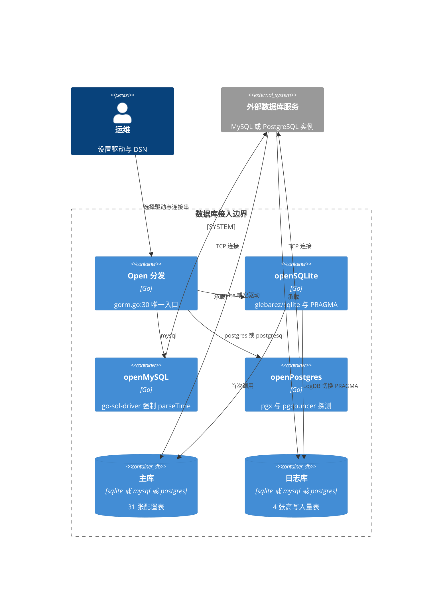
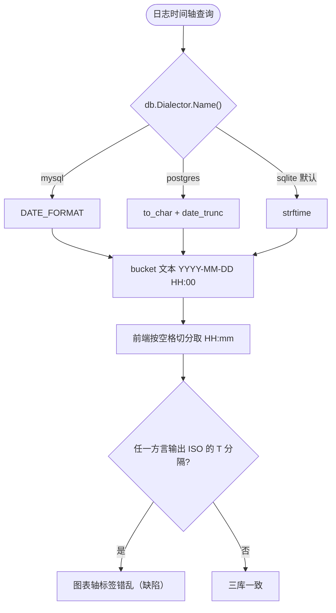
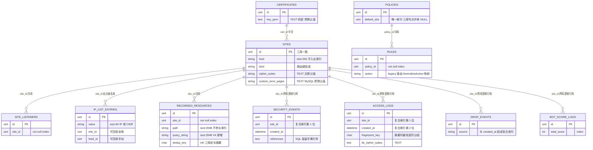
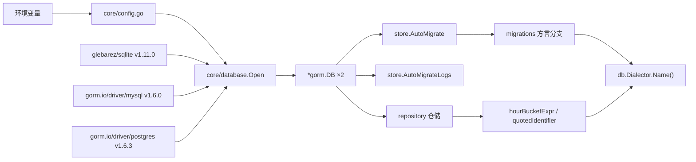

# 多数据库支持

> [返回 数据存储层](数据存储层.md)

<cite>
**本文档引用的文件**
- [internal/core/database/gorm.go](file://internal/core/database/gorm.go)
- [internal/core/database/dialect_test.go](file://internal/core/database/dialect_test.go)
- [internal/store/dialect_migration_test.go](file://internal/store/dialect_migration_test.go)
- [internal/store/migrations/site_tls_inheritance_defaults.go](file://internal/store/migrations/site_tls_inheritance_defaults.go)
- [internal/store/approute/app_route.go](file://internal/store/approute/app_route.go)
- [internal/store/repository/security_event.go](file://internal/store/repository/security_event.go)
- [internal/store/migrations/recorded_resource_dedup_key.go](file://internal/store/migrations/recorded_resource_dedup_key.go)
- [internal/core/runtime.go](file://internal/core/runtime.go)
- [go.mod](file://go.mod)
- [internal/store/migrate.go](file://internal/store/migrate.go)
- [internal/store/site.go](file://internal/store/site.go)
- [internal/store/policy.go](file://internal/store/policy.go)
- [internal/store/system.go](file://internal/store/system.go)
- [internal/store/events.go](file://internal/store/events.go)
- [internal/store/approute/app_route.go](file://internal/store/approute/app_route.go)
- [internal/store/migrate.go](file://internal/store/migrate.go)
- [internal/store/site.go](file://internal/store/site.go)
- [internal/store/policy.go](file://internal/store/policy.go)
- [internal/store/system.go](file://internal/store/system.go)
- [internal/store/events.go](file://internal/store/events.go)
- [internal/store/migrations/access_log_fingerprint_key.go](file://internal/store/migrations/access_log_fingerprint_key.go)
- [internal/core/config.go](file://internal/core/config.go)
- [README.md](file://README.md)
- [internal/store/migrations/site_tls_min_version_inheritance.go](file://internal/store/migrations/site_tls_min_version_inheritance.go)
- [internal/store/migrations/site_antireplay_inheritance.go](file://internal/store/migrations/site_antireplay_inheritance.go)
- [internal/store/repository/timeline_dialect_test.go](file://internal/store/repository/timeline_dialect_test.go)
- [internal/store/iplist/ip_list.go](file://internal/store/iplist/ip_list.go)
</cite>

## 目录

1. [简介](#简介)
2. [项目结构](#项目结构)
3. [核心组件](#核心组件)
4. [架构总览](#架构总览)
5. [详细组件分析](#详细组件分析)
6. [依赖关系分析](#依赖关系分析)
7. [性能考虑](#性能考虑)
8. [故障排查指南](#故障排查指南)
9. [结论](#结论)
10. [附录](#附录)

## 简介

My-OpenWaf 支持 SQLite、MySQL、PostgreSQL 三种 SQL 方言，同一份 struct tag 与同一套仓储代码在三者之上运行。方言差异没有被抽象层掩盖，而是收敛到三类显式处理点：**连接参数**（DSN 校验与 PRAGMA）、**结构迁移**（按方言分支的 DDL）、**查询表达式**（时间分桶与标识符引用）。

本篇说明这三类处理点的实现位置与约束，并给出选型建议。核心结论有两条：一是 SQLite 为默认且唯一无需外部服务的部署形态，MySQL/PostgreSQL 面向多节点与集中运维；二是主库与日志库始终是两条独立句柄，可以指向不同方言后端。

## 项目结构

方言相关代码集中在两个包，其余位置只做分支判断。

| 位置 | 行数 | 方言相关内容 | 关键符号 |
|------|:----:|--------------|----------|
| `internal/core/database/gorm.go` | 310 | 三分支连接、连接池、PRAGMA、DSN 脱敏 | `Open:30`、`openSQLite:73`、`openMySQL:115`、`openPostgres:134` |
| `internal/core/database/dialect_test.go` | 185 | 校验分支与脱敏的回归用例 | `TestOpenMySQLRequiresParseTime:14`、`TestOpenSQLiteLogDBPragmas:67` |
| `internal/store/migrations/` | 1074 | 按方言分支的 DDL 与索引重建 | `V5MigrateSiteTLSInheritanceDefaults:12`、`V8:60`、`V12:41` |
| `internal/store/repository/security_event.go` | 725 | 小时分桶与标识符引用 | `hourBucketExpr:605`、`quotedIdentifier:91` |
| `internal/store/dialect_migration_test.go` | 197 | 真实 MySQL/PG 上的迁移与索引断言 | `TestAutoMigrateOnExternalDialect:25` |
| `internal/core/config.go` | 驱动/DSN 段 | 环境变量到驱动的解析 | `LoadConfigFromEnv:334-360` |

| 能力 | sqlite | mysql | postgres | 差异说明 |
|------|:------:|:-----:|:--------:|----------|
| 空 DSN 可用 | ✓ | ✗ | ✗ | SQLite 回退 `DataDir/waf.db`（`gorm.go:74-77`） |
| `postgresql` 别名 | — | — | ✓ | 与 `postgres` 同分支（`gorm.go:50`） |
| 强制 `parseTime=True` | — | ✓ | — | 缺失即启动失败（`gorm.go:123-125`） |
| PgBouncer 简单协议 | — | — | ✓ | DSN 含 `pgbouncer=true` 时启用（`gorm.go:157-159`） |
| 连接池显式设置 | 8/8/不限 | 25/10/30m/5m | 25/10/30m/5m | SQLite 见 `gorm.go:101-106`，其余 `gorm.go:60-67` |
| WAL 与 PRAGMA 调优 | ✓ | — | — | 主库与日志库两套（`gorm.go:89-95`） |
| TEXT 列带 `DEFAULT` | ✓ | ✗ | ✗ | MySQL 报 Error 1101，模型刻意不给 TEXT 列设默认值（`site.go:125-128`） |
| 五列复合唯一索引 | ✓ | ✗ | 部分 | utf8mb4 键长超 3072（Error 1071），改为 `char(64)` 摘要列（`app_route.go:63-75`） |
| `ALTER COLUMN DROP DEFAULT` | ✗（跳过） | ✓ | ✓ | V5 按方言分支并容忍 MySQL 特定错误 |
| 小时分桶函数 | `strftime` | `DATE_FORMAT` | `date_trunc` | 三者输出必须同为 `YYYY-MM-DD HH:00`（`security_event.go:605-614`） |
| `GetIndexes` 列序可信 | ✓ | ✓ | ✗ | PG 驱动无 `ORDER BY`，只能断言列集合（`dialect_migration_test.go:101-128`） |

**章节来源**
- [internal/core/database/gorm.go:30-159](file://internal/core/database/gorm.go#L30-L159)
- [internal/core/database/dialect_test.go:14-128](file://internal/core/database/dialect_test.go#L14-L128)
- [internal/store/dialect_migration_test.go:14-128](file://internal/store/dialect_migration_test.go#L14-L128)
- [internal/store/migrations/site_tls_inheritance_defaults.go:12-55](file://internal/store/migrations/site_tls_inheritance_defaults.go#L12-L55)
- [internal/store/approute/app_route.go:57-98](file://internal/store/approute/app_route.go#L57-L98)
- [internal/store/repository/security_event.go:595-614](file://internal/store/repository/security_event.go#L595-L614)

## 核心组件

| 组件 | 位置 | 形态 | 职责 |
|------|------|------|------|
| `Options` | `gorm.go:22` | 结构体 | 以四字段表达「连哪个库、是不是日志库」 |
| `Open` | `gorm.go:30` | 函数 | 唯一方言分发点，共享 `gorm.Config` |
| `openSQLite` | `gorm.go:73` | 函数 | PRAGMA 拼接、目录创建、8 连接 |
| `openMySQL` | `gorm.go:115` | 函数 | `parseTime` 前置校验、原生改名语义 |
| `openPostgres` | `gorm.go:134` | 函数 | 简单协议探测、错误脱敏包装 |
| `maskDSN` | `gorm.go:162` | 函数 | URL / DSN / 关键字三形态口令遮蔽 |
| `isDSNSecretKey` | `gorm.go:212` | 函数 | 认定 `password/passwd/pwd/sslpassword` 为敏感键 |
| `V5MigrateSiteTLSInheritanceDefaults` | `site_tls_inheritance_defaults.go:12` | 迁移 | 按方言删除列默认值 |
| `V8MigrateRecordedResourceDedupKey` | `recorded_resource_dedup_key.go:60` | 迁移 | 摘要列替代五列复合索引 |
| `hourBucketExpr` | `security_event.go:605` | 查询辅助 | 时间轴分桶的方言适配 |
| `quotedIdentifier` | `security_event.go:91` | 查询辅助 | MySQL 反引号、其余双引号 |

SQLite 连接数上限是显式常量，注释直接指向 WAL 读并发与写安全性权衡：

```go
// internal/core/database/gorm.go:101-113
sqlDB, err := db.DB()
if err == nil {
	sqlDB.SetMaxOpenConns(sqliteMaxOpenConns)
	sqlDB.SetMaxIdleConns(sqliteMaxOpenConns)
	sqlDB.SetConnMaxLifetime(0) // 本地文件连接无需轮换
}

// sqliteMaxOpenConns 是 SQLite 的最大连接数。
// 见 openSQLite 中关于 WAL 读并发与写安全性的说明。
const sqliteMaxOpenConns = 8
```

**章节来源**
- [internal/core/database/gorm.go:22-159](file://internal/core/database/gorm.go#L22-L159)
- [internal/core/database/gorm.go:161-222](file://internal/core/database/gorm.go#L161-L222)
- [internal/store/migrations/site_tls_inheritance_defaults.go:12-76](file://internal/store/migrations/site_tls_inheritance_defaults.go#L12-L76)
- [internal/store/migrations/recorded_resource_dedup_key.go:15-83](file://internal/store/migrations/recorded_resource_dedup_key.go#L15-L83)
- [internal/store/repository/security_event.go:88-100](file://internal/store/repository/security_event.go#L88-L100)

## 架构总览

三种方言共用同一条打开路径，差异只发生在叶子函数与两个查询辅助函数上。



**图表来源**
- [internal/core/database/gorm.go:30-149](file://internal/core/database/gorm.go#L30-L149)
- [internal/core/runtime.go:63-97](file://internal/core/runtime.go#L63-L97)
- [go.mod:13-36](file://go.mod#L13-L36)

日志库不是第三种驱动：`runtime.go:88-93` 用同一个 `Open` 再调一次，只把 `Options.LogDB` 置真，因此 SQLite 下会切换 PRAGMA 组合，MySQL/PostgreSQL 下则完全复用同一套连接池参数。

**章节来源**
- [internal/core/runtime.go:63-97](file://internal/core/runtime.go#L63-L97)
- [internal/core/database/gorm.go:89-95](file://internal/core/database/gorm.go#L89-L95)

## 详细组件分析

### 数据表清单与方言分布

主库 31 张表由 `AutoMigrate` 建立，日志库 4 张表由 `AutoMigrateLogs` 建立；下表给出方言相关的建模约束落点。

| 表名 | 模型 | 定义位置:行 | 主键 | 关键索引 | 方言注意点 |
|------|------|-------------|------|----------|------------|
| `sites` | `Site` | `site.go:38` | `id` | `host`、`bind`、`deleted_at` | `custom_error_pages` 等 TEXT 列刻意无默认值 |
| `site_listeners` | `SiteListener` | `site.go:248` | `id` | `site_id`、`bind` | `enabled` 默认 true，需零值回写 |
| `certificates` | `Certificate` | `certificate.go:19` | `id` | `deleted_at` | `key_pem` 为 TEXT，禁默认值 |
| `policies` | `Policy` | `policy.go:10` | `id` | `ux_policies_default_slot` | 唯一索引允许多个 NULL，三库一致 |
| `rules` | `Rule` | `policy.go:70` | `id` | `policy_id`、`phase` | V14 补三列，默认 0 |
| `system_settings` | `SystemSettings` | `system.go:4` | `id` | `key` 唯一 | `key` 是 SQL 关键字，靠 GORM 引号处理 |
| `config_revisions` | `ConfigRevision` | `system.go:31` | `id` | — | 单行 `id=1` 自增表达式 `revision + ?` |
| `recorded_resources` | `approute.RecordedResource` | `approute/app_route.go:58` | `id` | `ux_recorded_res_dedup` | 摘要列替代五列复合索引 |
| `cve_rules` | `cve.CVERuleRecord` | `cve/cve.go:10` | `id` | `cve_id`、`deleted_at` | `references` 为保留字，需引号标识符 |
| `security_events` | `SecurityEvent` | `events.go:15` | `id` | `idx_se_site_created_id` | 三列复合索引列序由 priority 声明 |
| `access_logs` | `AccessLog` | `events.go:79` | `id` | `idx_al_site_created_id`、`idx_al_fingerprint_key` | `fingerprint_key char(64)` 摘要列 |
| `drop_events` | `DropEvent` | `events.go:238` | `id` | `idx_drop_source_created` | 无软删除字段 |
| `bot_score_logs` | `BotScoreLog` | `events.go:251` | `id` | `total_score`、`tls_ja4` | 六项分值为普通 int |

**章节来源**
- [internal/store/migrate.go:52-89:52-89](file://internal/store/migrate.go#L52-L89#52)
- [internal/store/site.go:38-147:38-147](file://internal/store/site.go#L38-L147#38)
- [internal/store/policy.go:10-97:10-97](file://internal/store/policy.go#L10-L97#10)
- [internal/store/system.go:4-34:4-34](file://internal/store/system.go#L4-L34#4)
- [internal/store/events.go:15-129:15-129](file://internal/store/events.go#L15-L129#15)
- [internal/store/approute/app_route.go:57-98:57-98](file://internal/store/approute/app_route.go#L57-L98#57)
- [internal/store/migrate.go:52-89](file://internal/store/migrate.go#L52-L89)
- [internal/store/site.go:38-147](file://internal/store/site.go#L38-L147)
- [internal/store/policy.go:10-97](file://internal/store/policy.go#L10-L97)
- [internal/store/system.go:4-34](file://internal/store/system.go#L4-L34)
- [internal/store/events.go:15-129](file://internal/store/events.go#L15-L129)
- [internal/store/approute/app_route.go:57-98](file://internal/store/approute/app_route.go#L57-L98)

### 字段明细与方言取值

摘要列是本项目最重要的跨方言设计：MySQL 的 InnoDB 索引键上限为 3072 字节，而 `path` 与 `query_string` 各 2048 字符在 utf8mb4 下即 16384 字节。

| 字段 | Go 类型 | 列类型 | 约束 | 默认 | 说明 |
|------|---------|--------|------|------|------|
| `DedupKey` | `string` | `char(64)` | `uniqueIndex:ux_recorded_res_dedup` | — | 五列 SHA-256 十六进制摘要 |
| `SiteID` | `uint` | integer | `not null;index` | 0 | 摘要组成的第一元素 |
| `Method` | `string` | `size:16` | 可空 | — | 摘要成员 |
| `Path` | `string` | `size:2048` | 可空 | — | 不入索引，仅存储 |
| `QueryString` | `string` | `size:2048` | 可空 | — | V4 新增并回填空串 |
| `FingerprintKey` | `string` | `char(64)` | `index:idx_al_fingerprint_key` | — | 九字段摘要，`BeforeSave` 维护 |
| `References` | `string` | `type:text` | 可空 | — | SQL 保留字，查询侧需引号 |
| `SkipPathByPhase` | `*string` | `type:text` | 可空 | NULL | 三态，禁止给 TEXT 列设默认值 |
| `TrustedCIDR` | `string` | `type:text` | 可空 | — | JSON 列表文本 |
| `UpstreamURLs` | `string` | `type:text` | `not null` | — | 上游地址列表 |

```sql
-- 摘要列方案：三库一致的定长唯一索引（internal/store/approute/app_route.go:75）
CREATE TABLE `recorded_resources` (
  `site_id` integer NOT NULL,
  `method` text,
  `host` text,
  `path` text,
  `query_string` text,
  `dedup_key` char(64)
);
CREATE UNIQUE INDEX `ux_recorded_res_dedup` ON `recorded_resources`(`dedup_key`);

-- 被 V4/V8 删除的旧五列复合索引（MySQL 上根本无法建立）
-- ALTER TABLE recorded_resources DROP INDEX ux_recorded_res_key;

-- 访问日志指纹摘要（internal/store/events.go:112，V12 补列补索引）
ALTER TABLE `access_logs` ADD COLUMN `fingerprint_key` char(64);
CREATE INDEX `idx_al_fingerprint_key` ON `access_logs`(`fingerprint_key`);
```

**章节来源**
- [internal/store/approute/app_route.go:57-141](file://internal/store/approute/app_route.go#L57-L141)
- [internal/store/events.go:79-198](file://internal/store/events.go#L79-L198)
- [internal/store/migrations/recorded_resource_dedup_key.go:15-83](file://internal/store/migrations/recorded_resource_dedup_key.go#L15-L83)
- [internal/store/migrations/access_log_fingerprint_key.go:12-91](file://internal/store/migrations/access_log_fingerprint_key.go#L12-L91)
- [internal/store/site.go:125-141](file://internal/store/site.go#L125-L141)
- [internal/core/database/dialect_test.go:67-91](file://internal/core/database/dialect_test.go#L67-L91)

### 连接与 DSN 规则

环境变量到方言的映射只有四个变量，DSN 形态决定校验分支。

| 配置项 | 类型 | 默认值 | 必填 | 作用域 | 生效方式 | 安全等级 | 说明 |
|--------|------|--------|:----:|--------|----------|----------|------|
| `MY_OPENWAF_DB_DRIVER` | string | `sqlite` | 否 | 进程 | 重启 | 普通 | 空串等价 sqlite |
| `MY_OPENWAF_DSN` | string | `{DataDir}/waf.db` | 非 sqlite 时必填 | 进程 | 重启 | 机密 | MySQL 必含 `parseTime=True` |
| `MY_OPENWAF_LOG_DSN` | string | `{DataDir}/waf_logs.db` | 否 | 进程 | 重启 | 机密 | 别名 `MY_OPENWAF_LOG_DB` |
| `MY_OPENWAF_DATA` | string | `./data` | 否 | 进程 | 重启 | 普通 | sqlite 落盘目录 |
| `pgbouncer=true` | DSN 参数 | 缺省 false | 否 | 连接 | 重启 | 普通 | 切简单协议，放弃预编译 |
| `charset=utf8mb4` | DSN 参数 | 建议显式 | 否 | 连接 | 重启 | 普通 | 影响索引键长上限判定 |

```bash
# SQLite（默认，无需外部服务）
export MY_OPENWAF_DB_DRIVER=sqlite
export MY_OPENWAF_DSN='{占位目录}/data/waf.db'
export MY_OPENWAF_LOG_DSN='{占位目录}/data/waf_logs.db'

# MySQL：三处缺一不可（charset、parseTime、loc）
export MY_OPENWAF_DB_DRIVER=mysql
export MY_OPENWAF_DSN='{user}:{password}@tcp({host}:3306)/{db}?charset=utf8mb4&parseTime=True&loc=Local'

# PostgreSQL：走 PgBouncer 事务池时必须加 pgbouncer=true
export MY_OPENWAF_DB_DRIVER=postgres
export MY_OPENWAF_DSN='postgres://{user}:{password}@{host}:5432/{db}?sslmode=disable&pgbouncer=true'

# 多方言迁移验证（未设置对应变量时测试自动跳过）
export MY_OPENWAF_TEST_MYSQL_DSN='{user}:{password}@tcp({host}:3306)/waf?charset=utf8mb4&parseTime=True&loc=Local'
export MY_OPENWAF_TEST_POSTGRES_DSN='postgres://{user}:{password}@{host}:5432/waf?sslmode=disable'
go test ./internal/store -run TestAutoMigrateOnExternalDialect -v
```

`Open` 之后的公共配置对三种方言完全一致：慢查询阈值 200 ms、日志级别 `Error`、忽略「记录未找到」、跳过默认事务、开启预编译语句。

**章节来源**
- [internal/core/config.go:263-277](file://internal/core/config.go#L263-L277)
- [internal/core/config.go:334-360](file://internal/core/config.go#L334-L360)
- [internal/core/database/gorm.go:31-71](file://internal/core/database/gorm.go#L31-L71)
- [internal/store/dialect_migration_test.go:21-33](file://internal/store/dialect_migration_test.go#L21-L33)
- [README.md:314-322](file://README.md#L314-L322)

### 迁移层方言分支

只有 V5 需要按方言分支执行 DDL，其余版本函数都用 Migrator 接口，由驱动自行翻译。

```go
// internal/store/migrations/site_tls_inheritance_defaults.go:17-27
switch strings.ToLower(db.Dialector.Name()) {
case "sqlite":
	return nil
case "mysql":
	return db.Transaction(func(tx *gorm.DB) error {
		if err := tx.Exec("ALTER TABLE sites ALTER COLUMN min_tls_version DROP DEFAULT").Error; err != nil {
			if !isIgnorableDropDefaultError(err) {
				return fmt.Errorf("failed to drop sites.min_tls_version default: %w", err)
			}
		}
		// max_tls_version、alpn 同构处理
	})
case "postgres", "postgresql":
	// 三条 DROP DEFAULT 均不允许被忽略
}
```

| 场景 | 处理策略 | 位置 |
|------|----------|------|
| SQLite 列默认值无法移除 | 直接返回 nil，靠 V6/V11 把数据洗成继承态 | `site_tls_inheritance_defaults.go:18-19` |
| MySQL 报「列本无默认值」 | 四类文本视为可忽略 | `site_tls_inheritance_defaults.go:67-76` |
| 旧库缺 `system_settings` 标记表 | V6/V11 在结构迁移后再跑一次 | `migrate.go:117-123` |
| 摘要索引早于回填创建 | V8 必须排在 `AutoMigrate` 之前 | `migrate.go:45-49` |
| 日志库无 `access_logs` 表 | V12 首行守卫返回 nil | `access_log_fingerprint_key.go:42-44` |

V6 与 V11 用 `system_settings` 里的标记行实现「只跑一次」，这与 MySQL/PostgreSQL 的 DDL 不进入事务的行为一致，避免半执行状态被重复洗数据。

**章节来源**
- [internal/store/migrations/site_tls_inheritance_defaults.go:12-76](file://internal/store/migrations/site_tls_inheritance_defaults.go#L12-L76)
- [internal/store/migrations/site_tls_min_version_inheritance.go:15-50](file://internal/store/migrations/site_tls_min_version_inheritance.go#L15-L50)
- [internal/store/migrations/site_antireplay_inheritance.go:14-48](file://internal/store/migrations/site_antireplay_inheritance.go#L14-L48)
- [internal/store/migrations/recorded_resource_dedup_key.go:60-83](file://internal/store/migrations/recorded_resource_dedup_key.go#L60-L83)
- [internal/store/migrate.go:45-123](file://internal/store/migrate.go#L45-L123)

### 查询侧方言适配

仓储层的两处适配把 SQL 差异挡在业务之外，且都带回归用例。

```go
// internal/store/repository/security_event.go:605-614：三库必须产出同一种文本
func hourBucketExpr(db *gorm.DB) string {
	switch strings.ToLower(db.Dialector.Name()) {
	case "mysql":
		return "DATE_FORMAT(created_at, '%Y-%m-%d %H:00') as bucket"
	case "postgres", "postgresql":
		return "to_char(date_trunc('hour', created_at), 'YYYY-MM-DD HH24:00') as bucket"
	default: // sqlite
		return "strftime('%Y-%m-%d %H:00', created_at) as bucket"
	}
}

// internal/store/repository/security_event.go:91-96：references 是保留字
func quotedIdentifier(db *gorm.DB, name string) string {
	if db != nil && db.Dialector != nil && strings.EqualFold(db.Dialector.Name(), "mysql") {
		return "`" + name + "`"
	}
	return `"` + name + `"`
}
```



**图表来源**
- [internal/store/repository/security_event.go:595-641](file://internal/store/repository/security_event.go#L595-L641)
- [internal/store/dialect_migration_test.go:171-181](file://internal/store/dialect_migration_test.go#L171-L181)
- [internal/store/repository/timeline_dialect_test.go:14-43](file://internal/store/repository/timeline_dialect_test.go#L14-L43)

**章节来源**
- [internal/store/repository/security_event.go:88-96](file://internal/store/repository/security_event.go#L88-L96)
- [internal/store/repository/security_event.go:595-641](file://internal/store/repository/security_event.go#L595-L641)
- [internal/store/dialect_migration_test.go:142-181](file://internal/store/dialect_migration_test.go#L142-L181)

### 跨方言实体关系

三种方言承载同一套实体关系，主库与日志库分开部署，日志表对站点只有逻辑引用而无外键。



**图表来源**
- [internal/store/site.go:38-147](file://internal/store/site.go#L38-L147)
- [internal/store/site.go:248-261](file://internal/store/site.go#L248-L261)
- [internal/store/events.go:15-129](file://internal/store/events.go#L15-L129)
- [internal/store/events.go:238-278](file://internal/store/events.go#L238-L278)
- [internal/store/policy.go:10-97](file://internal/store/policy.go#L10-L97)
- [internal/store/iplist/ip_list.go:17-30](file://internal/store/iplist/ip_list.go#L17-L30)

三处「跨库」关系需要注意：`SecurityEvent.SiteID`、`AccessLog.SiteID` 与站点在两个不同数据库中，join 只能靠应用层；日志库删除归档不影响主库；主库的软删除行仍会出现在历史日志里。

**章节来源**
- [internal/store/migrate.go:52-132](file://internal/store/migrate.go#L52-L132)
- [internal/store/events.go:15-278](file://internal/store/events.go#L15-L278)
- [internal/store/approute/app_route.go:57-98](file://internal/store/approute/app_route.go#L57-L98)
- [internal/core/runtime.go:63-97](file://internal/core/runtime.go#L63-L97)

## 依赖关系分析



**图表来源**
- [internal/core/database/gorm.go:13-54](file://internal/core/database/gorm.go#L13-L54)
- [internal/core/config.go:334-360](file://internal/core/config.go#L334-L360)
- [internal/store/migrations/site_tls_inheritance_defaults.go:17-19](file://internal/store/migrations/site_tls_inheritance_defaults.go#L17-L19)
- [internal/store/repository/security_event.go:605-613](file://internal/store/repository/security_event.go#L605-L613)

外部服务依赖：

| 服务 | 用途 | 必需性 | 版本约束 | 失败影响 |
|------|------|:------:|----------|----------|
| SQLite 文件 | 默认双库载体 | 默认启用 | 由 `modernc.org/sqlite` 决定 | 目录不可写则启动失败 |
| MySQL | 集中式主库/日志库 | 可选 | 建议 8.0+（原生改名语义） | 连接失败启动中止 |
| PostgreSQL | 集中式主库/日志库 | 可选 | 建议 12+ | 连接失败启动中止并脱敏报错 |
| PgBouncer | PG 连接池前置 | 可选 | 事务池模式 | 不加 `pgbouncer=true` 会报预编译语句不存在 |

**章节来源**
- [internal/core/database/gorm.go:13-149](file://internal/core/database/gorm.go#L13-L149)
- [go.mod:13-76](file://go.mod#L13-L76)

## 性能考虑

- **问题**：SQLite 下多条写连接互相争用文件锁。
  **优化**：`sqliteMaxOpenConns = 8`（`gorm.go:113`），配合 WAL 与 `busy_timeout(10000)`；日志库关闭外键检查并把自动 checkpoint 收紧到 2000 页。
  **效果**：读并发可用，写突发被 `busy_timeout` 吸收，WAL 不无限膨胀。
- **问题**：`COUNT(*)` 与时间轴聚合在日志大表上代价高。
  **优化**：日志库复合索引按查询形态声明（`site_id,created_at,id`），聚合列走定长摘要。
  **效果**：分页走覆盖索引，指纹分组不扫描 TEXT 列。
- **问题**：MySQL 上 `ALTER TABLE` 不进入事务，迁移半程失败会留下中间态。
  **优化**：V6/V11 用标记行保证一次性，V5 把可容忍错误白名单化。
  **效果**：重复启动不会重复洗数据。
- **问题**：PostgreSQL 走 PgBouncer 时服务端预编译语句会失效。
  **优化**：`pgbouncer=true` 切简单协议（`gorm.go:143`）。
  **效果**：牺牲 `PrepareStmt` 收益换取连接池可用，属显式取舍。

[本节为总结，无需特定文件来源]

## 故障排查指南

| 症状 | 根因 | 排查 | 方案 |
|------|------|------|------|
| `unsupported MY_OPENWAF_DB_DRIVER` | 驱动名非法 | 打印去空格后取值 | 用四值之一 |
| `mysql requires MY_OPENWAF_DSN` | MySQL 未给 DSN | 检查变量是否导出 | 补完整 DSN |
| `mysql DSN must include parseTime=True` | 缺参数 | 大小写不敏感检查 `parsetime=true` | 补参数 |
| `DATE/DATETIME` 扫描成 `[]byte` | 同上，运行期才暴露 | 看首次查询报错 | 启动即修 DSN |
| `prepared statement does not exist` | PgBouncer 事务池 | 连接串是否含 `pgbouncer=true` | 加参数 |
| Error 1071 索引键过长 | 五列复合唯一索引 | 确认 `dedup_key` 是否已建 | 让 V8 先于结构迁移执行 |
| Error 1101 BLOB/TEXT 默认值 | TEXT 列带 `DEFAULT` | 核对模型标签 | 移除默认值，读取侧等价处理空串 |
| PG 上 `GetIndexes` 列序异常 | 驱动读回无序 | 只断言列集合 | 属已知限制，勿据此判定缺陷 |
| 时间轴图表轴错乱 | 分桶表达式格式漂移 | 三库各跑一次分桶 | 保持 `YYYY-MM-DD HH:00` |
| 口令疑似出现在错误日志 | 未走 `maskDSN` | 检查是否直接打印 DSN | 统一用 `maskDSN`/`maskDatabaseOpenError` |

```bash
# 分方言验证迁移幂等（先在 SQLite 上，再按需扩展到外部库）
go test ./internal/store -run 'TestAutoMigrate|TestDialect|TestXFFMode' -v
go test ./internal/core/database -run 'TestOpen|TestMask|TestPreferSimple' -v
sqlite3 '{占位目录}/data/waf.db' "PRAGMA journal_mode; PRAGMA foreign_keys;"
# 预期：wal；外键主库 ON、日志库 OFF
```

**章节来源**
- [internal/core/database/gorm.go:52-159](file://internal/core/database/gorm.go#L52-L159)
- [internal/core/database/dialect_test.go:14-128](file://internal/core/database/dialect_test.go#L14-L128)
- [internal/store/dialect_migration_test.go:25-140](file://internal/store/dialect_migration_test.go#L25-L140)
- [internal/store/approute/app_route.go:63-75](file://internal/store/approute/app_route.go#L63-L75)
- [internal/store/repository/security_event.go:595-614](file://internal/store/repository/security_event.go#L595-L614)

## 结论

多数据库支持被压缩成「一个分发点、两类分支、三处显式适配」：`Open` 是唯一分发点；连接参数与结构迁移是仅有的两类分支；查询侧只有时间分桶、标识符引用与摘要索引三处需要知道方言。KISS 体现在不引入自研迁移框架与 SQL 生成层；YAGNI 体现在不为每种方言维护独立仓储实现；DRY 体现在摘要列一次设计同时解决 MySQL 键长限制与三库分组一致性；SRP 体现在 `dialect` 判断只出现在迁移函数与两个查询辅助函数内。

选型建议：单机或边缘节点用 SQLite，多节点共享配置与集中运维用 MySQL/PostgreSQL；若必须跨方言，注意 TEXT 列默认值与长复合索引这两条硬约束。

## 附录

### 连接池参数对照

| 参数 | sqlite | mysql / postgres | 位置 |
|------|:------:|:----------------:|------|
| `SetMaxOpenConns` | 8 | 25 | `gorm.go:103` / `gorm.go:63` |
| `SetMaxIdleConns` | 8 | 10 | `gorm.go:104` / `gorm.go:64` |
| `SetConnMaxLifetime` | 0（不轮换） | 30 分钟 | `gorm.go:105` / `gorm.go:65` |
| `SetConnMaxIdleTime` | 未设置 | 5 分钟 | `gorm.go:66` |

**章节来源**
- [internal/core/database/gorm.go:60-66](file://internal/core/database/gorm.go#L60-L66)
- [internal/core/database/gorm.go:101-113](file://internal/core/database/gorm.go#L101-L113)

### 术语速查

| 术语 | 含义 | 出处 |
|------|------|------|
| 主库 | 31 张配置表的宿主 | `runtime.go:63-70` |
| 日志库 | 4 张高写入量表的宿主，`Options.LogDB` 表达 | `gorm.go:26`、`runtime.go:88-93` |
| 摘要列 | 多列内容的定长 SHA-256 十六进制值 | `app_route.go:75`、`events.go:112` |
| 标记行 | `system_settings` 中的一次性迁移记录 | `site_tls_min_version_inheritance.go:42-47` |
| 可忽略错误 | MySQL 删默认值时的四类白名单文本 | `site_tls_inheritance_defaults.go:67-76` |

**章节来源**
- [internal/core/runtime.go:63-97](file://internal/core/runtime.go#L63-L97)
- [internal/core/database/gorm.go:22-27](file://internal/core/database/gorm.go#L22-L27)
- [internal/store/approute/app_route.go:73-75](file://internal/store/approute/app_route.go#L73-L75)
- [internal/store/migrations/site_tls_min_version_inheritance.go:42-47](file://internal/store/migrations/site_tls_min_version_inheritance.go#L42-L47)
