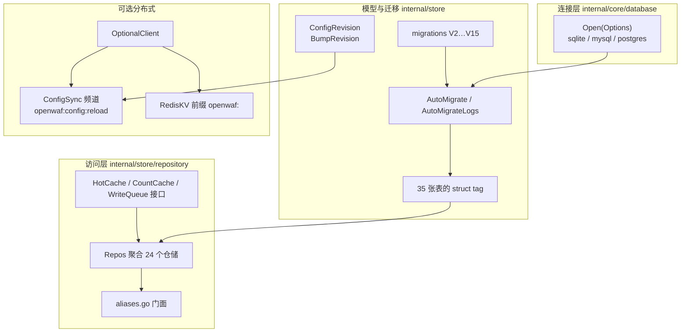
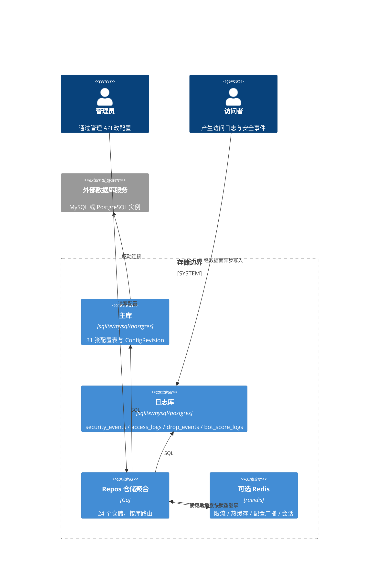
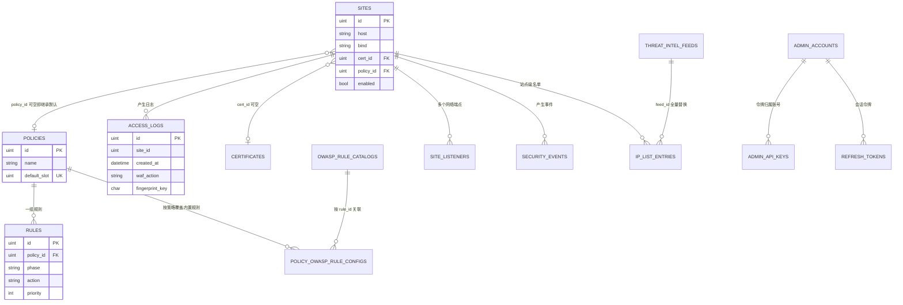
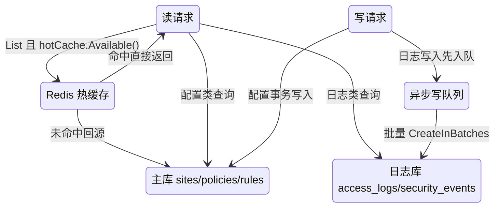
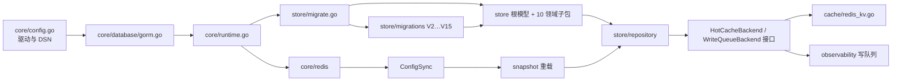
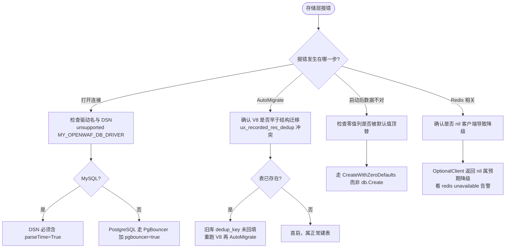

# 数据存储层

<cite>
**本文档引用的文件**
- [internal/store/migrate.go](file://internal/store/migrate.go)
- [internal/store/site.go](file://internal/store/site.go)
- [internal/store/policy.go](file://internal/store/policy.go)
- [internal/store/certificate.go](file://internal/store/certificate.go)
- [internal/store/system.go](file://internal/store/system.go)
- [internal/store/events.go](file://internal/store/events.go)
- [internal/store/protection.go](file://internal/store/protection.go)
- [internal/store/zero_defaults.go](file://internal/store/zero_defaults.go)
- [internal/store/auth/auth.go](file://internal/store/auth/auth.go)
- [internal/store/auth/seed.go](file://internal/store/auth/seed.go)
- [internal/store/iplist/ip_list.go](file://internal/store/iplist/ip_list.go)
- [internal/store/migrations/single_site.go](file://internal/store/migrations/single_site.go)
- [internal/store/repository/repository.go](file://internal/store/repository/repository.go)
- [internal/core/database/gorm.go](file://internal/core/database/gorm.go)
- [internal/core/runtime.go](file://internal/core/runtime.go)
- [internal/core/config.go](file://internal/core/config.go)
- [internal/core/redis/redis.go](file://internal/core/redis/redis.go)
- [internal/core/redis/pubsub.go](file://internal/core/redis/pubsub.go)
- [internal/cache/redis_kv.go](file://internal/cache/redis_kv.go)
- [go.mod](file://go.mod)
- [README.md](file://README.md)
- [internal/cache/hot_cache.go](file://internal/cache/hot_cache.go)
- [internal/observability/unified_writer.go](file://internal/observability/unified_writer.go)
- [internal/store/access/access_control.go](file://internal/store/access/access_control.go)
- [internal/store/approute/app_route.go](file://internal/store/approute/app_route.go)
- [internal/store/cve/cve.go](file://internal/store/cve/cve.go)
- [internal/store/falsepositive/false_positive.go](file://internal/store/falsepositive/false_positive.go)
- [internal/store/js_plugin.go](file://internal/store/js_plugin.go)
- [internal/store/luaplugin/lua_plugin.go](file://internal/store/luaplugin/lua_plugin.go)
- [internal/store/migrations/access_control.go](file://internal/store/migrations/access_control.go)
- [internal/store/migrations/access_log_fingerprint_key.go](file://internal/store/migrations/access_log_fingerprint_key.go)
- [internal/store/migrations/api_key_owner.go](file://internal/store/migrations/api_key_owner.go)
- [internal/store/migrations/default_policy.go](file://internal/store/migrations/default_policy.go)
- [internal/store/migrations/recorded_resource_dedup_key.go](file://internal/store/migrations/recorded_resource_dedup_key.go)
- [internal/store/migrations/recorded_resource_query_string.go](file://internal/store/migrations/recorded_resource_query_string.go)
- [internal/store/migrations/rule_execution_params.go](file://internal/store/migrations/rule_execution_params.go)
- [internal/store/migrations/rule_phase.go](file://internal/store/migrations/rule_phase.go)
- [internal/store/migrations/security_event_rule_info.go](file://internal/store/migrations/security_event_rule_info.go)
- [internal/store/migrations/site_antireplay_inheritance.go](file://internal/store/migrations/site_antireplay_inheritance.go)
- [internal/store/migrations/site_tls_inheritance_defaults.go](file://internal/store/migrations/site_tls_inheritance_defaults.go)
- [internal/store/migrations/site_tls_min_version_inheritance.go](file://internal/store/migrations/site_tls_min_version_inheritance.go)
- [internal/store/owasp/owasp.go](file://internal/store/owasp/owasp.go)
- [internal/store/repository/access_log.go](file://internal/store/repository/access_log.go)
- [internal/store/repository/aliases.go](file://internal/store/repository/aliases.go)
- [internal/store/repository/drop_event.go](file://internal/store/repository/drop_event.go)
- [internal/store/repository/rule.go](file://internal/store/repository/rule.go)
- [internal/store/repository/security_event.go](file://internal/store/repository/security_event.go)
- [internal/store/repository/site/site.go](file://internal/store/repository/site/site.go)
- [internal/store/threatintel/threat_intel.go](file://internal/store/threatintel/threat_intel.go)
- [internal/waf/accessgate/store_redis.go](file://internal/waf/accessgate/store_redis.go)
- [internal/waf/ratelimit/redis.go](file://internal/waf/ratelimit/redis.go)
</cite>

> **子页面索引**

**按主题分类**

- **数据库基础配置**
  - [GORM 配置与使用](GORM%20配置与使用.md) — GORM 初始化、连接池、日志、事务与零值默认回写。
  - [多数据库支持](多数据库支持.md) — SQLite、MySQL、PostgreSQL 驱动选择、DSN 校验与方言差异。
- **数据模型与访问**
  - [数据库模型设计](数据库模型设计.md) — 实体关系、字段规范、索引策略与三态覆盖语义。
  - [数据访问层设计](数据访问层设计.md) — `Repos` 聚合、门面别名、缓存与写队列注入。
- **缓存与分布式**
  - [Redis 集成](Redis%20集成.md) — 可选客户端、配置重载广播、分布式限流与热缓存键空间。
- **数据迁移与演进**
  - [数据迁移管理](数据迁移管理.md) — 版本化迁移顺序、幂等守卫与种子数据。

## 目录

1. [简介](#简介)
2. [项目结构](#项目结构)
3. [核心组件](#核心组件)
4. [架构总览](#架构总览)
5. [详细组件分析](#详细组件分析)
6. [依赖关系分析](#依赖关系分析)
7. [性能考虑](#性能考虑)
8. [故障排查指南](#故障排查指南)
9. [结论](#结论)
10. [附录](#附录)

## 简介

数据存储层承担 My-OpenWaf 全部持久化职责，向上为控制面（管理 API）与数据面（请求处理）提供统一的数据读写入口，向下屏蔽 SQLite、MySQL、PostgreSQL 三种方言差异。它由四个边界清晰的子域组成：连接与方言（`internal/core/database`）、领域模型与迁移（`internal/store` 及其 10 个领域子包与 `migrations`）、数据访问（`internal/store/repository`）、可选分布式状态（`internal/core/redis` 与 `internal/cache`）。

本层的设计目标是：**主库与日志库物理分离**、**表结构演进全程幂等**、**站点级配置以三态表达继承关系**、**Redis 完全可选且故障不阻断主链路**。本篇作为该域索引，给出表清单、模型关系与迁移全景，细节由六份子文档展开。

## 项目结构

存储层代码分布在四个目录，职责互不重叠：连接工厂不感知模型，模型不感知驱动，仓储不感知缓存实现，Redis 不感知 SQL。

| 模块 | 路径 | 非测试行数 | 职责 | 关键入口 |
|------|------|:----------:|------|----------|
| 连接与方言 | `internal/core/database/` | 310 | 按驱动打开 GORM 句柄、连接池调优、DSN 脱敏 | `Open`（`gorm.go:30`） |
| 领域模型 | `internal/store/`（根 12 文件） | 2347 | 结构体与表标签、AutoMigrate 清单、修订号 | `AutoMigrate`（`migrate.go:22`） |
| 领域子包 | `internal/store/{auth,access,approute,cve,owasp,iplist,luaplugin,threatintel,falsepositive,upstream}` | 742 | 按领域拆分的模型与常量 | 各包 `type Xxx struct` |
| 版本化迁移 | `internal/store/migrations/` | 1074 | 15 个 `Vn` 函数，数据修复与索引重建 | `V2`…`V15` |
| 数据访问 | `internal/store/repository/`（11 文件 + 12 子包） | 5042 | 仓储聚合、门面别名、缓存与写队列 | `NewWithLogDB`（`repository.go:60`） |
| Redis 状态 | `internal/core/redis/` | 174 | 可选客户端、配置重载发布订阅 | `OptionalClient`、`ConfigSync` |

技术栈版本取自 `go.mod` 实测，而非经验值：

| 组件 | 依赖 | 版本 | go.mod 位置 | 说明 |
|------|------|------|:-----------:|------|
| ORM | `gorm.io/gorm` | v1.31.2 | `go.mod:37` | 直接依赖 |
| SQLite 驱动 | `github.com/glebarez/sqlite` | v1.11.0 | `go.mod:14` | 纯 Go，无 cgo |
| SQLite 内核 | `modernc.org/sqlite` | v1.60.1 | `go.mod:76` | 间接依赖 |
| MySQL 驱动 | `gorm.io/driver/mysql` | v1.6.0 | `go.mod:35` | 底层 `go-sql-driver/mysql v1.10.1`（`go.mod:15`） |
| PostgreSQL 驱动 | `gorm.io/driver/postgres` | v1.6.3 | `go.mod:36` | 底层 `pgx/v5 v5.11.0` |
| Redis 客户端 | `github.com/redis/rueidis` | v1.0.78 | `go.mod:23` | 单客户端，禁用内置响应缓存 |
| 进程内缓存 | `github.com/dgraph-io/ristretto` | v0.2.0 | `go.mod:11` | 仅用于快照层 |
| 语言版本 | Go | 1.27.2 | `go.mod:3` | 工具链要求 |



**图表来源**
- [internal/core/database/gorm.go:30-71](file://internal/core/database/gorm.go#L30-L71)
- [internal/store/migrate.go:22-139](file://internal/store/migrate.go#L22-L139)
- [internal/store/repository/repository.go:28-103](file://internal/store/repository/repository.go#L28-L103)
- [internal/store/repository/aliases.go:20-33](file://internal/store/repository/aliases.go#L20-L33)
- [internal/core/redis/redis.go:18-34](file://internal/core/redis/redis.go#L18-L34)
- [internal/core/redis/pubsub.go:16-82](file://internal/core/redis/pubsub.go#L16-L82)

**章节来源**
- [internal/core/database/gorm.go:21-71](file://internal/core/database/gorm.go#L21-L71)
- [internal/store/migrate.go:22-139](file://internal/store/migrate.go#L22-L139)
- [internal/store/repository/repository.go:28-103](file://internal/store/repository/repository.go#L28-L103)
- [internal/store/repository/aliases.go:20-33](file://internal/store/repository/aliases.go#L20-L33)
- [go.mod:3-37](file://go.mod#L3-L37)

## 核心组件

组件清单按「一个组件只做一件事」划分：打开连接、描述表、演化表、读写行、跨节点同步，五者互不依赖具体实现。

| 组件 | 类型 | 定义位置 | 承担职责 | 依赖方向 |
|------|------|----------|----------|----------|
| `Options` | 结构体 | `gorm.go:22` | 承载驱动、DSN、数据目录与日志库标记 | 无外部依赖，避免与 `core` 形成导入环 |
| `Open` | 函数 | `gorm.go:30` | 三方言分支、连接池调优、错误脱敏 | → 三个驱动包 |
| `AutoMigrate` | 函数 | `migrate.go:22` | 先数据迁移后结构迁移，共 31 张表 | → `migrations`、10 个领域子包 |
| `AutoMigrateLogs` | 函数 | `migrate.go:126` | 日志库 4 张表 + V12/V13 | → `migrations` |
| `BumpRevision` | 函数 | `migrate.go:141` | 单行修订号自增，快照一致性锚点 | → `ConfigRevision` |
| `SeedDefaults` | 函数 | `auth/seed.go:26` | 仅首次运行创建 `admin` 账号 | → `AdminAccount` |
| `Repos` | 聚合结构体 | `repository.go:29` | 持有 24 个仓储，按库路由 | → 各仓储 |
| `NewWithLogDB` | 函数 | `repository.go:60` | 日志类仓储绑定 LogDB，其余绑定主库 | → `Repos` |
| `WriteQueueBackend` | 接口 | `repository.go:11` | 异步写入契约，规避 `observability` 导入环 | 被仓储实现依赖 |
| `HotCacheBackend` | 接口 | `repository.go:18` | Redis 读穿透契约，规避 `cache` 导入环 | 被仓储实现依赖 |
| `OptionalClient` | 函数 | `redis/redis.go:18` | 地址为空返回 nil，Redis 全程可选 | → `rueidis` |
| `ConfigSync` | 结构体 | `pubsub.go:29` | 发布/订阅配置重载，回环抑制 | → `OptionalClient` |
| `RedisKV` | 结构体 | `redis_kv.go:28` | 键前缀、TTL、原子自增、熔断回退 | → `rueidis` |

站点模型的三态覆盖是本层最容易写错的部分，字段表如下（`nil` 一律表示「继承全局」，不得存成 `false`）：

| 字段 | Go 类型 | 列名与默认 | DB 约束 | 三态语义 |
|------|---------|-----------|:-------:|----------|
| `BotProtectionEnabled` | `*bool` | `bot_protection_enabled`，`default:null` | 可空 | nil 继承 / true 开 / false 关 |
| `AntiReplayEnabled` | `*bool` | `anti_replay_enabled`，`default:null` | 可空 | 同上；V11 把历史 `false` 洗成 NULL |
| `ChallengeAction` | `*string` | `challenge_action`，`default:null` | 可空 | nil 继承全局质询动作 |
| `SiteCaptchaType` | `*string` | `site_captcha_type`，`default:null` | 可空 | nil 继承全局验证码类型 |
| `OWASPEnabled` | `*bool` | `owasp_enabled`，`default:null` | 可空 | 同上；档位 `OWASPSensitivity` 为普通 string |
| `CVEEnabled` | `*bool` | `cve_enabled`，`default:null` | 可空 | 同上 |
| `RateLimitEnabled` | `*bool` | `rate_limit_enabled`，`default:null` | 可空 | 同上；`RateLimitWindow`/`Max` 默认 0 |
| `SkipPathByPhase` | `*string` | `skip_path_by_phase`，`type:text` | 可空 | nil 继承 / `"{}"` 覆盖为空 / 非空 JSON 覆盖 |
| `AntiReplayCookieMode` | `*string` | `anti_replay_cookie_mode`，`default:null` | 可空 | nil 继承 `standard` 或 `dual` |
| `DynamicProtectionEnabled` | `*bool` | `dynamic_protection_enabled` | 可空 | 无 DB 默认值，靠 Go 侧 nil 判定 |
| `CCUseCustom` | `*bool` | `cc_use_custom` | 可空 | nil 继承全局 CC 规则 |
| `CertID` / `PolicyID` | `*uint` | `cert_id` / `policy_id` | 可空 | nil 表示未关联，非零外键 |

**章节来源**
- [internal/core/database/gorm.go:21-30](file://internal/core/database/gorm.go#L21-L30)
- [internal/store/migrate.go:22-160](file://internal/store/migrate.go#L22-L160)
- [internal/store/auth/seed.go:26-56](file://internal/store/auth/seed.go#L26-L56)
- [internal/store/site.go:59-91](file://internal/store/site.go#L59-L91)
- [internal/store/site.go:130-141](file://internal/store/site.go#L130-L141)
- [internal/store/repository/repository.go:11-60](file://internal/store/repository/repository.go#L11-L60)

## 架构总览

启动链路中存储层的落点固定为四步，顺序不可交换（`internal/app/server.go` 的 `Run` 第 249、261、267、301 步）：打开主库 → `store.AutoMigrate` → 打开日志库并 `store.AutoMigrateLogs` → `auth.SeedDefaults` → `repository.NewWithLogDB`。

下图给出跨系统的存储上下文：谁写主库、谁写日志库、谁读缓存。



**图表来源**
- [internal/store/migrate.go:22-139](file://internal/store/migrate.go#L22-L139)
- [internal/store/repository/repository.go:60-90](file://internal/store/repository/repository.go#L60-L90)
- [internal/core/runtime.go:63-97](file://internal/core/runtime.go#L63-L97)
- [internal/core/redis/pubsub.go:16-82](file://internal/core/redis/pubsub.go#L16-L82)

主库与日志库共用同一驱动但各自持有独立连接池，日志库通过 `Options.LogDB` 切换 PRAGMA 组合，这是「高频追加不拖慢配置读写」的关键。

**章节来源**
- [internal/core/runtime.go:63-97](file://internal/core/runtime.go#L63-L97)
- [internal/core/database/gorm.go:22-95](file://internal/core/database/gorm.go#L22-L95)
- [internal/store/migrate.go:126-139](file://internal/store/migrate.go#L126-L139)

## 详细组件分析

### 数据表全景

全库共 35 张表：主库 31 张由 `AutoMigrate` 清单建立（`migrate.go:52-89`），日志库 4 张由 `AutoMigrateLogs` 建立（`migrate.go:127-133`）。表名由 GORM 默认命名策略从结构体名推出，5 个模型显式覆盖了 `TableName`（`js_plugins`、`lua_plugins`、`cve_rules`、`application_route_rules`、`recorded_resources`）。

| 表名 | 模型 | 定义位置:行 | 主键 | 关键索引 | 写入方 |
|------|------|-------------|------|----------|--------|
| `certificates` | `Certificate` | `certificate.go:19` | `id` | `deleted_at` | `CertificateRepo.Create/UpdateCert` |
| `policies` | `Policy` | `policy.go:10` | `id` | `ux_policies_default_slot` 唯一 | `PolicyRepo.SetDefault`、V9 |
| `rules` | `Rule` | `policy.go:70` | `id` | `policy_id`、`phase`、`deleted_at` | `RuleRepo.Create/BatchCreate` |
| `sites` | `Site` | `site.go:38` | `id` | `host`、`bind`、`listener_id`、`deleted_at` | `SiteRepo.Create`（零值回写） |
| `site_listeners` | `SiteListener` | `site.go:248` | `id` | `site_id`、`bind`、`deleted_at` | `SiteListenerRepo.Create` |
| `system_settings` | `SystemSettings` | `system.go:4` | `id` | `key` 唯一 | `SystemSettingsRepo.Set` |
| `config_revisions` | `ConfigRevision` | `system.go:31` | `id` | — | `BumpRevision`（单行 id=1） |
| `admin_accounts` | `auth.AdminAccount` | `auth/auth.go:28` | `id` | `username` 唯一 | `SeedDefaults`、`AdminAccountRepo.Create` |
| `admin_api_keys` | `auth.AdminAPIKey` | `auth/auth.go:15` | `id` | `user_id`、`prefix`、`deleted_at` | `AdminAPIKeyRepo.Create`、V15 回填 |
| `refresh_tokens` | `auth.RefreshToken` | `auth/auth.go:38` | `id` | `jti` 唯一 | `RefreshTokenRepo.Create/Rotate` |
| `token_blacklists` | `auth.TokenBlacklist` | `auth/auth.go:51` | `id` | `jti` 唯一、`expires_at` | 吊销与强制下线 |
| `login_attempts` | `auth.LoginAttempt` | `auth/auth.go:60` | `id` | `username`、`ip`、`created_at` | 登录失败计数 |
| `active_sessions` | `auth.ActiveSession` | `auth/auth.go:70` | `id` | `jti` 唯一、`refresh_jti` | 会话管理 |
| `owasp_rule_catalogs` | `owasp.OWASPRuleCatalog` | `owasp/owasp.go:5` | `id` | `rule_id` 唯一、`active+category+rule_id` | 目录对账器 |
| `policy_owasp_rule_configs` | `owasp.PolicyOWASPRuleConfig` | `owasp/owasp.go:23` | `id` | `ux_policy_owasp_rule` 唯一 | 策略级规则覆盖 |
| `cve_rules` | `cve.CVERuleRecord` | `cve/cve.go:10` | `id` | `cve_id`、`deleted_at` | `CVERuleRepo`、NVD/GitHub feed |
| `cve_rule_scope_overrides` | `cve.CVERuleScopeOverride` | `cve/cve_scope.go:12` | `id` | `ux_cve_rule_scope` 三列唯一 | 作用域覆盖写接口 |
| `cve_sync_logs` | `cve.CVESyncLog` | `cve/cve.go:38` | `id` | — | `CVESyncLogRepo.Create` |
| `ip_list_entries` | `iplist.IPListEntry` | `iplist/ip_list.go:17` | `id` | `kind`、`value`、`site_id`、`feed_id` | `IPListRepo`、情报源全量替换 |
| `application_route_rules` | `approute.ApplicationRouteRule` | `approute/app_route.go:39` | `id` | `site_id`、`deleted_at` | `ApplicationRouteRuleRepo` |
| `recorded_resources` | `approute.RecordedResource` | `approute/app_route.go:58` | `id` | `ux_recorded_res_dedup` 唯一、`last_seen` | `RecordedResourceRepo.Upsert` |
| `site_access_configs` | `access.SiteAccessConfig` | `access/access_control.go:20` | `id` | `site_id` 唯一 | `AccessControlRepo.SaveSiteAccessConfig` |
| `access_providers` | `access.AccessProvider` | `access/access_control.go:33` | `id` | `site_id` | `AccessControlRepo` |
| `access_users` | `access.AccessUser` | `access/access_control.go:47` | `id` | `ux_access_user_site_name` 唯一 | `AccessControlRepo` |
| `access_path_rules` | `access.AccessPathRule` | `access/access_control.go:59` | `id` | `site_id` | `AccessControlRepo` |
| `access_sessions` | `access.AccessSession` | `access/access_control.go:72` | `id` | `token` 唯一、`expires_at` | V7 建表；会话落库 |
| `threat_intel_feeds` | `threatintel.ThreatIntelFeed` | `threatintel/threat_intel.go:12` | `id` | `site_id` | `ThreatIntelRepo` |
| `threat_intel_sync_logs` | `threatintel.ThreatIntelSyncLog` | `threatintel/threat_intel_sync_log.go:11` | `id` | `feed_id`、`success`、`trigger` | `ThreatIntelSyncLogRepo.Create` |
| `false_positive_reports` | `falsepositive.FalsePositiveReport` | `falsepositive/false_positive.go:16` | `id` | `idx_false_positive_source_event_key` 唯一 | `FalsePositiveRepo.CreateOrGetBySourceEvent` |
| `lua_plugins` | `luaplugin.LuaPlugin` | `luaplugin/lua_plugin.go:18` | `id` | `stage`、`site_id`、`deleted_at` | `LuaPluginRepo.Create` |
| `js_plugins` | `JSPlugin` | `js_plugin.go:25` | `id` | `stage`、`site_id`、`deleted_at` | `JSPluginRepo.Create` |
| `security_events` | `SecurityEvent` | `events.go:15` | `id` | `idx_se_site_created_id`、`idx_se_action`、`idx_se_category` | `SecurityEventRepo.BatchCreate`、统一写入器 |
| `access_logs` | `AccessLog` | `events.go:79` | `id` | `idx_al_site_created_id`、`idx_al_fingerprint_key` | `AccessLogRepo.BatchCreate`、统一写入器 |
| `drop_events` | `DropEvent` | `events.go:238` | `id` | `idx_drop_source_created` | `DropEventRepo.Create/BatchCreate` |
| `bot_score_logs` | `BotScoreLog` | `events.go:251` | `id` | `total_score`、`tls_ja4`、`created_at` | `BotScoreRepo.BatchCreate` |

主库建表与索引的真实 DDL 形态（SQLite 方言，取自 `AutoMigrate` 产物）：

```sql
-- internal/store/policy.go:70 的 Rule 模型生成
CREATE TABLE `rules` (
  `id` integer PRIMARY KEY AUTOINCREMENT,
  `policy_id` integer NOT NULL,
  `phase` text NOT NULL,
  `pattern` text NOT NULL,
  `action` text NOT NULL,
  `priority` integer DEFAULT 100,
  `enabled` numeric DEFAULT true,
  `window_seconds` integer DEFAULT 0,
  `request_count` integer DEFAULT 0,
  `captcha_minutes` integer DEFAULT 0
);
CREATE INDEX `idx_rules_policy_id` ON `rules`(`policy_id`);
CREATE INDEX `idx_rules_phase` ON `rules`(`phase`);

-- approute/app_route.go:75 的定长摘要唯一索引，替代 MySQL 撑不住的五列复合索引
CREATE TABLE `recorded_resources` (`dedup_key` char(64), `site_id` integer NOT NULL);
CREATE UNIQUE INDEX `ux_recorded_res_dedup` ON `recorded_resources`(`dedup_key`);
```

**章节来源**
- [internal/store/migrate.go:52-89](file://internal/store/migrate.go#L52-L89)
- [internal/store/migrate.go:127-133](file://internal/store/migrate.go#L127-L133)
- [internal/store/site.go:38-147](file://internal/store/site.go#L38-L147)
- [internal/store/policy.go:70-97](file://internal/store/policy.go#L70-L97)
- [internal/store/certificate.go:19-39](file://internal/store/certificate.go#L19-L39)
- [internal/store/system.go:4-34](file://internal/store/system.go#L4-L34)

### 实体关系与继承链

配置侧以 `Site` 为聚合根，运行日志侧以 `SiteID` 弱关联（无外键约束，靠归档与查询约定），证书与策略均为可复用独立实体。



**图表来源**
- [internal/store/site.go:38-147](file://internal/store/site.go#L38-L147)
- [internal/store/site.go:248-261](file://internal/store/site.go#L248-L261)
- [internal/store/policy.go:10-97](file://internal/store/policy.go#L10-L97)
- [internal/store/certificate.go:19-39](file://internal/store/certificate.go#L19-L39)
- [internal/store/owasp/owasp.go:5-38](file://internal/store/owasp/owasp.go#L5-L38)
- [internal/store/iplist/ip_list.go:17-30](file://internal/store/iplist/ip_list.go#L17-L30)

关系建模有三个刻意选择：`Site.PolicyID` 用 `*uint` 而非外键，使「未指定」与「指向 1 号策略」可区分；`SiteListener` 与 `Site` 双写 `bind`，V2 之后 `Site.Bind` 仍是路由权威；`recorded_resources` 只靠 `dedup_key` 唯一索引去重，避免 MySQL 索引键长度上限。

**章节来源**
- [internal/store/site.go:59-91](file://internal/store/site.go#L59-L91)
- [internal/store/approute/app_route.go:63-75](file://internal/store/approute/app_route.go#L63-L75)
- [internal/store/migrations/single_site.go:46-76](file://internal/store/migrations/single_site.go#L46-L76)

### 连接与驱动选择

`Open` 只暴露一个入口，日志库不是第二个函数：主库与日志库都调用 `database.Open`，差异由 `Options.LogDB` 表达（`runtime.go:88-93` 传 `LogDB: true`）。

| 能力 | sqlite | mysql | postgres | 差异说明 |
|------|:------:|:-----:|:--------:|----------|
| 空 DSN 回退 | ✓ | ✗ | ✗ | SQLite 落到 `DataDir/waf.db`（`gorm.go:74-77`），另两方言缺 DSN 直接报错 |
| DSN 强制校验 | — | ✓ | ✗ | MySQL 必须含 `parseTime=True`（`gorm.go:123-125`） |
| 连接池显式调优 | 8 连接 | ✓ | ✓ | 非 SQLite 固定 25/10/30m/5m（`gorm.go:63-66`） |
| WAL 与 PRAGMA | ✓ | — | — | 主库与日志库 PRAGMA 组合不同（`gorm.go:89-95`） |
| PgBouncer 兼容 | — | — | ✓ | DSN 含 `pgbouncer=true` 时切简单协议（`gorm.go:157-159`） |
| 重命名索引/列 | — | ✓ | ✓ | `DontSupportRenameIndex/Column` 显式置 false（`gorm.go:129-130`） |
| DSN 口令脱敏 | ✓ | ✓ | ✓ | URL 形态与关键字形态双路遮蔽（`gorm.go:162-199`） |

```bash
# 三方言的启动配置，口令一律占位
export MY_OPENWAF_DB_DRIVER=sqlite
export MY_OPENWAF_DSN=/app/data/waf.db
export MY_OPENWAF_LOG_DSN=/app/data/waf_logs.db

export MY_OPENWAF_DB_DRIVER=mysql
export MY_OPENWAF_DSN='{user}:{password}@tcp({host}:{port})/openwaf?charset=utf8mb4&parseTime=True&loc=Local'

export MY_OPENWAF_DB_DRIVER=postgres
export MY_OPENWAF_DSN='postgres://{user}:{password}@{host}:{port}/openwaf?sslmode=disable&pgbouncer=true'
```

**章节来源**
- [internal/core/database/gorm.go:22-95](file://internal/core/database/gorm.go#L22-L95)
- [internal/core/database/gorm.go:115-159](file://internal/core/database/gorm.go#L115-L159)
- [internal/core/runtime.go:63-97](file://internal/core/runtime.go#L63-L97)
- [internal/core/config.go:334-360](file://internal/core/config.go#L334-L360)
- [README.md:314-322](file://README.md#L314-L322)

### 迁移与版本演进

迁移分为两类：`migrations` 包内的 15 个具名 `Vn` 函数负责数据修复与索引重建，GORM `AutoMigrate` 负责按 struct tag 增列建表。两者由 `AutoMigrate` 统一编排，顺序即语义。

| 版本 | 文件:行 | 变更对象 | 是否幂等 |
|:----:|---------|----------|:--------:|
| V2 | `single_site.go:10` | `listeners`/`forwarding_profiles` 并入 `sites`，旧表改名带时间戳备份 | ✓ 以 `HasTable("listeners")` 守卫 |
| V3 | `rule_phase.go:13` | 历史不可执行 phase 改写为 `custom` | ✓ 重复执行为无操作 |
| V4 | `recorded_resource_query_string.go:11` | 新增 `query_string` 并回填空串，删除旧五列索引 | ✓ `HasColumn`/`HasIndex` 守卫 |
| V5 | `site_tls_inheritance_defaults.go:12` | 按方言删除 `min_tls_version` 等列的表结构默认值 | ✓ sqlite 直接返回 |
| V6 | `site_tls_min_version_inheritance.go:15` | 把 `TLS12` 洗成空串并写 `system_settings` 标记 | ✓ 标记行只执行一次 |
| V7 | `access_control.go:77` | 建 5 张访问控制表及索引 | ✓ 全量 `AutoMigrate` |
| V8 | `recorded_resource_dedup_key.go:60` | 新增 `dedup_key`、回填摘要、剔除重复行、删旧索引 | ✓ `HasColumn` 守卫 |
| V9 | `default_policy.go:23` | 释放软删策略占用的默认槽、补建默认策略、修复孤儿 `policy_id` | ✓ 事务内幂等 |
| V10 | `site_xff_mode.go:11` | 非法 `xff_mode` 归一到 `strip_all_and_set_remote` | ✓ 重复无副作用 |
| V11 | `site_antireplay_inheritance.go:14` | 把 `false` 洗成 NULL 以表达继承，写标记行 | ✓ 标记行守卫 |
| V12 | `access_log_fingerprint_key.go:41` | 新增 `fingerprint_key` 与索引，按 keyset 分批回填 | ✓ 表不存在直接返回 |
| V13 | `security_event_rule_info.go:34`、`:64` | `security_events` 补 10 列规则解释字段；`cve_rules` 补 `references` | ✓ 逐列 `HasColumn` |
| V14 | `rule_execution_params.go:31` | `rules` 补 `window_seconds`/`request_count`/`captcha_minutes` | ✓ 默认零值无需回填 |
| V15 | `api_key_owner.go:21` | 把 `user_id = 0` 的历史令牌回填到最小 id 的 admin 账号 | ✓ 只改 0 值行 |

V6 与 V11 在结构迁移前后各执行一次（`migrate.go:39-44` 与 `migrate.go:120-123`），原因是二者都依赖 `system_settings` 标记表，而旧库在该阶段可能还没有这张表。

```go
// internal/store/migrate.go:141-160：修订号自增是快照一致性的唯一锚点
func BumpRevision(db *gorm.DB) error {
	seed := ConfigRevision{ID: 1, Revision: 0}
	if err := db.Clauses(clause.OnConflict{
		Columns:   []clause.Column{{Name: "id"}},
		DoNothing: true,
	}).Create(&seed).Error; err != nil {
		return err
	}
	result := db.Model(&ConfigRevision{}).
		Where("id = ?", seed.ID).
		UpdateColumn("revision", gorm.Expr("revision + ?", 1))
	if result.Error != nil {
		return result.Error
	}
	if result.RowsAffected != 1 {
		return fmt.Errorf("config revision row %d was not updated", seed.ID)
	}
	return nil
}
```

**章节来源**
- [internal/store/migrate.go:22-139](file://internal/store/migrate.go#L22-L139)
- [internal/store/migrations/single_site.go:10-76](file://internal/store/migrations/single_site.go#L10-L76)
- [internal/store/migrations/rule_phase.go:13-26](file://internal/store/migrations/rule_phase.go#L13-L26)
- [internal/store/migrations/recorded_resource_query_string.go:11-38](file://internal/store/migrations/recorded_resource_query_string.go#L11-L38)
- [internal/store/migrations/site_tls_inheritance_defaults.go:12-55](file://internal/store/migrations/site_tls_inheritance_defaults.go#L12-L55)
- [internal/store/migrations/site_tls_min_version_inheritance.go:15-50](file://internal/store/migrations/site_tls_min_version_inheritance.go#L15-L50)

### 仓储聚合与读写路由

`Repos` 是 24 个仓储的唯一持有者，`NewWithLogDB` 决定每个仓储绑哪条连接：4 个日志类仓储绑 LogDB，其余绑主库；`logDB == nil` 时退化为同库，这是单测与嵌入式部署的常见形态。



**图表来源**
- [internal/store/repository/repository.go:60-103](file://internal/store/repository/repository.go#L60-L103)
- [internal/store/repository/access_log.go:47-75](file://internal/store/repository/access_log.go#L47-L75)
- [internal/store/repository/security_event.go:109-160](file://internal/store/repository/security_event.go#L109-L160)
- [internal/store/repository/drop_event.go:49-89](file://internal/store/repository/drop_event.go#L49-L89)

三个横切能力都以接口形式声明在 `repository.go`，避免与 `cache`、`observability` 形成导入环：`WriteQueueBackend`（`repository.go:11`）、`HotCacheBackend`（`repository.go:18`）、`CountCache`（`access_log.go:26`）。

**章节来源**
- [internal/store/repository/repository.go:11-103](file://internal/store/repository/repository.go#L11-L103)
- [internal/store/repository/site/site.go:13-107](file://internal/store/repository/site/site.go#L13-L107)
- [internal/store/repository/rule.go:30-66](file://internal/store/repository/rule.go#L30-L66)

### Redis 可选状态层

Redis 不参与任何事务，全部用途都是「可降级」：客户端为 nil 时限流回退本地桶，热缓存跳过，配置广播不发送。完整键空间见 [Redis 集成](Redis%20集成.md)，此处只列跨组件复用的主干。

| 键前缀 | 数据结构 | TTL | 使用方:行 |
|--------|----------|-----|-----------|
| `openwaf:config:reload` | Pub/Sub 频道 | 无 | `pubsub.go:16`、`Publish` :79 |
| `openwaf:` + 自定义键 | String（SET/GET/INCR/EXISTS） | 调用方传入，操作超时 1s | `redis_kv.go:16`、`:107-158` |
| `openwaf:hot:` + 列表键 | String（JSON 列表 + total） | 列表 5s、指纹结果 5s | `hot_cache.go:39`、`security_event.go:114-157` |
| `openwaf:request:rl:` + 限流键 | ZSET（滑动窗口 Lua） | `window + 1` 秒 | `ratelimit/redis.go:130-138`，前缀由 `server.go:383` 注入 |
| `openwaf:error:rl:` + 限流键 | ZSET | `window + 1` 秒 | `ratelimit/redis.go:130-191`，前缀由 `server.go:384` 注入 |
| `openwaf:security_events` | LIST（LPUSH + LTRIM 99999） | 7 天 | `unified_writer.go:1130` |
| `openwaf:access_logs` / `:drop_events` / `:bot_scores` | LIST（`LTRIM` 99999 / 49999） | 7 天 | `unified_writer.go:1137`、`:1144`、`:1151` |
| `owaf:access:session:` + token | String（会话 JSON） | `PX` 到会话过期时刻，操作超时 100ms | `accessgate/store_redis.go:16`、`:136` |
| `owaf:access:oauth-state:` + state | String（一次性，Lua 取后即删） | `PX` 到 state 过期 | `accessgate/store_redis.go:17`、`:400` |
| `owaf:captcha:` / `:shield:` / `:chain:` + 会话 ID | String | 分别 120 秒 / `TimeoutSecs` / 10 分钟 | `challenge/captcha.go:207`、`shield.go:200`、`chain.go:74` |

**章节来源**
- [internal/core/redis/redis.go:11-42](file://internal/core/redis/redis.go#L11-L42)
- [internal/core/redis/pubsub.go:16-132](file://internal/core/redis/pubsub.go#L16-L132)
- [internal/cache/redis_kv.go:15-217](file://internal/cache/redis_kv.go#L15-L217)
- [internal/cache/hot_cache.go:38-53](file://internal/cache/hot_cache.go#L38-L53)
- [internal/waf/ratelimit/redis.go:22-192](file://internal/waf/ratelimit/redis.go#L22-L192)
- [internal/observability/unified_writer.go:1094-1152](file://internal/observability/unified_writer.go#L1094-L1152)

## 依赖关系分析

存储层内部依赖严格单向：`core/database` 不引用模型，`store` 不引用驱动实现，`repository` 通过接口引用缓存与写队列，`migrations` 为避免导入环重复声明了轻量表结构。



**图表来源**
- [internal/core/runtime.go:63-141](file://internal/core/runtime.go#L63-L141)
- [internal/store/migrate.go:1-19](file://internal/store/migrate.go#L1-L19)
- [internal/store/repository/repository.go:9-26](file://internal/store/repository/repository.go#L9-L26)
- [internal/store/migrations/recorded_resource_dedup_key.go:15-26](file://internal/store/migrations/recorded_resource_dedup_key.go#L15-L26)
- [internal/core/redis/pubsub.go:16-82](file://internal/core/redis/pubsub.go#L16-L82)

依赖矩阵（行依赖列）：

| 调用方 | database | store 模型 | migrations | repository | core/redis | cache |
|--------|:--------:|:----------:|:----------:|:----------:|:----------:|:-----:|
| `core/runtime.go` | ✓ | — | — | — | ✓ | ✓ |
| `store/migrate.go` | — | ✓ | ✓ | — | — | — |
| `store/migrations` | — | ✗（自声明表结构） | — | — | — | — |
| `store/repository` | — | ✓ | — | — | — | ✗（走接口） |
| `admin` 各域 | — | ✓ | — | ✓ | ✓ | ✓ |
| `dataplane` | — | ✓（经快照） | — | — | ✓ | ✓ |

外部实体清单：

| 外部实体 | 用途 | 必需性 | 缺失时行为 |
|----------|------|:------:|------------|
| SQLite 文件 | 默认主库/日志库载体 | 必需 | `mkdir` 失败则启动失败 |
| MySQL / PostgreSQL | 替代主库与日志库 | 可选 | 缺 DSN 或口令报明确错误 |
| Redis | 限流、热缓存、配置广播、会话 | 可选 | `OptionalClient` 返回 nil，全链路降级 |
| bcrypt | 管理员口令哈希 | 必需 | `SeedDefaults` 返回错误并中止 |

**章节来源**
- [internal/core/runtime.go:63-141](file://internal/core/runtime.go#L63-L141)
- [internal/store/migrate.go:1-19](file://internal/store/migrate.go#L1-L19)
- [internal/store/migrations/access_control.go:10-22](file://internal/store/migrations/access_control.go#L10-L22)
- [internal/store/repository/repository.go:9-26](file://internal/store/repository/repository.go#L9-L26)

## 性能考虑

- **问题**：日志与配置同库时，`access_logs` 的高频追加会与站点配置读写争用同一把 SQLite 写锁。
  **优化**：主库与日志库拆成两个 `*gorm.DB`，日志库使用独立 PRAGMA 组合（`foreign_keys(OFF)`、`wal_autocheckpoint(2000)`）。
  **效果**：配置查询不受日志 WAL 膨胀影响，日志侧 checkpoint 频率提高换取 WAL 体积可控。
- **问题**：列表页每页都要 `COUNT(*)`，宽表上代价高。
  **优化**：`CountCache` 按命名空间缓存计数（`al_count:v2`、`se_count:v2`、`de_count`），写后按前缀失效。
  **效果**：翻页只付一次计数成本；命名空间失效避免误清无关缓存。
- **问题**：直接 `db.Create` 会把用户显式设置的 `false`/`0` 覆盖成 struct 默认值。
  **优化**：`CreateWithZeroDefaults` 先快照零值列，插入后显式 `UpdateColumns` 回写（`zero_defaults.go:90-146`）。
  **效果**：停用站点不会立刻对外服务，`priority = 0` 的规则保持抢跑位置。
- **问题**：五列复合唯一索引在 MySQL utf8mb4 下超过 3072 字节上限。
  **优化**：`recorded_resources` 改用 `char(64)` 的 SHA-256 摘要列建唯一索引，`access_logs` 同理使用 `fingerprint_key`。
  **效果**：三方言语义一致，分组查询不再扫描宽文本列。
- **问题**：Redis 抖动会把管理页请求拖成超时链。
  **优化**：`HotCache` 与 `RedisKV` 各自维护熔断窗口（故障后 5 秒内不再访问），所有命令带上下文超时。
  **效果**：Redis 不可用时读路径直接回源数据库，不产生级联等待。

[本节为总结，无需特定文件来源]

## 故障排查指南



**图表来源**
- [internal/core/database/gorm.go:53-125](file://internal/core/database/gorm.go#L53-L125)
- [internal/core/database/gorm.go:157-159](file://internal/core/database/gorm.go#L157-L159)
- [internal/store/migrate.go:45-49](file://internal/store/migrate.go#L45-L49)
- [internal/store/zero_defaults.go:90-146](file://internal/store/zero_defaults.go#L90-L146)
- [internal/core/runtime.go:99-116](file://internal/core/runtime.go#L99-L116)

| 症状 | 根因 | 排查命令 | 方案 |
|------|------|----------|------|
| `mysql DSN must include parseTime=True` | DSN 缺参数，`time.Time` 扫描失败 | `echo "$MY_OPENWAF_DSN"`（脱敏后核对） | 补 `parseTime=True&loc=Local` |
| `prepared statement does not exist` | PgBouncer 事务池 + 服务端预编译 | 连接串是否含 `pgbouncer=true` | 加上该参数切简单协议 |
| `failed to create unique index ux_recorded_res_dedup` | 旧库摘要未回填 | `SELECT count(*) FROM recorded_resources WHERE dedup_key IS NULL OR dedup_key=''` | 先跑 V8 回填再结构迁移 |
| 站点保存后立刻生效但应为停用 | 零值列被默认值顶替 | 核对创建路径是否用 `SiteRepo.Create` | 统一走 `CreateWithZeroDefaults` |
| 三态字段被存成 `false` | 前端把空值当关闭 | 查 `SELECT owasp_enabled FROM sites` 是否为 NULL | 读取端按 nil 继承，写入端不写空串 |
| 快照未重载 | 修订号未自增 | `SELECT revision FROM config_revisions WHERE id=1` | 确认变更后调用 `BumpRevision` |

```bash
# 主库与日志库自检：确认表数量与修订号
sqlite3 data/waf.db "SELECT count(*) FROM sqlite_master WHERE type='table' AND name NOT LIKE 'sqlite_%'"
sqlite3 data/waf.db "SELECT revision FROM config_revisions WHERE id=1"
sqlite3 data/waf_logs.db ".tables"
# 预期：31 / 递增数字 / 四张日志表
```

**章节来源**
- [internal/core/database/gorm.go:115-159](file://internal/core/database/gorm.go#L115-L159)
- [internal/store/migrations/recorded_resource_dedup_key.go:60-83](file://internal/store/migrations/recorded_resource_dedup_key.go#L60-L83)
- [internal/store/zero_defaults.go:90-146](file://internal/store/zero_defaults.go#L90-L146)
- [internal/store/site.go:76-91](file://internal/store/site.go#L76-L91)
- [internal/store/migrate.go:141-168](file://internal/store/migrate.go#L141-L168)

## 结论

存储层用四个小接口把「怎么连、有几张表、表怎么变、谁能读」四件事彻底分开：`Options` 描述连接、struct tag 描述表、`Vn` 函数描述演进、`Repos` 描述访问。KISS 体现在没有第二个建表入口（一切走 `AutoMigrate` 清单）与第二个日志库打开函数（只有 `Options.LogDB` 一个开关）；YAGNI 体现在未引入通用迁移框架与外键约束，改以显式版本函数与幂等守卫；DRY 体现在零值默认回写被抽成 `CreateWithZeroDefaults`，替代此前散落在 5 个仓储中的同类补偿；SOLID 的接口隔离体现在 `WriteQueueBackend`、`HotCacheBackend`、`CountCache` 各自只有必要方法，并以此切断与 `observability`、`cache` 的导入环。

主要优势是降级路径完整、方言差异集中在两处（`gorm.go` 与 `V5`）；已知取舍是保留 `listener_id`、`forwarding_profile_id` 等 legacy 字段与带时间戳的备份表，以换取历史库可无损升级。

## 附录

### 子文档导航

| 文档 | 覆盖范围 | 关键交付物 |
|------|----------|------------|
| [GORM 配置与使用](GORM%20配置与使用.md) | 连接池、日志、事务、预编译、零值回写 | 配置项表、性能参数矩阵 |
| [多数据库支持](多数据库支持.md) | 三方言差异、DSN 规则、迁移兼容 | 驱动兼容矩阵、PRAGMA 表 |
| [数据库模型设计](数据库模型设计.md) | 实体、字段、索引、三态、软删除 | 数据表清单、字段明细 |
| [数据访问层设计](数据访问层设计.md) | 仓储、门面、缓存、写队列 | 仓储清单表、代码上下文表 |
| [数据迁移管理](数据迁移管理.md) | 15 个版本函数、幂等、种子数据 | 迁移版本表 |
| [Redis 集成](Redis%20集成.md) | 可选客户端、广播、限流、键空间 | Redis 用途表 |

[本节为总结，无需特定文件来源]

[本节为总结，无需特定文件来源]
### 术语速查

| 术语 | 英文 | 含义 | 出处 |
|------|------|------|------|
| 主库 | config DB | 存放 31 张配置表 | `runtime.go:63` |
| 日志库 | log DB | 存放 4 张高写入量表 | `runtime.go:88`、`Options.LogDB` |
| 三态 | tri-state | `*bool`/`*string` 的 nil/true/false 语义 | `site.go:60-90` |
| 零值回写 | zero default restore | 插入后把被默认值顶替的零值列写回 | `zero_defaults.go:90` |
| 修订号 | revision | 快照一致性单调计数 | `system.go:31`、`migrate.go:141` |
| 回环抑制 | source loopback skip | 忽略自己发布的重载广播 | `pubsub.go:114-116` |

**章节来源**
- [internal/core/runtime.go:63-97](file://internal/core/runtime.go#L63-L97)
- [internal/core/database/gorm.go:22-27](file://internal/core/database/gorm.go#L22-L27)
- [internal/store/site.go:59-91](file://internal/store/site.go#L59-L91)
- [internal/store/zero_defaults.go:90-146](file://internal/store/zero_defaults.go#L90-L146)
- [internal/store/system.go:31-34](file://internal/store/system.go#L31-L34)
- [internal/core/redis/pubsub.go:111-116](file://internal/core/redis/pubsub.go#L111-L116)
