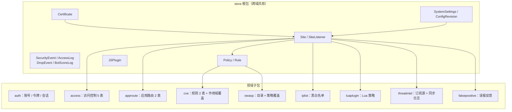
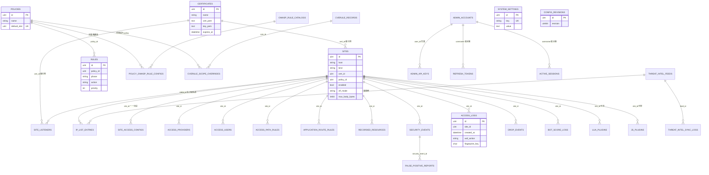
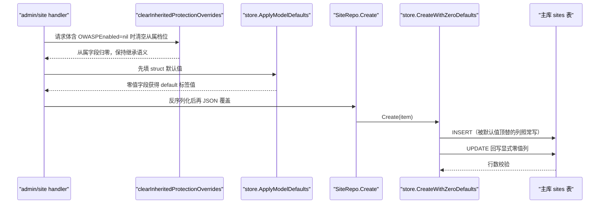
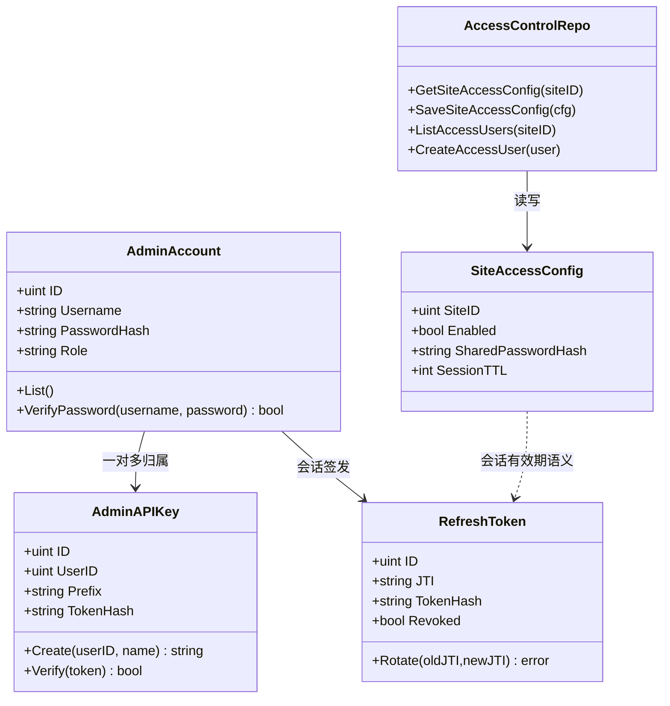
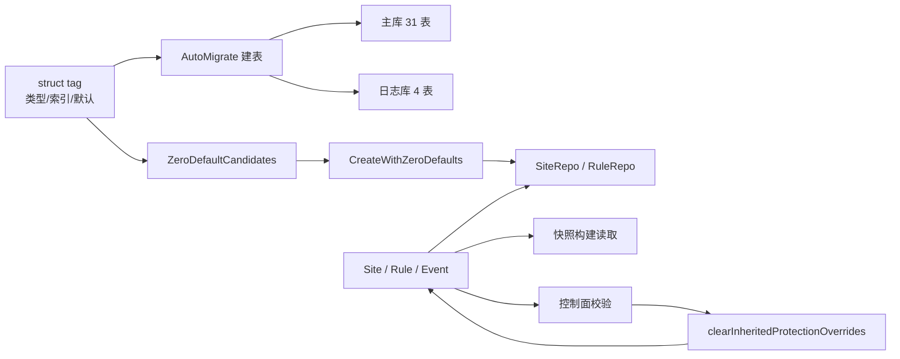

# 数据库模型设计

> [返回 数据存储层](数据存储层.md)

<cite>
**本文档引用的文件**
- [internal/store/site.go](file://internal/store/site.go)
- [internal/store/events.go](file://internal/store/events.go)
- [internal/store/policy.go](file://internal/store/policy.go)
- [internal/store/system.go](file://internal/store/system.go)
- [internal/store/auth/auth.go](file://internal/store/auth/auth.go)
- [internal/store/access/access_control.go](file://internal/store/access/access_control.go)
- [internal/store/protection.go](file://internal/store/protection.go)
- [internal/store/migrate.go](file://internal/store/migrate.go)
- [internal/store/certificate.go](file://internal/store/certificate.go)
- [internal/admin/site/site.go](file://internal/admin/site/site.go)
- [internal/store/zero_defaults.go](file://internal/store/zero_defaults.go)
- [internal/store/repository/site/site.go](file://internal/store/repository/site/site.go)
- [internal/store/repository/site/site_listener.go](file://internal/store/repository/site/site_listener.go)
- [internal/store/repository/policy/policy.go](file://internal/store/repository/policy/policy.go)
- [internal/store/repository/rule.go](file://internal/store/repository/rule.go)
- [internal/store/migrations/rule_phase.go](file://internal/store/migrations/rule_phase.go)
- [internal/store/migrations/rule_execution_params.go](file://internal/store/migrations/rule_execution_params.go)
- [internal/store/repository/security_event.go](file://internal/store/repository/security_event.go)
- [internal/store/migrations/access_log_fingerprint_key.go](file://internal/store/migrations/access_log_fingerprint_key.go)
- [internal/store/migrations/security_event_rule_info.go](file://internal/store/migrations/security_event_rule_info.go)
- [internal/store/repository/acl/access_control.go](file://internal/store/repository/acl/access_control.go)
- [internal/store/migrations/api_key_owner.go](file://internal/store/migrations/api_key_owner.go)
- [internal/store/repository/repository.go](file://internal/store/repository/repository.go)
- [internal/store/migrations/default_policy.go](file://internal/store/migrations/default_policy.go)
- [internal/store/migrations/recorded_resource_dedup_key.go](file://internal/store/migrations/recorded_resource_dedup_key.go)
- [internal/store/site.go](file://internal/store/site.go)
- [internal/store/policy.go](file://internal/store/policy.go)
- [internal/store/system.go](file://internal/store/system.go)
- [internal/store/events.go](file://internal/store/events.go)
- [internal/store/auth/auth.go](file://internal/store/auth/auth.go)
- [internal/store/access/access_control.go](file://internal/store/access/access_control.go)
- [internal/store/js_plugin.go](file://internal/store/js_plugin.go)
- [internal/store/luaplugin/lua_plugin.go](file://internal/store/luaplugin/lua_plugin.go)
- [internal/store/cve/cve.go](file://internal/store/cve/cve.go)
- [internal/store/approute/app_route.go](file://internal/store/approute/app_route.go)
</cite>

## 目录

1. [简介](#简介)
2. [项目结构](#项目结构)
3. [核心组件](#核心组件)
4. [架构总览](#架构总览)
5. [详细组件分析](#详细组件分析)
6. [依赖关系分析](#依赖关系分析)
7. [性能考虑](#性能考虑)
8. [故障排查指南](#故障排查指南)
9. [结论](#结论)
10. [附录](#附录)

## 简介

本篇描述数据存储层的模型设计：35 张表的清单与职责、字段与 struct tag 的逐条对应、索引策略、软删除与时间戳约定、枚举取值口径，以及本项目最具特色的**站点级三态覆盖**建模。

模型层遵循三条硬规则：其一，表结构只由 struct tag 表达，SQL 类型与索引名不写在迁移脚本里；其二，「未设置」与「显式关闭」必须可在数据库层面区分，因此可空标量指针是首选；其三，跨方言可移植性优先于单库便利性，凡 MySQL 无法建立的索引一律改为定长摘要。

## 项目结构

模型按领域分包，根包只放跨域共用的实体与运行时配置容器。

| 领域包 | 文件 | 行数 | 模型清单 |
|--------|------|:----:|----------|
| `store` 根 | `site.go` | 296 | `Site:38`、`SiteListener:248`、`SiteCacheRule:264` |
| `store` 根 | `events.go` | 278 | `SecurityEvent:15`、`AccessLog:79`、`DropEvent:238`、`BotScoreLog:251` |
| `store` 根 | `protection.go` | 476 | `ProtectionConfig:13`、`BotProtectionConfig:445`、`AttackProtectionConfig:460` |
| `store` 根 | `policy.go` | 97 | `Policy:10`、`Rule:70`、`RulePhase:27`、`RuleAction:37` |
| `store` 根 | `system.go` | 34 | `SystemSettings:4`、`ConfigRevision:31` |
| `store` 根 | `certificate.go` / `js_plugin.go` | 39 / 44 | `Certificate:19` / `JSPlugin:25` |
| `store/auth` | `auth.go` | 89 | `AdminAPIKey:15`、`AdminAccount:28`、`RefreshToken:38`、`TokenBlacklist:51`、`LoginAttempt:60`、`ActiveSession:70` |
| `store/access` | `access_control.go` | 94 | `SiteAccessConfig:20`、`AccessProvider:33`、`AccessUser:47`、`AccessPathRule:59`、`AccessSession:72` |
| `store/approute` | `app_route.go` | 141 | `ApplicationRouteRule:39`、`RecordedResource:58` |
| `store/cve` | `cve.go` / `cve_scope.go` | 46 / 25 | `CVERuleRecord:10`、`CVESyncLog:38` / `CVERuleScopeOverride:12` |
| `store/owasp` | `owasp.go` | 38 | `OWASPRuleCatalog:5`、`PolicyOWASPRuleConfig:23` |
| `store/iplist` | `ip_list.go` | 30 | `IPListEntry:17` |
| `store/luaplugin` | `lua_plugin.go` | 50 | `LuaPlugin:18` |
| `store/threatintel` | `threat_intel*.go` | 33 / 36 | `ThreatIntelFeed:12` / `ThreatIntelSyncLog:11` |
| `store/falsepositive` | `false_positive.go` | 43 | `FalsePositiveReport:16` |



**图表来源**
- [internal/store/site.go:38-147](file://internal/store/site.go#L38-L147)
- [internal/store/events.go:15-278](file://internal/store/events.go#L15-L278)
- [internal/store/policy.go:10-97](file://internal/store/policy.go#L10-L97)
- [internal/store/system.go:4-34](file://internal/store/system.go#L4-L34)
- [internal/store/auth/auth.go:15-82](file://internal/store/auth/auth.go#L15-L82)
- [internal/store/access/access_control.go:20-80](file://internal/store/access/access_control.go#L20-L80)

**章节来源**
- [internal/store/site.go:38-296](file://internal/store/site.go#L38-L296)
- [internal/store/events.go:15-278](file://internal/store/events.go#L15-L278)
- [internal/store/protection.go:13-476](file://internal/store/protection.go#L13-L476)
- [internal/store/auth/auth.go:15-89](file://internal/store/auth/auth.go#L15-L89)
- [internal/store/access/access_control.go:20-94](file://internal/store/access/access_control.go#L20-L94)

## 核心组件

组件即模型分组。以下清单以「谁持有该表的写入权」为划分依据，便于排障时直接定位入口。

| 模型族 | 表数 | 归属库 | 写入入口 | 是否软删除 |
|--------|:----:|:------:|----------|:----------:|
| 站点与端点 | 2 | 主库 | `SiteRepo`、`SiteListenerRepo` | ✓ |
| 证书 | 1 | 主库 | `CertificateRepo` | ✓ |
| 策略与规则 | 2 | 主库 | `PolicyRepo`、`RuleRepo` | ✓ |
| 运行时配置 | 2 | 主库 | `SystemSettingsRepo`、`BumpRevision` | ✗ |
| 防护覆盖 | 2 | 主库 | `owasp`/`cve` 作用域写接口 | ✗ / ✓ |
| 名单与情报 | 3 | 主库 | `IPListRepo`、`ThreatIntelRepo` | ✓ / ✗ |
| 认证与会话 | 6 | 主库 | `authn` 仓储族 | 部分 ✓ |
| 访问控制 | 5 | 主库 | `AccessControlRepo` | ✗ |
| 应用画像 | 2 | 主库 | `ApplicationRouteRuleRepo`、`RecordedResourceRepo` | ✓ / ✗ |
| 插件 | 2 | 主库 | `JSPluginRepo`、`LuaPluginRepo` | ✓ |
| 误报反馈 | 1 | 主库 | `FalsePositiveRepo` | ✓ |
| 日志与事件 | 4 | 日志库 | 仓储 + 统一写入器 | ✗ |

### 数据表清单

主库 31 张由 `AutoMigrate` 建立，日志库 4 张由 `AutoMigrateLogs` 建立，共 35 张。

| 表名 | 模型 | 定义位置:行 | 主键 | 索引 | 写入方 |
|------|------|-------------|------|------|--------|
| `sites` | `Site` | `site.go:38` | `id` | `idx_sites_host`、`idx_sites_bind`、`idx_sites_listener_id`、`idx_sites_deleted_at` | `SiteRepo.Create/Update` |
| `site_listeners` | `SiteListener` | `site.go:248` | `id` | `site_id`、`bind`、`deleted_at` | `SiteListenerRepo.Create` |
| `certificates` | `Certificate` | `certificate.go:19` | `id` | `deleted_at` | `CertificateRepo.Create/UpdateCert` |
| `policies` | `Policy` | `policy.go:10` | `id` | `ux_policies_default_slot` 唯一、`deleted_at` | `PolicyRepo`、V9 |
| `rules` | `Rule` | `policy.go:70` | `id` | `policy_id`、`phase`、`deleted_at` | `RuleRepo.Create/BatchCreate` |
| `system_settings` | `SystemSettings` | `system.go:4` | `id` | `key` 唯一 | `SystemSettingsRepo.Set` |
| `config_revisions` | `ConfigRevision` | `system.go:31` | `id` | — | `BumpRevision` |
| `owasp_rule_catalogs` | `OWASPRuleCatalog` | `owasp/owasp.go:5` | `id` | `rule_id` 唯一、`active`、`category`、两个复合 | 目录对账器 |
| `policy_owasp_rule_configs` | `PolicyOWASPRuleConfig` | `owasp/owasp.go:23` | `id` | `ux_policy_owasp_rule` 二列唯一 | 策略覆盖写接口 |
| `cve_rules` | `CVERuleRecord` | `cve/cve.go:10` | `id` | `cve_id`、`deleted_at` | `CVERuleRepo`、feed 同步 |
| `cve_rule_scope_overrides` | `CVERuleScopeOverride` | `cve/cve_scope.go:12` | `id` | `ux_cve_rule_scope` 三列唯一 | 作用域覆盖写接口 |
| `cve_sync_logs` | `CVESyncLog` | `cve/cve.go:38` | `id` | — | `CVESyncLogRepo.Create` |
| `ip_list_entries` | `IPListEntry` | `iplist/ip_list.go:17` | `id` | `kind`、`value`、`site_id`、`feed_id`、`deleted_at` | `IPListRepo`、情报全量替换 |
| `threat_intel_feeds` | `ThreatIntelFeed` | `threatintel/threat_intel.go:12` | `id` | `site_id` | `ThreatIntelRepo` |
| `threat_intel_sync_logs` | `ThreatIntelSyncLog` | `threatintel/threat_intel_sync_log.go:11` | `id` | `feed_id`、`success`、`trigger` | `ThreatIntelSyncLogRepo` |
| `false_positive_reports` | `FalsePositiveReport` | `falsepositive/false_positive.go:16` | `id` | `source_event_key` 唯一、`status`、`category`、`deleted_at` | `FalsePositiveRepo` |
| `application_route_rules` | `ApplicationRouteRule` | `approute/app_route.go:39` | `id` | `site_id`、`deleted_at` | `ApplicationRouteRuleRepo` |
| `recorded_resources` | `RecordedResource` | `approute/app_route.go:58` | `id` | `ux_recorded_res_dedup` 唯一、`site_id`、`host`、`last_seen`、`primary_rule_id` | `RecordedResourceRepo.Upsert` |
| `admin_accounts` | `AdminAccount` | `auth/auth.go:28` | `id` | `username` 唯一 | `SeedDefaults`、`AdminAccountRepo` |
| `admin_api_keys` | `AdminAPIKey` | `auth/auth.go:15` | `id` | `user_id`、`prefix`、`deleted_at` | `AdminAPIKeyRepo.Create`、V15 |
| `refresh_tokens` | `RefreshToken` | `auth/auth.go:38` | `id` | `jti` 唯一 | `RefreshTokenRepo.Create/Rotate` |
| `token_blacklists` | `TokenBlacklist` | `auth/auth.go:51` | `id` | `jti` 唯一、`expires_at` | 吊销流程 |
| `login_attempts` | `LoginAttempt` | `auth/auth.go:60` | `id` | `username`、`ip`、`created_at` | 登录审计 |
| `active_sessions` | `ActiveSession` | `auth/auth.go:70` | `id` | `jti` 唯一、`username`、`refresh_jti`、`expires_at` | 会话管理 |
| `site_access_configs` | `SiteAccessConfig` | `access/access_control.go:20` | `id` | `site_id` 唯一 | `AccessControlRepo` |
| `access_providers` | `AccessProvider` | `access/access_control.go:33` | `id` | `site_id` | `AccessControlRepo` |
| `access_users` | `AccessUser` | `access/access_control.go:47` | `id` | `ux_access_user_site_name` 二列唯一 | `AccessControlRepo` |
| `access_path_rules` | `AccessPathRule` | `access/access_control.go:59` | `id` | `site_id` | `AccessControlRepo` |
| `access_sessions` | `AccessSession` | `access/access_control.go:72` | `id` | `token` 唯一、`site_id`、`expires_at` | 访问控制会话 |
| `lua_plugins` | `LuaPlugin` | `luaplugin/lua_plugin.go:18` | `id` | `stage`、`site_id`、`deleted_at` | `LuaPluginRepo` |
| `js_plugins` | `JSPlugin` | `js_plugin.go:25` | `id` | `stage`、`site_id`、`deleted_at` | `JSPluginRepo` |
| `security_events` | `SecurityEvent` | `events.go:15` | `id` | `idx_se_site_created_id` 三列、`action`、`category`、`rule_id_str` | `SecurityEventRepo`、统一写入器 |
| `access_logs` | `AccessLog` | `events.go:79` | `id` | `idx_al_site_created_id` 三列、`fingerprint_key`、`visitor_fusion_window` | `AccessLogRepo`、统一写入器 |
| `drop_events` | `DropEvent` | `events.go:238` | `id` | `site_id`、`client_ip`、`idx_drop_source_created` | `DropEventRepo` |
| `bot_score_logs` | `BotScoreLog` | `events.go:251` | `id` | `site_id`、`client_ip`、`total_score`、`tls_ja3_hash`、`tls_ja4`、`request_id` | `BotScoreRepo` |

**章节来源**
- [internal/store/migrate.go:52-89](file://internal/store/migrate.go#L52-L89)
- [internal/store/migrate.go:127-132](file://internal/store/migrate.go#L127-L132)
- [internal/store/site.go:38-296](file://internal/store/site.go#L38-L296)
- [internal/store/events.go:15-278](file://internal/store/events.go#L15-L278)
- [internal/store/access/access_control.go:20-80](file://internal/store/access/access_control.go#L20-L80)
- [internal/store/auth/auth.go:15-82](file://internal/store/auth/auth.go#L15-L82)

## 架构总览

模型之间的关系以「引用意图」而非数据库外键表达：`Site.CertID`、`Site.PolicyID` 均为可空整数，级联一致性由仓储事务与启动期修复迁移保证。



**图表来源**
- [internal/store/site.go:38-147](file://internal/store/site.go#L38-L147)
- [internal/store/site.go:248-261](file://internal/store/site.go#L248-L261)
- [internal/store/policy.go:10-97](file://internal/store/policy.go#L10-L97)
- [internal/store/certificate.go:19-39](file://internal/store/certificate.go#L19-L39)
- [internal/store/system.go:4-34](file://internal/store/system.go#L4-L34)
- [internal/store/events.go:79-129](file://internal/store/events.go#L79-L129)

`Site.UpstreamURLs` 表达上游连接目标，`Site.UpstreamHost` 表达发往上游的 `Host` 头；两者都不参与索引，属于纯文本配置列。`Site.TrustedCIDR`、`Site.ClientIPHeaderOrder` 同理为 TEXT 存储的列表文本。

**章节来源**
- [internal/store/site.go:44-46](file://internal/store/site.go#L44-L46)
- [internal/store/site.go:92-95](file://internal/store/site.go#L92-L95)

## 详细组件分析

### 站点模型与三态覆盖

`Site` 是模型层最大的结构体：70 个字段中 65 个落库为列，5 个声明为 `gorm:"-"` 的运行期派生字段（`UpstreamTLSClientCertDER`、`UpstreamTLSClientCertKey`、`UpstreamTLSClientCertSet`、`UpstreamTLSClientCertBad`、`UpstreamTLSClientCertFP`），其中 3 列（`listener_id`、`forwarding_profile_id`、`inherit_listener_cert`）是仅为迁移兼容保留的 legacy 列。三态字段全部为指针，`nil` 一律表示继承。

| 字段 | 类型 | 约束 | 默认 | 说明 |
|------|------|------|------|------|
| `ID` | `uint` | `primaryKey` | 自增 | 主键 |
| `DeletedAt` | `gorm.DeletedAt` | `index` | NULL | 软删除 |
| `Host` | `string` | `size:255;not null;index` | — | 域名匹配串 |
| `UpstreamURLs` | `string` | `type:text;not null` | — | 上游地址列表 |
| `Bind` | `string` | `size:255;not null;index` | — | 监听端点 |
| `Network` | `string` | `size:16` | `tcp` | 协议族 |
| `Enabled` | `bool` | `default:true` | true | 显式 false 依赖零值回写 |
| `CertID` | `*uint` | 可空 | NULL | 未绑定证书 |
| `PolicyID` | `*uint` | 可空 | NULL | 未指定即使用默认策略 |
| `BotProtectionEnabled` | `*bool` | `default:null` | NULL | 三态 |
| `AntiReplayEnabled` | `*bool` | `default:null` | NULL | V11 把 `false` 洗成 NULL |
| `AntiReplayCookieMode` | `*string` | `default:null` | NULL | 三态 |
| `ChallengeAction` | `*string` | `default:null` | NULL | 三态 |
| `SiteCaptchaType` | `*string` | `default:null` | NULL | JSON 名 `captcha_type`，列名 `site_captcha_type` |
| `OWASPEnabled` | `*bool` | `default:null` | NULL | 三态 |
| `CVEEnabled` | `*bool` | `default:null` | NULL | 三态 |
| `RateLimitEnabled` | `*bool` | `default:null` | NULL | 三态 |
| `SkipPathByPhase` | `*string` | `column:skip_path_by_phase;type:text` | NULL | nil 继承 / `"{}"` 覆盖为空 |
| `XFFMode` | `string` | `size:64` | `strip_all_and_set_remote` | V10 归一非法值 |
| `MaxBodyBytes` | `int64` | `default:10485760` | 10 MB | 0 为不限制 |
| `UpstreamTLSClientCertPEM` | `*string` | `type:text` | NULL | 与私钥成对，管理面输出脱敏 |
| `UpstreamTLSClientKeyPEM` | `*string` | `type:text` | NULL | 机密，禁止出现在日志与响应 |
| `CustomErrorPages` | `string` | `type:text` | 无 DB 默认值 | MySQL TEXT 禁默认值 |
| `DynamicDecryptCacheTTL` | `*int` | `column:dynamic_decrypt_cache_ttl` | NULL | 三态 |
| `CCUseCustom` | `*bool` | `column:cc_use_custom` | NULL | 三态 |
| `ListenerID` | `uint` | `index` | 0 | legacy，仅为迁移兼容 |

继承合并发生在控制面而非数据库：`clearInheritedProtectionOverrides` 在把请求体反序列化到 `Site` 之前，将继承态从属字段清空，避免旧档位残留覆盖新配置。



**图表来源**
- [internal/admin/site/site.go:490-508](file://internal/admin/site/site.go#L490-L508)
- [internal/store/zero_defaults.go:35-65](file://internal/store/zero_defaults.go#L35-L65)
- [internal/store/zero_defaults.go:90-146](file://internal/store/zero_defaults.go#L90-L146)
- [internal/store/repository/site/site.go:48-56](file://internal/store/repository/site/site.go#L48-L56)

```sql
-- 三态列的真实 DDL：DEFAULT NULL 而非 false，保证「未设置」可读
-- internal/store/site.go:60-90
ALTER TABLE `sites` ADD COLUMN `bot_protection_enabled` numeric DEFAULT null;
ALTER TABLE `sites` ADD COLUMN `anti_replay_enabled`    numeric DEFAULT null;
ALTER TABLE `sites` ADD COLUMN `owasp_enabled`          numeric DEFAULT null;
ALTER TABLE `sites` ADD COLUMN `skip_path_by_phase`     text;         -- 禁默认值

-- 站点级联删除的一致性由仓储事务承担（无外键约束）
-- internal/store/repository/site/site.go:82-89
BEGIN;
DELETE FROM `site_listeners` WHERE `site_id` = ?;
DELETE FROM `sites`          WHERE `id` = ?;
COMMIT;
```

**章节来源**
- [internal/store/site.go:38-147](file://internal/store/site.go#L38-L147)
- [internal/store/site.go:180-245](file://internal/store/site.go#L180-L245)
- [internal/store/zero_defaults.go:21-65](file://internal/store/zero_defaults.go#L21-L65)
- [internal/store/repository/site/site.go:48-107](file://internal/store/repository/site/site.go#L48-L107)
- [internal/store/repository/site/site_listener.go:79-99](file://internal/store/repository/site/site_listener.go#L79-L99)

### 策略与规则模型

`Policy` 用「唯一槽位」表达默认策略：`DefaultSlot *uint` 上挂 `uniqueIndex:ux_policies_default_slot`，只有槽值为 1 的行是默认策略，其余行该列为 NULL，因而唯一索引允许多个 NULL——这是三库一致的「至多一行默认」实现。`IsDefault` 是 `gorm:"-"` 派生字段，由 `AfterFind` 填充。

`Rule` 的枚举全部为字符串，`RulePhase` 五值、`RuleAction` 十一个有效值加两个 legacy 值，索引只有 `policy_id` 与 `phase` 两列，排序依赖表达式而非索引。

| 值 | 常量名 | 含义 | 规范化映射 | 出处 |
|:---|--------|------|------------|------|
| `acl` | `PhaseACL` | 名单与访问控制阶段 | 原样 | `policy.go:30` |
| `rate_limit` | `PhaseRateLimit` | 频次阶段 | legacy 行被 V3 改写为 `custom` | `policy.go:31` |
| `owasp_default` | `PhaseOWASP` | 内置攻击检测阶段 | 同上 | `policy.go:32` |
| `signature` | `PhaseSignature` | 签名规则阶段 | 原样 | `policy.go:33` |
| `custom` | `PhaseCustom` | 用户自定义阶段 | 迁移目标值 | `policy.go:34` |
| `block` | `ActionBlock` | legacy 拦截 | → `intercept` | `policy.go:53`、`:58-67` |
| `log_only` | `ActionLogOnly` | legacy 仅记录 | → `observe` | `policy.go:54`、`:58-67` |
| `intercept` | `ActionIntercept` | 拦截并返回拦截页 | 原样 | `policy.go:41` |
| `observe` | `ActionObserve` | 只记录不阻断 | 原样 | `policy.go:42` |
| `drop` | `ActionDrop` | TCP 丢弃 | 原样 | `policy.go:43` |
| `challenge` | `ActionChallenge` | 通用质询 | 原样 | `policy.go:44` |
| `captcha_challenge` | `ActionCaptchaChallenge` | 验证码质询 | 原样 | `policy.go:45` |
| `shield_challenge` | `ActionShieldChallenge` | 5 秒盾质询 | 原样 | `policy.go:46` |
| `chain_challenge` | `ActionChainChallenge` | 链式质询 | 原样 | `policy.go:47` |
| `redirect` | `ActionRedirect` | 重定向到 `RedirectTo` | 原样 | `policy.go:48` |
| `rate_limit` | `ActionRateLimit` | 限流动作 | 原样 | `policy.go:49` |
| `tag` | `ActionTag` | 仅打标 | 原样 | `policy.go:50` |

`Rule.CaptchaType` 为空串表示继承全局验证码类型；`WindowSeconds`/`RequestCount` 必须同时大于 0 才生效；`CaptchaMinutes` 为 0 表示继承全局 `captcha_pass_ttl`。这三列由 V14 补齐。

**章节来源**
- [internal/store/policy.go:10-97](file://internal/store/policy.go#L10-L97)
- [internal/store/repository/policy/policy.go:36-88](file://internal/store/repository/policy/policy.go#L36-L88)
- [internal/store/repository/rule.go:18-66](file://internal/store/repository/rule.go#L18-L66)
- [internal/store/migrations/rule_phase.go:13-26](file://internal/store/migrations/rule_phase.go#L13-L26)
- [internal/store/migrations/rule_execution_params.go:11-45](file://internal/store/migrations/rule_execution_params.go#L11-L45)

### 日志与事件模型

日志四表全部落在日志库，无软删除字段，索引设计围绕「按站点 + 时间 + id 分页」与「按动作/类别聚合」。

| 字段 | 类型 | 约束 | 默认 | 说明 |
|------|------|------|------|------|
| `SecurityEvent.ID` | `uint` | `primaryKey`、复合第 3 位 | 自增 | 稳定游标 |
| `SecurityEvent.CreatedAt` | `time.Time` | 三个索引 | 自动 | 时间轴主键 |
| `SecurityEvent.SiteID` | `uint` | 复合第 1 位 | 0 | 未匹配站点为 0 |
| `SecurityEvent.RuleIDStr` | `string` | `size:64;index` | — | 内置规则 ID，带 `owasp:` 前缀 |
| `SecurityEvent.MatchSnippet` | `string` | `size:256` | — | 已截断脱敏的命中片段 |
| `SecurityEvent.References` | `string` | `type:text` | — | SQL 保留字，读取需引号标识符 |
| `SecurityEvent.TLSSNIPresence` | `string` | `gorm:"-"` | — | 派生字段，`AfterFind` 填充 |
| `AccessLog.FingerprintKey` | `string` | `char(64);index` | — | 九字段摘要，`BeforeSave` 维护 |
| `AccessLog.WAFAction` | `string` | `size:32;index` | — | 最终动作 |
| `AccessLog.VisitorFusionEvidenceSufficient` | `bool` | `default:false`、复合第 1 位 | false | 指纹窗口聚合 |
| `DropEvent.Source` | `string` | `size:32`、复合第 1 位 | — | bot/cve/rule 等来源 |
| `BotScoreLog.TotalScore` | `int` | `index` | 0 | 综合分 |

```go
// internal/store/events.go:178-198：摘要与派生字段都在写钩子里维护，
// 覆盖仓储、统一写入器与直接 CreateInBatches 三条路径
func (a *AccessLog) BeforeSave(*gorm.DB) error {
	if a == nil {
		return nil
	}
	a.FingerprintKey = ComputeAccessLogFingerprintKey(
		a.TLSJA3Hash, a.TLSJA4, a.TLSVersion, a.TLSALPN, a.TLSSNI,
		a.TLSCipherSuites, a.TLSExtensions, a.TLSCurves, a.TLSPointFormats,
	)
	a.TLSSNIPresence = ""
	return nil
}
```

```sql
-- 分页游标索引，列序由 tag 的 priority 决定（events.go:80-82）
CREATE INDEX `idx_al_site_created_id` ON `access_logs`(`site_id`,`created_at`,`id`);
CREATE INDEX `idx_al_fingerprint_key` ON `access_logs`(`fingerprint_key`);
-- 安全事件同构（events.go:16-19）
CREATE INDEX `idx_se_site_created_id` ON `security_events`(`site_id`,`created_at`,`id`);
```

**章节来源**
- [internal/store/events.go:15-278](file://internal/store/events.go#L15-L278)
- [internal/store/repository/security_event.go:81-107](file://internal/store/repository/security_event.go#L81-L107)
- [internal/store/migrations/access_log_fingerprint_key.go:12-55](file://internal/store/migrations/access_log_fingerprint_key.go#L12-L55)
- [internal/store/migrations/security_event_rule_info.go:11-58](file://internal/store/migrations/security_event_rule_info.go#L11-L58)

### 认证与访问控制模型

认证模型分两层：控制面自身（`admin_accounts`、`admin_api_keys`、`refresh_tokens`、`token_blacklists`、`login_attempts`、`active_sessions`）与面向客户站点的访问控制（`site_access_configs` 等 5 表）。两者的共同点是把秘密一律以哈希形式落库。

| 字段 | 类型 | 约束 | 默认 | 说明 |
|------|------|------|------|------|
| `AdminAccount.PasswordHash` | `string` | `size:255;not null` | — | bcrypt，`json:"-"` 不外泄 |
| `AdminAccount.Role` | `string` | `size:32;not null` | `'admin'` | admin/operator/readonly |
| `AdminAPIKey.UserID` | `uint` | `index;not null` | 0 | 归属账号，0 由 V15 回填 |
| `AdminAPIKey.TokenHash` | `string` | `size:255;not null` | — | 明文令牌不落库 |
| `AdminAPIKey.Prefix` | `string` | `size:16;index` | — | 定位候选哈希的前缀 |
| `RefreshToken.JTI` | `string` | `size:128;uniqueIndex;not null` | — | 令牌唯一标识 |
| `RefreshToken.ReplacedBy` | `string` | `size:128` | — | 轮换链后继 JTI |
| `ActiveSession.RefreshJTI` | `string` | `index;size:128` | — | 服务端精确撤销用 |
| `SiteAccessConfig.SharedPasswordHash` | `string` | `size:255` | — | 共享密码 bcrypt |
| `SiteAccessConfig.SessionTTL` | `int` | — | 86400 | 会话秒数 |
| `AccessUser.PasswordHash` | `string` | `size:255;not null` | — | 站点局部账号 |
| `AccessProvider.Config` | `string` | `type:text` | — | OAuth 配置，密钥需上层加密 |
| `AccessSession.Token` | `string` | `uniqueIndex;size:64;not null` | — | 会话令牌 |
| `AccessPathRule.Action` | `string` | `size:20;not null` | `'require_auth'` | require_auth/allow/deny |



**图表来源**
- [internal/store/auth/auth.go:15-89](file://internal/store/auth/auth.go#L15-L89)
- [internal/store/access/access_control.go:20-80](file://internal/store/access/access_control.go#L20-L80)
- [internal/store/repository/acl/access_control.go:18-30](file://internal/store/repository/acl/access_control.go#L18-L30)

**章节来源**
- [internal/store/auth/auth.go:15-89](file://internal/store/auth/auth.go#L15-L89)
- [internal/store/access/access_control.go:19-94](file://internal/store/access/access_control.go#L19-L94)
- [internal/store/migrations/api_key_owner.go:9-51](file://internal/store/migrations/api_key_owner.go#L9-L51)

### 配置容器与枚举口径

`SystemSettings` 是唯一的通用配置容器：全局防护配置以 JSON 文本存放在 `protection` 键下，由 `ProtectionConfig` 序列化。该模型刻意不建独立表，避免为几十个字段做列级迁移。

| 键 / 字段 | 类型 | 默认 | 说明 |
|-----------|------|------|------|
| `system_settings.key` | `string` | — | `size:128;uniqueIndex;not null` |
| `system_settings.value` | `string` | — | `type:text`，无 DB 默认值 |
| `protection.request_ratelimit_window` | int | 60 | 全局请求限流窗口 |
| `protection.request_ratelimit_max` | int | 300 | 窗口配额 |
| `protection.builtin_owasp_enabled` | bool | 默认 false | 全局 OWASP 开关 |
| `protection.builtin_owasp_sensitivity` | string | `mid` | 全局档位 |
| `protection.captcha_type` | string | `math` | 验证码类型 |
| `protection.challenge_action` | string | `challenge` | 空串走兜底渲染 |
| `protection.anti_replay_cookie_mode` | string | `standard` | standard/dual |
| `protection.skip_path_by_phase` | string | 无默认值 | JSON 文本，禁 TEXT 默认值 |
| `redis_config` | string | — | Redis 连接配置覆盖环境变量 |
| `jwt_secret` | string | — | 机密，禁止出现在导出与日志 |

```sql
-- 键值表 + 唯一键：全局配置只有一个写入者（SystemSettingsRepo.Set）
CREATE TABLE `system_settings` (
  `id` integer PRIMARY KEY AUTOINCREMENT,
  `key` text NOT NULL,
  `value` text
);
CREATE UNIQUE INDEX `idx_system_settings_key` ON `system_settings`(`key`);

-- 单行修订号：BumpRevision 用自增表达式，避免读改写竞态（migrate.go:150-152）
CREATE TABLE `config_revisions` (
  `id` integer PRIMARY KEY AUTOINCREMENT,
  `revision` integer NOT NULL
);
UPDATE `config_revisions` SET `revision` = revision + 1 WHERE `id` = 1;
```

**章节来源**
- [internal/store/system.go:3-34](file://internal/store/system.go#L3-L34)
- [internal/store/protection.go:13-117](file://internal/store/protection.go#L13-L117)
- [internal/store/protection.go:159-203](file://internal/store/protection.go#L159-L203)
- [internal/store/migrate.go:141-168](file://internal/store/migrate.go#L141-L168)

## 依赖关系分析

模型层不依赖任何仓储、缓存或 Redis；依赖方向永远是「仓储 → 模型」。



**图表来源**
- [internal/store/migrate.go:52-139](file://internal/store/migrate.go#L52-L139)
- [internal/store/zero_defaults.go:157-169](file://internal/store/zero_defaults.go#L157-L169)
- [internal/admin/site/site.go:490-508](file://internal/admin/site/site.go#L490-L508)

| 被依赖模型 | 依赖它的模块 | 依赖形式 |
|------------|--------------|----------|
| `Site` | 控制面、快照构建、数据面 | 只读快照字段 |
| `Rule`/`Policy` | 控制面、快照编译 | 读 + 写 |
| `ProtectionConfig` | 快照构建、控制面 | JSON 反序列化 |
| `SecurityEvent`/`AccessLog` | 统一写入器、报表仓储 | 批量写 + 读 |
| `IPListEntry` | 名单仓储、情报同步 | 全量替换 |
| `RecordedResource` | 数据面观测写路径 | upsert |
| `SystemSettings` | 几乎所有配置读取方 | 键值读写 |

已知遗留：`SiteForwardingRule`（`site.go:280`）与 `SiteHeaderOp`（`site.go:290`）两个类型仍在文件中，注释声称「存放在 `Site.ForwardingRules` / `Site.HeaderOps` 中」，但 `Site` 结构体已无这两个字段，前端类型定义仍保留同名接口。这是注释与结构不一致的残留，阅读时以 `Site` 字段清单为准。

**章节来源**
- [internal/store/site.go:263-296](file://internal/store/site.go#L263-L296)
- [internal/store/zero_defaults.go:148-169](file://internal/store/zero_defaults.go#L148-L169)
- [internal/store/repository/repository.go:28-54](file://internal/store/repository/repository.go#L28-L54)

## 性能考虑

- **索引与写入平衡**：`access_logs` 有 12 个索引、`security_events` 有 9 个，全部服务于列表过滤与聚合；写放大由统一写入器批量合并来抵消。
- **摘要列替代宽索引**：`fingerprint_key`、`dedup_key` 都是 `char(64)`，把跨列分组转成单列等值查询，同时绕开 MySQL 3072 字节索引上限。
- **默认值集中在 Go 侧**：TEXT 列一律不带 `DEFAULT`（MySQL Error 1101 会直接让 `AutoMigrate` 失败），空串与 `"{}"` 在读取侧等价处理。
- **软删除的成本**：`deleted_at` 索引让「只看未删」保持高效，但统计口径必须显式带条件；`Unscoped()` 仅在修复默认槽时使用。
- **派生字段不进表**：`IsDefault`、`TLSSNIPresence`、上游 mTLS 的 DER/指纹都是 `gorm:"-"`，读时由钩子派生，避免多份真相。

[本节为总结，无需特定文件来源]

## 故障排查指南

| 症状 | 根因 | 排查 | 方案 |
|------|------|------|------|
| 站点三态显示成「关闭」 | 空值被存成 `false` | `SELECT owasp_enabled FROM sites` 是否 NULL | 继承态写 NULL，禁止空串/false |
| 档位改了不生效 | 从属字段未清空 | 核对是否调用继承清理 | 继承时清档位与动作 |
| 规则顺序异常 | `priority` 0 被默认 100 顶替 | 查 `rules.priority` | 走零值回写创建 |
| 默认策略切换失败 | 软删行仍占用默认槽 | `SELECT id,default_slot FROM policies` | 重跑 V9 释放槽位 |
| 资源去重产生两行 | 摘要列未回填 | `dedup_key` 是否有空串 | 由 `BeforeSave` 兜底 + 重跑 V8 |
| 安全事件缺 `references` | V13 未执行 | 检查日志库列 | 跑 `AutoMigrateLogs` |
| 时间轴图表异常 | 分桶文本格式不一致 | 三库各查一次分桶 | 保持 `YYYY-MM-DD HH:00` |
| 口令泄露担忧 | 秘密字段被序列化 | 确认 `json:"-"` 标签齐全 | 不外泄哈希与 PEM 私钥 |

```bash
# 三态与索引自检（SQLite 路径）
sqlite3 '{占位目录}/data/waf.db' "SELECT id, owasp_enabled IS NULL AS inherit FROM sites LIMIT 5;"
sqlite3 '{占位目录}/data/waf.db' "SELECT name FROM sqlite_master WHERE type='index' AND tbl_name='rules';"
sqlite3 '{占位目录}/data/waf_logs.db' "PRAGMA index_list('access_logs');"
# 预期：inherit 为 1 表示继承；rules 含 idx_rules_policy_id / idx_rules_phase
```

**章节来源**
- [internal/store/site.go:76-91](file://internal/store/site.go#L76-L91)
- [internal/admin/site/site.go:490-508](file://internal/admin/site/site.go#L490-L508)
- [internal/store/migrations/default_policy.go:23-71](file://internal/store/migrations/default_policy.go#L23-L71)
- [internal/store/migrations/recorded_resource_dedup_key.go:60-83](file://internal/store/migrations/recorded_resource_dedup_key.go#L60-L83)
- [internal/store/repository/security_event.go:595-614](file://internal/store/repository/security_event.go#L595-L614)

## 结论

模型层用 struct tag 作为唯一真相源，把 35 张表的类型、索引、默认值收敛到声明位置，使迁移脚本只需处理数据而非结构。三态指针、摘要列、键值配置容器三项设计分别解决了「继承语义无法表达」「跨方言索引上限」「配置字段频繁增减」三个具体矛盾；软删除与派生字段钩子则把一致性问题推到仓储事务与读取钩子中处理。

主要遗留风险是配置列语义依赖读取方：`"{}"`、空串、NULL 三者在不同字段上的含义并不统一，新增字段时必须同时约定默认值与读取侧等价规则。

## 附录

### 命名与约束规范

| 规范 | 写法 | 反例 |
|------|------|------|
| 列名 | snake_case，由字段名自动推出 | 手写 `column:` 只在摘要/覆盖列使用 |
| JSON 名 | 与列名一致的 snake_case | 对外驼峰会破坏前端契约 |
| 字符串长度 | `size:255` 以下，长文本 `type:text` | 长文本用 size 会撑爆索引 |
| TEXT 默认值 | 禁止 | MySQL Error 1101 使建表失败 |
| 布尔默认 | `default:true/false`，可空用 `default:null` | 用 `default:false` 表达继承 |
| 索引命名 | 显式 `index:idx_域_字段` | 依赖自动名会让迁移无法定位 |
| 派生字段 | `gorm:"-"` + `AfterFind` | 落库副本会产生第二真相 |
| 机密字段 | `json:"-"` 且管理面脱敏 | 直接序列化哈希或私钥 |

**章节来源**
- [internal/store/site.go:38-147:38-147](file://internal/store/site.go#L38-L147#38)
- [internal/store/policy.go:70-97:70-97](file://internal/store/policy.go#L70-L97#70)
- [internal/store/system.go:4-34:4-34](file://internal/store/system.go#L4-L34#4)
- [internal/store/events.go:15-129:15-129](file://internal/store/events.go#L15-L129#15)
- [internal/store/auth/auth.go:15-82:15-82](file://internal/store/auth/auth.go#L15-L82#15)
- [internal/store/access/access_control.go:20-80:20-80](file://internal/store/access/access_control.go#L20-L80#20)
- [internal/store/site.go:38-147](file://internal/store/site.go#L38-L147)
- [internal/store/policy.go:70-97](file://internal/store/policy.go#L70-L97)
- [internal/store/system.go:4-34](file://internal/store/system.go#L4-L34)
- [internal/store/events.go:15-129](file://internal/store/events.go#L15-L129)
- [internal/store/auth/auth.go:15-82](file://internal/store/auth/auth.go#L15-L82)
- [internal/store/access/access_control.go:20-80](file://internal/store/access/access_control.go#L20-L80)

### 表数量速查

| 范围 | 数量 | 出处 |
|------|:----:|------|
| 主库表 | 31 | `AutoMigrate` 清单（`migrate.go:52-89`） |
| 日志库表 | 4 | `AutoMigrateLogs`（`migrate.go:127-132`） |
| 合计 | 35 | 本篇数据表清单 |
| 显式 `TableName` | 5 | `js_plugin.go:44`、`lua_plugin.go:45`、`cve.go:35`、`app_route.go:55/98` |

**章节来源**
- [internal/store/migrate.go:52-89](file://internal/store/migrate.go#L52-L89)
- [internal/store/migrate.go:127-132](file://internal/store/migrate.go#L127-L132)
- [internal/store/js_plugin.go:44](file://internal/store/js_plugin.go#L44)
- [internal/store/luaplugin/lua_plugin.go:45](file://internal/store/luaplugin/lua_plugin.go#L45)
- [internal/store/cve/cve.go:35](file://internal/store/cve/cve.go#L35)
- [internal/store/approute/app_route.go:55-98](file://internal/store/approute/app_route.go#L55-L98)
