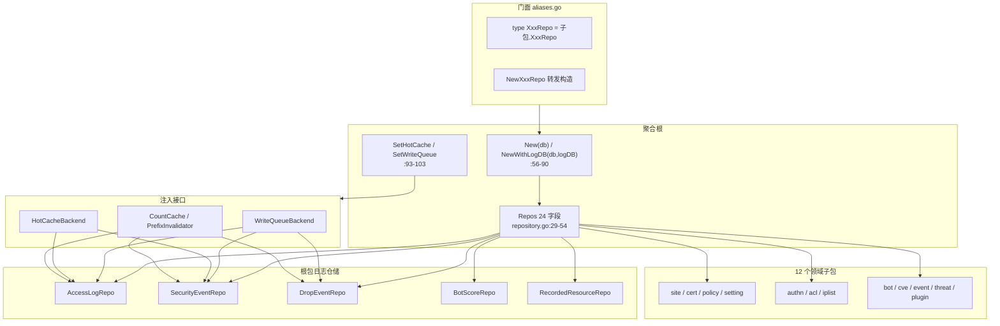
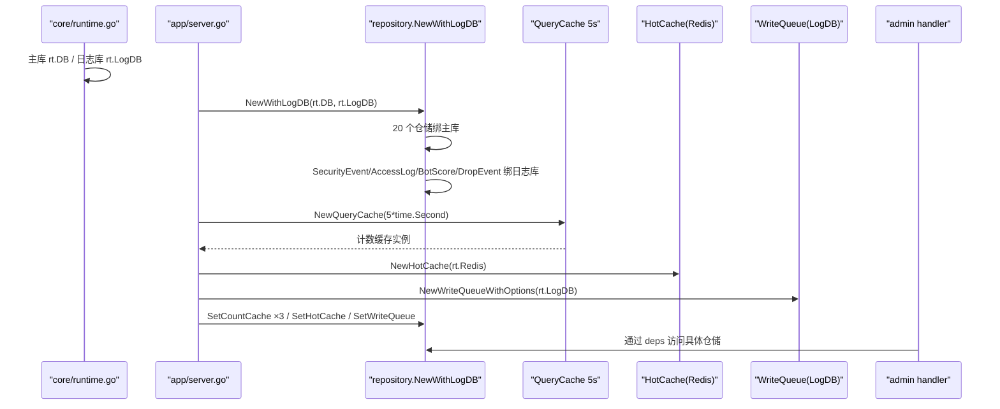
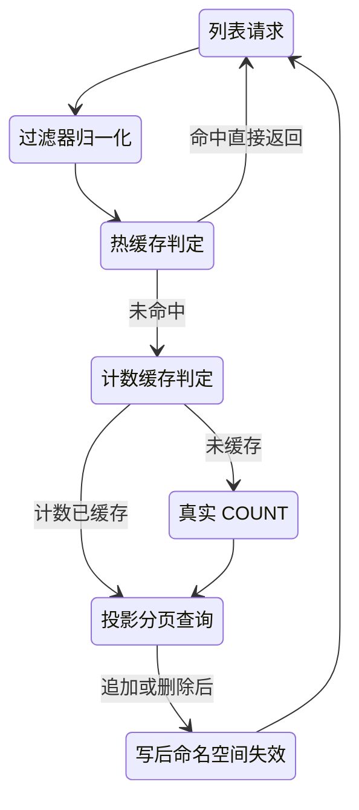
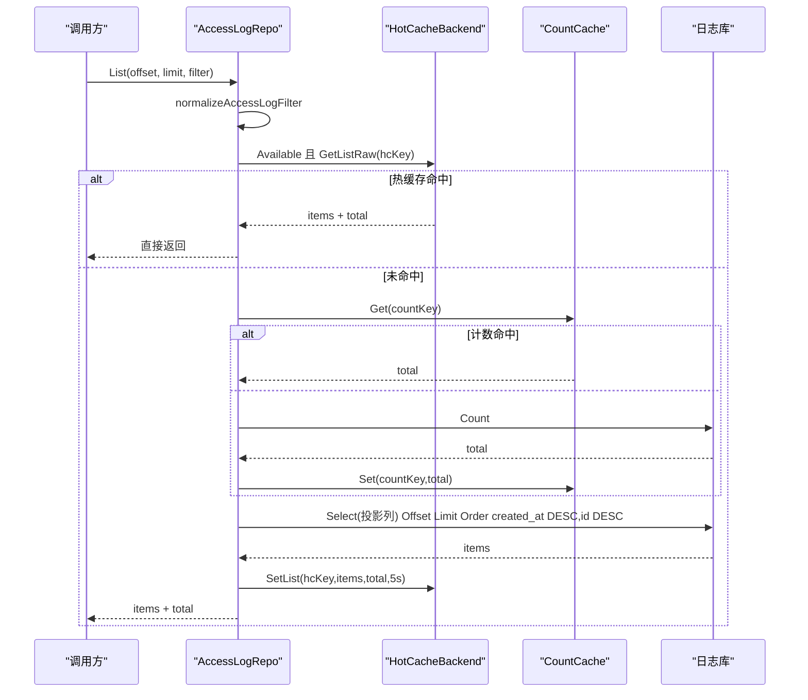
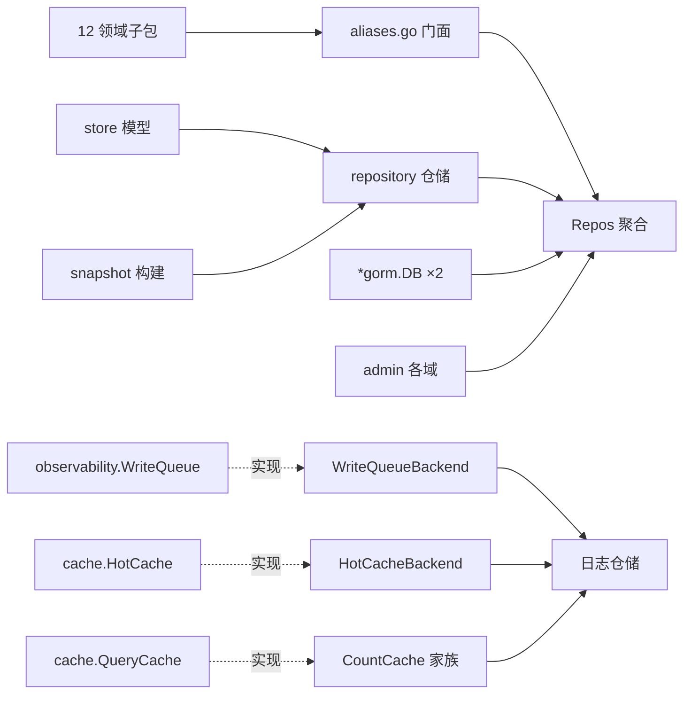

# 数据访问层设计

> [返回 数据存储层](数据存储层.md)

<cite>
**本文档引用的文件**
- [internal/store/repository/repository.go](file://internal/store/repository/repository.go)
- [internal/store/repository/aliases.go](file://internal/store/repository/aliases.go)
- [internal/store/repository/access_log.go](file://internal/store/repository/access_log.go)
- [internal/store/repository/count_cache.go](file://internal/store/repository/count_cache.go)
- [internal/store/repository/repository.go](file://internal/store/repository/repository.go)
- [internal/store/repository/site/site.go](file://internal/store/repository/site/site.go)
- [internal/store/repository/rule.go](file://internal/store/repository/rule.go)
- [internal/store/repository/access_log.go](file://internal/store/repository/access_log.go)
- [internal/store/migrate.go](file://internal/store/migrate.go)
- [internal/store/repository/site/site.go](file://internal/store/repository/site/site.go)
- [internal/store/repository/rule.go](file://internal/store/repository/rule.go)
- [internal/store/migrate.go](file://internal/store/migrate.go)
- [internal/store/repository/site/site_listener.go](file://internal/store/repository/site/site_listener.go)
- [internal/store/repository/cert/certificate.go](file://internal/store/repository/cert/certificate.go)
- [internal/store/repository/policy/policy.go](file://internal/store/repository/policy/policy.go)
- [internal/store/repository/setting/system_settings.go](file://internal/store/repository/setting/system_settings.go)
- [internal/app/server.go](file://internal/app/server.go)
- [internal/store/repository/application_route.go](file://internal/store/repository/application_route.go)
- [internal/store/repository/tls_filter.go](file://internal/store/repository/tls_filter.go)
- [internal/store/zero_defaults.go](file://internal/store/zero_defaults.go)
- [internal/store/repository/security_event.go](file://internal/store/repository/security_event.go)
- [internal/store/repository/drop_event.go](file://internal/store/repository/drop_event.go)
- [internal/store/repository/bot/bot_score.go](file://internal/store/repository/bot/bot_score.go)
- [internal/store/repository/security_event_aggregate_cache.go](file://internal/store/repository/security_event_aggregate_cache.go)
- [internal/store/repository/authn/admin_account.go](file://internal/store/repository/authn/admin_account.go)
- [internal/store/repository/authn/admin_api_key.go](file://internal/store/repository/authn/admin_api_key.go)
- [internal/store/repository/authn/refresh_token.go](file://internal/store/repository/authn/refresh_token.go)
- [internal/store/repository/acl/access_control.go](file://internal/store/repository/acl/access_control.go)
- [internal/store/repository/event/false_positive.go](file://internal/store/repository/event/false_positive.go)
- [internal/store/repository/cve/cve_rule.go](file://internal/store/repository/cve/cve_rule.go)
- [internal/store/repository/threat/threat_intel.go](file://internal/store/repository/threat/threat_intel.go)
</cite>

## 目录

1. [简介](#简介)
2. [项目结构](#项目结构)
3. [核心组件](#核心组件)
4. [架构总览](#架构总览)
5. [详细组件分析](#详细组件分析)
6. [依赖关系分析](#依赖关系分析)
7. [性能考虑](#性能考虑)
8. [故障排查指南](#故障排查指南)
9. [结论](#结论)
10. [附录](#附录)

## 简介

数据访问层是控制面与数据面通往持久化的唯一通道，由聚合根 `Repos`、12 个领域子包仓储、4 个日志类仓储与一组可选注入的缓存/写队列接口构成。它解决的问题很具体：让上层不必拼 SQL、不必关心连接归属哪条 `*gorm.DB`、不必在每处重复实现分页与计数缓存。

设计上有三个不可妥协点：**仓储不感知缓存实现**（只依赖本地声明的接口）、**日志与配置分属两条句柄**（由 `NewWithLogDB` 路由）、**类型别名保持调用点不变**（拆分到子包后外部零改动）。

## 项目结构

访问层分两层：根包保留聚合、跨方言 helper 与体量最大的日志仓储；实体仓储下沉到 12 个领域子包，根包通过门面再导出。

| 位置 | 文件数 | 行数 | 内容 |
|------|:------:|:----:|------|
| `repository/` 根 | 11 | 3206 | `repository.go:103`、`aliases.go:148`、`access_log.go:1010`、`security_event.go:725`、`security_event_aggregate_cache.go:344`、`fingerprint_cache.go:251`、`application_route.go:235`、`drop_event.go:208`、`rule.go:119`、`count_cache.go:33`、`tls_filter.go:30` |
| `repository/site/` | 2 | 214 | `site.go:107`、`site_listener.go:107` |
| `repository/authn/` | 3 | 345 | `admin_account.go:85`、`admin_api_key.go:106`、`refresh_token.go:154` |
| `repository/cve/` | 1 | 311 | `cve_rule.go` |
| `repository/acl/` | 1 | 137 | `access_control.go` |
| `repository/bot/` | 1 | 139 | `bot_score.go` |
| `repository/threat/` | 2 | 146 | `threat_intel.go:75`、`threat_intel_sync_log.go:71` |
| `repository/plugin/` | 2 | 122 | `js_plugin.go:54`、`lua_plugin.go:68` |
| `repository/event/` | 1 | 118 | `false_positive.go` |
| `repository/policy/` | 1 | 93 | `policy.go` |
| `repository/cert/` | 1 | 87 | `certificate.go` |
| `repository/iplist/` | 1 | 62 | `ip_list.go` |
| `repository/setting/` | 1 | 62 | `system_settings.go` |



**图表来源**
- [internal/store/repository/repository.go:28-103](file://internal/store/repository/repository.go#L28-L103)
- [internal/store/repository/aliases.go:20-148](file://internal/store/repository/aliases.go#L20-L148)
- [internal/store/repository/access_log.go:16-66](file://internal/store/repository/access_log.go#L16-L66)
- [internal/store/repository/count_cache.go:5-33](file://internal/store/repository/count_cache.go#L5-L33)

**章节来源**
- [internal/store/repository/repository.go:28-103](file://internal/store/repository/repository.go#L28-L103)
- [internal/store/repository/aliases.go:20-148](file://internal/store/repository/aliases.go#L20-L148)

## 核心组件

组件清单以「仓储 → 表 → 连接」为轴，连接列直接决定排障方向。

| 仓储 | 归属库 | 主要表 | 导出方法数 | 定义位置 |
|------|:------:|--------|:----------:|----------|
| `SiteRepo` | 主库 | `sites` | 13 | `site/site.go:9` |
| `SiteListenerRepo` | 主库 | `site_listeners` | 13 | `site/site_listener.go:9` |
| `CertificateRepo` | 主库 | `certificates` | 11 | `cert/certificate.go:11` |
| `PolicyRepo` | 主库 | `policies` | 10 | `policy/policy.go:9` |
| `RuleRepo` | 主库 | `rules` | 11 | `rule.go:20` |
| `SystemSettingsRepo` | 主库 | `system_settings` | 6 | `setting/system_settings.go:10` |
| `AdminAccountRepo` | 主库 | `admin_accounts` | 10 | `authn/admin_account.go:10` |
| `AdminAPIKeyRepo` | 主库 | `admin_api_keys` | 6 | `authn/admin_api_key.go:16` |
| `RefreshTokenRepo` | 主库 | `refresh_tokens` | 8 | `authn/refresh_token.go:14` |
| `IPListRepo` | 主库 | `ip_list_entries` | 8 | `iplist/ip_list.go:10` |
| `CVERuleRepo` | 主库 | `cve_rules` | 12 | `cve/cve_rule.go:31` |
| `CVESyncLogRepo` | 主库 | `cve_sync_logs` | 2 | `cve/cve_rule.go:297` |
| `ApplicationRouteRuleRepo` | 主库 | `application_route_rules` | 6 | `application_route.go:13` |
| `RecordedResourceRepo` | 主库 | `recorded_resources` | 3 | `application_route.go:68` |
| `AccessControlRepo` | 主库 | 访问控制 5 表 | 15 | `acl/access_control.go:10` |
| `ThreatIntelRepo` | 主库 | `threat_intel_feeds` | 8 | `threat/threat_intel.go:12` |
| `ThreatIntelSyncLogRepo` | 主库 | `threat_intel_sync_logs` | 3 | `threat/threat_intel_sync_log.go:14` |
| `FalsePositiveRepo` | 主库 | `false_positive_reports` | 6 | `event/false_positive.go:15` |
| `LuaPluginRepo` | 主库 | `lua_plugins` | 7 | `plugin/lua_plugin.go:10` |
| `JSPluginRepo` | 主库 | `js_plugins` | 7 | `plugin/js_plugin.go:10` |
| `SecurityEventRepo` | 日志库 | `security_events` | 24 + 4 聚合 | `security_event.go:14` |
| `AccessLogRepo` | 日志库 | `access_logs` | 13 | `access_log.go:16` |
| `DropEventRepo` | 日志库 | `drop_events` | 8 | `drop_event.go:12` |
| `BotScoreRepo` | 日志库 | `bot_score_logs` | 4 | `bot/bot_score.go:11` |

### 数据表清单（访问层视角）

同一张表可能有多个写入方，下表列出「谁有写权」，避免绕过仓储直接改库。

| 表名 | 模型 | 定义位置:行 | 主键 | 索引 | 写入方 |
|------|------|-------------|------|------|--------|
| `sites` | `Site` | `store/site.go:38` | `id` | `host`、`bind` | `SiteRepo.Create/Update/Delete/DeleteWithListeners` |
| `rules` | `Rule` | `store/policy.go:70` | `id` | `policy_id`、`phase` | `RuleRepo.Create/BatchCreate/Update/Delete` |
| `policies` | `Policy` | `store/policy.go:10` | `id` | `default_slot` 唯一 | `PolicyRepo.SetDefault`、`V9EnsureDefaultPolicy` |
| `system_settings` | `SystemSettings` | `store/system.go:4` | `id` | `key` 唯一 | `SystemSettingsRepo.Set/Delete` |
| `cve_rules` | `cve.CVERuleRecord` / `cve.CVERuleModel` | `store/cve/cve.go:10` | `id` | `cve_id` | `CVERuleRepo.Create/Update/Toggle`、feed 同步 |
| `recorded_resources` | `approute.RecordedResource` | `store/approute/app_route.go:58` | `id` | `dedup_key` 唯一 | `RecordedResourceRepo.Upsert/ClearSite` |
| `ip_list_entries` | `iplist.IPListEntry` | `store/iplist/ip_list.go:17` | `id` | `kind`、`value` | `IPListRepo`、`ThreatIntelRepo.ReplaceFeedEntries` |
| `access_sessions` | `access.AccessSession` | `store/access/access_control.go:72` | `id` | `token` 唯一 | `AccessControlRepo` |
| `security_events` | `SecurityEvent` | `store/events.go:15` | `id` | 三列复合等 | `SecurityEventRepo.Create/BatchCreate`、统一写入器 |
| `access_logs` | `AccessLog` | `store/events.go:79` | `id` | 三列复合、指纹摘要 | `AccessLogRepo.Create/BatchCreate`、统一写入器 |
| `drop_events` | `DropEvent` | `store/events.go:238` | `id` | `source,created_at` | `DropEventRepo.Create/BatchCreate` |
| `bot_score_logs` | `BotScoreLog` | `store/events.go:251` | `id` | `total_score` 等 | `BotScoreRepo.Create/BatchCreate` |

**章节来源**
- [internal/store/repository/repository.go:60-90:60-90](file://internal/store/repository/repository.go#L60-L90#60)
- [internal/store/repository/site/site.go:13-107:13-107](file://internal/store/repository/site/site.go#L13-L107#13)
- [internal/store/repository/rule.go:24-119:24-119](file://internal/store/repository/rule.go#L24-L119#24)
- [internal/store/repository/access_log.go:326-410:326-410](file://internal/store/repository/access_log.go#L326-L410#326)
- [internal/store/migrate.go:52-89:52-89](file://internal/store/migrate.go#L52-L89#52)
- [internal/store/repository/repository.go:60-90](file://internal/store/repository/repository.go#L60-L90)
- [internal/store/repository/site/site.go:13-107](file://internal/store/repository/site/site.go#L13-L107)
- [internal/store/repository/rule.go:24-119](file://internal/store/repository/rule.go#L24-L119)
- [internal/store/repository/access_log.go:326-410](file://internal/store/repository/access_log.go#L326-L410)
- [internal/store/migrate.go:52-89](file://internal/store/migrate.go#L52-L89)

### 字段明细（仓储注入字段）

仓储内部状态决定了能力是否生效，以下均为实测结构体字段。

| 仓储 | 字段 | 类型 | 注入方式 | 未注入时行为 |
|------|------|------|----------|--------------|
| `AccessLogRepo` | `db` | `*gorm.DB` | 构造参数 | 无连接，直接 panic 级错误 |
| `AccessLogRepo` | `countCache` | `CountCache` | `SetCountCache` | 每次执行真实 `COUNT` |
| `AccessLogRepo` | `hotCache` | `HotCacheBackend` | `SetHotCache` | 跳过热缓存直查库 |
| `AccessLogRepo` | `writeQueue` | `WriteQueueBackend` | `SetWriteQueue` | 同步落库 |
| `AccessLogRepo` | `fingerprintCache` | `*fingerprintResultCache` | 构造时创建 | 恒存在，进程内有界 |
| `SecurityEventRepo` | `aggregateCache` | `*securityEventAggregateCache` | 构造时创建 | 恒存在 |
| `DropEventRepo` | `countCache` / `writeQueue` | 同上两接口 | `SetCountCache` / `SetWriteQueue` | 计数不缓存、写入同步 |

**章节来源**
- [internal/store/repository/site/site.go:9-107](file://internal/store/repository/site/site.go#L9-L107)
- [internal/store/repository/site/site_listener.go:9-107](file://internal/store/repository/site/site_listener.go#L9-L107)
- [internal/store/repository/cert/certificate.go:11-87](file://internal/store/repository/cert/certificate.go#L9-L87)
- [internal/store/repository/policy/policy.go:9-93](file://internal/store/repository/policy/policy.go#L9-L93)
- [internal/store/repository/rule.go:12-119](file://internal/store/repository/rule.go#L12-L119)
- [internal/store/repository/setting/system_settings.go:10-62](file://internal/store/repository/setting/system_settings.go#L10-L62)

## 架构总览

启动阶段先建两条句柄再建聚合，注入顺序固定为「计数缓存 → 热缓存 → 写队列」。



**图表来源**
- [internal/store/repository/repository.go:56-103](file://internal/store/repository/repository.go#L56-L103)
- [internal/app/server.go:317-335](file://internal/app/server.go#L317-L335)

`New(db)` 只是 `NewWithLogDB(db, db)` 的便捷封装，用于单库测试；`logDB == nil` 时同样退化为单库，这是本层对「日志库可选」的表达方式。

**章节来源**
- [internal/store/repository/repository.go:56-90](file://internal/store/repository/repository.go#L56-L90)
- [internal/app/server.go:317-335](file://internal/app/server.go#L317-L335)
- [internal/store/migrate.go:126-139](file://internal/store/migrate.go#L126-L139)

## 详细组件分析

### 聚合根与库路由

`Repos` 的 24 个字段就是访问层的能力边界，路由规则简单到只有一条：日志类走 `logDB`，其余走 `db`。

```go
// internal/store/repository/repository.go:60-90（节选）
func NewWithLogDB(db *gorm.DB, logDB *gorm.DB) *Repos {
	if logDB == nil {
		logDB = db
	}
	return &Repos{
		Site:               NewSiteRepo(db),
		SecurityEvent:      NewSecurityEventRepo(logDB),
		AccessLog:          NewAccessLogRepo(logDB),
		BotScore:           NewBotScoreRepo(logDB),
		DropEvent:          NewDropEventRepo(logDB),
		RecordedResource:   NewRecordedResourceRepo(db),
		// 其余 19 个仓储同样绑定 db
	}
}
```

`RecordedResource` 虽是数据面写入，但落在主库：它属于「站点画像」而非请求日志，随配置一起备份与恢复。

**章节来源**
- [internal/store/repository/repository.go:28-103](file://internal/store/repository/repository.go#L28-L103)
- [internal/store/migrate.go:52-89](file://internal/store/migrate.go#L52-L89)

### 门面与子包拆分

`aliases.go` 用带等号的类型别名保持类型同一性，因此把实现拆到子包后，外部 `repository.NewXxxRepo` 与 `*repository.XxxRepo` 写法完全不变；`ErrRefreshTokenUnavailable` 也以变量方式共享同一实例，`errors.Is` 判定继续成立。

| 门面条目 | 形式 | 实际实现位置 |
|----------|------|--------------|
| `SiteRepo` / `SiteListenerRepo` | 别名 + 构造转发 | `site/site.go`、`site/site_listener.go` |
| `CertificateRepo` | 别名 + 构造转发 | `cert/certificate.go` |
| `PolicyRepo` | 别名 + 构造转发 | `policy/policy.go` |
| `SystemSettingsRepo` | 别名 + 构造转发 | `setting/system_settings.go` |
| `AdminAccountRepo` / `AdminAPIKeyRepo` / `RefreshTokenRepo` | 别名 + 构造转发 | `authn/` 三文件 |
| `IPListRepo` | 别名 + 构造转发 | `iplist/ip_list.go` |
| `BotScoreRepo` / `BotScoreFilter` / `BotScoreStats` | 别名（含类型） | `bot/bot_score.go` |
| `CVERuleRepo` / `CVESyncLogRepo` / `CVERuleFilter` / `CVERuleCanonicalSnapshot` | 别名（含类型） | `cve/cve_rule.go` |
| `FalsePositiveRepo` | 别名 + 构造转发 | `event/false_positive.go` |
| `ThreatIntelRepo` / `ThreatIntelSyncLogRepo` | 别名 + 构造转发 | `threat/` 两文件 |
| `JSPluginRepo` / `LuaPluginRepo` | 别名 + 构造转发 | `plugin/` 两文件 |
| `AccessControlRepo` | 别名 + 构造转发 | `acl/access_control.go` |

**章节来源**
- [internal/store/repository/aliases.go:20-148](file://internal/store/repository/aliases.go#L20-L148)

### 通用 CRUD 与流程约定

所有配置类仓储共享同一套方法语义，差异只在零值处理与事务边界。

| 序 | 步骤 | 实现约定 | 代表位置 |
|:--:|------|----------|----------|
| 1 | 归一化过滤器 | 先清洗再拼 WHERE，避免非法值进入 SQL | `tls_filter.go:5-29` |
| 2 | 试热缓存 | 仅日志大表列表使用，键含 offset/limit | `access_log.go:332-341` |
| 3 | 计数缓存判定 | 命中则跳过 `COUNT` | `access_log.go:361-376` |
| 4 | 真实计数 | `Model(T).Count(&total)` | `site/site.go:16` |
| 5 | 分页读取 | `Offset/Limit` + 稳定排序键 | `access_log.go:393` |
| 6 | 结果投影 | 列表用轻量列集合，详情全列 | `security_event.go:100-107` |
| 7 | 写后失效 | 按命名空间前缀失效 | `count_cache.go:18-33` |
| 8 | 零值回写 | 创建走 `CreateWithZeroDefaults` | `zero_defaults.go:90` |

```go
// internal/store/repository/site/site.go:13-31：List(0,0) 会命中 LIMIT 0，
// 因此全量场景必须用 ListAll，这是本层唯一的显式陷阱说明
func (r *SiteRepo) List(offset, limit int) ([]store.Site, int64, error) {
	var items []store.Site
	var total int64
	if err := r.db.Model(&store.Site{}).Count(&total).Error; err != nil {
		return nil, 0, err
	}
	if err := r.db.Offset(offset).Limit(limit).Order("id ASC").Find(&items).Error; err != nil {
		return nil, 0, err
	}
	return items, total, nil
}

func (r *SiteRepo) ListAll() ([]store.Site, error) {
	var items []store.Site
	return items, r.db.Order("id ASC").Find(&items).Error
}
```

事务边界集中在四处：站点级联删除、监听器 legacy 提升、默认策略槽切换、资源 upsert。

```go
// internal/store/repository/site/site.go:82-89
func (r *SiteRepo) DeleteWithListeners(id uint) error {
	return r.db.Transaction(func(tx *gorm.DB) error {
		if err := tx.Where("site_id = ?", id).Delete(&store.SiteListener{}).Error; err != nil {
			return err
		}
		return tx.Delete(&store.Site{}, id).Error
	})
}

// internal/store/repository/application_route.go:127-133：冲突判定用摘要列
return r.db.Clauses(clause.OnConflict{
	Columns: []clause.Column{{Name: "dedup_key"}},
	DoUpdates: clause.Assignments(map[string]interface{}{
		"last_seen": rec.LastSeen,
		"hit_count": gorm.Expr("hit_count + ?", rec.HitCount),
	}),
}).Create(rec).Error
```

**章节来源**
- [internal/store/repository/site/site.go:13-107](file://internal/store/repository/site/site.go#L13-L107)
- [internal/store/repository/site/site_listener.go:79-99](file://internal/store/repository/site/site_listener.go#L79-L99)
- [internal/store/repository/policy/policy.go:50-88](file://internal/store/repository/policy/policy.go#L50-L88)
- [internal/store/repository/application_route.go:111-159](file://internal/store/repository/application_route.go#L111-L159)
- [internal/store/repository/tls_filter.go:5-29](file://internal/store/repository/tls_filter.go#L5-L29)
- [internal/store/zero_defaults.go:67-146](file://internal/store/zero_defaults.go#L67-L146)

### 排序、分页与执行顺序

规则列表的排序不是简单 `priority`，而是把 phase 执行顺序写进 SQL 表达式，保证控制面展示顺序与引擎执行顺序一致。

```go
// internal/store/repository/rule.go:18
const ruleExecutionOrderClause = "CASE phase WHEN 'acl' THEN 1 WHEN 'signature' THEN 2 WHEN 'custom' THEN 3 ELSE 99 END ASC, priority ASC, id ASC"
```

日志类列表统一用 `created_at DESC, id DESC` 或 `id DESC`，前者配合三列复合索引避免 filesort；CVE 与插件类列表用 `id ASC` 保证稳定分页。过滤器里的 legacy 动作值也会展开成双值 `IN`，避免历史数据查不到。



**图表来源**
- [internal/store/repository/access_log.go:326-400](file://internal/store/repository/access_log.go#L326-L400)
- [internal/store/repository/security_event.go:109-160](file://internal/store/repository/security_event.go#L109-L160)
- [internal/store/repository/rule.go:34-62](file://internal/store/repository/rule.go#L34-L62)
- [internal/store/repository/count_cache.go:18-33](file://internal/store/repository/count_cache.go#L18-L33)

**章节来源**
- [internal/store/repository/rule.go:18-62](file://internal/store/repository/rule.go#L18-L62)
- [internal/store/repository/access_log.go:326-400](file://internal/store/repository/access_log.go#L326-L400)

### 日志类仓储与缓存分层

日志仓储的读路径分三级：Redis 热缓存（跨节点、5 秒）、进程内计数/列表缓存（5 秒）、数据库。写路径分两级：写队列异步合并、或直接同步落库。



**图表来源**
- [internal/store/repository/access_log.go:326-410](file://internal/store/repository/access_log.go#L326-L410)
- [internal/store/repository/security_event.go:109-160](file://internal/store/repository/security_event.go#L109-L160)

`BatchCreate` 一律用 `CreateInBatches(items, 100)`；`DeleteOlderThan` 采用「子查询取 id + 分批删除 + 每批休眠 50 ms」以降低长事务锁风险（`drop_event.go:167-188`）。

**章节来源**
- [internal/store/repository/access_log.go:16-101](file://internal/store/repository/access_log.go#L16-L101)
- [internal/store/repository/access_log.go:326-410](file://internal/store/repository/access_log.go#L326-L410)
- [internal/store/repository/security_event.go:81-160](file://internal/store/repository/security_event.go#L81-L160)
- [internal/store/repository/drop_event.go:49-188](file://internal/store/repository/drop_event.go#L49-L188)
- [internal/store/repository/bot/bot_score.go:39-96](file://internal/store/repository/bot/bot_score.go#L39-L96)

### 聚合统计与方言适配

统计能力集中在 `SecurityEventRepo`：类别分布、Top IP/路径/规则/国家、时间轴、按小时分桶的快照，聚合结果另有进程内缓存层。时间分桶函数必须按方言分支且输出格式完全一致。

```go
// internal/store/repository/security_event.go:605-614
switch strings.ToLower(db.Dialector.Name()) {
case "mysql":
	return "DATE_FORMAT(created_at, '%Y-%m-%d %H:00') as bucket"
case "postgres", "postgresql":
	return "to_char(date_trunc('hour', created_at), 'YYYY-MM-DD HH24:00') as bucket"
default: // sqlite
	return "strftime('%Y-%m-%d %H:00', created_at) as bucket"
}
```

`references` 是 SQL 保留字，列清单不能裸写，仓储用 `quotedIdentifier` 按方言加引号：MySQL 反引号，SQLite/PostgreSQL 双引号（`security_event.go:91-96`）。

**章节来源**
- [internal/store/repository/security_event.go:88-107](file://internal/store/repository/security_event.go#L88-L107)
- [internal/store/repository/security_event.go:447-641](file://internal/store/repository/security_event.go#L447-L641)
- [internal/store/repository/security_event_aggregate_cache.go:185-310](file://internal/store/repository/security_event_aggregate_cache.go#L185-L310)
- [internal/store/repository/drop_event.go:156-208](file://internal/store/repository/drop_event.go#L156-L208)

### 认证与安全仓储

认证仓储把秘密处理约束在层内：口令一律 bcrypt 哈希写入，令牌只存哈希与前缀，明文只出现在签发瞬间的返回值。

| 仓储 | 关键方法 | 语义 | 位置 |
|------|----------|------|------|
| `AdminAccountRepo` | `Create(username,password,role)` | 生成 bcrypt 哈希后入库 | `authn/admin_account.go:30` |
| `AdminAccountRepo` | `VerifyPassword` | 比对哈希，失败返回 false | `authn/admin_account.go:43` |
| `AdminAccountRepo` | `UpdatePasswordByID` / `UpdateRole` / `CountByRole` | 改密与角色维护 | `:63/:72/:81` |
| `AdminAPIKeyRepo` | `Create(userID,name)` | 返回明文令牌 + 存哈希与前缀 | `authn/admin_api_key.go:50` |
| `AdminAPIKeyRepo` | `Verify(token)` | 按前缀取候选再比哈希 | `authn/admin_api_key.go:70` |
| `RefreshTokenRepo` | `Rotate(oldJTI,newJTI,...)` | 轮换并记录后继 JTI | `authn/refresh_token.go:88` |
| `RefreshTokenRepo` | `Revoke` / `RevokeFamily` / `RevokeByUsername` / `RevokeAll` | 四级撤销粒度 | `:36/:43/:118/:129` |
| `RefreshTokenRepo` | `CleanExpired(limits...)` | 过期令牌回收 | `:134` |
| `AccessControlRepo` | `GetSiteAccessConfig` / `SaveSiteAccessConfig` | 站点一一对应配置 | `acl/access_control.go:18/:27` |
| `AccessControlRepo` | `GetAccessUserByName(siteID,username)` | 站点内唯一账号 | `acl/access_control.go:71` |
| `FalsePositiveRepo` | `CreateOrGetBySourceEvent` | 按源事件原子去重 | `event/false_positive.go:31` |
| `CVERuleRepo` | `CanonicalSnapshot` / `InvalidateCanonicalSnapshot` | 运行期规则快照与失效 | `cve/cve_rule.go:73/:109` |
| `ThreatIntelRepo` | `ReplaceFeedEntries(feedID,entries)` | 订阅源全量替换 | `threat/threat_intel.go:58` |

`CVERuleRepo` 读写的是运行期模型 `cve.CVERuleModel`，而建表由持久化模型 `store.CVERuleRecord` 承担，两侧字段集必须一致（有专门的模型对齐测试守住）。

**章节来源**
- [internal/store/repository/authn/admin_account.go:14-81](file://internal/store/repository/authn/admin_account.go#L14-L81)
- [internal/store/repository/authn/admin_api_key.go:20-104](file://internal/store/repository/authn/admin_api_key.go#L20-L104)
- [internal/store/repository/authn/refresh_token.go:20-134](file://internal/store/repository/authn/refresh_token.go#L20-L134)
- [internal/store/repository/acl/access_control.go:18-135](file://internal/store/repository/acl/access_control.go#L18-L135)
- [internal/store/repository/event/false_positive.go:25-102](file://internal/store/repository/event/false_positive.go#L25-L102)
- [internal/store/repository/cve/cve_rule.go:49-295](file://internal/store/repository/cve/cve_rule.go#L49-L295)

### 仓储与表映射关系

24 个仓储覆盖 35 张表，映射关系即「谁有写权」。下图把表按仓储归属画成实体关系，主库与日志库分界用实体分组表达。

```mermaid
erDiagram
SITE_REPO ||--o{ SITES : "读写"
SITE_LISTENER_REPO ||--o{ SITE_LISTENERS : "读写"
CERT_REPO ||--o{ CERTIFICATES : "读写"
POLICY_REPO ||--o{ POLICIES : "读写"
RULE_REPO ||--o{ RULES : "读写"
SETTING_REPO ||--o{ SYSTEM_SETTINGS : "键值读写"
IP_LIST_REPO ||--o{ IP_LIST_ENTRIES : "读写"
THREAT_REPO ||--o{ THREAT_INTEL_FEEDS : "读写"
THREAT_SYNC_REPO ||--o{ THREAT_INTEL_SYNC_LOGS : "只写"
APP_ROUTE_REPO ||--o{ APPLICATION_ROUTE_RULES : "读写"
RECORDED_REPO ||--o{ RECORDED_RESOURCES : "upsert"
ACCESS_CTRL_REPO ||--o{ SITE_ACCESS_CONFIGS : "读写"
ACCESS_CTRL_REPO ||--o{ ACCESS_SESSIONS : "读写"
FALSE_POSITIVE_REPO ||--o{ FALSE_POSITIVE_REPORTS : "读写"
PLUGIN_REPO ||--o{ JS_PLUGINS : "读写"
PLUGIN_REPO ||--o{ LUA_PLUGINS : "读写"
CVE_REPO ||--o{ CVE_RULES : "读写"
SYNC_LOG_REPO ||--o{ CVE_SYNC_LOGS : "只写"
AUTHN_REPO ||--o{ ADMIN_ACCOUNTS : "读写"
AUTHN_REPO ||--o{ ADMIN_API_KEYS : "读写"
AUTHN_REPO ||--o{ REFRESH_TOKENS : "读写"
ACCESS_LOG_REPO ||--o{ ACCESS_LOGS : "日志库读写"
SECURITY_EVENT_REPO ||--o{ SECURITY_EVENTS : "日志库读写"
DROP_EVENT_REPO ||--o{ DROP_EVENTS : "日志库读写"
BOT_SCORE_REPO ||--o{ BOT_SCORE_LOGS : "日志库读写"
SITES ||--o{ SITE_LISTENERS : "site_id 级联删除"
POLICIES ||--o{ RULES : "policy_id"
THREAT_INTEL_FEEDS ||--o{ IP_LIST_ENTRIES : "feed_id 全量替换"
SECURITY_EVENTS ||--o{ FALSE_POSITIVE_REPORTS : "security_event_id"
ADMIN_ACCOUNTS ||--o{ ADMIN_API_KEYS : "user_id 归属"
```



**图表来源**
- [internal/store/repository/repository.go:28-90](file://internal/store/repository/repository.go#L28-L90)
- [internal/store/repository/site/site.go:13-107](file://internal/store/repository/site/site.go#L13-L107)
- [internal/store/repository/application_route.go:19-159](file://internal/store/repository/application_route.go#L19-L159)
- [internal/store/repository/threat/threat_intel.go:18-71](file://internal/store/repository/threat/threat_intel.go#L18-L71)
- [internal/store/repository/acl/access_control.go:18-135](file://internal/store/repository/acl/access_control.go#L18-L135)
- [internal/store/repository/access_log.go:326-410](file://internal/store/repository/access_log.go#L326-L410)

三条特殊映射：`CVERuleRepo` 读写运行期模型而非建表模型；`CVESyncLogRepo` 与 `ThreatIntelSyncLogRepo` 只有写入与查询、没有更新；`AccessControlRepo` 一个仓储覆盖访问控制全部 5 张表，因为它们的读写总是成组发生。

仓储层的 upsert 直接落到摘要列冲突判定，对应的真实 SQL 形态如下：

```sql
-- 由 RecordedResourceRepo.Upsert 生成（application_route.go:127-158）
INSERT INTO `recorded_resources`
  (`site_id`,`method`,`host`,`path`,`query_string`,`dedup_key`,`hit_count`,`last_seen`)
VALUES (?,?,?,?,?,?,?,?)
ON CONFLICT (`dedup_key`) DO UPDATE SET
  `last_seen`   = excluded.`last_seen`,
  `hit_count`   = `hit_count` + excluded.`hit_count`,
  `status_code` = excluded.`status_code`,
  `matched_rule_ids` = CASE WHEN excluded.`matched_rule_ids` <> '' THEN excluded.`matched_rule_ids`
                            ELSE COALESCE(`recorded_resources`.`matched_rule_ids`, '') END;

-- 系统设置以 key 为唯一键做冲突更新（setting/system_settings.go:46-51）
INSERT INTO `system_settings` (`key`,`value`) VALUES (?,?)
ON CONFLICT (`key`) DO UPDATE SET `value` = excluded.`value`;
```

**章节来源**
- [internal/store/repository/repository.go:28-103](file://internal/store/repository/repository.go#L28-L103)
- [internal/store/repository/application_route.go:111-159](file://internal/store/repository/application_route.go#L111-L159)
- [internal/store/repository/setting/system_settings.go:38-56](file://internal/store/repository/setting/system_settings.go#L38-L56)
- [internal/store/repository/cve/cve_rule.go:212-307](file://internal/store/repository/cve/cve_rule.go#L212-L307)
- [internal/store/migrate.go:52-89](file://internal/store/migrate.go#L52-L89)

## 依赖关系分析



**图表来源**
- [internal/store/repository/repository.go:9-26](file://internal/store/repository/repository.go#L9-L26)
- [internal/app/server.go:317-335](file://internal/app/server.go#L317-L335)

接口实现方与被实现方分属两个包，依赖方向由接口拥有者（`repository`）决定，从而切断 `repository → cache/observability → repository` 的导入环。

| 接口 | 声明位置 | 实现方 | 方法数 |
|------|----------|--------|:------:|
| `WriteQueueBackend` | `repository.go:11` | `observability.WriteQueue` | 2 |
| `HotCacheBackend` | `repository.go:18` | `cache.HotCache` | 7 |
| `CountCache` | `access_log.go:26` | `cache.QueryCache` | 2 |
| `CountCacheInvalidator` | `access_log.go:34` | `cache.QueryCache` | 1 |
| `CountCachePrefixInvalidator` | `count_cache.go:5` | `cache.QueryCache` | 1 |

**章节来源**
- [internal/store/repository/repository.go:9-26](file://internal/store/repository/repository.go#L9-L26)
- [internal/store/repository/access_log.go:25-36](file://internal/store/repository/access_log.go#L25-L36)
- [internal/store/repository/count_cache.go:3-33](file://internal/store/repository/count_cache.go#L3-L33)

## 性能考虑

- **问题**：日志大表列表页每次都执行 `COUNT(*)` 与宽列扫描。
  **优化**：三级缓存（Redis 热缓存 5 秒、进程内计数与列表缓存、投影列集合）+ 三列复合索引。
  **效果**：翻页只付一次计数与一次窄列查询成本。
- **问题**：高频日志写入使 SQLite 写锁成为瓶颈。
  **优化**：写队列异步合并 + `CreateInBatches(items, 100)`。
  **效果**：单请求路径不等 DB，写入被批处理摊平。
- **问题**：缓存失效范围过大会连带清空无关列表。
  **优化**：命名空间前缀失效（`al_count:v2`、`al_list:v1`、`se_count:v2`、`de_count`），旧实现自动回落 `InvalidateAll`。
  **效果**：写后读一致性保持，且不产生缓存雪崩。
- **问题**：`SiteRepo.List(0,0)` 表达「取全部」会命中 `LIMIT 0`。
  **优化**：提供 `ListAll` 明确全量语义。
  **效果**：消除空结果类隐性缺陷。
- **问题**：指纹聚合每次刷新都重算。
  **优化**：进程内有界结果缓存 + singleflight + 代际递增。
  **效果**：管理页刷新不打穿数据库。

[本节为总结，无需特定文件来源]

## 故障排查指南

| 症状 | 根因 | 排查 | 方案 |
|------|------|------|------|
| 列表返回空但总数非零 | 用了 `List(0,0)` | 检查调用点 | 改 `ListAll` 或给正数 limit |
| 删除站点后监听器残留 | 未走级联方法 | 查 `site_listeners.site_id` | 用 `DeleteWithListeners` |
| 新建站点立即生效 | 直接 `db.Create` | 确认创建入口 | 走 `CreateWithZeroDefaults` |
| 计数长期偏大 | 写后未失效 | 核对注入顺序 | 注入 `CountCache` 并确认前缀 |
| Redis 关闭后列表变慢 | 热缓存缺失 | 看 `Available()` | 属预期降级，容量足够可保留计数缓存 |
| 资源行重复 | 摘要列未参与冲突判定 | 检查 `dedup_key` | 由 `BeforeSave` 兜底填充 |
| CVE 列不存在 | 持久化/运行期模型字段不齐 | 跑模型对齐测试 | 同步 `CVERuleRecord` 与 `CVERuleModel` |
| PG 时间轴报错 | 用了 `strftime` | 确认走 `hourBucketExpr` | 勿手写分桶表达式 |

```bash
# 仓储与注入自检
go test ./internal/store/repository/... -count=1
go test ./internal/store/... -run 'TestZeroDefaults|TestBackupModelsCoverBackupData' -count=1
rg -n "SetCountCache|SetHotCache|SetWriteQueue" internal/app/server.go
# 预期：三类注入各出现一次以上，且日志仓储各一条
```

**章节来源**
- [internal/store/repository/site/site.go:25-31](file://internal/store/repository/site/site.go#L25-L31)
- [internal/store/repository/site/site.go:82-89](file://internal/store/repository/site/site.go#L82-L89)
- [internal/store/zero_defaults.go:67-90](file://internal/store/zero_defaults.go#L67-L90)
- [internal/store/repository/count_cache.go:16-33](file://internal/store/repository/count_cache.go#L16-L33)
- [internal/store/repository/application_route.go:111-133](file://internal/store/repository/application_route.go#L111-L133)

## 结论

访问层用「一个聚合根 + 一个门面 + 三个接口」把 24 个仓储组织成稳定结构：`Repos` 负责生命周期与库路由，`aliases.go` 负责拆分后的兼容，接口负责可选能力。KISS 体现在没有通用 BaseRepo 泛型——各仓储方法直白但差异清晰；YAGNI 体现在不引入 ORM 之上的查询语言与软开关；DRY 体现在计数缓存失效、TLS 版本归一、零值回写三处公共逻辑各只写一次；ISP 体现在三个注入接口都只声明仓储实际使用的方法，且失效能力通过第二个可选接口增量提供。

主要技术债是日志仓储体量偏大（`access_log.go` 1010 行、`security_event.go` 725 行），其中过滤器、投影列与聚合可继续按切面拆分。

## 附录

### 命名空间与缓存键约定

| 前缀 | 含义 | 定义位置 | 失效触发 |
|------|------|----------|----------|
| `al_count:v2` | 访问日志计数 | `count_cache.go:10` | 追加/删除后 |
| `al_list:v1` | 访问日志列表投影 | `count_cache.go:11` | 追加/删除后 |
| `se_count:v2` | 安全事件计数 | `count_cache.go:12` | 追加/删除后 |
| `de_count` | drop 事件计数 | `count_cache.go:13` | 追加/删除后 |
| `al_list:` + 键 + `:o:n:l:n` | Redis 热缓存列表 | `access_log.go:333` | 5 秒 TTL |
| `se_list:` + 键 + `:o:n:l:n` | Redis 热缓存事件列表 | `security_event.go:115` | 5 秒 TTL |

**章节来源**
- [internal/store/repository/count_cache.go:5-33](file://internal/store/repository/count_cache.go#L5-L33)
- [internal/store/repository/access_log.go:332-333](file://internal/store/repository/access_log.go#L332-L333)
- [internal/store/repository/security_event.go:114-157](file://internal/store/repository/security_event.go#L114-L157)

### 仓储方法约定速查

| 约定 | 写法 | 例外 |
|------|------|------|
| 列表 | `List(offset, limit int, f Filter) ([]T, int64, error)` | `SiteRepo.List` 无过滤器 |
| 详情 | `Get(id uint) (*T, error)` | 证书另有 `GetByID(string)` |
| 创建 | 零值安全创建 | `BatchCreate` 走批量 |
| 更新 | `Update(item *T)` 用 `Save` | 局部更新用 `UpdateColumn` |
| 删除 | 软删除 `Delete(id)` | 日志表为硬删除 |
| 清理 | `DeleteOlderThan(before)` | 仅日志类仓储提供 |

[本节为总结，无需特定文件来源]
