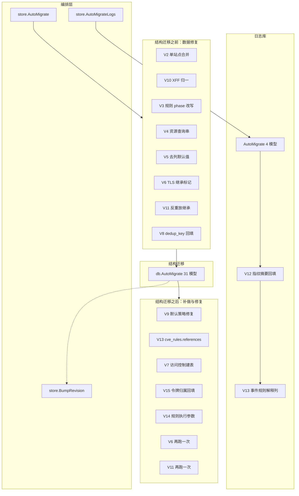
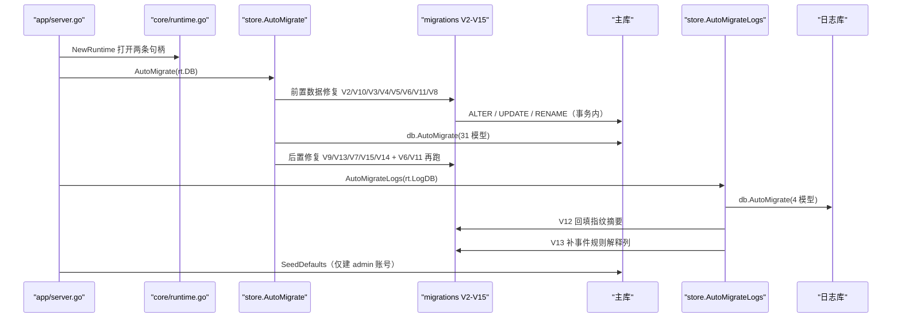
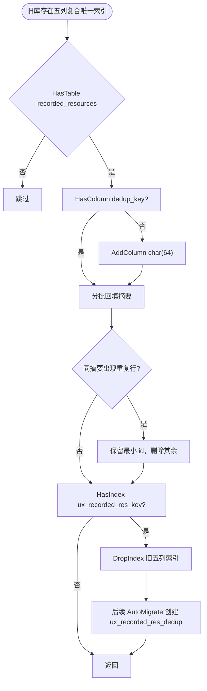
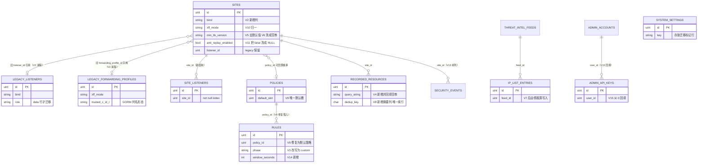
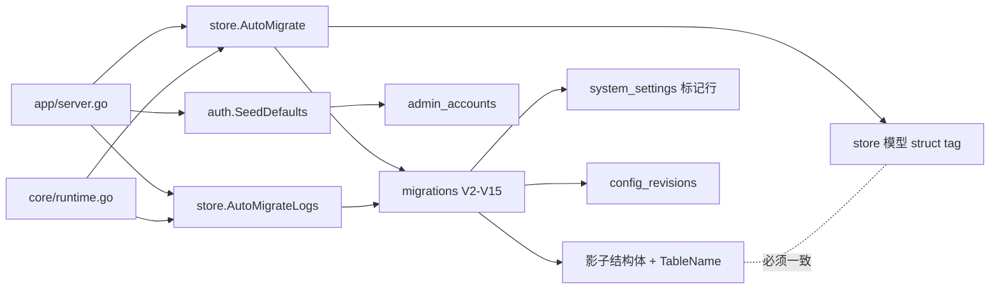

# 数据迁移管理

> [返回 数据存储层](数据存储层.md)

<cite>
**本文档引用的文件**
- [internal/store/migrate.go](file://internal/store/migrate.go)
- [internal/store/migrations/single_site.go](file://internal/store/migrations/single_site.go)
- [internal/store/migrations/recorded_resource_dedup_key.go](file://internal/store/migrations/recorded_resource_dedup_key.go)
- [internal/store/migrations/access_log_fingerprint_key.go](file://internal/store/migrations/access_log_fingerprint_key.go)
- [internal/store/auth/seed.go](file://internal/store/auth/seed.go)
- [internal/store/system.go](file://internal/store/system.go)
- [internal/store/migrate.go](file://internal/store/migrate.go)
- [internal/store/site.go](file://internal/store/site.go)
- [internal/store/policy.go](file://internal/store/policy.go)
- [internal/store/system.go](file://internal/store/system.go)
- [internal/store/events.go](file://internal/store/events.go)
- [internal/store/approute/app_route.go](file://internal/store/approute/app_route.go)
- [internal/store/site.go](file://internal/store/site.go)
- [internal/store/policy.go](file://internal/store/policy.go)
- [internal/store/events.go](file://internal/store/events.go)
- [internal/store/approute/app_route.go](file://internal/store/approute/app_route.go)
- [internal/store/migrations/site_tls_min_version_inheritance.go](file://internal/store/migrations/site_tls_min_version_inheritance.go)
- [internal/store/migrations/site_antireplay_inheritance.go](file://internal/store/migrations/site_antireplay_inheritance.go)
- [internal/core/runtime.go](file://internal/core/runtime.go)
- [internal/app/server.go](file://internal/app/server.go)
- [internal/store/migrations/rule_phase.go](file://internal/store/migrations/rule_phase.go)
- [internal/store/migrations/site_xff_mode.go](file://internal/store/migrations/site_xff_mode.go)
- [internal/store/migrations/api_key_owner.go](file://internal/store/migrations/api_key_owner.go)
- [internal/store/migrations/recorded_resource_query_string.go](file://internal/store/migrations/recorded_resource_query_string.go)
- [internal/store/migrations/dedup_key_test.go](file://internal/store/migrations/dedup_key_test.go)
- [internal/store/migrations/default_policy.go](file://internal/store/migrations/default_policy.go)
- [internal/store/migrations/migrations_test.go](file://internal/store/migrations/migrations_test.go)
- [internal/store/backup.go](file://internal/store/backup.go)
- [internal/store/seed_test.go](file://internal/store/seed_test.go)
- [internal/store/migrations/site_tls_inheritance_defaults.go](file://internal/store/migrations/site_tls_inheritance_defaults.go)
- [internal/store/migrations/security_event_rule_info.go](file://internal/store/migrations/security_event_rule_info.go)
- [internal/store/migrations/access_control.go](file://internal/store/migrations/access_control.go)
- [internal/store/dialect_migration_test.go](file://internal/store/dialect_migration_test.go)
- [internal/store/migrations/rule_execution_params.go](file://internal/store/migrations/rule_execution_params.go)
</cite>

## 目录

1. [简介](#简介)
2. [项目结构](#项目结构)
3. [核心组件](#核心组件)
4. [架构总览](#架构总览)
5. [详细组件分析](#详细组件分析)
6. [依赖关系分析](#依赖关系分析)
7. [性能考虑](#性能考虑)
8. [故障排查指南](#故障排查指南)
9. [结论](#结论)
10. [附录](#附录)

## 简介

数据迁移管理解决两个问题：如何让旧库在不丢数据的前提下追上新的 struct tag，以及如何让这个过程在每次启动都重跑一次仍然安全。

实现方式是一套固定编排：**先数据修复，再结构迁移，最后补做依赖新表的数据修复**。结构本身永远由 `AutoMigrate` 依据 struct tag 生成，15 个具名 `Vn` 函数只处理「tag 无法表达的部分」——历史列改名、取值语义清洗、索引替换、引用完整性修复。没有 down migration，回滚依赖带时间戳的备份表与配置备份。

## 项目结构

迁移编排与版本函数分处两个文件层级，函数命名即版本号。

| 位置 | 行数 | 内容 |
|------|:----:|------|
| `internal/store/migrate.go` | 168 | 编排入口 `AutoMigrate:22`、日志库 `AutoMigrateLogs:126`、修订号 `BumpRevision:141`、`CurrentRevision:162` |
| `internal/store/migrations/`（14 文件） | 1074 | V2–V15 具名函数，每个文件一个关注点 |
| `internal/store/auth/seed.go` | 64 | 种子数据 `SeedDefaults:26` |
| `internal/store/approute/app_route.go` | 141 | 摘要列与 `ComputeDedupKey:113`，被 V8 镜像 |
| `internal/store/backup.go` | 570 | 配置快照导出导入，`BackupVersion:59` |
| `internal/store/system.go` | 34 | `SystemSettings:4` 承载迁移标记行，`ConfigRevision:31` 承载修订号 |

14 个迁移文件按体量排序：

| 文件 | 行数 | 版本函数 | 定义行 |
|------|:----:|----------|:------:|
| `single_site.go` | 182 | V2 | `:10` |
| `recorded_resource_dedup_key.go` | 139 | V8 | `:60` |
| `access_log_fingerprint_key.go` | 115 | V12 | `:41` |
| `access_control.go` | 88 | V7 | `:77` |
| `site_tls_inheritance_defaults.go` | 76 | V5 | `:12` |
| `security_event_rule_info.go` | 76 | V13（两个入口） | `:34`、`:64` |
| `default_policy.go` | 73 | V9 | `:23` |
| `site_tls_min_version_inheritance.go` | 67 | V6 | `:15` |
| `recorded_resource_query_string.go` | 53 | V4 | `:11` |
| `api_key_owner.go` | 51 | V15 | `:21` |
| `site_antireplay_inheritance.go` | 56 | V11 | `:14` |
| `rule_execution_params.go` | 45 | V14 | `:31` |
| `rule_phase.go` | 34 | V3 | `:13` |
| `site_xff_mode.go` | 19 | V10 | `:11` |



**图表来源**
- [internal/store/migrate.go:22-139](file://internal/store/migrate.go#L22-L139)
- [internal/store/migrations/single_site.go:10-44](file://internal/store/migrations/single_site.go#L10-L44)
- [internal/store/migrations/recorded_resource_dedup_key.go:60-83](file://internal/store/migrations/recorded_resource_dedup_key.go#L60-L83)
- [internal/store/migrations/access_log_fingerprint_key.go:41-91](file://internal/store/migrations/access_log_fingerprint_key.go#L41-L91)

**章节来源**
- [internal/store/migrate.go:22-168](file://internal/store/migrate.go#L22-L168)
- [internal/store/migrations/single_site.go:10-182](file://internal/store/migrations/single_site.go#L10-L182)
- [internal/store/auth/seed.go:26-64](file://internal/store/auth/seed.go#L26-L64)
- [internal/store/system.go:3-34](file://internal/store/system.go#L3-L34)

## 核心组件

组件按「谁决定顺序、谁保证幂等、谁提供回滚」划分。

| 组件 | 位置 | 职责 | 幂等机制 |
|------|------|------|----------|
| `AutoMigrate` | `migrate.go:22` | 唯一编排入口 | 由下游函数各自守卫 |
| `AutoMigrateLogs` | `migrate.go:126` | 日志库结构与 V12/V13 | 表存在性守卫 |
| `BumpRevision` | `migrate.go:141` | 修订号自增 | `OnConflict DoNothing` 播种 + 行数校验 |
| `CurrentRevision` | `migrate.go:162` | 读取当前修订号 | `FirstOrCreate` |
| `SeedDefaults` | `auth/seed.go:26` | 首次运行创建 admin 账号 | 计数守卫 + `OnConflict DoNothing` |
| `migrationSystemSetting` | `site_tls_min_version_inheritance.go:60` | 迁移标记行 | 标记存在即跳过 |
| `recordedResourceTable` 等影子结构体 | `recorded_resource_query_string.go:43` | 避免 `migrations → store` 导入环 | 与模型 tag 保持一致 |
| `BackupData` | `backup.go:33` | 配置级快照（非 SQL dump） | `BackupVersion:59` |

### 数据表清单（迁移视角）

下表列出被迁移函数直接改动过的表与其当前归属。

| 表名 | 模型 | 定义位置:行 | 主键 | 索引 | 被哪些版本改动 |
|------|------|-------------|------|------|----------------|
| `sites` | `Site` | `site.go:38` | `id` | `host`、`bind`、`deleted_at` | V2、V5、V6、V10、V11 |
| `site_listeners` | `SiteListener` | `site.go:248` | `id` | `site_id`、`bind` | V2（由 `listeners` 演化） |
| `rules` | `Rule` | `policy.go:70` | `id` | `policy_id`、`phase` | V3、V9、V14 |
| `policies` | `Policy` | `policy.go:10` | `id` | `default_slot` 唯一 | V9 |
| `system_settings` | `SystemSettings` | `system.go:4` | `id` | `key` 唯一 | V6、V11（标记行） |
| `config_revisions` | `ConfigRevision` | `system.go:31` | `id` | — | 由 `BumpRevision` 写单行 |
| `recorded_resources` | `RecordedResource` | `app_route.go:58` | `id` | `ux_recorded_res_dedup` | V4、V8 |
| `access_logs` | `AccessLog` | `events.go:79` | `id` | `idx_al_fingerprint_key` | V12 |
| `security_events` | `SecurityEvent` | `events.go:15` | `id` | 多个 | V13 |
| `cve_rules` | `CVERuleRecord` | `cve/cve.go:10` | `id` | `cve_id` | V13 |
| `admin_api_keys` | `AdminAPIKey` | `auth/auth.go:15` | `id` | `user_id`、`prefix` | V15 |
| `site_access_configs` 等 5 表 | `access.*` | `access/access_control.go:20-80` | `id` | `site_id`/`token` 唯一 | V7 |

**章节来源**
- [internal/store/migrate.go:22-123:22-123](file://internal/store/migrate.go#L22-L123#22)
- [internal/store/site.go:38-147:38-147](file://internal/store/site.go#L38-L147#38)
- [internal/store/policy.go:10-97:10-97](file://internal/store/policy.go#L10-L97#10)
- [internal/store/system.go:4-34:4-34](file://internal/store/system.go#L4-L34#4)
- [internal/store/events.go:15-129:15-129](file://internal/store/events.go#L15-L129#15)
- [internal/store/approute/app_route.go:57-98:57-98](file://internal/store/approute/app_route.go#L57-L98#57)
- [internal/store/migrate.go:22-123](file://internal/store/migrate.go#L22-L123)
- [internal/store/site.go:38-147](file://internal/store/site.go#L38-L147)
- [internal/store/policy.go:10-97](file://internal/store/policy.go#L10-L97)
- [internal/store/system.go:4-34](file://internal/store/system.go#L4-L34)
- [internal/store/events.go:15-129](file://internal/store/events.go#L15-L129)
- [internal/store/approute/app_route.go:57-98](file://internal/store/approute/app_route.go#L57-L98)

### 字段明细（迁移标记行）

迁移标记与一次性状态都存放在通用键值表中，字段口径如下。

| 字段 | 类型 | 约束 | 默认 | 说明 |
|------|------|------|------|------|
| `SystemSettings.ID` | `uint` | `primaryKey` | 自增 | 主键 |
| `SystemSettings.Key` | `string` | `size:128;uniqueIndex;not null` | — | 标记键，如 `migration_v6_site_tls_min_version_inheritance` |
| `SystemSettings.Value` | `string` | `type:text` | — | 标记值，恒为 `"true"` |
| `migrationSystemSetting.Key` | `string` | 影子结构体 `primaryKey` | — | V6/V11 专用视图（`:61`） |
| `migrationSystemSetting.Value` | `string` | 影子结构体 | — | 只读判定用（`:62`） |
| `ConfigRevision.ID` | `uint` | `primaryKey` | 播种为 1 | 单行约束 |
| `ConfigRevision.Revision` | `uint64` | `not null` | 0 | 表达式自增 |

**章节来源**
- [internal/store/migrate.go:22-168](file://internal/store/migrate.go#L22-L168)
- [internal/store/system.go:3-34](file://internal/store/system.go#L3-L34)
- [internal/store/migrations/site_tls_min_version_inheritance.go:10-67](file://internal/store/migrations/site_tls_min_version_inheritance.go#L10-L67)
- [internal/store/migrations/site_antireplay_inheritance.go:10-56](file://internal/store/migrations/site_antireplay_inheritance.go#L10-L56)
- [internal/store/site.go:38-147](file://internal/store/site.go#L38-L147)
- [internal/store/events.go:15-129](file://internal/store/events.go#L15-L129)

## 架构总览

启动阶段迁移共跑四轮，顺序固定，任一失败即启动中止。



**图表来源**
- [internal/store/migrate.go:22-139](file://internal/store/migrate.go#L22-L139)
- [internal/core/runtime.go:63-97](file://internal/core/runtime.go#L63-L97)
- [internal/app/server.go:249-261](file://internal/app/server.go#L249-L261)
- [internal/store/auth/seed.go:26-56](file://internal/store/auth/seed.go#L26-L56)

修订号与迁移是两套独立机制：迁移只改表结构与数据，修订号只表达「配置内容变了，快照需要重建」。二者在 `BumpRevision` 处交汇但不互相触发。

**章节来源**
- [internal/store/migrate.go:141-168](file://internal/store/migrate.go#L141-L168)
- [internal/app/server.go:249-261](file://internal/app/server.go#L249-L261)

## 详细组件分析

### 执行顺序与编排

`AutoMigrate` 的顺序不是风格问题而是因果约束，代码注释逐条给出了理由。

| 序 | 步骤 | 位置 | 为什么必须在此 |
|:--:|------|------|----------------|
| 1 | V2 单站点合并 | `migrate.go:24` | 旧表存在时后续模型列才有归属 |
| 2 | V10 XFF 归一 | `migrate.go:27` | 先洗取值，避免快照读到非法模式 |
| 3 | V3 规则 phase 改写 | `migrate.go:30` | 旧 phase 不可执行，必须先落到 `custom` |
| 4 | V4 资源查询串 | `migrate.go:33` | 为 V8 的五列摘要准备列 |
| 5 | V5 去列默认值 | `migrate.go:36` | 默认值存在会掩盖继承语义 |
| 6 | V6 TLS 继承标记 | `migrate.go:39` | 需要 `system_settings`，旧库可能还没有 |
| 7 | V11 反重放继承 | `migrate.go:42` | 同上 |
| 8 | V8 摘要回填 | `migrate.go:47` | 必须在 `AutoMigrate` 之前，否则唯一索引因重复值创建失败 |
| 9 | 结构迁移 31 模型 | `migrate.go:52-89` | 依据 struct tag 建表加列 |
| 10 | V9 默认策略修复 | `migrate.go:92` | 需要 `default_slot` 列已存在 |
| 11 | V13 `cve_rules.references` | `migrate.go:99` | 启动期 CVE 目录对账早于日志迁移 |
| 12 | V7 访问控制建表 | `migrate.go:104` | 新表，幂等 |
| 13 | V15 令牌归属回填 | `migrate.go:110` | 需要 `admin_accounts` 已建 |
| 14 | V14 规则执行参数 | `migrate.go:113` | 兜底补列 |
| 15 | V6、V11 再跑 | `migrate.go:120-123` | 覆盖「表结构迁移前还没有 `system_settings`」的旧库 |

```go
// internal/store/migrate.go:45-49：顺序即正确性
// 必须在 AutoMigrate 之前：AutoMigrate 会创建 ux_recorded_res_dedup 唯一索引，
// 而旧库的 dedup_key 尚未回填，先建索引会因重复值冲突而失败。
if err := migrations.V8MigrateRecordedResourceDedupKey(db); err != nil {
	return err
}
```

**章节来源**
- [internal/store/migrate.go:22-124](file://internal/store/migrate.go#L22-L124)

### 幂等守卫的四种写法

每个 `Vn` 函数都必须能在已迁移库上重复执行，项目里共四种守卫。

| 守卫类型 | 写法 | 代表 | 适用 |
|----------|------|------|------|
| 表存在性 | `if !db.Migrator().HasTable(...) { return nil }` | `single_site.go:12`、`rule_phase.go:14`、`access_log_fingerprint_key.go:42` | 首次启动或表已被改名 |
| 列存在性 | `if !db.Migrator().HasColumn(...) { return nil }` | `site_xff_mode.go:12`、`api_key_owner.go:25`、`site_antireplay_inheritance.go:17` | 依赖新列的取值修复 |
| 条件更新 | `WHERE` 只命中待修数据 | `rule_phase.go:20`、`site_xff_mode.go:17`、`api_key_owner.go:45` | 天然幂等，重复为无操作 |
| 标记行 | `system_settings` 有键即跳过 | `site_tls_min_version_inheritance.go:25-34`、`site_antireplay_inheritance.go:22-32` | 一次性语义，保护后续显式值 |

```go
// internal/store/migrations/site_tls_min_version_inheritance.go:24-40：
// 标记行让「把 TLS12 洗成空串」只发生一次，之后的显式 TLS12 不再被清掉
var marker migrationSystemSetting
markerQuery := tx.Where(clause.Eq{
	Column: clause.Column{Name: "key"},
	Value:  siteTLSMinVersionInheritanceMigrationKey,
}).Limit(1).Find(&marker)
if markerQuery.Error != nil {
	return fmt.Errorf("failed to load site TLS min version migration marker: %w", markerQuery.Error)
}
if markerQuery.RowsAffected > 0 {
	return nil
}

if err := tx.Model(&siteTLSMinVersionInheritanceTable{}).
	Where("min_tls_version = ?", "TLS12").
	Update("min_tls_version", "").Error; err != nil {
	return fmt.Errorf("failed to migrate sites.min_tls_version default: %w", err)
}
```

```sql
-- V8：加列、回填、剔除重复行，最后由 AutoMigrate 建唯一索引
ALTER TABLE `recorded_resources` ADD COLUMN `dedup_key` char(64);
UPDATE `recorded_resources` SET `dedup_key` = ? WHERE `id` = ?;
DELETE FROM `recorded_resources` WHERE `id` = ?;  -- 同摘要的重复行只保留最小 id
ALTER TABLE `recorded_resources` DROP INDEX `ux_recorded_res_key`;

-- V12：日志表补摘要列与索引，再按 keyset 分批回填
ALTER TABLE `access_logs` ADD COLUMN `fingerprint_key` char(64);
CREATE INDEX `idx_al_fingerprint_key` ON `access_logs`(`fingerprint_key`);
SELECT `id`,`tls_ja3_hash`,`tls_ja4`,`tls_version`,`tls_alpn`,`tls_sni`,
       `tls_cipher_suites`,`tls_extensions`,`tls_curves`,`tls_point_formats`
FROM `access_logs`
WHERE `id` > ? AND (`fingerprint_key` IS NULL OR `fingerprint_key` = '')
  AND (`tls_ja3_hash` <> '' OR `tls_ja4` <> '')
ORDER BY `id` ASC LIMIT 1000;
```

**章节来源**
- [internal/store/migrations/single_site.go:10-44](file://internal/store/migrations/single_site.go#L10-L44)
- [internal/store/migrations/rule_phase.go:13-26](file://internal/store/migrations/rule_phase.go#L13-L26)
- [internal/store/migrations/site_xff_mode.go:11-19](file://internal/store/migrations/site_xff_mode.go#L11-L19)
- [internal/store/migrations/api_key_owner.go:21-51](file://internal/store/migrations/api_key_owner.go#L21-L51)
- [internal/store/migrations/recorded_resource_dedup_key.go:60-139](file://internal/store/migrations/recorded_resource_dedup_key.go#L60-L139)
- [internal/store/migrations/access_log_fingerprint_key.go:41-91](file://internal/store/migrations/access_log_fingerprint_key.go#L41-L91)

### 索引替换类迁移

V4/V8 与 V12 属于同一模式：宽列复合索引不可移植，改为定长摘要列。三步走固定为「加列 → 回填 → 删旧索引」，新唯一索引交由 `AutoMigrate` 创建。



**图表来源**
- [internal/store/migrations/recorded_resource_dedup_key.go:60-139](file://internal/store/migrations/recorded_resource_dedup_key.go#L60-L139)
- [internal/store/migrations/recorded_resource_query_string.go:11-53](file://internal/store/migrations/recorded_resource_query_string.go#L11-L53)
- [internal/store/approute/app_route.go:63-141](file://internal/store/approute/app_route.go#L63-L141)

摘要算法在 `migrations` 与 `approute` 两处各有一份实现，原因是迁移包不能反向依赖 `store`；两者必须逐字节一致，否则回填值与运行期写入值不匹配会产生重复行，这条不变式由 `TestV8ComputeDedupKeyMatchesStoreImplementation` 守住。

**章节来源**
- [internal/store/migrations/recorded_resource_dedup_key.go:15-58](file://internal/store/migrations/recorded_resource_dedup_key.go#L15-L58)
- [internal/store/approute/app_route.go:100-141](file://internal/store/approute/app_route.go#L100-L141)
- [internal/store/migrations/dedup_key_test.go:37-90](file://internal/store/migrations/dedup_key_test.go#L37-L90)

### 引用完整性修复

V9 承担「默认策略」这一隐式不变式：任何时刻必须恰有一个活动策略持有 `default_slot = 1`，且所有 `rules.policy_id` 指向存在且未软删的策略。

| 步骤 | 动作 | SQL 形态 |
|:--:|------|----------|
| 1 | 释放软删行占用的默认槽 | `UPDATE policies SET default_slot = NULL WHERE deleted_at IS NOT NULL AND default_slot IS NOT NULL`（`Unscoped`） |
| 2 | 查现有默认策略（多个则保留 id 最小） | `SELECT * FROM policies WHERE default_slot = 1 ORDER BY id ASC` |
| 3 | 无则创建 `Default Policy` | `INSERT INTO policies (name, description, default_slot) VALUES (...)` |
| 4 | 多余默认槽复位 | `UPDATE policies SET default_slot = NULL WHERE id IN (...)` |
| 5 | 规则孤儿引用改指默认策略 | `UPDATE rules SET policy_id = ? WHERE policy_id IS NULL OR policy_id = 0 OR NOT EXISTS (...)` |
| 6 | 站点孤儿引用复位为继承 | `UPDATE sites SET policy_id = NULL WHERE ...` |

V15 用同样的「回填到最小 id admin 账号」思路修复令牌归属，且只改 `user_id = 0` 或 `IS NULL` 的行；若库里没有 admin 账号则保持不回填，让这些令牌继续失效。

**章节来源**
- [internal/store/migrations/default_policy.go:22-73](file://internal/store/migrations/default_policy.go#L22-L73)
- [internal/store/migrations/api_key_owner.go:9-51](file://internal/store/migrations/api_key_owner.go#L9-L51)
- [internal/store/migrations/migrations_test.go:21-84](file://internal/store/migrations/migrations_test.go#L21-L84)

### 备份、恢复与回滚

本项目没有 down migration，回滚路径由三部分构成：V2 的带时间戳旧表改名、配置备份导入、以及数据库层快照。

```go
// internal/store/migrations/single_site.go:34-40：旧表改名而非删除
timestamp := time.Now().Format("20060102_150405")
if err := tx.Exec(fmt.Sprintf("ALTER TABLE listeners RENAME TO listeners_backup_%s", timestamp)).Error; err != nil {
	return fmt.Errorf("failed to backup listeners table: %w", err)
}
if err := tx.Exec(fmt.Sprintf("ALTER TABLE forwarding_profiles RENAME TO forwarding_profiles_backup_%s", timestamp)).Error; err != nil {
	return fmt.Errorf("failed to backup forwarding_profiles table: %w", err)
}
```

配置备份 `BackupData` 携带 `Version`（当前恒为 1，`backup.go:59`）与 `ExportedAt`，导出覆盖 18 类配置集合，导入在单事务内按外键依赖顺序 upsert，并保留原始主键以维持 `Site.CertID → Certificate.ID` 之类引用。

| 阶段 | 动作 | 位置 |
|------|------|------|
| 导出前置校验 | 全局保护配置与 JS 插件契约校验 | `backup.go:287`、`:270` |
| 导出 | 逐表查询，任一失败整体失败 | `backup.go:93` |
| 导入前置 | XFF 取值归一、规则验证码校验 | `backup.go:348`、`:303` |
| 导入 | 单事务，替换模式先清空配置表 | `backup.go:174`、`:541` |
| 恢复默认槽 | 导入尾调用 V9 修复引用 | `backup.go:262` |
| 零值还原 | `OnConflict{UpdateAll}` 排除带默认值列，插入后再还原 | `backup.go:492` |

**章节来源**
- [internal/store/migrations/single_site.go:16-44](file://internal/store/migrations/single_site.go#L16-L44)
- [internal/store/backup.go:33-85](file://internal/store/backup.go#L33-L85)
- [internal/store/backup.go:165-267](file://internal/store/backup.go#L165-L267)
- [internal/store/backup.go:269-360](file://internal/store/backup.go#L269-L360)
- [internal/store/backup.go:457-570](file://internal/store/backup.go#L457-L570)

### 种子数据与默认值

`SeedDefaults` 只做一件事：在 `admin` 账号不存在时创建它，口令由 `crypto/rand` 生成 16 字节再 hex 编码，bcrypt 哈希后入库，明文口令仅作为返回值输出一次。

```go
// internal/store/auth/seed.go:26-52（节选）：不预置任何 API 令牌
if aCount == 0 {
	password := generateToken(16)
	hash, err := bcrypt.GenerateFromPassword([]byte(password), bcrypt.DefaultCost)
	if err != nil {
		return "", fmt.Errorf("seed: hash admin password: %w", err)
	}
	a := AdminAccount{Username: "admin", PasswordHash: string(hash), Role: RoleAdmin}
	result := db.Clauses(clause.OnConflict{DoNothing: true}).Create(&a)
	if result.Error != nil {
		return "", fmt.Errorf("seed: create admin account: %w", err)
	}
	if result.RowsAffected > 0 {
		firstRunPassword = password
	}
}
```

| 项目 | 取值 | 位置 |
|------|------|------|
| 管理员用户名 | `admin` | `seed.go:41` |
| 口令长度 | 16 随机字节 → 32 位 hex | `seed.go:35`、`:58-63` |
| 哈希算法 | bcrypt `DefaultCost` | `seed.go:36` |
| 角色 | `RoleAdmin` | `seed.go:43` |
| 冲突策略 | `OnConflict DoNothing` | `seed.go:45` |
| API 令牌 | 不预置，由已登录管理员自行创建 | `seed.go:14-18` |

**章节来源**
- [internal/store/auth/seed.go:14-64](file://internal/store/auth/seed.go#L14-L64)
- [internal/store/seed_test.go:22-113](file://internal/store/seed_test.go#L22-L113)

### 迁移前后实体关系

迁移改变了三组关系：监听器与转发配置从独立表并入站点、资源去重从五列复合改为摘要列、日志表新增可与主库逻辑对齐的标识列。



**图表来源**
- [internal/store/migrations/single_site.go:46-182](file://internal/store/migrations/single_site.go#L46-L182)
- [internal/store/migrations/recorded_resource_query_string.go:11-53](file://internal/store/migrations/recorded_resource_query_string.go#L11-L53)
- [internal/store/migrations/recorded_resource_dedup_key.go:15-139](file://internal/store/migrations/recorded_resource_dedup_key.go#L15-L139)
- [internal/store/migrations/site_tls_inheritance_defaults.go:57-65](file://internal/store/migrations/site_tls_inheritance_defaults.go#L57-L65)
- [internal/store/migrations/site_tls_min_version_inheritance.go:52-67](file://internal/store/migrations/site_tls_min_version_inheritance.go#L52-L67)
- [internal/store/migrations/site_antireplay_inheritance.go:50-56](file://internal/store/migrations/site_antireplay_inheritance.go#L50-L56)

图中两个 legacy 实体（`listeners`、`forwarding_profiles`）在迁移后以 `*_backup_<时间戳>` 形态留在库里，不再被任何模型映射；`Site.ListenerID` 与 `Site.ForwardingProfileID` 也保留为兼容列，`AutoMigrate` 仍会维护它们的索引。

**章节来源**
- [internal/store/migrations/single_site.go:10-182](file://internal/store/migrations/single_site.go#L10-L182)
- [internal/store/site.go:143-147](file://internal/store/site.go#L143-L147)
- [internal/store/migrations/site_xff_mode.go:5-19](file://internal/store/migrations/site_xff_mode.go#L5-L19)

## 依赖关系分析



**图表来源**
- [internal/store/migrate.go:1-19](file://internal/store/migrate.go#L1-L19)
- [internal/store/migrations/recorded_resource_query_string.go:40-53](file://internal/store/migrations/recorded_resource_query_string.go#L40-L53)
- [internal/store/migrations/security_event_rule_info.go:9-32](file://internal/store/migrations/security_event_rule_info.go#L9-L32)
- [internal/core/runtime.go:63-97](file://internal/core/runtime.go#L63-L97)

迁移包不 import `store`：`store` 已反向依赖 `migrations`，因此迁移侧为每张要改的表声明了独立结构体（`siteTable`、`ruleTable`、`v9Policy`、`v12AccessLogFingerprintTable`、`v13SecurityEventRuleInfoTable` 等），列类型与索引名必须与模型标签一致。这是本层唯一的重复，也是被测试覆盖的重复。

| 依赖 | 类型 | 说明 |
|------|------|------|
| `gorm.io/gorm` Migrator | 必需 | `HasTable/HasColumn/HasIndex/AddColumn/CreateIndex/DropIndex` |
| `gorm.io/gorm/clause` | 必需 | 播种与冲突处理 |
| `golang.org/x/crypto/bcrypt` | 必需 | 种子口令哈希 |
| `crypto/rand` | 必需 | 口令与令牌熵源 |
| `store` 包 | 禁止 | 由影子结构体替代，避免导入环 |

**章节来源**
- [internal/store/migrations/access_control.go:10-22](file://internal/store/migrations/access_control.go#L10-L22)
- [internal/store/migrations/recorded_resource_dedup_key.go:15-26](file://internal/store/migrations/recorded_resource_dedup_key.go#L15-L26)
- [internal/store/auth/seed.go:3-12](file://internal/store/auth/seed.go#L3-L12)

## 性能考虑

- **问题**：日志库回填需要扫全表，大库启动会卡住。
  **优化**：V12 采用 keyset 游标（`id > ?` + `LIMIT 1000`）而非 offset，且只回填空摘要且含 JA3/JA4 的行。
  **效果**：内存占用有界，历史无指纹行不被无谓重写。
- **问题**：重复行会让唯一索引创建失败。
  **优化**：V8 回填时用 `seen` 表识别同摘要行，保留最小 id 并删除其余。
  **效果**：索引创建一次成功，且结果与运行期 upsert 语义一致。
- **问题**：MySQL 的 DDL 不进事务，失败会留下中间态。
  **优化**：V5 把「列本无默认值」类错误白名单化；V6/V11 用标记行避免重复洗数据。
  **效果**：重复启动幂等，中间态可被下一次启动继续修复。
- **问题**：迁移全量跑一遍会拖慢重启。
  **优化**：所有 `Vn` 以存在性守卫短路，已迁移库几乎只付索引检查成本。
  **效果**：稳态启动的迁移阶段接近常数时间。

[本节为总结，无需特定文件来源]

## 故障排查指南

| 症状 | 根因 | 排查 | 方案 |
|------|------|------|------|
| `failed to add recorded_resources.dedup_key` | 列已存在但类型不符 | 查列类型是否 `char(64)` | 手工对齐后重跑 V8 |
| `ux_recorded_res_dedup` 创建失败 | 摘要未回填或存在重复 | 统计空/重复摘要 | 先 V8 回填去重再结构迁移 |
| `failed to create access_logs fingerprint index` | 日志表已存在但索引残缺 | `HasIndex` 检查结果 | 重跑 `AutoMigrateLogs` |
| V6 未生效 | 标记行已存在 | 查 `system_settings` 键 | 属预期；显式 `TLS12` 不应被清 |
| 站点 `anti_replay_enabled` 全变 NULL | V11 首次执行 | 查标记行时间 | 预期行为，显式关闭需重新设置 |
| 旧令牌全部失效 | 无 admin 账号可回填 | `SELECT id FROM admin_accounts WHERE role='admin'` | 先初始化账号再重启 |
| 启动卡在迁移 | 大日志表回填 | 观察 V12 批次进度 | 等待或在维护窗口手工回填 |
| 权限不足 | 缺 `ALTER`/`RENAME`/`CREATE INDEX` | 用迁移账号执行 dry-run | 授予 DDL 权限 |

```bash
# 迁移幂等验证：连续两次 AutoMigrate 必须都成功
go test ./internal/store -run 'TestAutoMigrate' -count=1 -v
go test ./internal/store/migrations -count=1 -v
# 外部方言验证（需自备实例，未设环境变量则跳过）
export MY_OPENWAF_TEST_MYSQL_DSN='{user}:{password}@tcp({host}:3306)/waf?charset=utf8mb4&parseTime=True&loc=Local'
export MY_OPENWAF_TEST_POSTGRES_DSN='postgres://{user}:{password}@{host}:5432/waf?sslmode=disable'
go test ./internal/store -run TestAutoMigrateOnExternalDialect -v
```

**章节来源**
- [internal/store/migrations/recorded_resource_dedup_key.go:60-139](file://internal/store/migrations/recorded_resource_dedup_key.go#L60-L139)
- [internal/store/migrations/access_log_fingerprint_key.go:41-91](file://internal/store/migrations/access_log_fingerprint_key.go#L41-L91)
- [internal/store/migrations/api_key_owner.go:29-49](file://internal/store/migrations/api_key_owner.go#L29-L49)
- [internal/store/migrations/site_tls_min_version_inheritance.go:24-47](file://internal/store/migrations/site_tls_min_version_inheritance.go#L24-L47)
- [internal/store/dialect_migration_test.go:21-73](file://internal/store/dialect_migration_test.go#L21-L73)

## 结论

迁移管理由「固定编排 + 四种守卫 + 一个修订号」构成：编排把因果关系写进顺序（V8 早于结构迁移、V9 晚于默认槽列），守卫让每次启动重跑都安全，`ConfigRevision` 把「数据变了」与「快照要重建」解耦。KISS 是不引入外部迁移工具与版本号表；YAGNI 是不做 down migration，改用备份表与配置导出；DRY 的例外是摘要算法与影子结构体的两份实现，二者由测试强制一致；SRP 是每个 `Vn` 只做一件事，因此可以任意组合重跑。

已知风险集中在 MySQL 的隐式提交：跨语句 DDL 无法整体回滚，生产变更前必须做数据库级备份。

## 附录

### 迁移函数编写约定

| 约定 | 要求 | 反例后果 |
|------|------|----------|
| 入口守卫 | 先 `HasTable`，再 `HasColumn`/`HasIndex` | 首次启动即报错 |
| 一次性语义 | 需要「只洗一次」时写标记行 | 显式配置被反复清除 |
| 大表回填 | keyset 游标 + 固定批次 | 内存峰值不可控 |
| 影子结构体 | 只声明所需列，注释指明与模型保持一致 | 导入环或列定义漂移 |
| 顺序说明 | 在调用点注释因果 | 后来者误调整顺序 |
| 错误信息 | 包表名与列名 | 排障需要复现才能定位 |
| 权限 | 需要 `ALTER`/`RENAME`/`CREATE INDEX`/`DROP INDEX` | 中途失败留半态 |

**章节来源**
- [internal/store/migrations/single_site.go:10-76](file://internal/store/migrations/single_site.go#L10-L76)
- [internal/store/migrations/recorded_resource_dedup_key.go:60-139](file://internal/store/migrations/recorded_resource_dedup_key.go#L60-L139)
- [internal/store/migrations/site_tls_min_version_inheritance.go:15-50](file://internal/store/migrations/site_tls_min_version_inheritance.go#L15-L50)
- [internal/store/migrations/access_log_fingerprint_key.go:41-91](file://internal/store/migrations/access_log_fingerprint_key.go#L41-L91)

### 版本速查

| 版本 | 类型 | 影响表 | 幂等 |
|:----:|------|--------|:----:|
| V2 | 表合并 | `sites`、`listeners`、`forwarding_profiles` | ✓ |
| V3 | 取值改写 | `rules` | ✓ |
| V4 | 加列 + 删索引 | `recorded_resources` | ✓ |
| V5 | 方言 DDL | `sites` | ✓ |
| V6 | 标记行一次性 | `sites`、`system_settings` | ✓ |
| V7 | 建表 | 访问控制 5 表 | ✓ |
| V8 | 摘要列 | `recorded_resources` | ✓ |
| V9 | 引用修复 | `policies`、`rules`、`sites` | ✓ |
| V10 | 取值归一 | `sites` | ✓ |
| V11 | 标记行一次性 | `sites`、`system_settings` | ✓ |
| V12 | 加列 + 回填 | `access_logs` | ✓ |
| V13 | 补列 | `security_events`、`cve_rules` | ✓ |
| V14 | 补列 | `rules` | ✓ |
| V15 | 回填归属 | `admin_api_keys` | ✓ |

**章节来源**
- [internal/store/migrate.go:22-123](file://internal/store/migrate.go#L22-L123)
- [internal/store/migrations/access_control.go:77-88](file://internal/store/migrations/access_control.go#L77-L88)
- [internal/store/migrations/security_event_rule_info.go:34-76](file://internal/store/migrations/security_event_rule_info.go#L34-L76)
- [internal/store/migrations/rule_execution_params.go:31-45](file://internal/store/migrations/rule_execution_params.go#L31-L45)
- [internal/store/migrations/api_key_owner.go:21-51](file://internal/store/migrations/api_key_owner.go#L21-L51)
