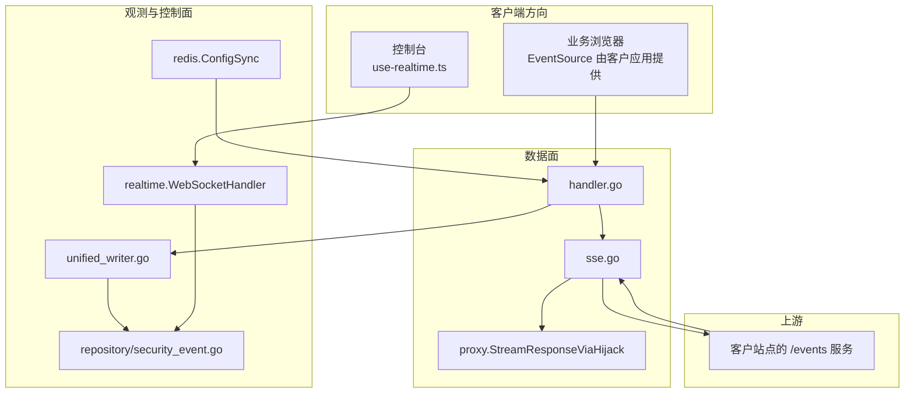
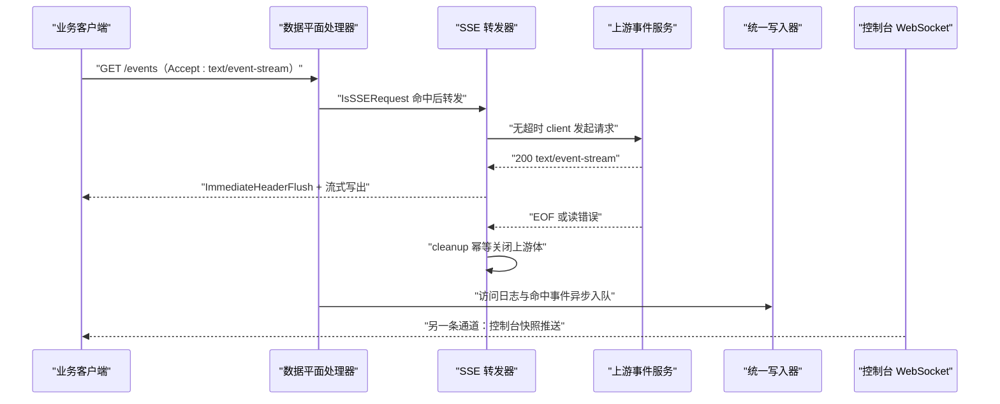
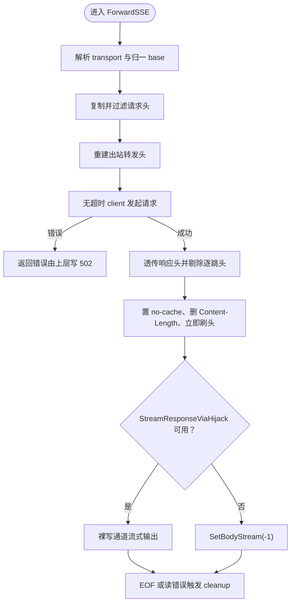
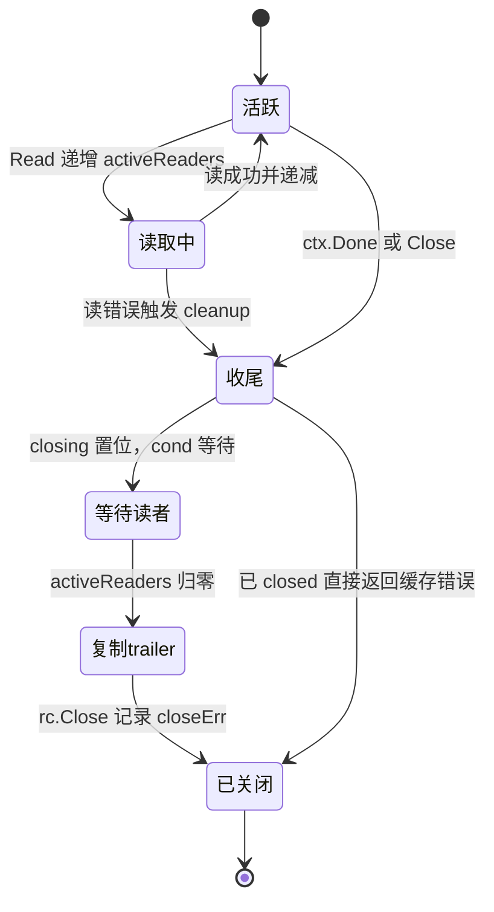
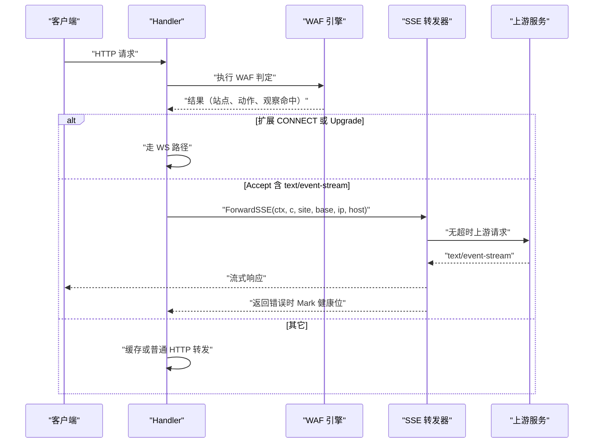
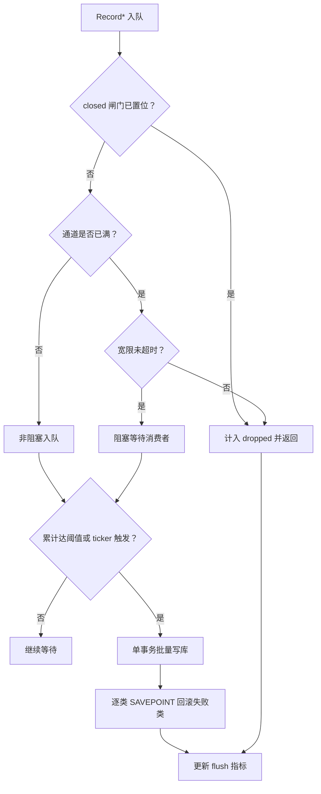
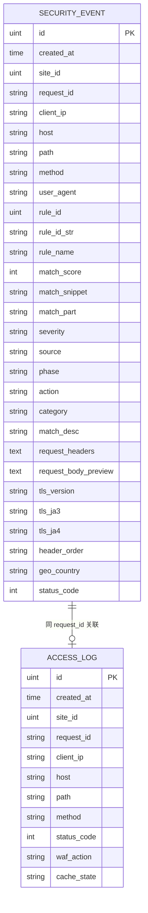
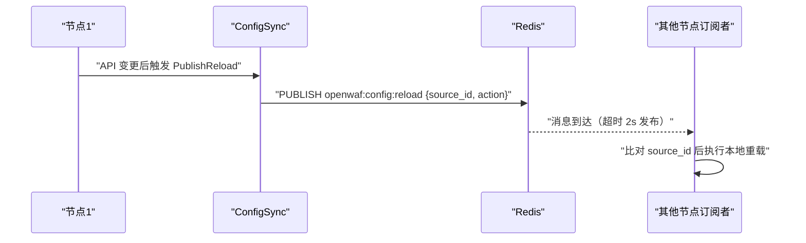
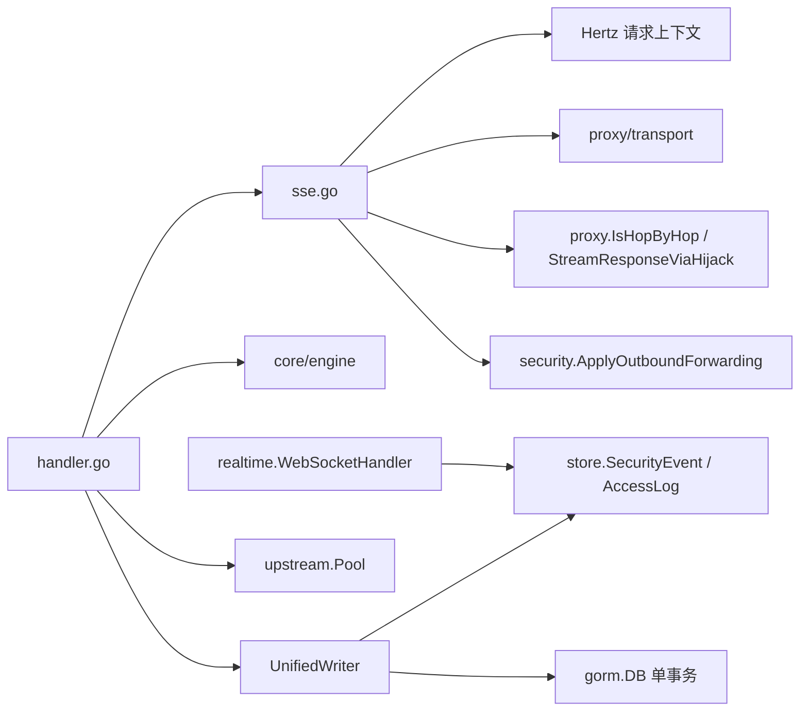

> [返回 数据平面处理](数据平面处理.md)

# SSE 事件推送

<cite>
**本文档引用的文件**
- [internal/dataplane/sse.go](file://internal/dataplane/sse.go)
- [internal/dataplane/handler.go](file://internal/dataplane/handler.go)
- [internal/dataplane/handler_support.go](file://internal/dataplane/handler_support.go)
- [internal/dataplane/access_log.go](file://internal/dataplane/access_log.go)
- [internal/dataplane/inbound_conn.go](file://internal/dataplane/inbound_conn.go)
- [internal/dataplane/logredact/sanitize.go](file://internal/dataplane/logredact/sanitize.go)
- [internal/observability/unified_writer.go](file://internal/observability/unified_writer.go)
- [internal/observability/metrics.go](file://internal/observability/metrics.go)
- [internal/upstream/health.go](file://internal/upstream/health.go)
- [internal/observability/archiver.go](file://internal/observability/archiver.go)
- [internal/store/events.go](file://internal/store/events.go)
- [internal/store/repository/security_event.go](file://internal/store/repository/security_event.go)
- [internal/core/redis/pubsub.go](file://internal/core/redis/pubsub.go)
- [internal/core/config.go](file://internal/core/config.go)
- [internal/proxy/proxy.go](file://internal/proxy/proxy.go)
- [internal/proxy/transport/transport.go](file://internal/proxy/transport/transport.go)
- [internal/security/outbound.go](file://internal/security/outbound.go)
- [internal/security/clientip.go](file://internal/security/clientip.go)
- [internal/snapshot/snapshot.go](file://internal/snapshot/snapshot.go)
- [internal/admin/router.go](file://internal/admin/router.go)
- [internal/admin/system/realtime/realtime.go](file://internal/admin/system/realtime/realtime.go)
- [frontend/hooks/use-realtime.ts](file://frontend/hooks/use-realtime.ts)
</cite>

## 目录

1. [简介](#简介)
2. [项目结构](#项目结构)
3. [核心组件](#核心组件)
4. [架构总览](#架构总览)
5. [详细组件分析](#详细组件分析)
6. [依赖关系分析](#依赖关系分析)
7. [性能考虑](#性能考虑)
8. [故障排查指南](#故障排查指南)
9. [结论](#结论)
10. [附录](#附录)

## 简介
本文件系统性阐述 OpenWAF 中 Server-Sent Events（SSE）的处理边界与实现方式。需要先明确一条分界：**本项目的 SSE 是「客户事件流的透传能力」，不是「WAF 自身的推送通道」**。

- SSE 透传：数据面识别 `Accept: text/event-stream` 后，把上游站点的 `text/event-stream` 原样流式转发给客户端，见 `internal/dataplane/sse.go`
- 安全事件落库：WAF 命中产生的安全事件与访问日志由统一写入器异步批量写入，与 SSE 无耦合
- 管理端实时推送：控制台的事件与状态快照走 WebSocket（`/api/v1/realtime/ws`，`router.go:424`），前端未使用 `EventSource`
- 配置变更同步：多节点之间通过 Redis 发布/订阅通道 `openwaf:config:reload` 通知重载（`pubsub.go:16`）

围绕这条边界，本文覆盖：协议识别与请求改写、响应头处理与流式回写、流生命周期与资源回收、写入器的缓冲与批处理、以及事件模型与查询聚合。

## 项目结构
SSE 相关能力分布在如下模块：

| 模块 | 路径 | 职责 | 核心符号 | 规模(行) |
|------|------|------|----------|:--------:|
| SSE 转发 | `internal/dataplane/sse.go` | 识别、构造上游请求、流式回写 | `ForwardSSE`（L21）、`IsSSERequest`（L263） | 277 |
| 流生命周期 | `internal/dataplane/sse.go` | 幂等清理与 trailer 复制 | `sseBodyStream`（L141）、`copySSETrailers`（L250） | 同上 |
| 分支注册 | `internal/dataplane/handler.go` | 转发分支顺序 | `IsSSERequest` 分支（L1130） | 1280 |
| 劫持写出 | `internal/proxy/proxy.go` | 裸写通道流式输出 | `StreamResponseViaHijack`（L2508） | 2989 |
| 无超时客户端 | `internal/proxy/transport/transport.go` | 按 RoundTripper 复用 client | `SharedNoTimeoutClientForRoundTripper`（L294） | 1280 |
| 出站头 | `internal/security/outbound.go` | 重建 XFF/XFH/XFP | `ApplyOutboundForwarding` | 439 |
| 事件写入 | `internal/observability/unified_writer.go` | 四类记录批量落库 | `UnifiedWriter`（L25） | 1182 |
| 事件模型 | `internal/store/events.go` | 安全事件与访问日志字段 | `SecurityEvent`（L15）、`AccessLog`（L79） | 278 |
| 事件仓库 | `internal/store/repository/security_event.go` | 列表、聚合、Top、清理 | `SecurityEventRepo` | 3206（包） |
| 配置同步 | `internal/core/redis/pubsub.go` | 发布/订阅重载 | `ConfigSync`（L29）、`PublishReload`（L65） | 174 |
| 管理端推送 | `internal/admin/system/realtime/realtime.go` | WebSocket 主题广播 | `RealtimeHub`（L39）、`WebSocketHandler`（L204） | 616 |

**图表来源**
- [internal/dataplane/handler.go:1130-1131](file://internal/dataplane/handler.go#L1130-L1131)
- [internal/dataplane/sse.go:21-89](file://internal/dataplane/sse.go#L21-L89)
- [internal/proxy/proxy.go:2508-2556](file://internal/proxy/proxy.go#L2508-L2556)
- [internal/observability/unified_writer.go:17-45](file://internal/observability/unified_writer.go#L17-L45)
- [internal/admin/system/realtime/realtime.go:199-232](file://internal/admin/system/realtime/realtime.go#L199-L232)
- [internal/core/redis/pubsub.go:16-40](file://internal/core/redis/pubsub.go#L16-L40)

**章节来源**
- [internal/dataplane/sse.go:262-277](file://internal/dataplane/sse.go#L262-L277)
- [internal/store/events.go:15-78](file://internal/store/events.go#L15-L78)
- [internal/admin/router.go:248](file://internal/admin/router.go#L248)
- [internal/admin/router.go:424](file://internal/admin/router.go#L424)
- [frontend/hooks/use-realtime.ts:59](file://frontend/hooks/use-realtime.ts#L59)
- [frontend/hooks/use-realtime.ts:170](file://frontend/hooks/use-realtime.ts#L170)

## 核心组件
- SSE 转发器：识别 SSE 请求、构造上游请求、透传响应头、置流式标记并把上游体交给 Hertz 写出
- 流生命周期对象：`sseBodyStream` 负责幂等清理、活跃读者计数与 trailer 复制
- 数据平面处理器：按「扩展 CONNECT → WebSocket → SSE → 需记录响应体 → 缓存/普通 HTTP」的固定顺序选择分支
- 统一写入器：把安全事件、访问日志、丢弃事件、机器人评分四类记录异步批量落库
- 安全事件模型与仓库：提供字段完备的事件模型、分页查询、聚合统计与过期清理
- Redis 配置同步：跨节点发布/订阅重载通知，与 SSE 无关但常被混淆
- 控制台实时通道：WebSocket 主题化广播（dashboard/runtime/upstreams/audit/fingerprints/heartbeat）

**章节来源**
- [internal/dataplane/sse.go:21-89](file://internal/dataplane/sse.go#L21-L89)
- [internal/dataplane/handler.go:1122-1131](file://internal/dataplane/handler.go#L1122-L1131)
- [internal/observability/unified_writer.go:17-110](file://internal/observability/unified_writer.go#L17-L110)
- [internal/store/events.go:15-120](file://internal/store/events.go#L15-L120)
- [internal/core/redis/pubsub.go:22-80](file://internal/core/redis/pubsub.go#L22-L80)
- [internal/admin/system/realtime/realtime.go:26-60](file://internal/admin/system/realtime/realtime.go#L26-L60)

## 架构总览
下图展示一次 SSE 透传请求的端到端形态：请求由客户端业务应用发起，WAF 只做识别、改写与流式回传；控制台的实时观测走另一条 WebSocket 通道。

**图表来源**
- [internal/dataplane/handler.go:1130-1131](file://internal/dataplane/handler.go#L1130-L1131)
- [internal/dataplane/sse.go:21-89](file://internal/dataplane/sse.go#L21-L89)
- [internal/admin/system/realtime/realtime.go:240-288](file://internal/admin/system/realtime/realtime.go#L240-L288)

## 详细组件分析

### SSE 转发器（ForwardSSE）
- 功能职责
  - 用 `Accept` 头识别 SSE 请求，要求 `text/event-stream` 后面是串尾或 `;`、`,`、空白，避免子串误判
  - 经 `UpstreamRoundTripperForBase` 解析 transport 与归一 base，交给 `SharedNoTimeoutClientForRoundTripper` 的无超时 client
  - 复制请求头时过滤 `connection`、`keep-alive`、`proxy-connection`、`te`、`trailer`、`transfer-encoding`、`upgrade`、`host` 与 `x-openwaf-internal-*`
  - 用 `ApplyOutboundForwarding` 重建出站 `X-Forwarded-For`/`Host`/`Proto`
  - 透传响应头时剔除逐跳头与 `Connection` 中列出的头，复制 trailer，必要时删除 `Server`
- 关键响应处理
  - 写入 `Cache-Control: no-cache`；删除 `Connection`；删除 `Content-Length` 并显式置 -1，表示长度未知
  - 置 `ImmediateHeaderFlush = true`，让响应头在首个事件到达前即可下发
  - 优先用 `StreamResponseViaHijack` 走裸写通道；不可用时退回 `SetBodyStream(stream, -1)`
- 错误处理
  - 请求构造失败立即取消上游 context 并返回错误
  - 读错误由 `sseBodyStream.Read` 触发一次 `cleanup`，最终错误统一交回上层处理

转发步骤与判定依据：

| 步 | 动作 | 执行位置 | 输入 | 输出 | 失败分支 | 可观测点 |
|:--:|------|----------|------|------|----------|----------|
| 1 | 识别 SSE | `sse.go:263` | Accept 头 | true | 走其它分支 | 转发分支日志 |
| 2 | 解析 transport | `sse.go:22` | base | RoundTripper + 归一 base | 返回错误 → 502 | `UpstreamHTTPProtocol` |
| 3 | 构造上游请求 | `sse.go:32-37` | 方法/URI/body | `*http.Request` | 构造失败 | 错误日志 |
| 4 | 复制请求头 | `sse.go:39-49` | 原始头 | 过滤后头 | — | 抓包对比 |
| 5 | 重建出站头 | `sse.go:50` | 客户端 IP、原始 Host | XFF/XFH/XFP | 模板解析失败 | 上游可见头 |
| 6 | 发起请求 | `sse.go:52-57` | 无超时 client | 上游响应 | 连接错误 → 502 | `Mark` 健康位 |
| 7 | 透传响应头 | `sse.go:60-75` | 上游头 | 客户端头 | 逐跳头剔除 | 响应头 |
| 8 | 置流式标记 | `sse.go:77-81` | — | no-cache、长度未知、立即刷头 | — | 首字节延迟 |
| 9 | 安装流对象 | `sse.go:82-87` | 上游 body | hijack 或 SetBodyStream | 退回缓冲写出 | 响应体 |
| 10 | 收尾清理 | `sse.go:173-215` | ctx 或读错误 | 幂等 Close | 活跃读者等待 | goroutine 数 |

**图表来源**
- [internal/dataplane/sse.go:21-89](file://internal/dataplane/sse.go#L21-L89)
- [internal/dataplane/sse.go:101-117](file://internal/dataplane/sse.go#L101-L117)
- [internal/proxy/transport/transport.go:800-856](file://internal/proxy/transport/transport.go#L800-L856)
- [internal/proxy/transport/transport.go:294-312](file://internal/proxy/transport/transport.go#L294-L312)
- [internal/proxy/proxy.go:2508-2556](file://internal/proxy/proxy.go#L2508-L2556)
- [internal/security/outbound.go:33-56](file://internal/security/outbound.go#L33-L56)

**章节来源**
- [internal/dataplane/sse.go:39-52](file://internal/dataplane/sse.go#L39-L52)
- [internal/dataplane/sse.go:91-99](file://internal/dataplane/sse.go#L91-L99)
- [internal/proxy/proxy.go:2771-2863](file://internal/proxy/proxy.go#L2771-L2863)
- [internal/snapshot/snapshot.go:337-362](file://internal/snapshot/snapshot.go#L337-L362)

### 流生命周期与资源回收
`sseBodyStream` 是本实现里最容易出问题的对象：上游体必须在「ctx 取消」「读错误」「显式 Close」三种入口下都只关一次，且不能在有活跃读者时抢关。

**图表来源**
- [internal/dataplane/sse.go:141-171](file://internal/dataplane/sse.go#L141-L171)
- [internal/dataplane/sse.go:173-242](file://internal/dataplane/sse.go#L173-L242)
- [internal/dataplane/sse.go:250-260](file://internal/dataplane/sse.go#L250-L260)

**章节来源**
- [internal/dataplane/sse.go:119-139](file://internal/dataplane/sse.go#L119-L139)
- [internal/dataplane/sse.go:199-215](file://internal/dataplane/sse.go#L199-L215)

### 数据平面处理器（Handler）
- 功能职责
  - 解析站点、解析客户端 IP、构建请求上下文并执行 WAF 判定
  - 按固定顺序选择转发分支，SSE 位于 WebSocket 之后
  - 记录访问日志与指标，必要时写安全事件
- SSE 分支
  - `IsSSERequest` 命中后调用 `ForwardSSE(ctx, c, site, base, clientIP, host)`
  - 上游错误统一走 `Mark(base, err)` 回写健康位，再由错误处理路径给出状态码
  - 记录状态码时 SSE 与 WebSocket 分支被排除在部分统计之外（`handler.go:1229`）

**图表来源**
- [internal/dataplane/handler.go:1122-1131](file://internal/dataplane/handler.go#L1122-L1131)
- [internal/dataplane/handler.go:1215-1232](file://internal/dataplane/handler.go#L1215-L1232)
- [internal/dataplane/sse.go:21-30](file://internal/dataplane/sse.go#L21-L30)

**章节来源**
- [internal/dataplane/handler.go:340-390](file://internal/dataplane/handler.go#L340-L390)
- [internal/dataplane/handler.go:529-533](file://internal/dataplane/handler.go#L529-L533)
- [internal/upstream/health.go:470-476](file://internal/upstream/health.go#L470-L476)

### 统一写入器（UnifiedWriter）
- 功能职责
  - 接收安全事件、访问日志、丢弃事件与机器人评分四类记录，各放入一个有界缓冲通道
  - 单 goroutine 排空全部通道，在同一个数据库事务内批量写入，从根本上消除 SQLite 写锁竞争
  - 逐类 SAVEPOINT 隔离：某类写入失败只回滚该类，其余三类照常提交
  - 关闭时先置 `closed` 闸门，再在预算内排空四个通道
- 队列与批处理取值（默认值来自 `DefaultUnifiedWriterOptions`，可由环境变量覆盖并被硬上限钳制）

| 配置项 | 默认值 | 硬上限 | 环境变量 | 位置 |
|--------|:------:|:------:|----------|------|
| 事件/访问日志缓冲 | 16384 | 1048576 | `MY_OPENWAF_QUEUE_EVENT_BUFFER_SIZE` | `unified_writer.go:126`、`config.go:113` |
| 丢弃/机器人评分缓冲 | 8192 | 1048576 | `MY_OPENWAF_QUEUE_DROP_BUFFER_SIZE` | `unified_writer.go:127`、`config.go:114` |
| 批量阈值（四类合计） | 256 | 10000 | `MY_OPENWAF_QUEUE_BATCH_SIZE` | `unified_writer.go:128`、`config.go:115` |
| 定时 flush 周期 | 3s | 60s | `MY_OPENWAF_QUEUE_FLUSH_INTERVAL` | `unified_writer.go:129`、`config.go:116` |
| 队列满宽限 | 30s | 5m | `MY_OPENWAF_QUEUE_SLOW_LOG_GRACE` | `unified_writer.go:172`、`config.go:123` |
| 通用写队列批次 | 64 | 10000 | `MY_OPENWAF_QUEUE_WRITE_BATCH_SIZE` | `config.go:117` |
| 通用写队列容量 | 256 | 1048576 | `MY_OPENWAF_QUEUE_WRITE_CAPACITY` | `config.go:118` |
| 通用写队列 tick | 50ms | — | `MY_OPENWAF_QUEUE_WRITE_INTERVAL` | `config.go:119` |

**图表来源**
- [internal/observability/unified_writer.go:25-110](file://internal/observability/unified_writer.go#L25-L110)
- [internal/observability/unified_writer.go:122-192](file://internal/observability/unified_writer.go#L122-L192)

**章节来源**
- [internal/observability/unified_writer.go:112-172](file://internal/observability/unified_writer.go#L112-L172)
- [internal/core/config.go:76-123](file://internal/core/config.go#L76-L123)
- [internal/core/config.go:95-106](file://internal/core/config.go#L95-L106)
- [internal/observability/metrics.go:774-820](file://internal/observability/metrics.go#L774-L820)

### 安全事件模型与仓库
- 模型（`store.SecurityEvent`，`events.go:15`）
  - 请求标识与身份：`RequestID`、`ClientIP`、`Host`、`Path`、`QueryString`、`Method`、`UserAgent`
  - 命中明细：`RuleID`/`RuleIDStr`/`RuleName`/`RuleDesc`、`MatchScore`、`MatchSnippet`、`MatchPart`、`Severity`、`Source`、`CVSSScore`、`CWEType`
  - 审计载荷：`RequestHeaders`、`RequestBodyPreview`、`RequestBodyTruncated`、`RequestSize`，均经脱敏与截断
  - TLS 指纹：`TLSVersion`、`TLSSNI`、`TLSALPN`、`TLSJA3`、`TLSJA4`、`TLSCipherSuites`、`TLSCurves`、`HeaderOrder`
  - 判决结果：`Phase`、`Action`、`Category`、`MatchDesc`、`StatusCode`、`GeoCountry`、`GeoCity`
- 仓库（`SecurityEventRepo`）：分页列表、单条查询、批量写入、按时间范围清理，以及分类统计、Top IP/Path/Rule 与时间线聚合
- 消费方式：控制台列表与统计接口读取；实时快照由 WebSocket 的 `audit` 主题广播（`realtime.go:271-276`）

**图表来源**
- [internal/store/events.go:15-78](file://internal/store/events.go#L15-L78)
- [internal/store/events.go:79-120](file://internal/store/events.go#L79-L120)

**章节来源**
- [internal/store/repository/security_event.go](file://internal/store/repository/security_event.go)
- [internal/dataplane/access_log.go:106-182](file://internal/dataplane/access_log.go#L106-L182)
- [internal/dataplane/logredact/sanitize.go:131-292](file://internal/dataplane/logredact/sanitize.go#L131-L292)
- [internal/admin/system/realtime/realtime.go:297-305](file://internal/admin/system/realtime/realtime.go#L297-L305)

### Redis 配置同步（发布/订阅）
- 功能职责
  - `PublishReload` 把 `{source_id, action:"reload"}` 发布到通道 `openwaf:config:reload`，发布超时 2 秒
  - 订阅端收到后触发本地快照重载；`source_id` 用于忽略自己发出的消息
  - `client` 为 nil 时 `NewConfigSync` 直接返回 nil，整套同步在无 Redis 部署下静默关闭
- 与 SSE 的区别：这是控制面一致性机制，不向浏览器推送任何内容

**图表来源**
- [internal/core/redis/pubsub.go:16-80](file://internal/core/redis/pubsub.go#L16-L80)

**章节来源**
- [internal/core/redis/pubsub.go:22-64](file://internal/core/redis/pubsub.go#L22-L64)

### 控制台实时通道
控制台的事件与状态更新不通过 SSE。前端 `use-realtime.ts` 用 `new WebSocket(...)` 连接 `/api/v1/realtime/ws`，连接前先向 `/realtime/ticket` 取一次性票据；服务端 `RealtimeHub` 按主题广播，每客户端发送队列容量 8，队列满时按实现丢弃而非阻塞。

| 主题 | 内容 | 触发方式 | 位置 |
|------|------|----------|------|
| `dashboard` | 仪表盘快照 | ticker 广播 | `realtime.go:250` |
| `runtime` | 运行时健康快照 | ticker 广播 | `realtime.go:254` |
| `upstreams` | 上游状态列表 | ticker 广播 | `realtime.go:257` |
| `audit` | 访问日志与安全事件快照 | ticker 广播 | `realtime.go:265` |
| `fingerprints` | TLS 指纹聚合 | ticker 广播 | `realtime.go:278` |
| `heartbeat` | 连接活性 | ticker 广播 | `realtime.go:261` |

**章节来源**
- [internal/admin/router.go:248](file://internal/admin/router.go#L248)
- [internal/admin/router.go:424](file://internal/admin/router.go#L424)
- [internal/admin/system/realtime/realtime.go:26-36](file://internal/admin/system/realtime/realtime.go#L26-L36)
- [internal/admin/system/realtime/realtime.go:204-232](file://internal/admin/system/realtime/realtime.go#L204-L232)
- [internal/admin/system/realtime/realtime.go:240-288](file://internal/admin/system/realtime/realtime.go#L240-L288)
- [frontend/hooks/use-realtime.ts:59](file://frontend/hooks/use-realtime.ts#L59)
- [frontend/hooks/use-realtime.ts:170](file://frontend/hooks/use-realtime.ts#L170)

## 依赖关系分析
- SSE 转发器依赖
  - `internal/proxy/transport`：解析 transport 与复用无超时 client
  - `internal/proxy`：逐跳头判定与 hijack 流式写出
  - `internal/security`：出站转发头重建
  - Hertz 请求上下文：读写头、状态码与流式写出
- 数据平面处理器依赖
  - WAF 引擎决定放行与否；上游状态池记录回源结果；统一写入器承接日志与事件
- 统一写入器依赖
  - `gorm.DB`：单事务批量写入四类记录，不经过仓储层；可选 Redis 镜像与 COUNT 缓存失效
- 配置同步依赖
  - rueidis 客户端，nil 时整套机制关闭

| 调用方 ↓ / 被调方 → | proxy | proxy/transport | security | snapshot | observability | upstream | core/engine |
|---------------------|:---:|:---:|:---:|:---:|:---:|:---:|:---:|
| sse.go | ✓ | ✓ | ✓ | ✓ | — | — | — |
| handler.go | ✓ | ✓ | ✓ | ✓ | ✓ | ✓ | ✓ |
| unified_writer.go | — | — | — | — | — | — | — |
| realtime.go | — | — | — | — | — | ✓ | — |

写入器不反向依赖数据面：它只依赖 `store` 模型与 `gorm`，四类记录由调用方以结构体值传入，因此观测层可被独立替换。

**图表来源**
- [internal/dataplane/sse.go:14-18](file://internal/dataplane/sse.go#L14-L18)
- [internal/dataplane/handler.go:14-36](file://internal/dataplane/handler.go#L14-L36)
- [internal/observability/unified_writer.go:1-16](file://internal/observability/unified_writer.go#L1-L16)
- [internal/admin/system/realtime/realtime.go:14-36](file://internal/admin/system/realtime/realtime.go#L14-L36)

**章节来源**
- [internal/observability/unified_writer.go:25-110](file://internal/observability/unified_writer.go#L25-L110)
- [internal/upstream/health.go:470-476](file://internal/upstream/health.go#L470-L476)

### 关键符号代码上下文
| 符号 | 位置 | 职责 | 上游调用者 | 下游依赖 | 副作用 | 影响面 |
|------|------|------|------------|----------|--------|--------|
| `ForwardSSE` | `dataplane/sse.go:21` | 事件流透传 | `handler.go:1131` | `UpstreamRoundTripperForBase`、`StreamResponseViaHijack` | 挂流对象、延迟关闭上游体 | 高：所有 SSE 业务 |
| `sseBodyStream.cleanup` | `dataplane/sse.go:173` | 幂等收尾 | `Read` 错误、ctx 取消、`Close` | `copySSETrailers`、`rc.Close` | 等待活跃读者 | 高：泄漏与卡尾 |
| `SharedNoTimeoutClientForRoundTripper` | `proxy/transport/transport.go:294` | 复用无超时 client | `sse.go:52` | `rtClientPool` | 池增长 | 中：连接复用 |
| `RecordAccessLog` | `observability/unified_writer.go` | 访问日志入队 | `access_log.go:507` | `accessCh` 有界通道 | 满时丢弃并计数 | 中：审计完整性 |

**章节来源**
- [internal/dataplane/sse.go:21-89](file://internal/dataplane/sse.go#L21-L89)
- [internal/dataplane/sse.go:173-242](file://internal/dataplane/sse.go#L173-L242)
- [internal/proxy/transport/transport.go:294-312](file://internal/proxy/transport/transport.go#L294-L312)
- [internal/dataplane/access_log.go:503-530](file://internal/dataplane/access_log.go#L503-L530)

## 性能考虑
- 首字节延迟：`ImmediateHeaderFlush` 让响应头在首个事件前下发，避免客户端等待凑批
- 写出路径：优先 hijack 裸写通道，减少一次框架层缓冲
- 长度未知：显式 `SetContentLength(-1)`，避免框架按缓冲体写出而截断流
- 批处理：默认 256 条/3 秒的组合在「延迟」与「写放大」之间取平衡；宽限 30 秒保证高并发下不丢日志
- 归档：默认保留 30 天、清理间隔 24 小时，控制存储增长与查询代价

**章节来源**
- [internal/dataplane/sse.go:77-87](file://internal/dataplane/sse.go#L77-L87)
- [internal/proxy/proxy.go:2508-2556](file://internal/proxy/proxy.go#L2508-L2556)
- [internal/observability/unified_writer.go:122-192](file://internal/observability/unified_writer.go#L122-L192)
- [internal/observability/archiver.go:52-58](file://internal/observability/archiver.go#L52-L58)

## 故障排查指南
- SSE 无输出或延迟高
  - 确认上游确实返回 `text/event-stream`，且 `Accept` 判定命中（`sse.go:263`）
  - 检查是否被中间层缓冲（`X-Accel-Buffering` 之类由上游负责）
  - 观察响应头是否含 `Cache-Control: no-cache`，以及 `Content-Length` 是否已被移除
- 事件丢失
  - 看 `openwaf_writer_dropped_total` 与 `openwaf_write_queue_dropped_full_total`
  - 队列满且未超宽限时会阻塞等待，超过宽限才丢弃
- 数据库写入失败
  - SAVEPOINT 只回滚失败的那一类，其余三类照常提交；核对 `openwaf_writer_flush_errors_total`
- 配置不同步
  - 核对通道名 `openwaf:config:reload` 与 `source_id` 过滤逻辑；无 Redis 时 `NewConfigSync` 返回 nil
- 控制台不更新
  - 这是 WebSocket 通道问题，与 SSE 无关：先查 `/realtime/ticket` 是否 401，再查 `topics` 参数

**章节来源**
- [internal/dataplane/sse.go:60-88](file://internal/dataplane/sse.go#L60-L88)
- [internal/observability/metrics.go:774-820](file://internal/observability/metrics.go#L774-L820)
- [internal/core/redis/pubsub.go:38-80](file://internal/core/redis/pubsub.go#L38-L80)
- [internal/admin/router.go:248](file://internal/admin/router.go#L248)

## 结论
OpenWAF 对 SSE 的定位是「客户事件流的透明反向代理」：识别只认 `Accept` 语义，请求头按白名单过滤，响应头按逐跳规则清理，写出优先走 hijack 通道，收尾靠 `sseBodyStream` 的幂等清理保证不泄漏。安全事件与访问日志走另一条异步批量落库链路，控制台实时更新走 WebSocket，三者不应混为一谈。理解这条边界，是排查「事件流卡顿」与「日志缺失」两类问题时最快收敛的路径。

## 附录

### SSE 协议识别机制
`IsSSERequest`（`sse.go:263`）在 `Accept` 小写串中定位 `text/event-stream`，并要求其后继字符为串尾、`;`、`,` 或空白之一。这样可以避免把 `text/event-streamx` 之类的畸形值误判为 SSE，也允许 `text/event-stream;q=0.9` 这类带参数的写法。

**章节来源**
- [internal/dataplane/sse.go:262-277](file://internal/dataplane/sse.go#L262-L277)

### 长连接管理策略
- 超时：上游 client 取 `SharedNoTimeoutClientForRoundTripper`，整体超时为 0
- 上下文：`context.WithCancel` 派生上游 context，客户端断开或流结束时取消
- 头部：写入 `Cache-Control: no-cache`，删除 `Connection` 与 `Content-Length`，而不是显式设 `Connection: keep-alive`
- 内部头：`x-openwaf-internal-*` 一律不送往上游

**章节来源**
- [internal/dataplane/sse.go:32-52](file://internal/dataplane/sse.go#L32-L52)
- [internal/dataplane/sse.go:77-81](file://internal/dataplane/sse.go#L77-L81)
- [internal/dataplane/sse.go:115-117](file://internal/dataplane/sse.go#L115-L117)
- [internal/proxy/transport/transport.go:257-312](file://internal/proxy/transport/transport.go#L257-L312)

### 流式数据推送实现
- 缓冲：不再有固定 4096 字节的手工读循环，改由流对象交给框架或 hijack 通道按块搬运
- 刷新：`ImmediateHeaderFlush` 保证响应头不被攒批
- trailer：`copySSETrailers` 复制上游 trailer，剔除逐跳与 `content-*` 系列
- 错误：读错误即触发一次 cleanup，保证上游体被关闭

**章节来源**
- [internal/dataplane/sse.go:82-88](file://internal/dataplane/sse.go#L82-L88)
- [internal/dataplane/sse.go:217-260](file://internal/dataplane/sse.go#L217-L260)

### 事件格式与脱敏处理
- 事件来源：WAF 观察命中、拦截与丢弃动作产生安全事件；每个请求产生访问日志
- 落库方式：非阻塞入队 + 单事务批量写，逐类 SAVEPOINT 隔离
- 敏感处理：URL、查询串与请求体预览均经 `logredact` 脱敏并截断，不落 `Authorization`、`Cookie`、`Set-Cookie` 原值

**章节来源**
- [internal/dataplane/logredact/sanitize.go:42-131](file://internal/dataplane/logredact/sanitize.go#L42-L131)
- [internal/dataplane/logredact/sanitize.go:206-292](file://internal/dataplane/logredact/sanitize.go#L206-L292)
- [internal/dataplane/access_log.go:411-472](file://internal/dataplane/access_log.go#L411-L472)
- [internal/store/events.go:15-78](file://internal/store/events.go#L15-L78)

### 客户端接入建议
业务客户端接入 SSE 时，浏览器侧使用标准 `EventSource`（由客户应用实现，本项目不提供该 API），断线重连需携带 `Last-Event-ID`（本项目原样透传请求头，事件语义由上游决定）；跨代理部署时建议保留 `Accept` 原文，避免识别失败退化为普通缓冲响应。

[本节为通用指导，无需特定文件来源]

### 调参与验证清单
| 目标 | 调整项 | 生效位置 |
|------|--------|----------|
| 降低事件入库延迟 | `MY_OPENWAF_QUEUE_FLUSH_INTERVAL`、`MY_OPENWAF_QUEUE_BATCH_SIZE` | `config.go:115-116` |
| 高并发不丢日志 | `MY_OPENWAF_QUEUE_SLOW_LOG_GRACE` | `config.go:123`、`unified_writer.go:172` |
| 控制内存占用 | 缓冲容量上限钳制 | `config.go:97-106` |
| 缩短日志留存 | 归档保留天数与间隔 | `archiver.go:52-58` |

**章节来源**
- [internal/core/config.go:76-123](file://internal/core/config.go#L76-L123)
- [internal/core/config.go:205-260](file://internal/core/config.go#L205-L260)
- [internal/observability/archiver.go:20-58](file://internal/observability/archiver.go#L20-L58)