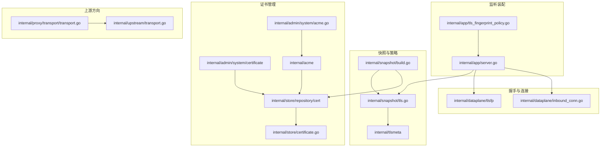
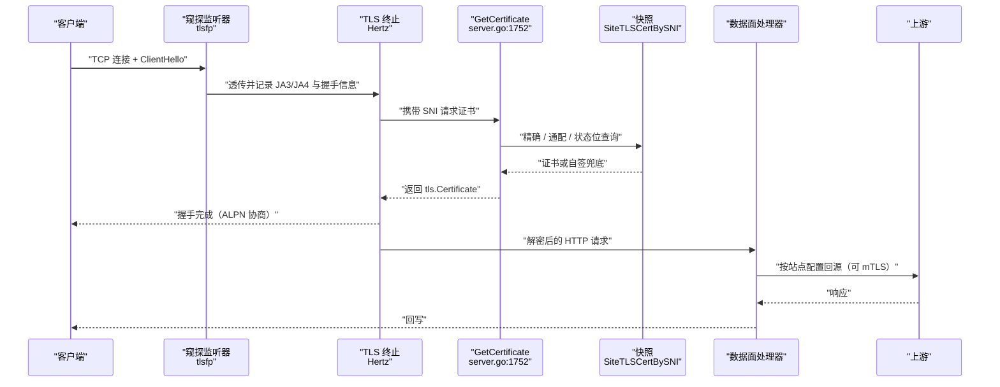
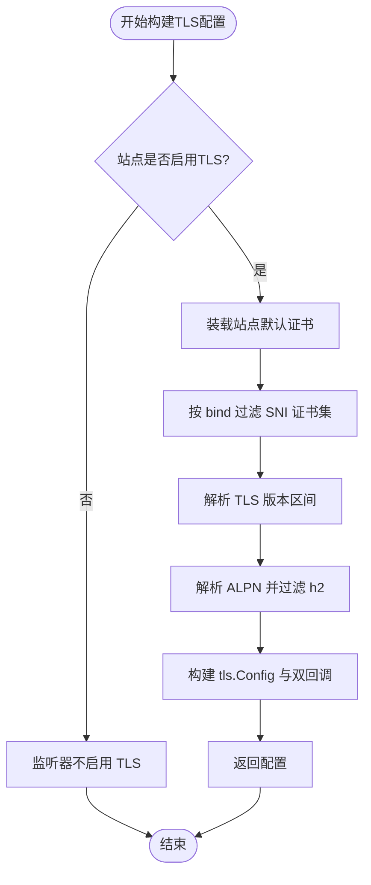
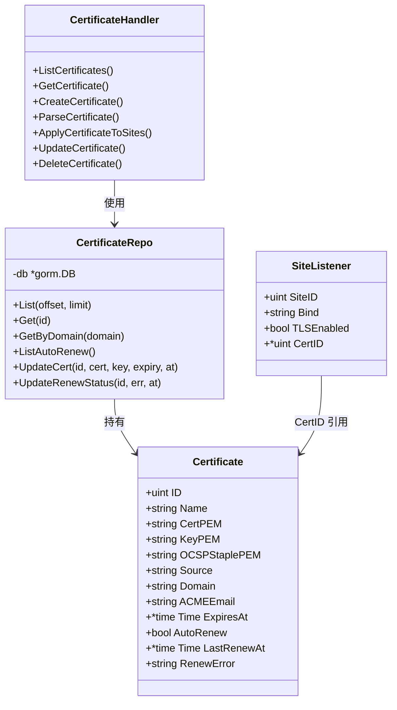
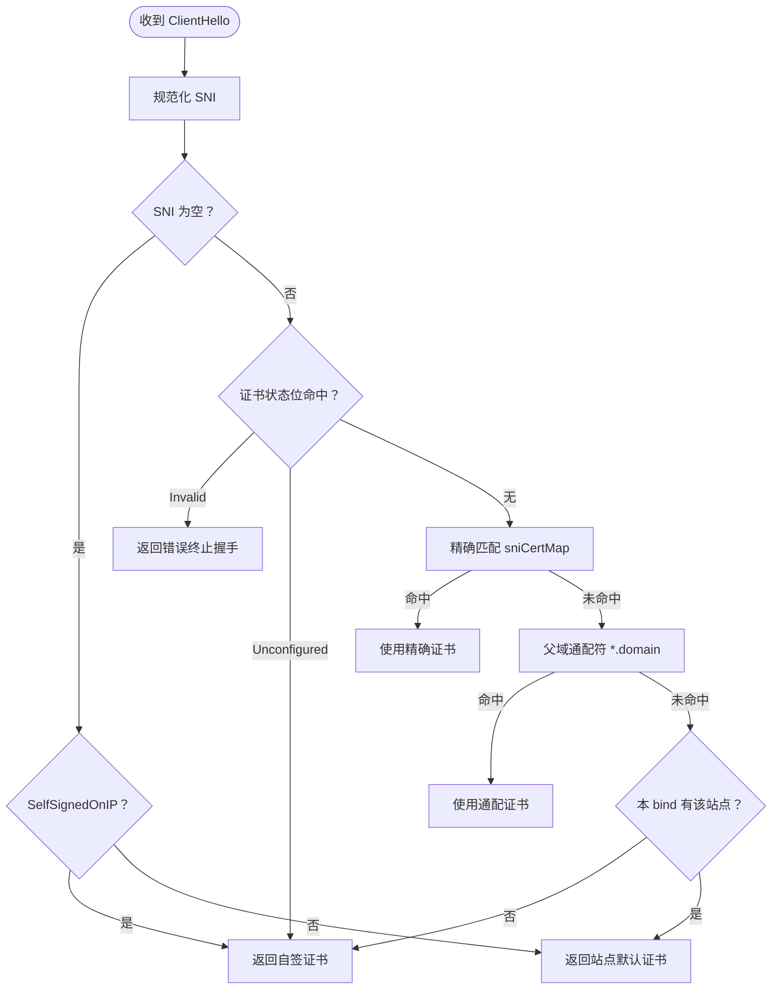
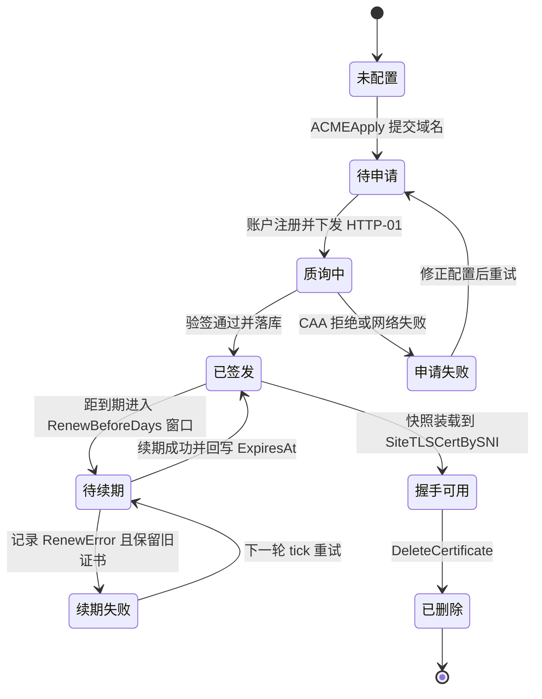
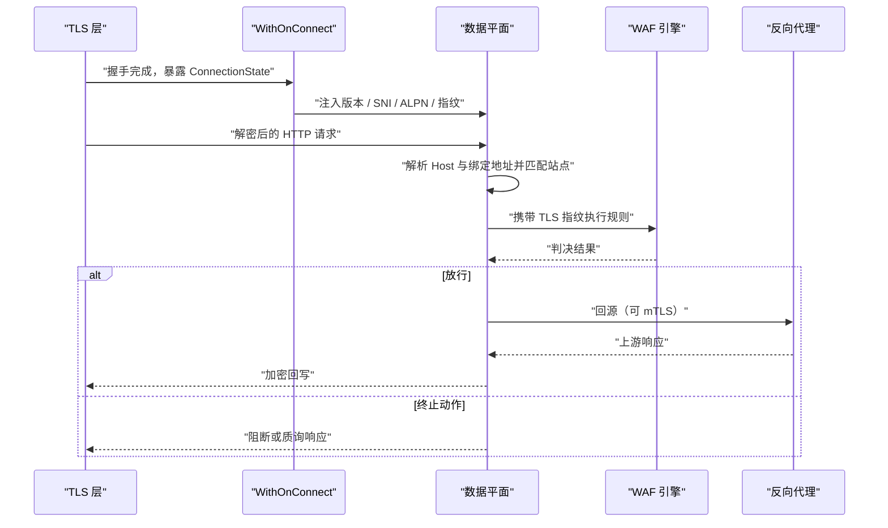
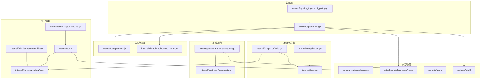
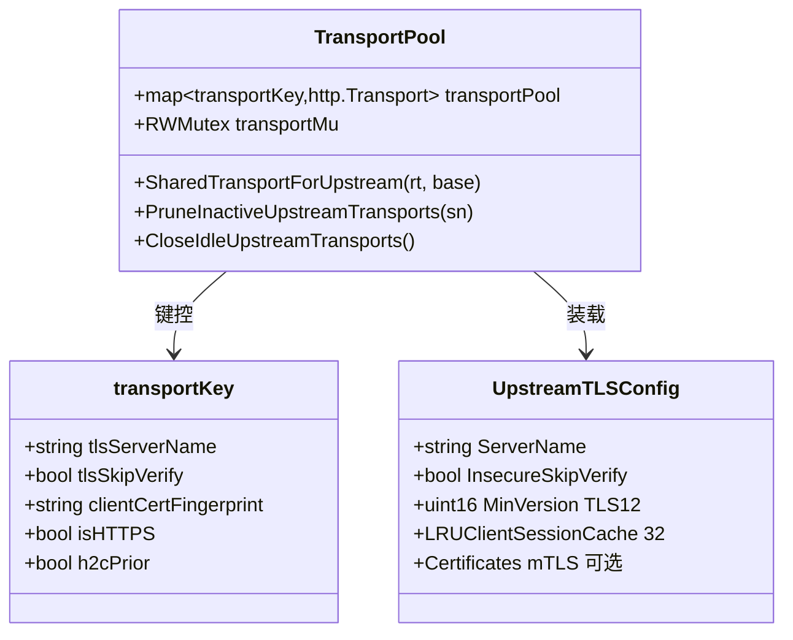

> [返回 数据平面处理](数据平面处理.md)

# TLS 终止与证书管理

<cite>
**本文档引用的文件**
- [server.go](file://internal/app/server.go)
- [tls_fingerprint_policy.go](file://internal/app/tls_fingerprint_policy.go)
- [inbound_conn.go](file://internal/dataplane/inbound_conn.go)
- [handler.go](file://internal/dataplane/handler.go)
- [handler_support.go](file://internal/dataplane/handler_support.go)
- [access_log.go](file://internal/dataplane/access_log.go)
- [tls_fingerprint_listener.go](file://internal/dataplane/tlsfp/tls_fingerprint_listener.go)
- [snapshot.go](file://internal/snapshot/snapshot.go)
- [tls.go](file://internal/snapshot/tls.go)
- [build.go](file://internal/snapshot/build.go)
- [ocsp.go](file://internal/snapshot/ocsp.go)
- [metrics.go](file://internal/observability/metrics.go)
- [certificate.go](file://internal/store/certificate.go)
- [site.go](file://internal/store/site.go)
- [certificate.go](file://internal/store/repository/cert/certificate.go)
- [certificate.go](file://internal/admin/system/certificate/certificate.go)
- [router.go](file://internal/admin/router.go)
- [acme.go](file://internal/admin/system/acme.go)
- [acme.go](file://internal/acme/acme.go)
- [selfsigned.go](file://internal/acme/selfsigned.go)
- [caa.go](file://internal/acme/caa.go)
- [version.go](file://internal/tlsmeta/version.go)
- [lists.go](file://internal/tlsmeta/lists.go)
- [cipher_suites.go](file://internal/tlsmeta/cipher_suites.go)
- [transport.go](file://internal/proxy/transport/transport.go)
- [transport.go](file://internal/upstream/transport.go)
- [clientip.go](file://internal/security/clientip.go)
</cite>

## 目录

1. [简介](#简介)
2. [项目结构](#项目结构)
3. [核心组件](#核心组件)
4. [架构总览](#架构总览)
5. [详细组件分析](#详细组件分析)
6. [依赖关系分析](#依赖关系分析)
7. [性能考虑](#性能考虑)
8. [故障排查指南](#故障排查指南)
9. [结论](#结论)
10. [附录](#附录)

## 简介
My-OpenWaf 是一个基于 Go 语言开发的 Web 应用防火墙，提供了完整的 TLS 终止与证书管理功能。该系统采用云雀(Hertz)框架作为 HTTP 服务器，实现了高性能的 TLS 终止、多域名证书支持和智能证书管理。本文档深入解析了系统的 TLS 终止机制、证书管理流程、SNI 处理策略以及相关的安全配置选项，为开发者和运维人员提供全面的技术指导。

## 项目结构
My-OpenWaf 的 TLS 功能按「监听装配 → 快照证书装载 → 握手期选择 → 观测与兜底」分布，模块清单如下：

| 模块 | 路径 | 职责 | 核心符号 | 依赖 |
|------|------|------|----------|------|
| 监听装配 | `internal/app/server.go` | 按 bind 构造 Hertz 监听与 `tls.Config` | `buildDataServerWithHTTP3Plans`（L1513）、`buildListenerTLS`（L1659） | snapshot、dataplane/tlsfp |
| 指纹开关 | `internal/app/tls_fingerprint_policy.go` | 决定是否解析 ClientHello | `needsTLSClientHelloFingerprint`（L27） | snapshot |
| 连接包装 | `internal/dataplane/inbound_conn.go` | 明文 FixURI 与 TLS 传输器 | `NewFixURITLSTransporter`（L309） | hertz network |
| ClientHello 窥探 | `internal/dataplane/tlsfp` | 前缀读取与指纹回填 | `NewTLSFingerprintListener`（L20） | waf/bot/tlsfp |
| 证书装载 | `internal/snapshot/build.go` | 构建期解析证书与状态位 | `SiteTLSCertBySNI` 装配（L422、L533） | store |
| 生效值计算 | `internal/snapshot/tls.go` | 站点与全局 TLS/网络默认值折中 | `EffectiveSiteTLS`（L363）、`EffectiveSiteNetwork`（L307） | tlsmeta |
| 版本与套件 | `internal/tlsmeta` | 版本别名解析与套件目录 | `ParseVersion`（version.go:44）、`CanonicalVersionName`（L16） | 无 |
| 证书模型 | `internal/store/certificate.go` | PEM 与 ACME 元数据 | `Certificate`（L18） | gorm |
| 监听模型 | `internal/store/site.go` | 每个端点的 bind 与 CertID | `SiteListener`（L248） | gorm |
| 证书仓库 | `internal/store/repository/cert` | 增删改查与续期状态写回 | `CertificateRepo`（cert/certificate.go:10） | store |
| 控制面 API | `internal/admin/system/certificate` | 上传、解析、批量绑定、删除 | `CreateCertificate`（L87）、`ApplyCertificateToSites`（L156） | repository |
| ACME 控制面 | `internal/admin/system/acme.go` | 配置、申请、续期、状态 | `ACMEApply`（L523）、`ACMERenew`（L637） | acme |
| ACME 协议 | `internal/acme` | 账户注册、质询、签发、自签兜底 | `Manager`（acme.go:31）、`SelfSignedCache`（selfsigned.go:18） | x/crypto/acme |
| 上游客户端 TLS | `internal/upstream/transport.go` | mTLS 与 legacy 套件配置 | `HTTPSClientTLSConfigWithClientCert`（L27） | snapshot |
| 上游连接池 | `internal/proxy/transport/transport.go` | 按 TLS 配置键缓存 transport | `SharedTransportForUpstream`（L131） | upstream |

**图表来源**
- [internal/app/server.go:1513-1560](file://internal/app/server.go#L1513-L1560)
- [internal/app/tls_fingerprint_policy.go:27-31](file://internal/app/tls_fingerprint_policy.go#L27-L31)
- [internal/snapshot/build.go:336-425](file://internal/snapshot/build.go#L336-L425)
- [internal/snapshot/tls.go:307-405](file://internal/snapshot/tls.go#L307-L405)
- [internal/dataplane/tlsfp/tls_fingerprint_listener.go:16-45](file://internal/dataplane/tlsfp/tls_fingerprint_listener.go#L16-L45)
- [internal/dataplane/inbound_conn.go:279-320](file://internal/dataplane/inbound_conn.go#L279-L320)
- [internal/admin/system/acme.go:523-637](file://internal/admin/system/acme.go#L523-L637)
- [internal/proxy/transport/transport.go:131-205](file://internal/proxy/transport/transport.go#L131-L205)

**章节来源**
- [internal/store/site.go:45-110](file://internal/store/site.go#L45-L110)
- [internal/store/site.go:247-263](file://internal/store/site.go#L247-L263)
- [internal/store/certificate.go:9-40](file://internal/store/certificate.go#L9-L40)
- [internal/admin/router.go:132-138](file://internal/admin/router.go#L132-L138)
- [internal/admin/router.go:267-272](file://internal/admin/router.go#L267-L272)

## 核心组件

### TLS 终止服务器
系统使用 Hertz 框架构建 TLS 终止服务器。`buildListenerTLS`（`server.go:1659`）产出带 `GetConfigForClient` 与 `GetCertificate` 双回调的 `tls.Config`：前者处理「h2 与低版本组合时摘除 h2」，后者按 SNI 动态选证。监听器 TLS 由 Hertz standard transporter 承担，数据面只在明文路径包一层 FixURI 监听、在 TLS 路径按需包一层 ClientHello 窥探（`server.go:1544-1546`、`server.go:1563-1568`）。

| 配置项 | 取值来源 | 缺省 | 位置 |
|--------|----------|------|------|
| MinVersion | `EffectiveSiteTLS` → `ParseTLSVersion` | TLS10 | `server.go:1707`、`server.go:1734` |
| MaxVersion | 同上 | TLS13 | `server.go:1708`、`server.go:1735` |
| NextProtos | `tcpTLSALPNProtocols` | h2、http/1.1 | `server.go:1717`、`server.go:1736` |
| CipherSuites | 站点或全局 `cipher_suites` | 交由 Go 默认 | `server.go:1725`、`server.go:1737` |
| CurvePreferences | `ParseCurvePreferences` | X25519、CurveP256、CurveP384 | `server.go:1727`、`server.go:1738` |
| PreferServerCipherSuites | `TLSDefaults` | true | `server.go:1739` |
| SessionTicketsDisabled | `!TLSDefaults.SessionTicketsEnabled` | 允许票据 | `server.go:1740` |
| SelfSignedOnIP | `TLSDefaults` | true | `server.go:1773` |
| ClientHello 窥探 | `needsTLSClientHelloFingerprint` | 开启 | `server.go:1544` |

**章节来源**
- [internal/app/server.go:1533-1560](file://internal/app/server.go#L1533-L1560)
- [internal/app/server.go:1659-1740](file://internal/app/server.go#L1659-L1740)
- [internal/snapshot/tls.go:85-102](file://internal/snapshot/tls.go#L85-L102)
- [internal/snapshot/tls.go:363-405](file://internal/snapshot/tls.go#L363-L405)

### 证书管理系统
提供证书生命周期管理：上传（PEM 校验）、解析（提取 CN/SAN 与到期）、按域名匹配批量绑定站点与监听、更新、删除，全部以 PEM 存于数据库（`store.Certificate`，`certificate.go:18`）。私钥在管理面输出前统一脱敏（`RedactCertificatePrivateKey`，`certificate.go:47`）。

**章节来源**
- [internal/store/certificate.go:9-40](file://internal/store/certificate.go#L9-L40)
- [internal/admin/system/certificate/certificate.go:47-210](file://internal/admin/system/certificate/certificate.go#L47-L210)
- [internal/store/repository/cert/certificate.go:15-87](file://internal/store/repository/cert/certificate.go#L15-L87)

### SNI 多域名支持
`SiteTLSCertBySNI` 以 `sni:<bind>\x00<host>` 为键（`SNICertKey`，`snapshot.go:294`），构建期把监听绑定的证书按主机名铺开；握手期按精确、通配符、状态位、站点存在性四级决策，未知 SNI 与 IP 直连统一回自签证书，避免通过证书泄露真实域名。

**章节来源**
- [internal/store/certificate.go:9-40](file://internal/store/certificate.go#L9-L40)
- [internal/admin/system/certificate/certificate.go:47-210](file://internal/admin/system/certificate/certificate.go#L47-L210)
- [internal/snapshot/build.go:336-425](file://internal/snapshot/build.go#L336-L425)
- [internal/snapshot/snapshot.go:289-333](file://internal/snapshot/snapshot.go#L289-L333)

## 架构总览
系统采用分层架构设计，TLS 终止位于数据平面的最前端，负责处理客户端连接和证书验证。

**图表来源**
- [internal/app/server.go:1541-1600](file://internal/app/server.go#L1541-L1600)
- [internal/app/server.go:1659-1830](file://internal/app/server.go#L1659-L1830)
- [internal/dataplane/tlsfp/tls_fingerprint_listener.go:16-60](file://internal/dataplane/tlsfp/tls_fingerprint_listener.go#L16-L60)
- [internal/snapshot/snapshot.go:226-230](file://internal/snapshot/snapshot.go#L226-L230)
- [internal/snapshot/snapshot.go:312-333](file://internal/snapshot/snapshot.go#L312-L333)

**章节来源**
- [internal/app/server.go:1596-1616](file://internal/app/server.go#L1596-L1616)
- [internal/security/clientip.go:16-36](file://internal/security/clientip.go#L16-L36)

## 详细组件分析

### TLS 配置构建器
TLS 配置构建器负责根据站点与全局默认值生成监听参数，站点级空值一律回退全局，非法区间整体退回默认档（`EffectiveSiteTLS`，`tls.go:363`）：

**图表来源**
- [internal/app/server.go:1680-1745](file://internal/app/server.go#L1680-L1745)
- [internal/snapshot/tls.go:307-405](file://internal/snapshot/tls.go#L307-L405)
- [internal/app/server.go:1869-1900](file://internal/app/server.go#L1869-L1900)

**章节来源**
- [internal/snapshot/tls.go:85-102](file://internal/snapshot/tls.go#L85-L102)
- [internal/tlsmeta/version.go:16-60](file://internal/tlsmeta/version.go#L16-L60)
- [internal/app/server.go:1841-1868](file://internal/app/server.go#L1841-L1868)

### 证书管理流程
证书管理以 RESTful API 提供 CRUD 与批量绑定能力，路由集中在 `admin/router.go`：

| 方法与路径 | 处理函数 | 权限组 | 位置 |
|------------|----------|--------|------|
| GET `/certificates` | `ListCertificates` | read | `router.go:132` |
| GET `/certificates/:id` | `GetCertificate` | read | `router.go:133` |
| GET `/certificates/acme/config` | `GetACMEConfig` | read | `router.go:134` |
| POST `/certificates/parse` | `ParseCertificate` | read | `router.go:138` |
| POST `/certificates` | `CreateCertificate` | ops | `router.go:267` |
| POST `/certificates/:id/update` | `UpdateCertificate` | ops | `router.go:268` |
| POST `/certificates/:id/apply-to-sites` | `ApplyCertificateToSites` | ops | `router.go:269` |
| POST `/certificates/:id/delete` | `DeleteCertificate` | ops | `router.go:270` |
| POST `/certificates/acme/apply` | `ACMEApply` | ops | `router.go:271` |
| POST `/certificates/acme/:id/renew` | `ACMERenew` | ops | `router.go:272` |
| POST `/certificates/acme/config` | `UpdateACMEConfig` | admin | `router.go:397` |
| GET `/certificates/acme/status` | `ACMEStatus` | admin | `router.go:398` |

**图表来源**
- [internal/store/certificate.go:18-40](file://internal/store/certificate.go#L18-L40)
- [internal/store/repository/cert/certificate.go:10-40](file://internal/store/repository/cert/certificate.go#L10-L40)
- [internal/admin/system/certificate/certificate.go:53-371](file://internal/admin/system/certificate/certificate.go#L53-L371)
- [internal/store/site.go:247-263](file://internal/store/site.go#L247-L263)

**章节来源**
- [internal/admin/router.go:132-138](file://internal/admin/router.go#L132-L138)
- [internal/admin/router.go:267-272](file://internal/admin/router.go#L267-L272)
- [internal/admin/router.go:397-398](file://internal/admin/router.go#L397-L398)
- [internal/admin/system/certificate/certificate.go:47-52](file://internal/admin/system/certificate/certificate.go#L47-L52)
- [internal/store/certificate.go:9-16](file://internal/store/certificate.go#L9-L16)

### SNI 证书匹配策略
`GetCertificate` 回调按固定优先级决策，其中「已配置但不可用」必须显式失败，不能被自签或其他站点证书掩盖：

| 优先级 | 判定条件 | 结果 | 位置 |
|:------:|----------|------|------|
| 1 | SNI 为空（IP 直连） | `SelfSignedOnIP` 为真返回自签；否则站点默认证书 | `server.go:1771-1780` |
| 2 | `TLSCertificateStateForSNI` 命中 Invalid | 返回错误，握手终止 | `server.go:1783-1786` |
| 3 | 同上命中 Unconfigured | 自签证书 | `server.go:1787-1789` |
| 4 | `sniCertMap` 精确命中 | 站点真实证书 | `server.go:1792-1795` |
| 5 | 父域通配符 `*.example.com` 命中 | 通配证书 | `server.go:1798-1803` |
| 6 | 站点不存在于本 bind | 自签证书（防域名泄露） | `server.go:1806-1818` |
| 7 | 站点存在但无专用证书 | 站点默认证书，仍缺失则自签 | `server.go:1821-1825` |

**图表来源**
- [internal/app/server.go:1752-1826](file://internal/app/server.go#L1752-L1826)
- [internal/snapshot/snapshot.go:303-333](file://internal/snapshot/snapshot.go#L303-L333)
- [internal/snapshot/build.go:336-425](file://internal/snapshot/build.go#L336-L425)

**章节来源**
- [internal/snapshot/snapshot.go:162-170](file://internal/snapshot/snapshot.go#L162-L170)
- [internal/snapshot/snapshot.go:289-299](file://internal/snapshot/snapshot.go#L289-L299)

### 证书生命周期与自动续期
手动上传与 ACME 申请共用同一张 `certificates` 表，用 `Source` 区分来源（`manual`、`acme`、`self_signed`）；自动续期由管理面的 `renewDue` 与 `acme.Manager` 的续期循环共同驱动，窗口判定统一收敛到 `ShouldRenewAt`。

**图表来源**
- [internal/admin/system/acme.go:523-637](file://internal/admin/system/acme.go#L523-L637)
- [internal/admin/system/acme.go:399-434](file://internal/admin/system/acme.go#L399-L434)
- [internal/acme/acme.go:285-360](file://internal/acme/acme.go#L285-L360)
- [internal/store/certificate.go:31-39](file://internal/store/certificate.go#L31-L39)
- [internal/admin/system/certificate/certificate.go:371-402](file://internal/admin/system/certificate/certificate.go#L371-L402)

证书相关 API 与流程步骤：

| 步 | 动作 | 执行位置 | 输入 | 输出 | 失败分支 | 可观测点 |
|:--:|------|----------|------|------|----------|----------|
| 1 | 解析 PEM 与域名 | `certificate.go:129` | 证书 PEM | CN/SAN 与匹配站点 | 解析错误 400 | 响应体 matched_sites |
| 2 | 创建证书记录 | `certificate.go:87` | name + cert + key | `store.Certificate` | 私钥不匹配拒绝 | `certificates` 表 |
| 3 | 批量绑定站点监听 | `certificate.go:156` | 证书 ID | 监听 `CertID` 更新 | 冲突跳过 | 请求后 reload |
| 4 | 快照装载 | `build.go:336-425` | 监听与证书 | `SiteTLSCertBySNI` | 状态位 Invalid | 配置诊断 |
| 5 | 握手选证 | `server.go:1752` | ClientHello | 证书或自签 | Invalid 直接失败 | debug 日志 `TLS ClientHello` |
| 6 | ACME 申请 | `acme.go:523` | 域名 + 邮箱 | 新证书记录 | CAA/网络失败 | `ACMEApply` 响应 |
| 7 | 到期续期 | `acme.go:399-434` | 自动续期列表 | 更新 PEM 与时间 | 记 `RenewError` | `ACMEStatus` |
| 8 | 删除证书 | `certificate.go:371` | 证书 ID | 解绑并删除 | 仍被引用则拒绝 | reload 结果 |

**章节来源**
- [internal/admin/system/certificate/certificate.go:47-402](file://internal/admin/system/certificate/certificate.go#L47-L402)
- [internal/admin/router.go:132-138](file://internal/admin/router.go#L132-L138)
- [internal/admin/router.go:267-272](file://internal/admin/router.go#L267-L272)
- [internal/admin/router.go:397-398](file://internal/admin/router.go#L397-L398)
- [internal/snapshot/build.go:336-425](file://internal/snapshot/build.go#L336-L425)
- [internal/acme/acme.go:285-300](file://internal/acme/acme.go#L285-L300)
- [internal/acme/caa.go:68-75](file://internal/acme/caa.go#L68-L75)

### 握手与监听期代码上下文
| 符号 | 位置 | 职责 | 上游调用者 | 下游依赖 | 副作用 | 影响面 |
|------|------|------|------------|----------|--------|--------|
| `buildListenerTLS` | `app/server.go:1659` | 产出监听 `tls.Config` | `buildDataServerWithHTTP3Plans`（`server.go:1539`） | `EffectiveSiteTLS`、`ParseTLSVersion`、`selfSignedCache` | 生成并缓存自签证书 | 高：所有 TLS 监听 |
| `GetCertificate` 回调 | `app/server.go:1752` | 握手期按 SNI 选证 | Go TLS 栈每次握手 | `SiteTLSCertBySNI`、`MatchSite`、`TLSCertificateStateForSNI` | 低级别时产生日志分配 | 高：证书暴露面 |
| `NewTLSFingerprintListener` | `dataplane/tlsfp:20` | 窥探 ClientHello 并记录指纹 | `server.go:1546` | `x509` 解析、`waf/bot/tlsfp` | 缓存前缀字节 | 中：TLS 观测与 bot 判定 |
| `SharedTransportForUpstream` | `proxy/transport/transport.go:131` | 上游 mTLS/SNI 传输复用 | `ResolveUpstreamBase`（`transport.go:800`） | `HTTPSClientTLSConfigWithClientCert`、证书指纹 | 池增长 | 高：上游握手成本 |
| `certRenewWindow` | `admin/system/acme.go:392` | 天级窗口换算 | `renewDue`（`acme.go:402`） | `ShouldRenewAt` | 无 | 中：续期时机 |

**章节来源**
- [internal/app/server.go:1659-1830](file://internal/app/server.go#L1659-L1830)
- [internal/dataplane/tlsfp/tls_fingerprint_listener.go:16-60](file://internal/dataplane/tlsfp/tls_fingerprint_listener.go#L16-L60)
- [internal/proxy/transport/transport.go:131-205](file://internal/proxy/transport/transport.go#L131-L205)
- [internal/upstream/transport.go:14-40](file://internal/upstream/transport.go#L14-L40)
- [internal/admin/system/acme.go:388-434](file://internal/admin/system/acme.go#L388-L434)

### 数据平面处理流程
TLS 终止后的请求进入数据平面：`WithOnConnect`（`server.go:1597`）把握手版本、SNI 与协商 ALPN 注入上下文，`Handler` 再从上下文取指纹写入 `RequestCtx.TLS`（`handler.go:66-74`、`websocket.go:516-518`），供 bot 与访问日志使用。

**图表来源**
- [internal/app/server.go:1596-1616](file://internal/app/server.go#L1596-L1616)
- [internal/dataplane/handler.go:66-74](file://internal/dataplane/handler.go#L66-L74)
- [internal/dataplane/handler.go:371-380](file://internal/dataplane/handler.go#L371-L380)
- [internal/dataplane/handler_support.go:70-93](file://internal/dataplane/handler_support.go#L70-L93)
- [internal/dataplane/access_log.go:487-501](file://internal/dataplane/access_log.go#L487-L501)

**章节来源**
- [internal/dataplane/handler.go:196-215](file://internal/dataplane/handler.go#L196-L215)
- [internal/security/clientip.go:16-36](file://internal/security/clientip.go#L16-L36)

## 依赖关系分析
系统各组件之间的依赖关系如下：

**图表来源**
- [internal/app/server.go:1541-1616](file://internal/app/server.go#L1541-L1616)
- [internal/snapshot/tls.go:1-25](file://internal/snapshot/tls.go#L1-L25)
- [internal/snapshot/build.go:93-100](file://internal/snapshot/build.go#L93-L100)
- [internal/acme/acme.go:1-20](file://internal/acme/acme.go#L1-L20)
- [internal/proxy/transport/transport.go:1-33](file://internal/proxy/transport/transport.go#L1-L33)

**章节来源**
- [internal/app/tls_fingerprint_policy.go:1-31](file://internal/app/tls_fingerprint_policy.go#L1-L31)
- [internal/dataplane/tlsfp/tls_fingerprint_listener.go:1-15](file://internal/dataplane/tlsfp/tls_fingerprint_listener.go#L1-L15)
- [internal/admin/system/acme.go:14-25](file://internal/admin/system/acme.go#L14-L25)

## 性能考虑

### TLS 会话复用
系统通过以下方式优化 TLS 性能：
1. **证书缓存**：`SelfSignedCache` 按 bind 缓存自签证书条目，条目有效期 24 小时，写入前先清理过期项（`selfsigned.go:44-77`）。
2. **会话恢复**：客户端侧上游 TLS 使用 `tls.NewLRUClientSessionCache(32)`，容量与 `MaxIdleConnsPerHost` 对齐（`transport.go:187-189`）；服务端侧由 `SessionTicketsDisabled` 控制（`server.go:1740`）。
3. **日志分配抑制**：`GetCertificate` 内先判 `slog` 级别再构造属性，避免默认 info 级别下每次握手产生一批堆分配（`server.go:1755-1769`）。
4. **配置指纹**：`siteListenerFingerprint`（`server.go:2012`）把 TLS 与网络参数折算成指纹，仅漂移时重建监听器。

**章节来源**
- [internal/acme/selfsigned.go:44-77](file://internal/acme/selfsigned.go#L44-L77)
- [internal/proxy/transport/transport.go:178-195](file://internal/proxy/transport/transport.go#L178-L195)
- [internal/app/server.go:1740](file://internal/app/server.go#L1740)
- [internal/app/server.go:2012-2050](file://internal/app/server.go#L2012-L2050)

### 连接池管理
上游方向的 transport 池实现已迁至 `internal/proxy/transport/transport.go`，`internal/proxy/proxy.go` 不再持有池；`transportKey` 含 `clientCertFingerprint`，只存证书链 DER 的前 16 字节 SHA-256 摘要，避免 PEM 进入 map 键。

**图表来源**
- [internal/proxy/transport/transport.go:70-92](file://internal/proxy/transport/transport.go#L70-L92)
- [internal/proxy/transport/transport.go:137-205](file://internal/proxy/transport/transport.go#L137-L205)
- [internal/proxy/transport/transport.go:1044-1136](file://internal/proxy/transport/transport.go#L1044-L1136)

**章节来源**
- [internal/acme/selfsigned.go:18-77](file://internal/acme/selfsigned.go#L18-L77)
- [internal/proxy/transport/transport.go:178-195](file://internal/proxy/transport/transport.go#L178-L195)
- [internal/app/server.go:1755-1769](file://internal/app/server.go#L1755-L1769)
- [internal/app/server.go:2012-2104](file://internal/app/server.go#L2012-L2104)

### 硬件加速支持
系统不自建密码学实现，全部经由 Go 标准库 `crypto/tls`，因此在支持 AES-NI 等平台指令的 CPU 上自动获得加速；GM/T 国密链路另有 `internal/waf/challenge/gm` 承担，不在 TLS 终止路径内。

**章节来源**
- [internal/upstream/transport.go:14-40](file://internal/upstream/transport.go#L14-L40)
- [internal/tlsmeta/cipher_suites.go:42-51](file://internal/tlsmeta/cipher_suites.go#L42-L51)

## 故障排查指南

### 常见问题诊断
1. **证书验证失败**
   - 检查证书与私钥是否为可配对的 PEM（`parseCertificatePEM` 与 `X509KeyPair` 是两处独立校验，前者在管理面、后者在快照构建期）
   - 状态位为 Invalid 时握手会显式报错而不是回退自签，注意区分「未配置」与「已配置但不可用」
   - 确认域名与证书 SAN 匹配，通配符只覆盖一级父域
2. **SNI 匹配问题**
   - 检查 SNI 字符串规范化结果（小写、去空白、剥端口）
   - 多监听场景确认证书键 `sni:<bind>\x00<host>` 是否覆盖目标 bind
   - 通配符证书以 `*.example.com` 形式登记才生效
3. **TLS 版本兼容性**
   - 最大版本低于 TLS 1.2 时 `h2` 会被自动摘除，浏览器将退回 HTTP/1.1
   - 站点区间非法时整体回退全局默认档，而不是取一半
   - ALPN 为空时默认 `h2,h3,http/1.1`（受协议总开关过滤）

**章节来源**
- [internal/app/server.go:1783-1826](file://internal/app/server.go#L1783-L1826)
- [internal/snapshot/snapshot.go:289-333](file://internal/snapshot/snapshot.go#L289-L333)
- [internal/snapshot/build.go:336-425](file://internal/snapshot/build.go#L336-L425)
- [internal/snapshot/tls.go:37-57](file://internal/snapshot/tls.go#L37-L57)

### 错误处理机制
TLS 终止路径不依赖集中式错误类型包，证书与握手相关失败按来源分为三类处理：

| 错误来源 | 处理方式 | 常见场景 | 证据位置 |
|---------|---------|----------|----------|
| 配置校验 | 站点与全局默认值折中，非法区间整体退回默认档 | TLS 版本区间倒置、套件名不可识别 | `snapshot/tls.go:363-405` |
| 证书装载 | 快照构建期解析失败置 Invalid 状态位并记诊断 | 证书与私钥不匹配、PEM 解析失败 | `snapshot/build.go:336-425` |
| 握手失败 | `GetCertificate` 返回错误，由 TLS 栈终止连接 | 已配置证书不可用、客户端版本不兼容 | `app/server.go:1783-1789` |
| ACME 失败 | 写 `RenewError` 并保留旧证书，下一轮重试 | CAA 拒绝、质询超时、账户未注册 | `admin/system/acme.go:399-434` |

**章节来源**
- [internal/snapshot/tls.go:363-405](file://internal/snapshot/tls.go#L363-L405)
- [internal/snapshot/build.go:336-425](file://internal/snapshot/build.go#L336-L425)
- [internal/app/server.go:1783-1789](file://internal/app/server.go#L1783-L1789)
- [internal/admin/system/acme.go:399-434](file://internal/admin/system/acme.go#L399-L434)
- [internal/store/certificate.go:31-39](file://internal/store/certificate.go#L31-L39)

### 监控和日志
数据面 TLS 相关观测点集中在三处：握手信息注入上下文后随访问日志落库（`tls_version`、`tls_sni`、`alpn` 与 JA3/JA4 指纹字段）；`GetCertificate` 在 debug 级别打印 ClientHello 概览；控制面 `/metrics` 暴露数据面与进程级指标。证书到期与续期结果通过 `ACMEStatus` 查询，不单独设指标。

**章节来源**
- [internal/app/server.go:1597-1616](file://internal/app/server.go#L1597-L1616)
- [internal/app/server.go:1755-1769](file://internal/app/server.go#L1755-L1769)
- [internal/dataplane/access_log.go:338-400](file://internal/dataplane/access_log.go#L338-L400)
- [internal/admin/system/acme.go:709-735](file://internal/admin/system/acme.go#L709-L735)
- [internal/observability/metrics.go:242-260](file://internal/observability/metrics.go#L242-L260)

## 结论
My-OpenWaf 的 TLS 终止与证书管理功能提供了企业级的安全防护和灵活的配置选项。通过模块化的架构设计和完善的错误处理机制，系统能够满足各种复杂的部署需求。

关键优势包括：
- 高性能的 TLS 终止处理
- 灵活的多域名证书支持
- 完整的证书生命周期管理
- 优秀的可扩展性和维护性

建议在生产环境中结合实际需求调整 TLS 参数，并定期监控证书状态以确保服务的持续可用性。

## 附录

### TLS 与 ALPN 协议支持矩阵
| 能力 | 服务端监听 | 上游回源 | 备注 |
|------|:----------:|:--------:|------|
| SSL 3.0 | 部分 | 部分 | 仅当配置显式给出 `SSL3` 令牌；Go 运行时已默认禁用 |
| TLS 1.0 | ✓ | ✓ | `tlsmeta.ParseVersion` 认 `1.0`/`TLS10`/线值；上游 legacy 套件补齐 |
| TLS 1.1 | ✓ | ✓ | 同上；`maxVer < TLS12` 时 ALPN 摘除 `h2` |
| TLS 1.2 | ✓ | ✓ | 共享上游 transport 的 `MinVersion` 固定为 TLS12 |
| TLS 1.3 | ✓ | ✓ | 默认最大版本；h3 transport 强制 TLS13 下限 |
| HTTP/1.1 | ✓ | ✓ | ALPN 空值时默认含 `http/1.1` |
| HTTP/2（h2） | ✓ | ✓ | `ForceAttemptHTTP2`，并注册独立 h2 server factory |
| h2c 明文 HTTP/2 | ✓ | ✓ | 上游走独立单例 transport，不入 `transportPool` |
| HTTP/3（h3） | ✓ | ✓ | 由 QUIC 监听承载，上游 transport 单独成池 |
| OCSP 装订 | ✓ | — | `OCSPStaplePEM` 支持 PEM / 裸 base64 / 裸 DER |
| 上游 mTLS | — | ✓ | `UpstreamTLSClientCertPEM/KeyPEM`，指纹入池键 |
| 0-RTT | ✓ | — | 由 `TLSDefaults.Allow0RTT` 与环境变量共同决定 |
| 自签兜底 | ✓ | — | 按 bind 缓存 24 小时 |

矩阵中「部分」表示能力取决于运行时代码与配置令牌是否同时满足；「—」表示该方向不适用。版本别名解析见 `tlsmeta/version.go:16-60`，服务端 ALPN 装配见 `server.go:1841-1900`，上游 TLS 与套件回补见 `upstream/transport.go:14-70`，h2c 与 h3 池见 `transport.go:863-945`。

**章节来源**
- [internal/tlsmeta/version.go:16-60](file://internal/tlsmeta/version.go#L16-L60)
- [internal/app/server.go:1841-1900](file://internal/app/server.go#L1841-L1900)
- [internal/upstream/transport.go:14-70](file://internal/upstream/transport.go#L14-L70)
- [internal/proxy/transport/transport.go:863-945](file://internal/proxy/transport/transport.go#L863-L945)
- [internal/snapshot/ocsp.go:9-30](file://internal/snapshot/ocsp.go#L9-L30)

### 证书配置要点
系统支持通过控制面 API 与前端页面进行证书管理：
- `Certificate` 以 PEM 存储证书与私钥，`OCSPStaplePEM` 可选
- `Source` 区分手动、ACME 与自签三类，`AutoRenew` 与 `ExpiresAt` 驱动续期窗口
- 监听端点通过 `SiteListener.CertID` 关联证书，`Bind` 与 `TLSEnabled` 决定是否走 TLS 路径
- 管理面输出前统一脱敏私钥，前端不回显 `KeyPEM`

**章节来源**
- [internal/store/certificate.go:9-40](file://internal/store/certificate.go#L9-L40)
- [internal/store/site.go:45-110](file://internal/store/site.go#L45-L110)
- [internal/store/site.go:247-263](file://internal/store/site.go#L247-L263)
- [internal/admin/system/certificate/certificate.go:47-52](file://internal/admin/system/certificate/certificate.go#L47-L52)

### 安全最佳实践
- 定期轮换证书，优先使用 ACME 自动续期并把 `RenewBeforeDays` 设为不小于 7 天
- 收紧 TLS 版本区间，避免把 `MinVersion` 降到 TLS 1.0/1.1；确认 h2 是否因此被摘除
- 显式配置 ALPN，避免依赖默认列表带来的 h3 通告
- 开启 CAA 检查并固定允许的签发方，减少误签风险
- 上游 mTLS 与 `UpstreamTLSSkipVerify` 互斥使用，跳过校验只作为临时排障手段

**章节来源**
- [internal/acme/caa.go:28-75](file://internal/acme/caa.go#L28-L75)
- [internal/admin/system/acme.go:27-38](file://internal/admin/system/acme.go#L27-L38)
- [internal/store/site.go:98-112](file://internal/store/site.go#L98-L112)

### 性能优化建议
- 保持会话票据开启（默认），让恢复握手走简化路径
- 复用自签与站点证书缓存，避免握手期重复 PEM 解析
- 按站点收敛套件列表，未配置时交由 Go 默认而非自定义弱套件
- 上游方向优先复用共享 transport，跨站点共用同一 TLS 配置键以提高命中率

[本节为通用指导，无需特定文件来源]