> [返回 数据平面处理](数据平面处理.md)

# WebSocket 连接处理

<cite>
**本文档引用的文件**
- [websocket.go](file://internal/dataplane/websocket.go)
- [h2_websocket.go](file://internal/dataplane/h2_websocket.go)
- [handler.go](file://internal/dataplane/handler.go)
- [handler_support.go](file://internal/dataplane/handler_support.go)
- [request_ctx.go](file://internal/dataplane/request_ctx.go)
- [access_log.go](file://internal/dataplane/access_log.go)
- [logredact/sanitize.go](file://internal/dataplane/logredact/sanitize.go)
- [reqid/reqid.go](file://internal/dataplane/reqid/reqid.go)
- [stream/stream_close_notify.go](file://internal/dataplane/stream/stream_close_notify.go)
- [metrics/metrics.go](file://internal/dataplane/metrics/metrics.go)
- [inbound_conn.go](file://internal/dataplane/inbound_conn.go)
- [engine.go](file://internal/core/engine/engine.go)
- [action.go](file://internal/core/action/action.go)
- [pool.go](file://internal/core/pipeline/pool.go)
- [drop.go](file://internal/waf/drop/drop.go)
- [block.go](file://internal/waf/pages/block.go)
- [proxy.go](file://internal/proxy/proxy.go)
- [transport/transport.go](file://internal/proxy/transport/transport.go)
- [upstream/transport.go](file://internal/upstream/transport.go)
- [upstream/health.go](file://internal/upstream/health.go)
- [upstream/scheme_alias.go](file://internal/upstream/scheme_alias.go)
- [security/outbound.go](file://internal/security/outbound.go)
- [snapshot/snapshot.go](file://internal/snapshot/snapshot.go)
- [store/site.go](file://internal/store/site.go)
- [server.go](file://internal/app/server.go)
</cite>

## 目录

1. [简介](#简介)
2. [项目结构](#项目结构)
3. [核心组件](#核心组件)
4. [架构总览](#架构总览)
5. [详细组件分析](#详细组件分析)
6. [依赖关系分析](#依赖关系分析)
7. [性能考虑](#性能考虑)
8. [故障排查指南](#故障排查指南)
9. [结论](#结论)
10. [附录](#附录)

## 简介

本文档深入解析 My-OpenWaf 项目中的 WebSocket 连接处理实现。该系统基于 CloudWeGo Hertz 框架构建，提供了完整的 WebSocket 协议升级、连接隧道转发和实时威胁检测功能。文档涵盖了从协议升级到连接生命周期管理的完整流程，以及与 WAF 引擎的深度集成。

## 项目结构

WebSocket 能力由两条转发路径与一组支撑件构成，模块清单如下：

| 模块 | 路径 | 职责 | 核心符号 | 规模(行) | 测试 |
|------|------|------|----------|:--------:|:----:|
| 升级检测与隧道 | `internal/dataplane/websocket.go` | HTTP/1.1 升级识别、Raw TCP 双向透传与帧检视 | `ForwardWebSocket`（L127） | 722 | 有 |
| h2 扩展 CONNECT | `internal/dataplane/h2_websocket.go` | RFC 8441 CONNECT 桥接与 h2c 帧层直通 | `ForwardH2ExtendedConnectWebSocket`（L62） | 1065 | 有 |
| 分支注册 | `internal/dataplane/handler.go` | 转发分支顺序与入站流登记 | `registerH2WSInboundStream`（L1122） | 1280 | 有 |
| 上游拨号 TLS | `internal/upstream/transport.go` | 客户端 TLS 配置与 legacy 套件补齐 | `HTTPSClientTLSConfigWithClientCert`（L27） | 194 | 有 |
| 协议别名 | `internal/upstream/scheme_alias.go` | `grpc`/`tls`/`grpcs` 折叠为传输 scheme | `RPCUpstreamAliasForURL`（L43） | 56 | 有 |
| 判决复用 | `internal/core/engine/engine.go` | 帧载荷复检复用同一引擎 | `Process`（L551） | 646 | 有 |
| 连接丢弃 | `internal/waf/drop/drop.go` | Drop 动作直接关闭连接 | `DropExecutor`（L19） | 113 | 部分 |

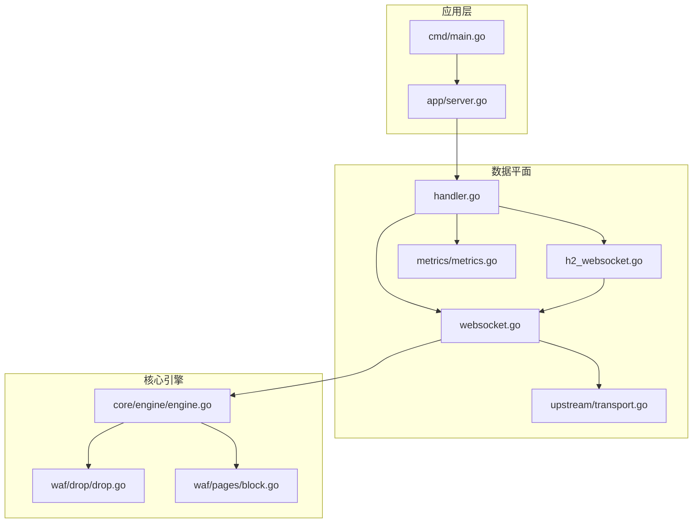

**图表来源**
- [internal/app/server.go:1620-1645](file://internal/app/server.go#L1620-L1645)
- [internal/dataplane/handler.go:1119-1132](file://internal/dataplane/handler.go#L1119-L1132)
- [internal/dataplane/websocket.go:127-145](file://internal/dataplane/websocket.go#L127-L145)
- [internal/dataplane/h2_websocket.go:62-69](file://internal/dataplane/h2_websocket.go#L62-L69)

**章节来源**
- [internal/upstream/scheme_alias.go:21-56](file://internal/upstream/scheme_alias.go#L21-L56)
- [internal/waf/drop/drop.go:19-45](file://internal/waf/drop/drop.go#L19-L45)
- [internal/dataplane/metrics/metrics.go:13-46](file://internal/dataplane/metrics/metrics.go#L13-L46)

## 核心组件

### WebSocket 协议升级检测器

WebSocket 协议升级检测器负责识别客户端发起的 WebSocket 连接请求：

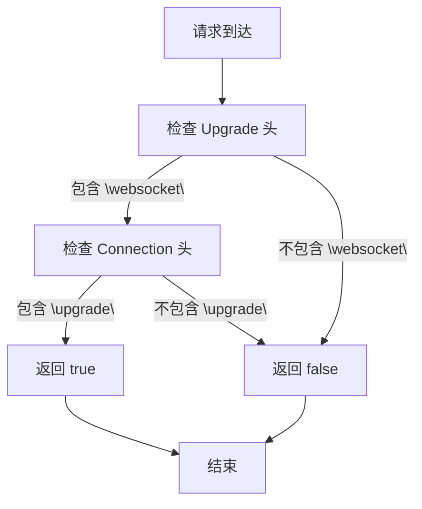

**图表来源**
- [internal/dataplane/websocket.go:36-39](file://internal/dataplane/websocket.go#L36-L39)
- [internal/dataplane/websocket.go:62-77](file://internal/dataplane/websocket.go#L62-L77)

**章节来源**
- [internal/dataplane/websocket.go:36-77](file://internal/dataplane/websocket.go#L36-L77)
- [internal/dataplane/handler.go:1122-1131](file://internal/dataplane/handler.go#L1122-L1131)

### WebSocket 连接隧道转发器

WebSocket 连接隧道转发器实现了完整的双向数据传输机制：

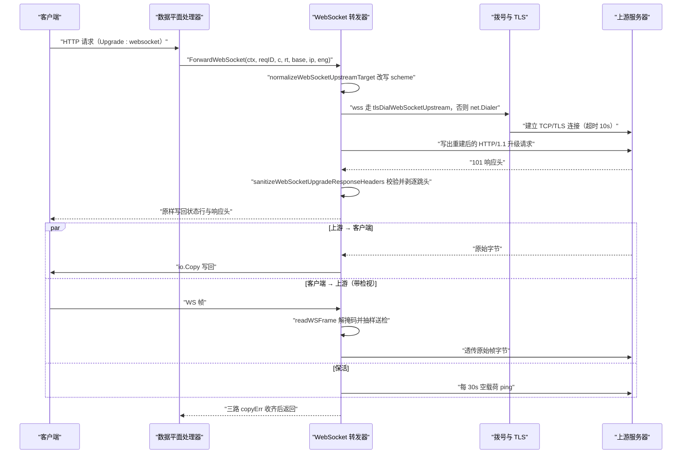

**图表来源**
- [internal/dataplane/websocket.go:92-108](file://internal/dataplane/websocket.go#L92-L108)
- [internal/dataplane/websocket.go:127-222](file://internal/dataplane/websocket.go#L127-L222)
- [internal/dataplane/websocket.go:269-274](file://internal/dataplane/websocket.go#L269-L274)
- [internal/dataplane/websocket.go:344-397](file://internal/dataplane/websocket.go#L344-L397)
- [internal/dataplane/websocket.go:452-497](file://internal/dataplane/websocket.go#L452-L497)

握手与隧道建立的流程步骤如下：

| 步 | 动作 | 执行位置 | 输入 | 输出 | 失败分支 | 可观测点 |
|:--:|------|----------|------|------|----------|----------|
| 1 | 升级识别 | `websocket.go:36` | Upgrade/Connection 头 | true/false | 走普通 HTTP | 转发分支日志 |
| 2 | 目标 URL 归一 | `websocket.go:92` | 上游 base | ws/wss 目标 | h3 不归一 | debug 日志 |
| 3 | 主机与端口推导 | `websocket.go:697` | 目标串 | host:port | 拨号错误 → 502 | 上游错误计数 |
| 4 | 连接建立 | `websocket.go:140`、`websocket.go:269` | 目标 host | `net.Conn` | 超时/拒绝 | 错误返回 handler |
| 5 | 握手头重建 | `websocket.go:276` | 原始头 + 转发参数 | 请求文本 | Host 模板解析失败 | 出站头 |
| 6 | 响应头校验 | `websocket.go:344`、`websocket.go:639` | 101 响应 | 清洗后头 | 缺 Upgrade/Connection 报错 | 错误文本 |
| 7 | 写回客户端 | `websocket.go:167-173` | 状态行与头 | 协议切换 | 写失败 | `X-Request-ID` |
| 8 | 双向透传 | `websocket.go:197-214` | 两端连接 | 字节流 | EOF/连接重置 | copyErr 汇总 |
| 9 | 帧检视送检 | `websocket.go:452`、`websocket.go:499` | 帧载荷 | 判决结果 | 命中即双端关闭 | 安全事件 |
| 10 | 收尾 | `handler.go:1215` | 上游错误 | `Mark(base, err)` | — | 上游状态位 |

**章节来源**
- [internal/dataplane/websocket.go:36-108](file://internal/dataplane/websocket.go#L36-L108)
- [internal/dataplane/websocket.go:127-222](file://internal/dataplane/websocket.go#L127-L222)
- [internal/dataplane/websocket.go:276-397](file://internal/dataplane/websocket.go#L276-L397)
- [internal/dataplane/websocket.go:452-521](file://internal/dataplane/websocket.go#L452-L521)
- [internal/dataplane/websocket.go:639-712](file://internal/dataplane/websocket.go#L639-L712)
- [internal/dataplane/handler.go:1215-1216](file://internal/dataplane/handler.go#L1215-L1216)
- [internal/security/outbound.go:33-56](file://internal/security/outbound.go#L33-L56)

## 架构总览

My-OpenWaf 的 WebSocket 处理架构采用分层设计，确保了高性能和可扩展性：

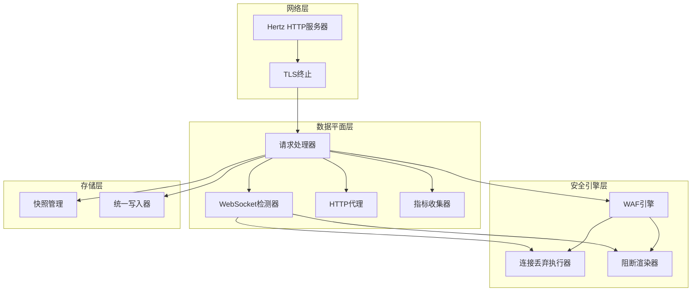

**图表来源**
- [internal/app/server.go:1513-1657](file://internal/app/server.go#L1513-L1657)
- [internal/dataplane/handler.go:39-145](file://internal/dataplane/handler.go#L39-L145)
- [internal/dataplane/handler.go:1101-1132](file://internal/dataplane/handler.go#L1101-L1132)

## 详细组件分析

### WebSocket 协议升级实现

WebSocket 协议升级是整个连接处理流程的关键起点。系统通过严格的头部验证确保只有合法的 WebSocket 请求才能被处理。

#### 升级头部验证机制

协议升级验证由两个条件组成，二者都必须成立才判为升级请求：

| 条件 | 判定语义 | 实现 |
|------|----------|------|
| `Upgrade` 头 | 与 `websocket` **等值**（大小写无关），非「包含」 | `strings.EqualFold`（`websocket.go:37`） |
| `Connection` 头 | 逗号分隔 token 列表中**含** `upgrade` | `headerContainsToken`（`websocket.go:62`） |

`IsWebSocketUpgrade` 因此不会把 `Upgrade: websocket, foo` 这类畸形值判为升级。扩展 CONNECT 走另一条判定：方法必须是 `CONNECT` 且 `: protocol` 伪头非空（`websocket.go:46`）。

**章节来源**
- [internal/dataplane/websocket.go:36-77](file://internal/dataplane/websocket.go#L36-L77)

#### 目标URL解析和转换

目标串由「上游 base 去尾斜杠 + 请求 path + query」拼成，再做 scheme 归一：`http→ws`、`https→wss`、`h2c→ws`，RPC 别名 `tls`/`grpcs`/`grpc+tls`/`grpc+https → wss`、`grpc → ws`。别名必须先于通用前缀替换处理，否则 `grpc+https://` 会被误改成 `grpc+wss://`。`h3` 明确排除在归一之外——QUIC 无法承载 HTTP/1.1 明文握手。主机名与端口由 `hostFromURL` 推导，缺省时 `wss` 补 443、`ws` 补 80（`websocket.go:92-108`、`websocket.go:697-711`）。

**章节来源**
- [internal/dataplane/websocket.go:92-133](file://internal/dataplane/websocket.go#L92-L133)
- [internal/dataplane/websocket.go:697-722](file://internal/dataplane/websocket.go#L697-L722)
- [internal/upstream/scheme_alias.go:21-30](file://internal/upstream/scheme_alias.go#L21-L30)

### 连接建立和握手验证

WebSocket 连接建立过程涉及多个验证步骤和安全检查：

#### TLS 连接建立

对 `wss://` 目标，拨号分两条路径（`websocket.go:140-144`、`websocket.go:269-274`）：站点配置了上游客户端证书时，取按「SNI + 跳过校验 + 证书指纹」键控的 `tls.Config` 缓存并调用 `tls.DialWithDialer`；未配置时走 `upstream.TLSDialWithDialer`。两条路径都受 10 秒拨号超时约束，命中的缓存配置自带 32 容量的会话缓存，可走恢复握手。证书读取失败只降级为「不带客户端证书」并告警，不让站点整体不可用。

**章节来源**
- [internal/dataplane/websocket.go:135-148](file://internal/dataplane/websocket.go#L135-L148)
- [internal/dataplane/websocket.go:224-274](file://internal/dataplane/websocket.go#L224-L274)
- [internal/upstream/transport.go:14-40](file://internal/upstream/transport.go#L14-L40)

#### HTTP/1.1 升级请求发送

建立底层连接后，系统发送标准的 WebSocket 升级请求：

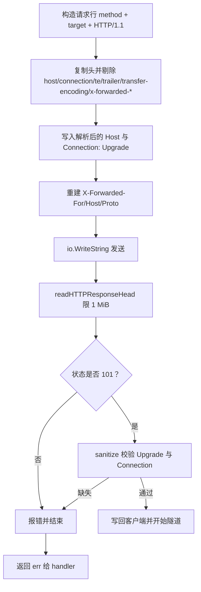

**图表来源**
- [internal/dataplane/websocket.go:150-173](file://internal/dataplane/websocket.go#L150-L173)
- [internal/dataplane/websocket.go:276-324](file://internal/dataplane/websocket.go#L276-L324)
- [internal/dataplane/websocket.go:344-397](file://internal/dataplane/websocket.go#L344-L397)
- [internal/dataplane/websocket.go:639-687](file://internal/dataplane/websocket.go#L639-L687)

**章节来源**
- [internal/dataplane/websocket.go:135-222](file://internal/dataplane/websocket.go#L135-L222)
- [internal/dataplane/websocket.go:276-397](file://internal/dataplane/websocket.go#L276-L397)
- [internal/dataplane/websocket.go:639-687](file://internal/dataplane/websocket.go#L639-L687)

### 双向数据传输机制

WebSocket 连接的核心特性是双向实时通信，系统通过 goroutine 实现高效的数据传输：

#### 双向复制架构

隧道由三路 goroutine 组成，而不是简单的双向 `io.Copy`：客户端字节先进入 `net.Pipe` 的一端，由检视协程逐帧解析后再写向上游，因此客户端方向可被 WAF 复检。

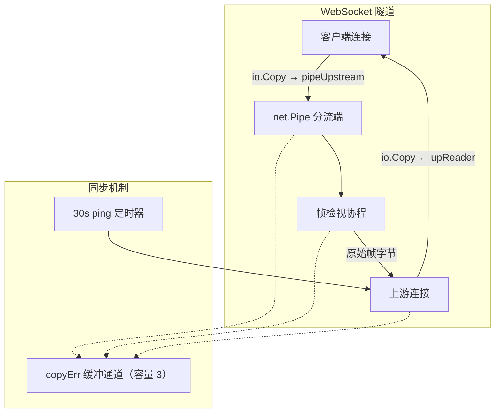

**图表来源**
- [internal/dataplane/websocket.go:178-195](file://internal/dataplane/websocket.go#L178-L195)
- [internal/dataplane/websocket.go:197-221](file://internal/dataplane/websocket.go#L197-L221)
- [internal/dataplane/websocket.go:452-497](file://internal/dataplane/websocket.go#L452-L497)

#### 数据传输优化

- **抽样上限**：帧载荷最多缓冲 4096 字节送检（`wsInspectFrameLimit`），超出部分用 `io.CopyN` 直补，不做二次拷贝
- **并发处理**：三路 goroutine（客户端→pipe、上游→客户端、pipe→上游检视），`copyErr` 容量 3
- **完成同步**：`for range 3 { <-copyErr }` 收齐后才返回，任一方向出错即关闭对应连接
- **保活合规**：向下游发的 ping 为空载荷且带掩码位（RFC 6455 要求客户端侧掩码），对端 ping 由检视协程原样回 pong

**章节来源**
- [internal/dataplane/websocket.go:32-33](file://internal/dataplane/websocket.go#L32-L33)
- [internal/dataplane/websocket.go:178-221](file://internal/dataplane/websocket.go#L178-L221)
- [internal/dataplane/websocket.go:452-497](file://internal/dataplane/websocket.go#L452-L497)
- [internal/dataplane/websocket.go:531-637](file://internal/dataplane/websocket.go#L531-L637)

### 连接生命周期管理

WebSocket 连接的生命周期管理包括连接建立、状态维护和异常处理：

#### 连接状态监控

系统通过原子计数器跟踪连接状态变化：

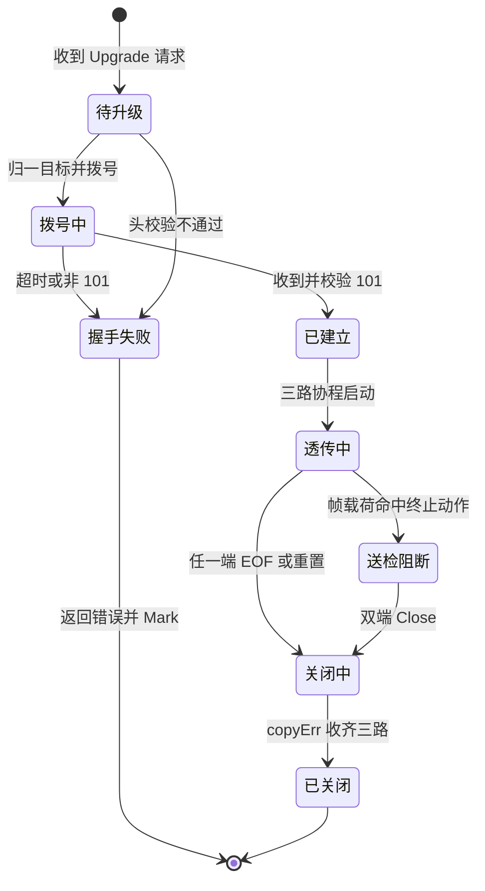

**图表来源**
- [internal/dataplane/websocket.go:127-222](file://internal/dataplane/websocket.go#L127-L222)
- [internal/dataplane/websocket.go:452-497](file://internal/dataplane/websocket.go#L452-L497)
- [internal/dataplane/websocket.go:639-661](file://internal/dataplane/websocket.go#L639-L661)

#### 异常断开恢复

当连接异常断开时，系统的处理策略是「显式关闭 + 幂等收尾」，不做自动重连：

- **错误检测**：`io.Copy` 返回错误，`isNetClosed` 过滤 `closed`/`reset by peer` 视为正常结束
- **资源清理**：`upConn`、`pipeClient`、`pipeUpstream`、`clientConn` 四处 Close 分散在各协程，均可重复调用
- **状态同步**：`copyErr` 容量 3，主协程收齐三次结果后才返回，避免遗留 goroutine

**章节来源**
- [internal/dataplane/websocket.go:197-222](file://internal/dataplane/websocket.go#L197-L222)
- [internal/dataplane/websocket.go:689-695](file://internal/dataplane/websocket.go#L689-L695)

### RFC 8441 扩展 CONNECT 路径

HTTP/2 与 h2c 上的 WebSocket 不走 `Upgrade` 头，而是 `CONNECT` 方法加 `: protocol` 伪头。`IsH2ExtendedWebSocketConnect` 据此识别（`websocket.go:46`），`registerH2WSInboundStream` 在进入转发分支前把入站流端点登记到请求上下文（`handler.go:1122`）。

两条子路径由上游 scheme 决定：

| 上游形态 | 判定 | 路径 | 握手超时 |
|----------|------|------|:--------:|
| `h2c://` 或 `grpc://` 别名 | `IsH2WebSocketDirectUpstream`（L33） | 帧层直通，不降级为 HTTP/1.1 | 5 秒 |
| `http(s)://`、`tls://`、`grpcs://` 等 | 同上为 false | 桥接为 HTTP/1.1 升级隧道 | 5 秒 |

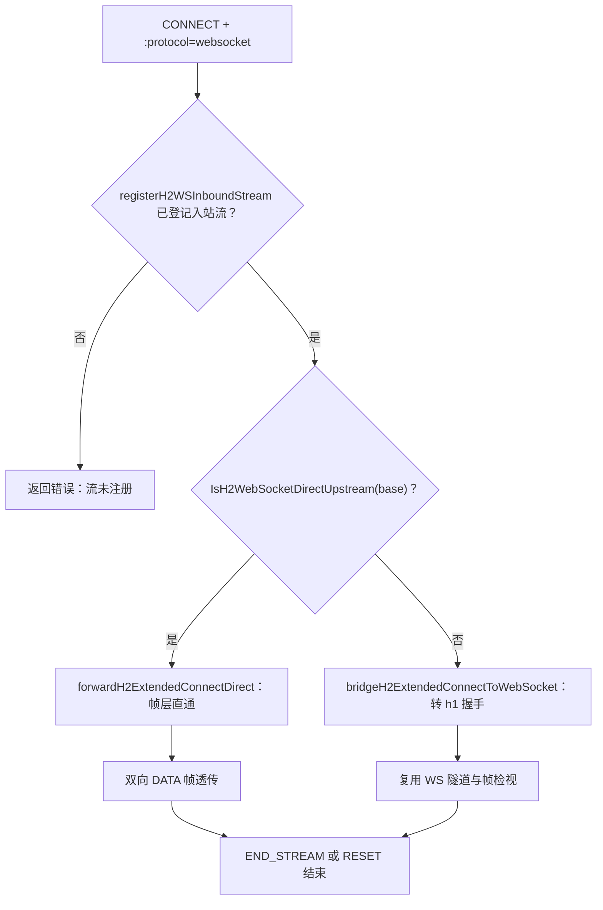

**图表来源**
- [internal/dataplane/h2_websocket.go:33-40](file://internal/dataplane/h2_websocket.go#L33-L40)
- [internal/dataplane/h2_websocket.go:62-69](file://internal/dataplane/h2_websocket.go#L62-L69)
- [internal/dataplane/h2_websocket.go:84-120](file://internal/dataplane/h2_websocket.go#L84-L120)
- [internal/dataplane/websocket.go:46-59](file://internal/dataplane/websocket.go#L46-L59)
- [internal/dataplane/handler.go:1122-1127](file://internal/dataplane/handler.go#L1122-L1127)

**章节来源**
- [internal/dataplane/h2_websocket.go:27-31](file://internal/dataplane/h2_websocket.go#L27-L31)
- [internal/dataplane/h2_websocket.go:41-59](file://internal/dataplane/h2_websocket.go#L41-L59)
- [internal/upstream/scheme_alias.go:21-30](file://internal/upstream/scheme_alias.go#L21-L30)

### 与 WAF 引擎的集成

WebSocket 连接处理与 WAF 引擎共用同一条阶段链：升级请求先经站点解析与维护检查，再由 `Engine.Process` 走完 IP 信誉、防重放、ACL、OWASP、CVE、机器人、限流、签名与自定义阶段；放行后建立隧道，隧道内每个文本/二进制帧再单独送检一次（阶段顺序详见[请求处理流程](请求处理流程.md)）。

#### 实时威胁检测

WAF 引擎在 WebSocket 帧层面复用同一套阶段链：`inspectWebSocketPayload` 从 `sync.Pool` 取 `RequestCtx`，把帧载荷作为 Body、内容类型置为 `application/octet-stream`，并回填请求 ID、站点、客户端 IP 与 TLS 指纹后调用 `eng.Process`（`websocket.go:499-521`）。命中终止动作时立刻关闭两端连接，不写业务响应。

| 复检字段 | 来源 | 说明 |
|----------|------|------|
| `Body` | WS 帧载荷 | 仅 opcode 0x1/0x2 且非空时送检 |
| `ContentType` | 固定 `application/octet-stream` | 避免误按表单解析 |
| `Path` / `RawQuery` | 握手请求 | 与升级请求一致 |
| `TLS` | 请求上下文指纹 | 由 tlsfp 监听器注入 |
| `AntiReplayTTL` | 站点配置 | 与其它请求路径同源 |

**章节来源**
- [internal/dataplane/websocket.go:463-470](file://internal/dataplane/websocket.go#L463-L470)
- [internal/dataplane/websocket.go:499-521](file://internal/dataplane/websocket.go#L499-L521)
- [internal/core/engine/engine.go:551-573](file://internal/core/engine/engine.go#L551-L573)
- [internal/core/pipeline/pool.go:20-60](file://internal/core/pipeline/pool.go#L20-L60)
- [internal/waf/drop/drop.go:19-45](file://internal/waf/drop/drop.go#L19-L45)

### 性能优化策略

系统采用了多种性能优化技术来确保 WebSocket 连接的高效运行：

#### 上游 TLS 配置缓存

WebSocket 走 Raw TCP 隧道，不经过 `http.Transport` 连接池；其复用点是按「SNI + 跳过校验 + 客户端证书指纹」键控的 `tls.Config` 缓存，命中的配置自带 32 容量的会话缓存。

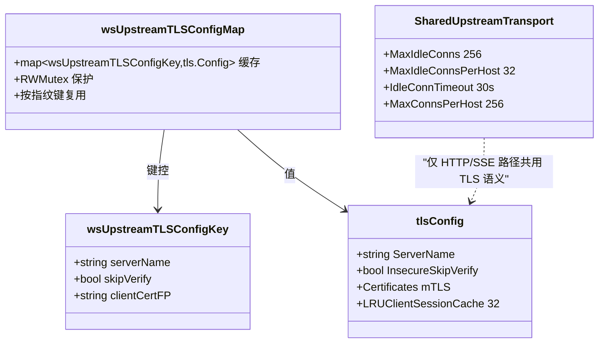

**图表来源**
- [internal/dataplane/websocket.go:224-267](file://internal/dataplane/websocket.go#L224-L267)
- [internal/upstream/transport.go:14-40](file://internal/upstream/transport.go#L14-L40)
- [internal/proxy/transport/transport.go:137-205](file://internal/proxy/transport/transport.go#L137-L205)

#### 指标监控和统计

指标只覆盖「请求与状态码」两个维度：隧道建立计入 `RecordRequest`，握手后的最终状态计入 `RecordStatus`，帧复检命中计入 `RecordWAFBlock`。数据面计数器的完整清单见[性能监控与调优](性能监控与调优.md)。

**章节来源**
- [internal/dataplane/websocket.go:224-267](file://internal/dataplane/websocket.go#L224-L267)
- [internal/dataplane/metrics/metrics.go:13-46](file://internal/dataplane/metrics/metrics.go#L13-L46)
- [internal/dataplane/metrics/metrics.go:48-161](file://internal/dataplane/metrics/metrics.go#L48-L161)
- [internal/proxy/transport/transport.go:153-195](file://internal/proxy/transport/transport.go#L153-L195)
- [internal/upstream/health.go:40-56](file://internal/upstream/health.go#L40-L56)

## 依赖关系分析

WebSocket 连接处理涉及多个模块间的复杂依赖关系：

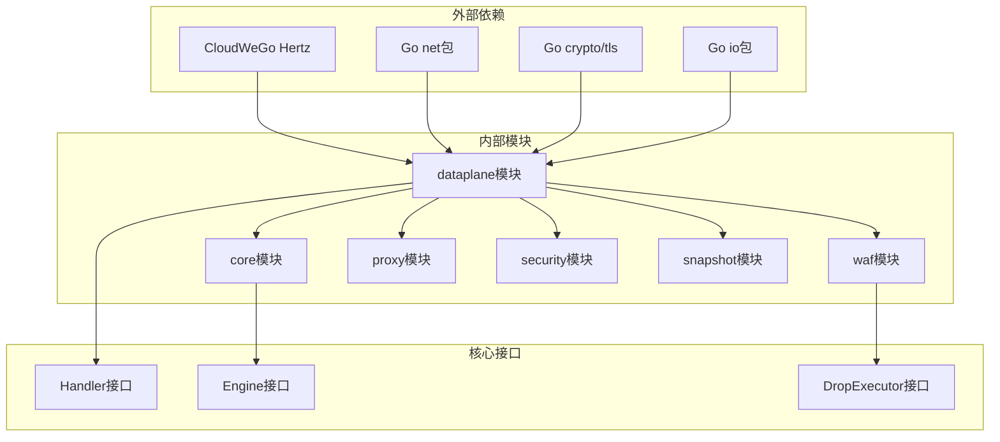

**图表来源**
- [internal/dataplane/handler.go:14-36](file://internal/dataplane/handler.go#L14-L36)
- [internal/dataplane/websocket.go:20-30](file://internal/dataplane/websocket.go#L20-L30)
- [internal/dataplane/h2_websocket.go:19-25](file://internal/dataplane/h2_websocket.go#L19-L25)
- [internal/app/server.go:1596-1616](file://internal/app/server.go#L1596-L1616)

### 关键依赖关系

1. **Hertz 框架集成**：升级判定与原始连接（`GetConn`）都来自 Hertz 请求上下文
2. **TLS 终止支持**：入站 TLS 由监听器承担，出站 TLS 由 `wsUpstreamTLSConfig` 承担
3. **WAF 引擎集成**：帧载荷复检复用同一 `Engine.Process` 与上下文池
4. **协议别名收敛**：`grpc`/`tls`/`grpcs` 等前缀在归一时折叠为传输 scheme，避免误判
5. **指标监控**：仅统计请求与状态码，隧道字节量不进入计数器

**章节来源**
- [internal/dataplane/handler.go:1122-1131](file://internal/dataplane/handler.go#L1122-L1131)
- [internal/upstream/scheme_alias.go:21-56](file://internal/upstream/scheme_alias.go#L21-L56)
- [internal/dataplane/websocket.go:119-124](file://internal/dataplane/websocket.go#L119-L124)

## 性能考虑

### 内存管理优化

系统采用多种技术优化内存使用：

- **对象池**：帧复检的 `RequestCtx` 来自 `sync.Pool`，`defer ReleaseCtx` 保证归还
- **抽样缓冲**：帧头 + 至多 4096 字节进入一次连续分配，剩余载荷用 `io.CopyN` 直补，避免整帧驻留
- **配置缓存**：上游 TLS 配置按指纹键缓存，跨站点共享同一份 `tls.Config`

**章节来源**
- [internal/core/pipeline/pool.go:11-60](file://internal/core/pipeline/pool.go#L11-L60)
- [internal/dataplane/websocket.go:489-496](file://internal/dataplane/websocket.go#L489-L496)
- [internal/dataplane/websocket.go:567-637](file://internal/dataplane/websocket.go#L567-L637)

### 并发处理优化

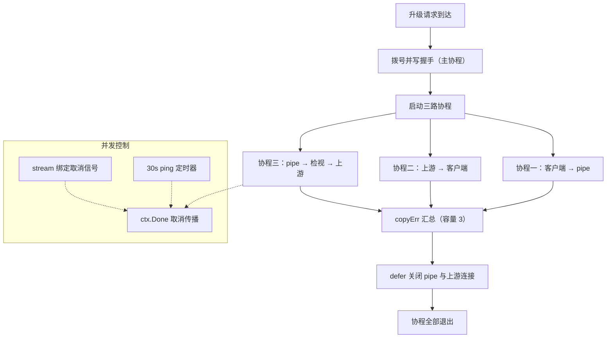

**图表来源**
- [internal/dataplane/websocket.go:178-221](file://internal/dataplane/websocket.go#L178-L221)
- [internal/dataplane/handler.go:49-62](file://internal/dataplane/handler.go#L49-L62)
- [internal/dataplane/stream/stream_close_notify.go:28-50](file://internal/dataplane/stream/stream_close_notify.go#L28-L50)

**章节来源**
- [internal/dataplane/websocket.go:178-221](file://internal/dataplane/websocket.go#L178-L221)
- [internal/dataplane/stream/stream_close_notify.go:21-50](file://internal/dataplane/stream/stream_close_notify.go#L21-L50)

### 监控和告警

系统提供多层次的监控能力：

- **实时指标**：QPS 与状态码分布来自数据面计数器，隧道内部字节量不单独计量
- **连接状态**：上游健康位（`Healthy`、`FailCount`、`LastFailureKind`）由 `Mark` 更新
- **判决可观测**：帧命中产生安全事件，阶段与规则 ID 可回溯到具体 WS 载荷
- **请求追踪**：`X-Request-ID` 贯穿握手与后续事件，便于跨日志关联

**章节来源**
- [internal/upstream/health.go:40-56](file://internal/upstream/health.go#L40-L56)
- [internal/dataplane/metrics/metrics.go:13-46](file://internal/dataplane/metrics/metrics.go#L13-L46)
- [internal/dataplane/reqid/reqid.go:36-53](file://internal/dataplane/reqid/reqid.go#L36-L53)
- [internal/dataplane/access_log.go:106-182](file://internal/dataplane/access_log.go#L106-L182)

## 故障排查指南

### 常见问题诊断

握手失败、异常断开与吞吐问题都可通过同一张表定位，判定点均为可grep的代码位置：

| 症状 | 可能原因 | 判定点 | 处置 |
|------|----------|--------|------|
| 非 101 响应 | 上游不支持 WS、协议前缀错、中间层阻止升级 | `readHTTPResponseHead`（`websocket.go:639`） | 核对 base scheme 与上游能力 |
| 握手报错缺 Upgrade/Connection | 上游响应头被改写 | `sanitizeWebSocketUpgradeResponseHeaders`（`websocket.go:344`） | 让上游原样回两值 |
| wss 握手失败 | SNI 或证书校验配置不符 | `wsUpstreamTLSConfig`（`websocket.go:235`） | 校正 `upstream_tls_server_name` |
| 建立后立刻断 | 帧命中终止动作 | `inspectWebSocketPayload`（`websocket.go:499`） | 查安全事件的阶段与规则 ID |
| 长空闲后被切 | NAT/防火墙空闲超时 | 30s ping 是否被回（`websocket.go:179`） | 调中间层超时 |
| 拨号超时 | 上游不可达、端口缺省错 | `hostFromURL` + 10s 超时（`websocket.go:135`） | 确认端口与健康位 |
| 延迟高/吞吐低 | 并发连接过多、送检开销 | `wsInspectFrameLimit`、CPU | 降低送检比例或扩容 |
| 反复失败的上游 | 未进入探活摘除 | `Pool.Mark`（`health.go:470`） | 结合 `FailCount` 判断 |
| h2 场景无 WS 流 | ALPN 未含 h2 | `IsH2ExtendedWebSocketConnect`（`websocket.go:46`） | 站点 ALPN 补 `h2` |

**章节来源**
- [internal/dataplane/websocket.go:135-148](file://internal/dataplane/websocket.go#L135-L148)
- [internal/dataplane/websocket.go:344-397](file://internal/dataplane/websocket.go#L344-L397)
- [internal/dataplane/websocket.go:499-521](file://internal/dataplane/websocket.go#L499-L521)
- [internal/dataplane/websocket.go:639-687](file://internal/dataplane/websocket.go#L639-L687)
- [internal/waf/drop/drop.go:19-45](file://internal/waf/drop/drop.go#L19-L45)
- [internal/upstream/health.go:460-514](file://internal/upstream/health.go#L460-L514)

## 结论

My-OpenWaf 的 WebSocket 连接处理把「握手代理 + 帧级复检 + 双向透传」收敛在一个不依赖 `http.Transport` 的 Raw TCP 隧道里，HTTP/2 侧再用扩展 CONNECT 路径保持同一套复检语义。

### 主要优势

1. **安全性**：帧载荷复用同一引擎阶段链，命中即双端关闭
2. **性能**：抽样送检限制驻留内存，配置与上下文双向复用
3. **可靠性**：三路协程收齐后才返回，错误按 `isNetClosed` 归一
4. **可观测性**：`X-Request-ID` 与上游健康位可回溯
5. **兼容性**：`ws`/`wss`/h2c/gRPC 别名统一归一，h3 明确排除

[本节为总结，无需特定文件来源]

### 技术特色

- **协议透明**：帧字节原样透传，仅在客户端方向做抽样解析
- **保活双向**：上游方向定时 ping，客户端方向 ping 回 pong
- **握手严格校验**：非 101、缺 `Upgrade` 或缺 `Connection: Upgrade` 均直接失败
- **扩展 CONNECT 分流**：h2c 上游走帧层直通，其余降级桥接
- **多站点隔离**：每站点独立上游 TLS 与转发参数，缓存按指纹键共享

[本节为总结，无需特定文件来源]

## 附录

### WebSocket 相关站点字段
WebSocket 转发没有独立配置文件，全部复用站点与监听字段：

| 字段 | JSON 名 | 作用域 | 与 WS 的关系 | 位置 |
|------|---------|--------|--------------|------|
| UpstreamURLs | `upstream_urls` | 站点 | 逗号分隔的 base 列表，逐个归一为 ws/wss | `store/site.go:45` |
| UpstreamHost | `upstream_host` | 站点 | 握手 `Host` 头，支持 Go 模板 | `store/site.go:46` |
| PreserveOriginalHost | `preserve_original_host` | 站点 | 决定是否写 `X-Forwarded-Host` | `store/site.go:95` |
| UpstreamTLSServerName | `upstream_tls_server_name` | 站点 | wss 拨号 SNI | `store/site.go:99` |
| UpstreamTLSSkipVerify | `upstream_tls_skip_verify` | 站点 | 跳过服务端校验 | `store/site.go:98` |
| 客户端证书 | `upstream_tls_client_cert_pem` | 站点 | mTLS，指纹入缓存键 | `store/site.go:104` |
| TLSEnabled | `tls_enabled` | 监听 | 决定入站是否 wss | `store/site.go:257` |
| Network | `network` | 监听 | tcp/tcp4/tcp6 | `store/site.go:256` |
| ALPN | `alpn` | 站点 | 决定入站能否用 h2 扩展 CONNECT | `store/site.go:57` |

**章节来源**
- [internal/store/site.go:45-110](file://internal/store/site.go#L45-L110)
- [internal/store/site.go:247-263](file://internal/store/site.go#L247-L263)
- [internal/dataplane/websocket.go:276-324](file://internal/dataplane/websocket.go#L276-L324)
- [internal/dataplane/websocket.go:224-267](file://internal/dataplane/websocket.go#L224-L267)

### 关键常量速查
| 常量 | 取值 | 位置 | 作用 |
|------|:----:|------|------|
| `wsInspectFrameLimit` | 4096 B | `websocket.go:32` | 单帧送检载荷上限 |
| `websocketUpstreamResponseHeaderLimit` | 1 MiB | `websocket.go:33` | 上游响应头读取上限 |
| 上游拨号超时 | 10 s | `websocket.go:135` | `net.Dialer.Timeout` |
| 保活 ping 间隔 | 30 s | `websocket.go:179` | 上游方向定时器 |
| `copyErr` 容量 | 3 | `websocket.go:201` | 三路协程结果 |
| 会话缓存容量 | 32 | `websocket.go:258` | 上游 TLS LRU |
| h2 桥接响应头上限 | 1 MiB | `h2_websocket.go:27` | 扩展 CONNECT 桥 |
| h2 直通握手超时 | 5 s | `h2_websocket.go:29` | 帧层直通 |

**章节来源**
- [internal/dataplane/websocket.go:32-33](file://internal/dataplane/websocket.go#L32-L33)
- [internal/dataplane/websocket.go:135-201](file://internal/dataplane/websocket.go#L135-L201)
- [internal/dataplane/websocket.go:255-262](file://internal/dataplane/websocket.go#L255-L262)
- [internal/dataplane/h2_websocket.go:27-31](file://internal/dataplane/h2_websocket.go#L27-L31)

### 排障观测口径
- **日志**：以 `X-Request-ID` 关联握手与事件行；上游错误按计数限流打印
- **抓包**：关注 101 响应的 `Connection`/`Upgrade` 两值，以及客户端帧掩码位
- **载荷**：送检只覆盖前 4096 字节，超长帧的判决需结合分片语义判断
- **脱敏**：日志中的 URL 与查询串经 `logredact` 处理，Authorization 与 Cookie 不落原文

**章节来源**
- [internal/dataplane/reqid/reqid.go:36-53](file://internal/dataplane/reqid/reqid.go#L36-L53)
- [internal/dataplane/logredact/sanitize.go:42-131](file://internal/dataplane/logredact/sanitize.go#L42-L131)
- [internal/proxy/proxy.go:431-497](file://internal/proxy/proxy.go#L431-L497)
- [internal/dataplane/websocket.go:605-637](file://internal/dataplane/websocket.go#L605-L637)
