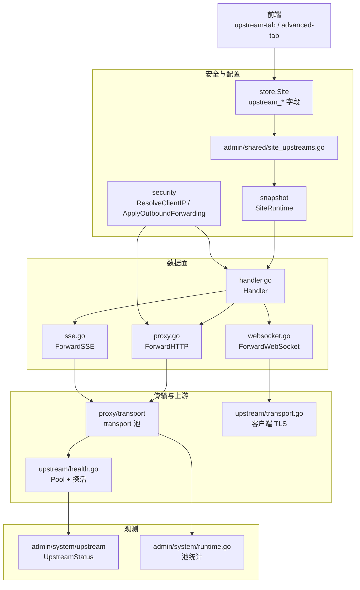
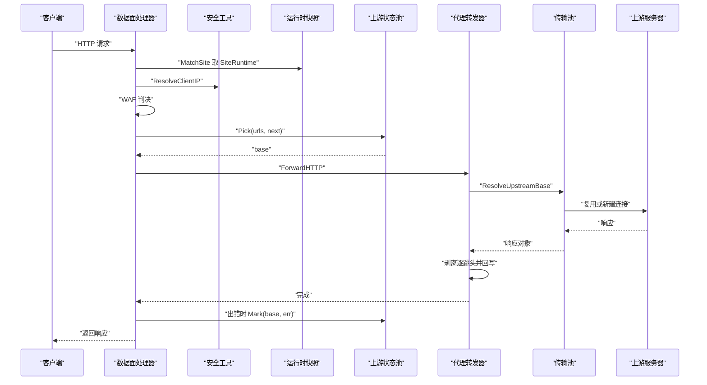
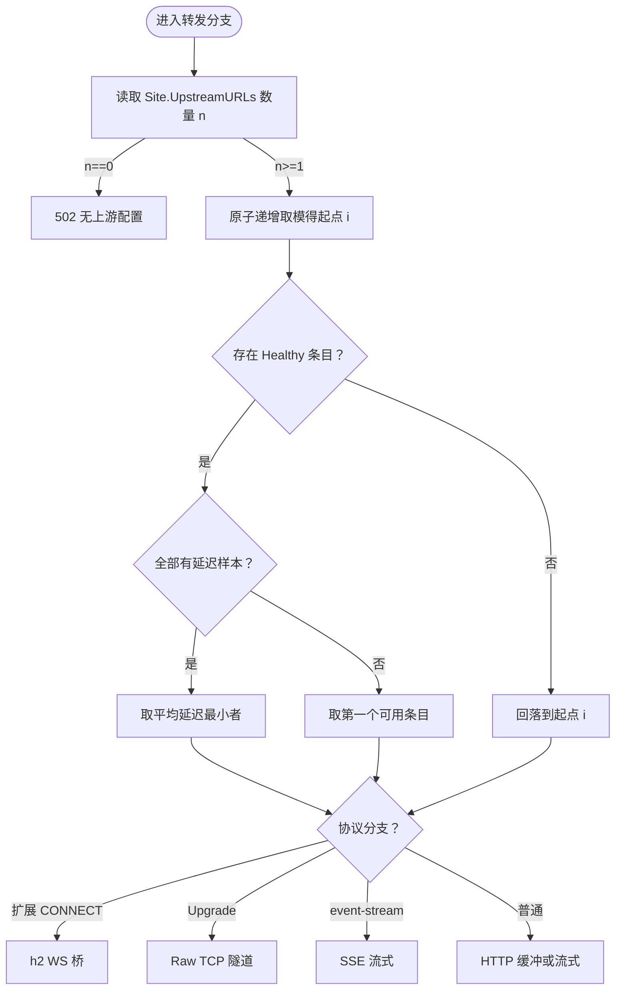
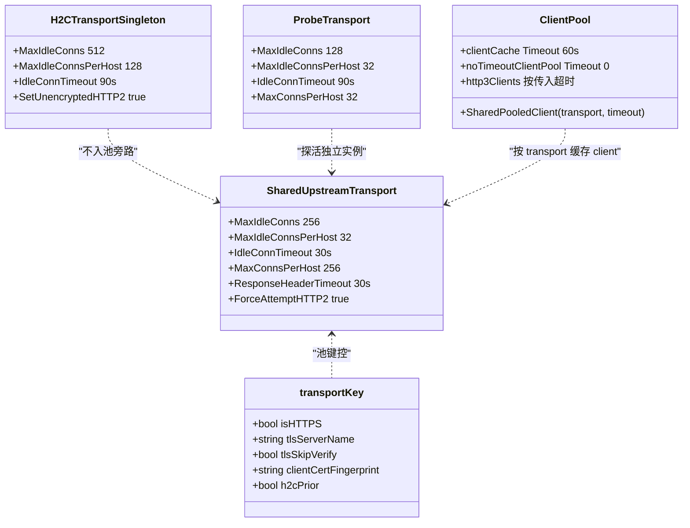
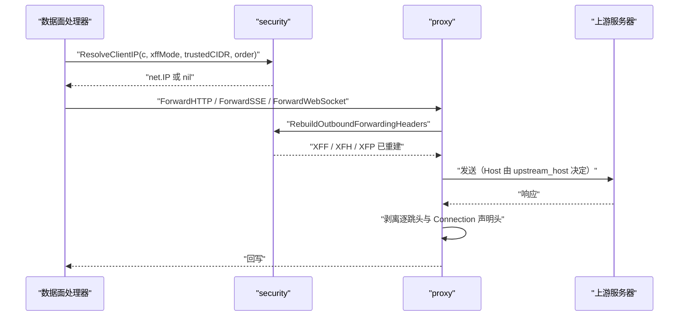
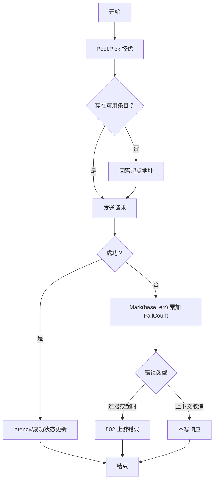
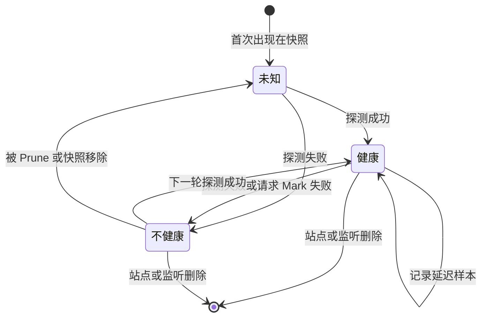
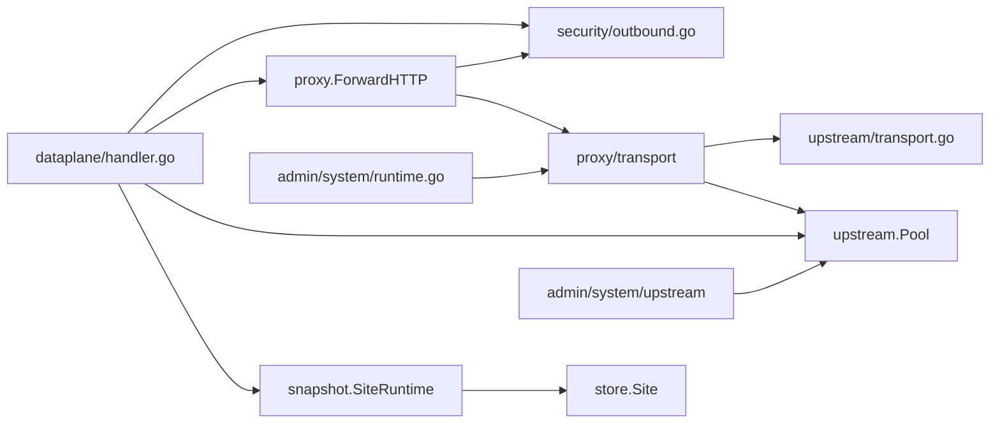

> [返回 数据平面处理](数据平面处理.md)

# 上游代理配置

<cite>
**本文档引用的文件**
- [handler.go](file://internal/dataplane/handler.go)
- [handler_support.go](file://internal/dataplane/handler_support.go)
- [sse.go](file://internal/dataplane/sse.go)
- [websocket.go](file://internal/dataplane/websocket.go)
- [proxy.go](file://internal/proxy/proxy.go)
- [transport/transport.go](file://internal/proxy/transport/transport.go)
- [upstream/health.go](file://internal/upstream/health.go)
- [upstream/transport.go](file://internal/upstream/transport.go)
- [upstream/scheme_alias.go](file://internal/upstream/scheme_alias.go)
- [security/clientip.go](file://internal/security/clientip.go)
- [security/outbound.go](file://internal/security/outbound.go)
- [snapshot/snapshot.go](file://internal/snapshot/snapshot.go)
- [observability/metrics.go](file://internal/observability/metrics.go)
- [store/site.go](file://internal/store/site.go)
- [admin/shared/site_upstreams.go](file://internal/admin/shared/site_upstreams.go)
- [admin/system/upstream/upstream.go](file://internal/admin/system/upstream/upstream.go)
- [admin/system/runtime.go](file://internal/admin/system/runtime.go)
- [admin/router.go](file://internal/admin/router.go)
- [server.go](file://internal/app/server.go)
- [upstream-tab.tsx](file://frontend/app/(dashboard)/sites/detail/components/upstream-tab.tsx)
- [advanced-tab.tsx](file://frontend/app/(dashboard)/sites/detail/components/advanced-tab.tsx)
- [site-form-dialog.tsx](file://frontend/app/(dashboard)/sites/components/site-form-dialog.tsx)
- [site-display.ts](file://frontend/lib/site-display.ts)
</cite>

## 目录

1. [简介](#简介)
2. [项目结构](#项目结构)
3. [核心组件](#核心组件)
4. [架构总览](#架构总览)
5. [详细组件分析](#详细组件分析)
6. [依赖关系分析](#依赖关系分析)
7. [性能考虑](#性能考虑)
8. [故障排查指南](#故障排查指南)
9. [结论](#结论)
10. [附录](#附录)

## 简介
本文件面向运维与开发人员，系统性阐述本项目的上游代理配置与实现机制，重点覆盖以下方面：
- 上游选择：轮询起点 + 健康位与平均延迟择优（`internal/upstream/health.go`）
- 上游服务器配置：URL 列表形态、协议白名单、`upstream_host` 模板
- 传输层：三类 transport 池的参数差异、超时与 HTTP/2/HTTP/3 分流
- 代理头部处理：入站 XFF 解析与出站 `X-Forwarded-*` 重建
- 错误处理：探活摘除、失败回写与 502 语义
- 可观测与调优：池统计、上游状态接口与参数建议

## 项目结构
上游代理能力由数据面处理器、代理转发器、传输池、上游状态池与安全工具共同构成，前端负责站点与转发配置录入。

| 模块 | 路径 | 职责 | 核心符号 | 规模(行) | 测试 |
|------|------|------|----------|:--------:|:----:|
| 上游择优 | `internal/upstream/health.go` | 状态池、轮询、探活与延迟择优 | `Pool.Pick`（L219）、`StartWithResult`（L587） | 981 | 有 |
| 探活实现 | `internal/upstream/health.go` | HTTP/h2c/h3 探测与失败分类 | `HTTPProbeWithResult`（L609） | 同上 | 有 |
| 协议别名 | `internal/upstream/scheme_alias.go` | RPC 前缀折叠为传输 scheme | `RPCUpstreamAliasForURL`（L43） | 56 | 有 |
| 客户端 TLS | `internal/upstream/transport.go` | 上游 TLS 与 mTLS 配置 | `HTTPSClientTLSConfigWithClientCert`（L27） | 194 | 有 |
| 转发器 | `internal/proxy/proxy.go` | 请求构造、逐跳头剥离、回写 | `ForwardHTTP`（L1998）、`IsHopByHop`（L2863） | 2989 | 有 |
| 传输池 | `internal/proxy/transport/transport.go` | transport/client 池化与分流 | `SharedTransportForUpstream`（L131）、`ResolveUpstreamBase`（L800） | 1280 | 有 |
| 池统计 | `internal/proxy/transport/transport.go` | 池规模快照与回收 | `UpstreamTransportPoolStatsSnapshot`（L1244）、`PruneInactiveUpstreamTransports`（L1044） | 同上 | 有 |
| 入站 IP | `internal/security/clientip.go` | XFF 语义解析 | `ResolveClientIP`（L16） | 273 | 有 |
| 出站头 | `internal/security/outbound.go` | 转发头重建 | `ApplyOutboundForwarding`（L74） | 166 | 有 |
| 配置校验 | `internal/admin/shared/site_upstreams.go` | URL 语法与协议白名单 | `ValidateSiteUpstreamURLs`（L24） | 112 | 有 |
| 状态接口 | `internal/admin/system/upstream/upstream.go` | 上游健康对外展示 | `UpstreamStatus`（L26） | 58 | 有 |

**图表来源**
- [internal/dataplane/handler.go:1101-1131](file://internal/dataplane/handler.go#L1101-L1131)
- [internal/proxy/proxy.go:1006-1054](file://internal/proxy/proxy.go#L1006-L1054)
- [internal/proxy/transport/transport.go:131-205](file://internal/proxy/transport/transport.go#L131-L205)
- [internal/upstream/health.go:219-240](file://internal/upstream/health.go#L219-L240)
- [internal/admin/shared/site_upstreams.go:14-56](file://internal/admin/shared/site_upstreams.go#L14-L56)
- [internal/admin/system/upstream/upstream.go:26-45](file://internal/admin/system/upstream/upstream.go#L26-L45)
- [internal/app/server.go:368-374](file://internal/app/server.go#L368-L374)

**章节来源**
- [internal/store/site.go:45-110](file://internal/store/site.go#L45-L110)
- [internal/snapshot/snapshot.go:44-90](file://internal/snapshot/snapshot.go#L44-L90)
- [frontend/app/(dashboard)/sites/detail/components/upstream-tab.tsx:25-45](file://frontend/app/(dashboard)/sites/detail/components/upstream-tab.tsx#L25-L45)

## 核心组件
- 上游状态池：以规范化 URL 为键维护 `Healthy`、`FailCount`、`LastFailureKind`、`AverageLatencyMs` 等状态位（`health.go:40-56`）。
- 择优器：`Pick` 先用调用方给的原子计数取起点，再在「未被判死」的集合内按平均延迟择优，全死则回落起点（`health.go:219-240`、`health.go:404-458`）。
- 探活循环：`StartWithResult` 以 10 秒间隔探测全部上游，探测超时 2 秒（`server.go:370-374`、`health.go:609`）。
- 传输池：按 `transportKey` 缓存 transport，并按 scheme 分流到 h2c 单例或 h3 池（`transport.go:71-92`、`transport.go:800-856`）。
- 转发器：构造上游请求、剥离逐跳头、按 30 秒 client 超时回源并回写响应（`proxy.go:1006-1054`）。
- 安全工具：入站按 XFF 模式解析真实 IP，出站重建 `X-Forwarded-For/Host/Proto`（`clientip.go:16`、`outbound.go:74`）。
- 观测接口：`/upstreams/status` 输出健康位（`router.go:245`），运行时接口输出池统计（`runtime.go:157-198`）。

**章节来源**
- [internal/upstream/health.go:20-56](file://internal/upstream/health.go#L20-L56)
- [internal/upstream/health.go:404-514](file://internal/upstream/health.go#L404-L514)
- [internal/proxy/transport/transport.go:71-92](file://internal/proxy/transport/transport.go#L71-L92)
- [internal/security/outbound.go:33-90](file://internal/security/outbound.go#L33-L90)
- [internal/admin/router.go:245](file://internal/admin/router.go#L245)
- [internal/admin/system/runtime.go:157-198](file://internal/admin/system/runtime.go#L157-L198)

## 架构总览
下图展示一次典型请求从进入数据面到上游转发的关键路径与职责分工。

**图表来源**
- [internal/dataplane/handler.go:141-170](file://internal/dataplane/handler.go#L141-L170)
- [internal/dataplane/handler.go:1101-1131](file://internal/dataplane/handler.go#L1101-L1131)
- [internal/dataplane/handler.go:1215-1216](file://internal/dataplane/handler.go#L1215-L1216)
- [internal/upstream/health.go:219-240](file://internal/upstream/health.go#L219-L240)
- [internal/proxy/transport/transport.go:800-856](file://internal/proxy/transport/transport.go#L800-L856)
- [internal/proxy/proxy.go:1006-1054](file://internal/proxy/proxy.go#L1006-L1054)
- [internal/security/clientip.go:16-36](file://internal/security/clientip.go#L16-L36)

**章节来源**
- [internal/snapshot/snapshot.go:337-362](file://internal/snapshot/snapshot.go#L337-L362)
- [internal/dataplane/handler_support.go:150-152](file://internal/dataplane/handler_support.go#L150-L152)

## 详细组件分析

### 负载均衡策略与择优算法
- 起点：`Handler` 用 `atomic.Uint32` 递增取模生成轮询起点（`handler.go:1101`、`handler_support.go:150`）。
- 择优：`pickFastestKnownAvailable` 跳过 `Healthy=false` 的条目；若全部已知条目都有延迟样本，则取平均延迟最小者，否则取第一个可用（`health.go:421-458`）。
- 协议偏好：`PickByProtocolPreference` 按 h3 > h2c > https > 其它分组轮询，pool 为 nil 时走无池分支（`health.go:268-281`）。
- 兜底：`Pick` 在无任何可用条目时仍返回起点地址，由请求失败路径写 502 并 `Mark` 失败（`health.go:219-240`、`handler.go:1215`）。
- 边界：SSE 与 WebSocket 分支同样先经过 `Pick`，但 WebSocket 走 Raw TCP 拨号，不使用 transport 池。

**图表来源**
- [internal/dataplane/handler.go:1101-1131](file://internal/dataplane/handler.go#L1101-L1131)
- [internal/dataplane/handler_support.go:150-152](file://internal/dataplane/handler_support.go#L150-L152)
- [internal/upstream/health.go:219-240](file://internal/upstream/health.go#L219-L240)
- [internal/upstream/health.go:268-281](file://internal/upstream/health.go#L268-L281)
- [internal/upstream/health.go:404-458](file://internal/upstream/health.go#L404-L458)

**章节来源**
- [internal/upstream/health.go:535-547](file://internal/upstream/health.go#L535-L547)
- [internal/upstream/health.go:460-478](file://internal/upstream/health.go#L460-L478)

### 上游服务器配置与 URL 列表管理
- 存储形态：`store.Site.UpstreamURLs` 为文本字段，后端接受 JSON 字符串数组或逗号分隔串两种形态（`site.go:45`、`site-display.ts:20`）。
- 协议白名单：仅允许 `http`、`https`、`h2c`、`h3`、`tls`、`grpc`、`grpcs`、`grpc+tls`、`grpc+https`，其它 scheme 在校验阶段即拒绝（`site_upstreams.go:18`）。
- 别名折叠：`tls`/`grpcs`/`grpc+tls`/`grpc+https` 归一为 `https`，`grpc` 归一为 `h2c`（`scheme_alias.go:21-30`）。
- Host 覆写：`upstream_host` 决定发往上游的 `Host` 头，支持域名、域名:端口或 Go 模板；为空时回退上游地址主机；`preserve_original_host` 只影响 `X-Forwarded-Host` 与未配置 `upstream_host` 时的回退（`site.go:46`、`site.go:95`、`snapshot.go` 的 `ResolveOutboundHost`）。
- 前端录入：站点详情的「上游」页编辑 `upstream_urls`、`upstream_host`、`upstream_tls_skip_verify`（`upstream-tab.tsx:25-45`），「高级」页编辑 `xff_mode` 与 `preserve_original_host`（`advanced-tab.tsx:166-245`），新建/编辑弹窗走同一字段集（`site-form-dialog.tsx:102-216`）。

| 协议 | 传输 | 是否入 transport 池 | WS 归一结果 | h3 支持 | 位置 |
|------|------|:---:|:---:|:---:|------|
| `http` | TCP + HTTP/1.1 或 h2 | 是 | `ws` | 否 | `transport.go:137`、`websocket.go:104` |
| `https` | TLS | 是（键含 SNI/跳过校验/证书指纹） | `wss` | 否 | `transport.go:138-155`、`websocket.go:105` |
| `h2c` | 明文 HTTP/2 | 否，走单例 | `ws` | 否 | `transport.go:863-889` |
| `h3` | QUIC | 独立 h3 池 | 不支持 | 是 | `transport.go:891-945`、`websocket.go:88` |
| `tls` / `grpcs` / `grpc+tls` / `grpc+https` | 同 `https` | 是 | `wss` | 否 | `scheme_alias.go:21-30` |
| `grpc` | 同 `h2c` | 否，走单例 | `ws` | 否 | `scheme_alias.go:21-30` |

**章节来源**
- [internal/store/site.go:45-110](file://internal/store/site.go#L45-L110)
- [internal/admin/shared/site_upstreams.go:14-112](file://internal/admin/shared/site_upstreams.go#L14-L112)
- [internal/upstream/scheme_alias.go:14-56](file://internal/upstream/scheme_alias.go#L14-L56)
- [frontend/lib/site-display.ts:5-25](file://frontend/lib/site-display.ts#L5-L25)
- [frontend/app/(dashboard)/sites/detail/components/upstream-tab.tsx:25-45](file://frontend/app/(dashboard)/sites/detail/components/upstream-tab.tsx#L25-L45)
- [frontend/app/(dashboard)/sites/detail/components/advanced-tab.tsx:166-245](file://frontend/app/(dashboard)/sites/detail/components/advanced-tab.tsx#L166-L245)
- [frontend/app/(dashboard)/sites/components/site-form-dialog.tsx:102-216](file://frontend/app/(dashboard)/sites/components/site-form-dialog.tsx#L102-L216)

### 传输层：三类 transport 池参数对照
连接池实现全部位于 `internal/proxy/transport/transport.go`，`internal/proxy/proxy.go` 不再持有 `transportPool` 与 `transportKey`。三类池的取值来自实测代码行，互不可混用：

| 参数 | 共享上游池 | h2c 明文 HTTP/2 单例 | 探活 transport |
|------|:---:|:---:|:---:|
| `MaxIdleConns` | 256（`transport.go:157`） | 512（`transport.go:872`） | 128（`health.go:667`） |
| `MaxIdleConnsPerHost` | 32（`transport.go:159`） | 128（`transport.go:873`） | 32（`health.go:668`） |
| `IdleConnTimeout` | 30s（`transport.go:161`） | 90s（`transport.go:874`） | 90s（`health.go:671`） |
| `MaxConnsPerHost` | 256（`transport.go:172`） | 未设 | 32（`health.go:669`） |
| 拨号超时 | 10s（`transport.go:110`） | 未设 | 等于探测超时（`health.go:663`） |
| `TLSHandshakeTimeout` | 10s（`transport.go:176`） | 未设 | 10s（`health.go:672`） |
| `ResponseHeaderTimeout` | 30s（`transport.go:177`） | 未设 | 未设 |
| 读/写缓冲 | 16 KiB（`transport.go:163-164`） | 默认 | 默认 |
| `ForceAttemptHTTP2` | 是（`transport.go:168`） | 是（`transport.go:875`） | 是（`health.go:674`） |
| `DisableCompression` | 是（`transport.go:170`） | 是（`transport.go:876`） | 是（`health.go:675`） |
| `ExpectContinueTimeout` | 1s（`transport.go:166`） | 未设 | 1s（`health.go:673`） |
| 客户端会话缓存 | LRU 32（`transport.go:187`） | 无 | 无 |
| `MinVersion` | TLS 1.2（`transport.go:183`） | 默认 | 默认 |
| 池化键 | `transportKey`（`transport.go:71`） | 单例（`transport.go:863`） | 每 client 一份 |

- 取值理由：256/32 比 Go 默认的 512/128 更省空闲连接内存，30 秒让峰值后的空闲连接更快释放（原为 90 秒）；`MaxConnsPerHost` 限制单上游并发，避免洪峰占满临时端口。
- client 侧：`*http.Transport` 走 `sharedClient`（整体超时固定 60 秒，`transport.go:246`）或 `sharedNoTimeoutClient`（超时 0，`transport.go:266`）；调用方传入的超时值只对 `*http3.Transport` 生效（`transport.go:967-1016`），因此 `proxy.go:1037` 的 30 秒在 HTTP/1 与 h2 路径上被 60 秒档覆盖，真正的响应头约束来自 `ResponseHeaderTimeout` 的 30 秒。
- 回收：`PruneInactiveUpstreamTransports` 按快照清理不再使用的键，`CloseIdleUpstreamTransports` 用于关停（`transport.go:1044-1136`）。

**图表来源**
- [internal/proxy/transport/transport.go:71-92](file://internal/proxy/transport/transport.go#L71-L92)
- [internal/proxy/transport/transport.go:109-195](file://internal/proxy/transport/transport.go#L109-L195)
- [internal/proxy/transport/transport.go:863-889](file://internal/proxy/transport/transport.go#L863-L889)
- [internal/proxy/transport/transport.go:967-1016](file://internal/proxy/transport/transport.go#L967-L1016)
- [internal/proxy/transport/transport.go:1044-1136](file://internal/proxy/transport/transport.go#L1044-L1136)
- [internal/upstream/health.go:661-676](file://internal/upstream/health.go#L661-L676)

**章节来源**
- [internal/proxy/transport/transport.go:238-277](file://internal/proxy/transport/transport.go#L238-L277)
- [internal/proxy/proxy.go:1037](file://internal/proxy/proxy.go#L1037)
- [internal/dataplane/sse.go:52](file://internal/dataplane/sse.go#L52)
- [internal/upstream/health.go:20-28](file://internal/upstream/health.go#L20-L28)
- [internal/admin/system/runtime.go:157-198](file://internal/admin/system/runtime.go#L157-L198)

### 代理头部处理：X-Forwarded-For 与客户端 IP 传递
- 入站 IP 解析
  - 仅当 `xff_mode = trust_outer_waf_cidr_then_take_leftmost` **且**直连 IP 落在可信网段内时，才按 `client_ip_header_order` 依次取头；否则一律用直连 IP（`clientip.go:16-34`）。
  - 可用头为 `X-Forwarded-For`（取最左有效 IP）、`X-Real-IP`、`Forwarded`（`site.go:20-22`）。
  - 默认模式是 `strip_all_and_set_remote`，即不信任客户端自带的任何转发头（`site.go:92`）。
- 出站头部设置
  - `RebuildOutboundForwardingHeaders` 先删除客户端带来的 `Forwarded`/`X-Forwarded-For`/`X-Forwarded-Host`/`X-Forwarded-Proto`，再按解析结果重写（`outbound.go:36-57`）。
  - `X-Forwarded-Host` 只在 `preserve_original_host` 为真时写入；`upstream_host` 独立决定请求的 `Host` 头，二者不互相覆盖（`outbound.go:52`、`snapshot.go` 的 `ResolveOutboundHost`）。
  - `X-Forwarded-Proto` 由入站协商结果推导：内部 h3 标记 → `h3`，站点启用 TLS → `https`，否则取受信入站值。
- 逐跳头剥离：请求侧由 `RequestConnectionHeaderStripper` 处理 `Connection` 列出的扩展逐跳头，响应侧由 `IsHopByHop` 白名单处理（`proxy.go:2868-2956`、`proxy.go:2771-2863`）。

| 头 | 入站处理 | 出站处理 | 位置 |
|----|----------|----------|------|
| `X-Forwarded-For` | 条件解析为真实 IP | 重写为解析结果 | `clientip.go:16`、`outbound.go:48` |
| `X-Forwarded-Host` | 丢弃 | `preserve_original_host` 为真时写入 | `outbound.go:41`、`outbound.go:52` |
| `X-Forwarded-Proto` | 受信时用于判决 | 按入站协商重写 | `outbound.go:59`、`outbound.go:44` |
| `Forwarded` | 可作 IP 来源 | 一律丢弃后不重建 | `clientip.go:39`、`outbound.go:38` |
| `Connection` 列出的头 | 按 token 剥离 | 响应侧同样剥离 | `proxy.go:2936`、`proxy.go:981` |
| `Host` | 参与站点匹配 | 由 `upstream_host` 覆写 | `handler.go:136`、`snapshot.go` |

**图表来源**
- [internal/security/clientip.go:16-49](file://internal/security/clientip.go#L16-L49)
- [internal/security/outbound.go:33-90](file://internal/security/outbound.go#L33-L90)
- [internal/proxy/proxy.go:622-765](file://internal/proxy/proxy.go#L622-L765)
- [internal/proxy/proxy.go:2868-2956](file://internal/proxy/proxy.go#L2868-L2956)
- [internal/dataplane/sse.go:50](file://internal/dataplane/sse.go#L50)
- [internal/dataplane/websocket.go:313-321](file://internal/dataplane/websocket.go#L313-L321)

**章节来源**
- [internal/store/site.go:17-31](file://internal/store/site.go#L17-L31)
- [internal/store/site.go:92-99](file://internal/store/site.go#L92-L99)
- [internal/proxy/proxy.go:935-1005](file://internal/proxy/proxy.go#L935-L1005)
- [internal/dataplane/handler.go:136-170](file://internal/dataplane/handler.go#L136-L170)

### 错误处理与故障转移
- 已有能力
  - 周期探活：`StartWithResult` 每 10 秒探测全部上游，探测超时 2 秒，结果写入 `State`（`server.go:370-374`、`health.go:587-608`）。
  - 摘除与择优：`Healthy=false` 的条目被 `pickFastestKnownAvailable` 跳过；失败分类记入 `LastFailureKind`（`health.go:421-458`、`health.go:740-798`）。
  - 回写健康位：请求失败时 `Mark(base, err)` 累加 `FailCount`（`handler.go:1215`、`health.go:470`）。
- 仍然存在的边界
  - 单请求不做多上游重试：一次 `Pick` 只发一次，失败即 502。
  - 全部上游判死时回落到起点地址继续尝试，避免整站不可用。
  - 探活状态不影响 WebSocket 的 Raw TCP 拨号结果判定，只影响被选中概率。

**图表来源**
- [internal/upstream/health.go:219-240](file://internal/upstream/health.go#L219-L240)
- [internal/upstream/health.go:404-458](file://internal/upstream/health.go#L404-L458)
- [internal/upstream/health.go:470-514](file://internal/upstream/health.go#L470-L514)
- [internal/dataplane/handler.go:1215-1224](file://internal/dataplane/handler.go#L1215-L1224)
- [internal/dataplane/handler_support.go:437-451](file://internal/dataplane/handler_support.go#L437-L451)

上游条目的状态迁移由探活结果与请求结果共同驱动，`State` 是唯一事实来源：

**图表来源**
- [internal/upstream/health.go:40-56](file://internal/upstream/health.go#L40-L56)
- [internal/upstream/health.go:478-514](file://internal/upstream/health.go#L478-L514)
- [internal/upstream/health.go:548-576](file://internal/upstream/health.go#L548-L576)
- [internal/proxy/transport/transport.go:1044-1136](file://internal/proxy/transport/transport.go#L1044-L1136)

**章节来源**
- [internal/upstream/health.go:20-56](file://internal/upstream/health.go#L20-L56)
- [internal/upstream/health.go:609-653](file://internal/upstream/health.go#L609-L653)
- [internal/proxy/proxy.go:431-497](file://internal/proxy/proxy.go#L431-L497)

### 上游观测与代码上下文
| 符号 | 位置 | 职责 | 上游调用者 | 下游依赖 | 副作用 | 影响面 |
|------|------|------|------------|----------|--------|--------|
| `Pool.Pick` | `upstream/health.go:219` | 起点 + 择优 | `handler_support.go:150` | `pickAvailableUpstream`、`states` | 无 | 高：回源目标 |
| `ResolveUpstreamBase` | `proxy/transport/transport.go:800` | scheme 分流并取 transport | `proxy.go:1007`、`sse.go:22` | 三类 transport 池 | 池增长 | 高：协议与连接复用 |
| `ForwardHTTP` | `proxy/proxy.go:1998` | 缓冲/流式回源与回写 | `handler.go:1149` | `buildUpstreamRequest`、`copyResponseHeaders` | 改响应头、写体 | 高：主转发路径 |
| `ApplyOutboundForwarding` | `security/outbound.go:74` | 出站转发头与 Host | `sse.go:50`、`proxy.go` 请求构造 | `RebuildOutboundForwardingHeaders` | 改请求头 | 高：上游身份可见性 |
| `UpstreamStatus` | `admin/system/upstream/upstream.go:26` | 健康位对外展示 | `router.go:245` | `Pool.Snapshot` | 无 | 中：排障入口 |

**章节来源**
- [internal/upstream/health.go:219-240](file://internal/upstream/health.go#L219-L240)
- [internal/proxy/transport/transport.go:800-856](file://internal/proxy/transport/transport.go#L800-L856)
- [internal/proxy/proxy.go:1998-2010](file://internal/proxy/proxy.go#L1998-L2010)
- [internal/security/outbound.go:74-90](file://internal/security/outbound.go#L74-L90)
- [internal/admin/router.go:245](file://internal/admin/router.go#L245)

### 代理性能调优与监控最佳实践
- 连接与协议：HTTP/2 由 `ForceAttemptHTTP2` 自动协商；h2c 与 h3 需显式 scheme，参数各自独立，调共享池不会影响它们。
- 空闲与并发：`MaxIdleConnsPerHost` 32 与 `MaxConnsPerHost` 256 是一对权衡——前者控内存，后者控端口占用。
- 超时：响应头 30 秒是回源首字节的主约束；client 侧 60 秒档只在缓冲路径生效。
- 择优：上游规模大时保持探活开启，让 `AverageLatencyMs` 参与选择，比纯轮询更稳。
- 观测：`/upstreams/status` 看健康位与延迟；运行时接口看池规模；`/metrics` 看 `openwaf_upstream_*` 与 `openwaf_dataplane_*`。

**章节来源**
- [internal/proxy/transport/transport.go:153-195](file://internal/proxy/transport/transport.go#L153-L195)
- [internal/upstream/health.go:535-547](file://internal/upstream/health.go#L535-L547)
- [internal/observability/metrics.go:458-520](file://internal/observability/metrics.go#L458-L520)
- [internal/admin/system/runtime.go:157-198](file://internal/admin/system/runtime.go#L157-L198)

## 依赖关系分析
- 数据面处理器依赖快照匹配站点、依赖安全工具解析 IP、依赖上游状态池择优、依赖代理转发器回源。
- 代理转发器依赖 `internal/proxy/transport` 复用连接，依赖安全工具设置出站头，不反向依赖数据面。
- 上游状态池只依赖快照与 store 模型，探活使用独立 transport，避免与业务连接池互相干扰。
- 观测接口从状态池与传输池读取快照，属单向依赖。

**图表来源**
- [internal/dataplane/handler.go:14-36](file://internal/dataplane/handler.go#L14-L36)
- [internal/proxy/proxy.go:17-29](file://internal/proxy/proxy.go#L17-L29)
- [internal/proxy/transport/transport.go:1-33](file://internal/proxy/transport/transport.go#L1-L33)
- [internal/upstream/health.go:1-18](file://internal/upstream/health.go#L1-L18)
- [internal/admin/system/runtime.go:157-198](file://internal/admin/system/runtime.go#L157-L198)

**章节来源**
- [internal/snapshot/snapshot.go:44-90](file://internal/snapshot/snapshot.go#L44-L90)
- [internal/store/site.go:45-110](file://internal/store/site.go#L45-L110)

## 性能考虑
- 连接复用：共享池 256/32/30 秒 + TLS 会话缓存 32，决定回源握手成本。
- 协议选择：h2 由 `ForceAttemptHTTP2` 尝试；h2c 与 h3 各用独立池，参数互不影响。
- 择优与探活：10 秒周期 + 2 秒超时，故障节点在下一轮前即被跳过。
- 超时分层：`ResponseHeaderTimeout` 30 秒约束首字节，client 60 秒只约束整体，SSE 走无超时。
- 并发上限：`MaxConnsPerHost` 256 保护本机临时端口，配合 `hertzH2CUpstreamGateCapacity` 128 限流 h2c 上游并发。

**章节来源**
- [internal/proxy/transport/transport.go:153-195](file://internal/proxy/transport/transport.go#L153-L195)
- [internal/proxy/transport/transport.go:351](file://internal/proxy/transport/transport.go#L351)
- [internal/upstream/health.go:609-620](file://internal/upstream/health.go#L609-L620)

## 故障排查指南
- 无上游配置：`UpstreamURLs` 为空时直接 502，前端录入与后端校验（协议白名单）需同时通过。
- 协议被拒：非白名单 scheme 在保存阶段即报错，运行期不会出现未知协议上游（`site_upstreams.go:18`）。
- TLS 握手失败：核对 `upstream_tls_server_name`、`upstream_tls_skip_verify` 与客户端证书对；证书内容变化会使旧池键自然失效。
- 上游被判死：查 `/upstreams/status` 的 `Healthy`、`LastFailureKind`、`FailCount`，必要时看 `openwaf_upstream_unhealthy_total`。
- 首字节慢：区分是 `ResponseHeaderTimeout` 触发还是客户端网络问题；SSE 场景看是否走了 hijack 通道。
- XFF 异常：确认直连 IP 是否在可信网段，模式是否为 trust_outer；否则解析结果恒为直连 IP。
- 端口耗尽：`MaxConnsPerHost` 与上游并发是否匹配，必要时增加上游实例而非放宽上限。

**章节来源**
- [internal/dataplane/handler.go:1101-1112](file://internal/dataplane/handler.go#L1101-L1112)
- [internal/admin/shared/site_upstreams.go:14-56](file://internal/admin/shared/site_upstreams.go#L14-L56)
- [internal/proxy/transport/transport.go:71-92](file://internal/proxy/transport/transport.go#L71-L92)
- [internal/upstream/health.go:40-56](file://internal/upstream/health.go#L40-L56)
- [internal/observability/metrics.go:458-520](file://internal/observability/metrics.go#L458-L520)

## 结论
上游代理能力由三层协作构成：`upstream.Pool` 负责择优与探活，`proxy/transport` 负责连接复用与协议分流，`proxy` 负责请求与响应的头语义。健康检查与故障摘除已经内置（10 秒探活 + 状态位 + 延迟择优），单请求不重试是有意取舍——把重试交给上层与客户端语义更清晰。调参时应按池分别处理，共享池的 256/32/30 秒、h2c 的 512/128/90 秒与探活的 128/32/90 秒是三套互不影响的取值。

## 附录

### 转发语义速查
| 请求形态 | 转发函数 | 位置 | 是否用 transport 池 |
|----------|----------|------|:---:|
| 普通 HTTP | `proxy.ForwardHTTP` | `handler.go:1149` | 是 |
| 需记录响应体 | `FetchHTTPForAppRouteCapture` | `handler.go:1136` | 是 |
| 命中站点缓存 | `WriteCachedResponseForSiteWithClientIP` | `handler.go:1162` | 否（回放） |
| SSE | `ForwardSSE` | `handler.go:1131` | 是（无超时 client） |
| WebSocket | `ForwardWebSocket` | `handler.go:1129` | 否（Raw TCP） |
| 扩展 CONNECT | `ForwardH2ExtendedConnectWebSocket` | `handler.go:1127` | 否（帧层/桥接） |

**章节来源**
- [internal/dataplane/handler.go:1122-1170](file://internal/dataplane/handler.go#L1122-L1170)
- [internal/proxy/proxy.go:1073-1120](file://internal/proxy/proxy.go#L1073-L1120)
- [internal/dataplane/websocket.go:127-148](file://internal/dataplane/websocket.go#L127-L148)

### 关键实现位置参考
| 主题 | 位置 |
|------|------|
| 上游择优与探活 | `internal/upstream/health.go:219`、`:587`、`:609` |
| transport 参数 | `internal/proxy/transport/transport.go:157-177` |
| h2c 单例 | `internal/proxy/transport/transport.go:863-889` |
| h3 池 | `internal/proxy/transport/transport.go:891-945` |
| client 池化 | `internal/proxy/transport/transport.go:238-312`、`:967-1016` |
| 池回收与统计 | `internal/proxy/transport/transport.go:1044-1136`、`:1244` |
| 逐跳头剥离 | `internal/proxy/proxy.go:2771-2863`、`:2868-2956` |
| 出站头重建 | `internal/security/outbound.go:36-90` |
| 入站 IP 解析 | `internal/security/clientip.go:16-49` |
| 配置校验 | `internal/admin/shared/site_upstreams.go:24-112` |
| 前端录入 | `frontend/app/(dashboard)/sites/detail/components/upstream-tab.tsx:25` |
| 前端高级转发项 | `frontend/app/(dashboard)/sites/detail/components/advanced-tab.tsx:166` |

[本节为总结，无需特定文件来源]
