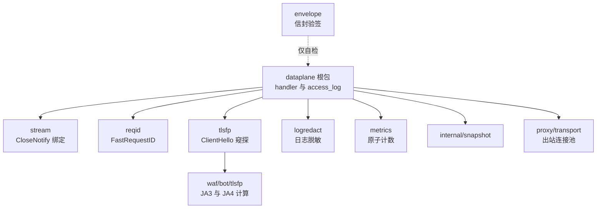
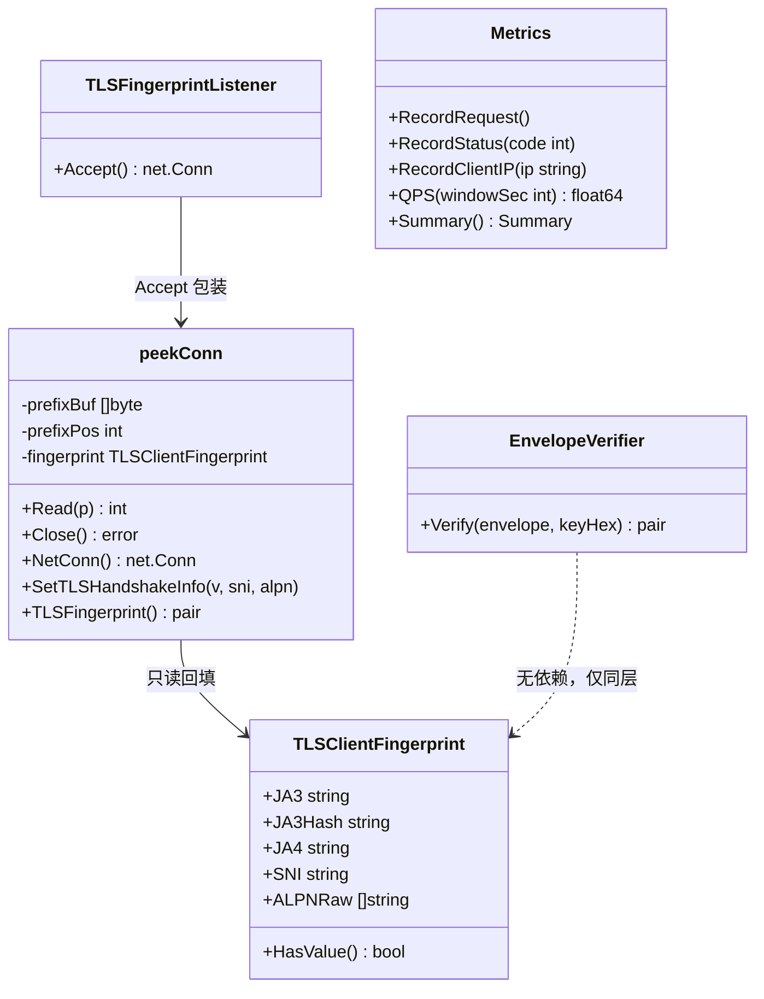
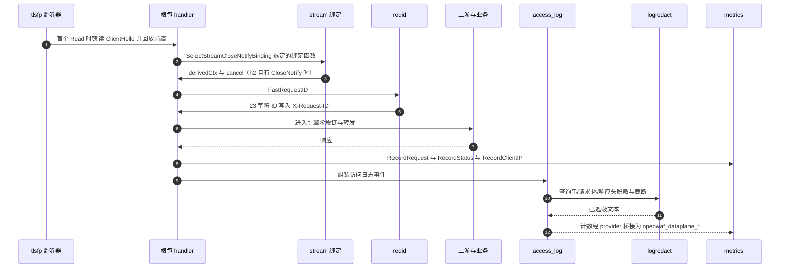
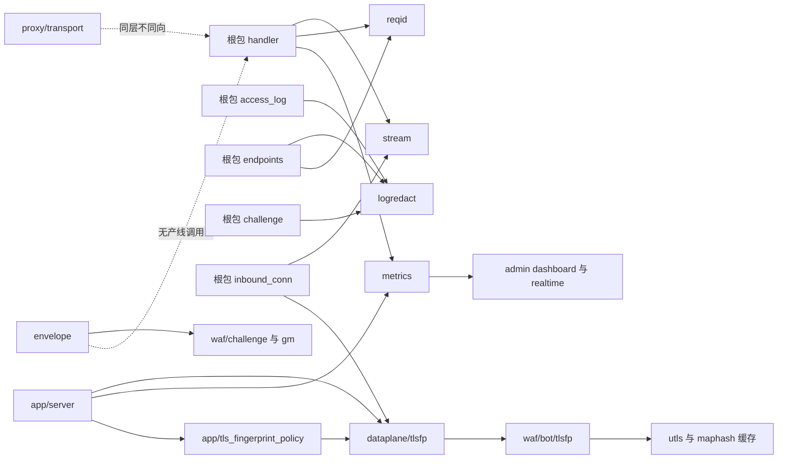
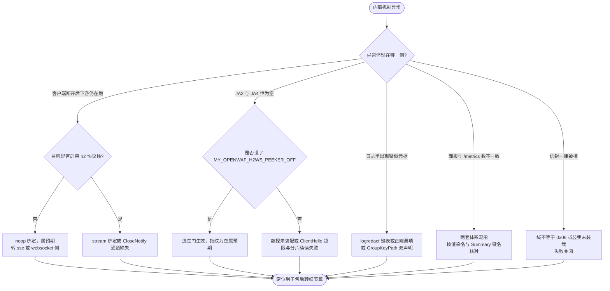
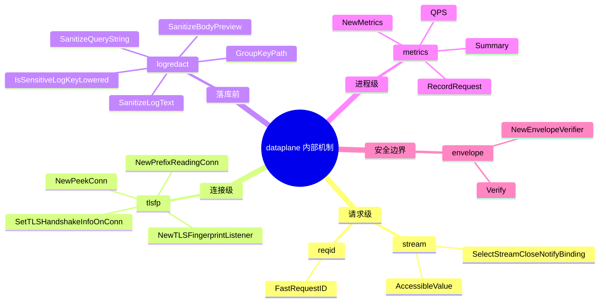

# 内部机制

<cite>
**本文档引用的文件**
- [stream_close_notify.go](file://internal/dataplane/stream/stream_close_notify.go)
- [envelope_verify.go](file://internal/dataplane/envelope/envelope_verify.go)
- [sanitize.go](file://internal/dataplane/logredact/sanitize.go)
- [lower.go](file://internal/dataplane/logredact/lower.go)
- [metrics.go](file://internal/dataplane/metrics/metrics.go)
- [reqid.go](file://internal/dataplane/reqid/reqid.go)
- [tls_fingerprint_listener.go](file://internal/dataplane/tlsfp/tls_fingerprint_listener.go)
- [exporter.go](file://internal/dataplane/tlsfp/tlsfptest/exporter.go)
- [handler.go](file://internal/dataplane/handler.go)
- [handler_support.go](file://internal/dataplane/handler_support.go)
- [inbound_conn.go](file://internal/dataplane/inbound_conn.go)
- [access_log.go](file://internal/dataplane/access_log.go)
- [endpoints.go](file://internal/dataplane/endpoints.go)
- [challenge.go](file://internal/dataplane/challenge.go)
- [server.go](file://internal/app/server.go)
- [tls_fingerprint_policy.go](file://internal/app/tls_fingerprint_policy.go)
- [transport.go](file://internal/proxy/transport/transport.go)
- [fingerprint.go](file://internal/waf/bot/tlsfp/fingerprint.go)
- [conn.go](file://internal/waf/bot/tlsfp/conn.go)
- [cache.go](file://internal/waf/bot/tlsfp/cache.go)
- [sni_presence.go](file://internal/waf/bot/tlsfp/sni_presence.go)
- [dashboard.go](file://internal/admin/system/dashboard/dashboard.go)
- [router.go](file://internal/admin/router.go)
- [数据平面处理.md](file://docs/数据平面处理/数据平面处理.md)
</cite>

## 目录
1. [简介](#简介)
2. [项目结构](#项目结构)
3. [核心组件](#核心组件)
4. [架构总览](#架构总览)
5. [详细组件分析](#详细组件分析)
6. [依赖关系分析](#依赖关系分析)
7. [性能考虑](#性能考虑)
8. [故障排查指南](#故障排查指南)
9. [结论](#结论)
10. [附录](#附录)

## 简介

本篇是 `docs/数据平面处理/内部机制/` 子域的**同名总览**，覆盖 `internal/dataplane` 下此前
**零文档**的六个子包：`stream`（173 行）、`envelope`（80 行）、`logredact`（350 行）、
`metrics`（161 行）、`reqid`（53 行）、`tlsfp`（395 行）。它们共同构成数据面的「内部机制层」——
不实现任何 WAF 判定，只向根包（14 文件 8836 行）提供连接绑定、请求标识、窥探、脱敏、计数与验签
六项基础设施。

本篇的职责边界是明确的：**只给全景、子包清单与索引，不展开单包细节**。细节由同子域三篇承载：[流式帧与连接绑定](流式帧与连接绑定.md)、
[日志脱敏与请求标识](日志脱敏与请求标识.md)、[数据面指标与TLS指纹窥探](数据面指标与TLS指纹窥探.md)，
范围与自检见[附录](#附录)。
与相邻文档的分工：[数据平面处理](../数据平面处理.md) 讲请求处理流程与根包组件，
[TLS 终止与证书管理](../TLS%20终止与证书管理.md) 讲监听与选证，
[上游代理配置](../上游代理配置.md) 与 [性能监控与调优](../性能监控与调优.md) 讲出站与调优，
上级 [数据平面处理](../数据平面处理.md) 的子页面分类索引当前只列 5 篇、尚未收录本子域，
本篇不改它，收录由该域的后续合入完成；[证书与TLS故障](../../故障排除/证书与TLS故障.md) 的 TLS-07
条目已触及 ClientHello 窃探的故障面，本篇不重复其表格。

`stream` 子包来自提交 `5451eee`（`refactor(dataplane): stream_close_notify 切分为 stream 子包`），
从根包 `stream_close_notify.go` 迁出为独立子包；此前该能力在全库无任何文档入口，本篇是首个。

**章节来源**
- [stream_close_notify.go:1-173](file://internal/dataplane/stream/stream_close_notify.go#L1-L173)
- [handler.go:52-56](file://internal/dataplane/handler.go#L52-L56)
- [数据平面处理.md:1-60](file://docs/数据平面处理/数据平面处理.md#L1-L60)

## 项目结构

六个子包按「作用对象」分层，而不是按目录字母序：请求级、连接级、落库前、进程级、出站前的安全边界。

```text
internal/dataplane/
├── 根包 14 文件 8836 行（handler/handler_support/inbound_conn/access_log/...）
├── stream/     173 行  请求级：HTTP/2 CloseNotify → context 取消绑定
├── reqid/       53 行  请求级：无系统调用的短唯一请求 ID
├── tlsfp/      395 行  连接级：ClientHello 前缀窥探与指纹回填
├── logredact/  350 行  落库前：查询串/请求体/头名脱敏与截断
├── metrics/    161 行  进程级：原子计数、QPS 环形缓冲、Summary
└── envelope/    80 行  安全边界：分片信封验签的唯一收口（当前无产线调用点）
```

| 层级 | 子包 | 非测试行数 | 导出面（生产可见符号） | 主要消费点 |
| --- | --- | :---: | --- | --- |
| 请求级 | `stream` | 173 | `SelectStreamCloseNotifyBinding`、`AccessibleValue` | `handler.go:52`、`inbound_conn.go:611` |
| 请求级 | `reqid` | 53 | `FastRequestID` | `handler.go:56`、`endpoints.go:183`、`access_log.go:623` |
| 连接级 | `tlsfp` | 395 | `NewTLSFingerprintListener`、`NewPrefixReadingConn`、`NewPeekConn`、`SetTLSHandshakeInfoOnConn` | `server.go:1546`、`inbound_conn.go:72` |
| 落库前 | `logredact` | 350 | `SanitizeLogText`、`SanitizeQueryString`、`SanitizeBodyPreview`、`SanitizeUpstreamURL`、`IsSensitiveLogKeyLowered`、`TruncateLogValue`、`ToLowerASCII`、`GroupKeyPath` | `access_log.go:122-470`、`handler_support.go:199`、`challenge.go:70-71` |
| 进程级 | `metrics` | 161 | `Metrics`、`NewMetrics`、`Summary` | `server.go:368`、`admin/router.go:68`、`dashboard.go:20` |
| 安全边界 | `envelope` | 80 | `EnvelopeVerifier`、`NewEnvelopeVerifier` | 仅测试与服务端签发后自检（无产线调用点） |



**图表来源**
- [handler.go:21-26](file://internal/dataplane/handler.go#L21-L26)
- [access_log.go:17-18](file://internal/dataplane/access_log.go#L17-L18)
- [tls_fingerprint_listener.go:8-9](file://internal/dataplane/tlsfp/tls_fingerprint_listener.go#L8-L9)
- [envelope_verify.go:13-15](file://internal/dataplane/envelope/envelope_verify.go#L13-L15)

`ENV -.仅自检.->` 这条虚线是本子域最重要的一处「未完成」：`envelope` 已被编译进来并有测试覆盖，
但生产路径上没有任何调用点（详见 [P-06](#p-06-envelope-零调用点的唯一收口)）。

**章节来源**
- [inbound_conn.go:21-22](file://internal/dataplane/inbound_conn.go#L21-L22)
- [handler_support.go:18-19](file://internal/dataplane/handler_support.go#L18-L19)
- [endpoints.go:20-21](file://internal/dataplane/endpoints.go#L20-L21)

## 核心组件

模块清单按「导出面 + 规模 + 变更风险」给出，便于判断改动落在哪一层。

| 模块 | 路径 | 规模 | 关键符号 | 单一职责 | 变更风险 |
| --- | --- | :---: | --- | --- | --- |
| 流式帧绑定 | `internal/dataplane/stream/` | 173 | `SelectStreamCloseNotifyBinding`（:28）、`bindStreamCloseNotifyContext`（:49）、`closeNotifyMethodIndexFor`（:116） | 把流关闭信号桥接成 context 取消 | 高：反射语义等价性 |
| 请求标识 | `internal/dataplane/reqid/` | 53 | `FastRequestID`（:41）、`reqIDPrefix`（:15）、`reqIDCounter`（:21） | 生成 23 字符抗碰撞 ID | 中：格式是对外契约 |
| 连接窥探 | `internal/dataplane/tlsfp/` | 395 | `TLSFingerprintListener`（:16）、`NewPeekConn`（:40）、`peekConn.Read`（:70）、`SetTLSHandshakeInfoOnConn`（:161） | 窃读 ClientHello 前缀并回填握手信息 | 高：字节序与回放正确性 |
| 日志脱敏 | `internal/dataplane/logredact/` | 350 | `SanitizeLogText`（:206）、`ContainsSensitiveLogHintFold`（:251）、`IsSensitiveLogKeyLowered`（:318）、`GroupKeyPath`（:34） | 落库前遮蔽敏感取值与截断 | 高：漏遮蔽即凭据入库 |
| 数据面指标 | `internal/dataplane/metrics/` | 161 | `Metrics`（:13）、`RecordRequest`（:48）、`QPS`（:112）、`Summary`（:146） | 进程内计数与窗口估计 | 中：指标桥接名对外 |
| 信封验签 | `internal/dataplane/envelope/` | 80 | `EnvelopeVerifier`（:35）、`Verify`（:57） | 验签收口，不关心信封来源 | 低：无产线调用点 |



**图表来源**
- [tls_fingerprint_listener.go:16-50](file://internal/dataplane/tlsfp/tls_fingerprint_listener.go#L16-L50)
- [fingerprint.go:27-39](file://internal/waf/bot/tlsfp/fingerprint.go#L27-L39)
- [metrics.go:13-125](file://internal/dataplane/metrics/metrics.go#L13-L125)
- [envelope_verify.go:35-57](file://internal/dataplane/envelope/envelope_verify.go#L35-L57)

`TLSClientFingerprint` 属于 `internal/waf/bot/tlsfp`（解析与指纹计算层，非测试 1199 行），`peekConn`
属于 `internal/dataplane/tlsfp`（监听与窥探层，395 行）——**两个同名 `tlsfp` 是不同层**，关系是「窥探层
调用解析层」，方向不可逆；`EnvelopeVerifier` 与指纹体系无依赖，画在此处只为表示同层并列。

**章节来源**
- [stream_close_notify.go:28-116](file://internal/dataplane/stream/stream_close_notify.go#L28-L116)
- [sanitize.go:206-318](file://internal/dataplane/logredact/sanitize.go#L206-L318)
- [reqid.go:41](file://internal/dataplane/reqid/reqid.go#L41)

## 架构总览

一次 TLS 请求穿过内部机制层的顺序是固定的：连接级窥探先于请求级，请求级绑定与 ID 生成在最前，
脱敏只发生在落库前，计数在响应阶段汇入。



**图表来源**
- [tls_fingerprint_listener.go:24-123](file://internal/dataplane/tlsfp/tls_fingerprint_listener.go#L24-L123)
- [handler.go:52-60](file://internal/dataplane/handler.go#L52-L60)
- [access_log.go:122-178](file://internal/dataplane/access_log.go#L122-L178)
- [server.go:491-507](file://internal/app/server.go#L491-L507)

注意第 1 步：`Accept()` 本身**不读** ClientHello（:24-30），窥探推迟到该连接第一次 `Read`（:70-123），
由 `prefixPos = -1` 这个哨兵值触发——是「惰性窥探」而非「握手前窥探」。末步的桥接是单向闭包
（`server.go:491-507`），`metrics` 包不 import `observability`。

**章节来源**
- [inbound_conn.go:66-90](file://internal/dataplane/inbound_conn.go#L66-L90)
- [endpoints.go:178-183](file://internal/dataplane/endpoints.go#L178-L183)

## 详细组件分析

### P-01 子包全景与规模口径

六个子包合计 **1212 行非测试代码**（173+80+350+161+53+395），约为根包 8836 行的 13.7%。
规模小但位置关键：它们全部处在请求热路径或落库前的最后一站上。

| 子包 | 非测试行数 | 测试行数 | 文件构成 | 是否含未导出核心 |
| --- | :---: | :---: | --- | --- |
| `stream` | 173 | 541 | `stream_close_notify.go` 单文件 | 是，绑定与 DFS 均未导出 |
| `reqid` | 53 | 180 | `reqid.go` 单文件 | 是，前缀与计数器未导出 |
| `metrics` | 161 | 47 | `metrics.go` 单文件 | 部分，环形缓冲类型未导出 |
| `logredact` | 350 | 716 | `sanitize.go` 325 + `lower.go` 25 | 是，三个正则与键表未导出 |
| `tlsfp` | 395 | 545 | `tls_fingerprint_listener.go` + `tlsfptest/` 夹具包 | 是，`peekConn` 未导出 |
| `envelope` | 80 | 108 | `envelope_verify.go` 单文件 | 否，类型即导出面 |

一处刻意的架构事实：**六个子包没有一个 import `internal/snapshot`**（全量检索命中只在根包文件），
因此它们与站点配置、代次、重载完全解耦，是「进程级/请求级基础设施」而非「配置消费者」。
`tlsfp/tlsfptest/` 是独立命名的夹具包（`BuildClientHelloRecord`，exporter.go:15），
只在测试构建中参与编译，不污染生产依赖图。

**章节来源**
- [stream_close_notify.go:1-173](file://internal/dataplane/stream/stream_close_notify.go#L1-L173)
- [sanitize.go:1-325](file://internal/dataplane/logredact/sanitize.go#L1-L325)
- [exporter.go:1-52](file://internal/dataplane/tlsfp/tlsfptest/exporter.go#L1-L52)

### P-02 stream 与 reqid 请求级两件小事

`stream` 的存在理由写在源码注释里：`hertz-contrib/http2 v0.1.8` 收到 `RST_STREAM` 时**不会**取消
handler 的 context，于是把请求上下文额外绑定到 HTTP/2 response writer 的 `CloseNotify` 通道
（stream_close_notify.go:43-48）。绑定结果由 `SelectStreamCloseNotifyBinding(disabled)`（:28-33）
在构造 handler 时**一次性选定**：`disabled` 为真返回 `noopStreamCloseNotifyBinding`（:39-41），
否则返回 `bindStreamCloseNotifyContext`（:49-66）。开关来源是
`o.StreamCloseNotifyDisabled = !http2Enabled`（server.go:1623），语义见
`handler_support.go:50-53`：h1/h3 的 conn 永不含 `CloseNotify`，探测只会完整空跑递归扫描。

性能上唯一的变化是把「按名线性查方法表」换成「按索引 O(1) 取方法」：`closeNotifyMethodIndex`
（:21）以 `reflect.Type` 为键缓存索引，负结论也缓存为 `-1`（`closeNotifyMethodIndexFor`，:116-129），
表内只存类型级事实，不缓存任何连接或通道值；存在性判定、原型校验与调用本身逐字节保持原样
（`callCloseNotify`，:151-173 校验 `NumIn()==0 && NumOut()==1`、通道元素为 `bool`、方向非 `SendDir`）。
`AccessibleValue`（:131-136）导出给根包复用——`inbound_conn.go:611`、`:624` 的连接链解包走同一个
`unsafe` 取可接口化值的实现，避免两份等价实现漂移。

`reqid` 用「启动时一次随机前缀 + 原子计数器」拼出 23 字符 ID（`prefix(11)-counter(11)`）：
`init()` 从 `math/rand/v2` 取 8 字节做前缀，并把启动纳秒混入计数器，使进程重启后序列不可预测
（reqid.go:23-30）；`FastRequestID`（:41-53）在栈上 11 字节与 23 字节缓冲拼装，把旧实现的
3 次小分配收敛为 1 次，不消耗 `crypto/rand` 系统调用。ID 同时写入响应头 `X-Request-ID`
（handler.go:57）与访问日志兜底（access_log.go:623），是跨文档排障的关联主键。

**章节来源**
- [stream_close_notify.go:14-173](file://internal/dataplane/stream/stream_close_notify.go#L14-L173)
- [handler_support.go:50-53](file://internal/dataplane/handler_support.go#L50-L53)
- [server.go:1613-1624](file://internal/app/server.go#L1613-L1624)
- [reqid.go:11-53](file://internal/dataplane/reqid/reqid.go#L11-L53)
- [inbound_conn.go:604-635](file://internal/dataplane/inbound_conn.go#L604-L635)

### P-03 tlsfp 窥探层与解析层的两层分工

`internal/dataplane/tlsfp`（395 行）只做三件事：**包装监听、惰性窥探、回填握手信息**。
包装由 `TLSFingerprintListener`（:16-30）完成，`server.go:1546` 在 TLS 站点且
`needsTLSClientHelloFingerprint` 为真时装配（策略在 `internal/app/tls_fingerprint_policy.go:26-31`：
默认对所有 TLS 监听开启，仅 `MY_OPENWAF_H2WS_PEEKER_OFF=1` 关闭，且注释明确该变量只给子进程
h2 WebSocket E2E 用、生产勿设）。

窥探的边界值都写死了：`maxClientHelloRecord = 16 * 1024`（:12）是 TLS record 载荷上限，
`defaultTLSFingerprintPrefixBufferSize = 2048`（:14）是缓冲初始容量；两个 `sync.Pool`
（:52-64）分别管前缀缓冲与解析记录缓冲，归还时 `cap(buf) > maxClientHelloRecord+5` 一律丢弃
（:369-375、:389-395），防止单次超大 ClientHello 把池容量永久抬高。分片 ClientHello 需要跨 record
续读并在必要时**重写 record 长度**再交给解析器（`readCompleteClientHelloRecord`，:222-335，
:244-245 与 :311-312 改写第 3、4 字节），这是本子域最容易读错也最不该改的一段。

回填侧刻意保持两条通道不互写：`ALPNRaw` 是 ClientHello 声明列表、解析阶段填一次且此后只读；
`ALPN` 是握手协商结果、由 `SetTLSHandshakeInfo` 覆写（:132-143 调用 `SetNegotiatedALPN`；该写入器只动 `ALPN`、
并在 `ALPNRaw` 为空时用覆写前的值回填，语义定义在 fingerprint.go:20-26 与 conn.go:79-92）。
`SetTLSHandshakeInfoOnConn`（:161-177）沿 `NetConn()` 链逐层解包找实现了 setter 的节点，
根包的 `FixURIConn` 就是靠它把信息透传下去（inbound_conn.go:66-72、:272）。

**计算层是另一个包**：`internal/waf/bot/tlsfp` 非测试代码 1199 行（`fingerprint.go` 954、`conn.go` 92、
`cache.go` 67、`sni_presence.go` 86），负责 JA3/JA4/扩展解析，并由 `SNIPresenceFromValues`
（sni_presence.go:46-66）以「SNI 名 → 是否有 ClientHello 元数据 → JA4 第 5 位标记」三级判定 SNI 存在性，
判定依据是 `HasClientHelloMetadata` 只看 `TLSVersion` 非空（:75-77）；
并带 4096 槽 maphash 结果缓存（`cache.go:9-18`，按记录字节哈希命中，`ParseTLSClientHello`
在 fingerprint.go:92-112 先查缓存再解析、解析失败回落 UTLS 路径）。它与 `proxy/transport`（1280 行，
出站连接池）方向相反、无任何关系。JA3/JA4 的算法细节与命中语义属于
`[数据面指标与TLS指纹窥探]` 那篇（见[附录](#附录)），本篇不展开。

**章节来源**
- [tls_fingerprint_listener.go:11-395](file://internal/dataplane/tlsfp/tls_fingerprint_listener.go#L11-L395)
- [tls_fingerprint_policy.go:9-31](file://internal/app/tls_fingerprint_policy.go#L9-L31)
- [server.go:1533-1547](file://internal/app/server.go#L1533-L1547)
- [inbound_conn.go:26-72](file://internal/dataplane/inbound_conn.go#L26-L72)
- [fingerprint.go:20-112](file://internal/waf/bot/tlsfp/fingerprint.go#L20-L112)
- [cache.go:9-53](file://internal/waf/bot/tlsfp/cache.go#L9-L53)
- [sni_presence.go:46-77](file://internal/waf/bot/tlsfp/sni_presence.go#L46-L77)

### P-04 logredact 落库前的最后一道遮蔽

`logredact` 是六个子包里唯一直接决定「凭据会不会进日志库」的一层，350 行分三个动作：
**键判定、值遮蔽、长度截断**。核心结构是三个预编译正则（sanitize.go:13-15）分别处理
header 行、`env` 对象、以及 `key=value` 形态的取值；对外入口是 `SanitizeLogText`（:206-216），
前置一次廉价的字面量预筛 `ContainsSensitiveLogHintFold`（:251-276）——`SensitiveLogValueHints`
（:190-195，20 项）是正则首捕获组的字面量集合，任一都不出现时三个正则必然无法匹配，可直接跳过，
避免 `(?i)(code|env|pwd|...)` 这类短关键字在无关文本上全串回溯。预筛按「首字节折叠小写」分桶
（:237-249），把每个候选位置的 20 次内层迭代降到同组的 1-3 次，判定条件与逐词顺序不变。

键侧由 `sensitiveLogKeyParts`（:300-303，14 项）配合 `IsSensitiveLogKeyLowered`（:318-325）判定，
`isSensitiveLogKey`（:306-308）先走 `ToLowerASCII`（lower.go:7-25，全小写 ASCII 时零分配原样返回）；
调用方若已算过小写形式必须用 `IsSensitiveLogKeyLowered`，避免重复 O(n) 扫描。

一条硬约束值得单独强调：`GroupKeyPath = "/__owaf/dynamic/key"` 在**全仓只有 sanitize.go:34 一处声明**
（:24-33 的注释解释了原因——曾出现过「两处独立声明」的双常量状态，任一处单独修改都会让请求体预览
不再对密钥端点返回 `[redacted]`，把动态保护密钥静默写进访问日志）。根包的
`access_log.go:240`、`endpoints.go:178` 都引用它，`keypath_contract_test.go` 双向锁住契约。

截断口径在消费侧：访问日志取 `logBodyPreviewLimit = 8192`、`logHeaderValueLimit = 2048`、
`logHeaderValuesLimit = 32`（access_log.go:406-408），先截断再遮蔽还是先遮蔽再截断由
`TruncateLogValue(SanitizeLogText(...), limit)` 的调用顺序固定为**先遮蔽后截断**
（access_log.go:425、:448）。

**章节来源**
- [sanitize.go:13-325](file://internal/dataplane/logredact/sanitize.go#L13-L325)
- [lower.go:1-25](file://internal/dataplane/logredact/lower.go#L1-L25)
- [access_log.go:122-470](file://internal/dataplane/access_log.go#L122-L470)
- [handler_support.go:199-199](file://internal/dataplane/handler_support.go#L199-L199)
- [challenge.go:70-71](file://internal/dataplane/challenge.go#L70-L71)

### P-05 metrics 两套体系中的第一套

`metrics` 只有 161 行，但要理解它在观测链上的位置才不会取错数。它是**数据面原子计数器与环形缓冲**，
本身不是 Prometheus 指标：没有 HELP/TYPE，只在内存里累加（metrics.go:13-31）。

| 成员 | 位置 | 语义 | 取值口径 |
| --- | --- | --- | --- |
| 7 个 `atomic.Int64` | [metrics.go:14-20](file://internal/dataplane/metrics/metrics.go#L14-L20) | 请求总数、2xx/4xx/5xx、拦截、观察、内置命中 | 累计值，重启清零 |
| 环形缓冲 | [metrics.go:33-38](file://internal/dataplane/metrics/metrics.go#L33-L38) | 10 个 1 秒槽位 | 即时窗口估计，非 rate 积分 |
| IP 去重集合 | [metrics.go:26-30](file://internal/dataplane/metrics/metrics.go#L26-L30) | `uniqueIPCnt`/`attackIPCnt` | 进程生命周期内去重 |
| `QPS(windowSec)` | [metrics.go:112-125](file://internal/dataplane/metrics/metrics.go#L112-L125) | 窗口秒内求和除以窗口 | `windowSec<=0` 按 1 处理 |
| `Summary()` | [metrics.go:146-161](file://internal/dataplane/metrics/metrics.go#L146-L161) | JSON 快照 | 供管理端面板与桥接 |

两个易被忽略的细节：`RecordRequest`（:48-62）在秒槽不匹配时**前进一格并直接 `Store(1)`**，
注释明确这是「良性竞态：最坏情况只是略微多计」（:56）；`Summary` 的 `Status4xx`/`Status5xx`
两个字段序列化后的 JSON 键是 `errors_upstream_4xx`/`errors_upstream_5xx`（:136-137），
字段名与键名不同义，前端与面板必须按键取数；仪表板同样按这组键输出
（`dashboard.go:90-99` 的 `errors_upstream_4xx: s.Status4xx`）。

进程级 `Metrics` 实例在 `server.go:368` 创建并被所有数据监听共享，
`server.go:491-507` 用 `SetDataPlaneMetricsProvider` 闭包把 `Summary()` 适配成
`observability.DataPlaneMetricsSnapshot`，再由 `prometheusDataPlaneMetrics` 渲染为
`openwaf_dataplane_*`；同时它被注入 `admin.Dependencies.Metrics`（router.go:68）与
仪表板（dashboard.go:20、:90）。**数据面原子计数与 `openwaf_dataplane_*` 桥接序列是两套体系**，
面板与告警必须按渲染名取数，不得与 `observability` 包内已移除的同名计数混写。

**章节来源**
- [metrics.go:13-161](file://internal/dataplane/metrics/metrics.go#L13-L161)
- [server.go:367-368](file://internal/app/server.go#L367-L368)
- [server.go:491-507](file://internal/app/server.go#L491-L507)
- [router.go:64-68](file://internal/admin/router.go#L64-L68)
- [dashboard.go:20-90](file://internal/admin/system/dashboard/dashboard.go#L20-L90)

### P-06 envelope 零调用点的唯一收口

`envelope` 只有 80 行，且**当前没有生产调用点**——这不是遗漏，而是文件头注释写明的有意状态：
它只承载「与传输形态无关」的密码学部分，把「用签名验封信封」收敛成一个类型一个方法，
因此信封走内联 hidden input 还是独立路由（L4 的 A′ 结论）落地时只需替换调用点，不必改这里
（envelope_verify.go:1-7、:30-33）。

三条语义必须原样理解：**失败关闭**——任何一步不成立都不放行，`ok=false` 时 `plaintext` 恒为空串
（:20-21、:57-80）；**不区分「公钥未装载」与「验签失败」**——`gm.PubKeyHex()` 在真实启动路径上恒非空
（`challenge` 包 `init()` 无条件装载 32 字节身份，唯一调用点 `SetChallengeSecret` 的内门条件恒假），
所以前者是内部不变量被破坏（只可能是 bug，记 error 级），后者是安全事件（记 warn 级），
两者是同一策略下的两种可观测性（:23-28、:59-77）；**域固定 0x06**——PoW 分片、动态保护分片、
C2 种子信封同域，且 Go 侧 `gm.Open` 把 `domain == 0` 当通配而 Rust 侧 `open_raw_signed` 无此豁免，
传 0 会在客户端直接失败（:44-56）。`NewEnvelopeVerifier(nil)` 允许静默，仅供测试与预览路径（:39-42）。

**章节来源**
- [envelope_verify.go:1-80](file://internal/dataplane/envelope/envelope_verify.go#L1-L80)

## 依赖关系分析



**图表来源**
- [handler.go:21-22](file://internal/dataplane/handler.go#L21-L22)
- [inbound_conn.go:21-24](file://internal/dataplane/inbound_conn.go#L21-L24)
- [endpoints.go:20-21](file://internal/dataplane/endpoints.go#L20-L21)
- [challenge.go:17-19](file://internal/dataplane/challenge.go#L17-L19)
- [envelope_verify.go:13-15](file://internal/dataplane/envelope/envelope_verify.go#L13-L15)

| 依赖方 | 被依赖方 | 形式 | 可替换性 | 约束 |
| --- | --- | --- | --- | --- |
| 根包 | `stream`/`reqid`/`metrics`/`logredact` | 直接调用 | 可独立替换 | 四者不 import 根包，无环 |
| 根包 `inbound_conn` | `stream.AccessibleValue` | 复用导出工具 | 否（共享实现） | 不得在根包再写一份 unsafe 取址 |
| `dataplane/tlsfp` | `waf/bot/tlsfp` | 单向调用解析层 | 是 | 窥探层不得反向被解析层依赖 |
| `app/server` | `dataplane/tlsfp` | 监听装配 | 是 | 由 `tls_fingerprint_policy` 决定开合 |
| `app/server` | `dataplane/metrics` | provider 闭包 | 是 | 未挂载则 `openwaf_dataplane_*` 缺失 |
| `envelope` | `waf/challenge`、`waf/challenge/gm` | 验签实现 | 是 | 域必须显式传 0x06 |
| `admin/dashboard`、`admin/router` | `dataplane/metrics` | 只读快照 | 是 | JSON 键名以 `Summary` 的 tag 为准 |

外部实体三类：`cloudwego/hertz`（`app.RequestContext`、`stats` 事件）、
`x01n/http2` fork（`CloseNotify` 语义缺口的来源）、`reflex` 无——`stream` 只用标准库
`reflect`/`unsafe`。`proxy/transport` 与本层同处数据面但方向相反（出站），不应混排。

**章节来源**
- [tls_fingerprint_listener.go:1-9](file://internal/dataplane/tlsfp/tls_fingerprint_listener.go#L1-L9)
- [stream_close_notify.go:3-12](file://internal/dataplane/stream/stream_close_notify.go#L3-L12)
- [transport.go:794-800](file://internal/proxy/transport/transport.go#L794-L800)
- [server.go:1613-1624](file://internal/app/server.go#L1613-L1624)

## 性能考虑

六个子包都在热路径或落库前，各自的成本口径不同：

- `reqid`：每请求 1 次堆分配（旧实现 3 次），零系统调用，是子域内最「便宜」的一环。
- `stream`：h2 监听下每请求一次 `reflect` 定位，方法索引按类型缓存后从线性查表降为按索引取值；
  h1/h3 监听直接返回 noop，省掉整次结构体 DFS。**关闭开关的收益来自 listener 类型，不来自配置。**
- `tlsfp`：窥探仅在连接首次 `Read` 发生一次，之后走 `prefixBuf` 回放；两个 `sync.Pool`
  把每连接 2KB 起的双缓冲收敛为复用，超 16KiB+5 的缓冲不进池。
- `logredact`：绝大多数 header 值不含敏感关键字，预筛把「必然不匹配」的串在正则前返回，
  是本层最主要的 CPU 节省；`ToLowerASCII` 对已小写输入零分配。
- `metrics`：`RecordRequest` 只有原子操作与一次 `time.Now()`；IP 去重走 `sync.Mutex` + map，
  只在新 IP 首次出现时给计数器加一。
- `envelope`：不在请求路径上（无调用点），无热路径成本。

跨层优化只有一条是硬要求：**新增落库字段时必须先脱敏再截断**，顺序颠倒会让被截断的敏感前缀
以可读形式入库（access_log.go:425、:448 的调用顺序即为规范写法）。
本域已有基准入口：`BenchmarkStreamCloseNotifyH2`、`BenchmarkFastRequestID`、
`BenchmarkSanitizeLogTextPlain`/`Sensitive`/`BenchmarkIsSensitiveLogKey`、
`BenchmarkTLSFingerprintConnSmallClientHello` 与 `…LargeClientHello`（含 `…Core` 变体）；
`metrics` 与 `envelope` 无基准。本次未复测，所有数字一律记为 `—`（未统计）。

**章节来源**
- [reqid.go:32-53](file://internal/dataplane/reqid/reqid.go#L32-L53)
- [stream_close_notify.go:14-33](file://internal/dataplane/stream/stream_close_notify.go#L14-L33)
- [tls_fingerprint_listener.go:52-123](file://internal/dataplane/tlsfp/tls_fingerprint_listener.go#L52-L123)
- [sanitize.go:197-276](file://internal/dataplane/logredact/sanitize.go#L197-L276)
- [metrics.go:48-109](file://internal/dataplane/metrics/metrics.go#L48-L109)
- [access_log.go:406-448](file://internal/dataplane/access_log.go#L406-L448)

## 故障排查指南

### 通用诊断流程

先判定故障属于哪个子包的作用对象（请求、连接、落库、计数、验签），再进对应细节篇取证。



**图表来源**
- [stream_close_notify.go:24-66](file://internal/dataplane/stream/stream_close_notify.go#L24-L66)
- [tls_fingerprint_policy.go:9-31](file://internal/app/tls_fingerprint_policy.go#L9-L31)
- [tls_fingerprint_listener.go:179-335](file://internal/dataplane/tlsfp/tls_fingerprint_listener.go#L179-L335)
- [sanitize.go:13-34](file://internal/dataplane/logredact/sanitize.go#L13-L34)
- [envelope_verify.go:44-80](file://internal/dataplane/envelope/envelope_verify.go#L44-L80)

排查流程步骤（顺序执行，命中即停）：

| 步 | 动作 | 命令或入口 | 判据 | 下一步 |
| :---: | --- | --- | --- | --- |
| 1 | 确认子包边界未被绕过 | `go list ./internal/dataplane/...` | 输出 7 个包（根 + 6 子包 + `tlsfp/tlsfptest`） | 数量少了说明包被误删或误合并 |
| 2 | 确认六个子包单包全绿 | `go test ./internal/dataplane/stream/ ... -count=1` | 六个 `ok` | 失败包即定位点 |
| 3 | 确认绑定开关来源 | 读 `server.go:1623` 的 `!http2Enabled` | 与站点 ALPN 实际协商一致 | 不一致查 h2 工厂注册 |
| 4 | 确认窥探是否装配 | 启动日志 `client_hello_fingerprint_enabled` | 布尔值与策略一致 | 查环境变量与 TLS 开关 |
| 5 | 确认脱敏契约未双声明 | 检索 `GroupKeyPath` 声明处 | 仅 `sanitize.go:34` 一处 | 出现第二处即为高危回归 |
| 6 | 确认计数取数口径 | `/metrics` 的 `openwaf_dataplane_*` | 与面板 `Summary` 键一致 | 不一致即两套体系混用 |

```bash
go list ./internal/dataplane/...
go test ./internal/dataplane/stream/ ./internal/dataplane/logredact/ \
  ./internal/dataplane/reqid/ ./internal/dataplane/tlsfp/ \
  ./internal/dataplane/envelope/ ./internal/dataplane/metrics/ -count=1
```

**预期输出形态**：第一段输出 8 行包路径（`My-OpenWaf/internal/dataplane` 及其 6 个子包，外加
`My-OpenWaf/internal/dataplane/tlsfp/tlsfptest`）；第二段输出 6 行 `ok`，本次已在本机执行通过，
最长约 0.8 秒（子包体量小，不需要 CGO 与外部依赖）。任何 `FAIL` 或 `no test files` 都说明
该子包的测试入口被移动过，应先恢复测试再查功能。

```bash
git log --oneline -1 5451eee
```

**预期输出形态**：一行 `5451eee refactor(dataplane): stream_close_notify 切分为 stream 子包`，
即 `stream` 子包的诞生提交；该提交把 `internal/dataplane/stream_close_notify.go` 移入子目录并新增
`fixtures_test.go`，只导出绑定选择器与 `AccessibleValue` 两个符号。

**章节来源**
- [tls_fingerprint_policy.go:26-31](file://internal/app/tls_fingerprint_policy.go#L26-L31)
- [server.go:1536-1547](file://internal/app/server.go#L1536-L1547)
- [server.go:1613-1624](file://internal/app/server.go#L1613-L1624)
- [sanitize.go:24-34](file://internal/dataplane/logredact/sanitize.go#L24-L34)

### 常见问题与解决方案

条目固定为**症状 / 原因 / 排查 / 方案**。

#### I-01 客户端取消后上游请求仍在继续

- **症状**：h2 客户端发 `RST_STREAM` 后，WAF 仍在等上游并继续写访问日志。
- **原因**：`hertz-contrib/http2 v0.1.8` 收到 `RST_STREAM` 不取消 handler context，需要 `stream` 的
  额外绑定；若该监听未注册 h2 协议栈，`SelectStreamCloseNotifyBinding(true)` 返回 noop，本就不该期望取消传播。
- **排查**：确认 `server.go:1623` 的 `StreamCloseNotifyDisabled` 取值与站点 ALPN 协商结果一致；
  再确认 conn 结构里确实存在 `CloseNotify() <-chan bool`。
- **方案**：h2 场景启用协议工厂注册后重建监听；h1/h3 场景改由各自的连接状态判定，不要为省 CPU 关掉 h2 的绑定。
- **定位依据**：[stream_close_notify.go:24-66](file://internal/dataplane/stream/stream_close_notify.go#L24-L66)、[handler_support.go:50-53](file://internal/dataplane/handler_support.go#L50-L53)

#### I-02 JA3/JA4 恒为空

- **症状**：访问日志与指纹面板里 `ja3`/`ja4` 为空，`tls_version`、SNI、ALPN 却有值。
- **原因**：三种可能——`MY_OPENWAF_H2WS_PEEKER_OFF=1` 使监听不包装窥探连接（此时 `FixURIConn` 的
  零窥探快路径仍会回填握手三元组，指纹为空属预期）；ClientHello 超过 `maxClientHelloRecord` 上限；
  或分片续读提前失败返回空指纹。
- **排查**：先看启动日志 `client_hello_fingerprint_enabled`；再核对握手三元组是否仍在（在则说明是解析侧而非装配侧）。
- **方案**：生产环境清除该环境变量；超限与分片问题按窥探层取证，不在本层改判定逻辑。
- **定位依据**：[tls_fingerprint_policy.go:15-31](file://internal/app/tls_fingerprint_policy.go#L15-L31)、[tls_fingerprint_listener.go:179-335](file://internal/dataplane/tlsfp/tls_fingerprint_listener.go#L179-L335)

#### I-03 访问日志出现疑似凭据

- **症状**：`request_headers`、`query_string` 或 `request_body_preview` 里看到明文 token、密码或密钥端点响应。
- **原因**：`sensitiveLogKeyParts` 或 `SensitiveLogValueHints` 缺项（两张表必须与正则同步，
  有 `TestSensitiveLogValueHintsCoverPattern` 兜漏改），或密钥端点判定失效——`GroupKeyPath` 一旦
  出现第二处独立声明，`requestBodyPreview` 就可能不再对该端点返回 `[redacted]`。
- **排查**：`go test ./internal/dataplane/logredact/ -run TestSensitiveLogValueHintsCoverPattern -count=1`
  与 `go test ./internal/dataplane/ -run TestDynamicProtectionKeyPathIsLogredactConstant -count=1`（两者本次均已执行通过）；
  再检索 `GroupKeyPath` 的声明数量。
- **方案**：补两张表并保持单处声明；新增审计字段一律走「先 `SanitizeLogText` 后 `TruncateLogValue`」。
- **定位依据**：[sanitize.go:13-34](file://internal/dataplane/logredact/sanitize.go#L13-L34)、[sanitize.go:181-195](file://internal/dataplane/logredact/sanitize.go#L181-L195)、[access_log.go:406-448](file://internal/dataplane/access_log.go#L406-L448)

#### I-04 面板与 `/metrics` 数字对不上

- **症状**：仪表板请求数与 Prometheus 抓取值不一致。
- **原因**：`Summary` 的 JSON 键与结构体字段不同义（`Status4xx` → `errors_upstream_4xx`），
  且数据面原子计数与 `openwaf_dataplane_*` 桥接序列是两套体系，取数侧混用即对不上。
- **排查**：核对 `metrics.go:131-144` 的 tag；确认 `SetDataPlaneMetricsProvider` 已注册。
- **方案**：面板按 JSON 键取数，Prometheus 按渲染名取数，两侧都不得引用已移除的旧计数名。
- **定位依据**：[metrics.go:131-161](file://internal/dataplane/metrics/metrics.go#L131-L161)、[server.go:491-507](file://internal/app/server.go#L491-L507)

#### I-05 信封验签全部失败

- **症状**：分片信封一律被拒，日志出现 `signing_identity_missing` 或 `signature_mismatch`。
- **原因**：域参数不等于 0x06（Go 与 Rust 对 `domain == 0` 的处理不对称，传 0 必在客户端失败），
  或 `envelope`/`keyHex` 为空；`signing_identity_missing` 则属内部不变量被破坏，只可能是进程未执行
  `challenge` 包的 `init()`。
- **排查**：区分日志级别——error 级指向 bug，warn 级指向篡改或格式不符；核对调用点是否显式传域。
- **方案**：调用点固定传 0x06；identity 缺失按启动顺序排查而不是在验签处放宽判据。
- **定位依据**：[envelope_verify.go:44-80](file://internal/dataplane/envelope/envelope_verify.go#L44-L80)

**章节来源**
- [stream_close_notify.go:24-66](file://internal/dataplane/stream/stream_close_notify.go#L24-L66)
- [tls_fingerprint_listener.go:11-14](file://internal/dataplane/tlsfp/tls_fingerprint_listener.go#L11-L14)
- [sanitize.go:181-195](file://internal/dataplane/logredact/sanitize.go#L181-L195)
- [metrics.go:131-144](file://internal/dataplane/metrics/metrics.go#L131-L144)
- [envelope_verify.go:44-80](file://internal/dataplane/envelope/envelope_verify.go#L44-L80)

## 结论

本子域的首篇把六个零文档子包收成了**一张全景图**：按作用对象分层（请求级 `stream`/`reqid`、
连接级 `tlsfp`、落库前 `logredact`、进程级 `metrics`、安全边界 `envelope`），逐包给出规模、导出面、
消费点与风险等级，并明确了三条容易混淆的结构事实——

1. 六个子包**均不依赖快照**，与配置重载完全解耦；
2. `dataplane/tlsfp`（395 行，窥探与包装）与 `waf/bot/tlsfp`（1199 行，JA3/JA4 解析与缓存）
   是方向单一的**两层**，同名不等于同层，也与出站的 `proxy/transport` 无关；
3. `envelope` 的零调用点是设计状态而非缺陷，其「失败关闭 + 同策略双可观测性」语义必须在落地调用点时保持。

设计原则落点：KISS 是每包单一动词（绑定/命名/窥探/遮蔽/计数/验签）；SRP 是窥探与解析分家、
脱敏与落库分家；DRY 由 `GroupKeyPath` 与 `AccessibleValue` 两处单一声明承载；YAGNI 体现在
`envelope` 刻意不知道信封从哪来，因此未来路由结论变更不需要改这一层。

已知缺口：`stream` 子包此前无任何文档入口，本篇为首个；本域未做子包级基准，性能数字一律 `—`。
下一步：把 `client_hello_fingerprint_enabled` 与 `StreamCloseNotifyDisabled` 两个开关纳入运维自检面板。

[本节为总结，无需特定文件来源]

## 附录

### 子包符号速查与子域索引



**图表来源**
- [stream_close_notify.go:28-136](file://internal/dataplane/stream/stream_close_notify.go#L28-L136)
- [reqid.go:41-53](file://internal/dataplane/reqid/reqid.go#L41-L53)
- [tls_fingerprint_listener.go:20-177](file://internal/dataplane/tlsfp/tls_fingerprint_listener.go#L20-L177)
- [sanitize.go:42-325](file://internal/dataplane/logredact/sanitize.go#L42-L325)
- [metrics.go:40-161](file://internal/dataplane/metrics/metrics.go#L40-L161)
- [envelope_verify.go:40-57](file://internal/dataplane/envelope/envelope_verify.go#L40-L57)

子域文档索引（四篇同批合入，本篇只作总览与分流，细节以下三篇为权威）：

| 文档 | 覆盖子包 | 状态 | 首个自检命令 |
| --- | --- | --- | --- |
| [流式帧与连接绑定](流式帧与连接绑定.md) | `stream` | 已建档 | `go test ./internal/dataplane/stream/ -count=1` |
| [日志脱敏与请求标识](日志脱敏与请求标识.md) | `logredact`、`reqid` | 已建档 | `go test ./internal/dataplane/logredact/ -count=1` |
| [数据面指标与TLS指纹窥探](数据面指标与TLS指纹窥探.md) | `metrics`、`tlsfp` | 已建档 | `go test ./internal/dataplane/tlsfp/ -count=1` |
| 内部机制（本篇） | 六包全景与索引 | 已建档 | `go list ./internal/dataplane/...` |

关键常量与判据速查：

| 常量或判据 | 值 | 位置 | 可否覆盖 |
| --- | --- | --- | :---: |
| CloseNotify 方法索引缓存 | `sync.Map`，负结论为 `-1` | `stream:21` | 否 |
| 请求 ID 结构 | 11 前缀 + `-` + 11 计数，共 23 字符 | `reqid:41-52` | 否 |
| ClientHello 载荷上限 | 16384 字节（另加 5 字节头） | `tlsfp:12` | 否 |
| 窥探缓冲初值 | 2048 字节 | `tlsfp:14` | 否 |
| 池回收上界 | `cap > 16384+5` 不进池 | `tlsfp:369-395` | 否 |
| QPS 环形槽数 | 10 个 1 秒槽 | `metrics:33` | 否 |
| 敏感关键字提示集 | 20 项 | `logredact:190-195` | 需与正则同步 |
| 敏感键名片段 | 14 项 | `logredact:300-303` | 需与判定同步 |
| 密钥端点路由 | `/__owaf/dynamic/key` | `logredact:34` | 禁止二次声明 |
| 信封域 | 0x06（`DomainPowShards`） | `envelope:44-56` | 不可传 0 |
| 指纹解析结果缓存 | 4096 槽 maphash | `waf/bot/tlsfp/cache.go:9-18` | 否 |
| 窥探开逃生门 | `MY_OPENWAF_H2WS_PEEKER_OFF=1` | `app/tls_fingerprint_policy.go:27` | 生产勿设 |

**章节来源**
- [stream_close_notify.go:21](file://internal/dataplane/stream/stream_close_notify.go#L21)
- [tls_fingerprint_listener.go:12-14](file://internal/dataplane/tlsfp/tls_fingerprint_listener.go#L12-L14)
- [metrics.go:33](file://internal/dataplane/metrics/metrics.go#L33)
- [sanitize.go:190-303](file://internal/dataplane/logredact/sanitize.go#L190-L303)
- [envelope_verify.go:44-56](file://internal/dataplane/envelope/envelope_verify.go#L44-L56)
- [cache.go:9-18](file://internal/waf/bot/tlsfp/cache.go#L9-L18)
- [tls_fingerprint_policy.go:26-31](file://internal/app/tls_fingerprint_policy.go#L26-L31)
