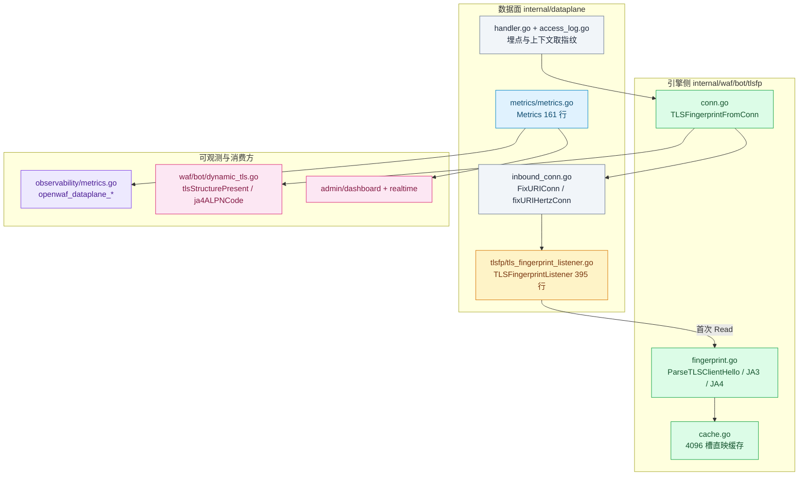
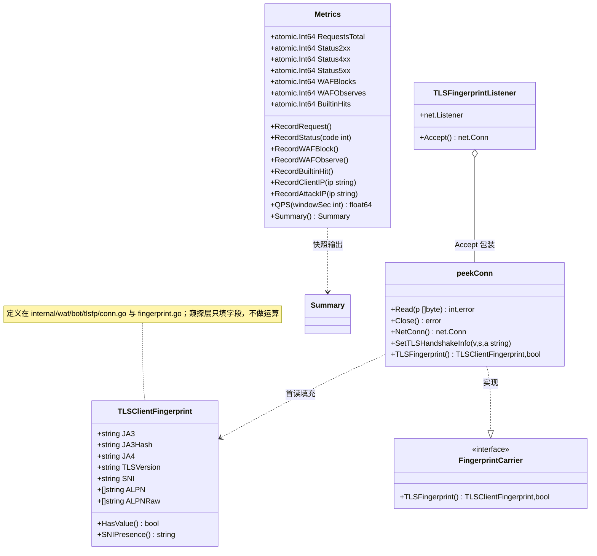
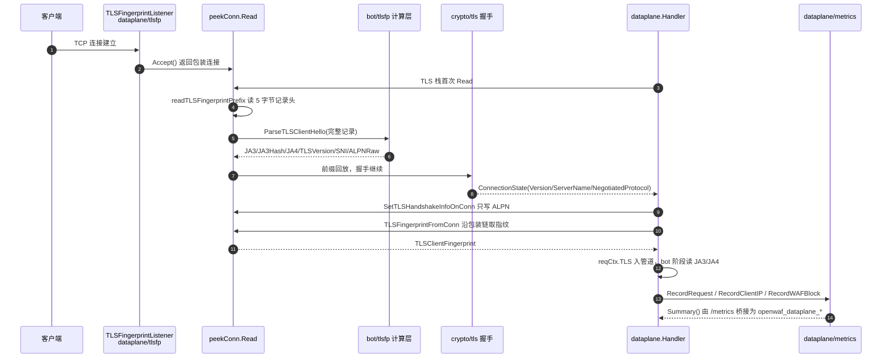
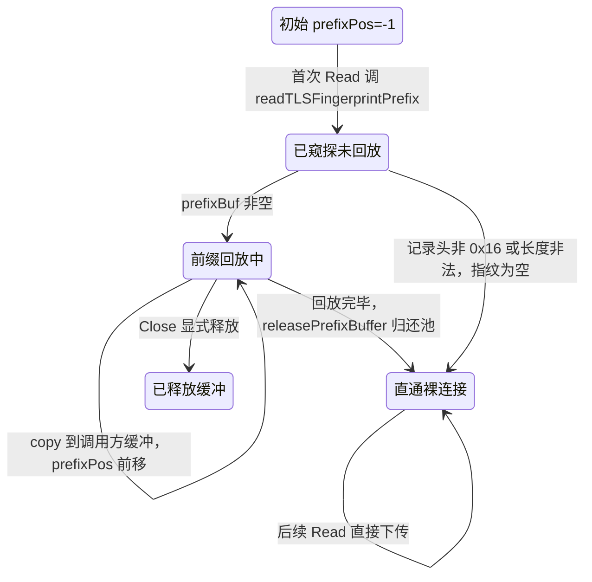
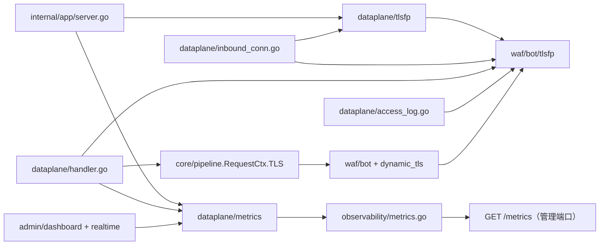

# 数据面指标与 TLS 指纹窥探

> [返回 数据平面处理](../数据平面处理.md)

<cite>
**本文档引用的文件**
- [metrics.go](file://internal/dataplane/metrics/metrics.go)
- [tls_fingerprint_listener.go](file://internal/dataplane/tlsfp/tls_fingerprint_listener.go)
- [exporter.go](file://internal/dataplane/tlsfp/tlsfptest/exporter.go)
- [inbound_conn.go](file://internal/dataplane/inbound_conn.go)
- [handler.go](file://internal/dataplane/handler.go)
- [handler_support.go](file://internal/dataplane/handler_support.go)
- [endpoints.go](file://internal/dataplane/endpoints.go)
- [access_log.go](file://internal/dataplane/access_log.go)
- [audit_events.go](file://internal/dataplane/audit_events.go)
- [challenge.go](file://internal/dataplane/challenge.go)
- [fingerprint.go](file://internal/waf/bot/tlsfp/fingerprint.go)
- [conn.go](file://internal/waf/bot/tlsfp/conn.go)
- [cache.go](file://internal/waf/bot/tlsfp/cache.go)
- [sni_presence.go](file://internal/waf/bot/tlsfp/sni_presence.go)
- [dynamic_tls.go](file://internal/waf/bot/dynamic_tls.go)
- [bot.go](file://internal/waf/bot/bot.go)
- [server.go](file://internal/app/server.go)
- [tls_fingerprint_policy.go](file://internal/app/tls_fingerprint_policy.go)
- [http3.go](file://internal/app/http3.go)
- [metrics.go](file://internal/observability/metrics.go)
- [pipeline.go](file://internal/core/pipeline/pipeline.go)
- [pool.go](file://internal/core/pipeline/pool.go)
- [dashboard.go](file://internal/admin/system/dashboard/dashboard.go)
- [realtime.go](file://internal/admin/system/realtime/realtime.go)
- [router.go](file://internal/admin/router.go)
</cite>

## 目录

1. [简介](#简介)
2. [项目结构](#项目结构)
3. [核心组件](#核心组件)
4. [架构总览](#架构总览)
5. [详细组件分析](#详细组件分析)
6. [依赖关系分析](#依赖关系分析)
7. [性能考虑](#性能考虑)
8. [故障排查指南](#故障排查指南)
9. [结论](#结论)
10. [附录](#附录)

## 简介

本篇覆盖数据平面三个互不重叠但首尾相接的实现：**进程内数据面计数器**（`internal/dataplane/metrics/`，161 行，`Metrics`/`Summary`）、**监听期 ClientHello 窥探**（`internal/dataplane/tlsfp/`，395 行，`TLSFingerprintListener`/`NewPeekConn`）、以及 **TLS 指纹计算引擎**（`internal/waf/bot/tlsfp/`，1199 行含测试，JA3/JA4 构建与解析）。读者为数据面开发、可观测性接入与机器人判定调试人员。

关键约束有两条。第一，**`openwaf_requests_total`、`openwaf_blocks_total`、`openwaf_observes_total`、`openwaf_upstream_errors_total` 已从 `/metrics` 移除**，请求总量等计数器的唯一真实来源是 `openwaf_dataplane_*` 系列，本篇不把它们当作活动指标书写。第二，**同名不同物的两层 `tlsfp` 必须分开理解**：`internal/dataplane/tlsfp/` 只负责在 TCP 连接首次读取时把 ClientHello 字节「窥」出来并交给计算层，本身不做任何指纹运算；`internal/waf/bot/tlsfp/` 才是 JA3/JA4 的解析、构建、缓存与连接载体读取实现。

| 项 | 内容 |
|----|------|
| 所属业务域 | `docs/数据平面处理/`，本篇落在其 `内部机制/` 子目录 |
| 本篇形态 | C 三级实现文档（一实现一节，节内固定四段 `####`） |
| 覆盖范围 | 数据面计数器结构与埋点、窥探监听的装配与字节边界、指纹计算层的解析与缓存；不覆盖 Prometheus 抓取侧部署、不覆盖 bot 打分算法本体 |
| 明确不覆盖 | 访问日志脱敏（见 `logredact`）、访客融合分类（`visitorfusion`）、上游健康度指标（`openwaf_upstream_*`） |
| 上级与下级 | [数据平面处理](../数据平面处理.md)、[TLS 终止与证书管理](../TLS%20终止与证书管理.md)、[性能监控与调优](../性能监控与调优.md) |

**章节来源**
- [metrics.go:1-161](file://internal/dataplane/metrics/metrics.go#L1-L161)
- [tls_fingerprint_listener.go:1-395](file://internal/dataplane/tlsfp/tls_fingerprint_listener.go#L1-L395)
- [fingerprint.go:1-185](file://internal/waf/bot/tlsfp/fingerprint.go#L1-L185)
- [server.go:263-273](file://internal/observability/metrics.go#L263-L273)

## 项目结构

三个实现分居三处：计数器与窥探在数据面自有的 `internal/dataplane/` 子包内，指纹计算在 WAF 引擎侧的 `internal/waf/bot/tlsfp/`。窥探层反向依赖计算层（`waftlsfp "My-OpenWaf/internal/waf/bot/tlsfp"`），计算层对窥探层零感知——这条单向依赖是所有「两层不得混为一谈」结论的结构基础。

```text
internal/dataplane/metrics/          数据面计数器（161 行 + 单测）
├── metrics.go                       Metrics/Summary/QPS 环形桶
internal/dataplane/tlsfp/            监听期窥探（395 行 + 单测）
├── tls_fingerprint_listener.go      Listener/Accept/peekConn/前缀读满
└── tlsfptest/exporter.go            测试夹具：真实握手抓 ClientHello
internal/waf/bot/tlsfp/              指纹计算（非测试 1199 行口径见共享上下文）
├── fingerprint.go                   ParseTLSClientHello / JA3 / JA4 三构建器
├── conn.go                          FingerprintCarrier / TLSFingerprintFromConn
├── cache.go                         4096 槽直映缓存
└── sni_presence.go                  present/absent/unknown 三态判定
```

| 路径 | 职责 | 主要语言 | 文件数 | 代表符号 | 对外暴露 |
|------|------|----------|:------:|----------|:--------:|
| `internal/dataplane/metrics/` | 请求/状态/动作/IP 计数与 QPS 环形桶 | Go | 1 | `Metrics`、`Summary` | 是 |
| `internal/dataplane/tlsfp/` | TLS 监听连接包装与 ClientHello 前缀窥读 | Go | 1 | `NewTLSFingerprintListener`、`NewPeekConn` | 是 |
| `internal/dataplane/tlsfp/tlsfptest/` | 仅测试构建参与的 ClientHello 夹具 | Go | 1 | `BuildClientHelloRecord` | 否（测试） |
| `internal/waf/bot/tlsfp/` | JA3/JA4 解析、构建、缓存、连接载体读取 | Go | 4 | `ParseTLSClientHello`、`TLSClientFingerprint` | 是 |
| `internal/observability/` | Prometheus 文本渲染与 provider 注册 | Go | 1 | `DataPlaneMetricsSnapshot`、`prometheusDataPlaneMetrics` | 是 |



**图表来源**
- [tls_fingerprint_listener.go:1-50](file://internal/dataplane/tlsfp/tls_fingerprint_listener.go#L1-L50)
- [inbound_conn.go:27-73](file://internal/dataplane/inbound_conn.go#L27-L73)
- [fingerprint.go:18-112](file://internal/waf/bot/tlsfp/fingerprint.go#L18-L112)
- [metrics.go:13-46](file://internal/dataplane/metrics/metrics.go#L13-L46)

**章节来源**
- [tls_fingerprint_listener.go:1-50](file://internal/dataplane/tlsfp/tls_fingerprint_listener.go#L1-L50)
- [exporter.go:1-52](file://internal/dataplane/tlsfp/tlsfptest/exporter.go#L1-L52)
- [handler_support.go:32-58](file://internal/dataplane/handler_support.go#L32-L58)

## 核心组件

形态 C 的模块清单收敛为「接口 + 装配 + 本实现」三行族，其余消费方只在备注出现。

| 模块 | 路径 | 职责 | 核心接口/符号 | 依赖模块 | 被依赖 | 规模(行) | 测试 |
|------|------|------|---------------|----------|--------|:--------:|:----:|
| 数据面计数器 | `internal/dataplane/metrics/metrics.go` | 原子计数、QPS 环形桶、IP 去重 | `Metrics`、`Summary`、`QPS` | `sync`、`sync/atomic`、`time` | dataplane handler、observability、admin | 161 | 有 |
| 窥探监听 | `internal/dataplane/tlsfp/tls_fingerprint_listener.go` | Accept 包装、首读窥探、前缀回放 | `TLSFingerprintListener`、`NewPeekConn`、`SetTLSHandshakeInfoOnConn` | `waftlsfp`、`net`、`io` | `internal/app` 监听装配、`inbound_conn.go` | 395 | 有 |
| 指纹计算 | `internal/waf/bot/tlsfp/` | ClientHello 解析、JA3/JA4 构建、结果缓存 | `ParseTLSClientHello`、`TLSClientFingerprint`、`TLSFingerprintFromConn` | `utls`、`crypto/*`、`tlsmeta` | dataplane、pipeline、bot、snapshot | 1199 | 有 |
| 连接载体 | `internal/waf/bot/tlsfp/conn.go` | 沿包装链解包取指纹 | `FingerprintCarrier`、`WrapFingerprintConn` | `net` | `FixURIConn`、`fixURIHertzConn` | 92 | 有 |
| 指纹缓存 | `internal/waf/bot/tlsfp/cache.go` | 4096 槽直映、按记录字节命中 | `lookupTLSFingerprintCacheWithHash` | `maphash`、`sync` | `ParseTLSClientHello` | 67 | 有 |
| Prometheus 渲染 | `internal/observability/metrics.go` | provider 桥接与文本输出 | `DataPlaneMetricsSnapshot`、`prometheusDataPlaneMetrics` | 无（被注入） | `/metrics` 端点 | 4205 | 有 |

`被依赖` 列由检索确认：`Metrics` 被 `internal/dataplane/handler.go`、`internal/dataplane/endpoints.go`、`internal/app/server.go`、`internal/admin/router.go`、`internal/admin/system/dashboard/dashboard.go` 引用；`TLSFingerprintFromConn` 被 `internal/dataplane/inbound_conn.go`、`internal/dataplane/access_log.go`、`internal/app/server.go`、`internal/app/http3.go` 引用。



**图表来源**
- [metrics.go:13-161](file://internal/dataplane/metrics/metrics.go#L13-L161)
- [tls_fingerprint_listener.go:16-149](file://internal/dataplane/tlsfp/tls_fingerprint_listener.go#L16-L149)
- [conn.go:5-57](file://internal/waf/bot/tlsfp/conn.go#L5-L57)
- [fingerprint.go:27-39](file://internal/waf/bot/tlsfp/fingerprint.go#L27-L39)

### 重点组件展开

**职责**：窥探层是「连接级证据的唯一采集口」。它在 TLS 服务器完成握手之前读走 ClientHello 字节，因此可以在不干预 `crypto/tls` 握手的前提下拿到 JA3/JA4 需要的原始记录。

**关键文件**：`internal/dataplane/tlsfp/tls_fingerprint_listener.go`（395 行），配套夹具 `tlsfp/tlsfptest/exporter.go`（52 行）。

**核心接口**：

```go
// internal/dataplane/tlsfp/tls_fingerprint_listener.go
func NewTLSFingerprintListener(ln net.Listener) net.Listener
func NewPrefixReadingConn(conn net.Conn) net.Conn
func NewPeekConn(conn net.Conn, fp waftlsfp.TLSClientFingerprint) net.Conn
func SetTLSHandshakeInfoOnConn(conn net.Conn, version, sni, alpn string)

func readTLSFingerprintPrefix(conn net.Conn) ([]byte, waftlsfp.TLSClientFingerprint)
```

`NewPeekConn` 与 `NewPrefixReadingConn` 的差别是**是否预置指纹**：前者直接注入一份已有 `TLSClientFingerprint`，仅同包测试与需要手工装配包装链的调用方使用（实测调用点为 `internal/dataplane/websocket_test.go`），生产监听路径一律走后者。

**章节来源**
- [tls_fingerprint_listener.go:16-42](file://internal/dataplane/tlsfp/tls_fingerprint_listener.go#L16-L42)
- [tls_fingerprint_listener.go:159-220](file://internal/dataplane/tlsfp/tls_fingerprint_listener.go#L159-L220)
- [exporter.go:13-52](file://internal/dataplane/tlsfp/tlsfptest/exporter.go#L13-L52)

## 架构总览

一张时序图说明两层 tlsfp 的**调用先后与数据流向**：窥探发生在握手之前，计算紧随其后，握手结束后由 `SetTLSHandshakeInfo` 回填协商结果，请求处理阶段才经包装链读出并注入管道上下文。



**图表来源**
- [tls_fingerprint_listener.go:24-30](file://internal/dataplane/tlsfp/tls_fingerprint_listener.go#L24-L30)
- [tls_fingerprint_listener.go:70-123](file://internal/dataplane/tlsfp/tls_fingerprint_listener.go#L70-L123)
- [tls_fingerprint_listener.go:179-220](file://internal/dataplane/tlsfp/tls_fingerprint_listener.go#L179-L220)
- [server.go:1597-1609](file://internal/app/server.go#L1597-L1609)
- [handler.go:366-370](file://internal/dataplane/handler.go#L366-L370)
- [metrics.go:48-62](file://internal/dataplane/metrics/metrics.go#L48-L62)

| 层 | 输入 | 输出 | 触发时机 | 幂等性 |
|----|------|------|----------|--------|
| `dataplane/tlsfp` | 原始 TCP 字节 | 前缀缓冲 + 已填字段 | 连接首次 `Read` | 一次（`prefixPos < 0` 守卫） |
| `waf/bot/tlsfp` 解析 | 完整 ClientHello 记录 | `TLSClientFingerprint` | 被窥探层同调用栈内调用 | 缓存命中时不重算 |
| `waf/bot/tlsfp` 载体 | `net.Conn` 包装链 | 指纹 + 是否有效 | 请求处理读日志/入管道时 | 只读 |
| `dataplane/metrics` | 埋点调用 | 原子计数 | 请求进入/判定/收尾 | 单调递增 |

**章节来源**
- [inbound_conn.go:56-73](file://internal/dataplane/inbound_conn.go#L56-L73)
- [conn.go:40-52](file://internal/waf/bot/tlsfp/conn.go#L40-L52)
- [server.go:491-503](file://internal/app/server.go#L491-L503)

## 详细组件分析

### 数据面指标计数器（internal/dataplane/metrics）

#### 接口与注册

`Metrics` 是**进程级单例**：`internal/app/server.go:368` 创建一次，经 `dataplane.Options.Metrics` 注入所有数据面监听，同时注入 `admin.Deps.Metrics`（`internal/admin/router.go:68`）。注册到 Prometheus 的方式不是自注册，而是 `internal/app/server.go:491` 用闭包把 `Summary()` 适配为 `observability.DataPlaneMetricsSnapshotProvider`，由 `promMetrics.SetDataPlaneMetricsProvider` 存入 `atomic` 槽位，`/metrics` 渲染时按需调用。

```go
// internal/app/server.go 装配骨架
metrics := dpmetrics.NewMetrics()            // 368：所有数据监听共享
promMetrics := observability.NewMetrics()    // 481：进程级指标收集器
promMetrics.SetDataPlaneMetricsProvider(func() observability.DataPlaneMetricsSnapshot {
        s := metrics.Summary()
        return observability.DataPlaneMetricsSnapshot{QPS1s: s.QPS1s, /* … */}
})
```

同一份 `Summary` 还被 `internal/admin/system/dashboard/dashboard.go:125` 直接消费，构成仪表板与实时视图的「当前进程统计」来源。

#### 配置与凭据

- 无外部配置项、无凭据：`NewMetrics()` 只记 `startTime` 并初始化两个去重 map
- `qpsRingSize = 10`（编译期常量，`metrics.go:33`），即 QPS 窗口上限 10 秒
- `AccessLogSamplingRate` 只影响访问日志落库，**不影响** `RecordRequest` 的计数

#### 调用与差异

埋点位置是排障第一手信息，全部来自实际代码行：

| 步 | 动作 | 执行位置 | 输入 | 输出 | 失败分支 | 可观测点 |
|:--:|------|----------|------|------|----------|----------|
| 1 | `RecordRequest` | [handler.go:116](file://internal/dataplane/handler.go#L116) | 进入主 handler 的每个请求 | `RequestsTotal+1`、环形桶 | `opts.Metrics == nil` 静默跳过 | `openwaf_dataplane_requests_total` |
| 2 | `RecordRequest` | [endpoints.go:188](file://internal/dataplane/endpoints.go#L188) | `/__owaf/dynamic/key` 端点 | 同上 | 同上 | 同上（与主路径同计数器） |
| 3 | `RecordClientIP` | [handler.go:173](file://internal/dataplane/handler.go#L173) | `ResolveClientIP` 结果非 nil | 去重后 `uniqueIPCnt+1` | 空串直接返回 | `openwaf_dataplane_unique_ips_total` |
| 4 | `RecordWAFObserve` | [handler.go:597](file://internal/dataplane/handler.go#L597) | 每条 observe 命中 | `WAFObserves+1` | 无 | `openwaf_dataplane_waf_actions_total{action="observe"}` |
| 5 | `RecordWAFObserve` | [audit_events.go:135](file://internal/dataplane/audit_events.go#L135) | 请求头走私判定命中 | 同上 | 无观测命中不计数 | 同上（与 OWASP 命中同计数器，需靠事件区分） |
| 6 | `RecordBuiltinHit` | [handler.go:599](file://internal/dataplane/handler.go#L599)、[handler.go:709](file://internal/dataplane/handler.go#L709) | `Phase == "owasp_default"` | `BuiltinHits+1` | 非内置阶段不计数 | `openwaf_dataplane_builtin_hits_total` |
| 7 | `RecordWAFBlock` | [handler.go:704](file://internal/dataplane/handler.go#L704) | 终局判定为拦截/挑战 | `WAFBlocks+1` | 升级改写后仍计一次 | `openwaf_dataplane_waf_actions_total{action="block"}` |
| 8 | `RecordAttackIP` | [handler.go:706](file://internal/dataplane/handler.go#L706) | 触发终止动作的客户端 IP | 去重后 `attackIPCnt+1` | `clientIP == nil` 跳过 | `openwaf_dataplane_attack_ips_total` |
| 9 | `RecordWAFBlock` | [handler.go:268](file://internal/dataplane/handler.go#L268) | 挑战提交失败且 IP 信誉 `RecordViolation` 返回真 | `WAFBlocks+1` | 站点白名单命中不进入 | 同上 |
| 10 | `RecordWAFBlock` | [handler.go:634](file://internal/dataplane/handler.go#L634)、[challenge.go:324](file://internal/dataplane/challenge.go#L324)、[challenge.go:369](file://internal/dataplane/challenge.go#L369)、[challenge.go:653](file://internal/dataplane/challenge.go#L653) | 维护页、重放拦截、无效 nonce | 同上 | 无 | 同上 |
| 11 | `RecordStatus` | [handler.go:424](file://internal/dataplane/handler.go#L424)、[handler.go:1261](file://internal/dataplane/handler.go#L1261)、[endpoints.go:199](file://internal/dataplane/endpoints.go#L199) | 收尾状态码 | 落入 2xx/4xx/5xx 三档 | 3xx 无分支，静默丢弃 | `openwaf_dataplane_status_total{class=…}` |

与 `internal/observability` 的进程级 `Metrics` 的差异必须点明：**两套体系**。进程级只输出 `openwaf_{uptime_seconds,goroutines,memory_alloc_bytes,memory_sys_bytes,gc_pause_total_ns}`；`openwaf_dataplane_*` 全部来自本包的原子计数器经 `Summary()` 桥接。历史上本包与 `observability` 各持一份同名 `RecordRequest`，导致 `/metrics` 同时出现恒为 0 的 `openwaf_requests_total` 与真值 `openwaf_dataplane_requests_total`，`observability` 侧的该指标与字段已被连同注释一并移除。

#### 限制与回退

- `QPS(windowSec)` 超过 10 秒时窗口被环形桶长度截断，只回看已有 10 个槽位。
- `clientIPs`/`attackIPs` 两个去重 map **无上限、无淘汰**，作用域被显式注释为「限定本进程生命周期」；长时间高基数 NAT 环境会让计数单调偏向内存占用增长。
- `Metrics` 为 nil 时所有埋点静默跳过（每处都有 `if opts.Metrics != nil` 守卫），不构成可用性风险，但会造成指标缺口，回退方式是仪表板读当前页统计而非全量。

**章节来源**
- [metrics.go:13-161](file://internal/dataplane/metrics/metrics.go#L13-L161)
- [handler.go:114-174](file://internal/dataplane/handler.go#L114-L174)
- [handler.go:595-601](file://internal/dataplane/handler.go#L595-L601)
- [handler.go:703-711](file://internal/dataplane/handler.go#L703-L711)
- [handler.go:1259-1262](file://internal/dataplane/handler.go#L1259-L1262)
- [endpoints.go:186-200](file://internal/dataplane/endpoints.go#L186-L200)
- [audit_events.go:131-137](file://internal/dataplane/audit_events.go#L131-L137)
- [server.go:365-369](file://internal/app/server.go#L365-L369)
- [server.go:481-503](file://internal/app/server.go#L481-L503)
- [metrics.go:263-273](file://internal/observability/metrics.go#L263-L273)
- [dashboard.go:124-126](file://internal/admin/system/dashboard/dashboard.go#L124-L126)

### 监听期 ClientHello 窥探（internal/dataplane/tlsfp）

#### 接口与注册

只有 TLS 站点才会被装上这层监听包装，装配点唯一：

```go
// internal/app/server.go:1538-1564 装配骨架
if siteRT.Site.TLSEnabled {
        tlsCfg = buildListenerTLS(siteRT, sn)
        needsClientHelloFingerprint = needsTLSClientHelloFingerprint(siteRT)
        if needsClientHelloFingerprint {
                ln = dptlsfp.NewTLSFingerprintListener(rawLn) // 1546
        }
}
if !siteRT.Site.TLSEnabled {
        ln = dataplane.NewFixURIListener(ln) // 1563：明文走 URI 修复，不窥探
}
```

`needsTLSClientHelloFingerprint` 的实现是**默认恒真**，唯一的关闭开关是环境变量 `MY_OPENWAF_H2WS_PEEKER_OFF=1`，且注释明确它只给子进程 h2 WebSocket E2E 使用。

#### 配置与凭据

- `MY_OPENWAF_H2WS_PEEKER_OFF`：字符串，默认未设置；置 `1` 时改用 `FixURIListener` 路径，JA3/JA4 为空属于预期，`tls_version/SNI/ALPN` 仍由 `onConnect` 兜底回填
- `maxClientHelloRecord = 16 * 1024`（`tls_fingerprint_listener.go:12`）：record 载荷上限，5 字节头另计
- `defaultTLSFingerprintPrefixBufferSize = 2048`（:14）：两个 `sync.Pool` 的初始容量
- 无凭据：窥探层不接触私钥，TLS 私钥材料只在 `buildListenerTLS` 侧出现

#### 调用与差异

窥探是一次性的状态迁移，守卫变量是 `prefixPos`：



**图表来源**
- [tls_fingerprint_listener.go:44-50](file://internal/dataplane/tlsfp/tls_fingerprint_listener.go#L44-L50)
- [tls_fingerprint_listener.go:70-130](file://internal/dataplane/tlsfp/tls_fingerprint_listener.go#L70-L130)
- [tls_fingerprint_listener.go:151-157](file://internal/dataplane/tlsfp/tls_fingerprint_listener.go#L151-L157)

代码上下文表（上游调用点均由检索确认）：

| 符号 | 位置 | 职责 | 上游调用者 | 下游依赖 | 副作用 | 影响面 |
|------|------|------|------------|----------|--------|--------|
| `NewTLSFingerprintListener` | [listener.go:20](file://internal/dataplane/tlsfp/tls_fingerprint_listener.go#L20) | 包装 `net.Listener` | `internal/app/server.go:1546` | `NewPrefixReadingConn` | 无 | 高：TLS 站点指纹可得性的总开关 |
| `Accept` | [listener.go:24](file://internal/dataplane/tlsfp/tls_fingerprint_listener.go#L24) | 每个新连接挂 `peekConn` | Hertz transporter accept 循环 | `peekConn` | 无 | 高 |
| `peekConn.Read` | [listener.go:70](file://internal/dataplane/tlsfp/tls_fingerprint_listener.go#L70) | 首读窥探 + 前缀回放 | `crypto/tls` 握手读 | `readTLSFingerprintPrefix` | 写 `fingerprint`、占用缓冲 | 高：所有 TLS 请求的首字节路径 |
| `readTLSFingerprintPrefix` | [listener.go:179](file://internal/dataplane/tlsfp/tls_fingerprint_listener.go#L179) | 读记录头、判类型、装配完整记录 | `peekConn.Read` | `waftlsfp.ParseTLSClientHello` | 池化分配 | 高 |
| `readCompleteClientHelloRecord` | [listener.go:222](file://internal/dataplane/tlsfp/tls_fingerprint_listener.go#L222) | 跨 record 重组 ClientHello | `readTLSFingerprintPrefix` | `io.ReadFull` | 池化分配 | 中：仅在分片记录时进入 |
| `SetTLSHandshakeInfoOnConn` | [listener.go:161](file://internal/dataplane/tlsfp/tls_fingerprint_listener.go#L161) | 沿包装链找 setter 回填握手 | `inbound_conn.go:72/272` | `peekConn.SetTLSHandshakeInfo` | 写 `ALPN` | 中 |
| `NewPeekConn` | [listener.go:40](file://internal/dataplane/tlsfp/tls_fingerprint_listener.go#L40) | 预置指纹的测试构造器 | 仅 `websocket_test.go` | 无 | 无 | 低：生产无调用点 |

与明文/其它包装链的差异：`FixURIConn`（`internal/dataplane/inbound_conn.go:27`）自己也持一份 `fingerprint` 字段并实现 `TLSFingerprint()`，它优先向下一层问 `tlsfp.TLSFingerprintFromConn(c.Conn)`，问不到才用自己的副本——这解释了「窥探层被关掉时仪表上仍能看到 TLS 版本/SNI」的现象。

#### 限制与回退

- 记录头首字节不是 `0x16`（非握手记录）时立刻放弃窥探，返回原始 5 字节前缀，指纹为空。
- `recordLen <= 0 || recordLen > 16384` 同样直接放弃；重组过程中 `helloLen + 4 > 16384`、`copied > maxClientHelloRecord`、`header[0] != 0x16` 三类越界都会释放已取出的 `parseRecordBuf` 并返回 `ok=false`。
- 缓冲回池的条件是 `cap(buf) > 0 && cap(buf) <= maxClientHelloRecord+5`，超容量缓冲直接丢弃，避免池被单次超大记录永久抬高。
- `MY_OPENWAF_H2WS_PEEKER_OFF=1` 是唯一的运维回退：它会牺牲 JA3/JA4，换取 h2 扩展 CONNECT 前缀不被吃掉的语义。

**章节来源**
- [tls_fingerprint_listener.go:11-64](file://internal/dataplane/tlsfp/tls_fingerprint_listener.go#L11-L64)
- [tls_fingerprint_listener.go:66-157](file://internal/dataplane/tlsfp/tls_fingerprint_listener.go#L66-L157)
- [tls_fingerprint_listener.go:159-395](file://internal/dataplane/tlsfp/tls_fingerprint_listener.go#L159-L395)
- [tls_fingerprint_policy.go:9-31](file://internal/app/tls_fingerprint_policy.go#L9-L31)
- [server.go:1530-1560](file://internal/app/server.go#L1530-L1560)
- [server.go:1566-1569](file://internal/app/server.go#L1566-L1569)
- [inbound_conn.go:27-116](file://internal/dataplane/inbound_conn.go#L27-L116)
- [inbound_conn.go:256-273](file://internal/dataplane/inbound_conn.go#L256-L273)

### TLS 指纹计算（internal/waf/bot/tlsfp）

#### 接口与注册

这一层没有「注册中心」，它是纯函数库加一份连接载体接口；被数据面与引擎两侧同时依赖：

```go
// internal/waf/bot/tlsfp 的对外契约骨架
func ParseTLSClientHello(record []byte) (TLSClientFingerprint, error)   // fingerprint.go:92
func TLSFingerprintFromClientHelloInfo(info *tls.ClientHelloInfo, protocol byte) TLSClientFingerprint // :46
func TLSFingerprintFromConn(conn net.Conn) (TLSClientFingerprint, bool)  // conn.go:40
func WrapFingerprintConn(conn net.Conn, fp TLSClientFingerprint) net.Conn // conn.go:18
func (f TLSClientFingerprint) SNIPresence() string                        // sni_presence.go:84
```

#### 配置与凭据

- `tlsFingerprintCacheSize = 4096`（`cache.go:9`），必须是 2 的幂，索引靠 `hash & (size-1)` 取模
- `tlsFingerprintCacheSeed = maphash.MakeSeed()`（`cache.go:19`）：进程随机种子，**跨进程不产生相同缓存**，仅影响命中率不影响结果
- 无凭据、无外部服务依赖

#### 调用与差异

计算层有两条解析路径与一条握手回调路径，差异必须分清：

| 步 | 动作 | 执行位置 | 输入 | 输出 | 失败分支 | 可观测点 |
|:--:|------|----------|------|------|----------|----------|
| 1 | 空记录短路 | [fingerprint.go:94](file://internal/waf/bot/tlsfp/fingerprint.go#L94) | `len(record)==0` | 零值指纹、无错误 | — | 访问日志 `tls_ja3` 为空 |
| 2 | 缓存查询 | [fingerprint.go:98](file://internal/waf/bot/tlsfp/fingerprint.go#L98) | maphash 全字节哈希 | 命中则克隆副本返回 | 未命中继续 | `cache.go` 的 `bytes.Equal` 严格比对 |
| 3 | 快路径裸解析 | [fingerprint.go:102](file://internal/waf/bot/tlsfp/fingerprint.go#L102) | 原始记录 | `parseTLSClientHelloRaw` 结果 | 出错回落第 4 步 | 无独立指标 |
| 4 | utls 兼容路径 | [fingerprint.go:107](file://internal/waf/bot/tlsfp/fingerprint.go#L107) | `ClientHelloSpec.FromRaw` | `parseTLSClientHelloWithUTLS` 结果 | 返回错误 | 窥探层吞错，指纹为空 |
| 5 | 结果入缓存 | [fingerprint.go:103](file://internal/waf/bot/tlsfp/fingerprint.go#L103) | `fp.HasValue()` 为真 | 写槽位 | 零值不写 | `cache.go:38` 守卫 |
| 6 | h3 握手回调 | [fingerprint.go:46](file://internal/waf/bot/tlsfp/fingerprint.go#L46) | `tls.ClientHelloInfo` | 同结构指纹，protocol 段 `'q'` | `info == nil` 返回零值 | `http3.go:1403` 存 addr 键 |
| 7 | 包装链读取 | [conn.go:40](file://internal/waf/bot/tlsfp/conn.go#L40) | `net.Conn` | 指纹 + 有效位 | 无载体返回 `false` | 日志/管道取值 |

ALPN 的双通道语义是这一层最容易写错的地方，代码注释给出唯一口径：`ALPNRaw` 是 ClientHello **声明**的完整列表、按客户端顺序，由解析阶段填写一次后不再被任何握手回调改写；`ALPN` 是握手**协商**出的单个协议，由 `SetTLSHandshakeInfo` 覆写。`SetNegotiatedALPN` 在 `ALPNRaw` 为空（逃生门路径）时会先用覆写前的 `ALPN` 回填 `ALPNRaw`，保证声明列表始终可读。

`SNIPresence()` 用四步判定把「`tls_sni` 为空」拆成两种含义：SNI 名非空即 `present`；有 JA4 时读其第 4 位（`ja4SNIMarkerOffset = 3`）的 `'d'`/`'i'` 标记；JA4 缺位但已解析过 ClientHello（`HasClientHelloMetadata()` 以 `TLSVersion != ""` 为准）判 `absent`；两者都没有才返回空串表示未知。IP 字面量访问按 RFC 6066 不发 SNI 扩展，属协议正确而非采集故障。

消费侧差异：`internal/waf/bot/bot.go:771-781` 把 `JA4/JA3Hash/TLSVersion/SNI` 写成 bot 判定明细的 `tls_ja4`/`tls_ja3`/`tls_version`/`tls_sni`；`internal/waf/bot/dynamic_tls.go:35-38` 的 `tlsStructurePresent` 明确规定**只有 TLSVersion 不算结构**，必须有扩展/密码套件/曲线/ALPN/SNI/JA4 之一才参与 UA-TLS 一致性推断。

#### 限制与回退

- 缓存是直映而非 LRU：同槽位冲突会直接覆盖，高基数 TLS 流量下命中率按 `maphash` 分布自然衰减，无淘汰线程也无内存增长风险（数组定长）。
- `cloneTLSFingerprintForCache`（`cache.go:59-67`）对六个切片字段逐个复制，避免调用方原地改写污染缓存；任何新增切片字段都必须同步该行，否则形成缓存串味。
- 计算层对窥探层的错误完全沉默：`ParseTLSClientHello` 返回 `err` 时 `readTLSFingerprintPrefix` 只回传空指纹，不打日志，排障必须从 bot 明细与访问日志的 `tls_ja3` 是否为空反推。

**章节来源**
- [fingerprint.go:18-181](file://internal/waf/bot/tlsfp/fingerprint.go#L18-L181)
- [cache.go:9-67](file://internal/waf/bot/tlsfp/cache.go#L9-L67)
- [conn.go:5-92](file://internal/waf/bot/tlsfp/conn.go#L5-L92)
- [sni_presence.go:11-86](file://internal/waf/bot/tlsfp/sni_presence.go#L11-L86)
- [dynamic_tls.go:25-60](file://internal/waf/bot/dynamic_tls.go#L25-L60)
- [bot.go:768-781](file://internal/waf/bot/bot.go#L768-L781)
- [http3.go:1399-1411](file://internal/app/http3.go#L1399-L1411)

## 依赖关系分析



**图表来源**
- [server.go:48-49](file://internal/app/server.go#L48-L49)
- [server.go:1546-1546](file://internal/app/server.go#L1546-L1546)
- [inbound_conn.go:22-24](file://internal/dataplane/inbound_conn.go#L22-L24)
- [handler_support.go:19-27](file://internal/dataplane/handler_support.go#L19-L27)
- [pipeline.go:42-42](file://internal/core/pipeline/pipeline.go#L42-L42)

### 依赖矩阵

| 调用方 ↓ / 被调方 → | dataplane/tlsfp | waf/bot/tlsfp | dataplane/metrics | observability |
|---------------------|:---------------:|:-------------:|:-----------------:|:-------------:|
| `internal/app` | ✓ | ✓ | ✓ | ✓ |
| `internal/dataplane` | ✓ | ✓ | ✓ | ✓ |
| `internal/core/pipeline` | ✗ | ✓ | — | — |
| `internal/waf/bot` | ✗ | ✓ | — | — |
| `internal/admin` | — | ✓ | ✓ | — |

`internal/core/pipeline` 一行出现 `✗` 口径需要澄清：它依赖 `waf/bot/tlsfp` 的 `TLSClientFingerprint` **类型**（`pipeline.go:42`、`pool.go:55` 清零），但绝不、也不应依赖 `dataplane/tlsfp`；此处 `✗` 标注的是「窥探层不得被引擎侧反向引用」这条边界，实测无任何引擎侧文件导入 `internal/dataplane/tlsfp`，唯一引用者是 `internal/app/server.go` 与 `internal/dataplane/inbound_conn.go`。

**章节来源**
- [tls_fingerprint_listener.go:3-9](file://internal/dataplane/tlsfp/tls_fingerprint_listener.go#L3-L9)
- [pipeline.go:38-46](file://internal/core/pipeline/pipeline.go#L38-L46)
- [pool.go:40-56](file://internal/core/pipeline/pool.go#L40-L56)
- [handler.go:199-222](file://internal/dataplane/handler.go#L199-L222)

### 外部实体

| 外部实体 | 类型 | 交互方向 | 协议/方式 | 触发时机 | 数据内容 | 失败影响 | 容错处理 |
|----------|------|----------|-----------|----------|----------|----------|----------|
| 客户端 TLS 栈 | 协议对端 | 入向 | TLS record | 连接首读 | ClientHello 记录 | 无指纹，JA3/JA4 空 | 前缀原样回放，握手不受影响 |
| `refraction-networking/utls` | 第三方库 | 出向 | `ClientHelloSpec.FromRaw` | 快路径失败时 | 完整记录 | 解析错误 | 窥探层吞错，返回空指纹 |
| Prometheus 抓取端 | 观测系统 | 出向 | HTTP GET `/metrics` | 抓取周期 | `openwaf_dataplane_*`、`owaf_cache_*` | 面板缺口 | provider 为 nil 时该族不渲染 |
| 管理前端 | 展示消费方 | 出向 | `GET /api/v1/dashboard` | SWR 10/30 秒 | `Summary` 的 snake_case JSON | 仪表板空白 | `ForceRecord` 与当前页统计口径区分 |

`owaf_cache_*` 一族与本篇三个包**无生产关系**：它来自 `observability.CacheStatsSnapshotProvider`，由 `internal/app/server.go:550` 把 `queryCache`/`hotCache`/`responseCache` 三层命中计数适配而来，label 取值为 `query|hot|response`，其中 `hot` 层额外携带 `Errors`（Redis 不可达/超时与「键不存在」分开计数）。把它与 `openwaf_dataplane_*` 并列写进同一份容量基线，是这两族指标最常见的误读点。

**章节来源**
- [fingerprint.go:15-16](file://internal/waf/bot/tlsfp/fingerprint.go#L15-L16)
- [fingerprint.go:114-120](file://internal/waf/bot/tlsfp/fingerprint.go#L114-L120)
- [metrics.go:530-553](file://internal/observability/metrics.go#L530-L553)
- [server.go:549-561](file://internal/app/server.go#L549-L561)

## 性能考虑

### QPS 环形桶的良性竞态

- **问题**：每秒切换槽位时，并发 `RecordRequest` 可能在「读到旧 ts」与「写入新槽」之间交错，导致同一秒的请求被分散到两个槽。
- **优化**：代码明确接受该误差（`metrics.go:56` 注释「良性竞态：最坏情况只是略微多计」），用两个 `atomic.Int64`（`ts`、`count`）替代互斥锁，使热路径每次请求只有一次原子自增。
- **效果**：`RecordRequest` 无锁、无分配；推断 QPS 读数在高并发下偏差为个位数百分比（未实测，代码未提供基线数据）。

[本节为通用指导，无需特定文件来源]

### 窥探层的池化与缓冲上限

- **问题**：每个 TLS 连接首读都要装配前缀缓冲与解析缓冲，未池化时每连接至少两次 2KiB 起配分配。
- **优化**：两个独立 `sync.Pool`（`tlsFingerprintPrefixPool`、`tlsFingerprintParseRecordPool`），`acquire*Buffer` 在池内容量不足时按 `max(2048, required)` 新建；`release*Buffer` 在 `cap > 16389` 时拒绝回池。
- **效果**：大记录（接近 16 KiB 上限）不会永久抬高池容量，峰值后 RSS 可回落；`parseRecordBuf` 通过 `defer` 与四条提前返回路径显式归还，未发现遗漏分支。

[本节为通用指导，无需特定文件来源]

### IP 去重 map 的无界增长

- **问题**：`clientIPs`/`attackIPs` 以字符串为键、`sync.Mutex` 保护，无容量上限、无淘汰、无分片。
- **优化**：当前唯一缓解是 `RecordClientIP`/`RecordAttackIP` 对空串的快速返回，以及计数器回填后仅由 `uniqueIPCnt`/`attackIPCnt` 提供 O(1) 读取。
- **效果**：`openwaf_dataplane_unique_ips_total` 的读取路径与基数无关；但内存增长风险未被消除，属已知缺口（见故障排查指南第 3 项）。

[本节为通用指导，无需特定文件来源]

## 故障排查指南

### 问题：`/metrics` 上看不到请求总量或读到 0

**症状**：`openwaf_dataplane_requests_total` 缺失或恒 0；面板若仍配置 `openwaf_requests_total` 则永远为 0。

**可能原因**：面板沿用已移除的旧指标名；`dataplane.Options.Metrics` 未注入；`/metrics` 请求打到了数据端口而非管理端口。

**排查步骤**：
1. 确认抓取目标为管理端口上的 `/metrics`（`internal/app/server.go:1056` 注册 `adminSrv.GET("/metrics", …)`）。
2. 检查响应体是否存在 `# TYPE openwaf_dataplane_requests_total counter` 与其下一行样本；两行同时缺失说明 `dataPlaneMetricsProvider` 未装载。
3. 若样本存在但为 0，用 `openwaf_uptime_seconds` 与 `openwaf_dataplane_uptime_seconds` 对比，判断是进程未收到流量还是数据面实例未装配。

**解决方案**：面板查询全部改用 `openwaf_dataplane_*` 前缀；装配缺失需回到 `internal/app/server.go:368`/`491` 确认 `NewMetrics()` 与 `SetDataPlaneMetricsProvider` 均在同一次启动中执行。

**章节来源**
- [metrics.go:263-273](file://internal/observability/metrics.go#L263-L273)
- [metrics.go:402-453](file://internal/observability/metrics.go#L402-L453)
- [server.go:1056-1056](file://internal/app/server.go#L1056-L1056)

### 问题：访问日志里 JA3/JA4 恒空但 TLS 版本正常

**症状**：`tls_version`/`tls_sni` 有值，`tls_ja3`/`tls_ja4` 为空。

**可能原因**：进程启动时设置了 `MY_OPENWAF_H2WS_PEEKER_OFF=1`；站点未启用 TLS；ClientHello 被分片且超出 16 KiB 判定边界；计算层解析失败被吞。

**排查步骤**：
1. 检查启动日志中的 `client_hello_fingerprint_enabled` 字段（`internal/app/server.go:1554`，与 `bind`/`http2_enabled`/`min_tls` 同批输出）。
2. 确认环境变量：`MY_OPENWAF_H2WS_PEEKER_OFF` 一旦为 `1`，JA3/JA4 为空是预期行为，此时 `SNIPresence()` 走「有握手信息、无 JA4」分支返回 `absent`。
3. 用 `internal/dataplane/tlsfp/tlsfptest.BuildClientHelloRecord` 生成的真实记录跑同包测试，排除解析层回归。

**解决方案**：生产环境移除该逃生门变量；若确需保留 h2 WebSocket 语义，接受 JA3/JA4 缺位并改用 `tls_version` + UA 一致性做 bot 判定。

**章节来源**
- [tls_fingerprint_policy.go:9-31](file://internal/app/tls_fingerprint_policy.go#L9-L31)
- [sni_presence.go:27-66](file://internal/waf/bot/tlsfp/sni_presence.go#L27-L66)
- [exporter.go:13-52](file://internal/dataplane/tlsfp/tlsfptest/exporter.go#L13-L52)
- [tls_fingerprint_listener.go:187-197](file://internal/dataplane/tlsfp/tls_fingerprint_listener.go#L187-L197)

### 问题：`unique_ips_total` 增速与内存曲线同步异常

**症状**：`openwaf_dataplane_unique_ips_total` 持续攀升，进程 RSS 不掉。

**可能原因**：上游 NAT/移动网络导致客户端 IP 高基数；`attack_ips` 同理。

**排查步骤**：
1. 与 `openwaf_memory_alloc_bytes` 时间线对齐，确认增长与 IP 计数同步。
2. 检查是否有大量请求被解析到同一 `X-Forwarded-For` 链，使 `ResolveClientIP` 产出大量不同值。

**解决方案**：当前实现无淘汰策略，短期只能通过重启复位（作用域为进程生命周期），长期需要在保留配置或去重结构上做变更；不要在文档中声称存在 LRU 或容量上限。

[本节为总结，无需特定文件来源]

## 结论

三个包构成一条清晰的单向链：`dataplane/tlsfp` 采集字节、`waf/bot/tlsfp` 计算语义、`dataplane/metrics` 记录判定结果，再由 `observability` 桥接成 `openwaf_dataplane_*`。

- **优势**：窥探层用「首读 + 前缀回放」把 TLS 证据采集做成一次性的状态迁移，对握手零侵入且缓冲可池化；计算层把快路径与 utls 兼容路径分开，并用定长直映缓存消除重复解析；指标层无锁、无配置、无凭据，装配点唯一。
- **建议**：把 IP 去重 map 的容量与淘汰策略列为显式待办（当前是无界）；把 `parseTLSClientHelloWithUTLS` 失败的次数做成一个可观测计数，否则「JA3 恒空」只能靠反推定位；仪表板消费 `Summary` 时应在 UI 标注「当前进程统计」，避免与全量聚合口径混淆。

[本节为总结，无需特定文件来源]

## 附录

### 指标族速查

| 指标族 | 类型 | label | 来源字段 | 渲染位置 |
|--------|:----:|:-----:|----------|----------|
| `openwaf_dataplane_qps` | gauge | `window="1s"/"5s"` | `Summary.QPS1s/QPS5s` | [metrics.go:404-407](file://internal/observability/metrics.go#L404-L407) |
| `openwaf_dataplane_requests_total` | counter | — | `ReqTotal` | [metrics.go:409-411](file://internal/observability/metrics.go#L409-L411) |
| `openwaf_dataplane_status_total` | counter | `class="2xx"/"4xx"/"5xx"` | `Status2xx/4xx/5xx` | [metrics.go:413-417](file://internal/observability/metrics.go#L413-L417) |
| `openwaf_dataplane_waf_actions_total` | counter | `action="block"/"observe"` | `WAFBlocks/WAFObserves` | [metrics.go:419-422](file://internal/observability/metrics.go#L419-L422) |
| `openwaf_dataplane_builtin_hits_total` | counter | — | `BuiltinHits` | [metrics.go:424-426](file://internal/observability/metrics.go#L424-L426) |
| `openwaf_dataplane_unique_ips_total` | counter | — | `UniqueIPs` | [metrics.go:428-430](file://internal/observability/metrics.go#L428-L430) |
| `openwaf_dataplane_attack_ips_total` | counter | — | `AttackIPs` | [metrics.go:432-434](file://internal/observability/metrics.go#L432-L434) |
| `openwaf_dataplane_uptime_seconds` | gauge | — | `UptimeSec` | [metrics.go:436-438](file://internal/observability/metrics.go#L436-L438) |
| `owaf_cache_{hits,misses,errors}_total` | counter | `cache="query"/"hot"/"response"` | 三层 `HitStats()`/`ErrorCount()` | [metrics.go:530-553](file://internal/observability/metrics.go#L530-L553) |
| `openwaf_requests_total` | — | — | 已移除 | 不得作为活动指标书写 |

**章节来源**
- [metrics.go:402-453](file://internal/observability/metrics.go#L402-L453)
- [metrics.go:530-553](file://internal/observability/metrics.go#L530-L553)
- [server.go:549-561](file://internal/app/server.go#L549-L561)

### 两层 tlsfp 对照

| 维度 | `internal/dataplane/tlsfp/` | `internal/waf/bot/tlsfp/` |
|------|------------------------------|----------------------------|
| 角色 | 采集层：连接包装与字节窥探 | 计算层：解析、指纹构建、缓存、载体读取 |
| 代表符号 | `TLSFingerprintListener`、`NewPeekConn`、`SetTLSHandshakeInfoOnConn` | `ParseTLSClientHello`、`TLSClientFingerprint`、`TLSFingerprintFromConn` |
| 规模 | 395 行单文件 | 非测试 1199 行口径（含 `fingerprint.go` 954 行主体） |
| 是否算 JA3/JA4 | ✗ 完全不算，只转发解析结果字段 | ✓ 三套构建器（raw / utls / ClientHelloInfo） |
| 调用先后 | 先：连接首次 `Read` 时 | 紧随其后：被窥探层在同一调用栈内调用 |
| 数据流向 | 窥探层 → 计算层（字节入，指纹出） | 计算层 → 连接载体 → `reqCtx.TLS` → bot 阶段 |
| 依赖方向 | 引用 `waf/bot/tlsfp`（别名 `waftlsfp`） | 对窥探层零感知 |
| 是否可关 | ✓ 监听装配层可跳过（逃生门变量） | ✗ h3 侧仍走 `TLSFingerprintFromClientHelloInfo` |
| 混用后果 | 把「窥探」当成「指纹计算」会漏判解析失败 | 把「计算」当成「窥探」会误以为关掉监听就没有 TLS 版本 |

**章节来源**
- [tls_fingerprint_listener.go:3-42](file://internal/dataplane/tlsfp/tls_fingerprint_listener.go#L3-L42)
- [fingerprint.go:92-181](file://internal/waf/bot/tlsfp/fingerprint.go#L92-L181)
- [conn.go:40-52](file://internal/waf/bot/tlsfp/conn.go#L40-L52)
- [http3.go:1399-1404](file://internal/app/http3.go#L1399-L1404)

### 配置与常量参数说明

| 参数 | 类型 | 默认值 | 必填 | 作用 | 证据位置 |
|------|------|--------|:----:|------|----------|
| `MY_OPENWAF_H2WS_PEEKER_OFF` | 环境变量 | 未设置 | 否 | 置 `1` 时不装窥探监听，JA3/JA4 为空 | [tls_fingerprint_policy.go:27](file://internal/app/tls_fingerprint_policy.go#L27) |
| `maxClientHelloRecord` | 常量 | 16384 | — | ClientHello record 载荷上限 | [tls_fingerprint_listener.go:12](file://internal/dataplane/tlsfp/tls_fingerprint_listener.go#L12) |
| `defaultTLSFingerprintPrefixBufferSize` | 常量 | 2048 | — | 两个缓冲池初始容量 | [tls_fingerprint_listener.go:14](file://internal/dataplane/tlsfp/tls_fingerprint_listener.go#L14) |
| `qpsRingSize` | 常量 | 10 | — | QPS 环形桶秒级槽数，窗口上限 | [metrics.go:33](file://internal/dataplane/metrics/metrics.go#L33) |
| `tlsFingerprintCacheSize` | 常量 | 4096 | — | 指纹直映缓存槽数 | [cache.go:9](file://internal/waf/bot/tlsfp/cache.go#L9) |
| `ja4SNIMarkerOffset` | 常量 | 3 | — | JA4 a 段 SNI 标记下标 | [sni_presence.go:11](file://internal/waf/bot/tlsfp/sni_presence.go#L11) |

**章节来源**
- [tls_fingerprint_policy.go:26-31](file://internal/app/tls_fingerprint_policy.go#L26-L31)
- [tls_fingerprint_listener.go:11-14](file://internal/dataplane/tlsfp/tls_fingerprint_listener.go#L11-L14)
- [metrics.go:33-33](file://internal/dataplane/metrics/metrics.go#L33-L33)
- [cache.go:9-19](file://internal/waf/bot/tlsfp/cache.go#L9-L19)
- [sni_presence.go:11-25](file://internal/waf/bot/tlsfp/sni_presence.go#L11-L25)

### 调用示例

抓取并只看数据面与缓存两族，确认两套体系互不重复：

```bash
curl -s "http://127.0.0.1:{管理端口}/metrics" \
  | grep -E '^(openwaf_dataplane_|owaf_cache_)' \
  | head -24
```

期望输出要点：`openwaf_dataplane_qps{window="1s"}` 与 `{window="5s"}` 同时存在；`owaf_cache_hits_total` 恰好三个 `cache` label 值（`query`/`hot`/`response`）；响应体中不应再出现 `openwaf_requests_total`。

**章节来源**
- [metrics.go:402-453](file://internal/observability/metrics.go#L402-L453)
- [metrics.go:530-553](file://internal/observability/metrics.go#L530-L553)

### 特性与限制对比

| 能力 | 窥探层 | 计算层 | 指标层 | 备注 |
|------|:------:|:------:|:------:|------|
| 跨连接复用 | ✓ | ✓ | ✓ | 窥探层缓冲入池、计算层定长缓存、指标层进程单例 |
| 失败可观测 | ✗ | 部分 | ✓ | 窥探吞错、计算层无失败计数、指标层有完整族 |
| 可运行时关闭 | ✓ | ✗ | ✓ | 指标层关闭等价于 provider 未装载 |
| 无界内存风险 | ✗ | ✗ | ✓ | 仅指标层的两个去重 map 无淘汰 |
| 依赖外部服务 | ✗ | ✗ | ✗ | 三层均为纯进程内实现 |

「部分」的含义：计算层错误会经 `ParseTLSClientHello` 的 `error` 返回值上抛，但唯一消费者 `readTLSFingerprintPrefix` 不记录，因此没有可抓取的信号。

**章节来源**
- [tls_fingerprint_listener.go:212-219](file://internal/dataplane/tlsfp/tls_fingerprint_listener.go#L212-L219)
- [fingerprint.go:92-112](file://internal/waf/bot/tlsfp/fingerprint.go#L92-L112)
- [metrics.go:80-109](file://internal/dataplane/metrics/metrics.go#L80-L109)
- [cache.go:18-19](file://internal/waf/bot/tlsfp/cache.go#L18-L19)
