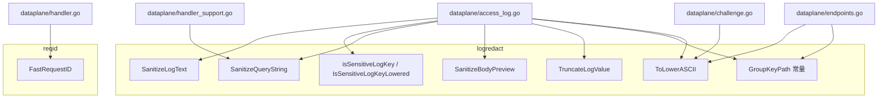
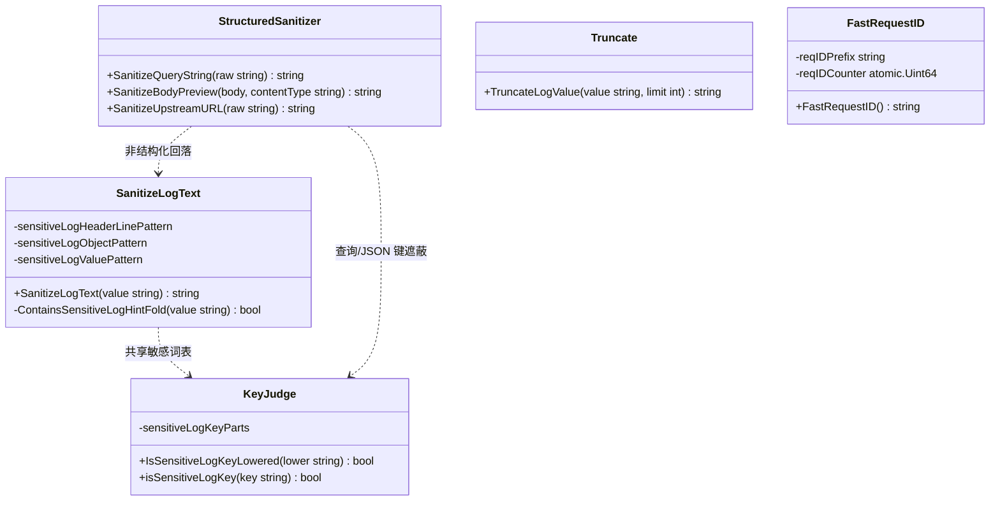
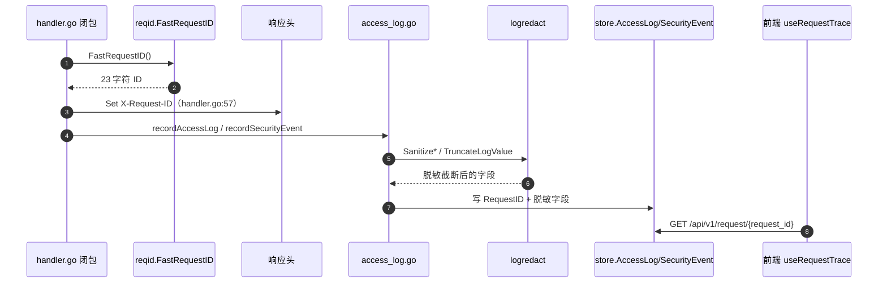
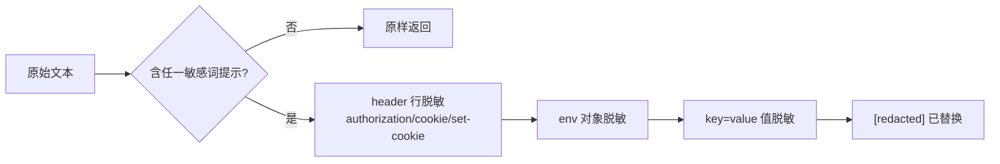
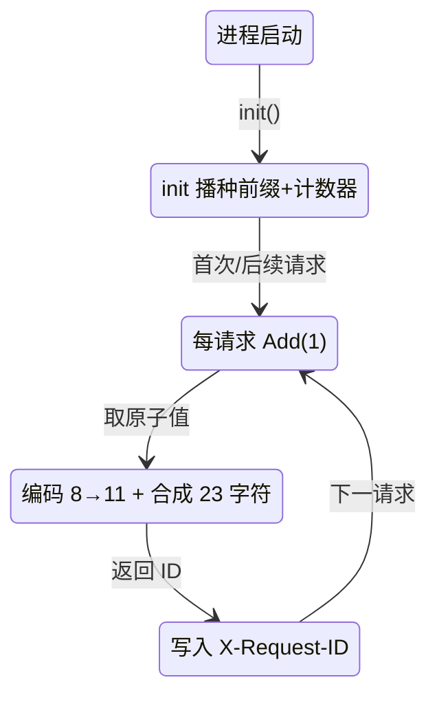
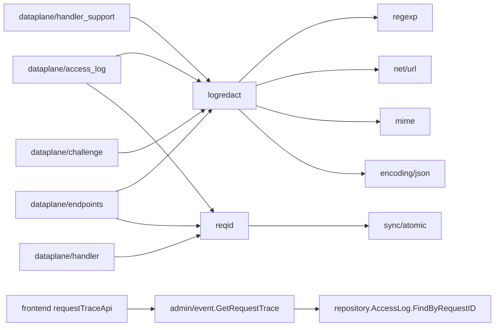

# 日志脱敏与请求标识

<cite>
**本文档引用的文件**
- [sanitize.go](file://internal/dataplane/logredact/sanitize.go)
- [lower.go](file://internal/dataplane/logredact/lower.go)
- [reqid.go](file://internal/dataplane/reqid/reqid.go)
- [access_log.go](file://internal/dataplane/access_log.go)
- [handler_support.go](file://internal/dataplane/handler_support.go)
- [endpoints.go](file://internal/dataplane/endpoints.go)
- [challenge.go](file://internal/dataplane/challenge.go)
- [handler.go](file://internal/dataplane/handler.go)
- [events.go](file://internal/store/events.go)
- [access_log.go](file://internal/store/repository/access_log.go)
- [request.go](file://internal/admin/event/request.go)
- [router.go](file://internal/admin/router.go)
- [logsanitize_test.go](file://internal/dataplane/logredact/logsanitize_test.go)
- [keypath_contract_test.go](file://internal/dataplane/logredact/keypath_contract_test.go)
- [reqid_test.go](file://internal/dataplane/reqid/reqid_test.go)
- [api.ts](file://frontend/lib/api.ts)
- [use-api.ts](file://frontend/hooks/use-api.ts)
</cite>

## 目录
1. [简介](#简介)
2. [项目结构](#项目结构)
3. [核心组件](#核心组件)
4. [架构总览](#架构总览)
5. [详细组件分析](#详细组件分析)
6. [依赖关系分析](#依赖关系分析)
7. [性能考虑](#性能考虑)
8. [故障排查指南](#故障排查指南)
9. [结论](#结论)
10. [附录](#附录)

## 简介

本篇是「数据平面处理 / 内部机制」下的三级实现文档（形态 C），覆盖两个此前零文档覆盖的数据面基础包：

- `internal/dataplane/logredact`（软件包 350 行：`sanitize.go` 325 行 + `lower.go` 25 行）：日志写入前的敏感值脱敏与截断原语集合，入口符号 `SanitizeLogText`、`IsSensitiveLogKeyLowered`。
- `internal/dataplane/reqid`（53 行）：不消耗 `crypto/rand` 系统调用的短唯一请求 ID 生成器，入口符号 `FastRequestID`。

两包共同服务于项目规则「日志新增请求头/体/响应头审计字段时必须脱敏、截断、可折叠，且避免记录敏感值」中的「脱敏 + 截断」侧：`logredact` 负责遮蔽与截断原语，`reqid` 提供把访问日志、安全事件、Bot 评分串成一体的关联键。读者为审计字段维护者与排障一线。

| 项 | 内容 |
|----|------|
| 所属业务域 | 数据平面处理 / 内部机制 |
| 本篇形态 | C 三级实现文档 |
| 覆盖范围 | `logredact` 的敏感键判定/文本脱敏/查询串与请求体脱敏/截断、`reqid` 的 ID 生成与 X-Request-ID 串联；不覆盖 DB 落库并发与前端折叠渲染实现 |
| 上级文档 | [数据平面处理](../数据平面处理.md) |
| 产线调用现状 | 两包均有产线调用点（logredact 见 access_log.go 多处；reqid 见 handler.go:56） |

**章节来源**
- [sanitize.go:1-325](file://internal/dataplane/logredact/sanitize.go#L1-L325)
- [reqid.go:1-53](file://internal/dataplane/reqid/reqid.go#L1-L53)

## 项目结构

`logredact` 拆为「脱敏主体 + ASCII 小写快路径」两个文件；`reqid` 为单文件。二者都是零外部 SDK 的纯工具包，被数据面日志路径与请求入口引用。

```text
internal/dataplane/
├── logredact/                  # 日志脱敏与截断（350 行）
│   ├── sanitize.go                 # 键判定/文本/查询串/请求体脱敏、截断（325）
│   ├── lower.go                    # ToLowerASCII 零分配快路径（25）
│   └── *_test.go                   # 行为/契约/基准测试
└── reqid/                      # 请求 ID（53 行）
    ├── reqid.go                    # FastRequestID 与 init 播种
    └── *_test.go                   # 格式/并发唯一性/基准
```

| 路径 | 职责 | 主要语言 | 文件数 | 代表文件 | 对外暴露 |
|------|------|----------|:------:|----------|:--------:|
| `internal/dataplane/logredact` | 审计字段脱敏与截断原语 | Go | 2（非测试） | `sanitize.go` | `SanitizeLogText`、`SanitizeQueryString`、`SanitizeBodyPreview`、`SanitizeUpstreamURL`、`TruncateLogValue`、`IsSensitiveLogKeyLowered`、`ToLowerASCII`、`GroupKeyPath` |
| `internal/dataplane/reqid` | 短唯一请求 ID 生成 | Go | 1（非测试） | `reqid.go` | `FastRequestID` |



**图表来源**
- [access_log.go:405-471](file://internal/dataplane/access_log.go#L405-L471)
- [sanitize.go:60-325](file://internal/dataplane/logredact/sanitize.go#L60-L325)
- [handler.go:56-57](file://internal/dataplane/handler.go#L56-L57)

**章节来源**
- [sanitize.go:1-325](file://internal/dataplane/logredact/sanitize.go#L1-L325)
- [lower.go:1-25](file://internal/dataplane/logredact/lower.go#L1-L25)

## 核心组件

| 模块 | 路径 | 职责 | 核心接口/符号 | 依赖模块 | 被依赖 | 规模(行) | 测试 |
|------|------|------|---------------|----------|--------|:--------:|:----:|
| 文本脱敏 | `logredact` | 遮蔽 key=value 形态的敏感取值 | `SanitizeLogText`（L206） | 3 个正则、`ContainsSensitiveLogHintFold` | access_log、challenge | 325 | 有 |
| 键名判定 | `logredact` | 判断 header 名是否敏感 | `IsSensitiveLogKeyLowered`（L318） | `ToLowerASCII`、`sensitiveLogKeyParts` | access_log | 325 | 有 |
| 结构化脱敏 | `logredact` | 查询串/请求体/上游 URL 脱敏 | `SanitizeQueryString`（L60）、`SanitizeBodyPreview`（L131）、`SanitizeUpstreamURL`（L42） | `net/url`、`mime`、`encoding/json` | access_log、handler_support、endpoints | 325 | 有 |
| 截断 | `logredact` | 长值截断并加标记 | `TruncateLogValue`（L292） | 无 | access_log | 325 | 有 |
| 请求标识 | `reqid` | 原子计数器 + 进程随机前缀生成短 ID | `FastRequestID`（L41） | `sync/atomic`、`encoding/base64`、`math/rand/v2` | handler、endpoints、access_log | 53 | 有 |

`被依赖` 由全仓检索得出：`logredact` 实际写入路径集中在 `access_log.go`（访问日志与安全事件两条落库前的 sanitize），并有 `handler_support.go:199`、`endpoints.go:54/178`、`challenge.go:70/71/187/206` 引用；`audit_events.go` 与 `internal/observability` 未直接导入本包（安全事件的脱敏发生在 `access_log.go` 的 `recordSecurityEvent`）。`reqid` 被 `handler.go:56`、`endpoints.go:183`、`access_log.go:623` 引用。



**图表来源**
- [sanitize.go:13-325](file://internal/dataplane/logredact/sanitize.go#L13-L325)
- [reqid.go:15-53](file://internal/dataplane/reqid/reqid.go#L15-L53)

### 重点组件展开

**职责**：`SanitizeLogText` 是纯文本脱敏的唯一收口，`FastRequestID` 是请求关联键的唯一生成器。**核心签名**（逐字取自源码）：

```go
func SanitizeLogText(value string) string
func IsSensitiveLogKeyLowered(lower string) bool
func isSensitiveLogKey(key string) bool // 未导出，内部经 ToLowerASCII 转小写后调用
func SanitizeQueryString(raw string) string
func SanitizeBodyPreview(body, contentType string) string
func SanitizeUpstreamURL(raw string) string
func TruncateLogValue(value string, limit int) string
func ToLowerASCII(s string) string
func FastRequestID() string
```

> 注：源码中判定 header 名敏感的导出函数是 `IsSensitiveLogKeyLowered`（要求入参已小写）与未导出的 `isSensitiveLogKey`（自动转小写），不存在导出名 `IsSensitiveLogKey`。

代码上下文（关键符号在上下游网络中的影响面）：

| 符号 | 位置 | 职责 | 上游调用者 | 下游依赖 | 副作用 | 影响面 |
|------|------|------|------------|----------|--------|--------|
| `SanitizeLogText` | [sanitize.go:206](file://internal/dataplane/logredact/sanitize.go#L206) | 文本 key=value 脱敏 | `access_log.go:173/243/244/245` | 3 个正则、`ContainsSensitiveLogHintFold` | 无（纯函数） | 高：所有审计文本 |
| `IsSensitiveLogKeyLowered` | [sanitize.go:318](file://internal/dataplane/logredact/sanitize.go#L318) | header 名敏感判定 | `access_log.go:417/440`、`sanitizeQueryPair` | `strings.Contains`、`sensitiveLogKeyParts` | 无 | 高：header 遮蔽决策 |
| `FastRequestID` | [reqid.go:41](file://internal/dataplane/reqid/reqid.go#L41) | 生成 23 字符关联 ID | `handler.go:56`、`endpoints.go:183`、`access_log.go:623` | `atomic`、`base64` | 原子自增（全局状态） | 高：贯穿三类日志 |
| `GetRequestTrace` | [request.go:33](file://internal/admin/event/request.go#L33) | 按 request_id 聚合链路 | `router.go:179`、前端 `requestTraceApi` | `FindByRequestID` 三仓储 | 读库 | 中：请求追踪页 |

**章节来源**
- [sanitize.go:42-325](file://internal/dataplane/logredact/sanitize.go#L42-L325)
- [lower.go:7](file://internal/dataplane/logredact/lower.go#L7)
- [access_log.go:173-245](file://internal/dataplane/access_log.go#L173-L245)

## 架构总览

一次请求内，`FastRequestID` 生成的 ID 写入 `X-Request-ID` 响应头并作为 `RequestID` 随访问日志/安全事件落库；日志落库前各审计字段经 `logredact` 脱敏与截断。排障时以同一 `request_id` 反查全链路。



**图表来源**
- [handler.go:56-57](file://internal/dataplane/handler.go#L56-L57)
- [access_log.go:115-179](file://internal/dataplane/access_log.go#L115-L179)
- [router.go:179](file://internal/admin/router.go#L179)

**章节来源**
- [access_log.go:240-268](file://internal/dataplane/access_log.go#L240-L268)

## 详细组件分析

### 日志脱敏与截断（logredact）

#### 接口与注册

本包无「注册」概念，全部为导出函数级 API。敏感词表以包级变量声明：`SensitiveLogValueHints`（遮蔽值的关键字集合，L190）、`sensitiveLogKeyParts`（判定 header 名的片段集合，L300）、`GroupKeyPath`（动态保护取密钥端点，L34）。

```go
// internal/dataplane/logredact/sanitize.go:206
func SanitizeLogText(value string) string {
    if !ContainsSensitiveLogHintFold(value) { // 廉价字面量预筛（零分配）
        return value
    }
    value = sensitiveLogHeaderLinePattern.ReplaceAllString(value, `${1} [redacted]`)
    value = sensitiveLogObjectPattern.ReplaceAllString(value, `${1}${2}[redacted]`)
    return sensitiveLogValuePattern.ReplaceAllString(value, `${1}${2}[redacted]`)
}
```

#### 配置与凭据

- 无外部配置项。`GroupKeyPath = "/__owaf/dynamic/key"`（L34）为数据面内部路由约定常量，全仓仅此一处声明，父包不得再定义同值常量（否则密钥端点会静默写进访问日志，由 `keypath_contract_test.go` 兜底）。
- 三条正则：`sensitiveLogHeaderLinePattern`（L13，含 continuation 行的 header 行）、`sensitiveLogObjectPattern`（L14，`env` 对象）、`sensitiveLogValuePattern`（L15，key=value 形态）。

#### 调用与差异

脱敏分两种入口，语义不同：

| 入口 | 处理对象 | 命中敏感键的动作 | 失败/不可解析时 |
|------|----------|------------------|-----------------|
| `SanitizeQueryString` | 查询串 | 敏感键取值整体替换 `[redacted]` | 键/值解码失败返回 `[redacted]` |
| `SanitizeBodyPreview` | 请求体 | 按 Content-Type 分派 form/json/其他 | JSON 解析失败回落 `SanitizeLogText` |
| `SanitizeLogText` | 任意文本（header/body 行） | key=value 的 value 段替换 | 无匹配原样返回 |
| `SanitizeUpstreamURL` | 上游 URL | 移除 userinfo | `url.Parse` 失败返回 `[redacted]` |

`IsSensitiveLogKeyLowered` 用 `strings.Contains` 对 header 名（已小写）做子串判定，命中 `sensitiveLogKeyParts` 任一片段即为敏感。`SanitizeBodyPreview` 对 `application/json` 走 `sanitizeJSONValue` 递归（对象键命中即遮蔽、数组逐项、字符串走 `SanitizeLogText`），对 `application/x-www-form-urlencoded` 走 `SanitizeQueryString`，其余走 `SanitizeLogText`。

`SanitizeLogText` 的数据流：



**图表来源**
- [sanitize.go:206-216](file://internal/dataplane/logredact/sanitize.go#L206-L216)

**章节来源**
- [sanitize.go:13-325](file://internal/dataplane/logredact/sanitize.go#L13-L325)
- [keypath_contract_test.go:19-29](file://internal/dataplane/logredact/keypath_contract_test.go#L19-L29)

### 请求标识生成（reqid）

#### 接口与注册

`FastRequestID() string` 是包内唯一导出函数；包级状态 `reqIDPrefix`（进程内随机前缀）与 `reqIDCounter`（`atomic.Uint64`）在 `init()` 播种一次。

```go
// internal/dataplane/reqid/reqid.go:41
func FastRequestID() string {
    n := reqIDCounter.Add(1)                 // 原子自增：进程内无竞争碰撞
    var v [8]byte
    binary.BigEndian.PutUint64(v[:], n)
    var enc [11]byte
    base64.RawURLEncoding.Encode(enc[:], v[:]) // 8 字节 → 11 位，无填充
    plen := len(reqIDPrefix)                   // 恒为 11
    var buf [23]byte
    copy(buf[:plen], reqIDPrefix)
    buf[plen] = '-'
    copy(buf[plen+1:], enc[:])
    return string(buf[:])                      // 11 + 1 + 11 = 23 字符
}
```

#### 配置与凭据

- `init()`（L23）用 `math/rand/v2` 自动播种取 8 字节作前缀（编码约 11 字符），并把 `time.Now().UnixNano()` 混入计数器使重启后不可预测。前缀非 `crypto/rand`，定位是关联标识而非安全随机数。
- 无凭据项。

#### 调用与差异

`FastRequestID` 与旧实现逐字节一致：后缀仍是同一 `RawURLEncoding` 输出，仅把目标换成栈上 11 字节缓冲，终串在 23 字节栈缓冲合成后一次搬入堆，把每请求 3 次小分配收敛为 1 次。竞争特性由 `reqIDCounter.Add(1)` 的原子性保证：同一进程内自增序列单调、无碰撞；跨进程唯一性由随机前缀（2^64 空间）与时间播种的计数器联合提供。



**图表来源**
- [reqid.go:15-53](file://internal/dataplane/reqid/reqid.go#L15-L53)

#### 限制与回退

- `X-Request-ID` 的落点（产线写入）：`handler.go:57` 主链每请求设置；`challenge.go:95`、`endpoints.go:184` 在对应路径设置；`access_log.go:621-624` 在挑战校验回写时若响应头缺失则以 `FastRequestID()` 兜底补齐。
- 存在 `X-OWAF-Drop-Degraded`（`handler.go:839`，值 `h2-h3-no-stream-reset`）：当 h2/h3 无法进行 stream reset 而降级为 403 拦截时打的标记。
- 不存在 `X-WAF-Action` 响应头：WAF 动作以数据库字段 `waf_action`（`store.AccessLog.WAFAction`）存储，不经响应头对外暴露。
- 回退：`access_log.go:539-541` 若某路径未写入 `X-Request-ID`，落库时用 `fallbackRequestID` 常量兜底，保证 `request_id` 非空可检索。

**章节来源**
- [reqid.go:15-53](file://internal/dataplane/reqid/reqid.go#L15-L53)
- [handler.go:56-57](file://internal/dataplane/handler.go#L56-L57)
- [handler.go:839](file://internal/dataplane/handler.go#L839)
- [access_log.go:539-541](file://internal/dataplane/access_log.go#L539-L541)
- [access_log.go:621-624](file://internal/dataplane/access_log.go#L621-L624)

### 脱敏写入路径与前端串联

#### 接口与注册

写入侧唯一汇聚点是 `access_log.go` 的 `recordAccessLog`（访问日志）与 `recordSecurityEvent`（安全事件）；两者在落库前对 `QueryString`、`RequestHeaders`、`RequestBodyPreview`、`ResponseHeaders`、`MatchSnippet`、`Upstream` 逐项调用 `logredact`。header 名小写用 `ToLowerASCII`，敏感键直接置 `[]string{"[redacted]"}`，非敏感值走 `TruncateLogValue(SanitizeLogText(v), 2048)`。

#### 配置与凭据

落库与展示限长（`access_log.go:405-409`，包内常量）：

| 常量 | 值 | 作用 | 施加位置 |
|------|:--:|------|----------|
| `logBodyPreviewLimit` | 8192 | 请求体预览截断 | `requestBodyPreview` |
| `logHeaderValueLimit` | 2048 | 单 header 值截断 | `TruncateLogValue` |
| `logHeaderValuesLimit` | 32 | 单 header 名最多保留值数 | header dump 循环 |

#### 调用与差异

串联闭环（前端）：`use-api.ts:568` 的 `useRequestTrace(requestId)` → `requestTraceApi.get` → `GET /api/v1/request/{request_id}`（`router.go:179`）→ `event.GetRequestTrace`（`request.go:33`）聚合 `FindByRequestID` 的访问日志（`repository/access_log.go:891`）、安全事件与 Bot 评分。`request_id` 在 `store/events.go` 三表分别有索引 `idx_al_request_id`（L83）、`idx_se_request_id`（L20）与 `BotScoreLog.RequestID`（L254）。

| 步 | 动作 | 执行位置 | 输入 | 输出 | 失败分支 | 可观测点 |
|:--:|------|----------|------|------|----------|----------|
| 1 | 生成 ID | [handler.go:56](file://internal/dataplane/handler.go#L56) | 无 | 23 字符 ID | 无 | 响应头 |
| 2 | 写 X-Request-ID | [handler.go:57](file://internal/dataplane/handler.go#L57) | ID | 响应头 | 无 | 客户端 |
| 3 | 查询串脱敏 | [access_log.go:257](file://internal/dataplane/access_log.go#L257) | raw query | 脱敏串 | 解码失败 `[redacted]` | `query_string` |
| 4 | header 脱敏截断 | [access_log.go:416-425](file://internal/dataplane/access_log.go#L416-L425) | header 值 | 遮蔽+截断 | 敏感键整体遮蔽 | `request_headers` |
| 5 | 请求体脱敏 | [access_log.go:463-470](file://internal/dataplane/access_log.go#L463-L470) | body | 预览串 | 密钥端点 `[redacted]` | `request_body_preview` |
| 6 | 落库关联键 | [access_log.go:253](file://internal/dataplane/access_log.go#L253) | info.RequestID | `request_id` 列 | 空则兜底 | `idx_al_request_id` |
| 7 | 前端反查全链路 | [router.go:179](file://internal/admin/router.go#L179) | request_id | 三源聚合 | 400 空 ID | 请求追踪页 |

**章节来源**
- [access_log.go:115-179](file://internal/dataplane/access_log.go#L115-L179)
- [access_log.go:240-268](file://internal/dataplane/access_log.go#L240-L268)
- [request.go:33-72](file://internal/admin/event/request.go#L33-L72)
- [events.go:20](file://internal/store/events.go#L20)
- [use-api.ts:568-570](file://frontend/hooks/use-api.ts#L568-L570)

## 依赖关系分析



**图表来源**
- [sanitize.go:3-11](file://internal/dataplane/logredact/sanitize.go#L3-L11)
- [request.go:41](file://internal/admin/event/request.go#L41)

### 依赖矩阵

| 调用方 ↓ / 被调方 → | logredact | reqid | regexp/url/json | store 模型 | repository |
|---------------------|:---------:|:-----:|:---------------:|:----------:|:----------:|
| dataplane/access_log | ✓ | ✓ | ✓ | ✓ | ✓ |
| dataplane/handler_support | ✓ | ✗ | — | ✓ | — |
| dataplane/endpoints | ✓ | ✓ | — | — | — |
| admin/event | ✗ | ✗ | — | ✓ | ✓ |

`✓` 存在依赖、`✗` 无依赖（显式声明当前不依赖）、`—` 不适用。`admin/event.GetRequestTrace` 不直接调用 `logredact`：脱敏已在写入侧完成，读取侧仅按 `request_id` 聚合已落库的脱敏数据。

**章节来源**
- [handler_support.go:18-19](file://internal/dataplane/handler_support.go#L18-L19)
- [request.go:33-72](file://internal/admin/event/request.go#L33-L72)

### 外部实体

| 外部实体 | 类型 | 交互方向 | 协议/方式 | 触发时机 | 数据内容 | 失败影响 | 容错处理 |
|----------|------|:--------:|-----------|----------|----------|----------|----------|
| 客户端 | 角色 | 出向 | HTTP 响应头 | 每请求 | `X-Request-ID` | 关联键缺失 | 落库兜底 ID |
| SQLite 日志库 | 存储 | 出向 | GORM | 异步写入 | 脱敏后审计字段 | 字段过长截断 | 限长常量 |

**章节来源**
- [access_log.go:621-624](file://internal/dataplane/access_log.go#L621-L624)
- [events.go:83-87](file://internal/store/events.go#L83-L87)

## 性能考虑

### 敏感文本的预筛

- **问题**：正则即使无匹配也要扫完整串，`(?i)(code|env|pwd|...)` 这类短关键字正则在错误前提下会全串回溯。
- **优化**：`SanitizeLogText` 先走 `ContainsSensitiveLogHintFold` 零分配字面量扫描（按首字节分组 `sensitiveLogHintByFirstFold`），任一关键字不出现即原样返回。
- **效果**：绝大多数 header/body 值不含敏感词，直接跳过三条正则替换。

### 请求 ID 的分配收敛

- **问题**：每请求生成 UUID 或多次 `EncodeToString` + 拼接会产生多次小分配。
- **优化**：`FastRequestID` 用栈上缓冲一次合成 23 字节串，仅 1 次堆分配；前缀启动期计算一次，计数器原子自增。
- **效果**：ID 生成不消耗 `crypto/rand` 系统调用、无 UUID 解析开销。

[本节为通用指导，无需特定文件来源]

## 故障排查指南

### 问题：访问日志出现明文敏感值

**症状**：`request_headers` / `query_string` 中可见 token、authorization 等原值。

**可能原因**：字段未经 `recordAccessLog`/`recordSecurityEvent` 的 sanitize 分支即写入；或敏感 header 名不含 `sensitiveLogKeyParts` 中任一片段（如自定义键名）。

**排查步骤**：
1. 确认写入经由 `access_log.go:243-245` 的 `SanitizeLogText`。
2. 核对 header 名小写后是否命中 `sensitiveLogKeyParts`（L300）。

**解决方案**：自定义敏感键需补入 `sensitiveLogKeyParts`（键遮蔽）与/或 `SensitiveLogValueHints`+正则（值遮蔽），两处须同步，由 `TestSensitiveLogValueHintsCoverPattern` 兜住漏改。

### 问题：日志中出现 `[redacted]` 过度遮蔽

**症状**：非敏感 header/body 被遮蔽。

**可能原因**：`sensitiveLogKeyParts` 含宽片段 `key`，任何名字包含子串 "key" 的 header 都会被判敏感（如 `keyboard`、`monkey`）；`code`、`env`、`ticket` 等短词作为值关键字也可能误命中。

**排查步骤**：
1. 用 `IsSensitiveLogKeyLowered` 单测复现误判。
**解决方案**：这是失败关闭取向下的已知宽匹配代价；若确需收窄，应替换片段为更精确的边界匹配而非直接删词。

**章节来源**
- [sanitize.go:299-325](file://internal/dataplane/logredact/sanitize.go#L299-L325)
- [logsanitize_test.go:16-104](file://internal/dataplane/logredact/logsanitize_test.go#L16-L104)

## 结论

`logredact` 与 `reqid` 用最小面积支撑了审计字段的「脱敏 + 截断 + 关联」三件事：前者把敏感取值统一遮蔽为 `[redacted]` 并提供分类型（文本/查询/请求体/URL）入口，后者用原子计数器与随机前缀给出 23 字符低分配 ID，经 `X-Request-ID` 与 `request_id` 列把三类日志串成一条可反查链路。

- **优势**：快路径预筛 + 栈上合成，热路径成本可控；写入侧集中 sanitize，读取侧只聚合，职责单一。
- **建议**：与项目规则「可折叠」对照，本包只提供脱敏与截断原语，「折叠展示」属前端渲染层不在本包职责内；`sensitiveLogKeyParts` 中的 `key`/`env`/`code`/`ticket` 宽匹配宜长期观察误遮蔽率，必要时应收窄；`sensitiveLogHintFirstFold`（sanitize.go:218）为当前未被引用的包级变量，属可清理冗余。

[本节为总结，无需特定文件来源]

## 附录

### 配置参数说明

| 配置项 | 类型 | 默认值 | 必填 | 说明 | 证据位置 |
|--------|------|--------|:----:|------|----------|
| `logBodyPreviewLimit` | `const int` | 8192 | 是 | 请求体预览长度上限 | [access_log.go:406](file://internal/dataplane/access_log.go#L406) |
| `logHeaderValueLimit` | `const int` | 2048 | 是 | 单 header 值截断长度 | [access_log.go:407](file://internal/dataplane/access_log.go#L407) |
| `logHeaderValuesLimit` | `const int` | 32 | 是 | 单 header 名最多保留值数 | [access_log.go:408](file://internal/dataplane/access_log.go#L408) |
| `GroupKeyPath` | `const string` | `/__owaf/dynamic/key` | 是 | 动态保护取密钥端点，请求体强制遮蔽 | [sanitize.go:34](file://internal/dataplane/logredact/sanitize.go#L34) |

**章节来源**
- [access_log.go:405-409](file://internal/dataplane/access_log.go#L405-L409)
- [sanitize.go:34](file://internal/dataplane/logredact/sanitize.go#L34)

### 敏感键覆盖清单

结合项目规则「避免记录 Authorization、Cookie、Set-Cookie、API key 等敏感值」逐条比对两套词表（键判定 `sensitiveLogKeyParts` vs 值遮蔽 `SensitiveLogValueHints`/正则）：

| 敏感项 | 键判定命中 | 值遮蔽命中 | 依据 |
|--------|:----------:|:----------:|------|
| Authorization | ✓ | ✓ | `authorization`/`proxy-authorization` 在两份表 |
| Cookie | ✓ | ✓ | `cookie` 片段 |
| Set-Cookie | ✓ | ✓ | `set-cookie` 值关键字；键侧经子串 `cookie` 命中 |
| API key | ✓ | ✓ | `api-key`/`apikey`/`api[_-]?key` 变体 |
| token/secret/password/session | ✓ | ✓ | 两份表均含 |
| credential | ✓ | ✗ | 仅键表有，值正则关键字表未含 |
| 含 `key` 子串的任意名 | ✓（宽匹配） | 视 value 而定 | 键表含 `key`，可能过度遮蔽 |

结论：规则点名的 Authorization/Cookie/Set-Cookie/API key 四类均被覆盖；键遮蔽与值遮蔽两份表存在细微不对称（`credential` 只在键表、`code`/`env`/`ticket` 只在值表），且 `key` 宽片段会带来过度遮蔽。

**章节来源**
- [sanitize.go:13-15](file://internal/dataplane/logredact/sanitize.go#L13-L15)
- [sanitize.go:190-195](file://internal/dataplane/logredact/sanitize.go#L190-L195)
- [sanitize.go:299-303](file://internal/dataplane/logredact/sanitize.go#L299-L303)

### 调用示例

脱敏与截断的产线调用（取自 `access_log.go`）：

```go
// 查询串脱敏（access_log.go:257）
QueryString: logredact.SanitizeQueryString(info.QueryString)

// header 值：先脱敏再截断到 2048（access_log.go:425）
headers[key] = append(values,
    logredact.TruncateLogValue(logredact.SanitizeLogText(string(v)), logHeaderValueLimit))

// 请求体：密钥端点强制遮蔽，否则按 Content-Type 脱敏（access_log.go:463-470）
if logredact.IsDynamicProtectionKeyPath(c, "") {
    return "[redacted]", truncated, size
}
return logredact.SanitizeBodyPreview(string(body), contentType), truncated, size
```

请求 ID 生成与落头（`handler.go:56-57`）：

```go
requestID := dpreqid.FastRequestID()
c.Response.Header.Set("X-Request-ID", requestID)
```

**章节来源**
- [access_log.go:416-470](file://internal/dataplane/access_log.go#L416-L470)
- [handler.go:56-57](file://internal/dataplane/handler.go#L56-L57)

### 特性与限制对比

| 能力 | logredact | reqid | 备注 |
|------|:---------:|:-----:|------|
| 产线调用点 | ✓ | ✓ | 均在 access_log/handler |
| 脱敏敏感值 | ✓ | — | Authorization/Cookie/API key 等 |
| 截断 | ✓ | — | `TruncateLogValue`，上限由调用方给 |
| 折叠展示 | ✗ | — | 属前端渲染层，本包不提供 |
| 消耗 crypto/rand | — | ✗ | 用 `math/rand/v2` + 原子计数 |
| 进程内唯一 | — | ✓ | 原子自增单调无碰撞 |
| 跨进程唯一 | — | 部分 | 随机前缀 + 时间播种，非强保证 |
| 宽片段误遮蔽 | ✓ | — | `key`/`code`/`env`/`ticket` |

**章节来源**
- [sanitize.go:292-325](file://internal/dataplane/logredact/sanitize.go#L292-L325)
- [reqid.go:23-53](file://internal/dataplane/reqid/reqid.go#L23-L53)
