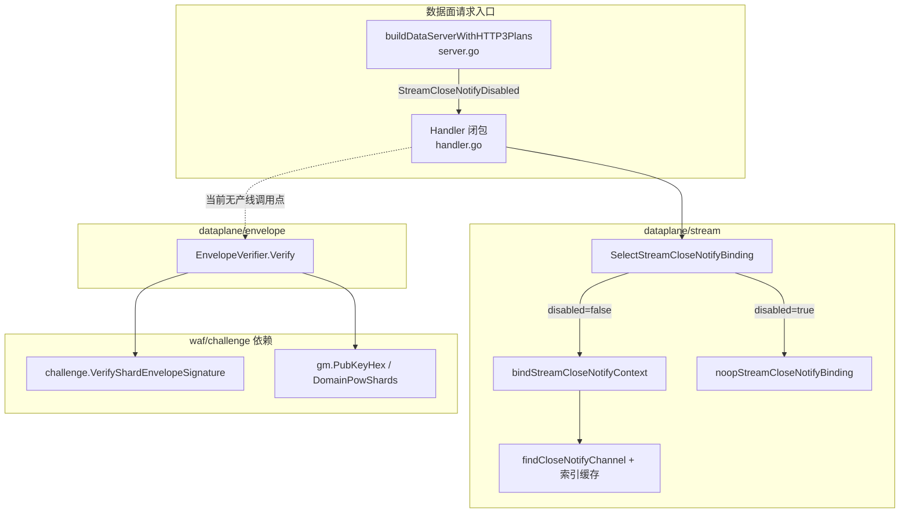
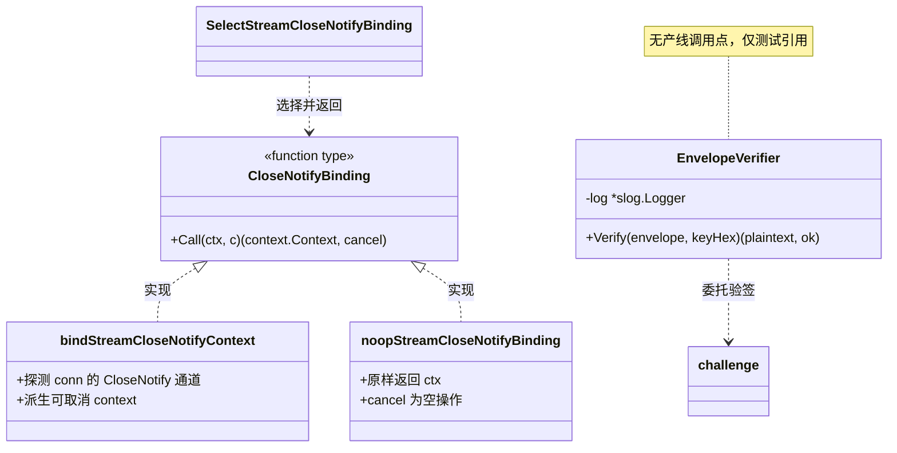
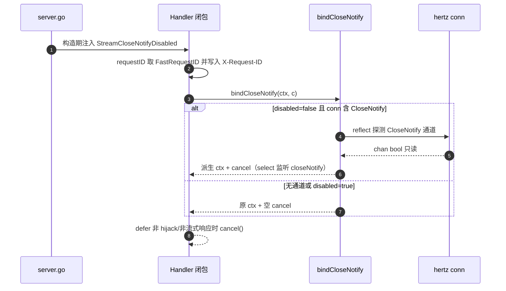
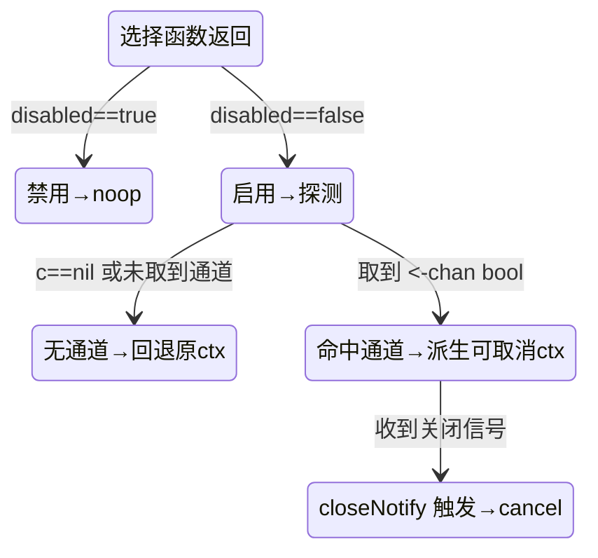
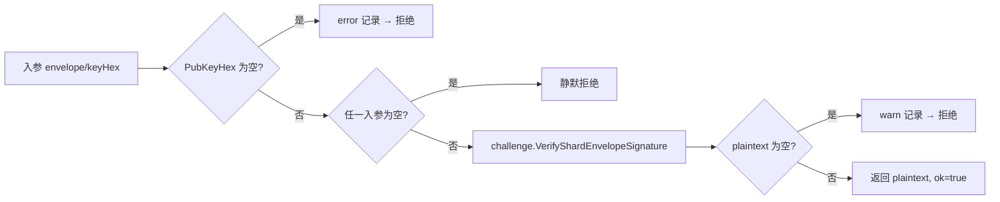
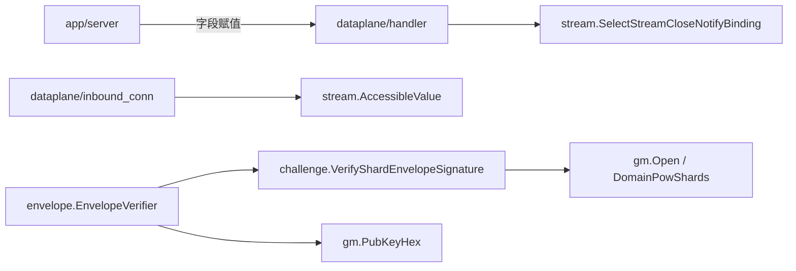

# 流式帧与连接绑定

<cite>
**本文档引用的文件**
- [stream_close_notify.go](file://internal/dataplane/stream/stream_close_notify.go)
- [envelope_verify.go](file://internal/dataplane/envelope/envelope_verify.go)
- [handler.go](file://internal/dataplane/handler.go)
- [handler_support.go](file://internal/dataplane/handler_support.go)
- [inbound_conn.go](file://internal/dataplane/inbound_conn.go)
- [server.go](file://internal/app/server.go)
- [pow_shard.go](file://internal/waf/challenge/pow_shard.go)
- [token.go](file://internal/waf/challenge/token.go)
- [sign.go](file://internal/waf/challenge/gm/sign.go)
- [envelope.go](file://internal/waf/challenge/gm/envelope.go)
- [stream_close_notify_test.go](file://internal/dataplane/stream/stream_close_notify_test.go)
- [stream_close_notify_typed_test.go](file://internal/dataplane/stream/stream_close_notify_typed_test.go)
- [envelope_verify_test.go](file://internal/dataplane/envelope/envelope_verify_test.go)
</cite>

## 目录
1. [简介](#简介)
2. [项目结构](#项目结构)
3. [核心组件](#核心组件)
4. [架构总览](#架构总览)
5. [详细组件分析](#详细组件分析)
6. [依赖关系分析](#依赖关系分析)
7. [性能考虑](#性能考虑)
8. [故障排查指南](#故障排查指南)
9. [结论](#结论)
10. [附录](#附录)

## 简介

本篇是「数据平面处理 / 内部机制」下的三级实现文档（形态 C），逐包覆盖两个此前零文档覆盖的数据面子包：

- `internal/dataplane/stream`（173 行）：请求级「流关闭通知绑定」的选择与实现，入口符号 `SelectStreamCloseNotifyBinding`。该包由提交 `5451eee`（refactor(dataplane): stream_close_notify 切分为 stream 子包）从父包 `stream_close_notify.go` 切分而来，现为独立子包。
- `internal/dataplane/envelope`（80 行）：分片信封验签的唯一收口类型 `EnvelopeVerifier`，把「用签名验封信封」这一密码学动作与传输形态解耦。

两者的共同点是：都是数据面里「小而边界清晰」的基础件——前者把 HTTP/2 流的关闭信号桥接进请求上下文的生命周期，后者把信封验签的失败语义收敛成一处。读者为数据面维护者与排查上游取消/信封下发问题的一线工程师。

| 项 | 内容 |
|----|------|
| 所属业务域 | 数据平面处理 / 内部机制 |
| 本篇形态 | C 三级实现文档 |
| 覆盖范围 | `dataplane/stream` 的绑定选择与反射探测、`dataplane/envelope` 的验签收口；不覆盖 HTTP/2 帧编解码本体、不覆盖信封的下发路由 |
| 上级文档 | [数据平面处理](../数据平面处理.md) |
| 产线调用现状 | stream：有产线调用点（`handler.go:52`）；envelope：无产线调用点，仅测试与「服务端签发后自检」引用 |

**章节来源**
- [stream_close_notify.go:22-33](file://internal/dataplane/stream/stream_close_notify.go#L22-L33)
- [envelope_verify.go:17-37](file://internal/dataplane/envelope/envelope_verify.go#L17-L37)

## 项目结构

两包各由单个非测试文件实现，均为纯 Go，无外部 SDK 依赖（stream 依赖标准库 `reflect`/`sync`/`unsafe` 与 hertz 请求上下文；envelope 依赖 `log/slog` 与 `challenge`/`gm` 两个内部包）。提交 `5451eee` 把 `stream_close_notify.go` 从父包移入 `stream/` 子目录并同步调整 `handler.go`、`protocol_guard.go` 两处引用。

```text
internal/dataplane/
├── stream/                     # CloseNotify 绑定选择（173 行）
│   ├── stream_close_notify.go      # 唯一实现文件
│   └── *_test.go                   # 行为/类型/基准测试
└── envelope/                   # 信封验签收口（80 行）
    ├── envelope_verify.go          # 唯一实现文件
    └── envelope_verify_test.go     # 域与篡改契约测试
```

| 路径 | 职责 | 主要语言 | 文件数 | 代表文件 | 对外暴露 |
|------|------|----------|:------:|----------|:--------:|
| `internal/dataplane/stream` | 依据 listener 是否具备 HTTP/2 选择 CloseNotify 绑定 | Go | 1（非测试） | `stream_close_notify.go` | `SelectStreamCloseNotifyBinding`、`AccessibleValue` |
| `internal/dataplane/envelope` | 分片信封验签的唯一收口（失败关闭） | Go | 1（非测试） | `envelope_verify.go` | `EnvelopeVerifier`、`NewEnvelopeVerifier` |



**图表来源**
- [handler.go:52-66](file://internal/dataplane/handler.go#L52-L66)
- [server.go:1621-1624](file://internal/app/server.go#L1621-L1624)
- [stream_close_notify.go:28-66](file://internal/dataplane/stream/stream_close_notify.go#L28-L66)
- [envelope_verify.go:57-80](file://internal/dataplane/envelope/envelope_verify.go#L57-L80)

**章节来源**
- [stream_close_notify.go:1-173](file://internal/dataplane/stream/stream_close_notify.go#L1-L173)
- [envelope_verify.go:1-80](file://internal/dataplane/envelope/envelope_verify.go#L1-L80)

## 核心组件

| 模块 | 路径 | 职责 | 核心接口/符号 | 依赖模块 | 被依赖 | 规模(行) | 测试 |
|------|------|------|---------------|----------|--------|:--------:|:----:|
| 流绑定选择器 | `internal/dataplane/stream` | 依 `disabled` 返回真实绑定或空操作 | `SelectStreamCloseNotifyBinding`（L28） | `hertz/app`、`reflect` | `dataplane/handler`、`dataplane/inbound_conn` | 173 | 有 |
| 关闭信号反射探测 | `internal/dataplane/stream` | 从 conn 递归定位首个 CloseNotify 通道 | `bindStreamCloseNotifyContext`（L49）、`findCloseNotifyChannel`（L80） | `sync.Map` 缓存 | 包内 `bind` | 173 | 有 |
| 信封验签收口 | `internal/dataplane/envelope` | 以单一类型/方法封装验签，失败关闭 | `EnvelopeVerifier.Verify`（L57） | `log/slog`、`waf/challenge`、`waf/challenge/gm` | 仅测试 | 80 | 部分 |

`被依赖` 列由全仓交叉检索得出：stream 的 `AccessibleValue` 另被 `inbound_conn.go:611/624` 复用（跨模块引用一个导出的零分配工具），`envelope` 在全仓检索中仅出现在其自身测试文件，无任何产线导入点，这与源码注释「当前尚无生产调用点」一致。`测试` 列以测试文件实际存在为准。



**图表来源**
- [stream_close_notify.go:28-66](file://internal/dataplane/stream/stream_close_notify.go#L28-L66)
- [envelope_verify.go:35-80](file://internal/dataplane/envelope/envelope_verify.go#L35-L80)

### 重点组件展开

**职责**：`SelectStreamCloseNotifyBinding` 在 Handler 构造期被调用一次，返回一个「请求级」绑定函数；该函数随后在每请求闭包内执行。**关键文件**：`internal/dataplane/stream/stream_close_notify.go`。**核心签名**（逐字取自源码）：

```go
func SelectStreamCloseNotifyBinding(disabled bool) func(context.Context, *app.RequestContext) (context.Context, func())
func bindStreamCloseNotifyContext(ctx context.Context, c *app.RequestContext) (context.Context, func())
func noopStreamCloseNotifyBinding(ctx context.Context, _ *app.RequestContext) (context.Context, func())
func streamCloseNotifyChannel(conn any) (<-chan bool, bool)
func findCloseNotifyChannel(v reflect.Value) (<-chan bool, bool)
func closeNotifyMethodIndexFor(t reflect.Type) int
func AccessibleValue(v reflect.Value) reflect.Value
func callCloseNotifyAt(v reflect.Value, methodIndex int) (ch <-chan bool, ok bool)
func callCloseNotify(method reflect.Value) (<-chan bool, bool)
```

**章节来源**
- [stream_close_notify.go:28-173](file://internal/dataplane/stream/stream_close_notify.go#L28-L173)

## 架构总览

一次请求内，绑定函数把「上游/客户端取消」与「派生 context」接通；验签器独立于请求主链，其预期调用点在挑战页信封下发/消费处，目前尚未接线。



**图表来源**
- [handler.go:52-66](file://internal/dataplane/handler.go#L52-L66)
- [stream_close_notify.go:49-66](file://internal/dataplane/stream/stream_close_notify.go#L49-L66)

**章节来源**
- [handler.go:40-75](file://internal/dataplane/handler.go#L40-L75)

## 详细组件分析

### 流式关闭通知绑定（stream）

#### 接口与注册

`SelectStreamCloseNotifyBinding(disabled bool)` 是包的对外唯一选择入口，返回类型为 `func(context.Context, *app.RequestContext) (context.Context, func())`。它不是「注册中心模式」，而是一个纯选择函数：`disabled` 为真直接返回 `noopStreamCloseNotifyBinding`，否则返回 `bindStreamCloseNotifyContext`。装配点在 Handler 构造期一次性完成。

```go
// internal/dataplane/stream/stream_close_notify.go:28
func SelectStreamCloseNotifyBinding(disabled bool) func(context.Context, *app.RequestContext) (context.Context, func()) {
    if disabled {
        return noopStreamCloseNotifyBinding
    }
    return bindStreamCloseNotifyContext
}
```

#### 配置与凭据

- `Options.StreamCloseNotifyDisabled`（`handler_support.go:53`，`bool`）：由 `server.go:1623` 赋值为 `!http2Enabled`。语义是「数据面 listener 未注册 HTTP/2 协议栈」。
- 无密钥/凭据项：本包不涉及任何凭据，仅依赖 hertz 请求上下文对象。

#### 调用与差异

`bindStreamCloseNotifyContext` 与 `noopStreamCloseNotifyBinding` 的差别只在是否执行探测与派生取消：

- **分支条件（选择层）**：`disabled==true` → 全链路 noop，省去每请求一次的全结构体 reflect 扫描；`disabled==false` → 进入真实绑定。`disabled` 的真值来源是 `!http2Enabled`（h1/h3 listener 恒为 true）。
- **分支条件（绑定层）**：`c==nil`、或 `streamCloseNotifyChannel` 未取得非空通道时，返回「原 ctx + 空 cancel」，与 noop 行为等价——这是本包的默认回退。
- **默认回退**：h1/h3 的 hertz conn 与 quic 流永不含 `CloseNotify`，绑定层探测必然落到「无通道 → 回退」，因此对 h1/h3 而言绑定开销可忽略；对 h2 listener 才可能命中真实通道。

```go
// internal/dataplane/handler.go:52-63（节选）
bindCloseNotify := dpstream.SelectStreamCloseNotifyBinding(opts.StreamCloseNotifyDisabled)
return func(ctx context.Context, c *app.RequestContext) {
    ctx, closeNotifyCancel := bindCloseNotify(ctx, c)
    requestID := dpreqid.FastRequestID()
    c.Response.Header.Set("X-Request-ID", requestID)
    // ...
    defer func() {
        // 非 hijack、非流式响应时回收派生 ctx
        if c.Response.GetHijackWriter() == nil && !c.Response.IsBodyStream() {
            closeNotifyCancel()
        }
    }()
```

绑定与 H2 stream close-notify 的关系：`hertz-contrib/http2 v0.1.8` 在收到 `RST_STREAM` 时不会取消 handler 上下文，故本绑定额外把请求上下文桥接到 HTTP/2 response writer 的 `CloseNotify` 信号（`<-chan bool`），当该信号可用时以 goroutine `select` 在 `ctx.Done()` 与 `closeNotify` 之间，后者触发即 `cancel()`。

代码上下文（把关键符号放到上下游网络中判定影响面）：

| 符号 | 位置 | 职责 | 上游调用者 | 下游依赖 | 副作用 | 影响面 |
|------|------|------|------------|----------|--------|--------|
| `SelectStreamCloseNotifyBinding` | [stream_close_notify.go:28](file://internal/dataplane/stream/stream_close_notify.go#L28) | 依 `disabled` 选绑定函数 | `handler.go:52`（构造期一次） | `noop`/`bind` 两函数 | 无 | 高：决定每请求是否探测 |
| `bindStreamCloseNotifyContext` | [stream_close_notify.go:49](file://internal/dataplane/stream/stream_close_notify.go#L49) | 桥接 CloseNotify 到 ctx 取消 | `handler.go:55`（每请求） | `streamCloseNotifyChannel`、`context.WithCancel` | 派生 goroutine | 高：每请求生命周期 |
| `AccessibleValue` | [stream_close_notify.go:131](file://internal/dataplane/stream/stream_close_notify.go#L131) | 重建不可导出字段为可读值 | 包内 DFS、`inbound_conn.go:611/624` | `unsafe.Pointer` | 无 | 中：跨模块复用 |
| `EnvelopeVerifier.Verify` | [envelope_verify.go:57](file://internal/dataplane/envelope/envelope_verify.go#L57) | 信封验签收口 | 仅测试 | `gm.PubKeyHex`、`challenge.VerifyShardEnvelopeSignature` | 记 error/warn | 低：无产线调用点 |

流程步骤（每请求绑定生命周期，供排障定位第一时间查哪里）：

| 步 | 动作 | 执行位置 | 输入 | 输出 | 失败分支 | 可观测点 |
|:--:|------|----------|------|------|----------|----------|
| 1 | 选择绑定 | [handler.go:52](file://internal/dataplane/handler.go#L52) | `StreamCloseNotifyDisabled` | 绑定函数 | 无 | 构造日志 |
| 2 | 执行绑定 | [handler.go:55](file://internal/dataplane/handler.go#L55) | ctx、c | 派生 ctx + cancel | `c==nil`→原 ctx | 派生 ctx |
| 3 | 反射探测 | [stream_close_notify.go:53](file://internal/dataplane/stream/stream_close_notify.go#L53) | conn | `<-chan bool` | 无通道→回退 noop | 探测结果 |
| 4 | 监听关闭 | [stream_close_notify.go:58](file://internal/dataplane/stream/stream_close_notify.go#L58) | select | cancel 触发 | ctx 先 Done 则不取消 | goroutine |
| 5 | 回收 | [handler.go:63](file://internal/dataplane/handler.go#L63) | hijack/stream 判定 | cancel() | 流式响应不回收 | defer 链 |



**图表来源**
- [stream_close_notify.go:49-108](file://internal/dataplane/stream/stream_close_notify.go#L49-L108)
- [handler_support.go:50-53](file://internal/dataplane/handler_support.go#L50-L53)

**章节来源**
- [stream_close_notify.go:1-173](file://internal/dataplane/stream/stream_close_notify.go#L1-L173)
- [handler.go:40-66](file://internal/dataplane/handler.go#L40-L66)
- [server.go:1612-1624](file://internal/app/server.go#L1612-L1624)

### 反射探测与索引缓存（stream 内部）

#### 接口与注册

探测链为 `streamCloseNotifyChannel → findCloseNotifyChannel → closeNotifyMethodIndexFor / callCloseNotifyAt → callCloseNotify`，全部为包内符号，除 `AccessibleValue` 外不对外暴露。`AccessibleValue` 另被 `inbound_conn.go:611/624` 复用。

#### 配置与凭据

- `closeNotifyMethodIndex sync.Map`（L21）：以 `reflect.Type` 为键缓存 `CloseNotify` 方法索引；无该方法的类型缓存 `-1`（恒负结论）。表内只存类型级事实，不缓存任何连接/通道值。
- `recvOnlyBoolChanType`（L12）：`(<-chan bool)` 的 `reflect.Type`，用于把返回值断言/转换为只读 bool 通道。

#### 调用与差异

`findCloseNotifyChannel` 与原实现的递归 DFS 语义完全一致：先对当前值做方法探测（命中索引即 `O(1)` 取方法并调用），再按 `Interface`/`Pointer`/`Struct` 三类递归。与「按名线性查方法表」相比，唯一差别是把每请求的名字匹配替换为按索引取方法；方法存在性、原型检查与调用本身保持原样。`callCloseNotify` 校验原型的口径固定：`NumIn()==0 && NumOut()==1`，出参须为 chan、元素为 bool、方向非仅发送；`callCloseNotifyAt` 的 `recover` 边界放在函数体内，防护与逐名调用等价。

#### 限制与回退

- 结构体字段可能不可导出：`AccessibleValue` 用 `unsafe.Pointer(v.UnsafeAddr())` 把不可导出字段重建为可 `Interface()` 的值，否则反射无法读取；若字段既不可 Interface 又不可 Addr，原值直接返回。
- 原型不符（多参、返回非通道、发送方向通道、结果为 nil）一律判为「未找到」，继续 DFS 或返回失败；失败即回退原 ctx，不影响请求处理。

**章节来源**
- [stream_close_notify.go:68-173](file://internal/dataplane/stream/stream_close_notify.go#L68-L173)
- [inbound_conn.go:605-625](file://internal/dataplane/inbound_conn.go#L605-L625)

### 信封验签收口（envelope）

#### 接口与注册

`EnvelopeVerifier` 是一个仅含 `log *slog.Logger` 字段的值类型，方法集为 `Verify`。构造入口 `NewEnvelopeVerifier(log *slog.Logger) EnvelopeVerifier`，`log` 为 nil 时静默（仅用于测试与预览路径）。

```go
// internal/dataplane/envelope/envelope_verify.go:57
func (v EnvelopeVerifier) Verify(envelope, keyHex string) (plaintext string, ok bool) {
    pub := gm.PubKeyHex()
    if pub == "" { /* 内部不变量被破坏：记 error 并拒绝 */ return "", false }
    if envelope == "" || keyHex == "" { return "", false }
    plaintext = challenge.VerifyShardEnvelopeSignature(envelope, keyHex, pub)
    if plaintext == "" { /* 安全事件：记 warn 并拒绝 */ return "", false }
    return plaintext, true
}
```

#### 配置与凭据

- 域固定为 `gm.DomainPowShards`（`0x06`，`gm/envelope.go:83`）：PoW 分片、动态保护分片、C2 种子三类信封同域，且域字段参与签名覆盖范围（`gm.Seal` 的 `toSign` 含整个头部）。
- 公钥来源 `gm.PubKeyHex()`（`gm/sign.go:81`）：返回当前装载身份的 SM2 公钥（hex 128 字符，无 `0x04` 前缀），无身份时返回空串。

#### 调用与差异

与 `internal/waf/challenge/` 的边界：本包只做「与传输形态无关」的密码学收敛，把「用签名验封信封」收成一个类型一个方法；真正的解码与验签委托 `challenge.VerifyShardEnvelopeSignature(envelope, keyHex, pubHex)`（`pow_shard.go:190`），后者内部用 `gm.Open(key[:16], raw, nil, gm.DomainPowShards, true)` 完成跨语言同构校验。`envelope` 刻意不知道信封从哪来（内联 hidden input 还是独立路由），因此将来 L4 结论落地时只需替换调用点，不改本包。

**必须传具体域而不能传 0 的原因**：Go 的 `gm.Open` 把 `domain == 0` 当通配，而 Rust 的 `open_raw_signed` 无此豁免（`raw[5] != domain`），两端不对称，传 0 会在客户端直接失败。

失败语义（失败关闭）分两级可观测性：

| 分支 | 触发条件 | 日志级别 | 返回 |
|------|----------|:--------:|------|
| 公钥缺失 | `gm.PubKeyHex()` 为空 | error | `("", false)` |
| 入参为空 | `envelope` 或 `keyHex` 为空串 | 不记录 | `("", false)` |
| 验签失败/被篡改 | `VerifyShardEnvelopeSignature` 返回空 | warn | `("", false)` |
| 验签成功 | 明文本非空 | 不记录 | `(plaintext, true)` |

「公钥未装载」在真实启动路径上恒不发生：`challenge` 包的 `init()` 无条件装载 32 字节随机身份，而唯一能覆盖它的 `SetChallengeSecret` 其内门条件 `len(secret) == 32` 恒假（`server.go` 传入的是 `resolveJWTSecret` 生成的 64 字符 hex）。因此本类型不区分「公钥未装载」与「验签失败」两类错误：前者是内部不变量被破坏（只可能是 bug），后者是安全事件——同一策略下的两种可观测性。



**图表来源**
- [envelope_verify.go:57-80](file://internal/dataplane/envelope/envelope_verify.go#L57-L80)
- [pow_shard.go:190-210](file://internal/waf/challenge/pow_shard.go#L190-L210)

**章节来源**
- [envelope_verify.go:17-80](file://internal/dataplane/envelope/envelope_verify.go#L17-L80)
- [token.go:55-83](file://internal/waf/challenge/token.go#L55-L83)
- [sign.go:77-87](file://internal/waf/challenge/gm/sign.go#L77-L87)
- [envelope.go:83](file://internal/waf/challenge/gm/envelope.go#L83)

## 依赖关系分析



**图表来源**
- [handler.go:22-52](file://internal/dataplane/handler.go#L22-L52)
- [envelope_verify.go:10-15](file://internal/dataplane/envelope/envelope_verify.go#L10-L15)

### 依赖矩阵

| 调用方 ↓ / 被调方 → | stream | envelope | challenge | gm | hertz/app |
|---------------------|:------:|:--------:|:---------:|:--:|:---------:|
| dataplane/handler | ✓ | ✗ | — | — | ✓ |
| dataplane/inbound_conn | ✓ | ✗ | — | — | ✓ |
| envelope | — | — | ✓ | ✓ | — |
| challenge/pow_shard | — | — | — | ✓ | — |

`✓` 存在依赖、`✗` 违规依赖、`—` 无依赖或不适用。envelope 行对 `dataplane/handler` 无依赖（未接线），`✗` 列标注「handler 未依赖 envelope」以显式表达当前无产线耦合。

**章节来源**
- [handler.go:22-22](file://internal/dataplane/handler.go#L22-L22)
- [envelope_verify.go:10-15](file://internal/dataplane/envelope/envelope_verify.go#L10-L15)

### 外部实体

| 外部实体 | 类型 | 交互方向 | 协议/方式 | 触发时机 | 数据内容 | 失败影响 | 容错处理 |
|----------|------|:--------:|-----------|----------|----------|----------|----------|
| hertz HTTP/2 conn | 运行时对象 | 入向 | 反射探测 | 每请求绑定期 | `<-chan bool` CloseNotify | 无（回退原 ctx） | 探测失败即 noop |
| SM2 签名身份 | 进程内状态 | 读 | `gm.PubKeyHex()` | 验签调用时 | 128 字符 hex 公钥 | 空即拒绝 | 失败关闭 |

**章节来源**
- [stream_close_notify.go:49-66](file://internal/dataplane/stream/stream_close_notify.go#L49-L66)
- [sign.go:77-87](file://internal/waf/challenge/gm/sign.go#L77-L87)

## 性能考虑

### 反射扫描的热路径成本

- **问题**：`bindStreamCloseNotifyContext` 对每个请求都从 conn 出发做递归反射 DFS；结构体越深、字段越多，扫描成本越高。
- **优化**：两级抑制——选择层用 `StreamCloseNotifyDisabled`（h1/h3 恒为 true）直接返回 noop，连探测都不发起；绑定层用 `closeNotifyMethodIndex` 的 `sync.Map` 把「按名线性查方法表」替换为「按索引 `O(1)` 取方法」，负结论也缓存为 `-1`。
- **效果**：h2 场景每请求省去方法名匹配开销；h1/h3 场景完全零探测。缓存表内不保存连接/通道值，避免对象泄漏。

### 验签器分配与调用次数

- **问题**：验签是低频动作，但错误分支若各记不同日志级别会混淆可观测性。
- **优化**：`EnvelopeVerifier` 为值类型，`Verify` 不额外分配；两级失败统一委托 challenge 一次调用，本包只做「取公钥 → 判空 → 调用 → 判空」的收口判断。
- **效果**：密码学细节集中在 `VerifyShardEnvelopeSignature` 一处，本包无独立性能热点。

[本节为通用指导，无需特定文件来源]

## 故障排查指南

### 问题：客户端提前断开但上游 handler 未被取消（h2）

**症状**：浏览器/客户端发出 `RST_STREAM` 或断开流后，服务端 handler 仍继续执行到自然结束。

**可能原因**：`hertz-contrib/http2 v0.1.8` 在收到 `RST_STREAM` 时不取消 handler 上下文；而 `StreamCloseNotifyDisabled` 被误置为真（listener 实际启用了 h2），导致走 noop；或 conn 未暴露 `CloseNotify` 通道。

**排查步骤**：
1. 确认该 bind 对应 listener 的 h2 是否注册（`server.go:1623` 的 `!http2Enabled` 是否为假）。
2. 用 `BenchmarkStreamCloseNotifyH2FindOnly` 验证探测是否命中真实通道。

**解决方案**：确保 h2 已启用的 listener 上 `StreamCloseNotifyDisabled=false`；若 conn 结构变化导致探测失败，回退属预期行为（不取消），需在下游自行处理流生命周期。

### 问题：信封自检报「signing identity is not loaded」

**症状**：调用 `EnvelopeVerifier.Verify` 返回 `ok=false`，日志为 error 级 `reason=signing_identity_missing`。

**可能原因**：`gm.PubKeyHex()` 返回空——进程未执行 `challenge` 包 `init()`，或身份被显式清空；这是内部不变量被破坏，只可能是 bug，而非配置错误。

**排查步骤**：
1. 确认 `challenge` 包已被链接并执行 init（验签路径必然 import 它）。
2. 若为 warn 级 `reason=signature_mismatch`，则是信封被篡改/域不为 `0x06`，属安全事件而非 bug。

**解决方案**：error 分支排查身份装载链；warn 分支核对下发端与校验端域参数一致（必须 `gm.DomainPowShards`）。

**章节来源**
- [stream_close_notify.go:24-66](file://internal/dataplane/stream/stream_close_notify.go#L24-L66)
- [envelope_verify.go:22-80](file://internal/dataplane/envelope/envelope_verify.go#L22-L80)

## 结论

`stream` 与 `envelope` 各自把一类「易被重复实现、又需精确语义」的动作收敛到单一入口：前者把 HTTP/2 流关闭桥接进 context 取消并给出可关闭的快路径，后者把信封验签的失败关闭语义收成一个值类型方法。

- **优势**：边界清晰、可独立替换——`stream` 的探测与选择互不耦合，`envelope` 不感知传输形态，L4 结论落地时只移动调用点。二者均遵循失败关闭/安全回退：探测不到通道回退原 ctx，验签任一步不成立即拒绝。
- **建议**：`envelope` 目前无产线调用点，接线时应优先复用 `EnvelopeVerifier` 而非在路由层重写公钥判空与日志分级；`stream` 若将来出现非 h2 也带 `CloseNotify` 的 conn 形态，需复核 `StreamCloseNotifyDisabled` 的推导是否仍成立。

[本节为总结，无需特定文件来源]

## 附录

### 配置参数说明

| 配置项 | 类型 | 默认值 | 必填 | 说明 | 证据位置 |
|--------|------|--------|:----:|------|----------|
| `Options.StreamCloseNotifyDisabled` | `bool` | 由 `!http2Enabled` 推导 | 是 | 置真则每请求跳过 CloseNotify 反射探测 | [handler_support.go:53](file://internal/dataplane/handler_support.go#L53) |
| 验签域 | `byte` | `gm.DomainPowShards`=0x06 | 是 | 参与签名覆盖范围，不可传 0 | [envelope.go:83](file://internal/waf/challenge/gm/envelope.go#L83) |

**章节来源**
- [handler_support.go:50-53](file://internal/dataplane/handler_support.go#L50-L53)
- [server.go:1621-1624](file://internal/app/server.go#L1621-L1624)

### 调用示例

stream 的产线调用形态（构造期一次选择 + 每请求执行）：

```go
// Handler 构造期（handler.go:52）
bindCloseNotify := dpstream.SelectStreamCloseNotifyBinding(opts.StreamCloseNotifyDisabled)

// 每请求闭包内（handler.go:53）
ctx, closeNotifyCancel := bindCloseNotify(ctx, c)
defer closeNotifyCancel() // 实际仅在非 hijack/非流式响应时回收
```

envelope 的测试调用形态（无产线调用点，取自 `envelope_verify_test.go`）：

```go
v := NewEnvelopeVerifier(nil)
plaintext, ok := v.Verify(envelope, keyHex) // ok==false 即必须拒绝
```

**章节来源**
- [handler.go:52-66](file://internal/dataplane/handler.go#L52-L66)
- [envelope_verify_test.go:32-85](file://internal/dataplane/envelope/envelope_verify_test.go#L32-L85)

### 特性与限制对比

| 能力 | stream | envelope | 备注 |
|------|:------:|:--------:|------|
| 产线调用点 | ✓ | ✗ | stream 在 handler.go:52；envelope 仅测试 |
| 失败/异常回退 | ✓ | ✓ | 探测失败回退原 ctx；验签任一步失败拒绝 |
| 每请求成本 | ✓ | — | stream 每请求执行；envelope 非每请求 |
| 类型级缓存 | ✓ | — | `closeNotifyMethodIndex sync.Map` |
| 域参与签名校验 | — | ✓ | 固定 `gm.DomainPowShards` 0x06 |
| 跨重启身份稳定 | — | ✗ | SM2 身份随进程重启变化（见 token.go 注释） |

**章节来源**
- [stream_close_notify.go:21-33](file://internal/dataplane/stream/stream_close_notify.go#L21-L33)
- [envelope_verify.go:22-80](file://internal/dataplane/envelope/envelope_verify.go#L22-L80)
- [token.go:55-83](file://internal/waf/challenge/token.go#L55-L83)
