> [返回 数据平面处理](数据平面处理.md)

# 性能监控与调优

<cite>
**本文档引用的文件**
- [cmd/main.go](file://cmd/main.go)
- [internal/app/server.go](file://internal/app/server.go)
- [internal/dataplane/metrics/metrics.go](file://internal/dataplane/metrics/metrics.go)
- [internal/observability/metrics.go](file://internal/observability/metrics.go)
- [internal/observability/unified_writer.go](file://internal/observability/unified_writer.go)
- [internal/observability/archiver.go](file://internal/observability/archiver.go)
- [internal/observability/write_queue.go](file://internal/observability/write_queue.go)
- [internal/cache/response_cache.go](file://internal/cache/response_cache.go)
- [internal/waf/ratelimit/ratelimit.go](file://internal/waf/ratelimit/ratelimit.go)
- [internal/waf/ratelimit/dynamic.go](file://internal/waf/ratelimit/dynamic.go)
- [internal/core/engine/engine.go](file://internal/core/engine/engine.go)
- [internal/core/pipeline/pool.go](file://internal/core/pipeline/pool.go)
- [internal/core/pipeline/pipeline.go](file://internal/core/pipeline/pipeline.go)
- [internal/proxy/proxy.go](file://internal/proxy/proxy.go)
- [internal/core/config.go](file://internal/core/config.go)
- [internal/proxy/transport/transport.go](file://internal/proxy/transport/transport.go)
- [internal/upstream/health.go](file://internal/upstream/health.go)
- [internal/dataplane/handler.go](file://internal/dataplane/handler.go)
- [internal/dataplane/handler_support.go](file://internal/dataplane/handler_support.go)
- [internal/dataplane/stream/stream_close_notify.go](file://internal/dataplane/stream/stream_close_notify.go)
- [internal/dataplane/reqid/reqid.go](file://internal/dataplane/reqid/reqid.go)
- [internal/dataplane/logredact/sanitize.go](file://internal/dataplane/logredact/sanitize.go)
- [internal/snapshot/snapshot.go](file://internal/snapshot/snapshot.go)
- [internal/admin/router.go](file://internal/admin/router.go)
- [internal/admin/system/runtime.go](file://internal/admin/system/runtime.go)
</cite>

## 目录

1. [简介](#简介)
2. [项目结构](#项目结构)
3. [核心组件](#核心组件)
4. [架构总览](#架构总览)
5. [详细组件分析](#详细组件分析)
6. [依赖关系分析](#依赖关系分析)
7. [性能考虑](#性能考虑)
8. [故障排查指南](#故障排查指南)
9. [结论](#结论)
10. [附录](#附录)

## 简介
本文件面向数据平面（即面向终端用户的请求处理层）的性能监控与调优，系统性梳理以下内容：
- 关键指标采集与分析：吞吐（QPS 与请求总量）、错误率（状态码类分布）、上游延迟（平均与最近值）、资源使用（goroutine、堆、GC）
- 指标体系设计：provider 解耦方式、现有标签维度与高基数风险
- 瓶颈识别：写入链路背压探针、池水位、热点上游定位
- 调优策略：三类连接池取值、上下文池容量护栏、缓存与限流参数
- 监控与告警：可落地的阈值建议与自动降级现状
- 基准测试与容量规划：以真实上限为约束的估算口径

需要说明的实测边界：当前指标体系**不提供请求延迟分位数**（无直方图），端到端慢请求定位依赖访问日志与 pprof。

## 项目结构
本项目按「装配 → 数据面 → 观测 → 资源」分层组织与性能相关的代码：

| 模块 | 路径 | 职责 | 核心符号 | 规模(行) |
|------|------|------|----------|:--------:|
| 入口 | `cmd/main.go` | 进程启动，可选 pprof 端点 | `main`（L13）、`MY_OPENWAF_PPROF_BIND`（L29） | 51 |
| 装配 | `internal/app/server.go` | 监听器、指标、写入器、限流后端初始化 | `Run`（L234）、`PrometheusHandler` 注册（L1056） | 2121 |
| 数据面指标 | `internal/dataplane/metrics/metrics.go` | 原子计数 + 10 秒环形桶 | `Metrics`（L13）、`QPS`（L112） | 161 |
| 暴露层 | `internal/observability/metrics.go` | Prometheus 文本组装 | `PrometheusHandler`（L242）、`PrometheusBody`（L253） | 935 |
| 异步写入 | `internal/observability/unified_writer.go` | 四类记录批量落库 | `UnifiedWriter`（L25） | 1182 |
| 通用写队列 | `internal/observability/write_queue.go` | 仓储写任务队列 | `WriteQueueStatsProvider`（metrics.go:26） | 602 |
| 归档 | `internal/observability/archiver.go` | 保留期清理与 DB 维护 | `RetentionConfig`（L24）、`Archiver`（L37） | 529 |
| 响应缓存 | `internal/cache/response_cache.go` | 64 分片 LRU 式缓存 | `ResponseCache`（L57）、`NewResponseCache`（L93） | 782 |
| 限流 | `internal/waf/ratelimit/ratelimit.go` | 固定窗口本地限流 | `RateLimiterBackend`（L10）、`RateLimiter`（L20） | 196 |
| 上下文池 | `internal/core/pipeline/pool.go` | RequestCtx 复用与容量护栏 | `AcquireCtx`（L31）、`ReleaseCtx`（L37） | 113 |
| 传输池 | `internal/proxy/transport/transport.go` | 上游连接池统计与回收 | `UpstreamTransportPoolStatsSnapshot`（L1244） | 1280 |
| 上游健康 | `internal/upstream/health.go` | 状态位与延迟样本 | `Pool.Snapshot`（L535） | 981 |
| 热路径细节 | `internal/dataplane/stream`、`reqid`、`logredact` | 反射缓存、请求 ID、脱敏截断 | 见模块清单 | 173/53/350 |

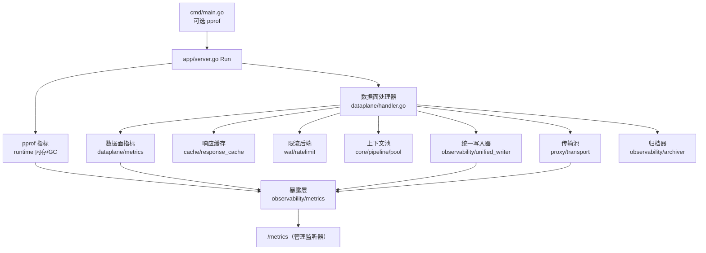

**图表来源**
- [cmd/main.go:29-48](file://cmd/main.go#L29-L48)
- [internal/app/server.go:1056](file://internal/app/server.go#L1056)
- [internal/observability/metrics.go:242-260](file://internal/observability/metrics.go#L242-L260)
- [internal/dataplane/metrics/metrics.go:13-46](file://internal/dataplane/metrics/metrics.go#L13-L46)
- [internal/observability/unified_writer.go:17-45](file://internal/observability/unified_writer.go#L17-L45)
- [internal/proxy/transport/transport.go:1244-1280](file://internal/proxy/transport/transport.go#L1244-L1280)

**章节来源**
- [internal/app/server.go:368-395](file://internal/app/server.go#L368-L395)
- [internal/app/server.go:481-487](file://internal/app/server.go#L481-L487)
- [internal/core/config.go:76-123](file://internal/core/config.go#L76-L123)

## 核心组件
- 数据平面指标：总请求数、2xx/4xx/5xx、WAF 阻断/观察、内置命中、唯一客户端 IP、攻击 IP、QPS（1s/5s）、运行时长
- 暴露层指标：进程资源（goroutine、堆分配、系统内存、GC 暂停累计）、数据面镜像、上游健康与延迟、上游请求治理计数、缓存层命中/未命中/错误、写入器与写队列、图片变换并发
- 处理器链路：端点短路 → 站点匹配 → 上下文入池 → 引擎判决 → 分支转发 → 状态码与日志
- 事件写入：非阻塞入队 + 单事务批量写 + 逐类 SAVEPOINT 隔离 + 关停排空
- 归档：按保留期删除过期事件，并做轻量 WAL/planner 维护
- 缓存与限流：64 分片响应缓存与固定窗口限流后端

| 组件 | 指标族前缀 | 数据来源 | 位置 |
|------|-----------|----------|------|
| 数据面计数器 | `openwaf_dataplane_*` | `dpmetrics.Metrics` 快照 | `observability/metrics.go:402-441` |
| 进程运行时 | `openwaf_uptime_seconds` 等 | `runtime` 包 | `observability/metrics.go:274-292` |
| 上游健康 | `openwaf_upstream_*` | `upstream.Pool.Snapshot` | `observability/metrics.go:457-483` |
| 请求治理 | `openwaf_upstream_request_*` | 上游请求守卫统计 | `observability/metrics.go:507-521` |
| 缓存层 | `owaf_cache_*` | 各缓存层命中计数 | `observability/metrics.go:532-550` |
| 图片变换 | `openwaf_imagery_*` | imagery 统计 | `observability/metrics.go:364-390` |
| 写入器 | `openwaf_writer_*` | `UnifiedWriter.Stats` | `observability/metrics.go:773-817` |
| 写队列 | `openwaf_write_queue_*` | `WriteQueue` 统计 | `observability/metrics.go:844-913` |

**章节来源**
- [internal/dataplane/metrics/metrics.go:13-161](file://internal/dataplane/metrics/metrics.go#L13-L161)
- [internal/observability/metrics.go:16-240](file://internal/observability/metrics.go#L16-L240)
- [internal/observability/archiver.go:20-58](file://internal/observability/archiver.go#L20-L58)
- [internal/cache/response_cache.go:57-91](file://internal/cache/response_cache.go#L57-L91)
- [internal/waf/ratelimit/ratelimit.go:10-45](file://internal/waf/ratelimit/ratelimit.go#L10-L45)

## 架构总览
数据平面在每个站点绑定地址上创建独立 Hertz 服务器实例，统一挂载数据平面处理器中间件。指标记录发生在热路径（原子计数），暴露发生在管理监听器的 `/metrics`（`server.go:1056`），两者通过 provider 回调解耦：暴露层不直接引用数据面对象，而是读取 `DataPlaneMetricsSnapshotProvider` 等窄接口。

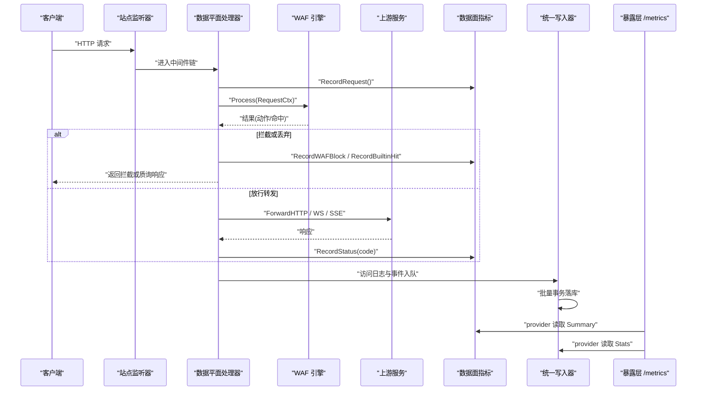

**图表来源**
- [internal/app/server.go:1056](file://internal/app/server.go#L1056)
- [internal/app/server.go:368-395](file://internal/app/server.go#L368-L395)
- [internal/dataplane/handler.go:105-127](file://internal/dataplane/handler.go#L105-L127)
- [internal/dataplane/handler.go:529-660](file://internal/dataplane/handler.go#L529-L660)
- [internal/dataplane/handler.go:1255-1265](file://internal/dataplane/handler.go#L1255-L1265)
- [internal/observability/metrics.go:183-240](file://internal/observability/metrics.go#L183-L240)

## 详细组件分析

### 指标清单
数据面与观测层指标按下表对应到实际代码行，抓取端点为管理监听器的 `/metrics`：

| 指标名 | 类型 | 来源文件:行 | 含义 |
|--------|------|-------------|------|
| `openwaf_uptime_seconds` | gauge | `observability/metrics.go:276` | 进程启动至今秒数 |
| `openwaf_goroutines` | gauge | `observability/metrics.go:280` | 当前 goroutine 数 |
| `openwaf_memory_alloc_bytes` | gauge | `observability/metrics.go:284` | 当前堆分配字节 |
| `openwaf_memory_sys_bytes` | gauge | `observability/metrics.go:288` | 向系统申请的内存总量 |
| `openwaf_gc_pause_total_ns` | counter | `observability/metrics.go:292` | GC 暂停累计纳秒 |
| `openwaf_dataplane_qps{window}` | gauge | `observability/metrics.go:406` | 1s/5s 窗口请求速率 |
| `openwaf_dataplane_requests_total` | counter | `observability/metrics.go:411` | 数据面看到的请求总数 |
| `openwaf_dataplane_status_total{class}` | counter | `observability/metrics.go:415` | 按状态类分布 |
| `openwaf_dataplane_waf_actions_total` | counter | `observability/metrics.go:420` | 阻断与观察命中 |
| `openwaf_dataplane_builtin_hits_total` | counter | `observability/metrics.go:426` | 内置规则命中 |
| `openwaf_dataplane_unique_ips_total` | counter | `observability/metrics.go:430` | 去重客户端 IP 数 |
| `openwaf_dataplane_attack_ips_total` | counter | `observability/metrics.go:434` | 去重攻击来源 IP 数 |
| `openwaf_dataplane_uptime_seconds` | gauge | `observability/metrics.go:438` | 数据面指标起点至今 |
| `openwaf_upstream_healthy_total` | gauge | `observability/metrics.go:459` | 当前健康上游数 |
| `openwaf_upstream_unhealthy_total` | gauge | `observability/metrics.go:463` | 当前不健康上游数 |
| `openwaf_upstream_known_total` | gauge | `observability/metrics.go:467` | 有状态记录的上游数 |
| `openwaf_upstream_checked_total` | gauge | `observability/metrics.go:471` | 至少探测过一次的上游数 |
| `openwaf_upstream_average_latency_ms` | gauge | `observability/metrics.go:475` | 有样本上游平均延迟 |
| `openwaf_upstream_max_last_latency_ms` | gauge | `observability/metrics.go:479` | 最近延迟最大值 |
| `openwaf_upstream_latency_samples_total` | counter | `observability/metrics.go:483` | 延迟样本累计 |
| `openwaf_upstream_request_header_names_dropped_total` | counter | `observability/metrics.go:509` | 非法头名被丢弃 |
| `openwaf_upstream_request_header_values_dropped_total` | counter | `observability/metrics.go:513` | 含控制字节的头值被丢弃 |
| `openwaf_upstream_request_paths_sanitized_total` | counter | `observability/metrics.go:517` | 路径裸百分号被转义 |
| `openwaf_upstream_request_security_headers_dropped_total` | counter | `observability/metrics.go:521` | 身份类头被整体丢弃 |
| `owaf_cache_hits_total{cache}` | counter | `observability/metrics.go:533` | 各缓存层命中 |
| `owaf_cache_misses_total{cache}` | counter | `observability/metrics.go:540` | 各缓存层未命中 |
| `owaf_cache_errors_total{cache}` | counter | `observability/metrics.go:547` | 缓存后端故障（不含 key 不存在） |
| `openwaf_writer_queue_len` | gauge | `observability/metrics.go:775` | 观测记录当前排队量 |
| `openwaf_writer_dropped_total` | counter | `observability/metrics.go:782` | 入队前丢弃总数 |
| `openwaf_writer_flushes_total` | counter | `observability/metrics.go:789` | flush 次数 |
| `openwaf_writer_flush_errors_total` | counter | `observability/metrics.go:793` | 含错误的 flush 次数 |
| `openwaf_writer_failed_records_total` | counter | `observability/metrics.go:797` | 因写库失败未落库记录 |
| `openwaf_writer_last_flush_*` | gauge | `observability/metrics.go:801-813` | 最近一次 flush 明细 |
| `openwaf_write_queue_dropped_full_total` | counter | `observability/metrics.go:866` | 队列满拒收任务数 |
| `openwaf_write_queue_succeeded_total` | counter | `observability/metrics.go:881` | 成功持久化任务数 |

数据面计数的产生点：`RecordRequest`（`metrics/metrics.go:48`）、`RecordStatus`（`:64`）、`RecordWAFBlock`/`RecordWAFObserve`/`RecordBuiltinHit`（`:75-77`）、`RecordClientIP`/`RecordAttackIP`（`:80`、`:96`）、`QPS`（`:112`）。

> [!WARNING]
> 早期文档记录的 `openwaf_requests_total`、`openwaf_blocks_total`、`openwaf_observes_total`、`openwaf_builtin_hits_total`、`openwaf_upstream_errors_total`、`openwaf_cache_hits_total` 均已不存在：前三类恒为 0 后被移除，请求总量请读 `openwaf_dataplane_requests_total`；缓存族前缀是 `owaf_cache_`，不是 `openwaf_`（`observability/metrics.go:266-273`）。

**章节来源**
- [internal/observability/metrics.go:262-292](file://internal/observability/metrics.go#L262-L292)
- [internal/observability/metrics.go:402-441](file://internal/observability/metrics.go#L402-L441)
- [internal/observability/metrics.go:455-521](file://internal/observability/metrics.go#L455-L521)
- [internal/observability/metrics.go:532-550](file://internal/observability/metrics.go#L532-L550)
- [internal/observability/metrics.go:773-913](file://internal/observability/metrics.go#L773-L913)
- [internal/dataplane/metrics/metrics.go:40-161](file://internal/dataplane/metrics/metrics.go#L40-L161)

### 数据平面指标组件
- 设计要点
  - 全部计数用 `atomic.Int64`，读写无锁；IP 去重用互斥锁保护的 map，作用域为进程生命周期
  - QPS 用 10 个 1 秒槽位的环形桶，槽位前移允许良性竞态（最坏略微多计）
  - `Summary` 带 JSON 标签，直接供仪表盘接口序列化
- 性能特性
  - 记录路径 O(1)；`QPS(windowSec)` 遍历固定 10 槽
  - 环形槽位与索引均为原子值，无分配
- 边界
  - 只有 2xx/4xx/5xx 三类，3xx 不计；`windowSec` 超过 10 时仍受槽位数量限制

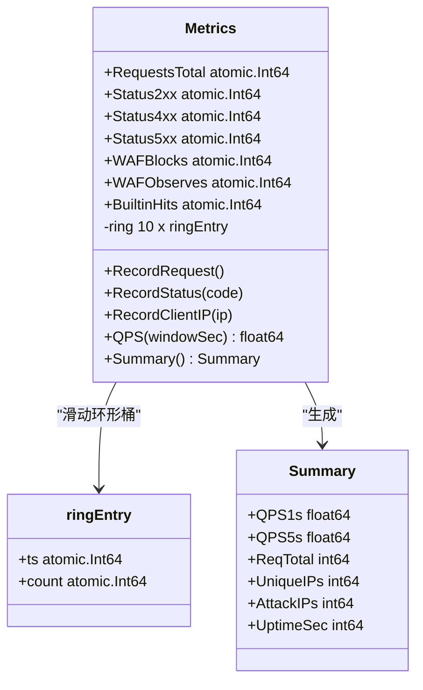

**图表来源**
- [internal/dataplane/metrics/metrics.go:13-46](file://internal/dataplane/metrics/metrics.go#L13-L46)
- [internal/dataplane/metrics/metrics.go:48-129](file://internal/dataplane/metrics/metrics.go#L48-L129)
- [internal/dataplane/metrics/metrics.go:131-161](file://internal/dataplane/metrics/metrics.go#L131-L161)

**章节来源**
- [internal/dataplane/metrics/metrics.go:13-161](file://internal/dataplane/metrics/metrics.go#L13-L161)
- [internal/app/server.go:368](file://internal/app/server.go#L368)

### 暴露层与抓取路径
暴露层是纯读取路径：按注册的 provider 拉快照并拼装文本，未注入的指标族直接缺席而不是输出 0。抓取端点挂在管理监听器（`adminSrv.GET("/metrics", ...)`，`server.go:1056`），不是数据面端口；进程级剖析另用 `MY_OPENWAF_PPROF_BIND` 开启（`cmd/main.go:29-48`）。

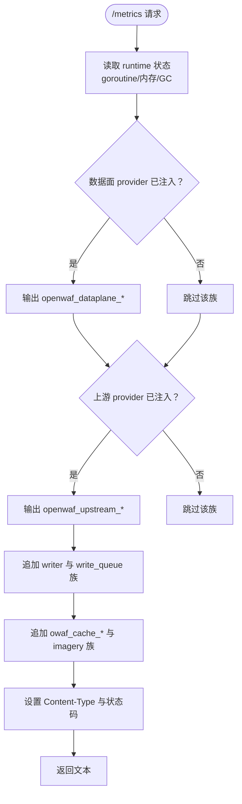

**图表来源**
- [internal/observability/metrics.go:167-240](file://internal/observability/metrics.go#L167-L240)
- [internal/observability/metrics.go:253-292](file://internal/observability/metrics.go#L253-L292)
- [internal/observability/metrics.go:402-441](file://internal/observability/metrics.go#L402-L441)
- [internal/app/server.go:1056](file://internal/app/server.go#L1056)
- [cmd/main.go:29-48](file://cmd/main.go#L29-L48)

**章节来源**
- [internal/observability/metrics.go:147-240](file://internal/observability/metrics.go#L147-L240)

### 数据平面处理器与链路
- 关键流程
  - 静态资源短路
  - 请求 ID 设置、指标记录、站点匹配
  - 客户端 IP 解析、上下文从池中获取
  - WAF 引擎处理、拦截/丢弃分支、事件写入
  - 上游转发（HTTP/WebSocket/SSE）、错误率限流
  - 访问日志输出
- 并发与性能
  - 使用 sync.Pool 复用 RequestCtx，降低 GC 压力
  - 事件写入采用缓冲通道与批量写入，避免阻塞热路径
- 可观测性
  - 记录 observe 命中、拦截/丢弃事件，写入数据库
  - 支持错误率限流（按 4xx/5xx 开关）

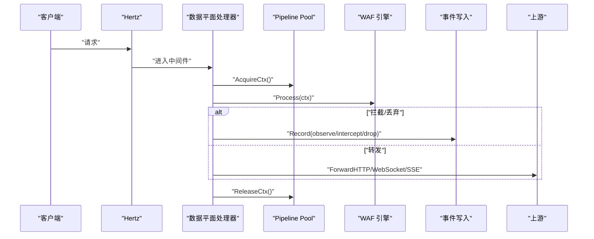

**图表来源**
- [internal/dataplane/handler.go:37-310](file://internal/dataplane/handler.go#L37-L310)
- [internal/core/pipeline/pool.go:5-37](file://internal/core/pipeline/pool.go#L5-L37)
- [internal/observability/unified_writer.go:16-232](file://internal/observability/unified_writer.go#L16-L232)

**章节来源**
- [internal/dataplane/handler.go:37-310](file://internal/dataplane/handler.go#L37-L310)
- [internal/core/pipeline/pool.go:5-37](file://internal/core/pipeline/pool.go#L5-L37)

### 事件写入与归档
- 事件写入
  - 带缓冲通道：安全事件与访问日志各 16384，丢弃事件与机器人评分各 8192；批量阈值 256，flush 周期 3 秒
  - 队列满时的行为由 `SlowLogGrace` 决定：默认 30 秒内阻塞等待，超过后退回丢弃并计数
  - 关闭时先置 `closed` 闸门再排空，保证关停期新增记录走丢弃计数而不是静默消失
- 归档
  - 默认清理间隔 24 小时（不是每小时），安全事件默认保留 30 天、统计默认 7 天
  - 清理后执行轻量 WAL/planner 维护，维护有 30 秒超时上界
- 性能影响
  - 把数据库写入从热路径剥离，显著降低尾延迟；代价是指标与日志存在秒级滞后

热路径与落库路径的步骤分解：

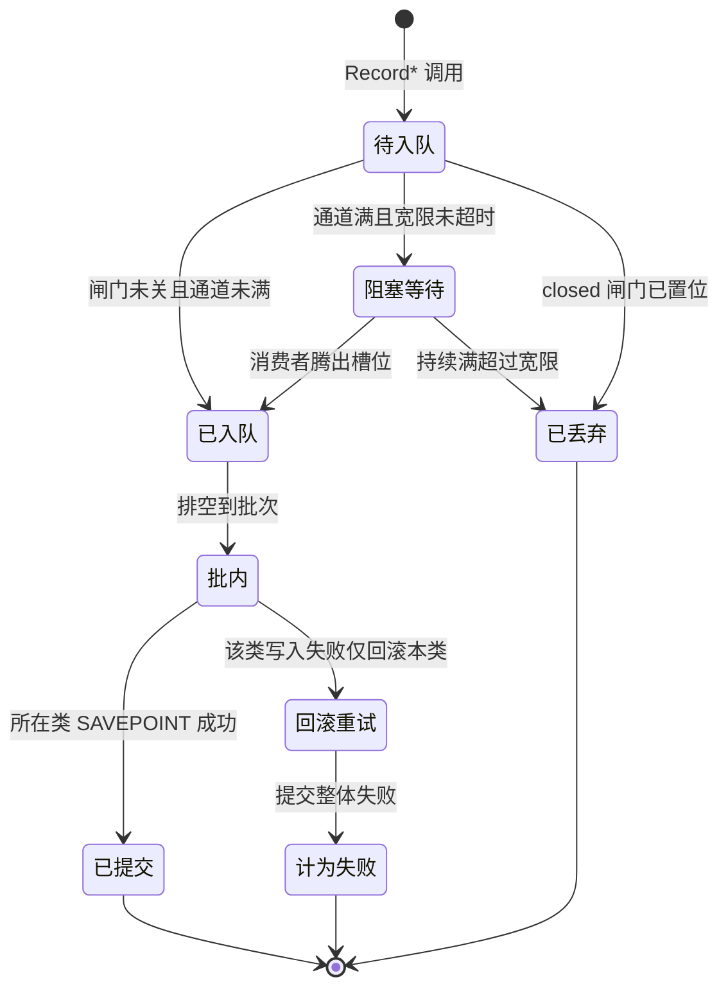

**图表来源**
- [internal/observability/unified_writer.go:25-110](file://internal/observability/unified_writer.go#L25-L110)
- [internal/observability/unified_writer.go:96-172](file://internal/observability/unified_writer.go#L96-L172)
- [internal/observability/metrics.go:773-817](file://internal/observability/metrics.go#L773-L817)

| 步 | 动作 | 执行位置 | 输入 | 输出 | 失败分支 | 可观测点 |
|:--:|------|----------|------|------|----------|----------|
| 1 | 记录入队 | `unified_writer.go` Record 系列 | 事件或日志值 | 通道槽位 | 满则等待或丢弃 | `writer_dropped_total` |
| 2 | 单协程排空 | `unified_writer.go` loop | 四通道 | 批次切片 | 达 drainLimit 即让位 | `writer_queue_len` |
| 3 | 开启事务 | flush 路径 | 批次 | 事务 | 直接记错误 | `flush_errors_total` |
| 4 | 逐类 SAVEPOINT | 四类分别写入 | 同类记录 | 各自提交 | 仅回滚失败类 | `failed_records_total` |
| 5 | 提交 | 事务 Commit | — | 持久化 | 回滚全部 | `last_flush_duration_ms` |
| 6 | 缓存失效 | `countCacheInvalidator` | 提交结果 | COUNT 缓存失效 | 无失效器时跳过 | 控制面查询延迟 |
| 7 | 归档清理 | `archiver.go:341-390` | 保留期配置 | 删除行数 | 单项失败不影响其它 | 归档日志 |

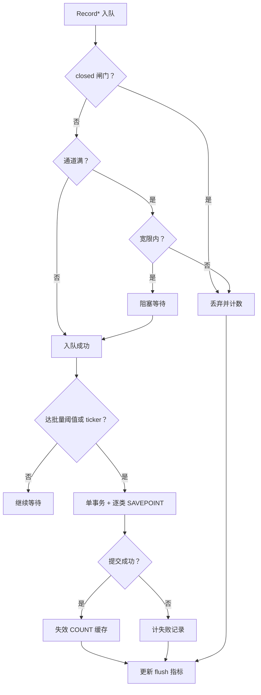

**图表来源**
- [internal/observability/unified_writer.go:25-110](file://internal/observability/unified_writer.go#L25-L110)
- [internal/observability/unified_writer.go:112-192](file://internal/observability/unified_writer.go#L112-L192)
- [internal/observability/archiver.go:20-58](file://internal/observability/archiver.go#L20-L58)
- [internal/observability/archiver.go:339-390](file://internal/observability/archiver.go#L339-L390)

**章节来源**
- [internal/observability/unified_writer.go:96-172](file://internal/observability/unified_writer.go#L96-L172)
- [internal/observability/archiver.go:37-110](file://internal/observability/archiver.go#L37-L110)
- [internal/core/config.go:76-123](file://internal/core/config.go#L76-L123)
- [internal/observability/metrics.go:773-817](file://internal/observability/metrics.go#L773-L817)

### 响应缓存组件
- 特性
  - 64 个分片各带独立读写锁，按 key 哈希分片降低竞争
  - 默认容量 64 MiB、默认 TTL 60 秒；条目大小上限为总容量的 1/10
  - `stale-if-error` 与 generation 机制：过期条目在窗口内仍可回放，失效后不可用
  - `BeginFill` 提供单飞填充，非 leader 只查新鲜条目，避免删掉 stale 备份
- 适用场景：站点缓存规则命中的安全方法响应
- 调优建议：按站点路径特征调 `MY_OPENWAF_RESPONSE_CACHE_MB` 与 `MY_OPENWAF_RESPONSE_CACHE_TTL_SEC`；高波动路径用规则关闭而非缩短全局 TTL

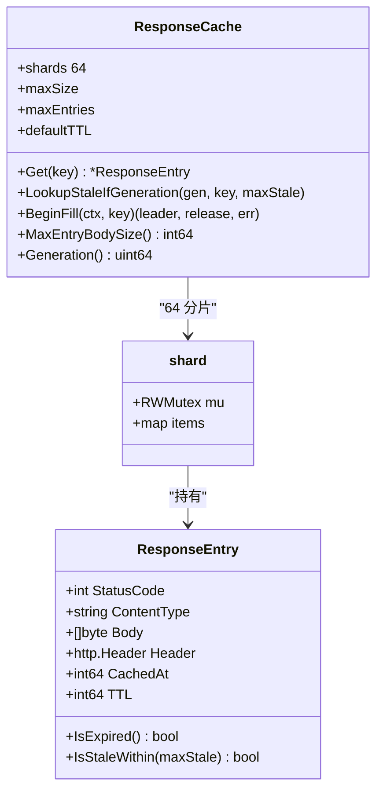

**图表来源**
- [internal/cache/response_cache.go:17-50](file://internal/cache/response_cache.go#L17-L50)
- [internal/cache/response_cache.go:57-131](file://internal/cache/response_cache.go#L57-L131)
- [internal/proxy/proxy.go:1849-1887](file://internal/proxy/proxy.go#L1849-L1887)
- [internal/dataplane/handler.go:1150-1200](file://internal/dataplane/handler.go#L1150-L1200)

**章节来源**
- [internal/cache/response_cache.go:85-131](file://internal/cache/response_cache.go#L85-L131)
- [internal/core/config.go:430-440](file://internal/core/config.go#L430-L440)
- [internal/observability/metrics.go:532-550](file://internal/observability/metrics.go#L532-L550)

### 限流组件
- 抽象后端：`RateLimiterBackend` 定义 `Enabled`、`Reconfigure`、`Allow`、`Increment`、`IsOverLimit`、`Close` 六个方法（`ratelimit.go:10-17`），本地固定窗口与 Redis 两套实现共享该接口
- 请求速率限制：按 `bind + 站点 + clientIP + host` 组合键计数（`handler_support.go:355`），超限动作由配置决定
- 错误率限制：响应后按状态码类别计数，`errorRateLimitAction` 解析动作，`incrementErrorRateLimitBlock` 在拦截时也累加（`handler_support.go:377-424`）
- 动态再配置：`DynamicRateLimiter` 包装后端，快照刷新后无需重建对象

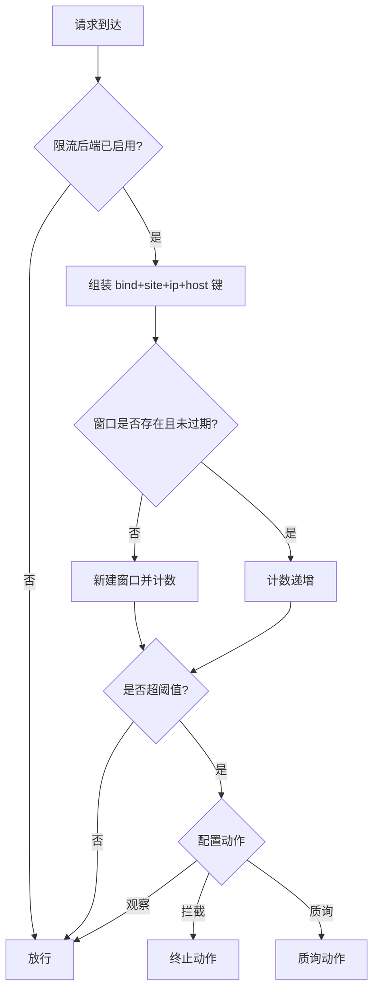

**图表来源**
- [internal/waf/ratelimit/ratelimit.go:10-45](file://internal/waf/ratelimit/ratelimit.go#L10-L45)
- [internal/waf/ratelimit/dynamic.go:7-20](file://internal/waf/ratelimit/dynamic.go#L7-L20)
- [internal/dataplane/handler_support.go:355-424](file://internal/dataplane/handler_support.go#L355-L424)
- [internal/app/server.go:376-383](file://internal/app/server.go#L376-L383)

**章节来源**
- [internal/waf/ratelimit/ratelimit.go:10-45](file://internal/waf/ratelimit/ratelimit.go#L10-L45)
- [internal/dataplane/handler_support.go:355-424](file://internal/dataplane/handler_support.go#L355-L424)

### 上下文池
- 目的：复用 `RequestCtx`，减少频繁分配与 GC 压力
- 行为：获取时返回已预分配头 map（32）与观察缓冲（4）的实例；释放时逐字段清空
- 护栏：头 map 超过 128、键切片超过 64、观察缓冲超过 32 时不再归还，防止峰值永久抬高 RSS

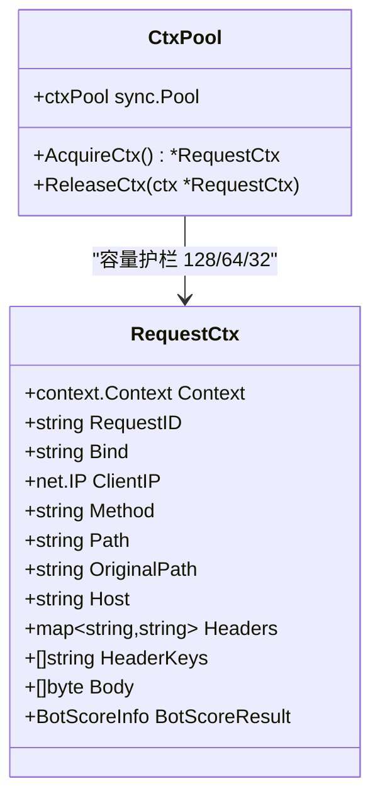

**图表来源**
- [internal/core/pipeline/pool.go:11-60](file://internal/core/pipeline/pool.go#L11-L60)
- [internal/core/pipeline/pipeline.go:15-80](file://internal/core/pipeline/pipeline.go#L15-L80)

**章节来源**
- [internal/core/pipeline/pool.go:11-60](file://internal/core/pipeline/pool.go#L11-L60)
- [internal/snapshot/snapshot.go:493](file://internal/snapshot/snapshot.go#L493)

### 连接复用与上游传输
连接池的取值与分流详见[上游代理配置](上游代理配置.md)，此处只列性能视角的关键约束：

| 池 | 关键取值 | 性能含义 | 位置 |
|----|----------|----------|------|
| 共享上游池 | 256 / 32 / 30s / MaxConns 256 | 空闲内存与端口占用的折中 | `transport.go:157-172` |
| h2c 单例 | 512 / 128 / 90s | 明文 h2 上游吞吐优先 | `transport.go:872-875` |
| 探活 transport | 128 / 32 / 90s / MaxConns 32 | 探测不挤占业务连接 | `health.go:667-671` |
| 缓冲路径 client | 超时 60s（HTTP/1 与 h2） | 整体兜底超时 | `transport.go:246` |
| 流式路径 client | 超时 0 | 支持 SSE 长连接 | `transport.go:266` |
| h2c 上游闸门 | 容量 128 | 限制 h2c 并发避免堆积 | `transport.go:351` |

**章节来源**
- [internal/proxy/transport/transport.go:153-195](file://internal/proxy/transport/transport.go#L153-L195)
- [internal/proxy/transport/transport.go:238-277](file://internal/proxy/transport/transport.go#L238-L277)
- [internal/proxy/transport/transport.go:342-357](file://internal/proxy/transport/transport.go#L342-L357)
- [internal/proxy/transport/transport.go:863-889](file://internal/proxy/transport/transport.go#L863-L889)
- [internal/upstream/health.go:661-676](file://internal/upstream/health.go#L661-L676)

### 数据面热路径优化点
| 优化点 | 手段 | 收益 | 位置 |
|--------|------|------|------|
| 请求 ID | 进程前缀 + 原子计数，23 字节栈缓冲合成 | 每请求 1 次堆分配，免系统调用 | `reqid/reqid.go:36-53` |
| CloseNotify | 按监听是否注册 h2 选择绑定，缓存方法索引 | 去掉每请求递归反射 | `stream/stream_close_notify.go:21-49` |
| 头部转换 | `[]byte→string` 结果一次计算并复用 | 省约 30 次小对象分配 | `handler.go:176-190` |
| HeaderOrder | 惰性派生并随上下文缓存 | 全程至多一次 Join | `handler.go:372-376` |
| 日志脱敏 | 先判级别再构造属性 | 避免被丢弃日志产生分配 | `server.go:1755-1769` |
| 阶段链缓存 | 按 revision + 站点缓存并原子替换 | 无锁快路径命中 | `engine/engine.go:457-476` |

**章节来源**
- [internal/dataplane/reqid/reqid.go:11-35](file://internal/dataplane/reqid/reqid.go#L11-L35)
- [internal/dataplane/stream/stream_close_notify.go:12-49](file://internal/dataplane/stream/stream_close_notify.go#L12-L49)
- [internal/dataplane/handler.go:175-190](file://internal/dataplane/handler.go#L175-L190)
- [internal/dataplane/handler_support.go:228-289](file://internal/dataplane/handler_support.go#L228-L289)
- [internal/dataplane/logredact/sanitize.go:292-325](file://internal/dataplane/logredact/sanitize.go#L292-L325)

## 依赖关系分析
监控体系分三层耦合关系：处理器直接持有指标与写入器句柄；暴露层只通过 provider 回调拉取快照；缓存与限流作为独立组件被引擎与处理器共享。

| 依赖方向 | 载体 | 说明 |
|----------|------|------|
| 处理器 → 指标 | `dpmetrics.Metrics` | 原子计数，无锁 |
| 处理器 → 写入器 | `*UnifiedWriter` | 非阻塞入队 |
| 暴露层 → 处理器 | provider 回调 | 单向拉取 |
| 写入器 → 数据库 | `gorm.DB` | 单事务批量 |
| 限流 → Redis | `RedisRateLimiter` | 可选后端 |
| 归档 → 仓储 | 各 `*Repo` | 按保留期删除 |
| 外部 | Hertz / Redis / 数据库 | 框架、可选共享状态、持久化 |

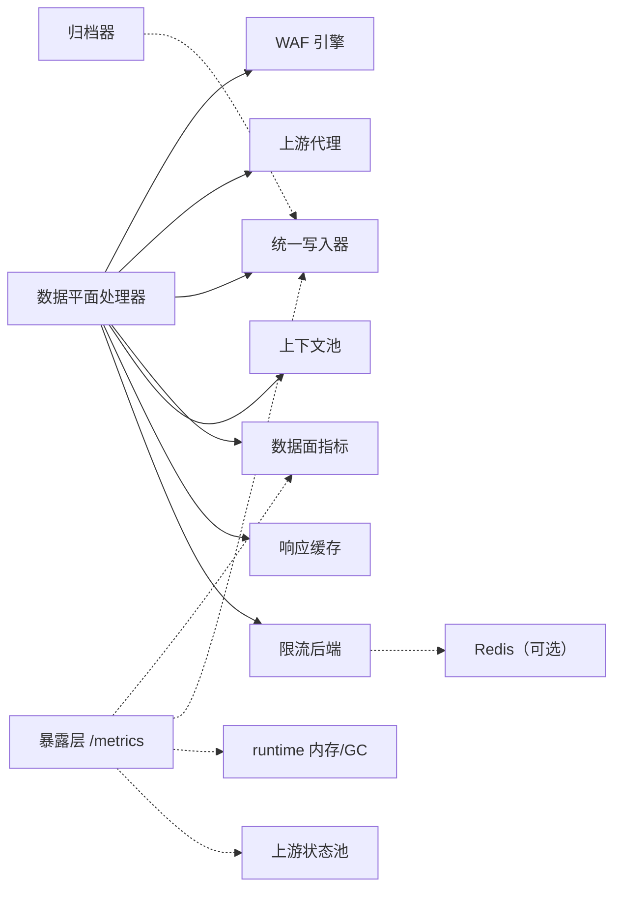

**图表来源**
- [internal/dataplane/handler.go:14-36](file://internal/dataplane/handler.go#L14-L36)
- [internal/observability/metrics.go:16-240](file://internal/observability/metrics.go#L16-L240)
- [internal/app/server.go:368-395](file://internal/app/server.go#L368-L395)
- [internal/app/server.go:481-487](file://internal/app/server.go#L481-L487)

**章节来源**
- [internal/app/server.go:123-130](file://internal/app/server.go#L123-L130)
- [internal/observability/metrics.go:242-260](file://internal/observability/metrics.go#L242-L260)

## 性能考虑
- 指标与采样
  - QPS 用 10 槽环形桶，适合短期突发观察；不提供延迟分位数，需要 P95/P99 时应引入直方图
  - 暴露层是纯读取路径，新增指标族只需注册 provider，不改数据面
- 缓存与限流
  - 响应缓存对热点 GET 收益明显；`stale-if-error` 在上游故障时可兜底
  - 固定窗口简单高效，跨节点一致性需切 Redis 后端
- 并发与内存
  - 上下文池容量护栏 + 64 分片缓存 + 写入器批量事务，三者共同压制锁竞争与 GC
  - 上游池 `MaxConnsPerHost` 是端口占用的硬闸门，不建议盲目放宽
- 端到端延迟
  - 响应头 30 秒是回源首字节主约束，client 60 秒是整体兜底
  - 建议用 `MY_OPENWAF_PPROF_BIND` 做定点剖析，而不是长期开启采样

**章节来源**
- [internal/dataplane/metrics/metrics.go:33-129](file://internal/dataplane/metrics/metrics.go#L33-L129)
- [internal/proxy/transport/transport.go:153-195](file://internal/proxy/transport/transport.go#L153-L195)
- [internal/cache/response_cache.go:57-131](file://internal/cache/response_cache.go#L57-L131)
- [cmd/main.go:29-48](file://cmd/main.go#L29-L48)

## 故障排查指南
- 指标异常
  - QPS 突增且 5xx 占比升高：依次查上游健康位、缓存命中率、限流触发
  - 观察命中增多：关注规则集变更与误报风险
  - `openwaf_dataplane_requests_total` 为 0 而进程在跑：确认快照是否已加载
- 资源问题
  - goroutine 激增：先看 `openwaf_writer_queue_len` 判断是否写入背压，再看数据库
  - 内存不回落：确认响应缓存条目上限与清理任务，以及上下文池是否被超大请求抬高
- 事件丢失
  - `openwaf_writer_dropped_total` 或 `openwaf_write_queue_dropped_full_total` 增长：增大缓冲、缩短 flush 周期或提高数据库吞吐
  - `openwaf_writer_failed_records_total` 增长：属写库失败，看 `flush_errors_total` 与事务错误计数
- 限流误伤
  - 核对窗口与阈值；组合键含 bind 与站点，跨站点共用 IP 不会互相污染

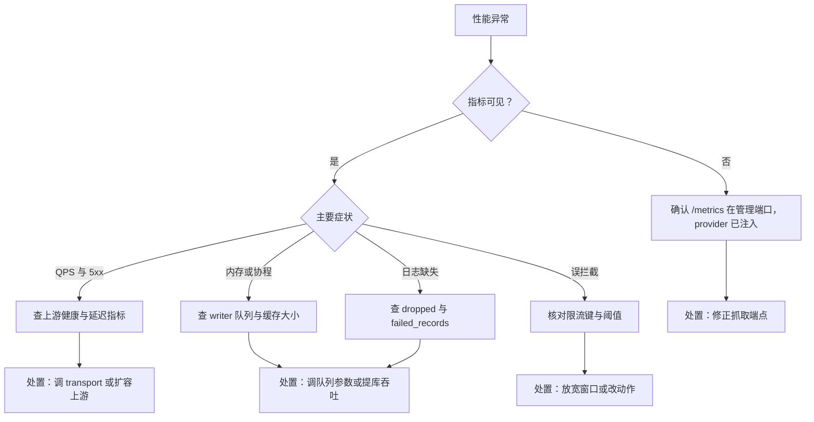

**图表来源**
- [internal/app/server.go:1056](file://internal/app/server.go#L1056)
- [internal/observability/metrics.go:773-817](file://internal/observability/metrics.go#L773-L817)
- [internal/observability/metrics.go:844-913](file://internal/observability/metrics.go#L844-L913)
- [internal/upstream/health.go:535-547](file://internal/upstream/health.go#L535-L547)

**章节来源**
- [internal/observability/metrics.go:455-521](file://internal/observability/metrics.go#L455-L521)
- [internal/observability/unified_writer.go:96-172](file://internal/observability/unified_writer.go#L96-L172)
- [internal/cache/response_cache.go:85-131](file://internal/cache/response_cache.go#L85-L131)
- [internal/dataplane/handler_support.go:355-424](file://internal/dataplane/handler_support.go#L355-L424)

## 结论
性能监控体系分三层：热路径用原子计数与环形桶做低成本采集，观测路径用异步批量写入把持久化隔离在外，暴露路径用 provider 回调把文本拼装与管理端口绑定。真实取值边界很清楚——上游池 256/32/30 秒、h2c 512/128/90 秒、探活 128/32/90 秒；队列 16384/8192/256/3 秒、宽限 30 秒；缓存 64 MiB/60 秒/64 分片；归档 24 小时间隔、30 天保留。后续缺口主要是延迟分位数与分布式追踪：当前指标只给速率与计数，不给分布，定位慢请求仍需 pprof 与访问日志配合。

## 附录

### 指标体系与标签现状
- 现有标签维度：`openwaf_dataplane_status_total{class}`、`openwaf_dataplane_qps{window}`、`owaf_cache_*{cache}`
- 汇总输出：`Summary` 的 JSON 字段名与仪表盘直连，`errors_upstream_4xx`/`errors_upstream_5xx` 是历史字段名，实际语义为响应状态码类计数
- 建议增量：按站点/主机/路径前缀加标签需谨慎，高基数会放大抓取体积；分位数优先用直方图而非标签爆炸
- 查询提示：速率用 `rate()`，容量水位用 `irate()` 或 gauge 原值

**章节来源**
- [internal/observability/metrics.go:404-441](file://internal/observability/metrics.go#L404-L441)
- [internal/observability/metrics.go:532-550](file://internal/observability/metrics.go#L532-L550)
- [internal/dataplane/metrics/metrics.go:131-161](file://internal/dataplane/metrics/metrics.go#L131-L161)

### 瓶颈识别方法
- 热点分析：控制台上游状态接口与运行时池统计并列查看，先定位是连接层还是应用层
- 资源利用率：`openwaf_goroutines`、`openwaf_memory_alloc_bytes`、`openwaf_gc_pause_total_ns` 三者联动判断
- 异常检测：以 `writer_queue_len` 与 `writer_dropped_total` 作为日志链路健康探针

**章节来源**
- [internal/admin/system/runtime.go:157-198](file://internal/admin/system/runtime.go#L157-L198)
- [internal/observability/metrics.go:274-292](file://internal/observability/metrics.go#L274-L292)
- [internal/admin/router.go:245](file://internal/admin/router.go#L245)

### 调优参数速查
| 目标 | 参数 | 默认 | 上限 | 位置 |
|------|------|:----:|:----:|------|
| 事件缓冲 | `MY_OPENWAF_QUEUE_EVENT_BUFFER_SIZE` | 16384 | 1048576 | `config.go:113`、`config.go:448` |
| 低频缓冲 | `MY_OPENWAF_QUEUE_DROP_BUFFER_SIZE` | 8192 | 1048576 | `config.go:114` |
| 批量阈值 | `MY_OPENWAF_QUEUE_BATCH_SIZE` | 256 | 10000 | `config.go:115` |
| flush 周期 | `MY_OPENWAF_QUEUE_FLUSH_INTERVAL` | 3s | 60s | `config.go:116` |
| 写队列批次 | `MY_OPENWAF_QUEUE_WRITE_BATCH_SIZE` | 64 | 10000 | `config.go:117` |
| 写队列容量 | `MY_OPENWAF_QUEUE_WRITE_CAPACITY` | 256 | 1048576 | `config.go:118` |
| 日志宽限 | `MY_OPENWAF_QUEUE_SLOW_LOG_GRACE` | 30s | 5m | `config.go:123`、`config.go:497` |
| 缓存容量 | `MY_OPENWAF_RESPONSE_CACHE_MB` | 64 | — | `config.go:430` |
| 缓存 TTL | `MY_OPENWAF_RESPONSE_CACHE_TTL_SEC` | 60 | — | `config.go:436` |
| 访问日志采样 | `MY_OPENWAF_ACCESSLOG_SAMPLING` | 全量 | — | `config.go:371` |
| 链路追踪 | `MY_OPENWAF_TRACE_ENABLED` / `TRACE_LEVEL` | 关闭 | — | `config.go:407-414` |
| pprof | `MY_OPENWAF_PPROF_BIND` | 关闭 | — | `cmd/main.go:29` |

**章节来源**
- [internal/core/config.go:76-123](file://internal/core/config.go#L76-L123)
- [internal/core/config.go:335-440](file://internal/core/config.go#L335-L440)
- [cmd/main.go:29-48](file://cmd/main.go#L29-L48)

### 监控告警机制
- 阈值建议
  - 日志链路：`rate(openwaf_writer_dropped_total[5m]) > 0` 即告警，丢弃意味着审计缺口
  - 上游：`openwaf_upstream_unhealthy_total > 0` 持续两轮探活周期以上
  - 资源：`openwaf_goroutines` 相对基线倍增，或 `openwaf_writer_queue_len` 长期贴近容量
- 通知与响应：由 Prometheus Alertmanager 承载；数据面侧的自动降级已有（限流动作、stale-if-error、上游摘除）

[本节为通用指导，无需特定文件来源]

### 基准测试与容量规划
- 压测口径：固定并发档位记录 QPS、状态码分布、`writer_queue_len` 峰值与丢弃数，比只看吞吐更能暴露瓶颈
- 容量估算：以 `MaxConnsPerHost` 256 与响应头 30 秒为约束，单上游理论并发上限即 256，超出部分排队
- 留存规划：按日均事件数 × 保留天数估算库体积，归档间隔 24 小时决定清理滞后上界

**章节来源**
- [internal/proxy/transport/transport.go:157-177](file://internal/proxy/transport/transport.go#L157-L177)
- [internal/observability/archiver.go:52-58](file://internal/observability/archiver.go#L52-L58)
- [internal/observability/metrics.go:773-817](file://internal/observability/metrics.go#L773-L817)