# 数据平面处理

<cite>
**本文档引用的文件**
- [cmd/main.go](file://cmd/main.go)
- [internal/app/server.go](file://internal/app/server.go)
- [internal/dataplane/handler.go](file://internal/dataplane/handler.go)
- [internal/dataplane/handler_support.go](file://internal/dataplane/handler_support.go)
- [internal/dataplane/websocket.go](file://internal/dataplane/websocket.go)
- [internal/dataplane/h2_websocket.go](file://internal/dataplane/h2_websocket.go)
- [internal/dataplane/inbound_conn.go](file://internal/dataplane/inbound_conn.go)
- [internal/dataplane/request_ctx.go](file://internal/dataplane/request_ctx.go)
- [internal/dataplane/sse.go](file://internal/dataplane/sse.go)
- [internal/dataplane/metrics/metrics.go](file://internal/dataplane/metrics/metrics.go)
- [internal/dataplane/reqid/reqid.go](file://internal/dataplane/reqid/reqid.go)
- [internal/dataplane/stream/stream_close_notify.go](file://internal/dataplane/stream/stream_close_notify.go)
- [internal/dataplane/envelope/envelope_verify.go](file://internal/dataplane/envelope/envelope_verify.go)
- [internal/dataplane/logredact/sanitize.go](file://internal/dataplane/logredact/sanitize.go)
- [internal/dataplane/tlsfp/tls_fingerprint_listener.go](file://internal/dataplane/tlsfp/tls_fingerprint_listener.go)
- [internal/proxy/proxy.go](file://internal/proxy/proxy.go)
- [internal/proxy/transport/transport.go](file://internal/proxy/transport/transport.go)
- [internal/upstream/health.go](file://internal/upstream/health.go)
- [internal/upstream/transport.go](file://internal/upstream/transport.go)
- [internal/core/engine/engine.go](file://internal/core/engine/engine.go)
- [internal/core/pipeline/pipeline.go](file://internal/core/pipeline/pipeline.go)
- [internal/core/pipeline/pool.go](file://internal/core/pipeline/pool.go)
- [internal/core/sites/resolver.go](file://internal/core/sites/resolver.go)
- [internal/snapshot/snapshot.go](file://internal/snapshot/snapshot.go)
- [internal/snapshot/ocsp.go](file://internal/snapshot/ocsp.go)
- [internal/snapshot/tls.go](file://internal/snapshot/tls.go)
- [internal/waf/pages/block.go](file://internal/waf/pages/block.go)
- [internal/observability/unified_writer.go](file://internal/observability/unified_writer.go)
- [internal/observability/metrics.go](file://internal/observability/metrics.go)
- [internal/observability/archiver.go](file://internal/observability/archiver.go)
- [internal/core/config.go](file://internal/core/config.go)
- [internal/security/clientip.go](file://internal/security/clientip.go)
- [internal/security/outbound.go](file://internal/security/outbound.go)
</cite>

> **子页面分类索引**
>
> 本模块文档按主题分为三类，涵盖数据平面从请求进入到响应输出的完整链路：
>
> **协议与连接处理**
> - [TLS 终止与证书管理](TLS 终止与证书管理.md) — 站点级 TLS 配置构建、证书与 SNI 多域名管理及 ALPN 协商。
> - [WebSocket 连接处理](WebSocket 连接处理.md) — WebSocket 升级检测、Raw TCP 隧道转发与双向数据透传。
> - [SSE 事件推送](SSE 事件推送.md) — Server-Sent Events 长连接流式转发与统一写入器异步批处理。
>
> **请求处理与转发**
> - [请求处理流程](请求处理流程.md) — 从请求进入到响应输出的完整链路，含站点匹配、WAF 规则阶段执行、拦截与放行决策。
> - [上游代理配置](上游代理配置.md) — 上游轮询负载均衡、共享传输层连接复用、代理头部处理与转发参数配置。
>
> **性能与可观测性**
> - [性能监控与调优](性能监控与调优.md) — 数据平面指标体系、Prometheus 监控、响应缓存、限流与连接池调优。

## 目录

1. [简介](#简介)
2. [项目结构](#项目结构)
3. [核心组件](#核心组件)
4. [架构总览](#架构总览)
5. [详细组件分析](#详细组件分析)
6. [依赖关系分析](#依赖关系分析)
7. [性能考虑](#性能考虑)
8. [故障排查指南](#故障排查指南)
9. [结论](#结论)
10. [附录](#附录)

## 简介
本文件聚焦于数据平面（Data Plane）的处理流程与实现细节，涵盖请求从接收、WAF 处理、上游转发（含 HTTP、WebSocket、Server-Sent Events）、TLS 终止、连接池与传输层优化、以及可观测性与性能调优等主题。目标是帮助读者在不深入源码的前提下，理解系统如何高效、安全地处理流量。

数据平面以「每个站点绑定地址一个独立 Hertz 监听器」的方式运行，请求进入后依次完成四个阶段：

1. **协议层处理**：TLS 终止（证书选择、SNI 匹配、ALPN）→ HTTP/WebSocket/SSE/h2 扩展 CONNECT 协议识别；
2. **请求处理**：站点匹配（绑定地址 + Host）→ WAF 引擎多阶段规则执行 → 拦截/质询/维护/放行决策；
3. **上游转发**：轮询起点 + 健康择优选择上游地址 → 通过 `internal/proxy/transport` 的连接池复用连接 → 剥离 Hop-by-Hop 头部并回写响应；
4. **可观测性**：异步批量写入安全事件与访问日志、实时 QPS 与状态码统计、控制面 `/metrics` 文本指标导出。

整个链路以对象池（`RequestCtx`）、连接池（`http.Transport` / `http3.Transport`）与 HTTP/2 复用为核心优化手段，兼顾高并发与低延迟。

## 项目结构
数据平面相关代码按「协议接入 → 请求处理 → 转发 → 观测」四类职责分布，模块清单如下（规模为去掉测试文件后的非测试 Go 行数，测试列以同包 `_test.go` 是否覆盖该文件为准）：

| 模块 | 路径 | 职责 | 核心符号 | 规模(行) | 测试 |
|------|------|------|----------|:--------:|:----:|
| 应用装配 | `internal/app/server.go` | 按 bind 构建站点 Hertz 监听器与 TLS 配置 | `buildDataServerWithHTTP3Plans`、`buildListenerTLS` | 2121 | 有 |
| 数据面主处理器 | `internal/dataplane/handler.go` | 请求入口中间件：静态短路、WAF、转发分支、日志 | `Handler`（L39） | 1280 | 有 |
| 处理器支撑 | `internal/dataplane/handler_support.go` | 监听器选项与上下文注入 | `Options`（L33）、`HandlerForBind`（L95） | 454 | 部分 |
| 请求上下文 | `internal/dataplane/request_ctx.go` | 入站请求体预取与采样窗控制 | `requestInspectionBodyLimit`（L472） | 780 | 有 |
| 访问日志 | `internal/dataplane/access_log.go` | 访问日志与安全事件组装、采样 | `recordAccessLog`（L507） | 735 | 有 |
| WebSocket 隧道 | `internal/dataplane/websocket.go` | HTTP/1.1 升级检测与 Raw TCP 转发 | `ForwardWebSocket`（L127） | 722 | 有 |
| h2 WebSocket | `internal/dataplane/h2_websocket.go` | RFC 8441 扩展 CONNECT 桥接与帧层直通 | `ForwardH2ExtendedConnectWebSocket`（L62） | 1065 | 有 |
| SSE 转发 | `internal/dataplane/sse.go` | `text/event-stream` 流式回源 | `ForwardSSE`（L21）、`IsSSERequest`（L263） | 277 | 有 |
| 入站连接 | `internal/dataplane/inbound_conn.go` | URI 修正监听与入站协议守卫 | `NewFixURIListener`（L279）、`InboundProtocolGuard`（L476） | 651 | 有 |
| 端点处理 | `internal/dataplane/endpoints.go` | `/__owaf` 内部端点与内联 OWASP 快捷判定 | `isScriptCreatedOWAFPath`（L33）、`serveOWAFStatic`（L87） | 274 | 部分 |
| 审计事件 | `internal/dataplane/audit_events.go` | 请求走私嗅探与压缩事件审计 | `SmugglingSniff`（L66） | 450 | 有 |
| 质询接入 | `internal/dataplane/challenge.go` | 验证码/5 秒盾/链式质询验证端点 | `handleChallengeVerify`（L722） | 868 | 有 |
| 访问控制 | `internal/dataplane/access_control.go` | 站点登录/验证/OAuth 端点 | `handleAccessControlEndpoints`（L131） | 545 | 有 |
| 脚本请求改写 | `internal/dataplane/js_request.go` | JS/Lua 响应改写运行时注入 | `JSResponseRuntimeFromRequestContext`（L382） | 403 | 有 |
| 资源聚合 | `internal/dataplane/resource_aggregator.go` | AppRoute 命中内存聚合后批量落库 | `NewRecordedResourceAggregator`（L75） | 332 | 有 |
| 子包·stream | `internal/dataplane/stream` | CloseNotify 绑定选择（h2 关闭时才探测） | `SelectStreamCloseNotifyBinding`（L28） | 173 | 有 |
| 子包·envelope | `internal/dataplane/envelope` | 信封验签唯一收口，失败关闭 | `EnvelopeVerifier.Verify`（L57） | 80 | 有 |
| 子包·logredact | `internal/dataplane/logredact` | 日志脱敏、截断、小写化 | `SanitizeQueryString`（L60）、`ToLowerASCII`（L7） | 350 | 有 |
| 子包·metrics | `internal/dataplane/metrics` | 数据面计数器与 QPS 环形桶 | `Metrics`（L13）、`Summary`（L131） | 161 | 有 |
| 子包·reqid | `internal/dataplane/reqid` | 免系统调用的请求 ID 生成 | `FastRequestID`（L41） | 53 | 有 |
| 子包·tlsfp | `internal/dataplane/tlsfp` | ClientHello 指纹监听器 | `NewTLSFingerprintListener`（L20） | 395 | 有 |
| 反向代理 | `internal/proxy/proxy.go` | 上游请求构造、逐跳头剥离、响应回写 | `ForwardHTTP`（L1998）、`IsHopByHop`（L2863） | 2989 | 有 |
| 传输层池 | `internal/proxy/transport` | 上游 transport/client 池化与 h2c/h3 分流 | `SharedTransportForUpstream`（L131） | 1280 | 有 |
| 上游探活 | `internal/upstream/health.go` | 上游状态池、周期探活与择优 | `Pool.Pick`（L219）、`StartWithResult`（L587） | 981 | 有 |
| 客户端 IP | `internal/security/clientip.go` | XFF 语义解析 | `ResolveClientIP`（L16） | 273 | 有 |
| 观测写入 | `internal/observability/unified_writer.go` | 四类记录异步批量落库 | `UnifiedWriter`（L25） | 1182 | 有 |

上表末段的 `stream`、`envelope`、`logredact`、`metrics`、`reqid`、`tlsfp` 六个子包是从 `internal/dataplane` 根包切分出来的独立职责单元，本文只登记位置与职责边界，接口细节由各子的专题文档承载。

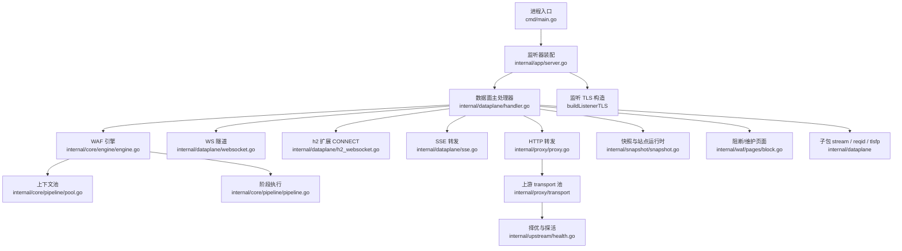

**图表来源**
- [cmd/main.go:13-50](file://cmd/main.go#L13-L50)
- [internal/app/server.go:1097-1130](file://internal/app/server.go#L1097-L1130)
- [internal/app/server.go:1513-1657](file://internal/app/server.go#L1513-L1657)
- [internal/dataplane/handler.go:39-130](file://internal/dataplane/handler.go#L39-L130)
- [internal/dataplane/handler.go:1101-1130](file://internal/dataplane/handler.go#L1101-L1130)
- [internal/proxy/transport/transport.go:131-205](file://internal/proxy/transport/transport.go#L131-L205)
- [internal/upstream/health.go:219-240](file://internal/upstream/health.go#L219-L240)
- [internal/core/engine/engine.go:441-551](file://internal/core/engine/engine.go#L441-L551)
- [internal/snapshot/snapshot.go:337-362](file://internal/snapshot/snapshot.go#L337-L362)

**章节来源**
- [internal/dataplane/handler_support.go:33-61](file://internal/dataplane/handler_support.go#L33-L61)
- [internal/dataplane/stream/stream_close_notify.go:28-38](file://internal/dataplane/stream/stream_close_notify.go#L28-L38)
- [internal/dataplane/envelope/envelope_verify.go:35-42](file://internal/dataplane/envelope/envelope_verify.go#L35-L42)
- [internal/dataplane/logredact/sanitize.go:60-131](file://internal/dataplane/logredact/sanitize.go#L60-L131)
- [internal/dataplane/reqid/reqid.go:41-53](file://internal/dataplane/reqid/reqid.go#L41-L53)
- [internal/dataplane/tlsfp/tls_fingerprint_listener.go:20-33](file://internal/dataplane/tlsfp/tls_fingerprint_listener.go#L20-L33)
- [internal/dataplane/inbound_conn.go:279-320](file://internal/dataplane/inbound_conn.go#L279-L320)

## 核心组件
- 数据平面处理器：负责静态资源、访问日志、WAF 执行、上游转发（HTTP/WebSocket/SSE）、错误率限流与状态统计。
- WAF 引擎与流水线：按阶段顺序执行规则链，支持观察命中与拦截动作。
- 上游代理与传输层：连接池按上游 scheme 分组缓存在 `internal/proxy/transport/transport.go`，支持 HTTP/2、HTTP/3、h2c 与 mTLS。
- TLS 终止：按站点绑定地址与证书配置动态构建 tls.Config，并支持 ALPN。
- 快照与站点运行时：提供站点匹配、上游地址、转发参数与证书等运行时信息。
- 阻断/维护页面：根据策略渲染阻断或维护页面，支持模板与内嵌资源回退。

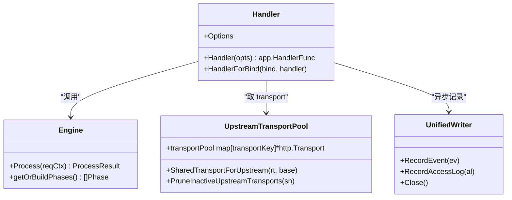

**图表来源**
- [internal/dataplane/handler.go:39-45](file://internal/dataplane/handler.go#L39-L45)
- [internal/dataplane/handler_support.go:33-61](file://internal/dataplane/handler_support.go#L33-L61)
- [internal/core/engine/engine.go:551-573](file://internal/core/engine/engine.go#L551-L573)
- [internal/proxy/transport/transport.go:71-92](file://internal/proxy/transport/transport.go#L71-L92)
- [internal/proxy/transport/transport.go:131-205](file://internal/proxy/transport/transport.go#L131-L205)
- [internal/proxy/transport/transport.go:1044-1136](file://internal/proxy/transport/transport.go#L1044-L1136)

**章节来源**
- [internal/dataplane/handler.go:39-45](file://internal/dataplane/handler.go#L39-L45)
- [internal/core/engine/engine.go:441-551](file://internal/core/engine/engine.go#L441-L551)
- [internal/snapshot/snapshot.go:337-362](file://internal/snapshot/snapshot.go#L337-L362)

## 架构总览
数据平面以「每个站点绑定地址一个监听器」的方式热管理监听器生命周期，结合快照指纹检测实现配置漂移自动重启。请求进入后，先做静态资源与内部端点判定，再执行 WAF 规则链，然后按协议分支选择 HTTP、WebSocket（含 RFC 8441 扩展 CONNECT）、SSE 转发；上游使用 `internal/proxy/transport` 的共享 transport 池。

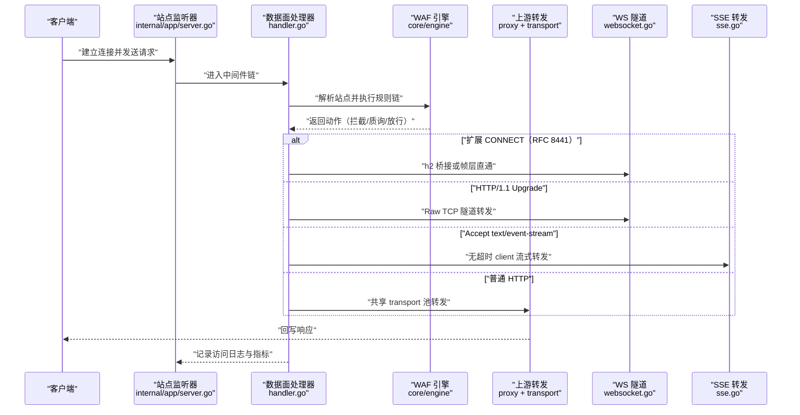

**图表来源**
- [internal/app/server.go:1097-1130](file://internal/app/server.go#L1097-L1130)
- [internal/app/server.go:1622-1640](file://internal/app/server.go#L1622-L1640)
- [internal/dataplane/handler.go:1101-1130](file://internal/dataplane/handler.go#L1101-L1130)
- [internal/core/engine/engine.go:551-573](file://internal/core/engine/engine.go#L551-L573)
- [internal/dataplane/websocket.go:127-222](file://internal/dataplane/websocket.go#L127-L222)
- [internal/dataplane/h2_websocket.go:62-69](file://internal/dataplane/h2_websocket.go#L62-L69)
- [internal/dataplane/sse.go:21-89](file://internal/dataplane/sse.go#L21-L89)
- [internal/proxy/proxy.go:1998-2010](file://internal/proxy/proxy.go#L1998-L2010)

## 详细组件分析

### 请求处理主流程（从接收至响应）
- 内部端点优先：WASM 质询资产、ACME 质询、质询验证、动态保护密钥、访问控制端点与 `/__owaf` 静态资源依次短路。
- 请求上下文构建：使用对象池申请 RequestCtx，填充方法、路径、查询串、头部与 Body，Body 送检上限 48 KB。
- WAF 执行：按站点匹配与保护策略执行多阶段规则链，收集观察命中并决定是否拦截。
- 上游转发决策：按扩展 CONNECT、Upgrade、Accept、缓存命中与规则顺序选择转发分支。
- 错误率限流：基于响应状态码对 4xx/5xx 进行计数，按 bind + 站点 + 客户端 IP + Host 维度聚合。
- 访问日志与指标：记录请求 ID、方法、路径、主机、状态码与 WAF 动作。

流程步骤与失败分支如下：

| 步 | 动作 | 执行位置 | 输入 | 输出 | 失败分支 | 可观测点 |
|:--:|------|----------|------|------|----------|----------|
| 1 | 请求 ID 与响应头预处理 | `handler.go:55-57` | Hertz 上下文 | `X-Request-ID` | — | 响应头 |
| 2 | 内部端点短路 | `handler.go:87-110` | 请求路径 | 端点响应或继续 | 直接返回 | 访问日志 |
| 3 | 快照可用性检查 | `handler.go:113-127` | `Holder.Load()` | `*Snapshot` | 503 configuration_error | `recordEarlyAccessLog` |
| 4 | 头字段数量限制 | `handler.go:129-133` | 请求头计数 | 放行或拒绝 | 431 | 协议审计行 |
| 5 | 站点匹配 | `handler.go:141`、`snapshot.go:337` | bind + Host | `SiteRuntime` | 欢迎页 + 200 routing_error | `no site match` 告警 |
| 6 | 客户端 IP 解析 | `handler.go:170`、`clientip.go:16` | XFF 模式与可信网段 | `net.IP` | 回落直连 IP | `RecordClientIP` |
| 7 | 请求上下文入池填充 | `handler.go:340-390` | 请求行/头/体 | `RequestCtx` | Body 截断 48 KB | debug 日志 |
| 8 | 走私嗅探审计 | `handler.go:361-363`、`audit_events.go:66` | 原始头字节 | 审计事件 | 不改判决 | 安全事件表 |
| 9 | 引擎判决 | `handler.go:529`、`engine.go:551` | `RequestCtx` | `ProcessResult` | 观察命中记录 | `WAFObserves` |
| 10 | 终止动作处理 | `handler.go:629-660`、`block.go:19` | 动作结果 | 阻断/维护/质询页 | 403/503 | `WAFBlocks` |
| 11 | 上游择优 | `handler.go:1101`、`health.go:219` | 上游 URL 列表 | base URL | 502 no upstream | 访问日志 |
| 12 | 协议分支转发 | `handler.go:1122-1131` | base + 请求 | 上游响应 | 502 | `RecordStatus` |
| 13 | 日志与错误率计数 | `handler.go:1261`、`handler_support.go:403` | 状态码 | 落库/指标 | 缓冲满丢弃 | `/metrics` |

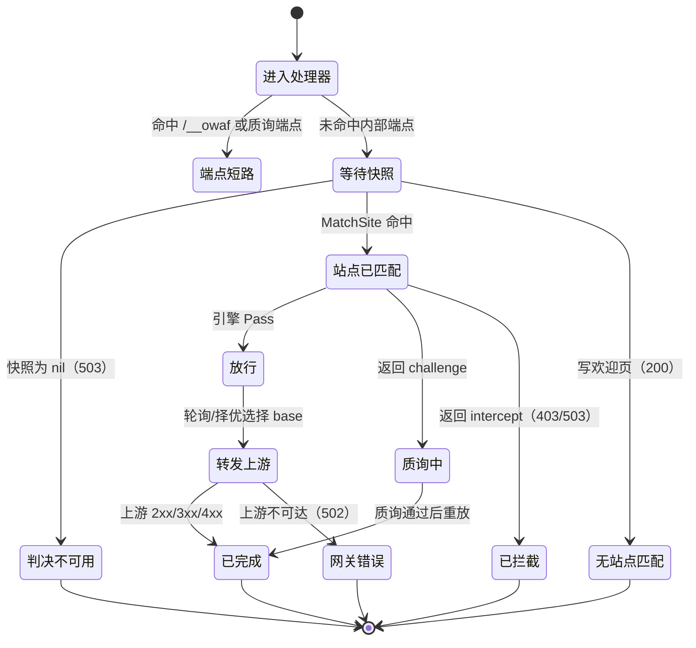

**图表来源**
- [internal/dataplane/handler.go:113-141](file://internal/dataplane/handler.go#L113-L141)
- [internal/dataplane/handler.go:529-660](file://internal/dataplane/handler.go#L529-L660)
- [internal/dataplane/handler.go:1101-1131](file://internal/dataplane/handler.go#L1101-L1131)
- [internal/snapshot/snapshot.go:337-362](file://internal/snapshot/snapshot.go#L337-L362)
- [internal/waf/pages/block.go:19-56](file://internal/waf/pages/block.go#L19-L56)

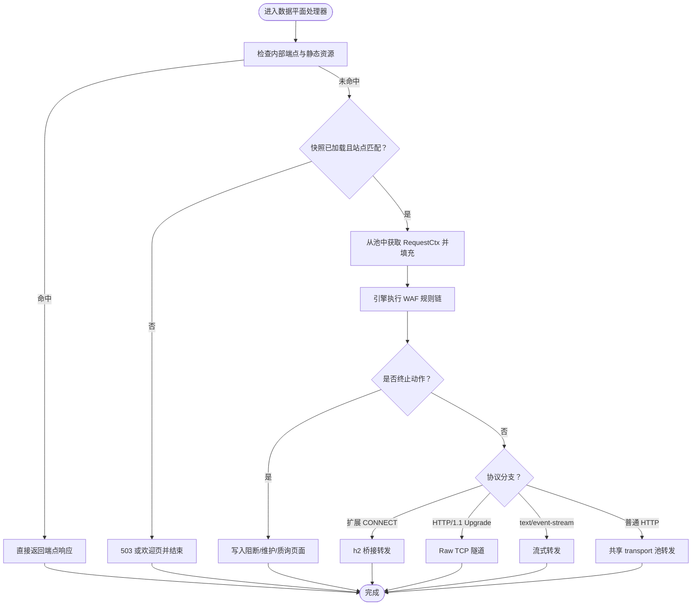

**图表来源**
- [internal/dataplane/handler.go:87-141](file://internal/dataplane/handler.go#L87-L141)
- [internal/dataplane/handler.go:340-390](file://internal/dataplane/handler.go#L340-L390)
- [internal/dataplane/handler.go:529-533](file://internal/dataplane/handler.go#L529-L533)
- [internal/dataplane/handler.go:1101-1131](file://internal/dataplane/handler.go#L1101-L1131)
- [internal/core/pipeline/pool.go:20-37](file://internal/core/pipeline/pool.go#L20-L37)
- [internal/core/engine/engine.go:551-573](file://internal/core/engine/engine.go#L551-L573)
- [internal/waf/pages/block.go:19-56](file://internal/waf/pages/block.go#L19-L56)

**章节来源**
- [internal/dataplane/handler.go:48-141](file://internal/dataplane/handler.go#L48-L141)
- [internal/dataplane/handler.go:340-390](file://internal/dataplane/handler.go#L340-L390)
- [internal/dataplane/handler.go:1101-1131](file://internal/dataplane/handler.go#L1101-L1131)
- [internal/dataplane/handler_support.go:355-424](file://internal/dataplane/handler_support.go#L355-L424)
- [internal/dataplane/request_ctx.go:472-506](file://internal/dataplane/request_ctx.go#L472-L506)
- [internal/core/pipeline/pool.go:20-60](file://internal/core/pipeline/pool.go#L20-L60)
- [internal/security/clientip.go:16-36](file://internal/security/clientip.go#L16-L36)

### 上游代理配置与负载均衡
- 负载均衡：`Pool.Pick` 以调用方传入的原子计数器取模得到起点，再在可用集合内择优（`handler.go:1101`、`health.go:219`）。
- 健康检查与故障转移：`internal/upstream/health.go` 提供周期探活（默认间隔 10 秒）与状态位，`pickFastestKnownAvailable` 会跳过 `Healthy=false` 的上游并按平均延迟择优；全部不健康时回落到起点地址。
- 转发参数：`X-Forwarded-For`、`X-Forwarded-Host`、`X-Forwarded-Proto` 由 `security.RebuildOutboundForwardingHeaders` 统一重建，客户端自带的同名头先被删除。
- 传输层：`internal/proxy/transport` 按 `transportKey` 缓存 `http.Transport`，共享上游池取值为 256/32/30 秒（`transport.go:157-161`）。

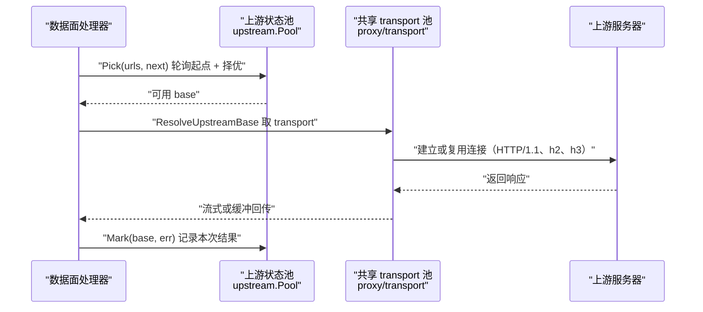

**图表来源**
- [internal/dataplane/handler.go:1101-1112](file://internal/dataplane/handler.go#L1101-L1112)
- [internal/dataplane/handler.go:1215-1216](file://internal/dataplane/handler.go#L1215-L1216)
- [internal/upstream/health.go:219-240](file://internal/upstream/health.go#L219-L240)
- [internal/upstream/health.go:404-458](file://internal/upstream/health.go#L404-L458)
- [internal/upstream/health.go:470-476](file://internal/upstream/health.go#L470-L476)
- [internal/proxy/transport/transport.go:800-856](file://internal/proxy/transport/transport.go#L800-L856)
- [internal/security/outbound.go:33-56](file://internal/security/outbound.go#L33-L56)

**章节来源**
- [internal/app/server.go:368-374](file://internal/app/server.go#L368-L374)
- [internal/upstream/health.go:20-56](file://internal/upstream/health.go#L20-L56)
- [internal/upstream/health.go:587-608](file://internal/upstream/health.go#L587-L608)
- [internal/proxy/transport/transport.go:131-205](file://internal/proxy/transport/transport.go#L131-L205)
- [internal/proxy/proxy.go:1006-1054](file://internal/proxy/proxy.go#L1006-L1054)

### TLS 终止与证书管理
- 监听器 TLS：`buildListenerTLS`（`server.go:1659`）按 bind 过滤 `SiteTLSCertBySNI`，构造带 `GetCertificate` 回调的 `tls.Config`，再由 Hertz standard transporter 完成握手。
- 证书来源：优先取 `SiteRuntime.TLSConfig` 的证书，其次用 `SiteRuntime.Certificate` 的 PEM 现场解析（可附带 OCSP 装订），两者皆无时按 bind 生成自签证书兜底。
- 协议协商：版本区间与 ALPN 由 `snapshot.EffectiveSiteTLS` / `EffectiveSiteNetwork` 计算；最大版本低于 TLS 1.2 时会自动摘除 `h2`。
- 性能优化：客户端侧复用 TLS 会话缓存（`transport.go:187`），上游池按 `transportKey` 缓存 transport，避免每请求重复握手。

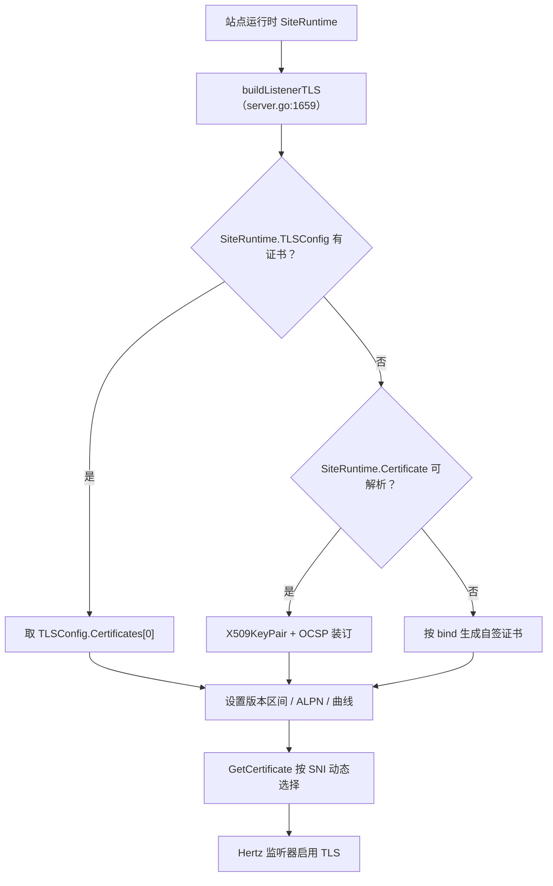

**图表来源**
- [internal/app/server.go:1659-1750](file://internal/app/server.go#L1659-L1750)
- [internal/app/server.go:1752-1830](file://internal/app/server.go#L1752-L1830)
- [internal/snapshot/tls.go:363-405](file://internal/snapshot/tls.go#L363-L405)
- [internal/snapshot/ocsp.go:17-44](file://internal/snapshot/ocsp.go#L17-L44)

**章节来源**
- [internal/app/server.go:1535-1560](file://internal/app/server.go#L1535-L1560)
- [internal/proxy/transport/transport.go:178-195](file://internal/proxy/transport/transport.go#L178-L195)
- [internal/snapshot/snapshot.go:226-330](file://internal/snapshot/snapshot.go#L226-L330)

### WebSocket 连接处理
- 协商识别：`IsWebSocketUpgrade` 要求 `Upgrade` 精确等于 `websocket` 且 `Connection` 头含 `upgrade` token（`websocket.go:36`）；RFC 8441 扩展 CONNECT 由 `IsH2ExtendedWebSocketConnect` 单独识别（`websocket.go:46`）。
- 转发策略：把上游 base 归一为 `ws`/`wss` 后以 Raw TCP 隧道转发，保留原始请求行并按白名单剥离逐跳头（`websocket.go:92`、`websocket.go:276`）。
- 安全与超时：上游拨号超时 10 秒；`wss` 场景使用站点上游 TLS 配置与客户端证书；响应头读取上限 1 MiB（`websocket.go:33`）。
- 保活与检测：每 30 秒向上游发一个空载荷 ping；客户端帧经 `inspectWebSocketClientFrames` 分流，文本/二进制帧载荷送引擎复检（`websocket.go:178`、`websocket.go:452`）。

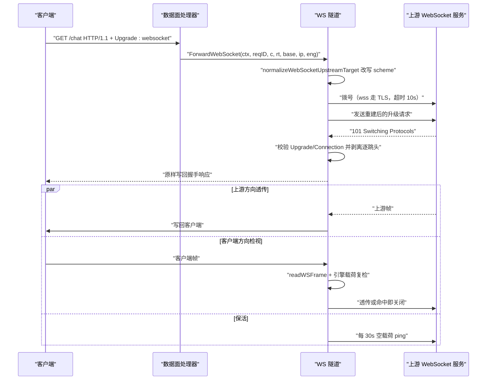

**图表来源**
- [internal/dataplane/websocket.go:36-59](file://internal/dataplane/websocket.go#L36-L59)
- [internal/dataplane/websocket.go:92-135](file://internal/dataplane/websocket.go#L92-L135)
- [internal/dataplane/websocket.go:135-222](file://internal/dataplane/websocket.go#L135-L222)
- [internal/dataplane/websocket.go:344-397](file://internal/dataplane/websocket.go#L344-L397)
- [internal/dataplane/websocket.go:452-497](file://internal/dataplane/websocket.go#L452-L497)

**章节来源**
- [internal/dataplane/websocket.go:32-33](file://internal/dataplane/websocket.go#L32-L33)
- [internal/dataplane/handler.go:1122-1131](file://internal/dataplane/handler.go#L1122-L1131)

### Server-Sent Events 实现
- 协商识别：`IsSSERequest` 在 `Accept` 中定位 `text/event-stream`，并要求其后为串尾、`;`、`,` 或空白，避免子串误判（`sse.go:263`）。
- 转发策略：经 `UpstreamRoundTripperForBase` 取 transport 后交给 `SharedNoTimeoutClientForRoundTripper` 的无超时 client；请求头过滤 `connection`/`keep-alive`/`te`/`trailer`/`transfer-encoding`/`upgrade`/`host` 与内部 h3 头（`sse.go:22`、`sse.go:52`）。
- 响应处理：逐跳头与 `Connection` 列出的头被剔除，写入 `Cache-Control: no-cache`、删除 `Connection` 与 `Content-Length` 并置 `ImmediateHeaderFlush`，由 hijack writer 或 `SetBodyStream` 流式输出（`sse.go:60-88`）。
- 连接管理：`sseBodyStream` 在 ctx 结束或读错误时幂等 `cleanup`，等待活跃读者归零后再关闭上游体（`sse.go:141-242`）。

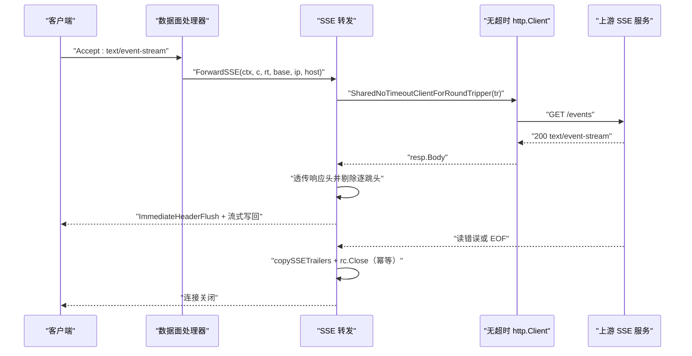

**图表来源**
- [internal/dataplane/sse.go:21-89](file://internal/dataplane/sse.go#L21-L89)
- [internal/dataplane/sse.go:141-242](file://internal/dataplane/sse.go#L141-L242)
- [internal/dataplane/sse.go:263-277](file://internal/dataplane/sse.go#L263-L277)
- [internal/proxy/transport/transport.go:257-277](file://internal/proxy/transport/transport.go#L257-L277)
- [internal/proxy/transport/transport.go:294-312](file://internal/proxy/transport/transport.go#L294-L312)

**章节来源**
- [internal/dataplane/sse.go:39-52](file://internal/dataplane/sse.go#L39-L52)
- [internal/dataplane/handler.go:1130-1131](file://internal/dataplane/handler.go#L1130-L1131)
- [internal/proxy/proxy.go:2508-2556](file://internal/proxy/proxy.go#L2508-L2556)

### 传输层优化（连接池、超时与资源管理）
- 连接池：`transportPool` 位于 `internal/proxy/transport/transport.go`，以 `transportKey{isHTTPS, tlsServerName, tlsSkipVerify, clientCertFingerprint, h2cPrior}` 为键缓存 `*http.Transport`；`internal/proxy/proxy.go` 已不再持有连接池实现。
- 共享上游池取值：`MaxIdleConns` 256、`MaxIdleConnsPerHost` 32、`IdleConnTimeout` 30 秒、`MaxConnsPerHost` 256（`transport.go:157-172`），并显式设定拨号 10 秒、TLS 握手 10 秒、响应头等待 30 秒（`transport.go:109-114`）。
- 其他池：h2c 明文 HTTP/2 走单例（512/128/90 秒，`transport.go:872-875`）；探活路径使用独立 transport（128/32/90 秒，`health.go:666-673`），三者参数不可混用。
- 资源管理：`RequestCtx` 由 `sync.Pool` 复用并在释放时清空字段，送检体上限 48 KB；闲置 transport 由 `PruneInactiveUpstreamTransports` 随快照回收。

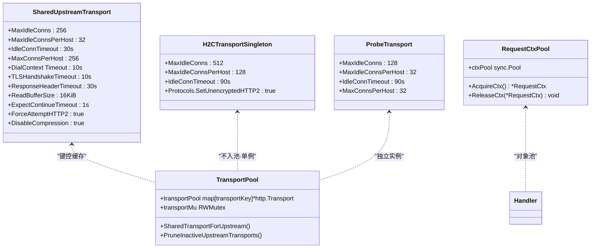

**图表来源**
- [internal/proxy/transport/transport.go:109-114](file://internal/proxy/transport/transport.go#L109-L114)
- [internal/proxy/transport/transport.go:137-205](file://internal/proxy/transport/transport.go#L137-L205)
- [internal/proxy/transport/transport.go:863-889](file://internal/proxy/transport/transport.go#L863-L889)
- [internal/proxy/transport/transport.go:1044-1136](file://internal/proxy/transport/transport.go#L1044-L1136)
- [internal/upstream/health.go:661-676](file://internal/upstream/health.go#L661-L676)
- [internal/core/pipeline/pool.go:20-37](file://internal/core/pipeline/pool.go#L20-L37)
- [internal/dataplane/handler.go:340-395](file://internal/dataplane/handler.go#L340-L395)

**章节来源**
- [internal/proxy/transport/transport.go:71-92](file://internal/proxy/transport/transport.go#L71-L92)
- [internal/proxy/transport/transport.go:238-277](file://internal/proxy/transport/transport.go#L238-L277)
- [internal/upstream/health.go:20-28](file://internal/upstream/health.go#L20-L28)
- [internal/core/pipeline/pool.go:11-60](file://internal/core/pipeline/pool.go#L11-L60)
- [internal/snapshot/snapshot.go:493](file://internal/snapshot/snapshot.go#L493)

### 关键符号代码上下文
| 符号 | 位置 | 职责 | 上游调用者 | 下游依赖 | 副作用 | 影响面 |
|------|------|------|------------|----------|--------|--------|
| `Handler` | `internal/dataplane/handler.go:39` | 组装数据面中间件链 | `server.go:1624` 构造 handler；`server.go:1642-1643` 注册 NoRoute 与 CONNECT | `Engine.Process`、`proxy.ForwardHTTP`、`UnifiedWriter` | 写访问日志与安全事件、改响应头 | 高：所有站点请求主链路 |
| `SharedTransportForUpstream` | `internal/proxy/transport/transport.go:131` | 取或建共享上游 transport | `ResolveUpstreamBase`（`transport.go:800`），由 `proxy.go:1007`、`sse.go:22` 间接触发 | `http.Transport`、`upstream.UpstreamClientCertificate` | 池增长、TLS 会话缓存 | 高：回源连接复用与并发上限 |
| `Pool.Pick` | `internal/upstream/health.go:219` | 轮询起点 + 健康与延迟择优 | `handler_support.go:150`（`pickUpstream`） | `pickAvailableUpstream`、`states` 表 | 无（只读状态） | 高：上游选择结果 |
| `ForwardSSE` | `internal/dataplane/sse.go:21` | 流式转发事件流 | `handler.go:1131` | `UpstreamRoundTripperForBase`、`StreamResponseViaHijack` | 挂 hijack writer、延迟关闭上游体 | 中：仅 SSE 分支 |
| `MatchSite` | `internal/snapshot/snapshot.go:337` | bind + Host 三级匹配 | `handler.go:141`、`resolver.go:27` | `Sites` map、`NormalizeMatchHost` | 无 | 高：站点归属与配置来源 |

**章节来源**
- [internal/dataplane/handler.go:39-46](file://internal/dataplane/handler.go#L39-L46)
- [internal/dataplane/handler_support.go:150-152](file://internal/dataplane/handler_support.go#L150-L152)
- [internal/app/server.go:1620-1645](file://internal/app/server.go#L1620-L1645)
- [internal/proxy/proxy.go:1006-1008](file://internal/proxy/proxy.go#L1006-L1008)
- [internal/core/sites/resolver.go:23-31](file://internal/core/sites/resolver.go#L23-L31)
- [internal/snapshot/snapshot.go:337-362](file://internal/snapshot/snapshot.go#L337-L362)

## 依赖关系分析
- 组件耦合：数据平面处理器依赖引擎、快照、上游代理与传输池、安全工具；引擎依赖规则阶段与限流后端；代理依赖 `internal/proxy/transport` 的连接池与上游状态池。
- 外部依赖：Hertz 与 `github.com/x01n/http2` 提供 HTTP/1.1、h2 与扩展 CONNECT 能力；`quic-go/http3` 提供 h3 上游；Go 标准库 `net/http`、`crypto/tls` 承载传输与握手。

| 调用方 ↓ / 被调方 → | dataplane | core/engine | core/pipeline | proxy | proxy/transport | upstream | snapshot | observability | security |
|---------------------|:---:|:---:|:---:|:---:|:---:|:---:|:---:|:---:|:---:|
| handler.go | — | ✓ | ✓ | ✓ | ✓ | ✓ | ✓ | ✓ | ✓ |
| websocket.go / h2_websocket.go | — | ✓ | ✓ | ✓ | — | ✓ | ✓ | — | ✓ |
| sse.go | — | — | — | ✓ | ✓ | — | ✓ | — | ✓ |
| proxy.go | — | — | — | — | ✓ | — | ✓ | — | ✓ |
| proxy/transport | — | — | — | — | — | ✓ | ✓ | — | — |
| core/engine | — | — | ✓ | — | — | — | ✓ | — | — |
| upstream/health.go | — | — | — | — | — | — | ✓ | — | — |

矩阵中无 `✗`：`internal/proxy` 不导入 `internal/dataplane`（`proxy.go:1-29` 的 import 段可核对），响应阶段的 JS/Lua 改写运行时改由数据面在构造 handler 时用 `SetJSResponseRuntimeLookup`、`SetLuaResponseRewriteLookup` 注入查找函数（`handler.go:42-46`），依赖方向保持单层向下。

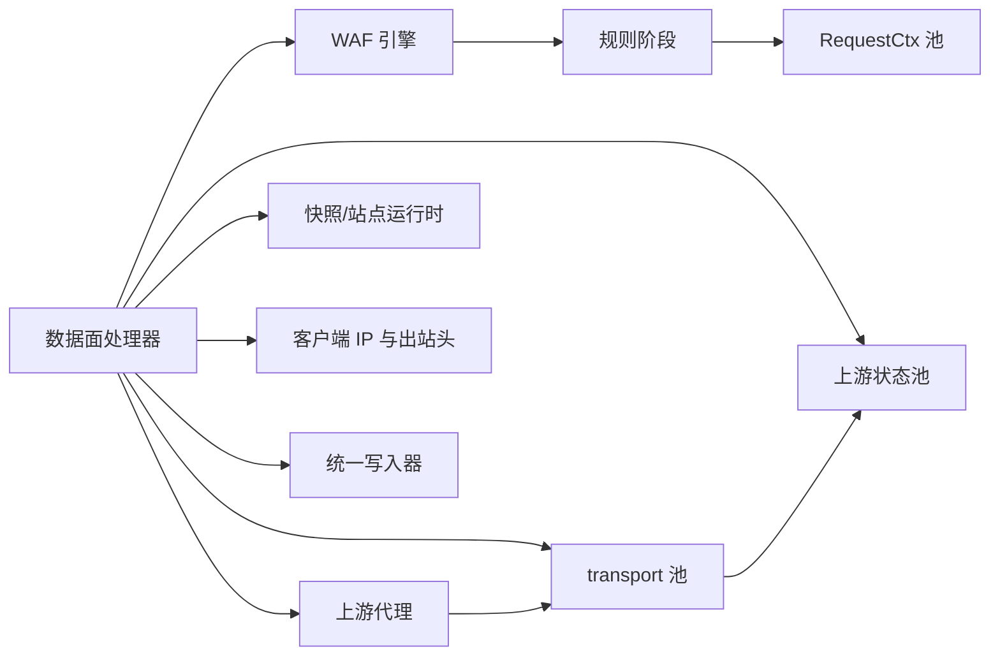

**图表来源**
- [internal/dataplane/handler.go:14-36](file://internal/dataplane/handler.go#L14-L36)
- [internal/dataplane/handler.go:42-46](file://internal/dataplane/handler.go#L42-L46)
- [internal/proxy/proxy.go:1006-1008](file://internal/proxy/proxy.go#L1006-L1008)
- [internal/proxy/transport/transport.go:131-135](file://internal/proxy/transport/transport.go#L131-L135)
- [internal/upstream/health.go:219-240](file://internal/upstream/health.go#L219-L240)
- [internal/snapshot/snapshot.go:337-362](file://internal/snapshot/snapshot.go#L337-L362)

**章节来源**
- [internal/dataplane/sse.go:14-18](file://internal/dataplane/sse.go#L14-L18)
- [internal/dataplane/websocket.go:22-30](file://internal/dataplane/websocket.go#L22-L30)
- [internal/core/engine/engine.go:551-573](file://internal/core/engine/engine.go#L551-L573)

## 性能考虑
- 对象池与内存：`RequestCtx` 池化并带容量上限（头 map 128、键切片 64、观察缓冲 32），送检体上限 48 KB，避免峰值后 RSS 不回落。
- 连接复用：共享上游 transport（256/32/30 秒）与 TLS 会话缓存（LRU 32）共同决定回源开销；h2c 与探活各有独立池。
- 反射与热路径：`stream` 子包按监听器是否注册 h2 协议栈决定是否绑定 CloseNotify，并用 `sync.Map` 缓存方法索引，避免每请求递归反射扫描。
- 请求 ID：`reqid` 用进程前缀 + 原子计数器生成 23 字节 ID，单请求一次堆分配，不消耗 `crypto/rand` 系统调用。
- 日志与指标：`logredact` 在入队前完成脱敏与截断；`unified_writer` 非阻塞入队，队列满时按 `SlowLogGrace`（默认 30 秒）决定是否等待。

**章节来源**
- [internal/core/pipeline/pool.go:11-30](file://internal/core/pipeline/pool.go#L11-L30)
- [internal/proxy/transport/transport.go:153-190](file://internal/proxy/transport/transport.go#L153-L190)
- [internal/dataplane/stream/stream_close_notify.go:21-45](file://internal/dataplane/stream/stream_close_notify.go#L21-L45)
- [internal/dataplane/reqid/reqid.go:36-53](file://internal/dataplane/reqid/reqid.go#L36-L53)
- [internal/observability/unified_writer.go:122-172](file://internal/observability/unified_writer.go#L122-L172)

## 故障排查指南
- 502 上游错误：先确认 `Pool.Pick` 返回的 base 是否来自健康集合，再检查 transport 池参数与 TLS SNI 配置；上游错误按 `shouldLogUpstreamErrorCount` 限流打印。
- 无站点匹配：当前实现写欢迎页并记 `routing_error`（状态 200），不是 404；核对快照键 `bind + NUL + 小写 host` 与 catch-all `*` 条目。
- 503 配置快照未加载 / 引擎不可用：分别对应 `handler.go:124` 与 `handler.go:165`，确认初始化顺序与 reload 结果。
- 431 头字段超限：由 `sn.HTTP2Config.MaxHeaderFields` 触发，调整 HTTP/2 配置而非放宽 WAF。
- WebSocket 握手失败：`readHTTPResponseHead` 要求状态必须是 101，且响应必须同时含 `Upgrade: websocket` 与 `Connection: Upgrade`，否则直接报错断开。
- SSE 无输出：检查 `Accept` 是否精确含 `text/event-stream`，以及 hijack writer 是否已被占用。
- 阻断页缺失：`WriteBlockResponse` 依次尝试站点 `BlockHTML` → 快照配置的阻断页 → 内嵌页面回退。

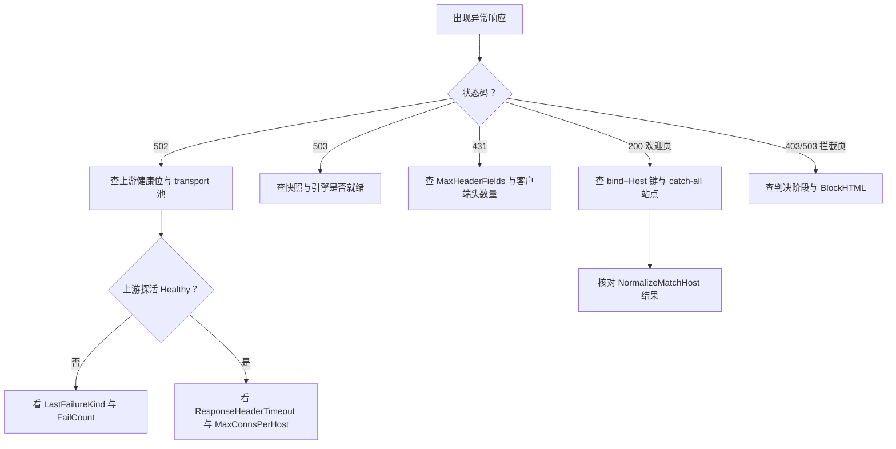

**图表来源**
- [internal/dataplane/handler.go:113-166](file://internal/dataplane/handler.go#L113-L166)
- [internal/dataplane/handler.go:1101-1112](file://internal/dataplane/handler.go#L1101-L1112)
- [internal/upstream/health.go:40-56](file://internal/upstream/health.go#L40-L56)
- [internal/dataplane/websocket.go:639-661](file://internal/dataplane/websocket.go#L639-L661)
- [internal/dataplane/sse.go:263-277](file://internal/dataplane/sse.go#L263-L277)
- [internal/waf/pages/block.go:19-56](file://internal/waf/pages/block.go#L19-L56)

**章节来源**
- [internal/proxy/proxy.go:431-497](file://internal/proxy/proxy.go#L431-L497)
- [internal/snapshot/snapshot.go:337-362](file://internal/snapshot/snapshot.go#L337-L362)

## 结论
数据平面以「监听器装配 → 端点短路 → 快照匹配 → 引擎判决 → 协议分支转发 → 异步观测」为主线，把职责切到 `internal/dataplane` 的根文件与六个子包，连接池与择优分别收敛在 `internal/proxy/transport` 与 `internal/upstream`。三类 transport 池的取值差异（256/32/30 秒、512/128/90 秒、128/32/90 秒）是回源容量的真实边界，调参时必须按池分别处理。

## 附录

### 本文与子文档索引
| 主题 | 文档 | 承载内容 |
|------|------|----------|
| 请求主链路 | [请求处理流程](请求处理流程.md) | 站点匹配、阶段执行、观察与拦截、维护与阻断 |
| TLS 终止 | [TLS 终止与证书管理](TLS%20终止与证书管理.md) | 监听器 tls.Config、SNI 选择、证书生命周期与协议矩阵 |
| WebSocket | [WebSocket 连接处理](WebSocket%20连接处理.md) | 升级检测、Raw TCP 隧道、帧检视与连接生命周期 |
| SSE | [SSE 事件推送](SSE%20事件推送.md) | 事件流转发、流式回写与统一写入器批处理 |
| 上游代理 | [上游代理配置](上游代理配置.md) | 择优与探活、transport 参数对照、出站头重建 |
| 性能监控 | [性能监控与调优](性能监控与调优.md) | 指标清单、缓存与限流、事件写入与归档 |
| 子包专题 | 待建：`stream`、`envelope`、`logredact`、`metrics`、`reqid`、`tlsfp` | 位置见「项目结构」模块清单表 |

[本节为总结，无需特定文件来源]

### 常用运行参数速查
| 参数 | 取值 | 位置 |
|------|------|------|
| 送检 Body 上限 | 48 KB | `snapshot.go:493` |
| 监听器最大请求体 | 32 MiB | `server.go:1579` |
| 监听器读缓冲 | 16 KiB | `server.go:1584` |
| WS 帧检视载荷上限 | 4096 B | `websocket.go:32` |
| WS 上游响应头上限 | 1 MiB | `websocket.go:33` |
| WS 上游拨号超时 | 10 s | `websocket.go:135` |
| WS 保活 ping 间隔 | 30 s | `websocket.go:179` |
| h2 扩展 CONNECT 握手超时 | 5 s | `h2_websocket.go:29` |
| 缓冲路径 client 超时 | 30 s | `proxy.go:1037` |
| 探活超时与间隔 | 2 s / 10 s | `server.go:370-374` |

**章节来源**
- [internal/dataplane/h2_websocket.go:27-31](file://internal/dataplane/h2_websocket.go#L27-L31)
- [internal/proxy/proxy.go:1037](file://internal/proxy/proxy.go#L1037)
- [internal/snapshot/snapshot.go:490-495](file://internal/snapshot/snapshot.go#L490-L495)
- [internal/app/server.go:1577-1585](file://internal/app/server.go#L1577-L1585)