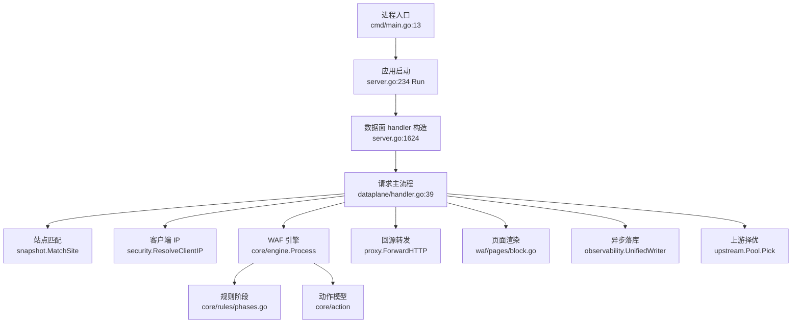
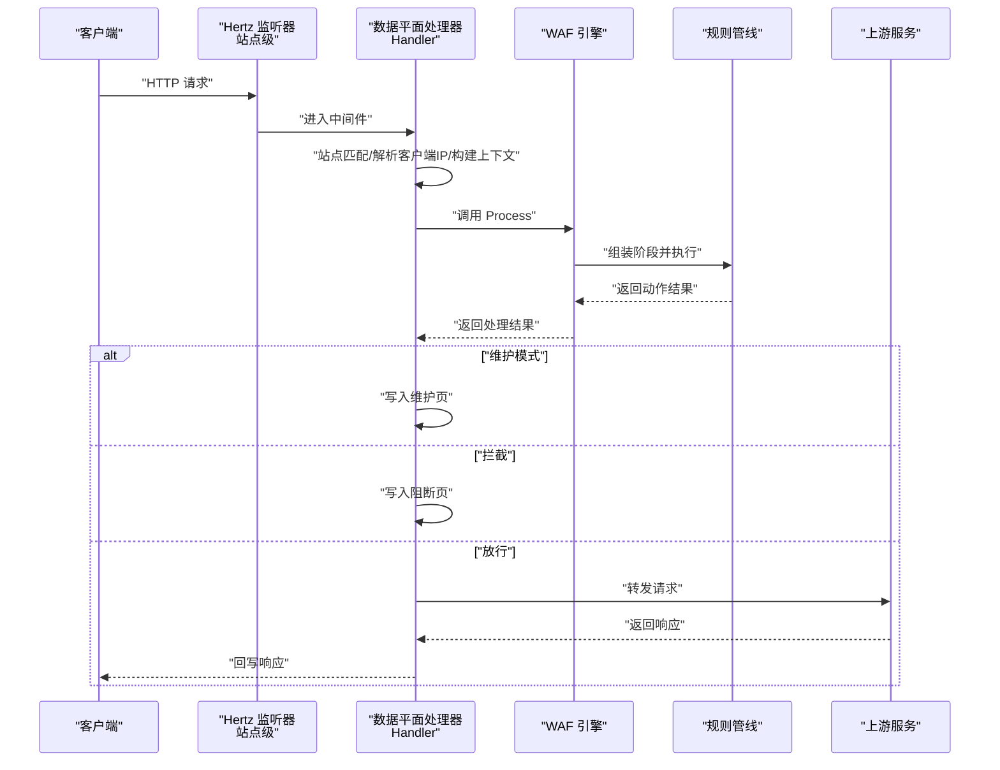
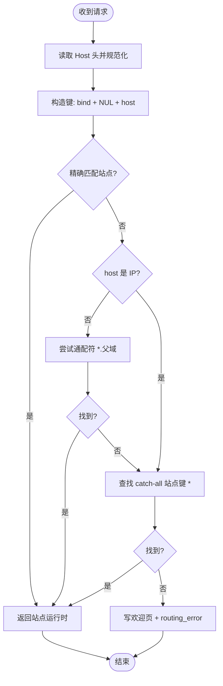
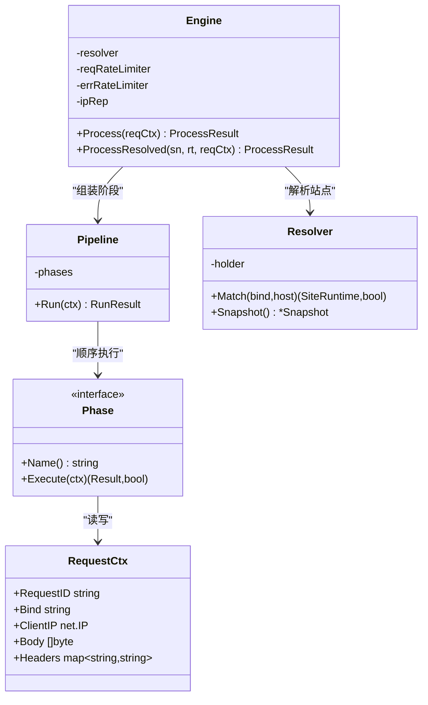
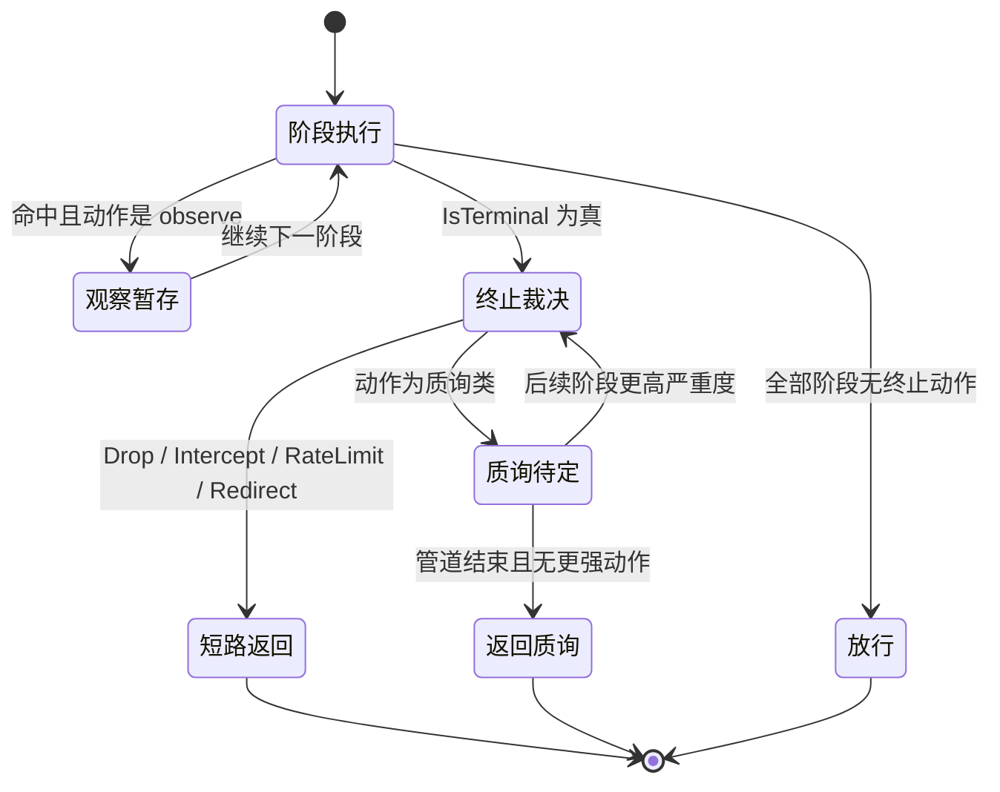
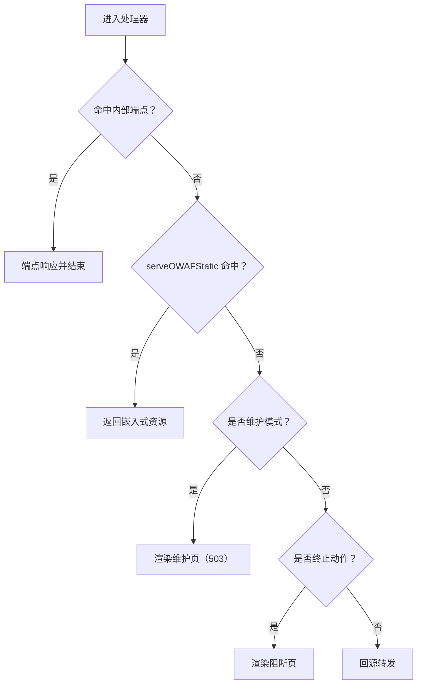
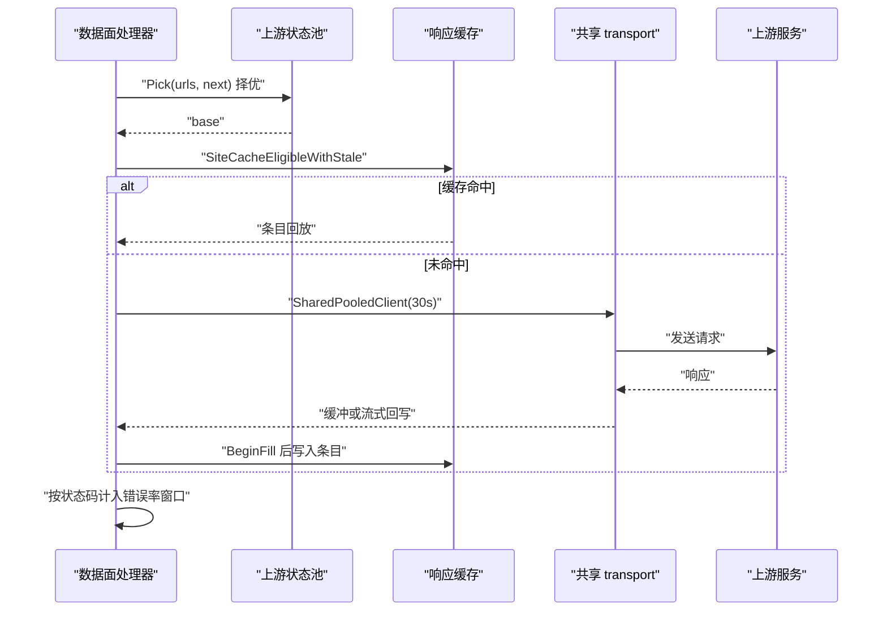
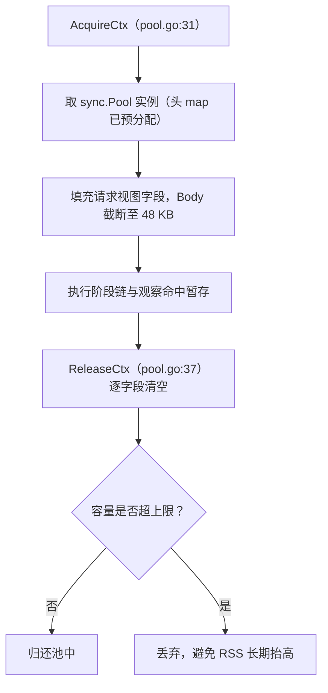
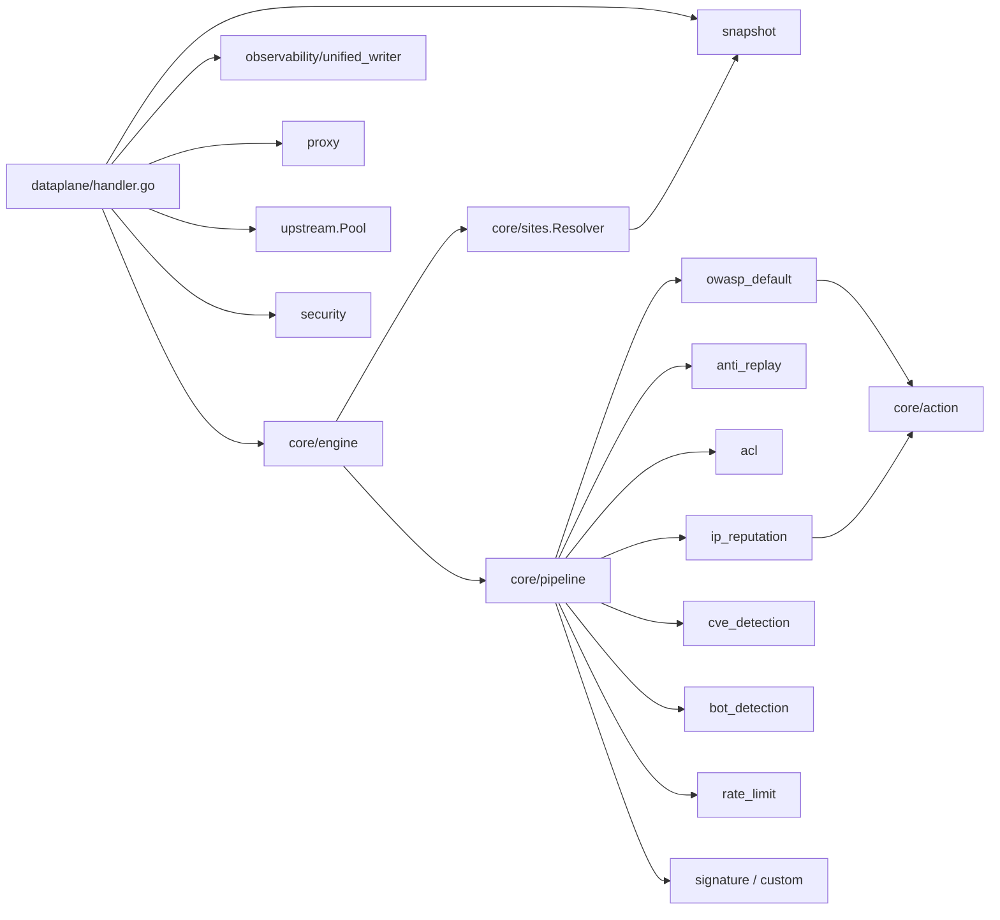
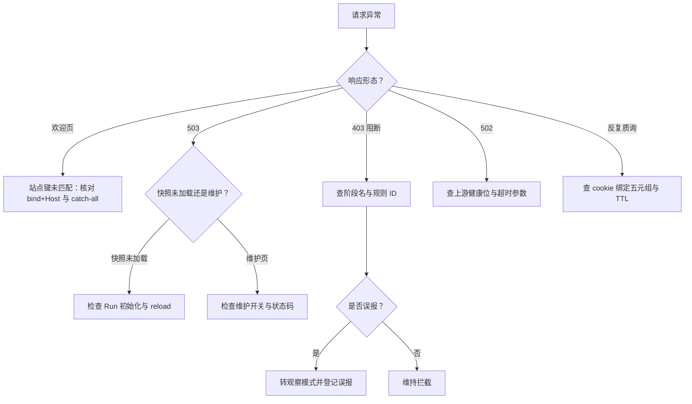

> [返回 数据平面处理](数据平面处理.md)

# 请求处理流程

<cite>
**本文档引用的文件**
- [cmd/main.go](file://cmd/main.go)
- [internal/app/server.go](file://internal/app/server.go)
- [internal/core/engine/engine.go](file://internal/core/engine/engine.go)
- [internal/core/sites/resolver.go](file://internal/core/sites/resolver.go)
- [internal/core/pipeline/pipeline.go](file://internal/core/pipeline/pipeline.go)
- [internal/core/pipeline/pool.go](file://internal/core/pipeline/pool.go)
- [internal/core/rules/phases.go](file://internal/core/rules/phases.go)
- [internal/core/rules/phase_skip.go](file://internal/core/rules/phase_skip.go)
- [internal/core/rules/lua_phase.go](file://internal/core/rules/lua_phase.go)
- [internal/core/action/action.go](file://internal/core/action/action.go)
- [internal/waf/ratelimit/ratelimit.go](file://internal/waf/ratelimit/ratelimit.go)
- [internal/dataplane/handler.go](file://internal/dataplane/handler.go)
- [internal/dataplane/handler_support.go](file://internal/dataplane/handler_support.go)
- [internal/dataplane/request_ctx.go](file://internal/dataplane/request_ctx.go)
- [internal/dataplane/access_log.go](file://internal/dataplane/access_log.go)
- [internal/dataplane/endpoints.go](file://internal/dataplane/endpoints.go)
- [internal/dataplane/audit_events.go](file://internal/dataplane/audit_events.go)
- [internal/dataplane/challenge.go](file://internal/dataplane/challenge.go)
- [internal/dataplane/reqid/reqid.go](file://internal/dataplane/reqid/reqid.go)
- [internal/dataplane/logredact/sanitize.go](file://internal/dataplane/logredact/sanitize.go)
- [internal/dataplane/metrics/metrics.go](file://internal/dataplane/metrics/metrics.go)
- [internal/security/clientip.go](file://internal/security/clientip.go)
- [internal/upstream/health.go](file://internal/upstream/health.go)
- [internal/proxy/proxy.go](file://internal/proxy/proxy.go)
- [internal/proxy/transport/transport.go](file://internal/proxy/transport/transport.go)
- [internal/waf/pages/block.go](file://internal/waf/pages/block.go)
- [internal/observability/metrics.go](file://internal/observability/metrics.go)
- [internal/observability/unified_writer.go](file://internal/observability/unified_writer.go)
- [internal/snapshot/snapshot.go](file://internal/snapshot/snapshot.go)
</cite>

## 目录

1. [简介](#简介)
2. [项目结构](#项目结构)
3. [核心组件](#核心组件)
4. [架构总览](#架构总览)
5. [详细组件分析](#详细组件分析)
6. [依赖关系分析](#依赖关系分析)
7. [性能考虑](#性能考虑)
8. [故障排查指南](#故障排查指南)
9. [结论](#结论)
10. [附录](#附录)

## 简介
本文件系统性梳理 My-OpenWaf 的请求处理全流程，覆盖从接收 HTTP 请求到生成响应的完整链路；解释站点配置匹配（含虚拟主机与绑定地址）；阐述 WAF 引擎的处理步骤（请求上下文构建、规则阶段执行、决策生成）；对比观察模式与拦截模式及安全事件记录；说明静态资源与维护模式实现；并给出性能优化建议与调试方法。

## 项目结构
应用入口 `cmd/main.go:13` 调用 `app.Run()`（`server.go:234`），Run 内按固定顺序完成运行时、迁移、快照、观测、限流、引擎与数据面装配，最后 `buildDataServerWithHTTP3Plans`（`server.go:1513`）为每个 bind 生成监听器并在 `server.go:1624` 构造数据面 handler，`server.go:1642-1643` 注册到 NoRoute 与 CONNECT 路由。请求主链路涉及的下表模块：

| 阶段 | 模块 | 核心符号与位置 | 职责 |
|------|------|----------------|------|
| 入口 | `internal/app/server.go` | `Run`（L234）、`buildDataServerWithHTTP3Plans`（L1513） | 监听器装配与 handler 注册 |
| 中间件 | `internal/dataplane/handler.go` | `Handler`（L39） | 请求主流程编排 |
| 路由归属 | `internal/snapshot/snapshot.go` | `MatchSite`（L337）、`SiteMapKey`（L289） | bind + Host 三级匹配 |
| IP 解析 | `internal/security/clientip.go` | `ResolveClientIP`（L16） | XFF 模式与可信网段 |
| 上下文 | `internal/core/pipeline/pool.go` | `AcquireCtx`（L31）、`ReleaseCtx`（L37） | 请求上下文池化 |
| 判决 | `internal/core/engine/engine.go` | `Process`（L551）、`getOrBuildPhases`（L441） | 阶段组装与执行 |
| 阶段 | `internal/core/rules/phases.go` | 各 `*Phase.Name()` | 分阶段检测 |
| 动作 | `internal/core/action/action.go` | `TerminalPriority`（L88）、`IsTerminal`（L168） | 严重度与短路判定 |
| 页面 | `internal/waf/pages/block.go` | `WriteBlockResponse`（L19）、`WriteMaintenanceResponse`（L61） | 阻断与维护页渲染 |
| 转发 | `internal/proxy/proxy.go` | `ForwardHTTP`（L1998）、`IsHopByHop`（L2863） | 回源与响应回写 |
| 观测 | `internal/observability/unified_writer.go` | `UnifiedWriter`（L25） | 异步批量落库 |

**图表来源**
- [cmd/main.go:13-50](file://cmd/main.go#L13-L50)
- [internal/app/server.go:234-245](file://internal/app/server.go#L234-L245)
- [internal/app/server.go:1513-1520](file://internal/app/server.go#L1513-L1520)
- [internal/app/server.go:1620-1645](file://internal/app/server.go#L1620-L1645)
- [internal/dataplane/handler.go:39-145](file://internal/dataplane/handler.go#L39-L145)
- [internal/core/engine/engine.go:551-573](file://internal/core/engine/engine.go#L551-L573)

**章节来源**
- [internal/snapshot/snapshot.go:276-362](file://internal/snapshot/snapshot.go#L276-L362)
- [internal/security/clientip.go:16-36](file://internal/security/clientip.go#L16-L36)
- [internal/waf/pages/block.go:19-70](file://internal/waf/pages/block.go#L19-L70)
- [internal/observability/unified_writer.go:17-45](file://internal/observability/unified_writer.go#L17-L45)

## 核心组件
- 应用启动与监听管理：负责初始化运行时、加载快照、构建 WAF 引擎、按站点热增删监听器、分发配置变更。
- 数据平面处理器：在每个站点监听器上注册中间件，完成站点匹配、客户端 IP 解析、请求上下文构建、调用引擎、日志与事件记录、阻断或转发。
- WAF 引擎：基于快照解析站点，执行多阶段规则管线，支持维护模式短路、IP 名单、ACL、机器人检测、请求速率限制、OWASP 规则集、签名与自定义规则。
- 规则阶段：各阶段按序执行，遇到终止动作即短路，观察命中仅记录不短路；质询类动作按严重度延迟到管道末端裁决。
- 安全事件与指标：异步批量写入安全事件，记录访问、拦截、攻击 IP、内置命中等指标。
- 阻断与维护页面：根据站点或全局配置渲染阻断页或维护页，支持模板与嵌入式页面回退。
- 代理与上游：HTTP/WS/SSE 转发，连接池复用，去除 Hop-by-Hop 头，支持上游 TLS 配置。

**章节来源**
- [internal/app/server.go:1513-1657](file://internal/app/server.go#L1513-L1657)
- [internal/dataplane/handler.go:39-145](file://internal/dataplane/handler.go#L39-L145)
- [internal/dataplane/handler.go:529-660](file://internal/dataplane/handler.go#L529-L660)
- [internal/core/engine/engine.go:441-573](file://internal/core/engine/engine.go#L441-L573)
- [internal/core/rules/phases.go:146-1352](file://internal/core/rules/phases.go#L146-L1352)
- [internal/core/action/action.go:88-200](file://internal/core/action/action.go#L88-L200)

## 架构总览
下图展示一次请求从进入站点监听器到最终响应的关键交互：

**图表来源**
- [internal/dataplane/handler.go:39-145](file://internal/dataplane/handler.go#L39-L145)
- [internal/dataplane/handler.go:529-660](file://internal/dataplane/handler.go#L529-L660)
- [internal/dataplane/handler.go:1101-1131](file://internal/dataplane/handler.go#L1101-L1131)
- [internal/core/engine/engine.go:551-573](file://internal/core/engine/engine.go#L551-L573)
- [internal/core/pipeline/pipeline.go:517-560](file://internal/core/pipeline/pipeline.go#L517-L560)
- [internal/waf/pages/block.go:19-70](file://internal/waf/pages/block.go#L19-L70)

## 详细组件分析

### 请求匹配站点配置（虚拟主机与绑定地址）
- 匹配策略
  - 使用快照中的 `Sites` 映射表，键由「绑定地址 + NUL + 规范化主机名」组成（`SiteMapKey`，`snapshot.go:289`）。
  - `MatchSite` 依次尝试精确匹配、通配符（`*.example.com`，IP 形态的 host 不做通配）、最后回退到同绑定地址下的 catch-all 站点键 `*`（`snapshot.go:337-362`）。
  - `NormalizeMatchHost`（`snapshot.go:409`）负责小写化、去空白与剥端口，并为已规范化的 Host 提供零分配快路径。
- 绑定地址与 TLS
  - 每个站点监听器由 `listenerRuntimesByBind` 按 bind 归组生成（`server.go:1313`），bind 由 `HandlerForBind` 注入上下文（`handler_support.go:95`）。
  - 支持 TLS 终止：优先使用站点 TLS 配置，否则从证书与 SNI 列表构建。
- 关键实现
  - `SiteRuntime`（`snapshot.go:44`）携带绑定地址、上游列表、证书、维护页与阻断页、转发参数与站点级覆盖。
  - 未匹配到站点时不再返回 404，而是写出欢迎页并记 `routing_error`（`handler.go:152-162`）。

**图表来源**
- [internal/snapshot/snapshot.go:289-296](file://internal/snapshot/snapshot.go#L289-L296)
- [internal/snapshot/snapshot.go:337-362](file://internal/snapshot/snapshot.go#L337-L362)
- [internal/snapshot/snapshot.go:409-425](file://internal/snapshot/snapshot.go#L409-L425)
- [internal/dataplane/handler.go:136-166](file://internal/dataplane/handler.go#L136-L166)
- [internal/app/server.go:1313-1330](file://internal/app/server.go#L1313-L1330)

**章节来源**
- [internal/dataplane/handler_support.go:95-110](file://internal/dataplane/handler_support.go#L95-L110)
- [internal/snapshot/snapshot.go:44-90](file://internal/snapshot/snapshot.go#L44-L90)
- [internal/core/sites/resolver.go:23-31](file://internal/core/sites/resolver.go#L23-L31)

### WAF 引擎处理步骤
- 请求上下文构建
  - 从请求中提取方法、路径、查询串、Host、头、Body（送检上限 48 KB）、客户端 IP（支持 XFF 模式与受信网段）。
  - 上下文对象来自 `sync.Pool`，`ReleaseCtx` 会逐字段清空并按容量上限回收，避免峰值后 RSS 不回落。
- 规则管道执行
  - 阶段链由 `getOrBuildPhases` 按快照 revision 与站点缓存，最多 11 项，未启用的阶段不入链。
  - 配了「按路径跳过」的阶段会被 `NewSkipByPathPhase` 包一层装饰器，未配置的阶段原样入链。
- 决策生成
  - 返回动作类型、命中规则信息、观察命中列表、站点运行时与是否维护模式。

阶段顺序与短路语义如下（`Name()` 取各阶段返回值，位置为 `phases.go` 中的定义行）：

| 序 | 阶段名 | 构造位置 | 启用条件 | 命中动作 | 短路语义 |
|:--:|--------|----------|----------|----------|----------|
| 1 | `ip_reputation` | `engine.go:480`、`phases.go:356` | `ipRep != nil` | 白名单放行 / 黑名单拦截 | 终止即短路 |
| 2 | `anti_replay` | `engine.go:483`、`phases.go:1251` | 站点 `AntiReplayEnabled` | nonce 失败按配置动作 | 质询延迟裁决 |
| 3 | `acl` | `engine.go:487`、`phases.go:146` | 存在 ACL 规则 | 允许即返回，拦截短路 | 允许短路 |
| 4 | Lua `pre` | `engine.go:493`、`lua_phase.go:39` | 存在前置 Lua 脚本 | 自定义终止动作 | 按严重度 |
| 5 | `owasp_default` | `engine.go:497`、`phases.go:616` | `OWASPEnabled` | 按配置动作 | 终止即短路 |
| 6 | `cve_detection` | `engine.go:500`、`phases.go:742` | `CVEEnabled` 且检测器就绪 | 按配置动作 | 终止即短路 |
| 7 | `bot_detection` | `engine.go:509`、`phases.go:488` | `BotDetectionEnabled` | 恶意拦截 / 可疑记录 | 终止即短路 |
| 8 | `browser_sign` | `engine.go:514`、`phases.go:1351` | `BrowserSignEnabled` | 签名缺失按配置动作 | 质询延迟裁决 |
| 9 | `rate_limit` | `engine.go:519`、`phases.go:314` | `RequestRateLimitEnabled` | 超限按配置动作 | 终止即短路 |
| 10 | `signature` | `engine.go:525`、`phases.go:167` | 存在签名规则 | 拦截短路 | 不参与路径跳过 |
| 11 | `custom` | `engine.go:528`、`phases.go:188` | 存在自定义规则 | 拦截短路 | 不参与路径跳过 |

**图表来源**
- [internal/core/engine/engine.go:83-115](file://internal/core/engine/engine.go#L83-L115)
- [internal/core/engine/engine.go:441-551](file://internal/core/engine/engine.go#L441-L551)
- [internal/core/engine/engine.go:551-573](file://internal/core/engine/engine.go#L551-L573)
- [internal/core/pipeline/pipeline.go:15-50](file://internal/core/pipeline/pipeline.go#L15-L50)
- [internal/core/pipeline/pipeline.go:277-282](file://internal/core/pipeline/pipeline.go#L277-L282)
- [internal/core/sites/resolver.go:9-31](file://internal/core/sites/resolver.go#L9-L31)

**章节来源**
- [internal/core/engine/engine.go:461-551](file://internal/core/engine/engine.go#L461-L551)
- [internal/core/rules/phases.go:146-1352](file://internal/core/rules/phases.go#L146-L1352)
- [internal/core/pipeline/pool.go:11-60](file://internal/core/pipeline/pool.go#L11-L60)
- [internal/dataplane/handler.go:340-395](file://internal/dataplane/handler.go#L340-L395)
- [internal/snapshot/snapshot.go:493](file://internal/snapshot/snapshot.go#L493)
- [internal/core/rules/phase_skip.go:38-49](file://internal/core/rules/phase_skip.go#L38-L49)

### 观察模式与拦截模式、安全事件记录
- 动作类型
  - `Allow`、`Intercept`、`Observe`、`Drop`、`Challenge`、`RateLimit` 为基元类型；`Block` 是 `Intercept` 的别名，由 `Normalize` 归一（`action.go:9-29`）。
  - `IsTerminal` 决定短路：`Intercept`、`Drop`、`Challenge`、`Redirect`、`RateLimit` 及三类细分质询均为终止动作（`action.go:168-180`）。
  - `TerminalPriority` 给出严重度：`Drop` 90 > `Intercept` 80 > `RateLimit` 70 > 质询类 60 > `Redirect` 50 > `Observe` 10（`action.go:88-119`）。
- 观察命中
  - 阶段可先内部产生仅观察命中再返回更强终止动作，管道通过 `DrainPhaseObserveHits` 一并收集（`pipeline.go:517-560`）。
  - 质询是「延迟终止」：管道继续跑完后续阶段，若出现更高严重度动作则覆盖该质询。
- 安全事件
  - 异步批处理写入数据库，避免阻塞热路径；记录请求 ID、客户端 IP、Host、路径、方法、UA、规则 ID、阶段、动作、分类、匹配描述等。
- 指标统计
  - 访问量、拦截量、攻击 IP、内置命中等指标在拦截与观察时分别上报；`owasp_default` 的观察命中额外计入内置命中。

| 动作 | 常量 | 严重度 | 是否短路 | 数据面表现 |
|------|------|:------:|:--------:|----------|
| Drop | `action.Drop` | 90 | 立即 | 关闭 TCP，不发响应 |
| Intercept | `action.Intercept` | 80 | 立即 | 阻断页 / 自定义状态码 |
| RateLimit | `action.RateLimit` | 70 | 立即 | 429 与限流页 |
| 质询 | `Challenge`/`CaptchaChallenge`/`ShieldChallenge`/`ChainChallenge` | 60 | 管道末位 | 质询页并下发通过 cookie |
| Redirect | `action.Redirect` | 50 | 立即 | 3xx 跳转 |
| Observe | `action.Observe` | 10 | 否 | 仅记事件与指标 |
| Allow | `action.Allow` | 0 | 否 | 继续后续阶段 |

**图表来源**
- [internal/core/action/action.go:88-131](file://internal/core/action/action.go#L88-L131)
- [internal/core/action/action.go:168-239](file://internal/core/action/action.go#L168-L239)
- [internal/core/pipeline/pipeline.go:517-565](file://internal/core/pipeline/pipeline.go#L517-L565)
- [internal/dataplane/handler.go:596-660](file://internal/dataplane/handler.go#L596-L660)

**章节来源**
- [internal/core/action/action.go:9-29](file://internal/core/action/action.go#L9-L29)
- [internal/dataplane/handler.go:590-630](file://internal/dataplane/handler.go#L590-L630)
- [internal/observability/unified_writer.go:17-45](file://internal/observability/unified_writer.go#L17-L45)
- [internal/dataplane/access_log.go:106-182](file://internal/dataplane/access_log.go#L106-L182)

### 静态资源与内部端点处理
- 内部端点顺序：WASM PoW 资产（`endpoints.go:137`）必须先于通用静态处理，因为 `serveOWAFStatic` 对未知 `/__owaf/` 路径返回 true 并给出 404；随后依次是 ACME 质询（`endpoints.go:112`）、质询验证（`challenge.go:722`）、动态保护密钥、访问控制端点与 `serveOWAFStatic`（`endpoints.go:87`）。
- 脚本改写防护：`isScriptCreatedOWAFPath`（`endpoints.go:33`）会对路径再做一次 URL 解码，封堵「上游路由自行解码后落入内部命名空间」的绕过。
- 维护模式：`result.Maintenance` 为真时写维护页并记 `maintenance`，同时计入拦截指标（`handler.go:629-646`）。
- 阻断页面：`WriteBlockResponse`（`block.go:19`）依次尝试站点 `BlockHTML`、快照配置的阻断页、内嵌页面回退；状态码取 `ResponseStatusCode()`，站点可用 `BlockStatus` 覆盖默认 403。

**图表来源**
- [internal/dataplane/handler.go:85-112](file://internal/dataplane/handler.go#L85-L112)
- [internal/dataplane/endpoints.go:33-140](file://internal/dataplane/endpoints.go#L33-L140)
- [internal/dataplane/challenge.go:722-740](file://internal/dataplane/challenge.go#L722-L740)
- [internal/dataplane/handler.go:629-646](file://internal/dataplane/handler.go#L629-L646)
- [internal/waf/pages/block.go:19-58](file://internal/waf/pages/block.go#L19-L58)

**章节来源**
- [internal/dataplane/handler.go:85-112](file://internal/dataplane/handler.go#L85-L112)
- [internal/waf/pages/block.go:19-75](file://internal/waf/pages/block.go#L19-L75)

### 关键符号代码上下文
| 符号 | 位置 | 职责 | 上游调用者 | 下游依赖 | 副作用 | 影响面 |
|------|------|------|------------|----------|--------|--------|
| `Handler` | `dataplane/handler.go:39` | 编排数据面中间件链 | `server.go:1624` | `Engine.Process`、`proxy.ForwardHTTP`、`UnifiedWriter` | 写日志与事件、改响应头 | 高：全部站点请求 |
| `Process` | `core/engine/engine.go:551` | 快照解析 + 阶段执行 | `handler.go:529`（`ProcessResolved`）、`websocket.go:520`（帧复检） | `MatchSitePtr`、`getOrBuildPhases`、`Run` | 命中计数、观察缓冲 | 高：判决结果 |
| `getOrBuildPhases` | `core/engine/engine.go:441` | 按 revision/站点缓存阶段链 | `processResolved`（`engine.go:331`） | `rules.New*Phase`、`phaseRuntimeConfig` | 写缓存并原子替换 | 中：阶段顺序变更面 |
| `Run` | `core/pipeline/pipeline.go:517` | 顺序执行并裁决短路 | `Pipeline.Run`、引擎判决路径 | 各 `Phase.Execute` | 无（纯计算） | 高：短路语义 |
| `recordAccessLog` | `dataplane/access_log.go:507` | 组装并投递访问日志 | `handler.go` 各分支 | `buildAccessLogEntry`、`UnifiedWriter` | 入队、可能丢弃 | 中：审计链路 |
| `ResolveClientIP` | `security/clientip.go:16` | 解析真实客户端 IP | `handler.go:170` | `remoteInTrustedCIDR`、头解析 | 无 | 高：限流与名单键 |

**章节来源**
- [internal/dataplane/handler.go:39-46](file://internal/dataplane/handler.go#L39-L46)
- [internal/core/engine/engine.go:331-340](file://internal/core/engine/engine.go#L331-L340)
- [internal/core/engine/engine.go:441-460](file://internal/core/engine/engine.go#L441-L460)
- [internal/core/pipeline/pipeline.go:511-520](file://internal/core/pipeline/pipeline.go#L511-L520)
- [internal/dataplane/access_log.go:507-530](file://internal/dataplane/access_log.go#L507-L530)
- [internal/security/clientip.go:16-36](file://internal/security/clientip.go#L16-L36)
- [internal/app/server.go:1620-1645](file://internal/app/server.go#L1620-L1645)

### 上游转发与错误率限制
- 上游转发
  - HTTP：`ForwardHTTP`（`proxy.go:1998`）构造上游请求、剔除逐跳头（`hopByHopHeaders`，`proxy.go:2771`）、按 30 秒超时 client 回源并回写。
  - 分支顺序固定：扩展 CONNECT → WebSocket 升级 → SSE → 需要记录响应体的 AppRoute → 带缓存的普通 HTTP（`handler.go:1122-1131`）。
  - 缓存分支会先 `SiteCacheEligibleWithStale` 取键，命中直接回放，未命中走 `BeginFill` 单飞填充。
- 错误率限流
  - `incrementErrorRateLimitStatus` 按配置统计 4xx/5xx（`handler_support.go:403`），键为 `bind + 站点 + 客户端 IP + Host`（`rateLimitKey`，`handler_support.go:355`）。
  - 超限动作由 `errorRateLimitAction` 解析配置值决定（`handler_support.go:377`）。
  - 限流后端可为本地固定窗口（`ratelimit.RateLimiter`）或 Redis（`RedisRateLimiter`），统一实现 `RateLimiterBackend`（`ratelimit.go:10-17`）。

**图表来源**
- [internal/dataplane/handler.go:1101-1145](file://internal/dataplane/handler.go#L1101-L1145)
- [internal/dataplane/handler.go:1150-1200](file://internal/dataplane/handler.go#L1150-L1200)
- [internal/upstream/health.go:219-240](file://internal/upstream/health.go#L219-L240)
- [internal/proxy/proxy.go:1006-1054](file://internal/proxy/proxy.go#L1006-L1054)
- [internal/proxy/proxy.go:1998-2010](file://internal/proxy/proxy.go#L1998-L2010)
- [internal/proxy/proxy.go:2771-2782](file://internal/proxy/proxy.go#L2771-L2782)

**章节来源**
- [internal/dataplane/handler_support.go:355-424](file://internal/dataplane/handler_support.go#L355-L424)
- [internal/waf/ratelimit/ratelimit.go:10-45](file://internal/waf/ratelimit/ratelimit.go#L10-L45)
- [internal/app/server.go:376-383](file://internal/app/server.go#L376-L383)

### 对象池机制与内存管理
- 请求上下文池化
  - `sync.Pool` 复用 `RequestCtx`，`AcquireCtx` 返回已预分配头 map（容量 32）的实例（`pool.go:20-35`）。
  - `ReleaseCtx` 逐字段清空后归还，并按容量上限丢弃过大对象：头 map 128、头键切片 64、观察缓冲 32（`pool.go:11-18`）。
- 送检体上限
  - `maxWAFBody` 与 `snapshot.WAFBodyScanLimit` 同为 48 KB，预取窗与解码上限共享该值（`handler.go:377`、`snapshot.go:493`、`request_ctx.go:472-506`）。
- 日志脱敏与截断
  - 进入日志与安全事件前，`logredact` 负责查询串与响应体预览脱敏、敏感键识别与定长截断（`sanitize.go:60`、`sanitize.go:131`、`sanitize.go:292`）。

**图表来源**
- [internal/core/pipeline/pool.go:11-60](file://internal/core/pipeline/pool.go#L11-L60)
- [internal/core/pipeline/pipeline.go:15-50](file://internal/core/pipeline/pipeline.go#L15-L50)
- [internal/dataplane/handler.go:375-395](file://internal/dataplane/handler.go#L375-L395)
- [internal/dataplane/request_ctx.go:472-510](file://internal/dataplane/request_ctx.go#L472-L510)

**章节来源**
- [internal/core/pipeline/pool.go:11-60](file://internal/core/pipeline/pool.go#L11-L60)
- [internal/dataplane/logredact/sanitize.go:60-131](file://internal/dataplane/logredact/sanitize.go#L60-L131)
- [internal/snapshot/snapshot.go:493](file://internal/snapshot/snapshot.go#L493)

## 依赖关系分析
- 组件耦合
  - 数据平面处理器依赖引擎、指标、统一写入器、代理模块与上游状态池。
  - 引擎依赖站点解析器、规则阶段、限流后端与 IP 信誉库；阶段实现不反向依赖数据面。
  - 规则阶段依赖动作类型与 WAF 侧能力（机器人、OWASP、CVE、防重放、浏览器签名）。
- 外部集成
  - Hertz 作为高性能网络框架；`x01n/http2` 提供 h2 与扩展 CONNECT 能力。
  - Redis 用于限流后端与配置同步通知（可选）。
  - 数据库持久化系统设置、安全事件与访问日志。

**图表来源**
- [internal/dataplane/handler.go:14-36](file://internal/dataplane/handler.go#L14-L36)
- [internal/core/engine/engine.go:441-551](file://internal/core/engine/engine.go#L441-L551)
- [internal/core/sites/resolver.go:1-31](file://internal/core/sites/resolver.go#L1-L31)
- [internal/dataplane/handler_support.go:33-61](file://internal/dataplane/handler_support.go#L33-L61)

**章节来源**
- [internal/app/server.go:376-395](file://internal/app/server.go#L376-L395)
- [internal/core/rules/phases.go:146-1352](file://internal/core/rules/phases.go#L146-L1352)
- [internal/core/action/action.go:9-30](file://internal/core/action/action.go#L9-L30)

## 性能考虑
- 对象池与内存：`RequestCtx` 池化带容量上限，送检体 48 KB 截断，避免峰值后 RSS 不回落。
- 链缓存：阶段链按 `snapshot.Revision` + 站点 + 防重放开关缓存，无锁快路径命中直接返回。
- 连接复用：上游 transport 与 `http.Client` 均按池复用，共享上游池为 256/32/30 秒（`transport.go:157-161`）。
- 异步事件：安全事件与访问日志非阻塞入队，缓冲满时按 `SlowLogGrace` 决定等待或丢弃并计数。
- 指标采样：`RecordRequest` 走原子计数与 10 槽环形桶，`QPS` 查询为 O(10)。
- 限流：固定窗口计数由本地或 Redis 后端承载，带清理与再配置能力。

**章节来源**
- [internal/core/engine/engine.go:457-476](file://internal/core/engine/engine.go#L457-L476)
- [internal/core/pipeline/pool.go:11-35](file://internal/core/pipeline/pool.go#L11-L35)
- [internal/dataplane/metrics/metrics.go:48-125](file://internal/dataplane/metrics/metrics.go#L48-L125)
- [internal/observability/unified_writer.go:122-192](file://internal/observability/unified_writer.go#L122-L192)
- [internal/proxy/transport/transport.go:153-177](file://internal/proxy/transport/transport.go#L153-L177)
- [internal/waf/ratelimit/ratelimit.go:20-45](file://internal/waf/ratelimit/ratelimit.go#L20-L45)

## 故障排查指南
- 无法匹配站点
  - 现象：返回欢迎页而非站点内容，访问日志记 `routing_error`。
  - 排查：确认快照键 `bind + NUL + 规范化 host` 是否存在，检查通配符与 catch-all `*` 条目；核对 `NormalizeMatchHost` 的剥端口结果。
- 维护模式误触发
  - 现象：所有请求返回维护页。
  - 排查：检查全局与站点维护开关、HTML 与状态码配置。
- 拦截误报
  - 现象：正常请求被拦截。
  - 排查：查看观察命中与终止动作的阶段名，确认是否被更高严重度动作覆盖；调整规则或阈值。
- 上游转发失败
  - 现象：502。
  - 排查：检查上游地址与 `upstream.Pool` 状态位（`Healthy`、`LastFailureKind`、`FailCount`）；确认 transport 池与 30 秒响应头超时。
- 事件丢失
  - 现象：安全事件或访问日志缺失。
  - 排查：看 `openwaf_writer_dropped_total` 与 `openwaf_write_queue_dropped_full_total`；增大缓冲或缩短 flush 间隔。
- 质询不通过
  - 现象：反复返回质询页。
  - 排查：核对质询 cookie 绑定五元组（host、client IP、UA、站点、bind）与通过 cookie 有效期。

**图表来源**
- [internal/dataplane/handler.go:113-166](file://internal/dataplane/handler.go#L113-L166)
- [internal/dataplane/handler.go:629-660](file://internal/dataplane/handler.go#L629-L660)
- [internal/dataplane/handler.go:1101-1112](file://internal/dataplane/handler.go#L1101-L1112)
- [internal/upstream/health.go:40-56](file://internal/upstream/health.go#L40-L56)
- [internal/dataplane/challenge.go:539-575](file://internal/dataplane/challenge.go#L539-L575)

**章节来源**
- [internal/dataplane/handler.go:113-166](file://internal/dataplane/handler.go#L113-L166)
- [internal/waf/pages/block.go:19-58](file://internal/waf/pages/block.go#L19-L58)
- [internal/proxy/proxy.go:431-497](file://internal/proxy/proxy.go#L431-L497)
- [internal/observability/metrics.go:774-820](file://internal/observability/metrics.go#L774-L820)
- [internal/security/clientip.go:16-36](file://internal/security/clientip.go#L16-L36)

## 结论
My-OpenWaf 的请求处理以「站点级监听 + 中间件处理器 + WAF 引擎 + 规则管线」为核心，站点匹配走三级键（精确、通配、catch-all），阶段链按快照版本缓存并支持按路径跳过，动作模型用统一严重度决定短路与质询延迟裁决。观测侧把安全事件与访问日志从热路径剥离到批量写入器。生产上建议以 `/metrics` 的丢弃与上游健康指标为告警锚点，配合观察模式做规则灰度，再逐步收紧阈值。

## 附录

### 请求主链路速查
| 现象 | 判定点 | 位置 |
|------|--------|------|
| 快照未加载 503 | `sn == nil` | `handler.go:113-127` |
| 头字段超限 431 | `MaxHeaderFields` | `handler.go:129-133` |
| 无站点匹配 | `MatchSite` 返回 false | `handler.go:152-162` |
| Body 只送检 48 KB | `maxWAFBody` | `handler.go:377` |
| 观察命中计数 | `ShouldLog` 且非终止 | `pipeline.go:521` |
| 维护短路 | `result.Maintenance` | `handler.go:629-646` |
| 上游 502 | `pickUpstream` 返回 false | `handler.go:1101-1112` |
| 状态码入指标 | `RecordStatus` | `handler.go:1261` |

**章节来源**
- [internal/dataplane/handler.go:113-166](file://internal/dataplane/handler.go#L113-L166)
- [internal/dataplane/handler.go:375-390](file://internal/dataplane/handler.go#L375-L390)
- [internal/dataplane/handler.go:529-646](file://internal/dataplane/handler.go#L529-L646)
- [internal/dataplane/handler.go:1101-1261](file://internal/dataplane/handler.go#L1101-L1261)
- [internal/core/pipeline/pipeline.go:517-525](file://internal/core/pipeline/pipeline.go#L517-L525)

### 术语对照
| 术语 | 代码标识 | 含义 | 易混点 |
|------|----------|------|--------|
| 绑定地址 | `SiteRuntime.Bind` | 监听器地址，站点匹配键第一段 | 与 Host 不同，可多站点共用 |
| 站点键 | `SiteMapKey` | `bind + NUL + host` | 与 SNI 证书键 `SNICertKey` 不同 |
| 终止动作 | `Result.IsTerminal` | 必须短路且不回源 | `Observe` 不属终止 |
| 观察命中 | `RunResult.ObserveHits` | 记录但不阻断 | 与拦截事件混记会虚高 |
| 送检体 | `WAFBodyScanLimit` | 48 KB 采样窗 | 不等于监听器 32 MiB 上限 |

[本节为总结，无需特定文件来源]