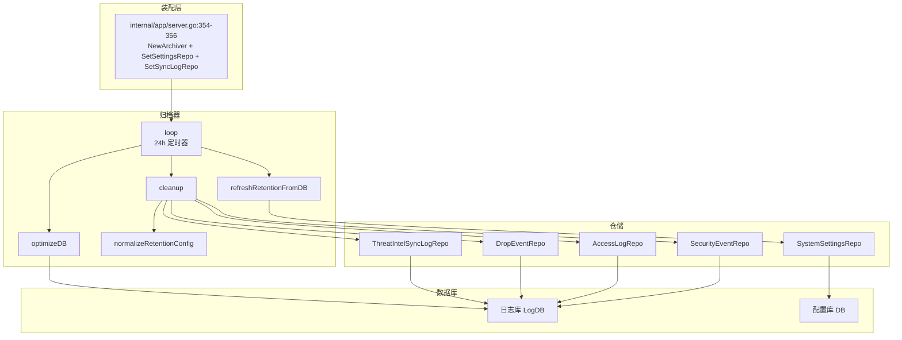
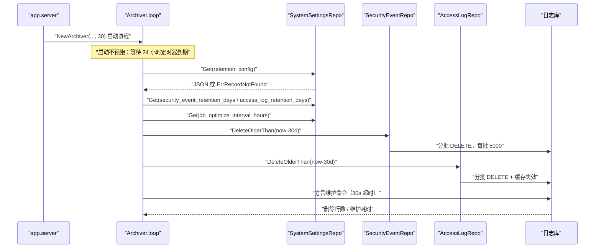
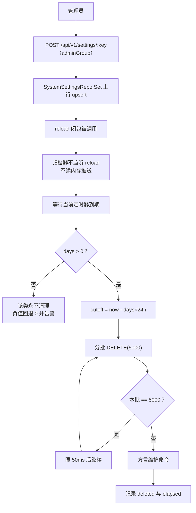
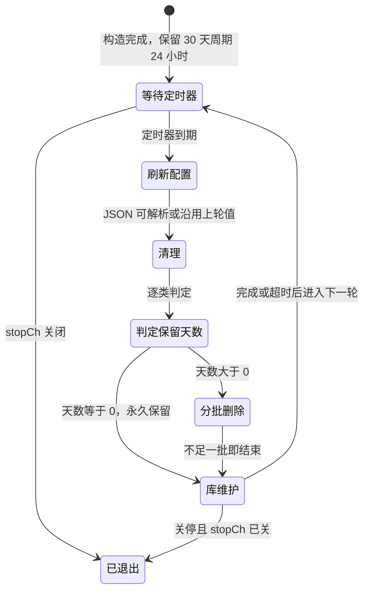
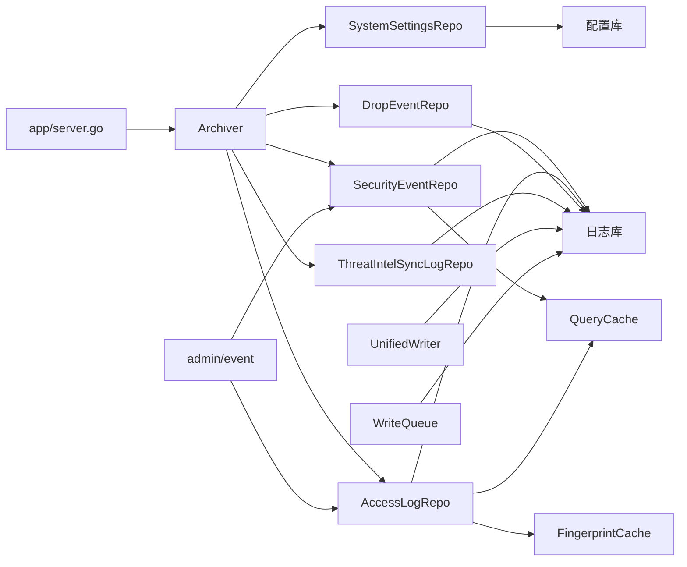
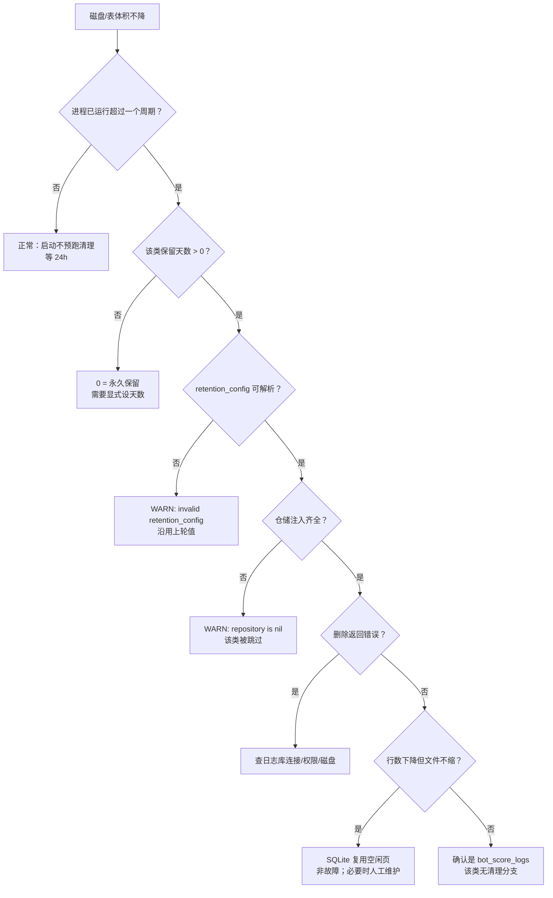

# 事件归档系统

> [返回 监控与可观测性](监控与可观测性.md)

<cite>
**本文档引用的文件**
- [archiver.go](file://internal/observability/archiver.go)
- [unified_writer.go](file://internal/observability/unified_writer.go)
- [write_queue.go](file://internal/observability/write_queue.go)
- [metrics.go](file://internal/observability/metrics.go)
- [events.go](file://internal/store/events.go)
- [security_event.go](file://internal/store/repository/security_event.go)
- [access_log.go](file://internal/store/repository/access_log.go)
- [drop_event.go](file://internal/store/repository/drop_event.go)
- [threat_intel_sync_log.go](file://internal/store/repository/threat/threat_intel_sync_log.go)
- [migrate.go](file://internal/store/migrate.go)
- [single_site.go](file://internal/store/migrations/single_site.go)
- [access_log_fingerprint_key.go](file://internal/store/migrations/access_log_fingerprint_key.go)
- [security_event_rule_info.go](file://internal/store/migrations/security_event_rule_info.go)
- [router.go](file://internal/admin/router.go)
- [system_settings.go](file://internal/store/repository/setting/system_settings.go)
- [server.go](file://internal/app/server.go)
</cite>

## 目录

1. [简介](#简介)
2. [项目结构](#项目结构)
3. [核心组件](#核心组件)
4. [架构总览](#架构总览)
5. [详细组件分析](#详细组件分析)
6. [依赖关系分析](#依赖关系分析)
7. [性能考虑](#性能考虑)
8. [故障排查指南](#故障排查指南)
9. [结论](#结论)
10. [附录](#附录)

## 简介
事件归档系统负责可观测性数据的生命周期收尾：按保留期删除过期记录、在删除后做数据库维护、并保证删除动作不拖垮读写。

三条必须澄清的实测事实，旧文档普遍写错：
- 清理周期是 **24 小时**，由 `defaultArchiverIntervalSeconds = int64(24 * time.Hour / time.Second)` 定义，不是每小时 [archiver.go:56-57](file://internal/observability/archiver.go#L56-L57)。
- 归档器**启动时不预跑清理**：`loop` 用 `time.NewTimer` 等待第一个周期到期才执行「刷新配置 → 清理 → 库维护」三步，因此新进程上线后最早 24 小时才回收空间 [archiver.go:219-242](file://internal/observability/archiver.go#L219-L242)。
- 保留天数 `0` 的语义是**永久保留**，负值会被回退成 0 并打 WARN，而不是「立即清空」 [archiver.go:22-24](file://internal/observability/archiver.go#L22-L24)、[archiver.go:94-104](file://internal/observability/archiver.go#L94-L104)。

归档器不搬数据到冷存储，只做「删除 + 维护」，因此容量规划必须以保留天数为唯一旋钮。

## 项目结构
归档能力集中在 `internal/observability/archiver.go`，通过仓储与日志库交互，由 `internal/app` 装配：

| 模块 | 路径 | 职责 | 核心符号 | 规模(行) | 测试 |
|------|------|------|----------|:--------:|:----:|
| 归档器 | `internal/observability/archiver.go` | 周期清理 + 库维护 + 配置刷新 | `Archiver` | 529 | 有 |
| 事件仓储 | `internal/store/repository/security_event.go` | 分批删除安全事件 | `DeleteOlderThan` | 725 | 有 |
| 日志仓储 | `internal/store/repository/access_log.go` | 分批删除访问日志 + 缓存失效 | `DeleteOlderThan` | 1010 | 有 |
| 丢弃仓储 | `internal/store/repository/drop_event.go` | 分批删除丢弃事件 | `DeleteOlderThan` | 208 | 有 |
| 同步日志仓储 | `internal/store/repository/threat/threat_intel_sync_log.go` | 删除威胁情报同步历史 | `DeleteOlderThan` | 71 | 有 |
| 设置仓储 | `internal/store/repository/setting/system_settings.go` | 读取保留与周期配置 | `Get` | 62 | 有 |
| 日志库迁移 | `internal/store/migrate.go` | 四张表结构 + V12/V13 数据迁移 | `AutoMigrateLogs` | 168 | 有 |
| 装配入口 | `internal/app/server.go` | 创建归档器并注入仓储 | `NewArchiver` | 2121 | 有 |

规模口径为对应文件 `wc -l` 实测；测试列以同名 `_test.go` 是否覆盖该符号为准。

**图表来源**
- [server.go:354-356](file://internal/app/server.go#L354-L356)
- [archiver.go:38-51](file://internal/observability/archiver.go#L38-L51)
- [archiver.go:179-193](file://internal/observability/archiver.go#L179-L193)
- [archiver.go:219-242](file://internal/observability/archiver.go#L219-L242)
- [archiver.go:244-330](file://internal/observability/archiver.go#L244-L330)
- [archiver.go:332-401](file://internal/observability/archiver.go#L332-L401)
- [archiver.go:94-133](file://internal/observability/archiver.go#L94-L133)
- [system_settings.go:38-44](file://internal/store/repository/setting/system_settings.go#L38-L44)

**章节来源**
- [server.go:354-356](file://internal/app/server.go#L354-L356)
- [archiver.go:38-51](file://internal/observability/archiver.go#L38-L51)
- [archiver.go:219-401](file://internal/observability/archiver.go#L219-L401)
- [system_settings.go:38-51](file://internal/store/repository/setting/system_settings.go#L38-L51)

## 核心组件

### 归档器（Archiver）与保留配置
`Archiver` 持有四个删除目标仓储、一个设置仓储、日志库连接与两个原子字段（`retention atomic.Value`、`interval atomic.Int64`），构造即拉起 `loop` 协程 [archiver.go:38-51](file://internal/observability/archiver.go#L38-L51)、[archiver.go:146-176](file://internal/observability/archiver.go#L146-L176)。

| 配置项 | 类型 | 默认（定义位置:行） | 作用域 | 继承语义 |
|--------|------|--------------------|--------|----------|
| `security_event_retention_days` | int | `30`（由 `NewArchiver` 入参传入）[archiver.go:146-155](file://internal/observability/archiver.go#L146-L155)、[server.go:354](file://internal/app/server.go#L354) | 日志库 | 单键存在时覆盖 JSON 内同名字段 |
| `access_log_retention_days` | int | `30` [archiver.go:150-155](file://internal/observability/archiver.go#L150-L155) | 日志库 | 同上，单键优先 [archiver.go:309-311](file://internal/observability/archiver.go#L309-L311) |
| `drop_event_retention_days` | int | `30` [archiver.go:150-155](file://internal/observability/archiver.go#L150-L155) | 日志库 | 只能由 `retention_config` 设置，无独立单键分支 [archiver.go:306-311](file://internal/observability/archiver.go#L306-L311) |
| `stats_retention_days` | int | `7` [archiver.go:55](file://internal/observability/archiver.go#L55) | 解析与归一化 | 仅被读取与钳制，**当前无消费方** [archiver.go:111](file://internal/observability/archiver.go#L111)、[archiver.go:336-401](file://internal/observability/archiver.go#L336-L401) |
| `db_optimize_interval_hours` | int | `24`（小时）[archiver.go:56-57](file://internal/observability/archiver.go#L56-L57) | 归档循环 | 非正回落 24 小时并告警 [archiver.go:125-133](file://internal/observability/archiver.go#L125-L133) |
| 保留天数上界 | int | `Duration` 可表示的整天数 | 全部四项 | 超出截断到上界并告警 [archiver.go:59-64](file://internal/observability/archiver.go#L59-L64) |

`retention_config` 是 JSON 设置行，四个字段与上表逐一对应；每轮循环开始时读取一次，解析失败保留上一轮值并打 WARN [archiver.go:25-30](file://internal/observability/archiver.go#L25-L30)、[archiver.go:254-272](file://internal/observability/archiver.go#L254-L272)。

**章节来源**
- [archiver.go:20-69](file://internal/observability/archiver.go#L20-L69)
- [archiver.go:94-176](file://internal/observability/archiver.go#L94-L176)
- [archiver.go:244-330](file://internal/observability/archiver.go#L244-L330)
- [server.go:354-356](file://internal/app/server.go#L354-L356)

### 清理与库维护
`cleanup` 对四类数据分别判 `days > 0` 后才构造 cutoff 并删除，四类互相独立，单类失败只记错误不中断其余类 [archiver.go:332-401](file://internal/observability/archiver.go#L332-L401)。威胁情报同步日志刻意复用 `DropEventDays`，注释明确理由是「同类运维辅助日志」 [archiver.go:186-193](file://internal/observability/archiver.go#L186-L193)、[archiver.go:387-400](file://internal/observability/archiver.go#L387-L400)。

`optimizeDB` 在清理之后按方言执行维护，统一 30 秒超时，未知方言跳过并告警 [archiver.go:68](file://internal/observability/archiver.go#L68)、[archiver.go:409-444](file://internal/observability/archiver.go#L409-L444)：

| 方言 | 维护命令 | 位置 | 设计意图 |
|------|----------|------|----------|
| sqlite | `PRAGMA optimize`、`wal_checkpoint(PASSIVE)`、`wal_checkpoint(TRUNCATE)` | [archiver.go:446-472](file://internal/observability/archiver.go#L446-L472) | 只更新必要统计、被动落盘再把 WAL 截断归零；刻意不每日 `VACUUM` |
| mysql | `OPTIMIZE TABLE` + `ANALYZE TABLE`，四张表 | [archiver.go:474-495](file://internal/observability/archiver.go#L474-L495) | 回收碎片并刷新统计 |
| postgres | `VACUUM ANALYZE`，四张表 | [archiver.go:497-511](file://internal/observability/archiver.go#L497-L511) | 一步完成空间回收与统计更新 |
| 其他 | 不执行 | [archiver.go:513-529](file://internal/observability/archiver.go#L513-L529) | 方言名由 `db.Dialector.Name()` 判定 |

**章节来源**
- [archiver.go:186-193](file://internal/observability/archiver.go#L186-L193)
- [archiver.go:332-529](file://internal/observability/archiver.go#L332-L529)

### 分批删除的仓储实现
三个主表的 `DeleteOlderThan` 形态一致：以 `id IN (SELECT id ... LIMIT 5000)` 分批删，累计行数，不足一批即退出；安全事件与访问日志每批之间睡 50ms，访问日志还在进入循环前先失效指纹缓存与 COUNT 缓存 [security_event.go:410-432](file://internal/store/repository/security_event.go#L410-L432)、[access_log.go:856-880](file://internal/store/repository/access_log.go#L856-L880)、[drop_event.go:167-190](file://internal/store/repository/drop_event.go#L167-L190)。

`runArchiverDelete` 把仓储 panic 转成 error，避免单表异常杀死整个归档循环 [archiver.go:137-144](file://internal/observability/archiver.go#L137-L144)。

**章节来源**
- [archiver.go:137-144](file://internal/observability/archiver.go#L137-L144)
- [security_event.go:410-432](file://internal/store/repository/security_event.go#L410-L432)
- [access_log.go:856-880](file://internal/store/repository/access_log.go#L856-L880)
- [drop_event.go:167-190](file://internal/store/repository/drop_event.go#L167-L190)

## 架构总览
归档器与写入链路共用日志库，因此它的每一次删除都与写入侧的批事务在锁上相遇；这也是把清理周期放宽到 24 小时、并把删除拆成 5000 行一批的直接原因。

**图表来源**
- [server.go:354-356](file://internal/app/server.go#L354-L356)
- [archiver.go:219-242](file://internal/observability/archiver.go#L219-L242)
- [archiver.go:244-330](file://internal/observability/archiver.go#L244-L330)
- [archiver.go:332-401](file://internal/observability/archiver.go#L332-L401)
- [archiver.go:409-444](file://internal/observability/archiver.go#L409-L444)
- [security_event.go:410-432](file://internal/store/repository/security_event.go#L410-L432)
- [access_log.go:856-880](file://internal/store/repository/access_log.go#L856-L880)

**章节来源**
- [archiver.go:219-444](file://internal/observability/archiver.go#L219-L444)
- [server.go:354-356](file://internal/app/server.go#L354-L356)

### 流程步骤表

| 步 | 动作 | 执行位置 | 输入 | 输出 | 失败分支 | 可观测点 |
|:--:|------|----------|------|------|----------|----------|
| 1 | 构造并入队协程 | [archiver.go:146-176](file://internal/observability/archiver.go#L146-L176) | `retentionDays=30` | `Archiver` + goroutine | 非正天数回落 30 | 启动日志 |
| 2 | 计算本轮间隔 | [archiver.go:223-231](file://internal/observability/archiver.go#L223-L231) | `interval` 原子值 | 秒数 | 非法则回落并 WARN | `effective_interval_seconds` |
| 3 | 定时器等待 | [archiver.go:231-241](file://internal/observability/archiver.go#L231-L241) | `time.Timer` | 触发或退出 | `stopCh` 关闭直接返回 | 无 |
| 4 | 刷新配置 | [archiver.go:244-330](file://internal/observability/archiver.go#L244-L330) | 4 个设置键 | 新 `RetentionConfig` | 解析失败保留旧值并 WARN | `keeping the previous value` |
| 5 | 归一化 | [archiver.go:94-113](file://internal/observability/archiver.go#L94-L113) | 四项天数 | 钳制后值 | 负值→0，超界→上界 | WARN 文本 |
| 6 | 逐类删除 | [archiver.go:341-400](file://internal/observability/archiver.go#L341-L400) | cutoff | 删除条数 | `days=0` 跳过；仓储 nil 跳过并 WARN | `cleaned old ...` |
| 7 | 分批执行 | [security_event.go:413-431](file://internal/store/repository/security_event.go#L413-L431) | 每批 5000 | 累计行数 | 出错返回已累计值 | 事务错误日志 |
| 8 | 缓存失效 | [security_event.go:421-426](file://internal/store/repository/security_event.go#L421-L426) | 前缀 | 计数过期 | 无 | 列表 total 一致 |
| 9 | 库维护 | [archiver.go:409-511](file://internal/observability/archiver.go#L409-L511) | 方言 | 维护完成 | 30s 超时后记错误 | `database optimized` + `elapsed` |
| 10 | 关停 | [archiver.go:207-217](file://internal/observability/archiver.go#L207-L217) | `stopCh` | `wg.Wait` 返回 | 阻塞至本轮结束 | `defer archiver.Close()`（[server.go:357](file://internal/app/server.go#L357)） |

**章节来源**
- [archiver.go:94-444](file://internal/observability/archiver.go#L94-L444)
- [security_event.go:410-432](file://internal/store/repository/security_event.go#L410-L432)
- [server.go:354-356](file://internal/app/server.go#L354-L356)

## 详细组件分析

### 关键符号的代码上下文

| 符号 | 位置 | 职责 | 上游调用者 | 下游依赖 | 副作用 | 影响面 |
|------|------|------|------------|----------|--------|--------|
| `NewArchiver` | [archiver.go:146](file://internal/observability/archiver.go#L146) | 建实例并拉起循环 | `app/server.go:354` | 四仓储、`normalizeRetentionConfig` | 启动后台协程 | 高 |
| `Archiver.loop` | [archiver.go:219](file://internal/observability/archiver.go#L219) | 周期驱动 | 自身协程 | `refreshRetentionFromDB`、`cleanup`、`optimizeDB` | 删数据、执行维护命令 | 高 |
| `refreshRetentionFromDB` | [archiver.go:244](file://internal/observability/archiver.go#L244) | 读设置覆盖内存值 | `loop` | `SystemSettingsRepo.Get` | 改 `retention`/`interval` | 高 |
| `cleanup` | [archiver.go:332](file://internal/observability/archiver.go#L332) | 四类删除 | `loop` | 四个仓储 `DeleteOlderThan` | 不可逆删数据 | 高 |
| `optimizeDB` | [archiver.go:409](file://internal/observability/archiver.go#L409) | 方言维护 | `loop` | `detectDriver`、原生命令 | 改存储状态 | 中 |
| `SetRetention` | [archiver.go:196](file://internal/observability/archiver.go#L196) | 内存直改保留配置 | 仅测试代码 | `normalizeRetentionConfig` | 改保留值 | 低：运行期无调用方 |
| `SetSyncLogRepo` | [archiver.go:188](file://internal/observability/archiver.go#L188) | 启用同步日志清理 | `app/server.go:356` | `ThreatIntelSyncLogRepo` | 扩大删除面 | 中 |

`SetRetention` 值得单独标注：全仓检索显示它只被 `archiver_test.go` 调用，生产路径的配置注入一律走设置键 + 下一轮刷新，因此「改配置立即生效」并不成立，最坏要等一个 24 小时周期 [archiver.go:196-205](file://internal/observability/archiver.go#L196-L205)、[server.go:354-356](file://internal/app/server.go#L354-L356)。

**章节来源**
- [archiver.go:146-444](file://internal/observability/archiver.go#L146-L444)
- [server.go:354-356](file://internal/app/server.go#L354-L356)

### 保留策略与数据分层
四类可观测数据处于三个不同寿命层，各自的到期方式不同：

| 数据 | 存储位置 | 到期机制 | 周期 | 出处 |
|------|----------|----------|:----:|------|
| 安全事件 | 日志库 `security_events` | 按 `created_at` 分批 DELETE | 24h | [archiver.go:341-357](file://internal/observability/archiver.go#L341-L357) |
| 访问日志 | 日志库 `access_logs` | 同上，并失效指纹与计数缓存 | 24h | [archiver.go:359-371](file://internal/observability/archiver.go#L359-L371)、[access_log.go:856-861](file://internal/store/repository/access_log.go#L856-L861) |
| 丢弃事件 | 日志库 `drop_events` | 分批 DELETE | 24h | [archiver.go:373-385](file://internal/observability/archiver.go#L373-L385) |
| 威胁情报同步日志 | 日志库 | 复用 `drop_event_retention_days`，同样每批 5000 | 24h | [archiver.go:387-400](file://internal/observability/archiver.go#L387-L400)、[threat_intel_sync_log.go:53-71](file://internal/store/repository/threat/threat_intel_sync_log.go#L53-L71) |
| 机器人评分日志 | 日志库 `bot_score_logs` | **无清理分支**，仅参与方言维护 | — | [archiver.go:332-401](file://internal/observability/archiver.go#L332-L401)、[archiver.go:479](file://internal/observability/archiver.go#L479) |
| Redis 实时列表 | `openwaf:security_events` 等 | `LTRIM` + `EXPIRE 7 天` | 每次 flush | [unified_writer.go:1103-1152](file://internal/observability/unified_writer.go#L1103-L1152) |
| COUNT 缓存 | 进程内查询缓存 | 5 秒 TTL | 即时 | [server.go:317-320](file://internal/app/server.go#L317-L320) |

`bot_score_logs` 与 `stats_retention_days` 是两处真实缺口：前者只会被 `OPTIMIZE`/`ANALYZE`/`VACUUM` 反复处理而永不清理，后者被读取归一化却没有任何消费方。容量规划时不能把两者当作已受保留策略约束。

**章节来源**
- [archiver.go:332-401](file://internal/observability/archiver.go#L332-L401)
- [archiver.go:474-511](file://internal/observability/archiver.go#L474-L511)
- [threat_intel_sync_log.go:53-71](file://internal/store/repository/threat/threat_intel_sync_log.go#L53-L71)
- [access_log.go:856-861](file://internal/store/repository/access_log.go#L856-L861)
- [unified_writer.go:1103-1152](file://internal/observability/unified_writer.go#L1103-L1152)
- [server.go:317-320](file://internal/app/server.go#L317-L320)

### 配置写入路径与生效边界
保留配置没有专用端点，只能通过通用设置写入口落库，再由下一轮归档循环读取：

**图表来源**
- [router.go:376-378](file://internal/admin/router.go#L376-L378)
- [system_settings.go:46-51](file://internal/store/repository/setting/system_settings.go#L46-L51)
- [archiver.go:94-133](file://internal/observability/archiver.go#L94-L133)
- [archiver.go:219-242](file://internal/observability/archiver.go#L219-L242)
- [archiver.go:332-401](file://internal/observability/archiver.go#L332-L401)
- [security_event.go:410-432](file://internal/store/repository/security_event.go#L410-L432)

**章节来源**
- [router.go:376-378](file://internal/admin/router.go#L376-L378)
- [system_settings.go:22-62](file://internal/store/repository/setting/system_settings.go#L22-L62)
- [archiver.go:94-133](file://internal/observability/archiver.go#L94-L133)
- [archiver.go:219-401](file://internal/observability/archiver.go#L219-L401)

### 兼容矩阵：不同部署形态下的归档行为

| 能力 | sqlite | mysql | postgres | 备注 |
|------|:------:|:-----:|:--------:|------|
| 按保留期删除 | ✓ | ✓ | ✓ | 同一 `DeleteOlderThan` 形态 |
| 统计信息更新 | ✓ | ✓ | ✓ | `PRAGMA optimize` / `ANALYZE` / `VACUUM ANALYZE` |
| WAL 文件回收 | ✓ | ✗ | ✗ | 仅 sqlite 有 `wal_checkpoint` 两步 [archiver.go:460-470](file://internal/observability/archiver.go#L460-L470) |
| 每日 VACUUM 收缩文件 | ✗ | ✗ | 部分 | 明确不执行；postgres 侧只有 `VACUUM ANALYZE` [archiver.go:458-460](file://internal/observability/archiver.go#L458-L460) |
| 维护超时保护 | ✓ | ✓ | ✓ | 统一 30s [archiver.go:68](file://internal/observability/archiver.go#L68) |
| 未知方言 | — | — | — | 跳过并 WARN，不报错 [archiver.go:432-434](file://internal/observability/archiver.go#L432-L434) |

**章节来源**
- [archiver.go:68](file://internal/observability/archiver.go#L68)
- [archiver.go:409-529](file://internal/observability/archiver.go#L409-L529)

### 归档循环状态机
循环体是一台只有少数内部状态的机器：等待、刷新、清理、判定、删除、维护。间隔值本身也是状态的一部分——每轮都重新从原子字段读取，因此改 `db_optimize_interval_hours` 会在**下一轮**改变等待时长，而不会打断当前定时器；`normalizeArchiverIntervalSeconds` 对非正值回落 24 小时、超上界截断并打 WARN，属于「等待」状态的自环修正而不是独立状态 [archiver.go:115-123](file://internal/observability/archiver.go#L115-L123)、[archiver.go:223-230](file://internal/observability/archiver.go#L223-L230)。

**图表来源**
- [archiver.go:146-176](file://internal/observability/archiver.go#L146-L176)
- [archiver.go:207-242](file://internal/observability/archiver.go#L207-L242)
- [archiver.go:115-133](file://internal/observability/archiver.go#L115-L133)
- [archiver.go:244-330](file://internal/observability/archiver.go#L244-L330)
- [archiver.go:332-401](file://internal/observability/archiver.go#L332-L401)
- [archiver.go:409-444](file://internal/observability/archiver.go#L409-L444)

**章节来源**
- [archiver.go:115-133](file://internal/observability/archiver.go#L115-L133)
- [archiver.go:146-176](file://internal/observability/archiver.go#L146-L176)
- [archiver.go:207-444](file://internal/observability/archiver.go#L207-L444)

## 依赖关系分析
- 归档器只依赖仓储接口与日志库连接，不依赖快照、引擎或数据面，因此清理逻辑与检测逻辑互不耦合。
- 配置读取走配置库的 `system_settings`，而删除走日志库，两个 `*gorm.DB` 在不同文件上；SQLite 部署下这也是「日志膨胀不拖累配置读写」的分库理由 [archiver.go:244-330](file://internal/observability/archiver.go#L244-L330)、[server.go:354](file://internal/app/server.go#L354)。
- 指标侧没有归档器专属项：`metrics.go` 只暴露写入器与写队列族（`openwaf_writer_*`、`openwaf_write_queue_*`），归档效果只能靠日志与行数核对 [metrics.go:773-870](file://internal/observability/metrics.go#L773-L870)。

**图表来源**
- [archiver.go:38-51](file://internal/observability/archiver.go#L38-L51)
- [archiver.go:179-193](file://internal/observability/archiver.go#L179-L193)
- [archiver.go:244-330](file://internal/observability/archiver.go#L244-L330)
- [server.go:317-356](file://internal/app/server.go#L317-L356)
- [unified_writer.go:25-45](file://internal/observability/unified_writer.go#L25-L45)
- [write_queue.go:173-203](file://internal/observability/write_queue.go#L173-L203)
- [access_log.go:856-861](file://internal/store/repository/access_log.go#L856-L861)

**章节来源**
- [archiver.go:38-193](file://internal/observability/archiver.go#L38-L193)
- [archiver.go:244-330](file://internal/observability/archiver.go#L244-L330)
- [server.go:317-356](file://internal/app/server.go#L317-L356)
- [unified_writer.go:25-45](file://internal/observability/unified_writer.go#L25-L45)
- [write_queue.go:173-203](file://internal/observability/write_queue.go#L173-L203)
- [access_log.go:856-861](file://internal/store/repository/access_log.go#L856-L861)

## 性能考虑
- 分批 + 睡眠：5000 行一批、批间 50ms，把长事务拆成短事务，给写入侧的批事务留出锁窗口 [security_event.go:410-432](file://internal/store/repository/security_event.go#L410-L432)。
- 不做每日 VACUUM：注释明确「被删除的页仍可被 SQLite 复用」，无条件 `VACUUM` 会带来整库重写成本，因此改用两次 `wal_checkpoint`，其中 `TRUNCATE` 专门回收长尾 WAL [archiver.go:452-470](file://internal/observability/archiver.go#L452-L470)。
- 维护有超时：30 秒 `context` 上限，驱动不响应时不会阻塞进程关停 [archiver.go:66-68](file://internal/observability/archiver.go#L66-L68)。
- panic 隔离：删除与维护都包了 `recover`，单表异常不影响循环存活 [archiver.go:137-144](file://internal/observability/archiver.go#L137-L144)、[archiver.go:413-417](file://internal/observability/archiver.go#L413-L417)。
- 周期与保留期联动：周期越长，删除后的空间释放越滞后；周期越短，扫描与 `ANALYZE` 开销越频繁。24 小时是当前折中，可通过 `db_optimize_interval_hours` 调整 [archiver.go:56-57](file://internal/observability/archiver.go#L56-L57)、[archiver.go:313-329](file://internal/observability/archiver.go#L313-L329)。

**章节来源**
- [archiver.go:66-144](file://internal/observability/archiver.go#L66-L144)
- [archiver.go:409-470](file://internal/observability/archiver.go#L409-L470)
- [security_event.go:410-432](file://internal/store/repository/security_event.go#L410-L432)

## 故障排查指南
空间未回收的成因排查按决策树走：

**图表来源**
- [archiver.go:219-242](file://internal/observability/archiver.go#L219-L242)
- [archiver.go:244-330](file://internal/observability/archiver.go#L244-L330)
- [archiver.go:332-401](file://internal/observability/archiver.go#L332-L401)
- [archiver.go:446-472](file://internal/observability/archiver.go#L446-L472)

配套日志关键字与含义：

| 日志片段 | 含义 | 出处 |
|----------|------|------|
| `archiver: cleaned old security events` | 本轮删除成功，含 `deleted` 与 `older_than` | [archiver.go:352-354](file://internal/observability/archiver.go#L352-L354) |
| `archiver: security event repository is nil, skipping cleanup` | 注入缺失 | [archiver.go:343-345](file://internal/observability/archiver.go#L343-L345) |
| `archiver: invalid retention_config, keeping the previous value` | JSON 解析失败 | [archiver.go:269-271](file://internal/observability/archiver.go#L269-L271) |
| `db_optimize_interval_hours=... is invalid, falling back to 24 hours` | 周期回落 | [archiver.go:126-128](file://internal/observability/archiver.go#L126-L128) |
| `archiver: database optimized` | 维护完成，含 `driver` 与 `elapsed` | [archiver.go:440-442](file://internal/observability/archiver.go#L440-L442) |
| `archiver: unknown DB driver, skip optimization` | 方言未识别 | [archiver.go:432-434](file://internal/observability/archiver.go#L432-L434) |

**章节来源**
- [archiver.go:126-128](file://internal/observability/archiver.go#L126-L128)
- [archiver.go:219-472](file://internal/observability/archiver.go#L219-L472)

## 结论
事件归档系统是一个刻意保持简单的收尾组件：一个协程、一个定时器、四类删除目标、三段方言维护命令，配置只从 `system_settings` 读，删除只按 `created_at` 判。24 小时周期与 5000 行分批是在「及时回收」与「不干扰读写」之间的明确取舍，`PRAGMA` 双步 checkpoint 而非每日 VACUUM 也是对 SQLite 特性的针对性选择。

需要留意的三处事实边界：启动后第一个周期不会预清理，保留天数为 0 表示永久保留，`bot_score_logs` 与 `stats_retention_days` 目前不构成有效保留闭环。建议把保留天数与 `db_optimize_interval_hours` 纳入部署清单，并用删除日志的行数作为容量核对的唯一依据。

## 附录

### 归档器可调项速查

| 项 | 载体 | 默认 | 取值边界 | 生效延迟 |
|----|------|:----:|----------|:--------:|
| 事件保留 | `retention_config.security_event_retention_days` 或同名单键 | 30 | `0` 永久；负→0；超界截断 | 下一个周期 |
| 访问日志保留 | `retention_config.access_log_retention_days` 或同名单键 | 30 | 同上 | 下一个周期 |
| 丢弃事件保留 | `retention_config.drop_event_retention_days` | 30 | 同上 | 下一个周期 |
| 统计保留 | `retention_config.stats_retention_days` | 7 | 归一化但不消费 | 无效 |
| 清理周期 | `db_optimize_interval_hours` | 24 | 非正→24；超界截断 | 本轮读下轮用 |
| 维护超时 | 代码常量 | 30s | 不可配 | 即时 |

**章节来源**
- [archiver.go:53-69](file://internal/observability/archiver.go#L53-L69)
- [archiver.go:94-133](file://internal/observability/archiver.go#L94-L133)
- [archiver.go:244-330](file://internal/observability/archiver.go#L244-L330)

### 表结构与迁移兼容
日志库表结构由 `AutoMigrateLogs` 统一维护，随后跑两支数据迁移：V12 为 `access_logs` 补 `fingerprint_key` 列与索引并回填历史行，V13 为 `security_events` 补齐规则解释字段（含 `references`，因是 SQL 保留字需按方言加引号选择）[migrate.go:126-139](file://internal/store/migrate.go#L126-L139)、[access_log_fingerprint_key.go:41-70](file://internal/store/migrations/access_log_fingerprint_key.go#L41-L70)、[security_event_rule_info.go:34-58](file://internal/store/migrations/security_event_rule_info.go#L34-L58)、[security_event.go:80-104](file://internal/store/repository/security_event.go#L80-L104)。

主库侧的历史迁移是 `V2MigrateSingleSite`：补齐 `sites` 新列、搬运 `listeners` 与 `forwarding_profiles` 数据，再把两张旧表 `RENAME TO *_backup_<时间戳>` 留作回滚依据，这是「归档即重命名备份」的唯一实现处 [migrate.go:22-24](file://internal/store/migrate.go#L22-L24)、[single_site.go:10-44](file://internal/store/migrations/single_site.go#L10-L44)。

安全事件的 9 个索引（`idx_se_created`、`idx_se_site_created`、`idx_se_site_created_id`、`idx_se_request_id`、`idx_se_client_ip`、`idx_se_host`、`idx_se_rule_id_str`、`idx_se_action`、`idx_se_category`）是清理与查询共同的依赖面：删除按 `created_at` 走 `idx_se_created`，列表按站点时间窗走 `idx_se_site_created` [events.go:15-76](file://internal/store/events.go#L15-L76)。

**章节来源**
- [migrate.go:20-139](file://internal/store/migrate.go#L20-L139)
- [single_site.go:10-44](file://internal/store/migrations/single_site.go#L10-L44)
- [access_log_fingerprint_key.go:41-70](file://internal/store/migrations/access_log_fingerprint_key.go#L41-L70)
- [security_event_rule_info.go:34-58](file://internal/store/migrations/security_event_rule_info.go#L34-L58)
- [events.go:15-76](file://internal/store/events.go#L15-L76)
- [security_event.go:80-104](file://internal/store/repository/security_event.go#L80-L104)

### 备份与恢复要点
- 配置库与日志库分别备份；日志库只增，快照式备份即可，恢复后重启会自动执行 `AutoMigrateLogs` 对齐结构 [migrate.go:126-139](file://internal/store/migrate.go#L126-L139)。
- 控制面另有 `GET /api/v1/backup/export` 与 `POST /api/v1/backup/import` 两个通道，导入后会调用 reload [router.go:381-382](file://internal/admin/router.go#L381-L382)。
- 恢复后归档器仍在 24 小时周期上，不会因为导入数据而立即删除；若导入的是超出保留期的历史数据，需预期它在下一个周期被清掉 [archiver.go:219-242](file://internal/observability/archiver.go#L219-L242)、[archiver.go:341-357](file://internal/observability/archiver.go#L341-L357)。

**章节来源**
- [router.go:381-382](file://internal/admin/router.go#L381-L382)
- [migrate.go:126-139](file://internal/store/migrate.go#L126-L139)
- [archiver.go:219-357](file://internal/observability/archiver.go#L219-L357)
