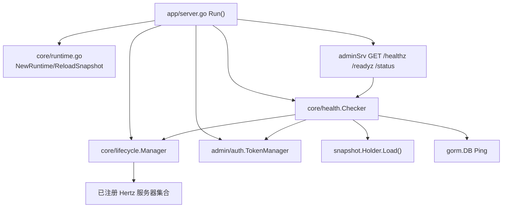
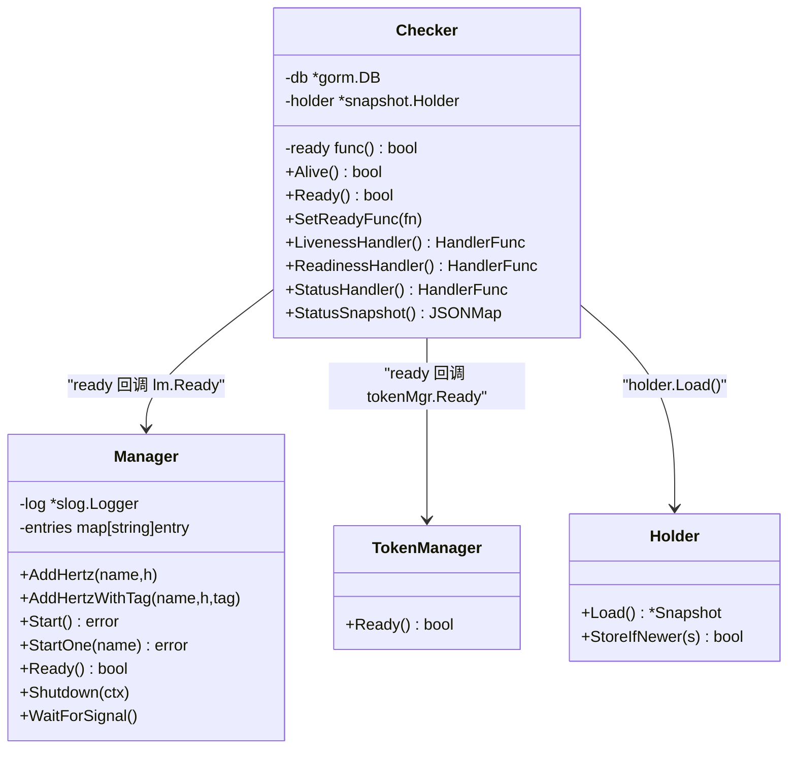
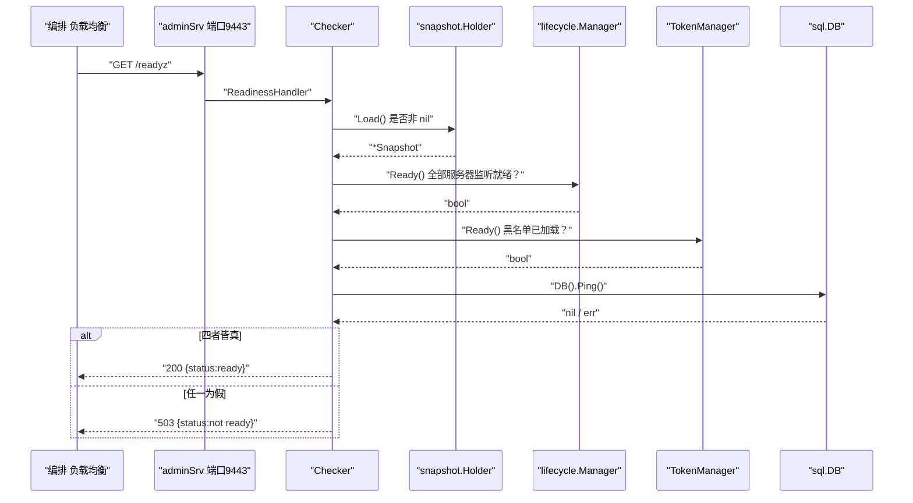
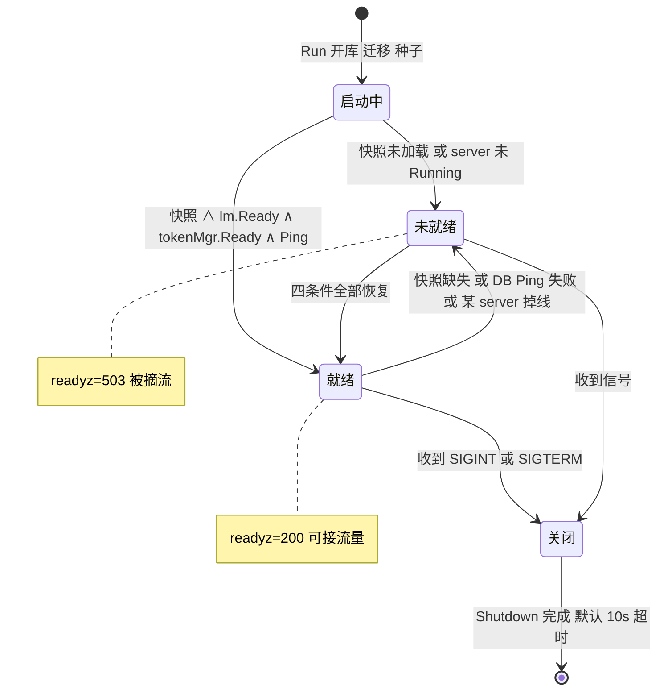
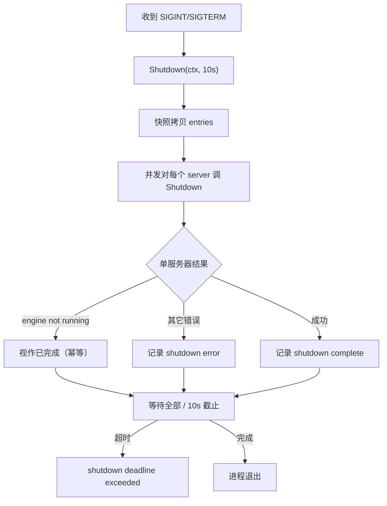
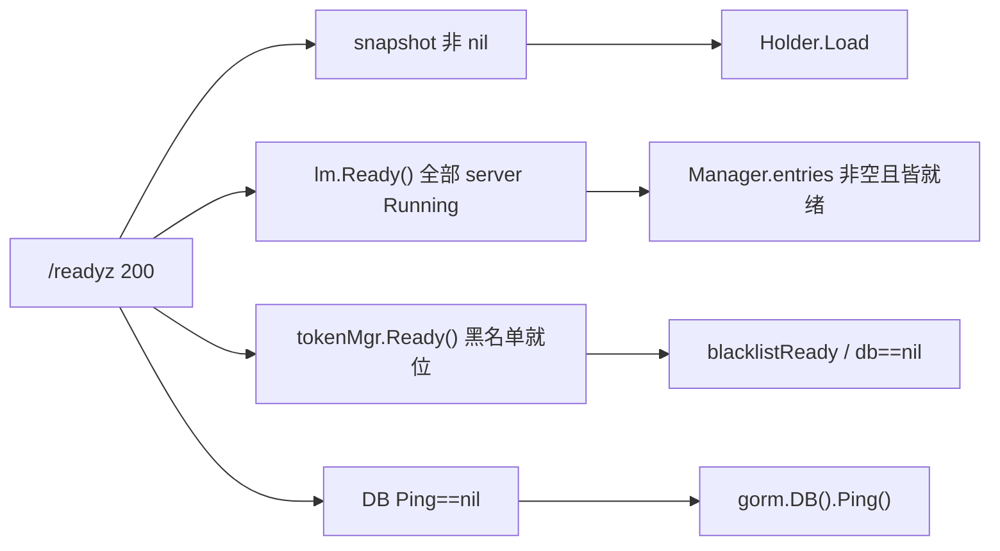

# 健康检查机制

> [返回 监控与可观测性](监控与可观测性.md)

<cite>
**本文档引用的文件**
- [internal/core/health/health.go](file://internal/core/health/health.go)
- [internal/core/lifecycle/lifecycle.go](file://internal/core/lifecycle/lifecycle.go)
- [internal/admin/auth/jwt.go](file://internal/admin/auth/jwt.go)
- [internal/snapshot/snapshot.go](file://internal/snapshot/snapshot.go)
- [internal/core/runtime.go](file://internal/core/runtime.go)
- [internal/app/server.go](file://internal/app/server.go)
</cite>

## 目录

1. [简介](#简介)
2. [项目结构](#项目结构)
3. [核心组件](#核心组件)
4. [架构总览](#架构总览)
5. [详细组件分析](#详细组件分析)
6. [依赖关系分析](#依赖关系分析)
7. [性能考虑](#性能考虑)
8. [故障排查指南](#故障排查指南)
9. [结论](#结论)
10. [附录](#附录)

## 简介

My-OpenWaf 在**管理端口**（默认 `:9443`，明文 HTTP）上提供三个探针：存活 `/healthz`、就绪 `/readyz`、状态 `/status`。健康判定与生命周期管理解耦：`Checker` 只负责读状态并回码，`lifecycle.Manager` 负责多服务器的启动、就绪等待与优雅关闭，`TokenManager` 负责认证黑名单是否就绪。

关键事实（必须与运行码一致）：

- `/readyz` 就绪条件是四者同时成立——**快照非 nil ∧ `lm.Ready()` ∧ `tokenMgr.Ready()` ∧ 数据库 Ping**（`health.go:32-44` 经 `server.go:629` 注入的 `ready` 回调组合而成）。不是「仅快照 + DB」两项。
- `/healthz` 的 `Alive()` **恒返回 true**（`health.go:29`），即存活探针只要进程能响应即 200，不做任何下游检查。
- `/metrics`、`/readyz`、`/healthz`、`/status` 都挂在 `adminSrv`（`server.go:1053-1056`），属控制面端口，不在数据面监听器上。
- Redis 不参与就绪判定：可选依赖，不可用时进程优雅降级而非 `not ready`（`runtime.go:99-116`）。

探针编排、指标与事件等域级内容见 [监控与可观测性](监控与可观测性.md)；指标名口径见 [性能指标收集](性能指标收集.md)。

## 项目结构

健康相关代码集中在三个小模块，由 `server.go` 装配：

| 模块 | 文件 | 职责 | 关键符号 |
|---|---|---|---|
| 探针判定 | `internal/core/health/health.go` | Alive/Ready 与三个 handler | `Checker`、`ReadinessHandler`、`StatusSnapshot` |
| 生命周期 | `internal/core/lifecycle/lifecycle.go` | 多服务器启停、就绪等待、信号处理 | `Manager`、`Start`、`waitReady`、`Ready` |
| 认证就绪 | `internal/admin/auth/jwt.go` | 黑名单是否成功加载 | `TokenManager.Ready` |
| 快照持有 | `internal/snapshot/snapshot.go` | 原子指针存当前快照 | `Holder.Load` |
| 装配 | `internal/app/server.go` | 构造、注入 ready 回调、注册路由 | `health.New`、`lifecycle.New`、`SetReadyFunc` |
| 运行环境 | `internal/core/runtime.go` | 开库、可选 Redis、构建快照 | `NewRuntime`、`ReloadSnapshot` |



**图表来源**
- [internal/app/server.go:595-629](file://internal/app/server.go#L595-L629)
- [internal/app/server.go:1052-1056](file://internal/app/server.go#L1052-L1056)
- [internal/core/health/health.go:14-44](file://internal/core/health/health.go#L14-L44)

**章节来源**
- [internal/app/server.go:595-629](file://internal/app/server.go#L595-L629)

## 核心组件

- `Checker`（`health.go:14-24`）：持 `db *gorm.DB`、`holder *snapshot.Holder`、`ready func() bool`。`New(db, holder)` 构造，`SetReadyFunc` 注入外部就绪判据。
- `LivenessHandler`/`ReadinessHandler`/`StatusHandler`（`health.go:47-73`）：三个 Hertz handler，分别绑 `Alive()`、`Ready()`、`StatusSnapshot()`。
- `lifecycle.Manager`（`lifecycle.go:65-83`）：`entries map[string]entry` 管任意可停止服务器；`Ready()` 聚合所有条目就绪位。
- `TokenManager.Ready`（`jwt.go:67-69`）：`tm != nil && (db == nil || blacklistReady.Load())`——轻量调用方不持久化吊销（db 为 nil）时同样视为就绪。



**图表来源**
- [internal/core/health/health.go:14-105](file://internal/core/health/health.go#L14-L105)
- [internal/core/lifecycle/lifecycle.go:65-243](file://internal/core/lifecycle/lifecycle.go#L65-L243)
- [internal/admin/auth/jwt.go:67-69](file://internal/admin/auth/jwt.go#L67-L69)

**章节来源**
- [internal/core/health/health.go:14-105](file://internal/core/health/health.go#L14-L105)
- [internal/core/lifecycle/lifecycle.go:65-83](file://internal/core/lifecycle/lifecycle.go#L65-L83)

## 架构总览

就绪探针在每次 `/readyz` 请求时**实时**计算四条件交集，任一失败即 503；外部编排据此摘除流量。存活探针不依赖下游，仅证明进程可达。



**图表来源**
- [internal/core/health/health.go:32-66](file://internal/core/health/health.go#L32-L66)
- [internal/app/server.go:629](file://internal/app/server.go#L629)

## 详细组件分析

### 探针清单

| 端点 | 方法 | 语义 | 判定条件（代码行） | 失败影响 |
|---|---|---|---|---|
| `/healthz` | GET | 存活 | `Alive()` 恒 true（`health.go:29`、`47-55`） | 仅端口未起/进程死才失败；编排据此重启容器 |
| `/readyz` | GET | 就绪 | 快照非 nil（`health.go:33`）∧ `c.ready()`（:36，=`lm.Ready() && tokenMgr.Ready()`，`server.go:629`）∧ DB `Ping`（:39-43） | 503 → 不接生产流量；恢复后自动回 200 |
| `/status` | GET | 状态查询 | 无判定，恒 200 输出运行时（`health.go:69-105`） | 观测/自动化取数，不参与编排决策 |

就绪判定内部短路顺序（`health.go:32-44`）：先 `holder.Load()==nil` 立刻 false；再 `ready` 回调为 false 立刻 false；最后取 `db.DB()`，`sqlDB.Ping()` 非 nil 即 false。`/healthz` 与 `/readyz` 的成功体分别是 `{"status":"ok"}` 与 `{"status":"ready"}`。

**章节来源**
- [internal/core/health/health.go:29-66](file://internal/core/health/health.go#L29-L66)
- [internal/app/server.go:1053-1056](file://internal/app/server.go#L1053-L1056)

### 启动到就绪：状态流转

进程从冷启动到可接流量经历「启动中 → 就绪」，运行期可在「就绪 ↔ 未就绪」间迁移，收到信号后进入「关闭」。`Alive` 是贯穿全程的独立位（除进程退出外恒真）。



**图表来源**
- [internal/core/health/health.go:32-44](file://internal/core/health/health.go#L32-L44)
- [internal/core/lifecycle/lifecycle.go:185-243](file://internal/core/lifecycle/lifecycle.go#L185-L243)
- [internal/app/server.go:1131-1132](file://internal/app/server.go#L1131-L1132)

### 启动就绪流程步骤

| 步 | 动作 | 执行位置 | 输入 | 输出 | 失败分支 | 可观测点 |
|:--:|---|---|---|---|---|---|
| 1 | 读配置、开主库/日志库 | `runtime.go:36-97` | 环境变量 | `Runtime.DB/LogDB` | 启动直接失败退出 | 启动日志 `config` |
| 2 | 自动迁移 + 种子默认 | `server.go:249-267` | DB | 表结构/管理员 | 迁移报错退出 | 迁移日志 |
| 3 | 首次构建并装载快照 | `server.go:293`、`runtime.go:201-274` | DB revision | `Holder` 非 nil | 键基未配置则报错 | `/status` revision |
| 4 | 构造 Checker 与 Manager | `server.go:595-596` | DB/Holder/log | `hc`/`lm` | — | — |
| 5 | 注入就绪回调 | `server.go:629` | `lm.Ready`、`tokenMgr.Ready` | `hc.ready` | — | `/readyz` |
| 6 | 注册探针路由 | `server.go:1053-1055` | `adminSrv` | 三路由生效 | — | 管理端口 |
| 7 | `lm.Start()` 起全部 server 并等待就绪 | `server.go:1131`、`lifecycle.go:185-203` | entries | 全部 `IsRunning` | 单 server 5s 内不就绪报错 | `waitReady` 日志 |
| 8 | `WaitForSignal()` 阻塞至信号 | `server.go:1132`、`lifecycle.go:290-298` | SIGINT/SIGTERM | 触发 `Shutdown` | — | 关闭日志 |

`Manager.Ready()`（`lifecycle.go:230-243`）要求所有已注册条目都实现 `Readiness` 且返回 `Ready()==true`，entries 为空时返回 false（避免「还没注册就报就绪」）。`hertzServer.Ready()` 即 `h.IsRunning()`（`lifecycle.go:48`）。

**章节来源**
- [internal/core/runtime.go:36-97](file://internal/core/runtime.go#L36-L97)
- [internal/app/server.go:595-629](file://internal/app/server.go#L595-L629)
- [internal/core/lifecycle/lifecycle.go:185-243](file://internal/core/lifecycle/lifecycle.go#L185-L243)

### 生命周期与优雅关闭

`Start`/`StartOne` 在后台 goroutine 调 `Spin()` 后用 `waitReady` 轮询：5 秒截止、5 毫秒 tick；若服务器在变就绪前退出，`Err()` 返回「hertz server stopped before becoming ready」（`lifecycle.go:205-227`、`49-59`）。热重载调谐用 `StartOne`/`Remove`，`Remove` 的关闭超时是更短的 500ms（`lifecycle.go:21`、`155`），而进程级 `Shutdown` 沿用 `defaultShutdownTimeout = 10s`（`lifecycle.go:18`、`250`）。`WaitForSignal` 仅监听 `SIGINT`/`SIGTERM`，收到后统一 `Shutdown` 并等待，超时则告警「shutdown deadline exceeded」（`lifecycle.go:290-298`、`282-286`）。



**图表来源**
- [internal/core/lifecycle/lifecycle.go:245-298](file://internal/core/lifecycle/lifecycle.go#L245-L298)

**章节来源**
- [internal/core/lifecycle/lifecycle.go:18-227](file://internal/core/lifecycle/lifecycle.go#L18-L227)
- [internal/core/lifecycle/lifecycle.go:245-298](file://internal/core/lifecycle/lifecycle.go#L245-L298)

### /status 输出字段

`StatusSnapshot()`（`health.go:75-105`）返回运行时信息：`alive`、`ready`（复用同一判定）、`revision`（来自快照 `Revision`，未加载时为 0）、`sites`（去重站点数）、`listeners`（去重 bind 数）、`goroutines`、`heap_alloc`、`go_version`、`num_cpu`。它直接读 `runtime.ReadMemStats` 与 `holder.Load()`，不做 Ping 以外的下游调用，是只读观测端点。

| 字段 | 来源（`health.go`） | 含义 |
|---|---|---|
| `ready` | :96 | 与 `/readyz` 同判定，便于一次取全 |
| `revision` | :97 | 当前配置快照修订号 |
| `sites` / `listeners` | :87-92 | 快照内站点与监听器规模 |
| `goroutines` / `heap_alloc` | :100-101 | 运行时资源，与 `/metrics` 进程指标交叉核对 |

**章节来源**
- [internal/core/health/health.go:69-105](file://internal/core/health/health.go#L69-L105)

### 代码上下文

| 符号 | 位置 | 职责 | 上游调用者 | 下游依赖 | 副作用 | 影响面 |
|---|---|---|---|---|---|---|
| `Checker.Ready` | `health.go:32` | 就绪四条件聚合 | `ReadinessHandler`、`StatusSnapshot` | `Holder.Load`、`ready 回调`、`sql.DB.Ping` | 无 | 高：决定摘流/接流 |
| `Checker.ReadinessHandler` | `health.go:58` | 返回 200/503 JSON | `adminSrv.GET("/readyz")`（`server.go:1054`） | `Checker.Ready` | 无 | 高：对外契约 |
| `Manager.Ready` | `lifecycle.go:230` | 全服务器就绪聚合 | `hc.ready` 回调（`server.go:629`） | 各 `entry.srv.(Readiness).Ready()` | 无 | 高：就绪判定核心 |
| `waitReady` | `lifecycle.go:205` | 5s/5ms 轮询单 server | `Start`、`StartOne` | `Readiness.Ready/Err` | 无 | 中：仅启动期 |
| `TokenManager.Ready` | `jwt.go:67` | 黑名单加载位 | `hc.ready` 回调 | `blacklistReady atomic.Bool` | 无 | 高：与鉴权 fail-closed 联动 |

**章节来源**
- [internal/core/health/health.go:32-66](file://internal/core/health/health.go#L32-L66)
- [internal/core/lifecycle/lifecycle.go:205-243](file://internal/core/lifecycle/lifecycle.go#L205-L243)
- [internal/admin/auth/jwt.go:67-69](file://internal/admin/auth/jwt.go#L67-L69)

## 依赖关系分析

`Checker` 依赖三类外部状态，全部只读、不写库：



| 依赖 | 用途 | 接入方式 | 配置来源 | 是否影响就绪 | 降级 |
|---|---|---|---|---|---|
| 主库/日志库 `sql.DB` | `Ping` 判可达 | GORM `DB().Ping()` | `runtime.go:63-97` | 是（必需） | 不可用则 `not ready` |
| `snapshot.Holder` | 确认配置已加载 | 原子指针 `Load` | `runtime.go:139` | 是（必需） | nil 则 `not ready` |
| 已注册 Hertz servers | 监听就绪 | `Manager.entries` | `server.go:1093`、`1105` | 是（必需） | 任一未起则 `not ready` |
| 认证黑名单 | 令牌吊销可用 | `TokenManager.Ready` | `server.go:624` | 是（db 非空时） | db 为 nil 视为就绪 |
| Redis | 分布式缓存/限流 | 可选客户端 | `runtime.go:99-116` | **否** | 不可用仅告警、优雅降级 |

**图表来源**
- [internal/core/health/health.go:32-44](file://internal/core/health/health.go#L32-L44)
- [internal/core/runtime.go:99-141](file://internal/core/runtime.go#L99-L141)

**章节来源**
- [internal/core/runtime.go:99-141](file://internal/core/runtime.go#L99-L141)

## 性能考虑

- 就绪判定全为内存读 + 一次 `Ping`，无锁阻塞：`Holder.Load` 是 `atomic.Pointer` 读（`snapshot.go:489`），`Manager.Ready` 持互斥锁仅遍历小 map。
- `waitReady` 用 5ms ticker 轮询而非忙等，最长 5s 截止，避免空转（`lifecycle.go:210-213`）。
- `Shutdown` 并发关闭全部服务器，10s 截止，缩短停机；`Remove` 用 500ms 快超时避免拖慢热重载（`lifecycle.go:18`、`21`）。
- `/healthz` 不调任何下游，适合高频存活探测而不产生数据库压力。

**章节来源**
- [internal/core/lifecycle/lifecycle.go:185-287](file://internal/core/lifecycle/lifecycle.go#L185-L287)
- [internal/snapshot/snapshot.go:489](file://internal/snapshot/snapshot.go#L489)

## 故障排查指南

三个探针均在管理端口 `:9443`，明文 HTTP，无鉴权。命令可直接执行：

```bash
# 1) 存活探针：进程可达即 200
curl -s -o /dev/null -w "%{http_code}\n" http://127.0.0.1:9443/healthz
# 预期：200

# 2) 就绪探针：看状态码与体
curl -s http://127.0.0.1:9443/readyz
# 预期：就绪时 {"status":"ready"}（200）；否则 {"status":"not ready"}（503）

# 3) 定位就绪失败原因：/status 的 ready 与 /readyz 同判定，revision=0 说明快照未加载
curl -s http://127.0.0.1:9443/status
# 预期：JSON 含 alive/ready/revision/sites/listeners/goroutines/heap_alloc 等

# 4) 确认管理端口在监听（默认 :9443）
(ss -ltnp 2>/dev/null || netstat -ltnp 2>/dev/null) | grep ':9443'

# 5) DB 故障时 /readyz 转 503：先验证库可达再恢复
curl -s -o /dev/null -w "readyz=%{http_code}\n" http://127.0.0.1:9443/readyz
# 预期：库正常时 200；库不可用时 503
```

- `/readyz` 持续 503：按短路顺序排查——先看 `/status.revision` 是否为 0（快照未加载，检查 `ReloadSnapshot` 与键基配置 `runtime.go:215-217`），再看是否某数据面 server 未 `IsRunning`（`lm.Ready` 会因此为 false），最后查数据库 `Ping`（DSN/网络）。
- `/healthz` 一直 200 但 `/readyz` 503：正常——存活与就绪语义不同，前者不检查下游（`health.go:29`）。
- Redis 挂了却仍 `ready`：符合设计，Redis 不在就绪条件内（`runtime.go:109-115`）。
- 关闭卡住到 10s：`Shutdown` 超时仅告警不强杀（`lifecycle.go:284-286`），需查是否有服务器阻塞在长请求上。

**章节来源**
- [internal/core/health/health.go:29-105](file://internal/core/health/health.go#L29-L105)
- [internal/core/runtime.go:201-274](file://internal/core/runtime.go#L201-L274)

## 结论

健康检查机制以「存活恒真、就绪四条件、状态只读」清晰分层：`Checker` 把 `snapshot.Holder`、`lifecycle.Manager`、`TokenManager` 与数据库 `Ping` 组合为就绪判据，`server.go:629` 是这套组合的唯一装配点；`lifecycle.Manager` 用 `waitReady` 保证启动后才报就绪、用并发 `Shutdown` 与 10s 截止保证优雅关闭。Redis 被刻意排除在就绪之外，保证可选依赖不可用时仍能服务。探针全部落在控制面端口，与数据面转发解耦。

## 附录

### 探针与周期建议

- 探针周期由外部编排（K8s/SLB）自行配置，代码不内置定时轮询：`Ready()` 仅在每次请求时即时计算。
- 存活探测可高频（不触库）；就绪探测应低频一些，因为每次都做一次 `Ping`（`health.go:39-43`）。
- 优雅关闭窗口：进程级 10s、热重载移除 500ms、就绪等待最长 5s（`lifecycle.go:18`、`21`、`210`），外部 terminationGracePeriod 应不小于 10s。

**章节来源**
- [internal/core/health/health.go:39-43](file://internal/core/health/health.go#L39-L43)
- [internal/core/lifecycle/lifecycle.go:18-22](file://internal/core/lifecycle/lifecycle.go#L18-L22)

### 就绪条件速查

| 条件 | 表达式 | 代码位置 |
|---|---|---|
| 快照已加载 | `holder.Load() != nil` | `health.go:33` |
| 服务器全就绪 | `lm.Ready()` | `lifecycle.go:230` |
| 认证黑名单就位 | `tokenMgr.Ready()` | `jwt.go:67` |
| 数据库可达 | `db.DB().Ping() == nil` | `health.go:39-43` |
| 组合点 | `func() bool { return lm.Ready() && tokenMgr.Ready() }` | `server.go:629` |

**章节来源**
- [internal/core/health/health.go:32-44](file://internal/core/health/health.go#L32-L44)
- [internal/app/server.go:629](file://internal/app/server.go#L629)
