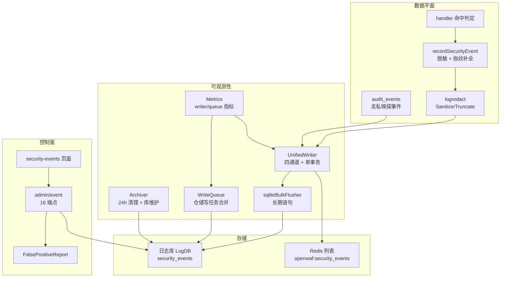
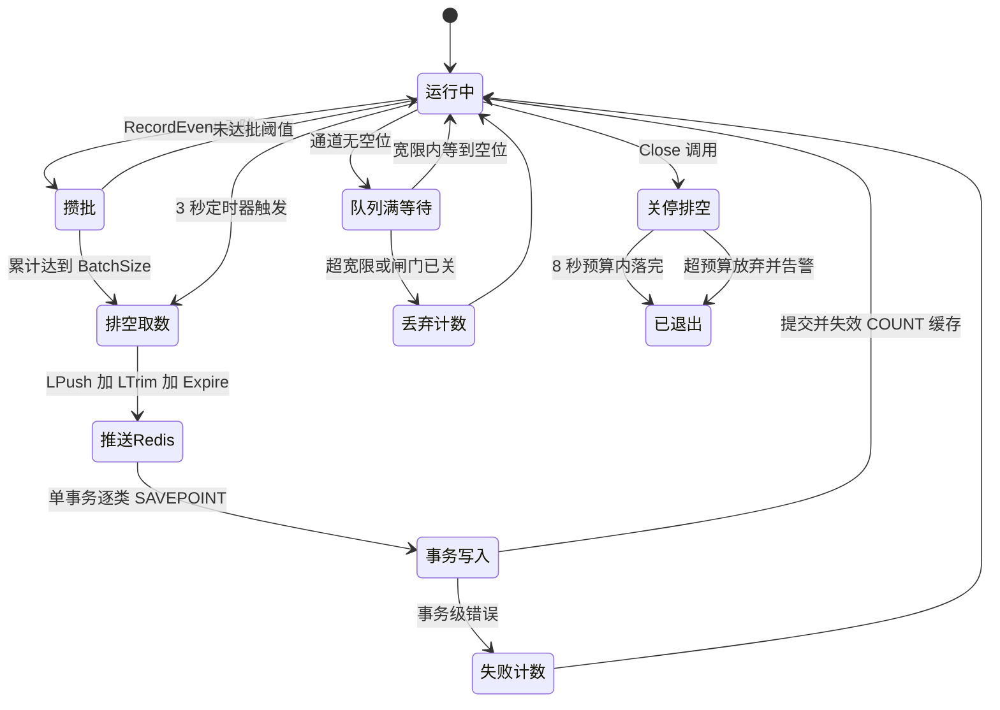
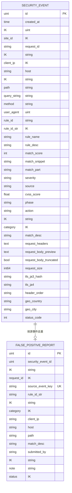
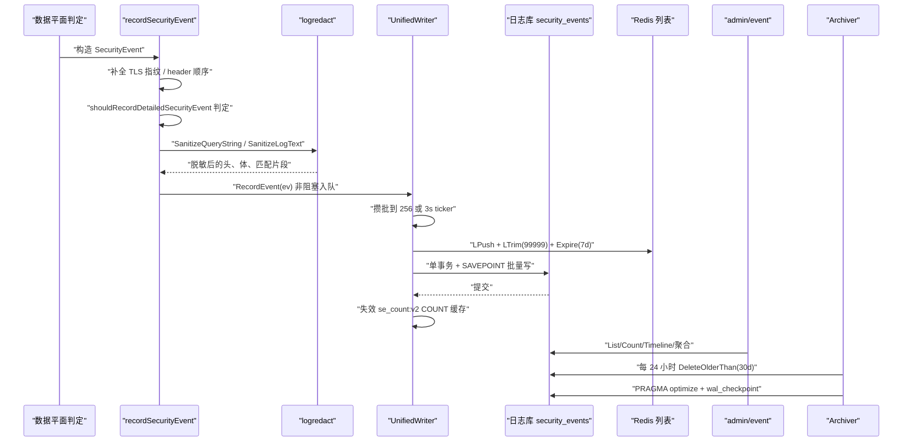
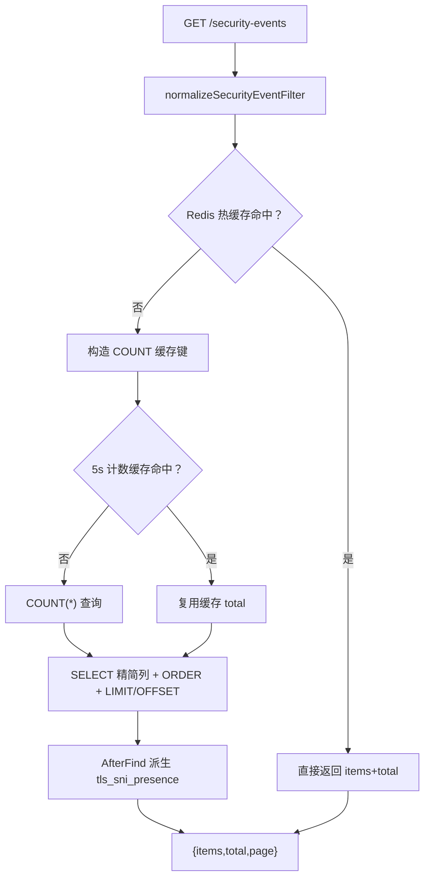
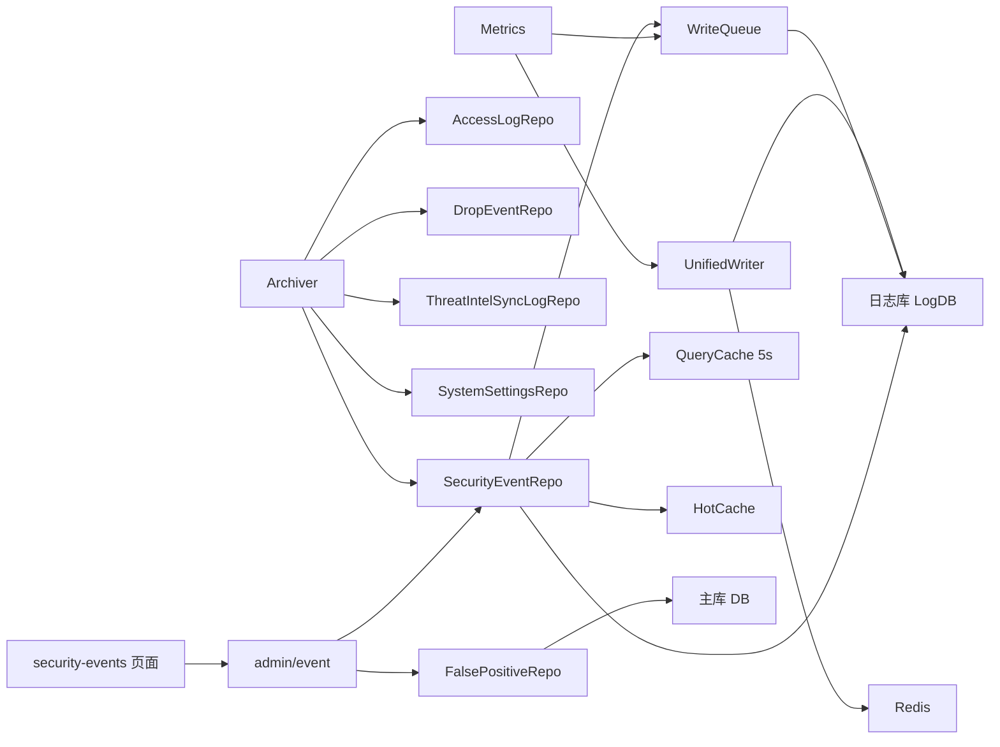

# 安全事件记录

> [返回 监控与可观测性](监控与可观测性.md)

<cite>
**本文档引用的文件**
- [unified_writer.go](file://internal/observability/unified_writer.go)
- [write_queue.go](file://internal/observability/write_queue.go)
- [archiver.go](file://internal/observability/archiver.go)
- [metrics.go](file://internal/observability/metrics.go)
- [sqlite_bulk_flusher.go](file://internal/observability/sqlite_bulk_flusher.go)
- [events.go](file://internal/store/events.go)
- [falsepositive.go](file://internal/store/falsepositive/false_positive.go)
- [security_event.go](file://internal/store/repository/security_event.go)
- [false_positive.go](file://internal/store/repository/event/false_positive.go)
- [access_log.go](file://internal/dataplane/access_log.go)
- [audit_events.go](file://internal/dataplane/audit_events.go)
- [sanitize.go](file://internal/dataplane/logredact/sanitize.go)
- [lower.go](file://internal/dataplane/logredact/lower.go)
- [migrate.go](file://internal/store/migrate.go)
- [security.go](file://internal/admin/event/security.go)
- [false_positive.go](file://internal/admin/event/false_positive.go)
- [request.go](file://internal/admin/event/request.go)
- [router.go](file://internal/admin/router.go)
- [dashboard.go](file://internal/admin/system/dashboard/dashboard.go)
- [server.go](file://internal/app/server.go)
- [config.go](file://internal/core/config.go)
- [phases.go](file://internal/core/rules/phases.go)
- [handler_support.go](file://internal/dataplane/handler_support.go)
- [page.tsx](file://frontend/app/(dashboard)/security-events/page.tsx)
</cite>

## 目录

1. [简介](#简介)
2. [项目结构](#项目结构)
3. [核心组件](#核心组件)
4. [架构总览](#架构总览)
5. [详细组件分析](#详细组件分析)
6. [依赖关系分析](#依赖关系分析)
7. [性能考虑](#性能考虑)
8. [故障排查指南](#故障排查指南)
9. [结论](#结论)
10. [附录](#附录)

## 简介
本文件面向安全事件记录系统，围绕事件采集、脱敏、异步批量写入、查询与统计、假阳性反馈与保留清理给出可核对的技术说明。

设计约束有三条来自实测：
- 数据平面热路径只做一次非阻塞通道发送，落库由单个 goroutine 在一个事务里完成，从根本上消除 SQLite 写锁竞争 [unified_writer.go:18-24](file://internal/observability/unified_writer.go#L18-L24)。
- 请求头、请求体、响应头、查询串与匹配片段都属于审计字段，写入前一律脱敏并截断，敏感键整体遮蔽，绝不落 `Authorization`、`Cookie`、`Set-Cookie`、API key 等原值 [access_log.go:173-180](file://internal/dataplane/access_log.go#L173-L180)、[sanitize.go:13-15](file://internal/dataplane/logredact/sanitize.go#L13-L15)。
- 事件不落主库而是落日志库 `rt.LogDB`，与配置库分库迁移 [server.go:354](file://internal/app/server.go#L354)、[migrate.go:126-139](file://internal/store/migrate.go#L126-L139)。

## 项目结构
安全事件记录的关键模块分布如下：

| 模块 | 路径 | 职责 | 核心符号 | 规模(行) | 测试 |
|------|------|------|----------|:--------:|:----:|
| 统一写入器 | `internal/observability/unified_writer.go` | 四类记录异步批量落库 + Redis 双写 | `UnifiedWriter` | 1198 | 有 |
| 通用写队列 | `internal/observability/write_queue.go` | 仓储写任务合并成单事务 | `WriteQueue` | 602 | 有 |
| SQLite 批量写 | `internal/observability/sqlite_bulk_flusher.go` | 长期语句快路径 | `sqliteBulkFlusher` | 470 | 有 |
| 归档器 | `internal/observability/archiver.go` | 按保留期清理 + 库维护 | `Archiver` | 529 | 有 |
| 指标出口 | `internal/observability/metrics.go` | 写入器与队列的 Prometheus 指标 | `Metrics` | 935 | 有 |
| 事件模型 | `internal/store/events.go` | `SecurityEvent` 字段与 9 个索引 | `SecurityEvent` | 278 | 部分 |
| 事件仓储 | `internal/store/repository/security_event.go` | 列表、请求聚合、统计、时间线、删除 | `SecurityEventRepo` | 725 | 有 |
| 事件 API | `internal/admin/event/` | 列表/详情/统计/时间线/假阳性/请求追踪 | 16 个端点 | 649 | 有 |
| 数据面记录 | `internal/dataplane/access_log.go` | 构建事件并脱敏入队 | `recordSecurityEvent` | 735 | 有 |
| 脱敏工具 | `internal/dataplane/logredact/` | 键判定、取值遮蔽、截断 | `SanitizeLogText` | 350 | 有 |
| 前端页面 | `frontend/app/(dashboard)/security-events/page.tsx` | 筛选、分页、导出 | 事件列表 | 769 | 无 |

规模口径为对应文件（或子包非测试文件合计）`wc -l` 实测；`admin/event` 取四个非测试文件合计。

**图表来源**
- [access_log.go:115-181](file://internal/dataplane/access_log.go#L115-L181)
- [audit_events.go:19-30](file://internal/dataplane/audit_events.go#L19-L30)
- [sanitize.go:198-230](file://internal/dataplane/logredact/sanitize.go#L198-L230)
- [unified_writer.go:25-50](file://internal/observability/unified_writer.go#L25-L50)
- [write_queue.go:104-131](file://internal/observability/write_queue.go#L104-L131)
- [archiver.go:38-69](file://internal/observability/archiver.go#L38-L69)
- [events.go:15-76](file://internal/store/events.go#L15-L76)
- [security_event.go:13-20](file://internal/store/repository/security_event.go#L13-L20)
- [router.go:169-191](file://internal/admin/router.go#L169-L191)
- [falsepositive.go:16-43](file://internal/store/falsepositive/false_positive.go#L16-L43)
- [page.tsx:153-175](file://frontend/app/(dashboard)/security-events/page.tsx#L153-L175)

**章节来源**
- [server.go:317-357](file://internal/app/server.go#L317-L357)
- [migrate.go:126-139](file://internal/store/migrate.go#L126-L139)
- [router.go:169-191](file://internal/admin/router.go#L169-L191)

## 核心组件

### 统一写入器（UnifiedWriter）
- 四通道汇聚：安全事件与访问日志共用 `EventBufferSize`（默认 16384），丢弃事件与机器人评分共用 `DropBufferSize`（默认 8192）；批阈值默认 256，flush 周期默认 3 秒，单次取数上限 `drainLimit = 4 × BatchSize` [unified_writer.go:124-129](file://internal/observability/unified_writer.go#L124-L129)、[unified_writer.go:405-410](file://internal/observability/unified_writer.go#L405-L410)。
- 硬上限钳制：通道容量 1M、批大小 10000、flush 间隔 60s、慢速宽限 5m；越界回退默认或截断并打 WARN，不静默改写 [unified_writer.go:111-119](file://internal/observability/unified_writer.go#L110-L118)、[unified_writer.go:228-246](file://internal/observability/unified_writer.go#L217-L246)。
- 队列满语义：默认不是立即丢弃，而是「持续为满 30s 之内阻塞等待」，超过宽限或已关闸才计入丢弃；`SlowLogGraceDisabled` 才回到历史丢弃语义 [unified_writer.go:155-208](file://internal/observability/unified_writer.go#L155-L208)。
- 单事务落库：四类记录同一个 `db.Transaction`，每类各持一个 SAVEPOINT，某类失败只回滚到自身保存点；sqlite 方言走长期语句，其余方言回退 `CreateInBatches` [unified_writer.go:929-1005](file://internal/observability/unified_writer.go#L929-L1005)。
- Redis 双写：在落库前先推 Redis 列表 `openwaf:security_events` / `openwaf:access_logs`（LTRIM 到 99999）与 `openwaf:drop_events` / `openwaf:bot_scores`（49999），统一 7 天 TTL，单次调用 5 秒超时 [unified_writer.go:1094-1152](file://internal/observability/unified_writer.go#L1094-L1152)。
- 关停：先置 `closed` 闸门并关 `stopCh`，再在 8 秒排空预算 + 5 秒宽限内循环排空；超预算记录计入丢弃并打错误日志 [unified_writer.go:340-351](file://internal/observability/unified_writer.go#L340-L351)、[unified_writer.go:702-742](file://internal/observability/unified_writer.go#L702-L742)。
- 提交后按类型失效控制面 COUNT 缓存前缀（安全事件是 `se_count:v2`）[unified_writer.go:962-985](file://internal/observability/unified_writer.go#L962-L985)。

**图表来源**
- [unified_writer.go:25-50](file://internal/observability/unified_writer.go#L25-L50)
- [unified_writer.go:553-600](file://internal/observability/unified_writer.go#L553-L600)
- [unified_writer.go:660-700](file://internal/observability/unified_writer.go#L660-L700)
- [unified_writer.go:702-742](file://internal/observability/unified_writer.go#L702-L742)
- [unified_writer.go:746-800](file://internal/observability/unified_writer.go#L746-L800)
- [unified_writer.go:895-1005](file://internal/observability/unified_writer.go#L895-L1005)
- [unified_writer.go:1094-1152](file://internal/observability/unified_writer.go#L1094-L1152)

**章节来源**
- [unified_writer.go:25-208](file://internal/observability/unified_writer.go#L25-L208)
- [unified_writer.go:340-410](file://internal/observability/unified_writer.go#L340-L410)
- [unified_writer.go:553-742](file://internal/observability/unified_writer.go#L553-L742)
- [unified_writer.go:895-1005](file://internal/observability/unified_writer.go#L895-L1005)
- [unified_writer.go:1094-1152](file://internal/observability/unified_writer.go#L1094-L1152)

### 通用写队列（WriteQueue）
- 任务形态是 `func(tx *gorm.DB) error`，`Submit` 非阻塞、`SubmitWait` 阻塞等结果、`SubmitPriority` 入队并立即触发 flush，队列为 nil 时走 `runSynchronously` [write_queue.go:300-425](file://internal/observability/write_queue.go#L300-L425)。
- 默认容量 256、批大小 64、ticker 50ms；上限 1M 条 / 10000 批 [write_queue.go:104-131](file://internal/observability/write_queue.go#L104-L131)。
- 丢弃分两种原因计数：`full`（队列满）与 `closed`（已开始关停），告警按 10 秒节流 [write_queue.go:67](file://internal/observability/write_queue.go#L67)、[write_queue.go:236-262](file://internal/observability/write_queue.go#L236-L262)。
- `runWriteTransaction` 把驱动 panic 转成 error，单个写任务不会打断整个队列 [write_queue.go:264-287](file://internal/observability/write_queue.go#L264-L287)。

**章节来源**
- [write_queue.go:67-131](file://internal/observability/write_queue.go#L67-L131)
- [write_queue.go:236-287](file://internal/observability/write_queue.go#L236-L287)
- [write_queue.go:300-425](file://internal/observability/write_queue.go#L300-L425)
- [write_queue.go:441-545](file://internal/observability/write_queue.go#L441-L545)

### 事件模型与字段明细
`SecurityEvent` 落 `security_events` 表，索引恰好 9 个：`idx_se_created`、`idx_se_site_created`、`idx_se_site_created_id`、`idx_se_request_id`、`idx_se_client_ip`、`idx_se_host`、`idx_se_rule_id_str`、`idx_se_action`、`idx_se_category` [events.go:15-76](file://internal/store/events.go#L15-L76)。

审计类字段按「是否脱敏」如实标注：`request_headers`、`request_body_preview`、`query_string`、`match_snippet` 四条在写入前必过 `SanitizeLogText` / `SanitizeQueryString`，`user_agent` 与 `path` 来自请求原文、只做长度约束 [access_log.go:119-180](file://internal/dataplane/access_log.go#L119-L180)。

| 字段 | 类型 | 来源（文件:行） | 是否脱敏 | 索引 |
|------|------|----------------|:--------:|:----:|
| `id` | uint | [events.go:16](file://internal/store/events.go#L16) | 不适用 | 组合键第 3 位 |
| `created_at` | time | [events.go:17](file://internal/store/events.go#L17) | 不适用 | 是（3 处） |
| `site_id` | uint | [events.go:19](file://internal/store/events.go#L19) | 不适用 | 是（2 处） |
| `request_id` | string(64) | [events.go:20](file://internal/store/events.go#L20) | 不适用 | 是 |
| `client_ip` | string(45) | [events.go:21](file://internal/store/events.go#L21) | 不适用 | 是 |
| `host` | string(255) | [events.go:22](file://internal/store/events.go#L22) | 不适用 | 是 |
| `path` / `query_string` | string(2048) | [events.go:23-24](file://internal/store/events.go#L23-L24) | 查询串脱敏 | 否 |
| `method` / `user_agent` | string(16/512) | [events.go:25-26](file://internal/store/events.go#L25-L26) | 否 | 否 |
| `rule_id` / `rule_id_str` | uint / string(64) | [events.go:28-29](file://internal/store/events.go#L28-L29) | 不适用 | str 有 |
| `rule_name` / `rule_desc` | string(255/512) | [events.go:32-33](file://internal/store/events.go#L32-L33) | 否（注册表文案） | 否 |
| `match_score` / `match_snippet` | int / string(256) | [events.go:35-37](file://internal/store/events.go#L35-L37) | 是（截断 256） | 否 |
| `match_part` / `severity` / `source` | string(32/16/32) | [events.go:39-43](file://internal/store/events.go#L39-L43) | 不适用 | 否 |
| `cvss_score` / `cwe_type` / `references` | float/string/text | [events.go:45-47](file://internal/store/events.go#L45-L47) | 不适用 | 否 |
| `phase` | string(32) | [events.go:49](file://internal/store/events.go#L49) | 不适用 | 组合键 |
| `action` / `category` | string(32) | [events.go:50-51](file://internal/store/events.go#L50-L51) | 不适用 | 是 |
| `match_desc` | string(512) | [events.go:52](file://internal/store/events.go#L52) | 否（检测层文案） | 否 |
| `request_headers` | text | [events.go:54](file://internal/store/events.go#L54) | 是 | 否 |
| `request_body_preview` | text | [events.go:55](file://internal/store/events.go#L55) | 是 | 否 |
| `request_body_truncated` | bool | [events.go:56](file://internal/store/events.go#L56) | 不适用 | 否 |
| `request_size` | int64 | [events.go:57](file://internal/store/events.go#L57) | 不适用 | 否 |
| TLS 指纹族（8 列） | string/text | [events.go:59-69](file://internal/store/events.go#L59-L69) | 不适用 | 否 |
| `header_order` | string(1024) | [events.go:70](file://internal/store/events.go#L70) | 不适用 | 否 |
| `geo_country` / `geo_city` | string(2/128) | [events.go:72-73](file://internal/store/events.go#L72-L73) | 不适用 | 否 |
| `status_code` | int | [events.go:75](file://internal/store/events.go#L75) | 不适用 | 否 |

`tls_sni_presence` 是 `gorm:"-"` 的读侧派生字段，由 `AfterFind` 填充，不参与落库 [events.go:61](file://internal/store/events.go#L61)、[events.go:217-223](file://internal/store/events.go#L217-L223)。

**图表来源**
- [events.go:15-76](file://internal/store/events.go#L15-L76)
- [falsepositive.go:16-43](file://internal/store/falsepositive/false_positive.go#L16-L43)

**章节来源**
- [events.go:15-76](file://internal/store/events.go#L15-L76)
- [events.go:217-223](file://internal/store/events.go#L217-L223)
- [falsepositive.go:16-43](file://internal/store/falsepositive/false_positive.go#L16-L43)
- [migrate.go:126-139](file://internal/store/migrate.go#L126-L139)

### 管理 API 与前端页面
- 事件侧读接口共 6 个：列表、请求级聚合、详情、统计、时间线，以及站点维度的三个同名变体；写接口只有假阳性反馈的 POST 系列 [router.go:169-191](file://internal/admin/router.go#L169-L191)、[router.go:365-366](file://internal/admin/router.go#L365-L366)、[router.go:415](file://internal/admin/router.go#L415)。
- 统计与时间线共用 `hours` 参数：缺省 24 小时，上限 720 小时（30 天），显式非法值返回 400 而不是静默回落 [security.go:16-35](file://internal/admin/event/security.go#L16-L35)。
- 列表默认投影列不含体积最大的 `request_headers` / `request_body_preview`，只有详情与按请求号查询才读全量 [security_event.go:100-108](file://internal/store/repository/security_event.go#L100-L108)。
- 前端页面提供动作、阶段、类别、IP、Host、路径、规则 ID、时间范围等筛选项，CSV 导出取的是**当前页 `items`**，不是全量结果 [page.tsx:271-309](file://frontend/app/(dashboard)/security-events/page.tsx#L271-L309)。

**章节来源**
- [router.go:169-191](file://internal/admin/router.go#L169-L191)
- [security.go:16-35](file://internal/admin/event/security.go#L16-L35)
- [security_event.go:100-108](file://internal/store/repository/security_event.go#L100-L108)
- [page.tsx:271-309](file://frontend/app/(dashboard)/security-events/page.tsx#L271-L309)

## 架构总览
事件从判定到可查的完整链路是「检测产生结果 → 数据面补全审计字段并脱敏 → 非阻塞入队 → 攒批 → 单事务落库（同时推 Redis）→ 控制面查询 → 归档器按保留期清理」。

**图表来源**
- [access_log.go:115-181](file://internal/dataplane/access_log.go#L115-L181)
- [sanitize.go:58-120](file://internal/dataplane/logredact/sanitize.go#L58-L120)
- [unified_writer.go:566-575](file://internal/observability/unified_writer.go#L566-L575)
- [unified_writer.go:895-1005](file://internal/observability/unified_writer.go#L895-L1005)
- [unified_writer.go:1094-1152](file://internal/observability/unified_writer.go#L1094-L1152)
- [archiver.go:219-242](file://internal/observability/archiver.go#L219-L242)
- [archiver.go:332-401](file://internal/observability/archiver.go#L332-L401)
- [security_event.go:109-190](file://internal/store/repository/security_event.go#L109-L190)

**章节来源**
- [access_log.go:106-181](file://internal/dataplane/access_log.go#L106-L181)
- [unified_writer.go:566-1005](file://internal/observability/unified_writer.go#L566-L1005)
- [archiver.go:219-401](file://internal/observability/archiver.go#L219-L401)

### 流程步骤表

| 步 | 动作 | 执行位置 | 输入 | 输出 | 失败分支 | 可观测点 |
|:--:|------|----------|------|------|----------|----------|
| 1 | 判定产生结果 | [phases.go:316-339](file://internal/core/rules/phases.go#L316-L339) | 请求上下文 | `action.Result` | 放行 | 事件 `phase` |
| 2 | 构造事件 | [access_log.go:115-122](file://internal/dataplane/access_log.go#L115-L122) | `SecurityEvent` | 待补全事件 | Writer 为 nil 直接返回 | 无 |
| 3 | 补全指纹与头顺序 | [access_log.go:123-159](file://internal/dataplane/access_log.go#L123-L159) | 请求上下文 | TLS/`header_order` | 无指纹则留空 | 事件 TLS 列 |
| 4 | 详记判定 | [access_log.go:106-114](file://internal/dataplane/access_log.go#L106-L114) | `action` + `status_code` | 是否带头/体 | 非终止且 <400 不采集 | `request_headers` 是否为空 |
| 5 | 脱敏 | [access_log.go:161-180](file://internal/dataplane/access_log.go#L161-L180) | 原始串 | 遮蔽后串 | 无法解析整体 `[redacted]` | 日志值 |
| 6 | 入队 | [unified_writer.go:566-575](file://internal/observability/unified_writer.go#L566-L575) | 事件 | 通道或丢弃 | 满则等待/丢弃 | `openwaf_writer_dropped_total` |
| 7 | 攒批 | [unified_writer.go:746-800](file://internal/observability/unified_writer.go#L746-L800) | 缓冲区 | 一批记录 | 关停超预算 | `openwaf_writer_queue_len` |
| 8 | 落库 | [unified_writer.go:929-1005](file://internal/observability/unified_writer.go#L929-L1005) | 事务 | 持久化 | 单类回滚到 SAVEPOINT | `openwaf_writer_flush_errors_total` |
| 9 | 缓存失效 | [unified_writer.go:999-1005](file://internal/observability/unified_writer.go#L999-L1005) | 前缀列表 | COUNT 过期 | 无 | 列表 total 一致性 |
| 10 | 查询 | [security_event.go:109-190](file://internal/store/repository/security_event.go#L109-L190) | 过滤条件 | items + total | 500 | 响应状态 |
| 11 | 清理 | [archiver.go:341-357](file://internal/observability/archiver.go#L341-L357) | cutoff | 删除条数 | 仓储为 nil 跳过并 WARN | `archiver: cleaned old security events` |

**章节来源**
- [access_log.go:106-181](file://internal/dataplane/access_log.go#L106-L181)
- [phases.go:316-339](file://internal/core/rules/phases.go#L316-L339)
- [unified_writer.go:566-1005](file://internal/observability/unified_writer.go#L566-L1005)
- [security_event.go:109-190](file://internal/store/repository/security_event.go#L109-L190)
- [archiver.go:341-357](file://internal/observability/archiver.go#L341-L357)
- [metrics.go:773-809](file://internal/observability/metrics.go#L773-L809)

## 详细组件分析

### 采集入口与代码上下文
把核心符号放到上下游网络中看，改动影响面一目了然：

| 符号 | 位置 | 职责 | 上游调用者 | 下游依赖 | 副作用 | 影响面 |
|------|------|------|------------|----------|--------|--------|
| `recordSecurityEvent` | [access_log.go:115](file://internal/dataplane/access_log.go#L115) | 补全 + 脱敏 + 入队 | `handler.go` 多处拦截分支、`audit_events.go` | `logredact`、`UnifiedWriter.RecordEvent` | 写通道、可能丢弃 | 高：所有事件字段口径 |
| `UnifiedWriter.RecordEvent` | [unified_writer.go:566](file://internal/observability/unified_writer.go#L566) | 非阻塞入队 | `recordSecurityEvent` | 通道 + 丢弃计数 | 计数、限流告警 | 高：热路径 |
| `UnifiedWriter.flushBuffered` | [unified_writer.go:895](file://internal/observability/unified_writer.go#L895) | 单事务批量写 | `loop`、`drainAllAndFlush` | `sqliteBulkFlusher`、Redis、COUNT 缓存 | 写库、推 Redis | 高：数据一致性 |
| `SecurityEventRepo.List` | [security_event.go:109](file://internal/store/repository/security_event.go#L109) | 分页 + 过滤 + 缓存 | `ListSecurityEvents`、站点变体 | 热缓存、COUNT 缓存、DB | 无 | 中 |
| `SecurityEventRepo.DeleteOlderThan` | [security_event.go:410](file://internal/store/repository/security_event.go#L410) | 分批删除 | `Archiver.cleanup` | DB、缓存失效 | 删数据 | 高：不可逆 |
| `Archiver.loop` | [archiver.go:219](file://internal/observability/archiver.go#L219) | 24h 周期驱动 | `NewArchiver` 协程 | `refreshRetentionFromDB`、`cleanup`、`optimizeDB` | 删数据、库维护 | 高 |
| `CreateFalsePositive` | [false_positive.go:52](file://internal/admin/event/false_positive.go#L52) | 从事件快照生成反馈 | `POST /false-positives` | `SecurityEventRepo.Get`、`CreateOrGetBySourceEvent` | 写主库 | 中 |

**章节来源**
- [access_log.go:115-181](file://internal/dataplane/access_log.go#L115-L181)
- [unified_writer.go:566-1005](file://internal/observability/unified_writer.go#L566-L1005)
- [security_event.go:109-434](file://internal/store/repository/security_event.go#L109-L434)
- [archiver.go:219-401](file://internal/observability/archiver.go#L219-L401)
- [false_positive.go:52-106](file://internal/admin/event/false_positive.go#L52-L106)

### 动作与记录详略的映射
是否采集请求头/请求体由动作决定，不是所有事件都带审计载荷：

| action | 终止性 | 采集头/体 | 时间线是否计入 | 事件语义 |
|--------|:------:|:---------:|:--------------:|----------|
| `drop` | ✓ | ✓ | ✓ | 连接级丢弃 |
| `intercept` | ✓ | ✓ | ✓ | 403 阻断 |
| `rate_limit` | ✓ | ✓ | ✓ | 429 限流 |
| `challenge` / `captcha_challenge` / `shield_challenge` / `chain_challenge` | ✓ | ✓ | ✓ | 挑战类，前端按类型渲染 |
| `redirect` | ✓ | ✓ | ✓ | 跳转 |
| `observe` | ✗ | 仅当 `status_code >= 400` | ✗ | 观察命中 |
| `pass` | ✗ | 仅当 `status_code >= 400` | ✗ | 放行 |

来源：`shouldRecordDetailedSecurityEvent` 的枚举与回退条件 [access_log.go:106-114](file://internal/dataplane/access_log.go#L106-L114)；时间线的终止动作白名单 [security_event.go:617](file://internal/store/repository/security_event.go#L617)。

**章节来源**
- [access_log.go:106-114](file://internal/dataplane/access_log.go#L106-L114)
- [security_event.go:616-645](file://internal/store/repository/security_event.go#L616-L645)

### 脱敏与截断规则
`logredact` 提供三层遮蔽，覆盖键判定、取值模式与结构化解析：

| 层次 | 函数 | 规则 | 出处 |
|------|------|------|------|
| 键名判定 | `IsSensitiveLogKeyLowered` | 片段命中即整值替换为 `[redacted]` | [sanitize.go:299-325](file://internal/dataplane/logredact/sanitize.go#L299-L325) |
| 头行模式 | `sensitiveLogHeaderLinePattern` | `authorization`/`proxy-authorization`/`cookie`/`set-cookie` 整行遮蔽 | [sanitize.go:13](file://internal/dataplane/logredact/sanitize.go#L13) |
| 取值模式 | `SanitizeLogText` | 15 类敏感键名后的取值遮蔽（含 `password`、`token`、`secret`、`api_key`、`csrf`、`ticket`、`env` 等） | [sanitize.go:15](file://internal/dataplane/logredact/sanitize.go#L15)、[sanitize.go:206](file://internal/dataplane/logredact/sanitize.go#L206) |
| 查询串 | `SanitizeQueryString` | 逐对解码判定，畸形整体 `[redacted]` | [sanitize.go:58-120](file://internal/dataplane/logredact/sanitize.go#L58-L120) |
| 截断 | `TruncateLogValue` | 超限追加 `...[truncated]` | [sanitize.go:292-296](file://internal/dataplane/logredact/sanitize.go#L292-L296) |

截断上限：请求体预览 8192、单头值 2048、头值分组 32 条；匹配片段上限 256 由检测层 `snippet.MaxLen` 保证 [access_log.go:405-408](file://internal/dataplane/access_log.go#L405-L408)、[events.go:37](file://internal/store/events.go#L37)。动态保护取密钥端点 `/__owaf/dynamic/key` 的请求体无条件整体遮蔽 [sanitize.go:20-31](file://internal/dataplane/logredact/sanitize.go#L20-L31)、[access_log.go:240-242](file://internal/dataplane/access_log.go#L240-L242)。

前端展示按这三类字段做折叠区渲染，避免把长文本铺开；本仓库不在事件里保存任何 `Authorization`、`Cookie`、`Set-Cookie` 原值。

**章节来源**
- [sanitize.go:13-31](file://internal/dataplane/logredact/sanitize.go#L13-L31)
- [sanitize.go:58-120](file://internal/dataplane/logredact/sanitize.go#L58-L120)
- [sanitize.go:198-325](file://internal/dataplane/logredact/sanitize.go#L198-L325)
- [lower.go:1-25](file://internal/dataplane/logredact/lower.go#L1-L25)
- [access_log.go:173-180](file://internal/dataplane/access_log.go#L173-L180)
- [access_log.go:240-265](file://internal/dataplane/access_log.go#L240-L265)
- [access_log.go:405-448](file://internal/dataplane/access_log.go#L405-L448)

### 查询、统计与时间线
- 列表：`GET /api/v1/security-events`，参数 `page`、`page_size` 与 20 余个过滤键；`offset = (page-1) × page_size` 由 `utils.Paginate` 统一计算 [security.go:39-56](file://internal/admin/event/security.go#L39-L56)。
- 过滤键与匹配方式不同：`action`/`phase`/`category`/`rule_id_str`/`client_ip` 是等值，`host`/`path`/`query_string` 是 `LIKE %v%`，`q` 是一次跨 14 列的模糊匹配 [security_event.go:643-725](file://internal/store/repository/security_event.go#L640-L725)。
- 请求级聚合：`GET /api/v1/security-events/requests` 按 `request_id` 去重，`total` 是请求数而不是事件数 [security.go:64-86](file://internal/admin/event/security.go#L64-L86)、[security_event.go:194](file://internal/store/repository/security_event.go#L194)。
- 时间线：按小时分桶，桶文本三种方言统一为 `YYYY-MM-DD HH:00`，且只统计终止动作 [security_event.go:590-645](file://internal/store/repository/security_event.go#L590-L645)。

**图表来源**
- [security.go:39-56](file://internal/admin/event/security.go#L39-L56)
- [security_event.go:109-190](file://internal/store/repository/security_event.go#L109-L190)
- [security_event.go:643-725](file://internal/store/repository/security_event.go#L639-L725)
- [events.go:217-223](file://internal/store/events.go#L217-L223)
- [server.go:317-320](file://internal/app/server.go#L317-L320)

**章节来源**
- [router.go:169-182](file://internal/admin/router.go#L169-L182)
- [security.go:27-56](file://internal/admin/event/security.go#L27-L56)
- [security.go:89-138](file://internal/admin/event/security.go#L89-L138)
- [security.go:260-291](file://internal/admin/event/security.go#L260-L291)
- [security_event.go:109-190](file://internal/store/repository/security_event.go#L109-L190)
- [security_event.go:590-725](file://internal/store/repository/security_event.go#L590-L725)
- [server.go:317-320](file://internal/app/server.go#L317-L320)

### 假阳性反馈闭环
反馈记录把源事件的关键字段冗余存一份，因此 30 天保留期过后事件被清理，反馈仍可独立审查 [falsepositive.go:12-14](file://internal/store/falsepositive/false_positive.go#L12-L14)。

| 端点 | 方法 | 请求体 / 参数 | 行为 | 权限组 |
|------|------|---------------|------|--------|
| `/api/v1/false-positives` | GET | `page`、`page_size`（≤200，默认 20）、`status` | 分页列出 | readGroup |
| `/api/v1/false-positives` | POST | `{"security_event_id":1,"note":"..."}` | 读源事件快照并建记录；已存在返回 200 | opsGroup |
| `/api/v1/false-positives/:id/status` | POST | `{"status":"confirmed"}` | 状态只能在 `pending`/`confirmed`/`rejected` 间迁移 | opsGroup |
| `/api/v1/false-positives/:id/delete` | POST | — | 删除并清空 `source_event_key` 以允许重新提交 | adminGroup |

去重靠唯一索引 `idx_false_positive_source_event_key`，键值是 `security-event:<id>`，`CreateOrGetBySourceEvent` 保证并发下同一事件只落一条 [falsepositive.go:25-27](file://internal/store/falsepositive/false_positive.go#L25-L27)、[false_positive.go:80-95](file://internal/admin/event/false_positive.go#L80-L95)、[false_positive.go:31-50](file://internal/store/repository/event/false_positive.go#L31-L50)。客户端只能提交事件 ID 与备注，快照字段一律由后端从日志库读取，避免伪造 [false_positive.go:48-72](file://internal/admin/event/false_positive.go#L48-L72)。

**章节来源**
- [falsepositive.go:9-43](file://internal/store/falsepositive/false_positive.go#L9-L43)
- [false_positive.go:16-106](file://internal/admin/event/false_positive.go#L16-L106)
- [false_positive.go:108-171](file://internal/admin/event/false_positive.go#L108-L171)
- [false_positive.go:25-101](file://internal/store/repository/event/false_positive.go#L25-L101)
- [router.go:185](file://internal/admin/router.go#L185)
- [router.go:365-366](file://internal/admin/router.go#L365-L366)
- [router.go:415](file://internal/admin/router.go#L415)

## 依赖关系分析
- 统一写入器依赖日志库 `*gorm.DB` 与可选 rueidis 客户端；Redis 为 nil 时双写自动跳过 [unified_writer.go:429-441](file://internal/observability/unified_writer.go#L429-L441)。
- 写队列只依赖日志库连接，被 `SecurityEventRepo`、`AccessLogRepo` 等共享 [write_queue.go:173-203](file://internal/observability/write_queue.go#L173-L203)。
- 归档器依赖事件、访问日志、丢弃事件、威胁情报同步日志四个仓储与系统设置仓储 [archiver.go:38-51](file://internal/observability/archiver.go#L38-L51)、[server.go:354-356](file://internal/app/server.go#L354-L356)。
- 管理 API 依赖事件仓储与分页工具，不触碰数据面 [security.go:39-56](file://internal/admin/event/security.go#L39-L56)。
- 反向依赖被刻意切断：observability 通过窄接口 `countCacheInvalidator` 失效缓存，不 import `store/repository` [unified_writer.go:103-107](file://internal/observability/unified_writer.go#L103-L107)。

**图表来源**
- [unified_writer.go:25-45](file://internal/observability/unified_writer.go#L25-L45)
- [unified_writer.go:103-107](file://internal/observability/unified_writer.go#L103-L107)
- [write_queue.go:173-203](file://internal/observability/write_queue.go#L173-L203)
- [security_event.go:13-56](file://internal/store/repository/security_event.go#L13-L56)
- [archiver.go:38-51](file://internal/observability/archiver.go#L38-L51)
- [router.go:169-191](file://internal/admin/router.go#L169-L191)
- [false_positive.go:52-64](file://internal/admin/event/false_positive.go#L52-L64)

**章节来源**
- [unified_writer.go:25-107](file://internal/observability/unified_writer.go#L25-L107)
- [write_queue.go:173-203](file://internal/observability/write_queue.go#L173-L203)
- [security_event.go:13-56](file://internal/store/repository/security_event.go#L13-L56)
- [archiver.go:38-51](file://internal/observability/archiver.go#L38-L51)
- [router.go:169-191](file://internal/admin/router.go#L169-L191)

## 性能考虑
- 事务合并：四类记录共用一个事务，SQLite 写锁竞争从「每类一次」降到「每批一次」；sqlite 方言再经长期语句省掉重复 Prepare [unified_writer.go:929-1005](file://internal/observability/unified_writer.go#L929-L1005)、[sqlite_bulk_flusher.go:1-40](file://internal/observability/sqlite_bulk_flusher.go#L1-L40)。
- 批阈值 256 是实测调参结果，由 64 上调；`drainLimit = 4 × 256` 限制单事务体积 [unified_writer.go:122-128](file://internal/observability/unified_writer.go#L119-L125)、[unified_writer.go:405-410](file://internal/observability/unified_writer.go#L405-L410)。
- 背压取舍：默认 30 秒慢速宽限而不是立即丢弃，因为在 128 并发、400 万行日志库的实测中立即丢弃会丢掉约 51% 的访问日志；宽限只在数据库长期落后时生效 [unified_writer.go:155-177](file://internal/observability/unified_writer.go#L155-L177)。
- 读侧缓存：5 秒 COUNT 缓存覆盖 `security_events`/`access_logs`/`drop_events`，大结果集再叠一层 Redis 热缓存 [server.go:317-326](file://internal/app/server.go#L317-L326)、[security_event.go:109-140](file://internal/store/repository/security_event.go#L109-L140)。
- 列裁剪：列表与实时轮询只取精简列，把 `request_headers`、`request_body_preview` 这类 TEXT 排除在外 [security_event.go:100-108](file://internal/store/repository/security_event.go#L100-L108)。
- 分批删除：`DeleteOlderThan` 每批 5000 行、批间睡 50ms，避免长事务锁表 [security_event.go:410-432](file://internal/store/repository/security_event.go#L410-L432)。

**章节来源**
- [unified_writer.go:119-177](file://internal/observability/unified_writer.go#L119-L177)
- [unified_writer.go:405-410](file://internal/observability/unified_writer.go#L405-L410)
- [unified_writer.go:929-1005](file://internal/observability/unified_writer.go#L929-L1005)
- [sqlite_bulk_flusher.go:1-40](file://internal/observability/sqlite_bulk_flusher.go#L1-L40)
- [security_event.go:100-140](file://internal/store/repository/security_event.go#L100-L140)
- [security_event.go:410-432](file://internal/store/repository/security_event.go#L410-L432)
- [server.go:317-326](file://internal/app/server.go#L317-L326)

## 故障排查指南

| 症状 | 可能原因 | 排查动作 | 处理方案 |
|------|----------|----------|----------|
| 事件缺失 | 队列满且超宽限 | 看 `openwaf_writer_dropped_total{type="security_event"}` 与 `observability writer closed, record dropped` | 调大 `MY_OPENWAF_QUEUE_EVENT_BUFFER_SIZE` 或延长 `SlowLogGrace` [config.go:76-123](file://internal/core/config.go#L76-L123) |
| 有丢弃但队列不满 | 关停窗口内新到记录被闸门拦下 | 比对 `queue_len` 与 `dropped_total` 增速 | 属预期，事后核对损失量 |
| 落库失败 | 事务级错误或单类 SAVEPOINT 回滚 | `openwaf_writer_flush_errors_total`、`failed_records_total` 与 flush 错误日志 | 检查日志库连接与磁盘 |
| 列表 total 抖动 | 提交后缓存失效前缀遗漏 | 比对 `se_count:v2` 键 | 确认走 `invalidateCountCache` |
| 时间线缺口 | 该小时只有 observe/pass 命中 | 直接用列表核对 | 属口径设计，非丢数 |
| CSV 与 total 不符 | 导出只含当前页 | 看导出前 `items` 长度 | 翻页合并或缩小筛选 |
| 旧事件不消失 | 未到 24 小时周期或保留期为 0 | 查 `archiver: cleaned old security events` 与 `retention_config` | 0 表示永久保留，需显式设置天数 |

**章节来源**
- [unified_writer.go:336-351](file://internal/observability/unified_writer.go#L336-L351)
- [unified_writer.go:513-565](file://internal/observability/unified_writer.go#L513-L565)
- [unified_writer.go:895-1005](file://internal/observability/unified_writer.go#L895-L1005)
- [metrics.go:773-809](file://internal/observability/metrics.go#L773-L809)
- [security_event.go:590-645](file://internal/store/repository/security_event.go#L590-L645)
- [archiver.go:332-401](file://internal/observability/archiver.go#L332-L401)
- [page.tsx:271-309](file://frontend/app/(dashboard)/security-events/page.tsx#L271-L309)
- [config.go:76-123](file://internal/core/config.go#L76-L123)

## 结论
安全事件记录用「非阻塞入队 + 单事务批量落库 + 双写 Redis」把采集成本压离热路径，同时以逐字段脱敏与列裁剪保证审计可用性与体积可控；查询侧用精简列、5 秒计数缓存与 Redis 热缓存分层，写入侧用批阈值与宽限参数平衡延迟与丢弃。

三点务必如实理解：事件详情只在终止动作或 4xx/5xx 时采集；时间线只统计终止动作；清理周期是 24 小时而非每小时，且保留天数为 0 表示永久保留。建议在生产环境为 `openwaf_writer_dropped_total` 设告警，并把假阳性反馈闭环纳入规则调优流程。

## 附录

### 采集与写入参数速查

| 参数 | 默认 | 上限 | 注入来源 |
|------|:----:|:----:|----------|
| 事件/访问日志通道容量 | 16384 | 1M | `MY_OPENWAF_QUEUE_EVENT_BUFFER_SIZE` [config.go:76-118](file://internal/core/config.go#L76-L118) |
| 丢弃/机器人评分通道容量 | 8192 | 1M | `MY_OPENWAF_QUEUE_DROP_BUFFER_SIZE` [unified_writer.go:124-129](file://internal/observability/unified_writer.go#L124-L129) |
| 批大小 | 256 | 10000 | `MY_OPENWAF_QUEUE_BATCH_SIZE` [unified_writer.go:122-128](file://internal/observability/unified_writer.go#L119-L125) |
| flush 间隔 | 3s | 60s | `MY_OPENWAF_QUEUE_FLUSH_INTERVAL` [unified_writer.go:746-750](file://internal/observability/unified_writer.go#L746-L750) |
| 慢速宽限 | 30s | 5m | `MY_OPENWAF_QUEUE_SLOW_LOG_GRACE` [unified_writer.go:155-177](file://internal/observability/unified_writer.go#L155-L177) |
| 关停排空预算 | 8s + 5s 宽限 | — | 常量 [unified_writer.go:340-351](file://internal/observability/unified_writer.go#L340-L351) |
| Redis 列表 TTL | 7 天 | — | 常量 [unified_writer.go:1103](file://internal/observability/unified_writer.go#L1103) |
| 写队列容量 / 批 / ticker | 256 / 64 / 50ms | 1M / 10000 / — | `MY_OPENWAF_QUEUE_WRITE_*` [write_queue.go:104-131](file://internal/observability/write_queue.go#L104-L131) |

**章节来源**
- [unified_writer.go:110-177](file://internal/observability/unified_writer.go#L110-L177)
- [unified_writer.go:340-351](file://internal/observability/unified_writer.go#L340-L351)
- [unified_writer.go:746-750](file://internal/observability/unified_writer.go#L746-L750)
- [unified_writer.go:1094-1152](file://internal/observability/unified_writer.go#L1094-L1152)
- [write_queue.go:104-131](file://internal/observability/write_queue.go#L104-L131)
- [config.go:76-123](file://internal/core/config.go#L76-L123)

### 归档与保留策略
清理与保留的完整口径见 [事件归档系统](事件归档系统.md)，此处只列与事件直接相关的三项：

| 项目 | 取值 | 出处 |
|------|------|------|
| 清理周期 | 24 小时（`defaultArchiverIntervalSeconds`），非每小时 | [archiver.go:56-57](file://internal/observability/archiver.go#L56-L57) |
| 首次清理时机 | 启动后第一个 24 小时定时器到期，启动不预跑 | [archiver.go:219-242](file://internal/observability/archiver.go#L219-L242) |
| 事件保留默认 | 30 天；`0` = 永久保留，负值回退 0 并告警 | [archiver.go:146-155](file://internal/observability/archiver.go#L146-L155)、[archiver.go:94-104](file://internal/observability/archiver.go#L94-L104) |
| 动态配置来源 | `retention_config` JSON + `security_event_retention_days` 单键，每轮读取 | [archiver.go:244-311](file://internal/observability/archiver.go#L244-L311) |

**章节来源**
- [archiver.go:53-69](file://internal/observability/archiver.go#L53-L69)
- [archiver.go:94-155](file://internal/observability/archiver.go#L94-L155)
- [archiver.go:219-311](file://internal/observability/archiver.go#L219-L311)
- [archiver.go:332-401](file://internal/observability/archiver.go#L332-L401)

### 已知名不副实的统计口径
仪表盘的 `cve_by_type_24h` 名义是「按 CVE 类型分布」，实现却是 `SELECT phase as category ... WHERE category = 'cve' GROUP BY phase`。CVE 命中的 `phase` 恒为 `cve_detection`，因此结果实际只剩一个桶，无法反映类型分布 [dashboard.go:247-252](file://internal/admin/system/dashboard/dashboard.go#L247-L252)。引用该字段时不得当作多维统计。

**章节来源**
- [dashboard.go:64](file://internal/admin/system/dashboard/dashboard.go#L64)
- [dashboard.go:247-252](file://internal/admin/system/dashboard/dashboard.go#L247-L252)
