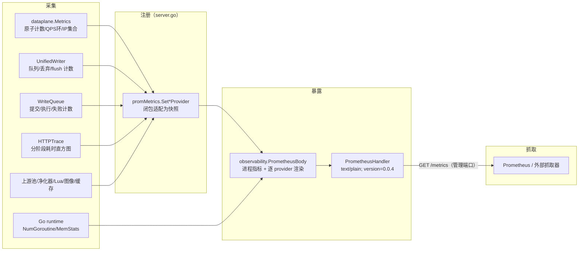
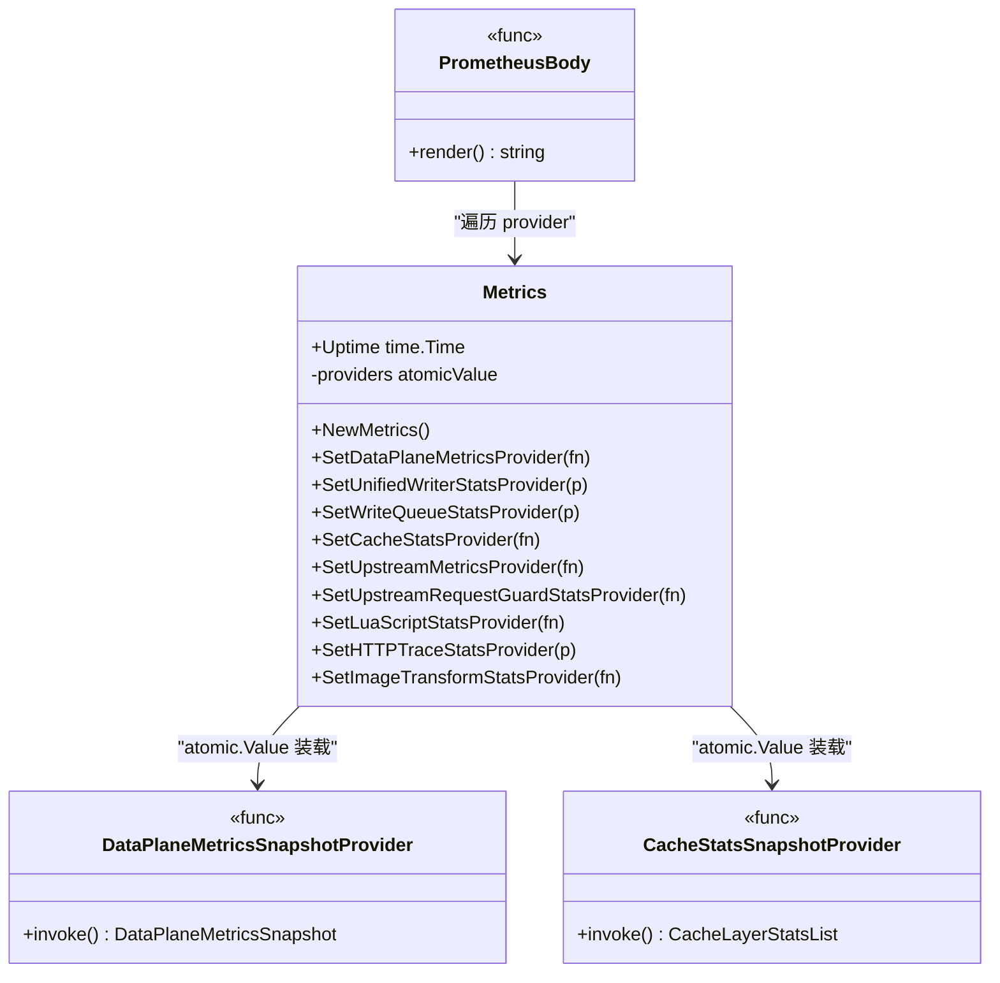
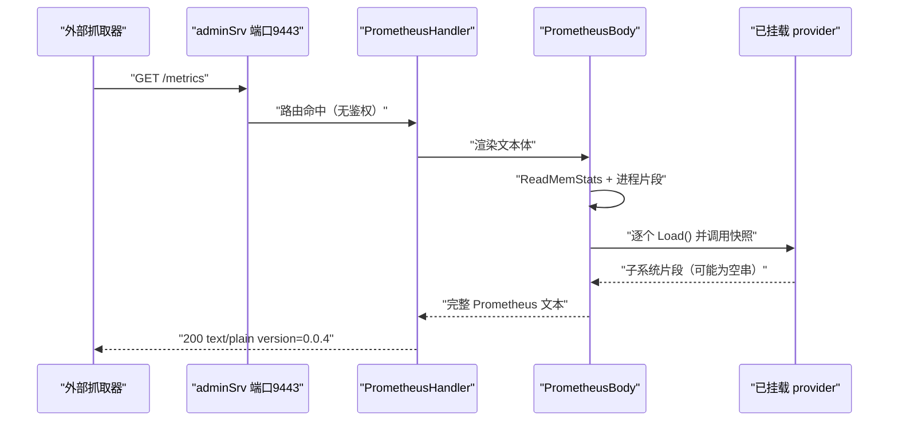
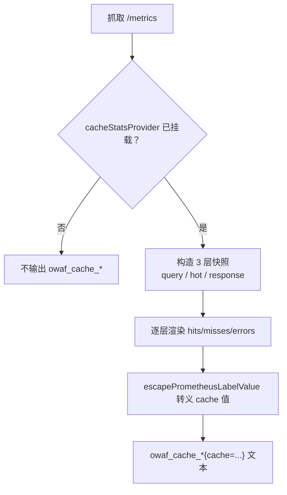
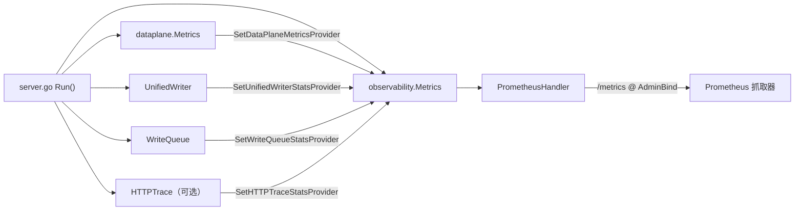

# 性能指标收集

> [返回 监控与可观测性](监控与可观测性.md)

<cite>
**本文档引用的文件**
- [internal/observability/metrics.go](file://internal/observability/metrics.go)
- [internal/observability/unified_writer.go](file://internal/observability/unified_writer.go)
- [internal/observability/write_queue.go](file://internal/observability/write_queue.go)
- [internal/observability/http_trace.go](file://internal/observability/http_trace.go)
- [internal/dataplane/metrics/metrics.go](file://internal/dataplane/metrics/metrics.go)
- [internal/app/server.go](file://internal/app/server.go)
</cite>

## 目录

1. [简介](#简介)
2. [项目结构](#项目结构)
3. [核心组件](#核心组件)
4. [架构总览](#架构总览)
5. [详细组件分析](#详细组件分析)
6. [依赖关系分析](#依赖关系分析)
7. [性能考虑](#性能考虑)
8. [故障排查指南](#故障排查指南)
9. [结论](#结论)
10. [附录](#附录)

## 简介

本篇聚焦「指标」这一可观测支柱，覆盖两套彼此独立、口径不同的计数体系，以及它们如何汇合到单一 Prometheus 文本端点：

- **控制面 Prometheus 指标**：由 `internal/observability.Metrics` 收集，经管理端口 `GET /metrics` 暴露，进程级指标恒常输出，子系统指标由可插拔 provider 按需挂载。
- **数据面实时计数器**：由 `internal/dataplane/metrics.Metrics` 维护原子计数、QPS 环形缓冲与去重 IP 集合，主要服务实时面板（`Summary` JSON）；其中一份经 provider 桥接为 `openwaf_dataplane_*` 序列进入 Prometheus。
- **异步写入器诊断**：`UnifiedWriter` 与 `WriteQueue` 的队列深度、丢弃与 flush 结果，用于判断「数据是否被丢弃」。

关键事实：`openwaf_requests_total`、`openwaf_blocks_total`、`openwaf_observes_total`、`openwaf_upstream_errors_total` **已从代码移除**，`/metrics` 不再输出这四个名字；请求总量请读 `openwaf_dataplane_requests_total`，移除原因见 `internal/observability/metrics.go:263-273` 的结构体注释。缓存族真实名是 `owaf_cache_*`（带 `cache` 标签），而非 `openwaf_cache_*`。`/metrics` 挂在**管理端口**而非数据面端口。域级概述（含事件、归档、探针）见 [监控与可观测性](监控与可观测性.md)，本篇不重复其结论。

## 项目结构

指标子系统按「谁产生计数、谁渲染文本、谁挂载路由」三层划分：

| 层 | 文件 | 职责 | 关键符号 |
|---|---|---|---|
| 计数产生（数据面） | `internal/dataplane/metrics/metrics.go` | 原子计数 + QPS 环形桶 + 去重 IP | `Metrics`、`Summary` |
| 文本渲染（控制面） | `internal/observability/metrics.go` | 聚合进程指标与各 provider 快照，渲染 Prometheus 文本 | `Metrics`、`PrometheusBody`、`prometheus*` |
| 异步队列诊断 | `internal/observability/unified_writer.go`、`write_queue.go` | 暴露队列深度/丢弃/flush 结果 | `UnifiedWriterStats`、`WriteQueueStats` |
| 分阶段耗时 | `internal/observability/http_trace.go` | 数据面请求分协议分阶段耗时直方图 | `HTTPTrace.Stats` |
| 装配与暴露 | `internal/app/server.go` | 创建 `promMetrics`、`Set*Provider`、注册 `/metrics` | `NewMetrics`、`PrometheusHandler` |

采集 → 注册 → 暴露 → 抓取的端到端拓扑如下：



**图表来源**
- [internal/observability/metrics.go:253-348](file://internal/observability/metrics.go#L253-L348)
- [internal/dataplane/metrics/metrics.go:13-161](file://internal/dataplane/metrics/metrics.go#L13-L161)
- [internal/app/server.go:481-593](file://internal/app/server.go#L481-L593)
- [internal/app/server.go:1056](file://internal/app/server.go#L1056)

**章节来源**
- [internal/app/server.go:481-593](file://internal/app/server.go#L481-L593)
- [internal/observability/metrics.go:253-348](file://internal/observability/metrics.go#L253-L348)

## 核心组件

控制面 `Metrics` 结构体本身**只保留进程级计数器**（存活时长与若干 provider 挂载点），所有请求级、阻断级计数都来自下游 provider，这是为避免「同一语义两条路径各持一份计数」的第二真相。

| 组件 | 位置 | 类型 | 职责 |
|---|---|---|---|
| `observability.Metrics` | `metrics.go:147-159` | struct | 进程级指标宿主 + 9 个 provider 挂载槽（`atomic.Value`） |
| `NewMetrics` | `metrics.go:162-164` | 构造函数 | 记录 `Uptime`，返回空 provider 的收集器 |
| `PrometheusBody` | `metrics.go:253-348` | 渲染函数 | 拼进程指标，再逐个 `Load()` provider 追加片段 |
| `PrometheusHandler` | `metrics.go:242-250` | Hertz handler | 设置 `text/plain; version=0.0.4; charset=utf-8` 与 200 |
| `dataplane.Metrics` | `dataplane/metrics/metrics.go:13-31` | struct | 请求/状态/WAF/IP 原子计数 + QPS 环形桶 |
| `dataplane.Summary` | `dataplane/metrics/metrics.go:131-161` | struct | 数据面计数器 JSON 视图，供实时面板与桥接 |
| `UnifiedWriter.Stats` | `unified_writer.go:474-489` | 快照方法 | 四类通道长度、丢弃、flush 累计 |
| `WriteQueue.Stats` | `write_queue.go:205-215` | 快照方法 | 队列深度/容量、提交/执行/失败计数 |



**图表来源**
- [internal/observability/metrics.go:147-239](file://internal/observability/metrics.go#L147-L239)
- [internal/observability/metrics.go:242-348](file://internal/observability/metrics.go#L242-L348)

**章节来源**
- [internal/observability/metrics.go:147-239](file://internal/observability/metrics.go#L147-L239)
- [internal/dataplane/metrics/metrics.go:13-31](file://internal/dataplane/metrics/metrics.go#L13-L31)

## 架构总览

`/metrics` 只在管理端口注册（`adminSrv.GET("/metrics", ...)`，`server.go:1056`），且 `adminSrv` 为明文 HTTP（`server.Default(server.WithHostPorts(AdminBind))`，`server.go:1052`，默认 `:9443`）。每次抓取触发一次 `PrometheusBody`：先读 Go runtime 拼进程片段，再对每个已挂载 provider 调一次快照函数追加片段。未挂载 provider 的子系统（如未启用 HTTPTrace）不会输出对应 HELP/TYPE 头。



**图表来源**
- [internal/observability/metrics.go:242-348](file://internal/observability/metrics.go#L242-L348)
- [internal/app/server.go:1052-1056](file://internal/app/server.go#L1052-L1056)

## 详细组件分析

### 指标清单（注册位置与来源）

下表穷举 `/metrics` 实际输出的指标族。「注册位置:行」给渲染该样本行的 `metrics.go` 行号；provider 的挂载点在 `server.go`。「来源」为计数最终产生处。带标签的族只列代表行。

| 指标名 | 类型 | 注册位置:行 | 标签 | 来源 | 含义 |
|---|---|---|---|---|---|
| `openwaf_uptime_seconds` | gauge | metrics.go:276 | 无 | Go runtime（`m.Uptime`） | 进程启动至今秒数（恒输出） |
| `openwaf_goroutines` | gauge | metrics.go:280 | 无 | `runtime.NumGoroutine()` | 当前 goroutine 数 |
| `openwaf_memory_alloc_bytes` | gauge | metrics.go:284 | 无 | `MemStats.Alloc` | 当前堆分配字节 |
| `openwaf_memory_sys_bytes` | gauge | metrics.go:288 | 无 | `MemStats.Sys` | 向 OS 申请总字节 |
| `openwaf_gc_pause_total_ns` | counter | metrics.go:292 | 无 | `MemStats.PauseTotalNs` | GC 暂停累计纳秒 |
| `openwaf_dataplane_qps` | gauge | metrics.go:406-407 | `window=1s\|5s` | `dataplane.Metrics.QPS` | 采样窗口平均 QPS |
| `openwaf_dataplane_requests_total` | counter | metrics.go:411 | 无 | `RequestsTotal` | 数据面累计请求数 |
| `openwaf_dataplane_status_total` | counter | metrics.go:415-417 | `class=2xx\|4xx\|5xx` | `RecordStatus` | 响应状态码分布 |
| `openwaf_dataplane_waf_actions_total` | counter | metrics.go:421-422 | `action=block\|observe` | `WAFBlocks/WAFObserves` | WAF 阻断/观察动作数 |
| `openwaf_dataplane_builtin_hits_total` | counter | metrics.go:426 | 无 | `BuiltinHits` | 内置规则命中数 |
| `openwaf_dataplane_unique_ips_total` | counter | metrics.go:430 | 无 | `uniqueIPCnt` | 去重客户端 IP 数 |
| `openwaf_dataplane_attack_ips_total` | counter | metrics.go:434 | 无 | `attackIPCnt` | 去重攻击源 IP 数 |
| `openwaf_dataplane_uptime_seconds` | gauge | metrics.go:438 | 无 | `UptimeSeconds()` | 数据面指标启动至今秒数 |
| `owaf_cache_hits_total` | counter | metrics.go:536 | `cache=query\|hot\|response` | `HitStats()` | 各缓存层命中 |
| `owaf_cache_misses_total` | counter | metrics.go:543 | `cache` | `HitStats()` | 各缓存层未命中 |
| `owaf_cache_errors_total` | counter | metrics.go:550 | `cache` | `hot.ErrorCount()` | 后端故障（非「键不存在」） |
| `openwaf_writer_queue_len` | gauge | metrics.go:775-778 | `type=4类` | `len(ch)` | 各通道当前积压 |
| `openwaf_writer_dropped_total` | counter | metrics.go:782-785 | `type` | dropped 原子计数 | 入队前丢弃记录数 |
| `openwaf_writer_flushes_total` | counter | metrics.go:789 | 无 | `FlushesTotal` | 累计 flush 次数 |
| `openwaf_writer_flush_errors_total` | counter | metrics.go:793 | 无 | `FlushErrorsTotal` | flush 含 Redis/DB 错误 |
| `openwaf_writer_failed_records_total` | counter | metrics.go:797 | 无 | `FailedRecordsTotal` | DB 失败未持久化记录 |
| `openwaf_writer_total_flushed_records` | counter | metrics.go:817 | 无 | `TotalFlushedRecords` | 累计持久化记录数 |
| `openwaf_write_queue_len` | gauge | metrics.go:846 | 无 | `len(wq.ch)` | 通用写队列当前深度 |
| `openwaf_write_queue_capacity` | gauge | metrics.go:850 | 无 | `cap(wq.ch)` | 写队列配置容量 |
| `openwaf_write_queue_dropped_full_total` | counter | metrics.go:866 | 无 | `DroppedFullTotal` | 队列满被拒任务 |
| `openwaf_write_queue_sync_fallback_total` | counter | metrics.go:874 | 无 | `SyncFallbackTotal` | 可等待提交的同步回落 |
| `openwaf_write_queue_succeeded_total` | counter | metrics.go:882 | 无 | `SucceededTotal` | 成功持久化任务数 |
| `openwaf_upstream_healthy_total` | gauge | metrics.go:459 | 无 | `pool.Snapshot()` | 当前健康上游目标数 |
| `openwaf_upstream_unhealthy_total` | gauge | metrics.go:462 | 无 | `pool.Snapshot()` | 当前不健康上游目标数 |
| `openwaf_upstream_average_latency_ms` | gauge | metrics.go:474 | 无 | 延迟样本均值 | 上游平均延迟 |
| `openwaf_upstream_latency_samples_total` | counter | metrics.go:482 | 无 | `LatencySamples` | 上游延迟样本总数 |
| `openwaf_upstream_request_header_names_dropped_total` | counter | metrics.go:509 | 无 | 出站净化器 | 非法头名被丢弃 |
| `openwaf_upstream_request_paths_sanitized_total` | counter | metrics.go:517 | 无 | 出站净化器 | 裸 `%` 路径被转义 |
| `openwaf_upstream_request_security_headers_dropped_total` | counter | metrics.go:521 | 无 | 出站净化器 | 安全相关头被整体丢弃 |
| `openwaf_lua_script_runs_total` | counter | metrics.go:614 | `script,stage` | `luaEngine.Stats()` | Lua 脚本执行次数 |
| `openwaf_lua_script_failures_total` | counter | metrics.go:620 | `script,stage` | 不含超时的失败 | 句柄错误/panic/入口缺失 |
| `openwaf_lua_script_timeouts_total` | counter | metrics.go:626 | `script,stage` | 超时中止 | 与 failures 互斥 |
| `openwaf_lua_script_avg_duration_ms` | gauge | metrics.go:632 | `script,stage` | 单位换算 | 平均执行毫秒 |
| `openwaf_httptrace_samples_total` | counter | metrics.go:663 | `proto` | `HTTPTrace.Stats()` | 完整 trace 记录采样数 |
| `openwaf_httptrace_phase_duration_seconds` | histogram | metrics.go:733-741 | `proto,phase,le` | 14 桶直方图 | 分阶段耗时（含上游等待） |
| `openwaf_httptrace_errors_total` | counter | metrics.go:677 | `proto` | trace 带错误 | 携带错误的采样数 |
| `openwaf_imagery_webp_dynamic_available` | gauge | metrics.go:366 | 无 | `imagery.Metrics()` | libwebp 是否装载（1/0） |
| `openwaf_imagery_applied_total` | counter | metrics.go:370 | 无 | 图像子系统 | 成功产出新字节次数 |
| `openwaf_imagery_gate_skipped_total` | counter | metrics.go:390 | 无 | 并发闸门 | 闸门满而原图直通次数 |

`/readyz` 与 `/status` 的探针语义见 [健康检查机制](健康检查机制.md)；此处不重复。

**章节来源**
- [internal/observability/metrics.go:274-935](file://internal/observability/metrics.go#L274-L935)
- [internal/app/server.go:481-593](file://internal/app/server.go#L481-L593)
- [internal/observability/http_trace.go:53-114](file://internal/observability/http_trace.go#L53-L114)

### 数据面计数器与 openwaf_dataplane_* 桥接（两套体系）

数据面计数器与 Prometheus 指标是**两套独立体系**，不得混为一谈：

- 第一套是 `dataplane.Metrics` 的原子字段与环形缓冲（`dataplane/metrics/metrics.go:13-31`）。它们本身不是 Prometheus 指标，没有 HELP/TYPE，只在内存里累加。`RecordRequest`（:48-62）在原子自增的同时把请求落进 10×1s 环形桶；`QPS(windowSec)`（:112-125）遍历窗口求和再除以秒数。唯一 IP 与攻击 IP 通过 `sync.Mutex` + `map` 去重（:80-109），仅首次出现时给 `uniqueIPCnt`/`attackIPCnt` 加一。
- 该结构体主要服务 `Summary`（:131-161）JSON，供管理端实时面板（`server.go:1060` 的 `NewRealtimeHub`）消费。
- 第二套是桥接后的 Prometheus 序列：`server.go:491` 用 `SetDataPlaneMetricsProvider` 注册一个闭包，把 `metrics.Summary()` 转成 `observability.DataPlaneMetricsSnapshot`，`PrometheusBody` 经 `prometheusDataPlaneMetrics`（metrics.go:402-453）渲染为 `openwaf_dataplane_*`。

差异点：原子字段是「累计值」，`openwaf_dataplane_*` 是抓取瞬时快照；QPS 是即时窗口估计而非 rate 积分；IP 集合按进程生命周期去重、重启清零。`observability.Metrics` 内不再自带 `RequestsTotal`/`BlocksTotal` 等字段，这些语义的唯一真实来源就是这条桥接链路。

| 维度 | 数据面原子计数器 | openwaf_dataplane_* 桥接序列 |
|---|---|---|
| 定义处 | `dataplane/metrics/metrics.go:13-31` | `metrics.go:402-453` |
| 形态 | `atomic.Int64` / `map` / 环形桶 | Prometheus counter/gauge 文本 |
| 消费者 | `Summary` JSON、实时面板 | Prometheus 抓取 |
| 是否带 HELP/TYPE | 否 | 是 |
| 重启后 | 全部清零 | 快照随进程清零 |

**章节来源**
- [internal/dataplane/metrics/metrics.go:13-161](file://internal/dataplane/metrics/metrics.go#L13-L161)
- [internal/observability/metrics.go:402-453](file://internal/observability/metrics.go#L402-L453)
- [internal/app/server.go:491-507](file://internal/app/server.go#L491-L507)

### 缓存指标族 owaf_cache_*

缓存族是少数使用 `owaf_` 前缀（而非 `openwaf_`）的指标，定义在 `metrics.go:532-550`，由 `server.go:550-561` 的 `SetCacheStatsProvider` 注入三层快照：

- `cache="query"`：`queryCache.HitStats()`。
- `cache="hot"`：`hotCache.HitStats()`，且额外携带 `ErrorCount()`——hot 层走 Redis，把「Redis 故障穿透」与「键不存在」分开计数。
- `cache="response"`：`responseCache.HitStats()`。

每个 `CacheLayerStats` 含 `Hits/Misses/Errors`（`metrics.go:72-80`）。`Errors` 增长说明请求正穿透到数据库，而非缓存策略失效。label 值经 `escapePrometheusLabelValue`（:568-587）转义反斜杠、双引号与换行，避免用户可控字符串破坏文本格式。



**图表来源**
- [internal/observability/metrics.go:530-587](file://internal/observability/metrics.go#L530-L587)
- [internal/app/server.go:550-561](file://internal/app/server.go#L550-L561)

**章节来源**
- [internal/observability/metrics.go:530-587](file://internal/observability/metrics.go#L530-L587)
- [internal/app/server.go:550-561](file://internal/app/server.go#L550-L561)

### 写入器与写队列诊断

`UnifiedWriter` 与 `WriteQueue` 是两个生命周期与丢失语义不同的队列，故各自有独立 provider（`metrics.go:15-28` 的接口注释）。`prometheusUnifiedWriterStats`（:771-836）渲染队列长度（`{type}` 四类）、丢弃、flush 结果与最近一次 flush 的若干 gauge；`prometheusWriteQueueStats`（:838-935）渲染深度/容量/关闭位、提交/入队/满丢弃/关闭丢弃/同步回落、执行/成功/失败/事务错误、批次与最近批次 gauge。

判断「数据是否真丢」：`openwaf_writer_dropped_total{type=...}` 增长代表入队前被丢（通道满或关停期），`openwaf_writer_failed_records_total` 增长代表已进入 flush 但数据库写失败。默认容量与阈值见 `unified_writer.go:124-129`（事件/访问日志通道 16384、丢弃/机器人通道 8192、批 256、flush 3s）与 `write_queue.go:111-115`（容量 256、批 64、ticker 50ms）。归档与保留策略见 [监控与可观测性](监控与可观测性.md)。

**章节来源**
- [internal/observability/metrics.go:771-935](file://internal/observability/metrics.go#L771-L935)
- [internal/observability/unified_writer.go:124-129](file://internal/observability/unified_writer.go#L124-L129)
- [internal/observability/write_queue.go:111-115](file://internal/observability/write_queue.go#L111-L115)

### 上游健康、出站净化与 Lua/HTTPTrace/图像指标

- 上游健康（`prometheusUpstreamMetrics` :455-493）：`server.go:508-537` 的闭包遍历 `upstreamPool.Snapshot()`，区分 healthy/unhealthy/known/checked 与平均/最大延迟。这是探活结果，非请求级。
- 出站净化（`prometheusUpstreamRequestGuardStats` :505-528）：四个 counter 记录「本可成 5xx 却被救回」的次数，包括 `DroppedSecurityHeaderNames`——非零意味着上游看到的身份/来源与客户端发出的不一致，是重要告警信号。
- Lua 脚本（`prometheusLuaScriptStats` :598-636）：脚本失败/超时只写日志即跳过，若无指标则策略长期失效无外部信号；`failures` 与 `timeouts` 互斥。无脚本时返回空串（不输出空 HELP/TYPE）。
- HTTPTrace（`prometheusHTTPTraceStats` :654-755）：仅在 `rt.Config.HTTPTrace.Enabled` 时挂载（`server.go:482-488`），分协议输出 `total/read_header/read_body/server_handle/write` 直方图（阶段名 `http_trace.go:16-22`）。`phase="server_handle"` **含同步等待上游**，不是纯 WAF 计算时间（`http_trace.go:85-114`）。
- 图像（`prometheusImageTransformStats` :358-400）：`openwaf_imagery_webp_dynamic_available` 是 libwebp 装载失败退回纯 Go 转译的唯一信号，恒为 0/1 gauge 而非省略。

**章节来源**
- [internal/observability/metrics.go:358-755](file://internal/observability/metrics.go#L358-L755)
- [internal/observability/http_trace.go:53-114](file://internal/observability/http_trace.go#L53-L114)
- [internal/app/server.go:482-593](file://internal/app/server.go#L482-L593)

## 依赖关系分析

控制面与数据面解耦：`observability.Metrics` 不反向依赖 `dataplane`，桥接靠 `server.go` 注入的闭包完成（如 Lua 适配在 `server.go:564-578`，注释明确「observability 不反向依赖 luaplugin」）。



**图表来源**
- [internal/app/server.go:481-593](file://internal/app/server.go#L481-L593)
- [internal/app/server.go:1052-1056](file://internal/app/server.go#L1052-L1056)

外部服务依赖：

| 依赖 | 用途 | 接入方式 | 配置来源 | 超时 | 重试 | 降级 | 可用性影响 |
|---|---|---|---|---|---|---|---|
| Prometheus 抓取器 | 拉取 `/metrics` | HTTP GET（明文，管理端口 `:9443`） | 外部配置 | 外部决定 | 外部决定 | 无 | 抓取失败仅缺监控，不影响转发 |
| Redis | 四类记录双写供实时消费 | `UnifiedWriter.SetRedis` LPUSH | `redis_config`/环境变量 | 见运行期 | 无 | 未启用则跳过双写 | 实时消费缺失，DB 仍写 |
| SQLite/MySQL/PG | 事件/访问日志落库 | GORM 单事务批量 | `core.Config` | 驱动层 | flush 失败计 `flush_errors` | 队列满丢弃并计数 | 写入背压可见于 `writer_*` |

**章节来源**
- [internal/observability/unified_writer.go:422-435](file://internal/observability/unified_writer.go#L422-L435)
- [internal/app/server.go:481-593](file://internal/app/server.go#L481-L593)

## 性能考虑

- 进程指标每次抓取读一次 `runtime.ReadMemStats`，与抓取频率绑定、不在请求热路径上。
- provider 用 `atomic.Value` 挂载、抓取时 `Load()` 一次，未挂载即零开销；HTTPTrace provider 一旦挂上每次抓取会遍历协议与阶段表，故未启用遥测时不调用 `SetHTTPTraceStatsProvider`（`metrics.go:222-231`）。
- 数据面 QPS 用固定 10 槽环形缓冲，`QPS` 为 O(10) 扫描，窗口长度稳定；良性竞态最坏仅略微多计（`metrics.go:51-61`）。
- 直方图仅渲染有有效样本的协议（`metrics.go:713-721`），keep-alive 空闲回收不补零，避免每次抓取多出 80 行恒零样本。
- 写入器用大缓冲通道 + 单 goroutine 批量事务，把 DB 写从热路径剥离，丢弃量经 `writer_dropped_total` 可见。

**章节来源**
- [internal/observability/metrics.go:253-348](file://internal/observability/metrics.go#L253-L348)
- [internal/dataplane/metrics/metrics.go:48-125](file://internal/dataplane/metrics/metrics.go#L48-L125)

## 故障排查指南

所有探针与 `/metrics` 都在管理端口（默认 `:9443`，明文 HTTP）。以下命令均可直接执行：

```bash
# 1) 抓取指标，确认数据面累计请求确实来自桥接序列（不再有 openwaf_requests_total）
curl -s http://127.0.0.1:9443/metrics | grep '^openwaf_dataplane_requests_total'
# 预期：一行 "openwaf_dataplane_requests_total <非负整数>"；若无行，说明 provider 未挂载或数据面未起

# 2) 确认已移除的旧指标名不再出现（应无输出）
curl -s http://127.0.0.1:9443/metrics | grep -E 'openwaf_(requests|blocks|observes|upstream_errors)_total'

# 3) 看是否有入队前丢弃（通道满/关停期）
curl -s http://127.0.0.1:9443/metrics | grep '^openwaf_writer_dropped_total'
# 预期：四类 type 值；非零代表可观测记录被丢，需查 DB 背压或调大批量

# 4) 缓存族真实前缀是 owaf_ 而非 openwaf_
curl -s http://127.0.0.1:9443/metrics | grep '^owaf_cache_'

# 5) 进程级健康（uptime/goroutines 恒输出，可作为 /metrics 存活判据）
curl -s http://127.0.0.1:9443/metrics | grep -E '^openwaf_(uptime_seconds|goroutines)'
```

排查要点：

- 指标全缺：先 `curl` 管理端口确认 `adminSrv` 已起；`/metrics` 路由在 `server.go:1056` 注册，与 `RegisterRoutes` 同一实例。
- `openwaf_dataplane_*` 恒 0：数据面监听器未接流量，或 provider 闭包未注册（`server.go:491`）。
- 误把 `openwaf_requests_total` 当真实指标：该名已移除，请求总量请读 `openwaf_dataplane_requests_total`。
- 缓存命中率骤降：区分 `owaf_cache_misses_total`（策略）与 `owaf_cache_errors_total{cache="hot"}`（Redis 故障穿透）。

**章节来源**
- [internal/app/server.go:1052-1056](file://internal/app/server.go#L1052-L1056)
- [internal/observability/metrics.go:402-550](file://internal/observability/metrics.go#L402-L550)

## 结论

My-OpenWaf 用「进程级恒输出 + 9 个可插拔 provider」的方式组织控制面 Prometheus 指标，与数据面原子计数器形成两套各司其职的体系，再经 `SetDataPlaneMetricsProvider` 单向桥接为 `openwaf_dataplane_*`。指标名以 `metrics.go` 渲染函数为权威：旧的四类计数名已移除、缓存族用 `owaf_cache_*`、`/metrics` 仅在管理端口。运维建立面板与告警时应严格按真实指标名取数，避免第二真相。

## 附录

### 指标族前缀速查

| 前缀 | 族 | 渲染函数:行 | provider 挂载:行（server.go） |
|---|---|---|---|
| `openwaf_*`（进程） | uptime/goroutine/mem/gc | 274-299 | 恒输出，无需 provider |
| `openwaf_dataplane_*` | 数据面桥接 | 402-453 | 491 |
| `openwaf_upstream_*` | 上游健康 | 455-493 | 508 |
| `openwaf_upstream_request_*` | 出站净化 | 505-528 | 540 |
| `owaf_cache_*` | 缓存层 | 530-553 | 550 |
| `openwaf_lua_script_*` | Lua 脚本 | 598-636 | 564 |
| `openwaf_httptrace_*` | 分阶段耗时 | 654-755 | 484（可选） |
| `openwaf_imagery_*` | 图像转换 | 358-400 | 582 |
| `openwaf_writer_*` | 统一写入器 | 771-836 | 489 |
| `openwaf_write_queue_*` | 通用写队列 | 838-935 | 490 |

### PromQL 查询与分析

- 数据面 QPS（1m 平滑）：`rate(openwaf_dataplane_requests_total[1m])`。
- 缓存命中率（response 层）：`rate(owaf_cache_hits_total{cache="response"}[5m]) / (rate(owaf_cache_hits_total{cache="response"}[5m]) + rate(owaf_cache_misses_total{cache="response"}[5m]))`。
- Redis 穿透告警：`increase(owaf_cache_errors_total{cache="hot"}[5m]) > 0`。
- 可观测记录丢弃告警：`increase(openwaf_writer_dropped_total[5m]) > 0`。
- 上游健康翻转：`openwaf_upstream_unhealthy_total > 0`。
- Lua 策略失效占比：`rate(openwaf_lua_script_failures_total[5m]) + rate(openwaf_lua_script_timeouts_total[5m])`。

### 可视化与告警建议

- 实时 QPS/状态分布取数据面 `Summary`（面板）与 `openwaf_dataplane_*`（Prometheus）交叉核对，二者口径见上文两套体系表。
- 分阶段耗时面板按 `proto` 拆 h1/h2/h3，h2 的 `read_body/write` 恒缺属「未采集」而非「零耗时」，不要补零解读。
- 资源告警：`openwaf_goroutines` 突增、`openwaf_memory_alloc_bytes` 持续爬升、`openwaf_gc_pause_total_ns` 差分过大。
- 图像退化告警：`openwaf_imagery_webp_dynamic_available == 0` 表示退回纯 Go 路径，慢数倍。

**章节来源**
- [internal/observability/metrics.go:274-935](file://internal/observability/metrics.go#L274-L935)
- [internal/observability/metrics.go:654-755](file://internal/observability/metrics.go#L654-L755)
