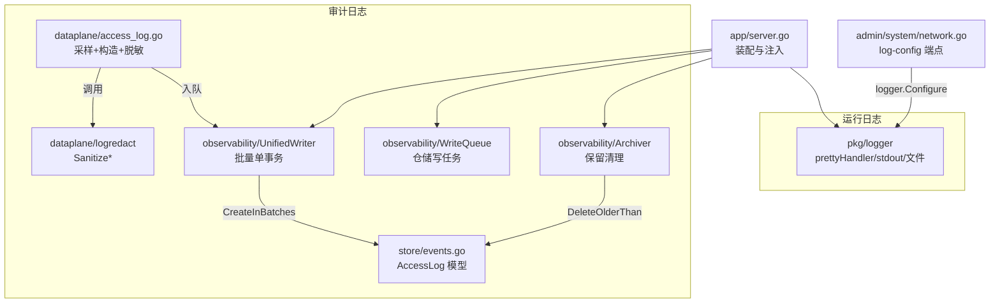
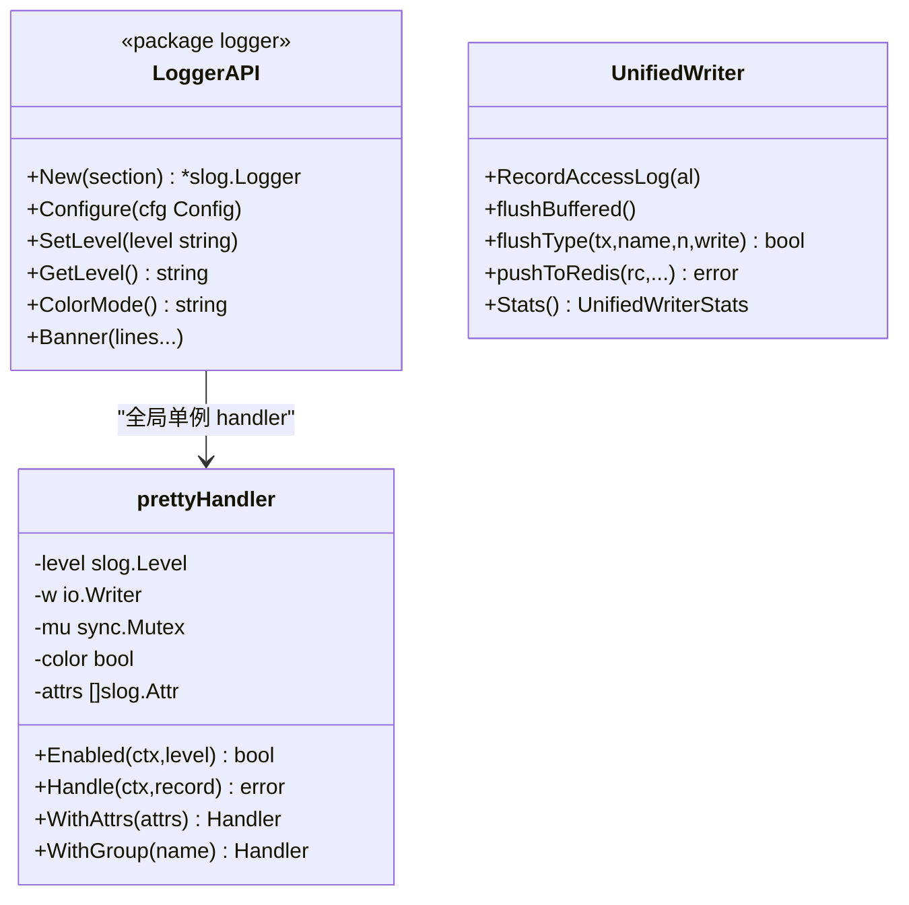
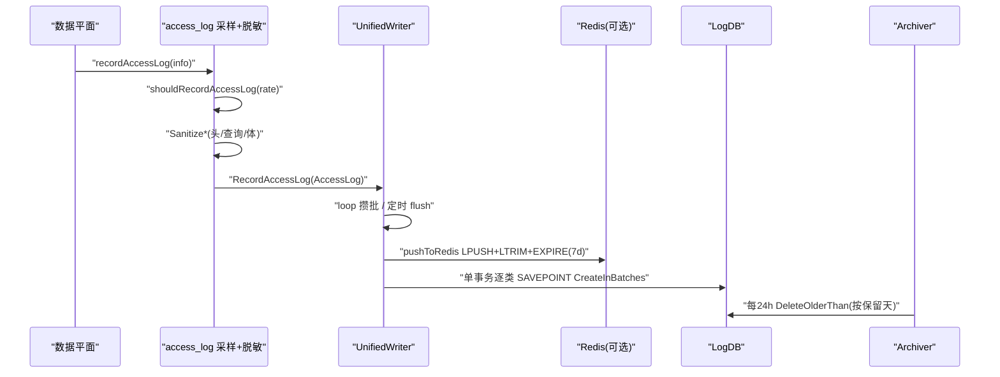
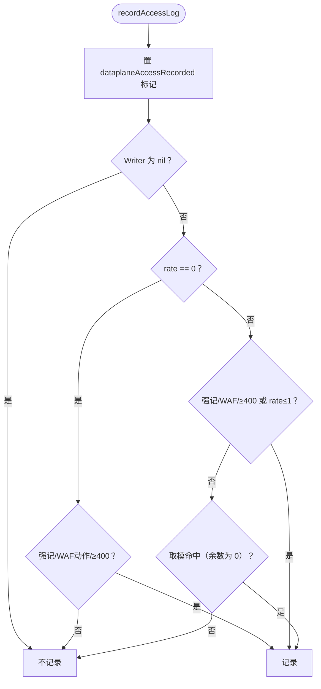

# 日志管理系统

> [返回 监控与可观测性](监控与可观测性.md)

<cite>
**本文档引用的文件**
- [internal/pkg/logger/logger.go](file://internal/pkg/logger/logger.go)
- [internal/dataplane/access_log.go](file://internal/dataplane/access_log.go)
- [internal/dataplane/logredact/sanitize.go](file://internal/dataplane/logredact/sanitize.go)
- [internal/store/events.go](file://internal/store/events.go)
- [internal/observability/unified_writer.go](file://internal/observability/unified_writer.go)
- [internal/observability/write_queue.go](file://internal/observability/write_queue.go)
- [internal/observability/archiver.go](file://internal/observability/archiver.go)
- [internal/admin/system/network.go](file://internal/admin/system/network.go)
- [internal/core/config.go](file://internal/core/config.go)
- [internal/app/server.go](file://internal/app/server.go)
- [README.md](file://README.md)
</cite>

## 目录

1. [简介](#简介)
2. [项目结构](#项目结构)
3. [核心组件](#核心组件)
4. [架构总览](#架构总览)
5. [详细组件分析](#详细组件分析)
6. [依赖关系分析](#依赖关系分析)
7. [性能考虑](#性能考虑)
8. [故障排查指南](#故障排查指南)
9. [结论](#结论)
10. [附录](#附录)

## 简介

My-OpenWaf 的「日志」分两条完全不同的通道，本篇分别覆盖它们的实现、去向与边界：

- **运行日志（slog）**：基于 Go 标准库 `log/slog` 的自定义 `prettyHandler`（`internal/pkg/logger`），输出到 stdout 或文件，受 `MY_OPENWAF_LOG_LEVEL` 过滤，可彩色、可按 `section` 标签区分模块。这条通道记录进程自身行为，不落数据库。
- **审计日志（访问/安全事件/drop/bot）**：由数据面在请求路径上构造 `store.AccessLog` 等结构体，经采样与脱敏后，由 `UnifiedWriter` 批量写入**独立日志库**（`MY_OPENWAF_LOG_DSN`），可选双写 Redis 供实时消费，由 `Archiver` 按保留期清理。

两条通道的耦合点在 `server.go`：初始化 logger、构造写入器/队列/归档器。域级概述（事件生命周期、归档细节、探针、指标）见 [监控与可观测性](监控与可观测性.md)，本篇不重复其结论，只落到「日志」本身。

关键事实校正：`MY_OPENWAF_ACCESSLOG_SAMPLING` 默认 `1`（全量），且**仅抽样正常成功的访问审计行**；安全事件、拦截、4xx/5xx 恒全量（`README.md:330`、`internal/dataplane/access_log.go:692-703`）。管理端保存日志配置（`POST /api/v1/log-config`）**直接调用 `logger.Configure` 即时生效，不触发快照 reload**（`internal/admin/system/network.go:266-301`）。审计字段一律脱敏/截断，绝不记录 `Authorization`、`Cookie`、`Set-Cookie`、API key 等敏感原值。

## 项目结构

日志相关代码按「格式化输出 / 采样构造 / 脱敏 / 落库 / 清理 / 配置」分工：

| 模块 | 文件 | 职责 | 关键符号 |
|---|---|---|---|
| 运行日志器 | `internal/pkg/logger/logger.go` | 全局 handler、级别、彩色、Banner | `New`、`Configure`、`prettyHandler` |
| 采样与条目构造 | `internal/dataplane/access_log.go` | 决定是否记录、组装 `AccessLog` | `recordAccessLog`、`shouldRecordAccessLog`、`buildAccessLogEntry` |
| 审计字段脱敏 | `internal/dataplane/logredact/sanitize.go` | 头/查询/体敏感值遮蔽与截断 | `SanitizeLogText`、`SanitizeQueryString` |
| 数据模型 | `internal/store/events.go` | `AccessLog` 字段与指纹摘要 | `AccessLog`、`BeforeSave` |
| 异步落库 | `internal/observability/unified_writer.go` | 四类通道单事务批量写 | `UnifiedWriter`、`flushType` |
| 通用写队列 | `internal/observability/write_queue.go` | 仓储写任务批处理 | `WriteQueue`、`Submit` |
| 保留清理 | `internal/observability/archiver.go` | 按天删除过期记录 | `Archiver`、`RetentionConfig` |
| 日志配置端点 | `internal/admin/system/network.go` | 读写 `log_config` 并即时生效 | `UpdateLogConfig`、`GetLogConfig` |



**图表来源**
- [internal/pkg/logger/logger.go:52-125](file://internal/pkg/logger/logger.go#L52-L125)
- [internal/dataplane/access_log.go:507-520](file://internal/dataplane/access_log.go#L507-L520)
- [internal/observability/unified_writer.go:895-965](file://internal/observability/unified_writer.go#L895-L965)
- [internal/app/server.go:327-357](file://internal/app/server.go#L327-L357)

**章节来源**
- [internal/app/server.go:327-357](file://internal/app/server.go#L327-L357)
- [internal/pkg/logger/logger.go:52-125](file://internal/pkg/logger/logger.go#L52-L125)

## 核心组件

- `logger.New(section)`：返回带 `section` 属性的 `*slog.Logger`，全部共享同一全局 handler，保证单一输出流不重复（`logger.go:68-70`）。
- `prettyHandler`：实现 `slog.Handler`，渲染「时间戳 + 级别徽标 + [section] + 正文 + 行内 attrs」，可选 ANSI 着色（`logger.go:273-373`）。
- `Configure`：重建全局 handler（级别 / 文件 / 镜像 / 着色），由 `init`、`SetLevel` 与管理端 `UpdateLogConfig` 共用（`logger.go:109-125`）。
- `recordAccessLog`：请求终结点先标记已处理，再按采样与脱敏构造条目并入队（`access_log.go:507-520`）。
- `UnifiedWriter`：四类通道（安全事件、访问日志、drop、bot 评分）由单 goroutine 排空，在一个事务内逐类 SAVEPOINT 写入（`unified_writer.go:26-109`、`895-1092`）。
- `Archiver`：默认每 24 小时一轮清理，安全事件/访问日志/drop 各按保留天数删除，过期即 `DeleteOlderThan`（`archiver.go:38-69`）。



**图表来源**
- [internal/pkg/logger/logger.go:68-125](file://internal/pkg/logger/logger.go#L68-L125)
- [internal/pkg/logger/logger.go:273-396](file://internal/pkg/logger/logger.go#L273-L396)

**章节来源**
- [internal/pkg/logger/logger.go:68-70](file://internal/pkg/logger/logger.go#L68-L70)
- [internal/observability/unified_writer.go:566-595](file://internal/observability/unified_writer.go#L566-L595)

## 架构总览

运行日志走 stdout/文件、不落库；审计日志走「采样→脱敏→入队→单事务落库→（可选）Redis 双写→（周期）归档清理」。日志库与主库分离：`UnifiedWriter`、`WriteQueue`、`Archiver` 均以 `rt.LogDB` 构造（`server.go:329`、`340`、`354`）。



**图表来源**
- [internal/dataplane/access_log.go:507-520](file://internal/dataplane/access_log.go#L507-L520)
- [internal/observability/unified_writer.go:1094-1159](file://internal/observability/unified_writer.go#L1094-L1159)
- [internal/observability/archiver.go:53-69](file://internal/observability/archiver.go#L53-L69)

## 详细组件分析

### 运行日志：级别、输出与着色

`init()` 一次性建立全局 handler，级别由 `MY_OPENWAF_LOG_LEVEL` 解析（DEBUG/WARN/ERROR/默认 INFO，`logger.go:187-198`）。输出目标由 `buildConfiguredOutput` 决定：无 `MY_OPENWAF_LOG_FILE` 走 `os.Stdout`；设了路径则建目录、以 O_APPEND 打开文件，若 `MY_OPENWAF_LOG_ALSO_STDOUT=1` 用 `io.MultiWriter` 同时镜像 stdout（`logger.go:155-185`）。着色优先级为「显式覆盖 > `MY_OPENWAF_LOG_COLOR` > stdout 是否终端」（`logger.go:215-228`）。`Banner` 直接写 stdout、不受级别过滤（`logger.go:451-483`）。管理端保存只改级别/文件/镜像三项并透传当前 `ColorMode()`，避免一次无关保存把着色重置成 auto（`network.go:287-292`）。

**章节来源**
- [internal/pkg/logger/logger.go:155-228](file://internal/pkg/logger/logger.go#L155-L228)
- [internal/pkg/logger/logger.go:451-483](file://internal/pkg/logger/logger.go#L451-L483)

### 采样决策：哪些请求会被记录

`shouldRecordAccessLog(info, rate)`（`access_log.go:692-703`）是唯一的记录闸门：

- `rate == 0`（采样关闭）：仍保留例外路径——`ForceRecord`、`WAFAction != "none"`、或 `StatusCode >= 400` 的记录照常写。
- `rate <= 1`（默认全量）或命中上述三条件之一：恒记录。
- `rate > 1`：普通成功访问按 `accessLogSampleCounter.Add(1) % rate == 0` 取模抽样。

「详细条目」另有一档：`shouldRecordDetailedAccessLog` 仅在 `WAFAction != "none" || StatusCode >= 400` 时打开（`access_log.go:667-669`）。纯正常访问若客户端提前断开（context 取消）则不记录（`isClientGoneForPlainAccessLog`，`access_log.go:685-690`）。



**图表来源**
- [internal/dataplane/access_log.go:667-703](file://internal/dataplane/access_log.go#L667-L703)

**章节来源**
- [internal/dataplane/access_log.go:507-520](file://internal/dataplane/access_log.go#L507-L520)
- [internal/dataplane/access_log.go:667-703](file://internal/dataplane/access_log.go#L667-L703)

### 审计字段与去向（脱敏矩阵）

下表给「字段 → 来源行 → 是否脱敏 → 落库或文件 → 采样条件」。「来源」为 `access_log.go` 中赋值或脱敏行；落库目标为独立日志库 `LogDB`（`MY_OPENWAF_LOG_DSN`）。

| 字段 | 来源:行 | 是否脱敏 | 落库或文件 | 采样条件 |
|---|---|---|---|---|
| `QueryString` | access_log.go:257 | 是：`SanitizeQueryString` 敏感键整体遮蔽 | LogDB 列 | 受 `ACCESSLOG_SAMPLING` |
| `Upstream` | access_log.go:262 | 是：`SanitizeUpstreamURL` 去 userinfo | LogDB 列 | 受采样 |
| `RequestHeaders` | access_log.go:244,264 | 是：`SanitizeLogText`，动态密钥端点置 `[redacted]`（:240-241） | LogDB 列 | 仅详细条目（WAF/≥400） |
| `RequestBodyPreview` | access_log.go:243,265 | 是：`SanitizeLogText` + 体抽取截断 | LogDB 列 | 仅详细条目 |
| `ResponseHeaders` | access_log.go:245,268 | 是：`SanitizeLogText` | LogDB 列 | 仅详细条目 |
| `Path` / `Method` / `StatusCode` | access_log.go:256,258,259 | 否（原值） | LogDB 列 | 受采样 |
| `ClientIP` / `Host` / `UserAgent` | access_log.go:254,255,263 | 否（原值） | LogDB 列 | 受采样 |
| TLS 指纹族（JA3/JA4/SNI/…） | access_log.go:271-282 | 否（指纹非凭据） | LogDB 列 + `fingerprint_key` 摘要 | 受采样 |
| `UpstreamLatencyMs` / `ResponseSize` | access_log.go:283-284 | 否 | LogDB 列 | 受采样 |
| 运行日志（slog 记录） | logger.go:290-373 | 否（非审计通道，级别过滤） | stdout / `MY_OPENWAF_LOG_FILE` | 不受采样，受 `LOG_LEVEL` |

逐头采集时按 `IsSensitiveLogKeyLowered` 命中即整值置 `[redacted]`，未命中的取值再经 `SanitizeLogText` 并以 `logHeaderValueLimit`（2048，`access_log.go:407`）截断（`access_log.go:416-425`、`439-448`）。敏感键清单见 `sensitiveLogKeyParts`（`sanitize.go:300-303`）与 `SensitiveLogValueHints`（`sanitize.go:190-195`），覆盖 `authorization`、`cookie`、`set-cookie`、`token`、`secret`、`api_key`、`csrf`、`ticket`、`env` 等。

**章节来源**
- [internal/dataplane/access_log.go:240-294](file://internal/dataplane/access_log.go#L240-L294)
- [internal/dataplane/access_log.go:407-470](file://internal/dataplane/access_log.go#L407-L470)
- [internal/dataplane/logredact/sanitize.go:13-16](file://internal/dataplane/logredact/sanitize.go#L13-L16)
- [internal/dataplane/logredact/sanitize.go:190-195](file://internal/dataplane/logredact/sanitize.go#L190-L195)

### 统一写入器：批量事务与 Redis 双写

`UnifiedWriter` 用四条带缓冲通道收记录（`eventCh/accessCh` 容量 = `EventBufferSize` 默认 16384，`dropCh/botScoreCh` = `DropBufferSize` 默认 8192，`unified_writer.go:124-129`、`396-402`）。`flushBuffered` 在一个事务里对四类各调 `flushType`，每类一个 SAVEPOINT，某类失败回滚到保存点、其余三类不受牵连（`unified_writer.go:930-965`、`1035-1069`，注释明确 SQLite 与 MySQL 驱动都实现 `SavePoint/RollbackTo`）。入队为通道满即丢弃并计数（`openwaf_writer_dropped_total`），`slowLogGrace > 0` 时可改「满则等待」而非丢弃（默认宽限 30s，`config.go:123`）。`pushToRedis` 用 `LPUSH + LTRIM + EXPIRE` 写四个列表（`openwaf:security_events`/`access_logs`/`drop_events`/`bot_scores`，长度上限 99999/49999，TTL 7 天，超时 5s，`unified_writer.go:1101-1152`）。

`WriteQueue` 服务仓储层通用写任务：`Submit` 非阻塞、满则丢弃并计数；`SubmitWait`/`SubmitPriority` 提供可等待路径，队列满时走同步回落 `runSynchronously`（`write_queue.go:300-425`）。默认容量 256、批 64、ticker 50ms（`write_queue.go:111-115`）。

**章节来源**
- [internal/observability/unified_writer.go:930-965](file://internal/observability/unified_writer.go#L930-L965)
- [internal/observability/unified_writer.go:1035-1152](file://internal/observability/unified_writer.go#L1035-L1152)
- [internal/observability/write_queue.go:111-115](file://internal/observability/write_queue.go#L111-L115)

### 归档与保留策略

`Archiver` 保留策略以天为单位，`RetentionConfig` 含安全事件、访问日志、drop、统计四类；0 表示永久保留（`archiver.go:25-30`）。默认保留 30 天、统计 7 天，清理间隔默认 24 小时（`archiver.go:53-57`）；`server.go:354` 以 30 天构造。每轮清理后执行轻量 SQLite planner/WAL 维护或原生后端优化。非法/越界的保留天数会被归一化并告警，不静默（`normalizeRetentionDays`，`archiver.go:94-113`）。完整事件生命周期见 [监控与可观测性](监控与可观测性.md)。

**章节来源**
- [internal/observability/archiver.go:25-69](file://internal/observability/archiver.go#L25-L69)
- [internal/observability/archiver.go:94-113](file://internal/observability/archiver.go#L94-L113)

## 依赖关系分析

- `pkg/logger` 仅依赖标准库（`context`、`io`、`log/slog`、`os`、`strings`、`sync`、`time`），无内部依赖，便于被任意模块共享。
- `access_log.go` 依赖 `logredact` 做脱敏、依赖 `store.AccessLog` 模型；`UnifiedWriter` 依赖 `gorm` 与 `rueidis`、`store` 事件类型。
- `admin/system/network.go` 通过 `logger.Configure` 反向作用于运行日志器，并经 `SystemSettingsRepo` 持久化 `log_config`，但不触碰快照/reload。

| 配置项 | 类型 | 默认值 | 必填 | 作用域 | 生效方式 | 安全等级 | 说明 |
|---|---|---|:--:|---|---|---|---|
| `MY_OPENWAF_LOG_LEVEL` | string | `info` | 否 | 进程 | 启动或 log-config | 普通 | DEBUG/INFO/WARN/ERROR |
| `MY_OPENWAF_LOG_FILE` | string | 空（stdout） | 否 | 进程 | 启动或 log-config | 普通 | 日志文件路径 |
| `MY_OPENWAF_LOG_ALSO_STDOUT` | bool | 空 | 否 | 进程 | 启动或 log-config | 普通 | 置 `1` 时文件+stdout 镜像 |
| `MY_OPENWAF_LOG_COLOR` | string | auto | 否 | 进程 | 启动 | 普通 | 仅 `1`/`true` 上色，否则终端判定 |
| `MY_OPENWAF_ACCESSLOG_SAMPLING` | int | `1` | 否 | 进程 | 启动或 reload（override） | 普通 | N≥1 生效，仅抽正常成功访问 |
| `MY_OPENWAF_QUEUE_EVENT_BUFFER_SIZE` | int | `16384` | 否 | 写入器 | 启动 | 普通 | 事件/访问日志通道容量 |
| `MY_OPENWAF_QUEUE_BATCH_SIZE` | int | `256` | 否 | 写入器 | 启动 | 普通 | flush 累计阈值 |
| `MY_OPENWAF_QUEUE_FLUSH_INTERVAL` | duration | `3s` | 否 | 写入器 | 启动 | 普通 | 定时 flush 周期 |
| `MY_OPENWAF_LOG_DSN` | string | `./data/waf_logs.db` | 否 | 日志库 | 重启 | 普通 | 独立日志库连接串 |
| `log_config`（API） | json | 继承运行值 | 否 | 进程 | POST 即时（不 reload） | 普通 | level/file/also_stdout |

来源：`logger.go:87-88`、`187-198`、`219`；`config.go:369-378`、`448-473`；`README.md:319`、`330`、`338-340`；`network.go:37-41`、`266-301`。

**章节来源**
- [internal/core/config.go:369-378](file://internal/core/config.go#L369-L378)
- [internal/admin/system/network.go:266-301](file://internal/admin/system/network.go#L266-L301)

### 三库兼容矩阵

审计日志的落库对 SQLite/MySQL/PostgreSQL 的差异主要影响写入器，与运行日志无关：

| 能力 | SQLite | MySQL | PostgreSQL | 备注 |
|---|:--:|:--:|:--:|---|
| 单事务批量 `CreateInBatches` | ✓ | ✓ | ✓ | 四类共用一个事务 |
| 逐类 `SAVEPOINT`/`RollbackTo` | ✓ | ✓ | 部分 | 代码注释保证 SQLite/MySQL；PG 由驱动 `SavePoint` 实现，失败面仍收敛到单类 |
| 单 goroutine 串行消除写锁竞争 | 关键收益 | 次要 | 次要 | SQLite 单写者是主要瓶颈来源 |
| 独立日志库 DSN | ✓ | ✓ | ✓ | `MY_OPENWAF_LOG_DSN` 与主库分离 |
| MySQL DSN 需 `parseTime=True` | — | 必须 | — | `README.md:318` |
| PG 经 PgBouncer 加 `pgbouncer=true` | — | — | 视部署 | `README.md:318` |

**章节来源**
- [internal/observability/unified_writer.go:1035-1069](file://internal/observability/unified_writer.go#L1035-L1069)
- [README.md:317-319](file://README.md#L317-L319)

## 性能考虑

- 运行日志用 `strings.Builder` 拼接、写前加互斥锁，单一流避免重复分配（`logger.go:290-372`）。
- `SanitizeLogText` 先做零分配的字面量预筛 `ContainsSensitiveLogHintFold`，不含敏感关键字直接返回，避免每行跑正则（`sanitize.go:206-216`、`251-276`）。
- 审计写入从热路径剥离：通道满即丢弃或有限等待（`slowLogGrace`），单事务批量落库降低 SQLite 锁竞争。
- `AccessLog.BeforeSave` 用九字段 SHA-256 摘要 `fingerprint_key` 替代宽文本列分组，列表/聚合查询更快（`events.go:178-198`、`148-170`）。
- Redis 双写整体 5s 超时、失败仅告警，不阻塞 DB 落库（`unified_writer.go:1101-1159`）。

**章节来源**
- [internal/dataplane/logredact/sanitize.go:206-216](file://internal/dataplane/logredact/sanitize.go#L206-L216)
- [internal/store/events.go:148-198](file://internal/store/events.go#L148-L198)

## 故障排查指南

管理端口默认 `:9443`（明文 HTTP，`README.md:321`）。日志配置端点需管理员 JWT，令牌用 `{TOKEN}` 占位、切勿写入真实值。

```bash
# 1) 读取当前生效的运行日志级别与输出（GET，readGroup 鉴权）
curl -s -H "Authorization: Bearer {TOKEN}" http://127.0.0.1:9443/api/v1/log-config
# 预期：{"level":"INFO","file_path":"","also_stdout":false}

# 2) 临时把级别调到 DEBUG 即时生效（POST，adminGroup 鉴权；不改快照、不触发 reload）
curl -s -X POST -H "Authorization: Bearer {TOKEN}" -H "Content-Type: application/json" \
  -d '{"level":"DEBUG"}' http://127.0.0.1:9443/api/v1/log-config
# 预期：返回体 level 变为 "DEBUG"，运行日志立刻多出 DEBUG 行，无需重启

# 3) 核对访问日志采样是否被改成全量：默认 1，安全事件/拦截/4xx/5xx 不受采样影响
#    仅当显式设 >1 时正常成功访问才被抽稀
env | grep MY_OPENWAF_ACCESSLOG_SAMPLING || echo "未设置（默认 1 全量）"

# 4) 判断审计记录是否被丢弃（通道满/关停期）
curl -s http://127.0.0.1:9443/metrics | grep '^openwaf_writer_dropped_total{type="access_log"}'
# 预期：单行计数；非零说明写入器背压，需增大队列或排查 LogDB

# 5) 查看实际落盘的访问日志库（独立 DSN）
ls -l ./data/waf_logs.db 2>/dev/null || echo "未启用独立日志库"
```

- 改级别后无 DEBUG 输出：确认 `UpdateLogConfig` 走的是 `logger.Configure`（`network.go:287`），若用环境变量改需重启。
- 日志文件没生成：`MY_OPENWAF_LOG_FILE` 为空时只走 stdout；目录不存在时 `buildConfiguredOutput` 会 `MkdirAll`，权限不足则回退 stdout 并告警（`logger.go:169-172`）。
- 审计里没有凭据值属预期：`Authorization`/`Cookie`/`token` 等被整值 `[redacted]`，不是丢字段。

**章节来源**
- [internal/admin/system/network.go:266-301](file://internal/admin/system/network.go#L266-L301)
- [internal/pkg/logger/logger.go:155-185](file://internal/pkg/logger/logger.go#L155-L185)

## 结论

My-OpenWaf 把「运行日志（slog，输出 stdout/文件、级别过滤）」与「审计日志（AccessLog 等，采样+脱敏后经 UnifiedWriter 批量落独立 LogDB、可选 Redis 双写、按保留期归档）」明确分离。审计通道以「默认全量、异常恒全量、敏感字段必脱敏截断」为原则，单事务逐类 SAVEPOINT 保证写入隔离与吞吐。管理端日志配置即时生效且不触发 reload，避免无关保存扰动快照。运行细节、事件生命周期与指标见 [监控与可观测性](监控与可观测性.md)。

## 附录

### 术语速查

| 术语 | 含义 | 出处 |
|---|---|---|
| section | slog 记录的模块标签，如 `writer`/`dataplane`/`archiver` | `logger.go:68` |
| ForceRecord | 强制记录标志，绕过采样（如质询/特殊端点） | `access_log.go:692-703` |
| detailed 条目 | 仅 WAF 命中或 ≥400 时携带头/体预览 | `access_log.go:667-669` |
| `[redacted]` | 敏感值统一遮蔽标记 | `sanitize.go:206-216` |
| `log_config` | 持久化的运行日志配置键 | `network.go:82` |

### 配置项与采样取值细则

- `MY_OPENWAF_ACCESSLOG_SAMPLING`：`N≥1` 生效；非整数或 `<1` 保留默认 `1` 并告警（`config.go:371-378`）。可经逐键覆盖表 `accesslog_sampling` 在 reload 时改（`config.go:369` 注释；前端 `env-override.ts` 归 observability 组）。
- 队列参数 `MY_OPENWAF_QUEUE_*`：越界会钳制到硬上限（通道 ≤1M、批 ≤10K、flush ≤60s、宽限 ≤5m）并告警，不静默（`config.go:222-255`、`unified_writer.go:113-120`）。

**章节来源**
- [internal/core/config.go:371-378](file://internal/core/config.go#L371-L378)
- [internal/observability/unified_writer.go:113-120](file://internal/observability/unified_writer.go#L113-L120)

### 生产配置建议

- 生产用 `MY_OPENWAF_LOG_FILE` 落文件、关闭彩色，交给 logrotate 或采集器（Filebeat/Fluent Bit）转发到集中式平台。
- 高并发下调大 `MY_OPENWAF_QUEUE_EVENT_BUFFER_SIZE` 或保留默认 `slowLogGrace` 以避免访问日志被丢弃；关注 `openwaf_writer_dropped_total` 是否增长。
- 采样默认保持 `1`（全量）；仅当正常成功访问量大且只用于容量估算时才调高，且必须理解安全事件/拦截/4xx/5xx 恒全量。
- 审计字段已是脱敏/截断结果，前端展示时可折叠长文本，不得反向拼回敏感原值。

**章节来源**
- [internal/pkg/logger/logger.go:155-185](file://internal/pkg/logger/logger.go#L155-L185)
- [internal/observability/unified_writer.go:124-129](file://internal/observability/unified_writer.go#L124-L129)
