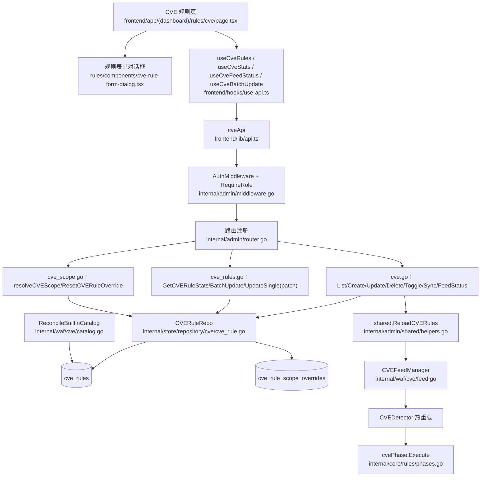
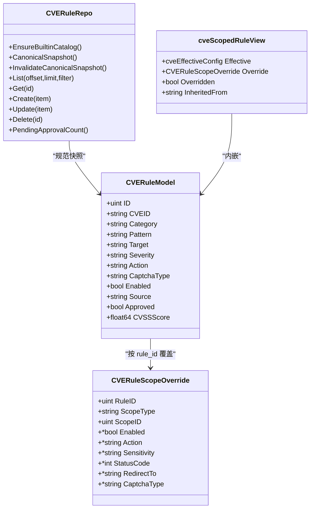
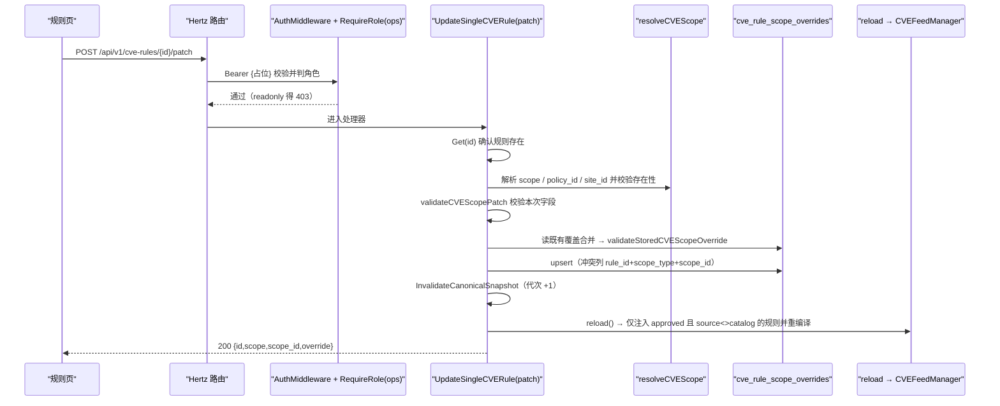
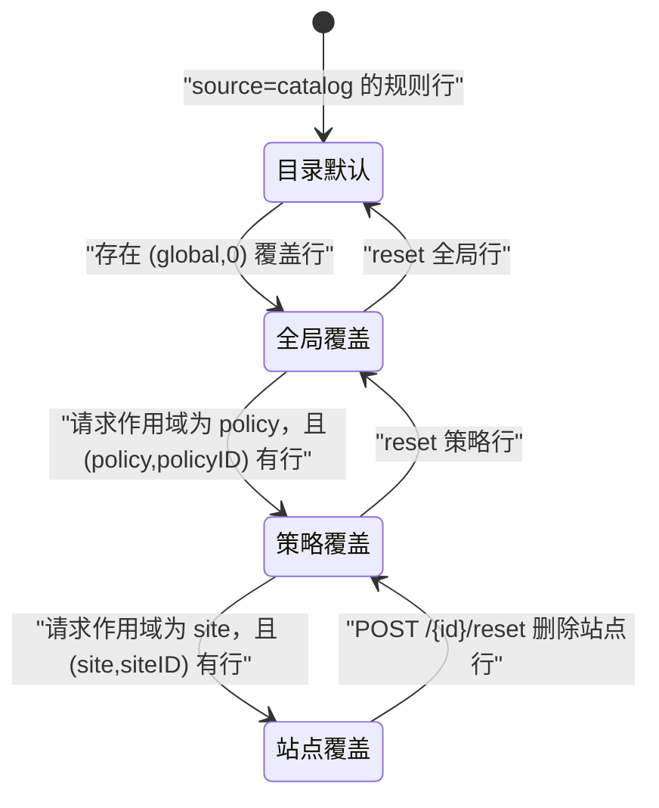
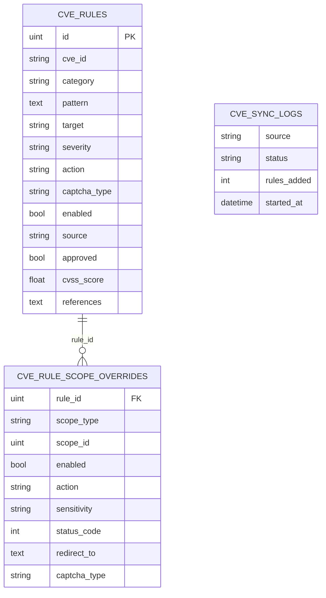
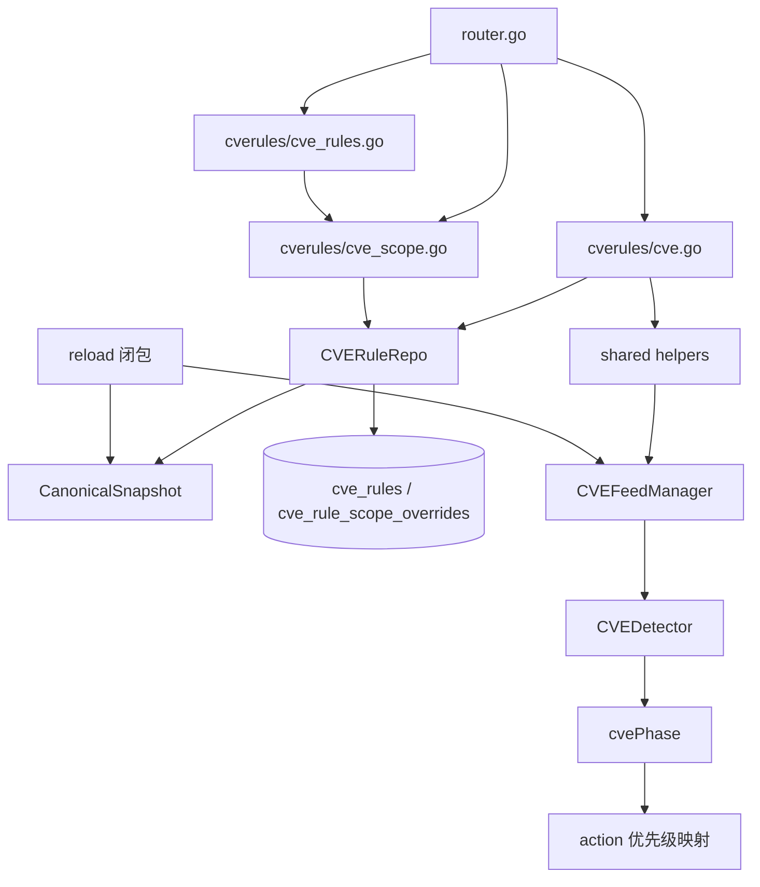

# CVE 规则管理 API

> [返回 管理 API 系统](管理 API 系统.md)

<cite>
**本文档引用的文件**
- [router.go](file://internal/admin/router.go)
- [cve.go](file://internal/admin/detect/cverules/cve.go)
- [cve_rules.go](file://internal/admin/detect/cverules/cve_rules.go)
- [cve_scope.go](file://internal/admin/detect/cverules/cve_scope.go)
- [detectlimit.go](file://internal/admin/detect/detectlimit/detectlimit.go)
- [cve_rule.go](file://internal/store/repository/cve/cve_rule.go)
- [cve.go](file://internal/store/cve/cve.go)
- [cve_scope.go](file://internal/store/cve/cve_scope.go)
- [feed.go](file://internal/waf/cve/feed.go)
- [catalog.go](file://internal/waf/cve/catalog.go)
- [helpers.go](file://internal/admin/shared/helpers.go)
- [action.go](file://internal/core/action/action.go)
- [phases.go](file://internal/core/rules/phases.go)
- [owasp.go](file://internal/waf/owasp/owasp.go)
- [migrate.go](file://internal/store/migrate.go)
- [config.go](file://internal/core/config.go)
- [middleware.go](file://internal/admin/middleware.go)
- [api.ts](file://frontend/lib/api.ts)
- [use-api.ts](file://frontend/hooks/use-api.ts)
- [page.tsx](file://frontend/app/(dashboard)/rules/cve/page.tsx)
- [cve-rule-form-dialog.tsx](file://frontend/app/(dashboard)/rules/components/cve-rule-form-dialog.tsx)
</cite>

## 目录

1. [简介](#简介)
2. [项目结构](#项目结构)
3. [核心组件](#核心组件)
4. [架构总览](#架构总览)
5. [详细组件分析](#详细组件分析)
6. [依赖关系分析](#依赖关系分析)
7. [性能考虑](#性能考虑)
8. [故障排查指南](#故障排查指南)
9. [结论](#结论)
10. [附录](#附录)

## 简介

CVE 规则管理 API 提供漏洞检测规则的作用域视图、目录对账、外部数据源同步与自定义规则 CRUD。处理器在 `internal/admin/detect/cverules/`（`cve.go` 409 行、`cve_rules.go` 179 行、`cve_scope.go` 367 行），仓储在 `internal/store/repository/cve/cve_rule.go`（311 行），运行时侧由 `internal/waf/cve/` 的检测器与订阅源管理器承接。

必须先纠正的三点旧口径：不存在 `GET /api/v1/cve-rules/:id`，单条规则的读取只能通过带作用域的列表视图，本组共 11 个端点；写操作只有 POST 且权限分两档，`/cve-rules`、`/cve-rules/:id/update`、`/cve-rules/:id/delete` 仅 admin，`toggle`、`patch`、`reset`、`batch`、`sync` 为 admin/operator；灵敏度是六档（`off`/`low`/`mid`/`high`/`very_high`/`strict`）而非三档，`medium` 是 `mid` 的可接受别名。

**章节来源**
- [router.go:220-222](file://internal/admin/router.go#L220-L222)
- [router.go:317-321](file://internal/admin/router.go#L317-L321)
- [router.go:410-412](file://internal/admin/router.go#L410-L412)
- [owasp.go:840-857](file://internal/waf/owasp/owasp.go#L840-L857)

## 项目结构

CVE 管理面围绕「一张规则表 + 一张作用域覆盖表」组织：规则本体是全局唯一的目录条目或自定义条目，动作与启停由按 `(rule_id, scope_type, scope_id)` 唯一约束的覆盖表承担。

| 层 | 路径 | 行数 | 职责 |
|----|------|-----:|------|
| 路由 | `internal/admin/router.go` | 465 | 11 个端点与三档权限分组 |
| 处理器 | `internal/admin/detect/cverules/cve.go` | 409 | 自定义规则 CRUD、切换、同步与订阅状态 |
| 处理器 | `internal/admin/detect/cverules/cve_rules.go` | 179 | 作用域统计、批量更新、单条覆盖写入（`patch`） |
| 处理器 | `internal/admin/detect/cverules/cve_scope.go` | 367 | 作用域解析、有效视图合并、覆盖落库与清除 |
| 仓储 | `internal/store/repository/cve/cve_rule.go` | 311 | 规范快照缓存、CRUD、待审批计数 |
| 模型 | `internal/store/cve/cve.go` + `cve_scope.go` | 46 / 25 | 建表模型、`CVESyncLog`、作用域常量与覆盖结构 |
| 模型 | `internal/waf/cve/feed.go` | 694 | `CVERuleModel` 运行时读写模型、订阅源管理器 |
| 对账 | `internal/waf/cve/catalog.go` | 126 | 内置目录以 `source='catalog'` 落表 |
| 前端 | `frontend/app/(dashboard)/rules/cve/page.tsx` | 815 | 作用域切换、批量操作与表单；配套 `rules/components/cve-rule-form-dialog.tsx`（334） |



**图表来源**
- [router.go:220-222](file://internal/admin/router.go#L220-L222)
- [router.go:317-321](file://internal/admin/router.go#L317-L321)
- [router.go:410-412](file://internal/admin/router.go#L410-L412)
- [cve.go:112-409](file://internal/admin/detect/cverules/cve.go#L112-L409)
- [cve_rule.go:73-295](file://internal/store/repository/cve/cve_rule.go#L73-L295)
- [catalog.go:13-113](file://internal/waf/cve/catalog.go#L13-L113)

**章节来源**
- [cve.go:20-23](file://internal/admin/detect/cverules/cve.go#L20-L23)
- [cve_scope.go:22-44](file://internal/admin/detect/cverules/cve_scope.go#L22-L44)
- [cve_rule.go:14-45](file://internal/store/repository/cve/cve_rule.go#L14-L45)

## 核心组件

| 组件 | 类型 | 定义位置 | 说明 |
|------|------|----------|------|
| `CVERuleModel` / `CVERuleRecord` | 模型两侧 | `waf/cve/feed.go:36-59`、`store/cve/cve.go:9-35` | 运行时读写与建表迁移共用一张 `cve_rules`，字段集必须一致 |
| `CVERuleScopeOverride` | 覆盖模型 | `store/cve/cve_scope.go:11-25` | 六字段全指针，唯一索引 `(rule_id,scope_type,scope_id)` |
| `cveScopeContext` | 作用域上下文 | `cverules/cve_scope.go:39-44` | `ScopeType`/`ScopeID`/`PolicyID`/`SiteID` |
| `cveScopedRuleView` / `cveEffectiveConfig` | 响应视图 | `cverules/cve_scope.go:22-37` | 内嵌模型 + `effective`/`override`/`overridden`/`inherited_from` |
| `cveRuleStats` | 统计结构 | `cverules/cve_rules.go:18-26` | `total`/启停计数/类别与危险度分布/作用域回显 |
| `resolveCVEScope` | 解析函数 | `cverules/cve_scope.go:46-108` | 查询参数优先于请求体，逐级校验存在性 |
| `effectiveCVERule` | 合并函数 | `cverules/cve_scope.go:110-159` | 目录 → 全局 → 策略 → 站点 四层覆盖 |
| `saveCVEScopeOverride` | 落库函数 | `cverules/cve_scope.go:286-323` | 先读既有行合并再校验，upsert 七列 |
| `CanonicalSnapshot` | 快照 | `repository/cve/cve_rule.go:73-105` | 10 秒 TTL + 单飞 + 代次核对 |
| `CVEFeedManager` | 订阅源管理 | `waf/cve/feed.go:17-33` | 后台同步循环与热重载入口 |



**图表来源**
- [feed.go:36-59](file://internal/waf/cve/feed.go#L36-L59)
- [cve.go:9-35](file://internal/store/cve/cve.go#L9-L35)
- [cve_scope.go:11-25](file://internal/store/cve/cve_scope.go#L11-L25)
- [cve_scope.go:31-37](file://internal/admin/detect/cverules/cve_scope.go#L31-L37)
- [cve_rule.go:43-295](file://internal/store/repository/cve/cve_rule.go#L43-L295)

**章节来源**
- [feed.go:36-59](file://internal/waf/cve/feed.go#L36-L59)
- [cve_scope.go:11-25](file://internal/store/cve/cve_scope.go#L11-L25)
- [cve_rule.go:43-45](file://internal/store/repository/cve/cve_rule.go#L43-L45)

## 架构总览

CVE 配置写入的独有特征是「不改正则本体，只写作用域覆盖」，因此链路比规则表 CRUD 多一次快照失效与代次核对。



**图表来源**
- [router.go:255-256](file://internal/admin/router.go#L255-L256)
- [router.go:318](file://internal/admin/router.go#L318)
- [cve_rules.go:130-179](file://internal/admin/detect/cverules/cve_rules.go#L130-L179)
- [cve_scope.go:46-108](file://internal/admin/detect/cverules/cve_scope.go#L46-L108)
- [cve_scope.go:286-323](file://internal/admin/detect/cverules/cve_scope.go#L286-L323)
- [helpers.go:314-319](file://internal/admin/shared/helpers.go#L314-L319)
- [feed.go:136-138](file://internal/waf/cve/feed.go#L136-L138)

三档权限分组决定端点可达性：

| 分组 | 注册位置 | 允许角色 | 本组端点数 | 覆盖端点 |
|------|----------|----------|-----------:|----------|
| `readGroup` | `router.go:124-125` | admin、operator、readonly | 3 | `GET /cve-rules`、`GET /cve-rules/stats`、`GET /cve-feed/status` |
| `opsGroup` | `router.go:255-256` | admin、operator | 5 | `toggle`、`patch`、`reset`、`batch`、`sync` |
| `adminGroup` | `router.go:372-373` | admin | 3 | 创建、`update`、`delete` |

**章节来源**
- [router.go:124-125](file://internal/admin/router.go#L124-L125)
- [router.go:255-256](file://internal/admin/router.go#L255-L256)
- [router.go:372-373](file://internal/admin/router.go#L372-L373)
- [middleware.go:42-141](file://internal/admin/middleware.go#L42-L141)

## 详细组件分析

### 端点总表

| 方法 | 路径 | 权限 | 处理器 | 注册行 | 说明 |
|------|------|------|--------|-------:|------|
| GET | `/api/v1/cve-rules` | readonly+ | `cverules.ListCVERules` | 220 | 作用域有效视图分页，附 `stats` |
| GET | `/api/v1/cve-rules/stats` | readonly+ | `cverules.GetCVERuleStats` | 221 | 作用域内统计，不受过滤影响 |
| GET | `/api/v1/cve-feed/status` | readonly+ | `cverules.GetCVEFeedStatus` | 222 | 订阅源状态与待审批数 |
| POST | `/api/v1/cve-rules/:id/toggle` | admin/operator | `cverules.ToggleCVERule` | 317 | 仅自定义规则；空体即翻转 |
| POST | `/api/v1/cve-rules/:id/patch` | admin/operator | `cverules.UpdateSingleCVERule` | 318 | 写作用域覆盖，不改规则本体 |
| POST | `/api/v1/cve-rules/:id/reset` | admin/operator | `cverules.ResetCVERuleOverride` | 319 | 删除当前作用域覆盖 |
| POST | `/api/v1/cve-rules/batch` | admin/operator | `cverules.BatchUpdateCVERules` | 320 | 多 ID 同覆盖，事务内逐条校验 |
| POST | `/api/v1/cve-rules/sync` | admin/operator | `cverules.SyncCVERules` | 321 | 触发一次立即同步，阻塞 |
| POST | `/api/v1/cve-rules` | admin | `cverules.CreateCVERule` | 410 | 新建自定义规则，强制 201 |
| POST | `/api/v1/cve-rules/:id/update` | admin | `cverules.UpdateCVERule` | 411 | 仅自定义规则可改正本体 |
| POST | `/api/v1/cve-rules/:id/delete` | admin | `cverules.DeleteCVERule` | 412 | 同事务清理覆盖行 |

另有一条与本组强相关的管理端点：`POST /api/v1/backup/import`（`router.go:382-388`）在导入成功后显式调用 `CVERule.InvalidateCanonicalSnapshot()`，否则恢复的库会继续沿用旧快照。

**章节来源**
- [router.go:220-222](file://internal/admin/router.go#L220-L222)
- [router.go:317-321](file://internal/admin/router.go#L317-L321)
- [router.go:382-388](file://internal/admin/router.go#L382-L388)
- [router.go:410-412](file://internal/admin/router.go#L410-L412)

### 请求参数表

读取类端点共用作用域与过滤参数：

| 端点 | 参数 | 位置 | 类型 | 必填 | 约束与默认 |
|------|------|------|------|:----:|------------|
| `GET /cve-rules` | `page` / `page_size` | query | int | 否 | 缺省 1 / 20 |
| `GET /cve-rules` | `scope` | query | string | 否 | `global`（缺省）/`policy`/`site`，查询串优先于请求体 |
| `GET /cve-rules` | `policy_id` / `site_id` | query | uint | 条件 | 对应作用域下必填，0 或非法值 400 |
| `GET /cve-rules` | `category` / `severity` / `source` / `enabled` | query | string | 否 | 精确匹配有效视图字段；`enabled` 取 `true` 或 `1` 视为真 |
| `GET /cve-rules` | `q` | query | string | 否 | 匹配 `cve_id` 或 `description`，超过 256 字节 400 |
| `GET /cve-rules/stats` | `scope`/`policy_id`/`site_id` | query | — | 条件 | 与列表同一解析函数，过滤参数不参与统计 |
| `POST /cve-rules/:id/patch` | `id` | path | uint | 是 | 非数值 400；规则不存在 404 |
| `POST /cve-rules/:id/patch` | `scope`/`policy_id`/`site_id` | body 或 query | — | 否 | 查询串优先；`site` 作用域会回溯解析 `policy_id` |
| `POST /cve-rules/:id/patch` | `enabled`/`action`/`sensitivity`/`status_code`/`redirect_to`/`captcha_type` | body | 指针 | 否 | nil 保留既有覆盖值 |
| `POST /cve-rules/batch` | `ids` | body | []uint | 是 | 空数组 400；任一 ID 不存在则整体 400 |
| `POST /cve-rules/:id/reset` | `scope` 等 | body | — | 否 | 兼容旧前端把作用域放 body 的写法；`sync` 无请求体 |

创建与更新自定义规则的请求体字段：

| 字段 | 类型 | 创建必填 | 更新必填 | 约束 |
|------|------|:--------:|:--------:|------|
| `cve_id` | string | 否 | 否 | ≤32 字节；更新用指针区分未提交 |
| `category` / `severity` | string | 是 | 否 | ≤32 / ≤16 字节，空值不覆盖原值 |
| `pattern` | string | 是 | 否 | ≤64 KiB，必须能被 `regexp.Compile` |
| `target` | string | 是 | 否 | `all`/`url`/`url_body`/`body`/`header`/`cookie` |
| `action` | string | 是 | 否 | 经 `ValidateActionWithoutRedirectTarget`，禁 `redirect` |
| `description` | string | 否 | 否 | ≤64 KiB，更新用指针 |
| `captcha_type` | string | 否 | 否 | ≤16 字节，且动作必须是 `captcha_challenge` |
| `enabled` | bool | 否 | 否 | 更新用指针，避免省略即置 false |

批量更新载荷示例（把三条规则在某策略作用域内改为验证码挑战）：

```json
{
  "scope": "policy",
  "policy_id": 2,
  "ids": [12, 31, 77],
  "enabled": true,
  "action": "captcha_challenge",
  "captcha_type": "slide"
}
```

**章节来源**
- [cve.go:112-158](file://internal/admin/detect/cverules/cve.go#L112-L158)
- [cve.go:25-103](file://internal/admin/detect/cverules/cve.go#L25-L103)
- [cve.go:212-260](file://internal/admin/detect/cverules/cve.go#L212-L260)
- [cve_rules.go:66-127](file://internal/admin/detect/cverules/cve_rules.go#L66-L127)
- [cve_scope.go:46-108](file://internal/admin/detect/cverules/cve_scope.go#L46-L108)
- [cve_scope.go:325-367](file://internal/admin/detect/cverules/cve_scope.go#L325-L367)
- [detectlimit.go:4-5](file://internal/admin/detect/detectlimit/detectlimit.go#L4-L5)
- [helpers.go:116-147](file://internal/admin/shared/helpers.go#L116-L147)

### 响应字段表

`GET /cve-rules` 返回 `{items,total,scope,scope_id,stats}`，`items` 元素是 `cveScopedRuleView`：内嵌 `CVERuleModel` 全部 JSON 列，外加四个作用域字段。

| 字段 | 类型 | 说明 |
|------|------|------|
| `id` / `created_at` / `updated_at` | uint / time / time | `deleted_at` 标记 `json:"-"`，不对外暴露 |
| `cve_id` | string | 漏洞编号，目录条目必有 |
| `category` | string | 实测取值 `cve_general`、`cve_java`、`cve_php`、`cve_node`；目录侧空值回落 `cve_general` |
| `pattern` | string | 目录条目的这一列存的是注册表规则 ID，自定义条目才是正则 |
| `target` / `severity` | string | 目标视图；`critical`/`high`/`medium`/`low`，目录侧空值回落 `medium` |
| `action` / `captcha_type` | string | 本体动作默认 `drop`；验证码类型 `omitempty` 且非 `captcha_challenge` 动作下被强制清空 |
| `enabled` / `approved` | bool | 目录条目 `approved` 恒为真 |
| `description` / `source` | string | `source` 取值见下表 |
| `cvss_score` / `cwe_type` / `references` | float / string / text | 仅用于危险度推导与展示 |
| `effective` / `override` | object / object 或 null | 合并后的六个生效字段；覆盖行详情仅在当前作用域存在覆盖时非空 |
| `overridden` / `inherited_from` | bool / string | 是否被当前作用域显式覆盖；`catalog`/`global`/`policy`/`site` 中最后一次赋值层 |

| `source` 取值 | 写入方 | 可否删改本体 | 是否注入运行时检测器 |
|---------------|--------|:------------:|:--------------------:|
| `catalog` | `ReconcileBuiltinCatalog` | 否（403） | 否，被 `source<>'catalog'` 过滤 |
| `nvd` | NVD 订阅源同步 | 否（403） | 是，需 `approved` 为真 |
| `github` | GitHub Advisory 同步 | 否（403） | 是，需 `approved` 为真 |
| `auto_generated` | CWE 派生生成 | 否（403） | 是，需 `approved` 为真 |
| `custom` | `POST /cve-rules` | 是（仅 admin） | 是，创建即 `approved=true` |

`GET /cve-rules/stats` 返回 `cveRuleStats`：`total`、`enabled_count`、`disabled_count`、`by_category`、`by_severity`、`scope`、`scope_id`。`GET /cve-feed/status` 返回 `last_sync`、`last_error`、`syncing`、`pending_review`；订阅管理器未初始化时前两项为 `null` 与 `feed manager not initialized`。

```json
{
  "items": [
    {
      "id": 12,
      "cve_id": "CVE-2024-23897",
      "category": "cve_general",
      "pattern": "cve:CVE-2024-23897",
      "target": "all",
      "severity": "critical",
      "action": "drop",
      "enabled": false,
      "description": "Jenkins CLI 参数绕过程序读取任意文件",
      "source": "catalog",
      "approved": true,
      "cvss_score": 9.8,
      "cwe_type": "CWE-22",
      "effective": { "enabled": true, "action": "captcha_challenge", "captcha_type": "slide" },
      "override": { "rule_id": 12, "scope": "policy", "scope_id": 2, "enabled": true, "action": "captcha_challenge", "captcha_type": "slide" },
      "overridden": true,
      "inherited_from": "policy"
    }
  ],
  "total": 1,
  "scope": "policy",
  "scope_id": 2,
  "stats": {
    "total": 36,
    "enabled_count": 12,
    "disabled_count": 24,
    "by_category": { "cve_general": 30, "cve_java": 2, "cve_node": 2, "cve_php": 2 },
    "by_severity": { "critical": 9, "high": 21, "medium": 6 },
    "scope": "policy",
    "scope_id": 2
  }
}
```

**章节来源**
- [cve_scope.go:22-44](file://internal/admin/detect/cverules/cve_scope.go#L22-L44)
- [cve_scope.go:110-159](file://internal/admin/detect/cverules/cve_scope.go#L110-L159)
- [cve_rules.go:18-47](file://internal/admin/detect/cverules/cve_rules.go#L18-L47)
- [cve.go:369-409](file://internal/admin/detect/cverules/cve.go#L369-L409)
- [feed.go:36-59](file://internal/waf/cve/feed.go#L36-L59)
- [catalog.go:75-113](file://internal/waf/cve/catalog.go#L75-L113)
- [cve_rule.go:288-293](file://internal/store/repository/cve/cve_rule.go#L288-L293)

### 错误码表

| 状态码 | 触发条件 | 响应体 | 依据 |
|-------:|----------|--------|------|
| 400 | `q` 超过 256 字节 | `{"error":"q exceeds 256 bytes"}` | `cve.go:123-126` |
| 400 | 作用域参数缺失、目标不存在或 `scope` 非三值 | `policy_id required`、`policy not found`、`site_id required`、`site not found`、`default policy not configured`、`scope must be global, policy, or site` | `cve_scope.go:74-105` |
| 400 | 请求体非法 JSON | `{"error":"请求体格式无效"}` 或绑定错误原文 | `cve_rules.go:81-84`、`cve_scope.go:343-348` |
| 400 | `ids` 为空，或批量含未知规则 ID | `{"error":"ids required"}` / `{"error":"unknown CVE rule id"}` | `cve_rules.go:85-88`、`cve_rules.go:100-107` |
| 400 | 路径 `id` 非数值 | `{"error":"invalid id"}` | `cve.go:132-135`、`cve.go:194-198` |
| 400 | 动作非法、`redirect` 缺 `redirect_to`，或 `status_code` 越界 | `invalid action`、`redirect_to required`、`status_code must be between 100 and 599` | `cve_scope.go:206-216`、`cve_scope.go:279-282` |
| 400 | `sensitivity` 不在六档集合 | `{"error":"invalid sensitivity"}` | `cve_scope.go:262-268` |
| 400 | `captcha_type` 与动作不匹配 | `{"error":"captcha_type requires captcha_challenge action"}` | `cve_scope.go:217-238`、`cve.go:92-101` |
| 400 | 自定义规则字段缺失或正则非法 | `{"error":"category is required"}` 等 | `cve.go:38-56`、`cve.go:70-91` |
| 403 | 目录或订阅源规则被改本体 | `only custom rules can be edited` / `…deleted` / `…toggled` | `cve.go:205-208`、`cve.go:297-300`、`cve.go:330-333` |
| 404 | 规则 ID 不存在 | `{"error":"not found"}` | `cve.go:137-140`、`cve.go:200-204` |
| 500 | 落库成功但快照重载失败，或同步执行失败 | `config applied but reload failed: …` / `<错误文本>` | `cve_rules.go:119-124`、`cve.go:181-187`、`cve.go:379-382` |
| 503 | 订阅源管理器未初始化 | `{"error":"CVE feed manager not available"}` | `cve.go:371-374` |

创建成功返回 201 与完整对象，删除成功返回 200 `{"message":"deleted"}`（非 204），批量返回 `{"updated":N,"scope":…,"scope_id":…}`。

**章节来源**
- [cve.go:25-158](file://internal/admin/detect/cverules/cve.go#L25-L158)
- [cve.go:192-409](file://internal/admin/detect/cverules/cve.go#L192-L409)
- [cve_rules.go:66-179](file://internal/admin/detect/cverules/cve_rules.go#L66-L179)
- [cve_scope.go:206-284](file://internal/admin/detect/cverules/cve_scope.go#L206-L284)
- [cve_scope.go:325-367](file://internal/admin/detect/cverules/cve_scope.go#L325-L367)

### 作用域三态与合并优先级

覆盖模型的六个字段全为指针，`nil` 表示「本作用域不表态」，由下一层继承；这与站点级 `*bool` 三态是同一套语义。



**图表来源**
- [cve_scope.go:110-159](file://internal/admin/detect/cverules/cve_scope.go#L110-L159)
- [cve_scope.go:286-323](file://internal/admin/detect/cverules/cve_scope.go#L286-L323)
- [cve_scope.go:325-367](file://internal/admin/detect/cverules/cve_scope.go#L325-L367)

合并规则有四点值得逐条记住：

| 规则 | 行为 | 依据 |
|------|------|------|
| 逐层应用 | 依次 `global(0)` → `policy(scope.PolicyID)` → `site(scope.SiteID)`，后者覆盖前者 | `cve_scope.go:145-151` |
| 空值不算覆盖 | 字符串字段仅在非空白时覆盖，`status_code` 仅在非 0 时覆盖 | `cve_scope.go:122-136` |
| `inherited_from` 记最后一次赋值层 | 不是请求作用域本身 | `cve_scope.go:137` |
| 非挑战动作清空验证码类型 | 有效视图与规则体同时清空，防止前端渲染不存在的挑战类型 | `cve_scope.go:152-157` |
| 部分更新先合并再校验 | 避免留下「`redirect` 无 `redirect_to`」这类不可执行组合 | `cve_scope.go:286-314` |

站点作用域解析还有一个隐含步骤：`site` 作用域会回溯站点绑定的 `policy_id`，站点未绑定时取默认策略（`default_slot = 1`），因此站点视图必然包含其策略层的覆盖效果（`cve_scope.go:94-103`）。

**章节来源**
- [cve_scope.go:46-108](file://internal/admin/detect/cverules/cve_scope.go#L46-L108)
- [cve_scope.go:110-159](file://internal/admin/detect/cverules/cve_scope.go#L110-L159)
- [cve_scope.go:242-323](file://internal/admin/detect/cverules/cve_scope.go#L242-L323)

### 灵敏度与动作取值表

覆盖模型的 `sensitivity` 与 OWASP 类别敏感度共用同一套六档口径，`medium` 是 `mid` 的归一化别名：

| 档位 | 可接受输入 | 阈值语义 | 效果 |
|------|------------|---------:|------|
| `off` | `off`、`none` | 停用 | 该类别不参与判定 |
| `low` | `low` | 7 | 仅高分命中拦截，最宽松 |
| `mid` | `mid`、`medium` | 4 | 全局默认 |
| `high` | `high` | 3 | 由 2 上调以减少误报 |
| `very_high` | `very_high`、`very-high`、`veryhigh` | 2 | 严格 |
| `strict` | `strict` | 1 | 最严格 |

CVE 侧的校验只接受上述六档加 `medium`（`cve_scope.go:262-268`），归一化与阈值映射的权威实现在 `normalizeSensitivityLevel` 与 `sensitivityThresholdForNormalizedLevel`。

动作取值在两个入口上的合法集合不同，这是最常见的 400 来源：

| 入口 | 校验函数 | 允许的 `redirect` | 说明 |
|------|----------|:-----------------:|------|
| 规则本体 `action`（create/update） | `ValidateActionWithoutRedirectTarget` | 否 | 规则体不承载跳转目标 |
| 作用域覆盖 `action`（patch/batch） | `ValidateActionWithRedirectTarget` | 是，须同带 `redirect_to` | 覆盖层可改为跳转 |
| 任意入口 | 二者共同排除 | — | `allow` 与 `tag` 不可作为命中动作 |

挑战类四种动作与自动断连的配合关系：`captcha_challenge` 需要 `captcha_type`（缺省继承全局验证码类型），`shield_challenge` 走 5 秒盾流程，`chain_challenge` 走链式步骤；`cve_auto_drop_critical`/`cve_auto_drop_high` 仅在规则未显式指定动作时把 critical/high 升级为 `drop`。

**章节来源**
- [cve_scope.go:262-268](file://internal/admin/detect/cverules/cve_scope.go#L262-L268)
- [owasp.go:840-892](file://internal/waf/owasp/owasp.go#L840-L892)
- [helpers.go:103-147](file://internal/admin/shared/helpers.go#L103-L147)
- [action.go:8-26](file://internal/core/action/action.go#L8-L26)
- [action.go:88-119](file://internal/core/action/action.go#L88-L119)
- [phases.go:789-841](file://internal/core/rules/phases.go#L789-L841)
- [cve.go:92-101](file://internal/admin/detect/cverules/cve.go#L92-L101)

### 数据模型与缓存



**图表来源**
- [feed.go:36-59](file://internal/waf/cve/feed.go#L36-L59)
- [cve.go:9-46](file://internal/store/cve/cve.go#L9-L46)
- [cve_scope.go:11-25](file://internal/store/cve/cve_scope.go#L11-L25)

规范快照是这组端点的性能与一致性枢纽：`CanonicalSnapshot` 一次读全量规则（上限 10000 条）与其全部覆盖行，构建深拷贝缓存 10 秒；`InvalidateCanonicalSnapshot` 同时清掉热条目并递增代次，正在进行的加载会在发布前核对代次并重试，因此不会发布陈旧数据。写操作都显式调用失效，`Create`/`Update`/`Delete`/`Toggle` 在仓储层内即完成失效。

两点结构性事实需要记录：`cve_rules` 与 `cve_rule_scope_overrides` 之间没有数据库级外键，删除自定义规则时必须在同一事务清理覆盖行（`cve_rule.go:264-278`）；`CVESyncLog` 表虽由 `store/cve/cve.go:37-46` 建表、并在 `store/migrate.go:72-74` 与规则表、覆盖表一并 AutoMigrate，同时提供 `Create`/`Latest` 仓储方法，但当前 `feed.go` 的同步循环并未写入该表，`GET /cve-feed/status` 的数据完全来自 `CVEFeedManager` 的内存状态。

**章节来源**
- [cve_rule.go:14-16](file://internal/store/repository/cve/cve_rule.go#L14-L16)
- [cve_rule.go:73-157](file://internal/store/repository/cve/cve_rule.go#L73-L157)
- [cve_rule.go:264-293](file://internal/store/repository/cve/cve_rule.go#L264-L293)
- [cve.go:37-46](file://internal/store/cve/cve.go#L37-L46)
- [migrate.go:72-74](file://internal/store/migrate.go#L72-L74)
- [feed.go:89-138](file://internal/waf/cve/feed.go#L89-L138)

### 订阅源同步

同步周期与开关来自环境变量，缺省关闭 feed、间隔 6 小时：

| 项 | 取值 | 来源 |
|----|------|------|
| 间隔默认与环境变量 | `6h`；`MY_OPENWAF_CVE_FEED_INTERVAL` | `core/config.go:399-405` |
| feed 开关 | `MY_OPENWAF_CVE_FEED_ENABLED=true` 才启用后台循环 | `core/config.go:398` |
| NVD 密钥与自动审批 | `MY_OPENWAF_NVD_API_KEY`（值写作 `{占位}`）、`MY_OPENWAF_CVE_AUTO_APPROVE` | `core/config.go:400-401` |
| 检测器注入过滤 | `approved = true AND source <> 'catalog'` | `waf/cve/feed.go:201-228` |
| 待审批计数 | `approved = false` 行数 | `cve_rule.go:288-293` |

`POST /cve-rules/sync` 是同步阻塞调用：先检查管理器非空（否则 503），执行 `SyncNow()`，随后无条件失效规范快照，最后按结果返回 200 或 500。由于快照失效发生在同步结果判定之前，即便同步失败，下一次读取也会重新拉取数据库现状。

**章节来源**
- [config.go:398-405](file://internal/core/config.go#L398-L405)
- [cve.go:369-409](file://internal/admin/detect/cverules/cve.go#L369-L409)
- [feed.go:89-138](file://internal/waf/cve/feed.go#L89-L138)
- [feed.go:201-228](file://internal/waf/cve/feed.go#L201-L228)
- [cve_rule.go:288-293](file://internal/store/repository/cve/cve_rule.go#L288-L293)

### 前端调用点

| 调用方 | 位置 | 消费端点 | 说明 |
|--------|------|----------|------|
| `cveApi.list` / `getStats` / `getFeedStatus` | `lib/api.ts:1002-1006` | 三个 readGroup 端点 | 带作用域与过滤参数 |
| `cveApi.toggle`/`patch`/`reset`/`batch`/`sync` | `lib/api.ts:1007-1033` | 五个 opsGroup 端点 | `reset` 把作用域拼成查询串 |
| `cveApi.create`/`update`/`delete` | `lib/api.ts:1015-1021` | 三个 adminGroup 端点 | 注释明确内置规则不得调用 |
| `useCveRules` / `useCveStats` / `useCveFeedStatus` | `hooks/use-api.ts:580-586`、`1519-1528` | 列表、统计、订阅状态 | 参数为 null 时不请求 |
| `useCveBatchUpdate` | `hooks/use-api.ts:1215-1217` | 批量 | 提交后失效规则缓存 |
| 规则页写操作 | `app/(dashboard)/rules/cve/page.tsx:266-362` | patch / update / reset / create / delete | 作用域内改动走 `patch`，本体改动走 `update` |
| 表单对话框 | `rules/components/cve-rule-form-dialog.tsx` | create / update | 仅自定义规则可编辑本体 |

页面的路由分工与后端权限一致：作用域内的启停与动作调整始终走 `patch`，只有自定义规则的本体编辑才走 `update`，这一区分正是避免 operator 误触 admin 端点得到 403 的关键。

**章节来源**
- [api.ts:1001-1034](file://frontend/lib/api.ts#L1001-L1034)
- [use-api.ts:580-586](file://frontend/hooks/use-api.ts#L580-L586)
- [use-api.ts:1215-1217](file://frontend/hooks/use-api.ts#L1215-L1217)
- [use-api.ts:1519-1528](file://frontend/hooks/use-api.ts#L1519-L1528)
- [page.tsx:266-362](file://frontend/app/(dashboard)/rules/cve/page.tsx#L266-L362)

## 依赖关系分析

| 依赖方 | 被依赖方 | 依赖性质 | 失败表现 |
|--------|----------|----------|----------|
| `ListCVERules` | `resolveCVEScope` 与 `listEffectiveCVERules` | 作用域校验 + 全量视图与内存分页 | 400/500 |
| `listEffectiveCVERules` | `EnsureBuiltinCatalog`、`CanonicalSnapshot` | 目录兜底对账 + 10 秒快照读 | 500 |
| `CreateCVERule` | `regexp.Compile`、`validateCustomCVERule` | 正则与字段合法性 | 400 |
| CRUD 四个写端点 | `shared.ReloadCVERules` | 检测器热重载 | 管理器为 nil 时静默跳过 |
| `patch`/`batch`/`reset` | `saveCVEScopeOverride`、`InvalidateCanonicalSnapshot` | 覆盖 upsert 与代次推进 | 400/500 |
| 全部写端点 | `reload` 闭包 | 配置快照生效 | 500 并提示已落库 |
| `SyncCVERules` | `CVEFeedManager.SyncNow` | 阻塞外部抓取 | 503/500 |
| `cvePhase.Execute` | `store.ProtectionConfig` | 动作映射与自动断连 | 命中动作退化到默认 `intercept` |



**图表来源**
- [cve.go:112-409](file://internal/admin/detect/cverules/cve.go#L112-L409)
- [cve_rules.go:49-179](file://internal/admin/detect/cverules/cve_rules.go#L49-L179)
- [cve_scope.go:161-183](file://internal/admin/detect/cverules/cve_scope.go#L161-L183)
- [cve_rule.go:73-157](file://internal/store/repository/cve/cve_rule.go#L73-L157)
- [helpers.go:314-319](file://internal/admin/shared/helpers.go#L314-L319)
- [phases.go:789-841](file://internal/core/rules/phases.go#L789-L841)

**章节来源**
- [cve.go:12-18](file://internal/admin/detect/cverules/cve.go#L12-L18)
- [cve_scope.go:12-20](file://internal/admin/detect/cverules/cve_scope.go#L12-L20)
- [helpers.go:314-319](file://internal/admin/shared/helpers.go#L314-L319)

## 性能考虑

- 列表把全量有效视图读入内存后再过滤分页，代价换来「覆盖合并后的值也能按 `enabled` 过滤」这一语义；规则总量受快照上限 10000 约束。
- 10 秒快照 TTL + 单飞合并冷读，使高频列表与统计请求共享同一次数据库往返；写后立即失效，避免读到旧值；代次核对保证并发写不会让陈旧快照发布成功。
- `by_category`/`by_severity` 是 `map[string]int`，统计与列表共用一次全量遍历，不额外查库。
- 批量更新在单事务内逐 ID 处理：先做一次存在性计数，再读既有覆盖行合并、最后 upsert，N 条即 3N 次数据库交互；前端应控制单次勾选规模，避免长事务。
- `SyncNow` 是同步阻塞端点，抓取耗时直接体现在请求延迟上，建议仅在运维窗口调用，常规更新交给 6 小时后台循环；`references` 为 `text` 列且随全量视图下发，必要时用 `category`/`severity` 收窄响应体积。

[本节为总结，无需特定文件来源]

## 故障排查指南

| 症状 | 原因 | 排查 | 方案 |
|------|------|------|------|
| `GET /cve-rules?scope=site` 返回 400 | 站点未绑策略且无默认策略 | 查 `default_slot=1` 的策略是否存在 | 先设置默认策略 |
| 覆盖保存 400 `invalid action` | 动作含 `redirect` 但缺 `redirect_to`，或用了 `allow`/`tag` | 比对两把校验函数 | 补 `redirect_to` 或换动作 |
| 覆盖保存 400 `captcha_type requires…` | 提交了 `captcha_type` 但动作非 `captcha_challenge` | 看同一请求的 `action` | 同时提交，或省略验证码类型 |
| 覆盖里 `sensitivity` 被拒 | 不在六档集合 | 用 `medium` 归一到 `mid` | 按档位表提交 |
| 改目录规则动作报 403 | 本体只允许 `custom` | 用 `POST /{id}/patch` | 覆盖层即可改动作 |
| 规则启用后不拦截 | `approved=false` 或来源为 `catalog` | `GET /cve-feed/status` 看 `pending_review` | 审批或改用自定义规则 |
| 列表数字与统计不一致 | `stats` 来自未过滤全量，`total` 来自过滤后 | 去掉过滤条件复核 | 统计卡应标注「全量口径」 |
| 备份导入后视图仍是旧值 | 快照未失效 | 确认走的是 `POST /backup/import` | 该端点已内置失效，手工导入需调 `reload` |
| `sync` 返回 503 | 订阅管理器未初始化 | 查 `MY_OPENWAF_CVE_FEED_ENABLED` | 启用 feed 或改用目录规则 |

**章节来源**
- [cve_scope.go:46-108](file://internal/admin/detect/cverules/cve_scope.go#L46-L108)
- [cve_scope.go:206-284](file://internal/admin/detect/cverules/cve_scope.go#L206-L284)
- [cve.go:192-367](file://internal/admin/detect/cverules/cve.go#L192-L367)
- [cve.go:369-409](file://internal/admin/detect/cverules/cve.go#L369-L409)
- [cve_rule.go:264-278](file://internal/store/repository/cve/cve_rule.go#L264-L278)
- [feed.go:201-228](file://internal/waf/cve/feed.go#L201-L228)
- [router.go:382-388](file://internal/admin/router.go#L382-L388)

## 结论

CVE 规则管理 API 的设计要点是「本体与表态分离」：`cve_rules` 存检测事实，`cve_rule_scope_overrides` 存作用域内态度，有效视图在读取时四层合并生成，写侧只碰覆盖表即可调整动作、灵敏度与验证码类型。这一分工让目录规则可被策略与站点改写，同时保证 operator 无法改动规则本体。

本轮订正了五处旧文档错误：虚构的 `GET /cve-rules/:id` 端点、把创建/更新/删除写成 admin-operator 可达的权限、把 `patch` 与 `update` 混为一谈、灵敏度写成三档、以及把动作集合列成四种。另登记两项代码侧事实供后续处理：`CVESyncLog` 表未接入 feed 循环、`pattern` 列在目录条目中存的是规则 ID 而非正则。

[本节为总结，无需特定文件来源]

## 附录

### 校验区间速查

| 字段 | 区间或集合 | 依据 |
|------|------------|------|
| `cve_id` / `category` / `severity` / `captcha_type` | ≤32、≤32、≤16、≤16 字节，均须 UTF-8 合法 | `cve.go:57-77` |
| `target` | `all`/`url`/`url_body`/`body`/`header`/`cookie` | `cve.go:52-56` |
| `pattern` | ≤64 KiB 且可编译 | `cve.go:21`、`cve.go:78-82` |
| `description` | ≤64 KiB | `cve.go:22-23` |
| `status_code` | 0 或 100–599 | `cve_scope.go:214-216` |
| `sensitivity` | 六档 + `medium` | `cve_scope.go:262-268` |
| `q` | ≤256 字节 | `cve.go:123-126`、`detectlimit.go:4-5` |
| 快照规则上限 | 10000 条 | `cve_rule.go:16`、`cve_rule.go:136` |
| `captcha_type` 集合 | `math`/`click`/`slide`/`rotate` | `helpers.go:138-155` |

**章节来源**
- [cve.go:20-103](file://internal/admin/detect/cverules/cve.go#L20-L103)
- [cve.go:123-126](file://internal/admin/detect/cverules/cve.go#L123-L126)
- [cve_scope.go:206-284](file://internal/admin/detect/cverules/cve_scope.go#L206-L284)
- [cve_rule.go:14-16](file://internal/store/repository/cve/cve_rule.go#L14-L16)
- [helpers.go:138-155](file://internal/admin/shared/helpers.go#L138-L155)
- [detectlimit.go:4-5](file://internal/admin/detect/detectlimit/detectlimit.go#L4-L5)

### 请求与响应示例

创建自定义规则（仅 admin，预期 201）：

```json
{
  "cve_id": "CVE-2025-000001",
  "category": "cve_general",
  "pattern": "(?i)/actuator/(env|heapdump)",
  "target": "url",
  "severity": "high",
  "action": "intercept",
  "description": "Spring Actuator 敏感端点未授权访问",
  "enabled": true
}
```

切换启用状态可提交空体即翻转，也可显式给值（`{"enabled": true}`）；成功响应同时回显审批位，`{id, enabled, approved}` 三键。`GET /cve-feed/status` 返回 `{last_sync, last_error, syncing, pending_review}`，其中 `pending_review` 即 `approved = false` 的规则数。

**章节来源**
- [cve.go:160-190](file://internal/admin/detect/cverules/cve.go#L160-L190)
- [cve.go:317-367](file://internal/admin/detect/cverules/cve.go#L317-L367)
- [cve.go:387-409](file://internal/admin/detect/cverules/cve.go#L387-L409)

### 相关文档

- 检测器与动作映射：[CVE 漏洞检测](../安全防护功能/CVE 漏洞检测/CVE 漏洞检测.md)、[CVE 规则管理](../安全防护功能/CVE 漏洞检测/CVE 规则管理.md)、[CVE 数据源同步](../安全防护功能/CVE 漏洞检测/CVE 数据源同步.md)
- 同域端点：[策略管理 API](策略管理 API.md)、[阻断策略 API](阻断策略 API.md)
- 自定义规则 CRUD：[规则管理 API](规则管理 API/规则管理 API.md)

[本节为通用指导，无需特定文件来源]

### 验证命令

按作用域读取有效视图与统计：

```bash
curl -s -H "Authorization: Bearer {占位}" \
  "http://127.0.0.1:8080/api/v1/cve-rules?scope=policy&policy_id=2&enabled=true&page_size=5"

curl -s -H "Authorization: Bearer {占位}" \
  "http://127.0.0.1:8080/api/v1/cve-rules/stats?scope=site&site_id=3"
```

写入并清除一条作用域覆盖，再校验非法作用域被拒：

```bash
curl -s -X POST -H "Authorization: Bearer {占位}" \
  -H "Content-Type: application/json" \
  -d '{"scope":"policy","policy_id":2,"action":"captcha_challenge","captcha_type":"slide"}' \
  http://127.0.0.1:8080/api/v1/cve-rules/12/patch

curl -s -X POST -H "Authorization: Bearer {占位}" \
  -d '{"scope":"tenant"}' http://127.0.0.1:8080/api/v1/cve-rules/12/reset

go test ./internal/admin/detect/cverules/... ./internal/store/repository/cve/...
```

[本节为通用指导，无需特定文件来源]
