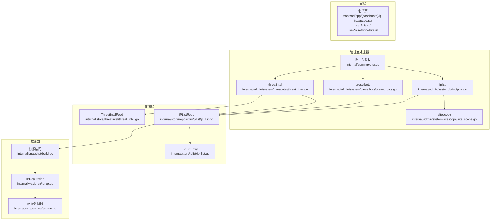
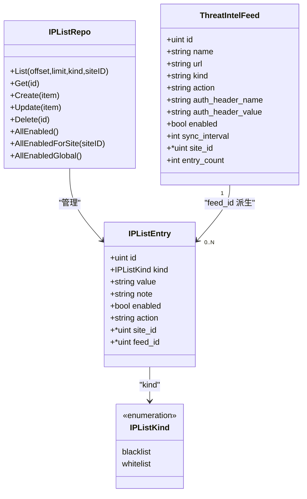
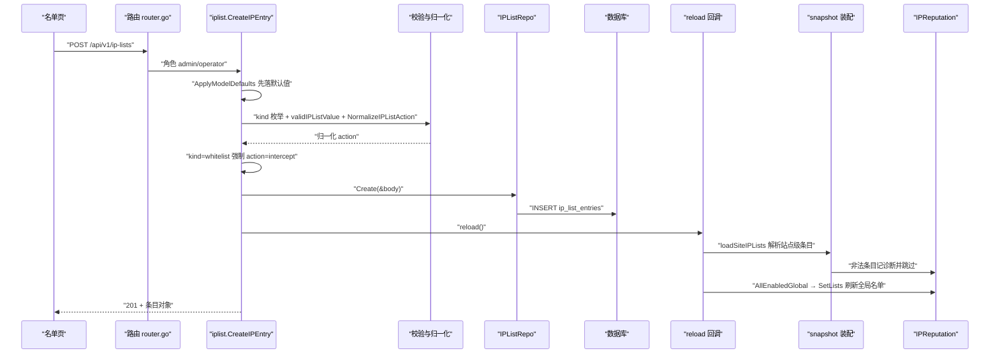
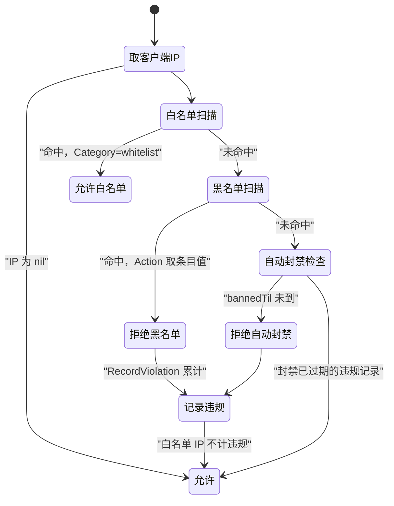
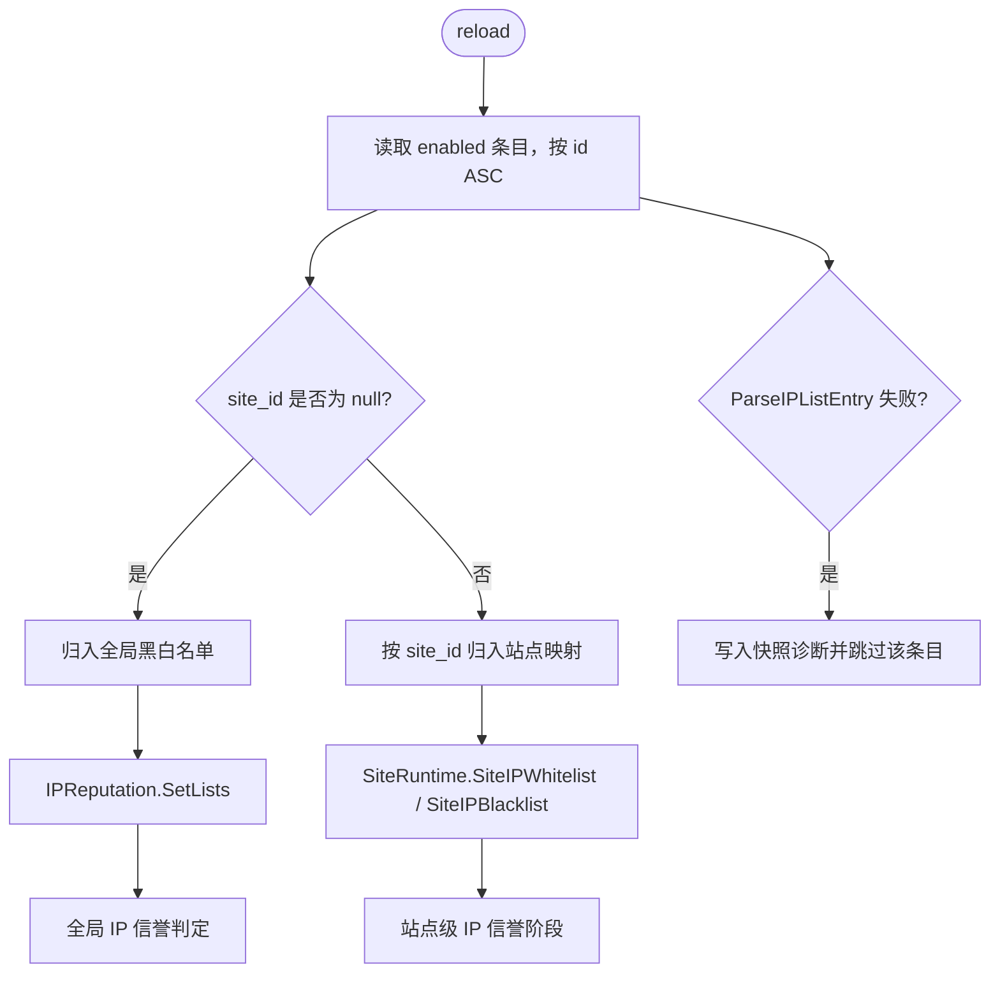
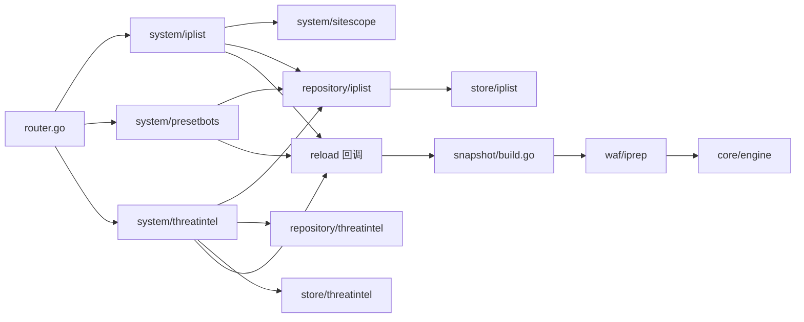

# IP 黑白名单管理 API

> [返回 管理 API 系统](管理 API 系统.md)

<cite>
**本文档引用的文件**
- [router.go](file://internal/admin/router.go)
- [iplist.go](file://internal/admin/system/iplist/iplist.go)
- [site_scope.go](file://internal/admin/system/sitescope/site_scope.go)
- [preset_bots.go](file://internal/admin/system/presetbots/preset_bots.go)
- [threat_intel.go](file://internal/admin/system/threatintel/threat_intel.go)
- [threat_intel_sync_log.go](file://internal/admin/system/threatintel/threat_intel_sync_log.go)
- [ip_list.go](file://internal/store/iplist/ip_list.go)
- [ip_list.go](file://internal/store/repository/iplist/ip_list.go)
- [threat_intel.go](file://internal/store/threatintel/threat_intel.go)
- [threat_intel_sync_log.go](file://internal/store/threatintel/threat_intel_sync_log.go)
- [iprep.go](file://internal/waf/iprep/iprep.go)
- [build.go](file://internal/snapshot/build.go)
- [engine.go](file://internal/core/engine/engine.go)
- [server.go](file://internal/app/server.go)
- [page.tsx](file://frontend/app/(dashboard)/ip-lists/page.tsx)
</cite>

## 目录

1. [简介](#简介)
2. [项目结构](#项目结构)
3. [核心组件](#核心组件)
4. [架构总览](#架构总览)
5. [详细组件分析](#详细组件分析)
6. [依赖关系分析](#依赖关系分析)
7. [性能考虑](#性能考虑)
8. [故障排查指南](#故障排查指南)
9. [结论](#结论)
10. [附录](#附录)

## 简介

IP 黑白名单管理 API 负责 `IPListEntry` 的 CRUD、作用域（全局/站点）切换、预置搜索引擎白名单注入，以及威胁情报订阅源的管理——订阅源是名单条目的自动生产者。共 13 个端点。

三条容易踩坑的事实：

1. **列表默认只看全局**。`GET /api/v1/ip-lists` 不带 `site_id` 时，仓库把条件写成 `site_id IS NULL`，站点级条目一条都不会出现，必须显式传 `site_id` 才切换到该站点的条目。
2. **白名单的动作被强制为 `intercept`**。请求体里的 `action` 对 `kind=whitelist` 不生效，创建与更新两条路径都会覆写。
3. **`site_id` 是三态**：字段缺省=保持原作用域、显式 `null`=改回全局、正整数=改为该站点作用域。用 `**uint` 无法表达，因此实现改用 `json.RawMessage` 判别原始字节。

**章节来源**
- [ip_list.go:14-33](file://internal/store/repository/iplist/ip_list.go#L14-L33)
- [iplist.go:84-86](file://internal/admin/system/iplist/iplist.go#L84-L86)
- [site_scope.go:13-37](file://internal/admin/system/sitescope/site_scope.go#L13-L37)

## 项目结构

处理器在 `internal/admin/system/iplist/` 子包（旧文档按扁平单文件命名指向该处理器，该布局早已作废），作用域解析在 `sitescope/`，预置白名单在 `presetbots/`，订阅源在 `threatintel/`。

**图表来源**
- [router.go:154-158](file://internal/admin/router.go#L154-L158)
- [router.go:188](file://internal/admin/router.go#L188)
- [router.go:289-296](file://internal/admin/router.go#L289-L296)
- [router.go:369](file://internal/admin/router.go#L369)
- [iplist.go:1-212](file://internal/admin/system/iplist/iplist.go#L1-L212)

| 模块 | 路径 | 行数 | 职责 |
|------|------|-----:|------|
| 名单处理器 | `internal/admin/system/iplist/iplist.go` | 212 | CRUD、值与动作校验、白名单动作覆写 |
| 作用域解析 | `internal/admin/system/sitescope/site_scope.go` | 37 | `site_id` 三态判别 |
| 预置白名单 | `internal/admin/system/presetbots/preset_bots.go` | 118 | 9 条搜索引擎段预览与幂等注入 |
| 订阅源处理器 | `internal/admin/system/threatintel/threat_intel.go` | 273 | 订阅源 CRUD、手动同步、认证头掩码 |
| 同步日志处理器 | `internal/admin/system/threatintel/threat_intel_sync_log.go` | 41 | 同步历史查询与分页 |
| 名单模型 | `internal/store/iplist/ip_list.go` | 30 | `IPListKind` 与 `IPListEntry` |
| 名单仓库 | `internal/store/repository/iplist/ip_list.go` | 62 | 分页、作用域过滤、启用集读取 |
| 运行时判定 | `internal/waf/iprep/iprep.go` | 281 | 白/黑/自动封禁三级决策 |

**章节来源**
- [iplist.go:1-212](file://internal/admin/system/iplist/iplist.go#L1-L212)
- [site_scope.go:1-37](file://internal/admin/system/sitescope/site_scope.go#L1-L37)
- [preset_bots.go:1-118](file://internal/admin/system/presetbots/preset_bots.go#L1-L118)
- [threat_intel.go:1-273](file://internal/admin/system/threatintel/threat_intel.go#L1-L273)
- [ip_list.go:1-30](file://internal/store/iplist/ip_list.go#L1-L30)
- [ip_list.go:1-62](file://internal/store/repository/iplist/ip_list.go#L1-L62)
- [iprep.go:1-281](file://internal/waf/iprep/iprep.go#L1-L281)

## 核心组件

**图表来源**
- [ip_list.go:9-30](file://internal/store/iplist/ip_list.go#L9-L30)
- [ip_list.go:10-62](file://internal/store/repository/iplist/ip_list.go#L10-L62)
- [threat_intel.go:1-33](file://internal/store/threatintel/threat_intel.go#L1-L33)

| 字段 | 类型 | 语义 | 备注 |
|------|------|------|------|
| `kind` | `IPListKind` | `blacklist` / `whitelist` | 唯一合法取值，其他值 400 |
| `value` | string | 单 IP 或 CIDR | `net.ParseIP` 或 `net.ParseCIDR` 判定 |
| `note` | string | 描述 | 预置项前缀 `[预置] ` |
| `enabled` | bool | 是否参与判定 | 默认 true；关闭条目不进入快照 |
| `action` | string | `intercept` / `drop` | 白名单强制 `intercept` |
| `site_id` | `*uint` | null=全局，有值=站点作用域 | 列表与快照装配都按此分流 |
| `feed_id` | `*uint` | null=手工，有值=订阅源派生 | 删除订阅源会连带清理派生条目 |

注意模型上**没有条目过期字段**：`ExpireAt` 属于数据面的自动封禁记录 `iprep.BanEntry`，与持久化名单条目无关。

**章节来源**
- [ip_list.go:16-30](file://internal/store/iplist/ip_list.go#L16-L30)
- [iplist.go:70-96](file://internal/admin/system/iplist/iplist.go#L70-L96)
- [iprep.go:13-20](file://internal/waf/iprep/iprep.go#L13-L20)

## 架构总览

**图表来源**
- [router.go:289](file://internal/admin/router.go#L289)
- [iplist.go:60-97](file://internal/admin/system/iplist/iplist.go#L60-L97)
- [build.go:1596-1641](file://internal/snapshot/build.go#L1596-L1641)
- [server.go:1335-1351](file://internal/app/server.go#L1335-L1351)

| 端点分组 | 数量 | 权限 | 处理器包 |
|----------|-----:|------|----------|
| 名单读取 | 2 | readonly+ | `system/iplist` |
| 名单写入 | 3 | admin/operator | `system/iplist` |
| 预置爬虫白名单 | 2 | readonly+ / admin+operator | `system/presetbots` |
| 订阅源 | 5 | readonly+ / admin+operator | `system/threatintel` |
| 同步日志 | 1 | readonly+ | `system/threatintel` |
| **合计** | **13** | — | — |

**章节来源**
- [router.go:154-158](file://internal/admin/router.go#L154-L158)
- [router.go:188](file://internal/admin/router.go#L188)
- [router.go:289-296](file://internal/admin/router.go#L289-L296)
- [router.go:369](file://internal/admin/router.go#L369)

## 详细组件分析

### 端点总表

| 方法 | 路径 | 权限 | 处理器 | 注册行 | 实现行 |
|------|------|------|--------|-------:|-------:|
| GET | `/api/v1/ip-lists` | readonly+ | `iplist.ListIPEntries` | 154 | 20 |
| GET | `/api/v1/ip-lists/:id` | readonly+ | `iplist.GetIPEntry` | 155 | 44 |
| POST | `/api/v1/ip-lists` | admin/operator | `iplist.CreateIPEntry` | 289 | 60 |
| POST | `/api/v1/ip-lists/:id/update` | admin/operator | `iplist.UpdateIPEntry` | 290 | 99 |
| POST | `/api/v1/ip-lists/:id/delete` | admin/operator | `iplist.DeleteIPEntry` | 291 | 195 |
| GET | `/api/v1/preset-bot-whitelist` | readonly+ | `presetbots.ListPresetBotWhitelist` | 188 | 106 |
| POST | `/api/v1/preset-bot-whitelist/seed` | admin/operator | `presetbots.SeedBotWhitelist` | 369 | 61 |
| GET | `/api/v1/threat-intel-feeds` | readonly+ | `threatintel.ListThreatIntelFeeds` | 157 | 55 |
| POST | `/api/v1/threat-intel-feeds` | admin/operator | `threatintel.CreateThreatIntelFeed` | 293 | 82 |
| POST | `/api/v1/threat-intel-feeds/:id/update` | admin/operator | `threatintel.UpdateThreatIntelFeed` | 294 | 135 |
| POST | `/api/v1/threat-intel-feeds/:id/delete` | admin/operator | `threatintel.DeleteThreatIntelFeed` | 295 | 228 |
| POST | `/api/v1/threat-intel-feeds/:id/sync` | admin/operator | `threatintel.SyncThreatIntelFeed` | 296 | 248 |
| GET | `/api/v1/threat-intel-sync-logs` | readonly+ | `threatintel.ListThreatIntelSyncLogs` | 158 | 17 |

**章节来源**
- [router.go:154-158](file://internal/admin/router.go#L154-L158)
- [router.go:188](file://internal/admin/router.go#L188)
- [router.go:289-296](file://internal/admin/router.go#L289-L296)
- [router.go:369](file://internal/admin/router.go#L369)
- [iplist.go:20-212](file://internal/admin/system/iplist/iplist.go#L20-L212)

### 请求参数表

| 端点 | 参数 | 位置 | 类型 | 必填 | 约束与默认 |
|------|------|------|------|:----:|------------|
| `GET /ip-lists` | `page` / `page_size` | query | int | 否 | 非法值按 0 传入 `utils.Paginate` |
| `GET /ip-lists` | `kind` | query | string | 否 | 空=两类都返回 |
| `GET /ip-lists` | `site_id` | query | uint | 否 | **缺省只返回全局条目**；传值只返回该站点条目 |
| `POST /ip-lists` | `kind` | body | string | 是 | `blacklist` / `whitelist` |
| `POST /ip-lists` | `value` | body | string | 是 | 单 IP 或 CIDR，去空白后判定 |
| `POST /ip-lists` | `action` | body | string | 否 | `intercept`/`drop`，legacy `block` 归一化为 `drop` |
| `POST /ip-lists` | `note` | body | string | 否 | 默认空 |
| `POST /ip-lists` | `enabled` | body | bool | 否 | 默认 true |
| `POST /ip-lists` | `site_id` | body | *uint | 否 | 缺省=全局 |
| `POST /ip-lists/:id/update` | `site_id` | body | 原始 JSON | 否 | 缺省保持、`null` 改回全局、数值改站点 |
| `POST /preset-bot-whitelist/seed` | — | — | — | — | 无请求体，按 value 去重后追加 |
| `POST /threat-intel-feeds` | `name` / `url` | body | string | 是 | 缺一即 400 |
| `POST /threat-intel-feeds` | `kind` / `action` | body | string | 是 | 同名单口径；白名单动作强制 `intercept` |
| `POST /threat-intel-feeds` | `sync_interval` | body | int | 否 | ≤0 时抬到 3600 秒 |
| `POST /threat-intel-feeds` | `auth_header_name` / `_value` | body | string | 否 | 长度 ≤100 / ≤512 |
| `GET /threat-intel-sync-logs` | 过滤与分页 | query | — | 否 | 按订阅源与时间范围过滤 |

订阅源创建会**忽略客户端传入的运行态字段**：`last_sync_at`、`last_error`、`entry_count` 一律清零后入库，防止伪造健康状态。

**章节来源**
- [iplist.go:20-170](file://internal/admin/system/iplist/iplist.go#L20-L170)
- [site_scope.go:23-37](file://internal/admin/system/sitescope/site_scope.go#L23-L37)
- [preset_bots.go:61-101](file://internal/admin/system/presetbots/preset_bots.go#L61-L101)
- [threat_intel.go:82-133](file://internal/admin/system/threatintel/threat_intel.go#L82-L133)

### 响应字段表

| 端点 | 字段 | 类型 | 说明 |
|------|------|------|------|
| `GET /ip-lists` | `items` | array | 按 `id DESC` 排序的条目 |
| `GET /ip-lists` | `total` | int64 | 同作用域总行数 |
| `GET /ip-lists` | `page` | int | 原样回显请求页码 |
| 条目对象 | `id`、`kind`、`value`、`note`、`enabled`、`action`、`site_id`、`feed_id` | 混合 | `site_id`/`feed_id` 为 null 时 `omitempty` 不出键 |
| `GET /preset-bot-whitelist` | `items[].value`、`items[].note` | string | 仅预览，不入库 |
| `POST /preset-bot-whitelist/seed` | `added` / `skipped` | int | 幂等统计 |
| `POST /preset-bot-whitelist/seed` | `entries` | array | 本次新增的网段列表 |
| `GET /threat-intel-feeds` | `items`、`total` | array/int | 非 admin 角色看到的 `auth_header_value` 已掩码 |
| `GET /threat-intel-sync-logs` | `items`、`total` | array/int | 含 `duration_ms`、`entries_added`、`entries_skipped`、`lines_read`、`trigger` |

删除成功统一返回 204 空体；创建返回 201 + 条目对象；更新返回 200 + 合并后的条目对象。

**章节来源**
- [iplist.go:40-57](file://internal/admin/system/iplist/iplist.go#L40-L57)
- [iplist.go:95-168](file://internal/admin/system/iplist/iplist.go#L95-L168)
- [preset_bots.go:45-49](file://internal/admin/system/presetbots/preset_bots.go#L45-L49)
- [preset_bots.go:99-118](file://internal/admin/system/presetbots/preset_bots.go#L99-L118)
- [threat_intel.go:55-80](file://internal/admin/system/threatintel/threat_intel.go#L55-L80)
- [threat_intel_sync_log.go:17-40](file://internal/admin/system/threatintel/threat_intel_sync_log.go#L17-L40)

### 错误码表

| 状态码 | 触发条件 | 响应体关键字 | 依据 |
|-------:|----------|--------------|------|
| 400 | `id` 非数值 | `invalid id` | `iplist.go:46-49`、`iplist.go:101-104`、`iplist.go:197-200` |
| 400 | `kind` 非黑/白名单 | `kind must be blacklist or whitelist` | `iplist.go:70-72`、`iplist.go:126-129` |
| 400 | `value` 非法 IP/CIDR | `value must be a valid IP address or CIDR` | `iplist.go:74-77`、`iplist.go:133-136` |
| 400 | `action` 越界 | `action must be intercept or drop` | `iplist.go:78-82`、`iplist.go:143-149` |
| 400 | `site_id` 既非 null 也非正整数 | `site_id must be null or a positive integer` | `site_scope.go:11`、`iplist.go:154-157` |
| 400 | 订阅源缺 `name` 或 `url` | `name required` / `url required` | `threat_intel.go:93-97` |
| 400 | 订阅源认证头过长 | `auth header name/value too long` | `threat_intel.go:114-117` |
| 401 | 无 Authorization 头 | `missing Authorization header` | `AuthMiddleware` |
| 403 | readonly 写名单 | `access denied: insufficient permissions` | `RequireRole` |
| 404 | 条目不存在 | `not found` | `iplist.go:51-54`、`iplist.go:106-109` |
| 500 | 数据库写入失败 | `{"error":"<文本>"}` | `iplist.go:87-89` |
| 500 | 已落库但 reload 失败 | `config applied but reload failed: …` + `item` | `iplist.go:91-93`、`iplist.go:164-166` |
| 500 | 预置注入成功但重载失败 | `seeded but reload failed: …` + `result` | `preset_bots.go:95-97` |

**章节来源**
- [iplist.go:44-200](file://internal/admin/system/iplist/iplist.go#L44-L200)
- [site_scope.go:11-37](file://internal/admin/system/sitescope/site_scope.go#L11-L37)
- [threat_intel.go:82-133](file://internal/admin/system/threatintel/threat_intel.go#L82-L133)
- [preset_bots.go:61-101](file://internal/admin/system/presetbots/preset_bots.go#L61-L101)

### 决策链与自动封禁

**图表来源**
- [iprep.go:105-136](file://internal/waf/iprep/iprep.go#L105-L136)
- [iprep.go:144-180](file://internal/waf/iprep/iprep.go#L144-L180)
- [iprep.go:85-95](file://internal/waf/iprep/iprep.go#L85-L95)

决策顺序是「白名单 → 黑名单 → 自动封禁」，命中即返回，`Category` 标明来源；`IsWhitelisted` 复用同一 `Check`，因此白名单 IP 永不会被计入自动封禁。

| 阶段 | 输入 | 输出 |
|------|------|------|
| 白名单 | `whitelist` 数组线性匹配 | `Allowed=true`、`Matched=true`、`Reason=note` |
| 黑名单 | `blacklist` 数组线性匹配 | `Allowed=false`、`Action` 取条目 `intercept`/`drop` |
| 自动封禁 | `violations` 并发表 + `bannedTil` | `Allowed=false`、`Category=auto_ban`、动作取全局封禁动作 |

**章节来源**
- [iprep.go:96-180](file://internal/waf/iprep/iprep.go#L96-L180)

### 作用域分流与装配

全局条目与站点条目走两条不同装配路径：

**图表来源**
- [build.go:1596-1641](file://internal/snapshot/build.go#L1596-L1641)
- [engine.go:480](file://internal/core/engine/engine.go#L480)
- [server.go:1335-1351](file://internal/app/server.go#L1335-L1351)

非法条目不会被静默丢弃：装配期会生成 `SnapshotConfigDiagnostic`，`reason` 为 `invalid_ip_or_cidr` 或 `empty_value`，并带上条目 ID 与作用域（`global`/`site`），可在 `GET /runtime-config` 的 `config_diagnostics` 中看到。

**章节来源**
- [build.go:1596-1641](file://internal/snapshot/build.go#L1596-L1641)
- [engine.go:479-481](file://internal/core/engine/engine.go#L479-L481)
- [iprep.go:226-248](file://internal/waf/iprep/iprep.go#L226-L248)

### 预置爬虫白名单

`GET /api/v1/preset-bot-whitelist` 返回下列内置段供预览，`POST …/seed` 以白名单、全局作用域、`action=intercept`、`note` 前缀 `[预置] ` 幂等写入：

| 网段 | 备注 |
|------|------|
| `66.249.64.0/19` | Google Googlebot |
| `40.77.167.0/24` | Microsoft Bingbot |
| `207.46.13.0/24` | Microsoft Bingbot |
| `180.76.15.0/24` | Baidu Spider |
| `42.236.10.0/24` | 360 Spider |
| `5.45.192.0/22` | Yandex Bot |
| `123.126.68.0/24` | Sogou Spider |
| `40.114.240.0/24` | DuckDuckGo Bot |

判重一次性拉取现有条目前 500 条并在内存建集合比对，只对 `kind=whitelist` 的既有值判重，因此同一网段以黑名单存在时不会被跳过。

**章节来源**
- [preset_bots.go:12-40](file://internal/admin/system/presetbots/preset_bots.go#L12-L40)
- [preset_bots.go:61-101](file://internal/admin/system/presetbots/preset_bots.go#L61-L101)

### 威胁情报订阅与凭据掩码

订阅源是名单条目的自动生产者：`SyncInterval` 秒定时或手动 `POST …/sync` 拉取 URL 内容，全量替换该 `feed_id` 下的条目。凭据处理有两处：

| 场景 | 处理 |
|------|------|
| 列表响应（非 admin 角色） | `auth_header_value` 掩码：长度 <5 整体 `***`，否则保留前 4 位加 `***` |
| 列表响应（admin 或 API 密钥） | 保持明文，便于管理面回显 |
| 备份导出 | 一律掩码，凭据不随备份走 |
| 更新请求 | 仅覆盖显式提供的字段，缺省保留 |

**章节来源**
- [threat_intel.go:25-53](file://internal/admin/system/threatintel/threat_intel.go#L25-L53)
- [threat_intel.go:135-227](file://internal/admin/system/threatintel/threat_intel.go#L135-L227)
- [threat_intel.go:1-33](file://internal/store/threatintel/threat_intel.go#L1-L33)

### 前端集成

名单页提供全局/站点作用域切换与黑/白名单筛选，创建与批量导入都会把 `site_id` 按作用域设置为 `null` 或站点 ID；页面用 `useIPLists(scope)` 以查询参数取数，因此切换到站点作用域时列表内容随之改变，而不是在前端过滤。

**章节来源**
- [page.tsx:8-13](file://frontend/app/(dashboard)/ip-lists/page.tsx#L8-L13)
- [page.tsx:75-88](file://frontend/app/(dashboard)/ip-lists/page.tsx#L75-L88)
- [page.tsx:138-188](file://frontend/app/(dashboard)/ip-lists/page.tsx#L138-L188)

## 依赖关系分析

**图表来源**
- [router.go:154-158](file://internal/admin/router.go#L154-L158)
- [router.go:289-296](file://internal/admin/router.go#L289-L296)
- [iplist.go:1-18](file://internal/admin/system/iplist/iplist.go#L1-L18)

| 上游 | 下游 | 依赖形式 | 缺失后果 |
|------|------|----------|----------|
| `system/iplist` | `sitescope.ParseSiteScope` | 三态判别 | 站点条目无法改回全局 |
| `system/iplist` | `repository/iplist` | 数据访问 | 400/500 |
| `system/threatintel` | `ThreatIntelSyncer` 接口 | 手动同步 | 端点返回同步错误 |
| `snapshot/build.go` | `iprep.ParseIPListEntry` | 值解析 | 非法条目降级为诊断 |
| `core/engine` | `SiteRuntime` 站点名单 | 阶段入参 | 站点级名单不参与判定 |
| `app/server.go` | `AllEnabledGlobal` + `SetLists` | 全局名单刷新 | 全局条目改动不生效 |

**章节来源**
- [threat_intel.go:20-24](file://internal/admin/system/threatintel/threat_intel.go#L20-L24)
- [build.go:1600-1641](file://internal/snapshot/build.go#L1600-L1641)
- [server.go:1335-1351](file://internal/app/server.go#L1335-L1351)

## 性能考虑

- 名单匹配为线性扫描：黑白名单各 O(n)，条目越多单次判定越贵，建议按站点收敛而非全局堆叠。
- 自动封禁检查基于并发映射，O(1) 取违规计数；清理协程按活跃记录数 O(m) 回收过期项。
- 读写锁保护黑白名单快照，写入用整体替换（`SetLists`）而非逐条更新，读路径无锁竞争放大。
- 每次名单写都会触发快照重建与全局 `SetLists`，批量导入应合并为一次请求。

**章节来源**
- [iprep.go:22-47](file://internal/waf/iprep/iprep.go#L22-L47)
- [iprep.go:65-71](file://internal/waf/iprep/iprep.go#L65-L71)
- [iprep.go:249-281](file://internal/waf/iprep/iprep.go#L249-L281)

## 故障排查指南

| 症状 | 成因 | 处置 |
|------|------|------|
| 名单加了但不生效 | 忘记 `site_id`，条目落在站点作用域而查询看的是全局 | 带 `site_id` 重新查询，或改回全局 |
| 站点级名单命中而全局不命中 | 站点名单只进 `SiteRuntime`，不入全局 `SetLists` | 按判定作用域放置条目 |
| 白名单条目动作显示为 `drop` | 不可能出现，写入时已被覆写 | 确认是否黑名单条目 |
| `action` 传 `block` 后行为像丢弃 | legacy 归一化 `block` → `drop` | 显式使用 `intercept`/`drop` |
| 条目从不出现在快照 | `value` 解析失败 | 查 `runtime-config` 的诊断条目 `invalid_ip_or_cidr` |
| 站点条目改不回全局 | 用缺省字段代替显式 `null` | 请求体显式写 `"site_id": null` |
| 封禁提前解除 | `ExpireAt` 属封禁记录而非名单条目 | 用 `ActiveBans()` 观察活跃封禁 |
| 导入备份后订阅源拉取失败 | 认证头被掩码导出 | 重新录入订阅凭据 |

**章节来源**
- [ip_list.go:14-33](file://internal/store/repository/iplist/ip_list.go#L14-L33)
- [site_scope.go:13-37](file://internal/admin/system/sitescope/site_scope.go#L13-L37)
- [iplist.go:172-193](file://internal/admin/system/iplist/iplist.go#L172-L193)
- [build.go:1607-1631](file://internal/snapshot/build.go#L1607-L1631)
- [iprep.go:194-215](file://internal/waf/iprep/iprep.go#L194-L215)

## 结论

IP 黑白名单管理 API 的关键不在 CRUD 本身，而在两条语义边界：**作用域**（全局与站点分别装配、分别查询、默认视图只看全局）与**归一化**（白名单动作强制、legacy 动作映射、非法值降级为诊断而非静默失效）。威胁情报订阅把外部名单接入同一张表，用 `feed_id` 保留派生关系，从而让手工条目与自动条目共存且可分别清理。

**章节来源**
- [本节为总结，无需特定文件来源]

## 附录

### 自动封禁配置建议

| 场景 | 阈值 | 窗口（秒） | 时长（秒） | 说明 |
|------|-----:|-----------:|-----------:|------|
| 开发环境 | 3–5 | 60 | 300 | 便于快速验证 |
| 生产环境 | 10–20 | 60–120 | 3600–7200 | 平衡误伤与拦截 |
| 高风险环境 | 5–10 | 30–60 | 7200–14400 | 更严格的累计与封禁 |

内置默认值为阈值 10、窗口 60、时长 3600、动作 `intercept`；`ConfigureAutoBanAction` 只接受 `drop` 与 `intercept` 两类归一化结果。

**章节来源**
- [iprep.go:42-47](file://internal/waf/iprep/iprep.go#L42-L47)
- [iprep.go:72-95](file://internal/waf/iprep/iprep.go#L72-L95)

### 字段命名与序列化约定

| 约定 | 口径 | 示例 |
|------|------|------|
| JSON 字段名 | `snake_case` | `site_id`、`feed_id`、`sync_interval` |
| 作用域三态 | `json.RawMessage` 判别：缺省/null/数值 | `site_id` |
| 可空外键 | `*uint` + `omitempty` | `site_id`、`feed_id` |
| 枚举 | 字符串枚举 + 归一化函数 | `kind`、`action` |
| 软删除 | `deleted_at` 标 `json:"-"` | `gorm.DeletedAt` |
| 机密 | 认证头值掩码、示例用占位 | `{订阅令牌}`、`abcd***` |

**章节来源**
- [ip_list.go:16-30](file://internal/store/iplist/ip_list.go#L16-L30)
- [site_scope.go:13-37](file://internal/admin/system/sitescope/site_scope.go#L13-L37)
- [threat_intel.go:11-33](file://internal/store/threatintel/threat_intel.go#L11-L33)

### 关联文档

- [机器人保护 API](机器人保护 API.md)：Bot 评分与 TLS 指纹判定
- [阻断策略 API](阻断策略 API.md)：`drop` 动作的连接丢弃策略
- [威胁情报相关章节](../配置管理系统/配置管理系统.md)：订阅源定时同步链路
- [API 端点参考](REST API 设计规范/API 端点参考.md)：全量 217 端点清单

**章节来源**
- [本节为总结，无需特定文件来源]
