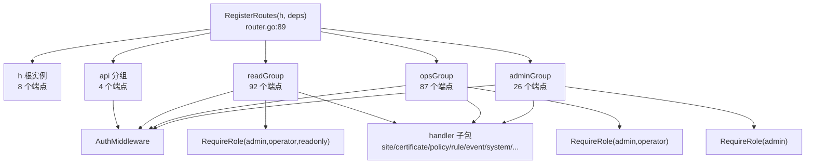
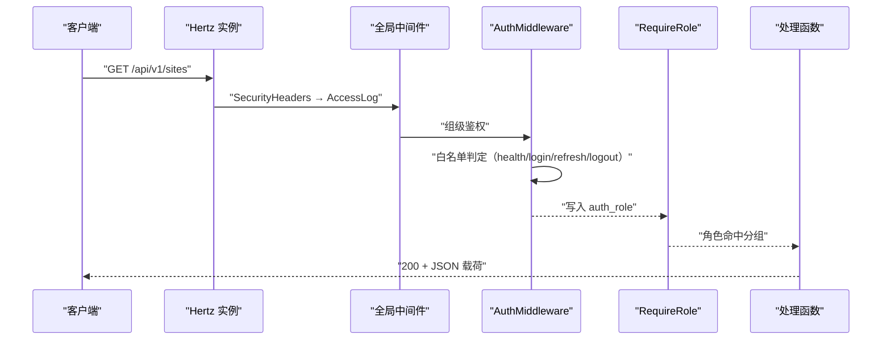
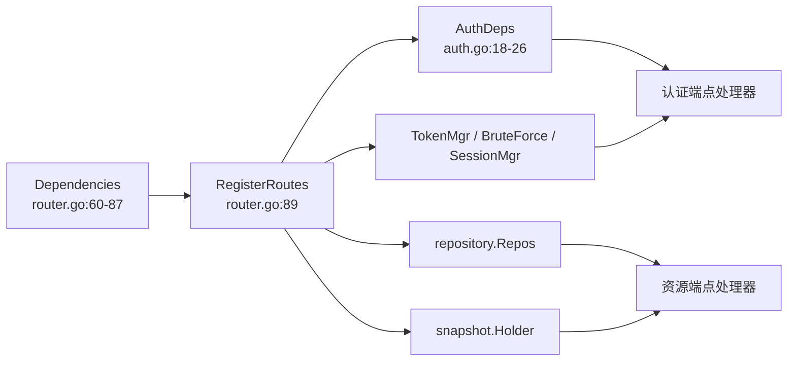
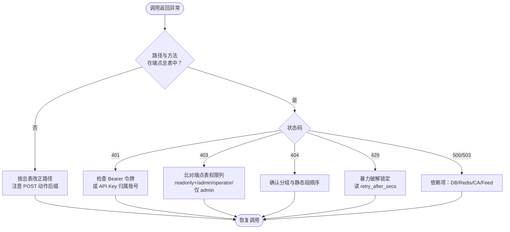

# API 端点参考

> [返回 管理 API 系统](../管理 API 系统.md)

<cite>
**本文档引用的文件**
- [router.go](file://internal/admin/router.go)
- [auth.go](file://internal/admin/auth.go)
- [auth_helpers.go](file://internal/admin/auth_helpers.go)
- [auth_session.go](file://internal/admin/auth_session.go)
- [admin_users.go](file://internal/admin/admin_users.go)
- [middleware.go](file://internal/admin/middleware.go)
- [session.go](file://internal/admin/auth/session.go)
- [apikey.go](file://internal/admin/system/apikey/apikey.go)
- [site.go](file://internal/admin/site/site.go)
- [security.go](file://internal/admin/event/security.go)
- [access.go](file://internal/admin/event/access.go)
- [rule.go](file://internal/admin/rule/rule.go)
- [settings.go](file://internal/admin/system/settings.go)
- [helpers.go](file://internal/admin/shared/helpers.go)
- [utils.go](file://internal/utils/utils.go)
- [api.ts](file://frontend/lib/api.ts)
- [REST API 设计规范.md](file://docs/管理 API 系统/REST API 设计规范/REST API 设计规范.md)
- [认证授权机制.md](file://docs/管理 API 系统/REST API 设计规范/认证授权机制.md)
- [路由设计规范.md](file://docs/管理 API 系统/REST API 设计规范/路由设计规范.md)
- [请求响应格式规范.md](file://docs/管理 API 系统/REST API 设计规范/请求响应格式规范.md)
- [错误处理机制.md](file://docs/管理 API 系统/REST API 设计规范/错误处理机制.md)
</cite>

## 目录

1. [简介](#简介)
2. [项目结构](#项目结构)
3. [核心组件](#核心组件)
4. [架构总览](#架构总览)
5. [详细组件分析](#详细组件分析)
6. [依赖关系分析](#依赖关系分析)
7. [性能考虑](#性能考虑)
8. [故障排查指南](#故障排查指南)
9. [结论](#结论)
10. [附录](#附录)

## 简介

本篇是 My-OpenWaf 控制面（管理后台）REST API 的**端点总清单**。全部条目逐条取自 `internal/admin/router.go` 的实际注册语句，包含 HTTP 方法、完整路径、处理函数、注册行号、所需权限与用途说明，覆盖 `RegisterRoutes` 中注册的全部 **217 个端点**（GET 100 个、POST 117 个，无 PUT/DELETE 方法）。

本篇只负责"有哪些端点、每个端点谁在处理、需要什么权限"。载荷字段、鉴权实现、路由命名规范与错误语义分别由[请求响应格式规范](请求响应格式规范.md)、[认证授权机制](认证授权机制.md)、[路由设计规范](路由设计规范.md)与[错误处理机制](错误处理机制.md)承载，本篇不重复展开。

## 项目结构

端点全部集中在 `RegisterRoutes` 一个函数体内注册，按权限分组下挂到四个组变量上。下表为注册位置的实测分布。

| 注册位置 | 分组变量 | 端点数 | 中间件 | 挂载路径前缀 |
|----------|----------|:------:|--------|--------------|
| Hertz 实例根 | `h` | 8 | `SecurityHeaders` + `AccessLog` | 无（含 `/api/v1/health` 与数据面静态端点） |
| 认证分组 | `api` | 4 | 追加 `AuthMiddleware` | `/api/v1` |
| 只读分组 | `readGroup` | 92 | 追加 `RequireRole(admin, operator, readonly)` | `/api/v1` |
| 操作分组 | `opsGroup` | 87 | 追加 `RequireRole(admin, operator)` | `/api/v1` |
| 管理分组 | `adminGroup` | 26 | 追加 `RequireRole(admin)` | `/api/v1` |
| **合计** | — | **217** | — | — |

**图表来源**
- [router.go:89-120](file://internal/admin/router.go#L89-L120)
- [router.go:124-126](file://internal/admin/router.go#L124-L126)
- [router.go:255-257](file://internal/admin/router.go#L255-L257)
- [router.go:372-374](file://internal/admin/router.go#L372-L374)

**章节来源**
- [router.go:89-440](file://internal/admin/router.go#L89-L440)
- [middleware.go:42-147](file://internal/admin/middleware.go#L42-L147)

## 核心组件

端点按处理函数所在包归属，一个包对应一组资源。下表为处理器归属实测。

| 处理器包 | 别名 | 端点数 | 负责资源 |
|----------|------|:------:|----------|
| `internal/admin/system` | `system` | 31 | 设置、健康、网络/TLS/HTTP2/Redis/日志/运行时配置、ACME、备份、重载 |
| `internal/admin/rule` | `rule` | 17 | 自定义规则、站点级规则、应用路由规则、录制资源 |
| `internal/admin/event` | `event` | 16 | 安全事件、访问日志、TLS 指纹、请求追踪、误报反馈 |
| `internal/admin/access` | `access` | 14 | 站点访问控制（身份源、用户、路径规则） |
| `internal/admin`（根） | 无前缀 | 12 | 登录、刷新、登出、me、改密、会话、强退、管理员账号 |
| `internal/admin/detect/cverules` | `cverules` | 11 | CVE 规则 |
| `internal/admin/detect/owasprules` | `owasprules` | 10 | OWASP 规则 |
| `internal/admin/system/jsplugin` | `adminjsplugin` | 10 | JS 插件 |
| `internal/admin/system/luaplugin` | `adminluaplugin` | 9 | Lua 插件 |
| `internal/admin/site` | `site` | 8 | 站点增删改查与启停 |
| `internal/admin/system/policy` | `policy` | 8 | 策略 |
| `internal/admin/system/certificate` | `certificate` | 7 | 证书 |
| `internal/admin/protect/page` | `pagehandler` | 6 | 页面模板 |
| `internal/admin/system/threatintel` | `threatintel` | 6 | 威胁情报源 |
| `internal/admin/system/iplist` | `iplist` | 5 | IP 黑白名单 |
| `internal/admin/protect` 的 `bot`/`chain`/`drop`/`escalation` | 各 4 | 16 | Bot、链式验证、阻断策略、响应升级链 |
| `internal/admin/site` 的 `errorpage`/`listener`/`observability` | 各 4 | 12 | 站点错误页、监听器、站点级观测 |
| `internal/admin/protect/captcha`、`internal/admin/system/apikey` | 各 3 | 6 | 验证码、管理端令牌 |
| `internal/admin/protect`、`protect/sensitivity`、`system/presetbots` | 各 2 | 6 | 保护配置读写、类别敏感度、预置白名单 |
| `internal/admin/system/realtime` | `deps.Realtime` | 2 | 实时订阅票据与 WebSocket |
| `internal/admin/system/dashboard`、`system/upstream` | 各 1 | 2 | 仪表盘汇总、上游连接池状态 |
| `router.go` 内联闭包 | — | 3 | PoW WASM/glue JS 下发、ACME HTTP-01 应答 |
| **合计** | — | **217** | — |

包计数按注册语句中处理函数的包别名归属；`internal/admin` 根的 12 个包含 `RequireRole` 之后紧跟的 `ForceLogoutSessionHandler`。

**章节来源**
- [router.go:12-56](file://internal/admin/router.go#L12-L56)
- [router.go:127-415](file://internal/admin/router.go#L127-L415)

## 架构总览

一次端点调用从路由匹配到处理函数返回，经过全局中间件、组级鉴权与组级角色三层过滤。

**图表来源**
- [router.go:91-92](file://internal/admin/router.go#L91-L92)
- [router.go:110-110](file://internal/admin/router.go#L110-L110)
- [middleware.go:42-147](file://internal/admin/middleware.go#L42-L147)

下表为权限取值口径，各端点表的"权限"列均取此五种之一。

| 权限取值 | 判定来源 | 允许角色 | 未满足时响应 |
|----------|----------|----------|--------------|
| `公开` | 未挂载 `AuthMiddleware` 或命中白名单 | 任意 | 不校验 |
| `已认证` | `AuthMiddleware`，无 `RequireRole` | admin / operator / readonly | `401` |
| `readonly+` | `RequireRole(admin, operator, readonly)` | 三角色 | `403` |
| `admin/operator` | `RequireRole(admin, operator)` | admin / operator | `403` |
| `仅 admin` | `RequireRole(admin)` | admin | `403` |

**章节来源**
- [middleware.go:46-53](file://internal/admin/middleware.go#L46-L53)
- [middleware.go:127-147](file://internal/admin/middleware.go#L127-L147)
- [router.go:124-126](file://internal/admin/router.go#L124-L126)

## 详细组件分析

本节按资源给出端点总表。列口径：`注册行` 为 `internal/admin/router.go` 内的注册语句行号；`说明` 取自处理函数名的动词与资源语义。

### 健康检查与认证会话端点

`/api/v1/health` 与三个 `/auth/*` 写操作端点不经过鉴权中间件，其余认证端点要求已认证会话。

| 方法 | 路径 | 处理函数 | 注册行 | 权限 | 说明 |
|------|------|----------|:------:|------|------|
| GET | `/api/v1/health` | `system.HealthCheck` | 94 | 公开 | 健康检查 |
| POST | `/api/v1/auth/login` | `LoginHandler` | 105 | 公开 | 登录签发 |
| POST | `/api/v1/auth/refresh` | `RefreshHandler` | 106 | 公开 | 令牌刷新 |
| POST | `/api/v1/auth/logout` | `LogoutHandler` | 107 | 公开 | 登出撤销 |
| GET | `/api/v1/auth/me` | `MeHandler` | 112 | 已认证 | 当前身份 |
| POST | `/api/v1/auth/change-password` | `ChangeOwnPasswordHandler` | 113 | 已认证 | 修改本人口令 |
| GET | `/api/v1/auth/sessions` | `ListSessionsHandler` | 115 | 已认证 | 会话列表 |
| POST | `/api/v1/auth/sessions/force-logout` | `ForceLogoutSessionHandler` | 116 | 仅 admin | 强制下线 |

**章节来源**
- [router.go:94-116](file://internal/admin/router.go#L94-L116)
- [auth.go:33-352](file://internal/admin/auth.go#L33-L352)
- [auth_session.go:13-89](file://internal/admin/auth_session.go#L13-L89)
- [settings.go:212-216](file://internal/admin/system/settings.go#L212-L216)

### 站点与监听端点

站点资源共 42 个端点，读端点归 `readonly+`，写端点归 `admin/operator`。站点写操作处理函数均带 `reload` 回调，成功后触发快照重载。

| 方法 | 路径 | 处理函数 | 注册行 | 权限 | 说明 |
|------|------|----------|:------:|------|------|
| GET | `/api/v1/sites` | `site.ListSites` | 127 | readonly+ | 站点级列表 |
| GET | `/api/v1/sites/:id` | `site.GetSite` | 128 | readonly+ | 读取详情 |
| GET | `/api/v1/sites/:id/status` | `site.GetSiteStatus` | 129 | readonly+ | 站点运行状态 |
| GET | `/api/v1/sites/:id/listeners` | `listener.ListSiteListeners` | 130 | readonly+ | 站点级列表 |
| GET | `/api/v1/sites/:id/security-events` | `event.ListSiteSecurityEvents` | 180 | readonly+ | 站点级事件列表 |
| GET | `/api/v1/sites/:id/security-events/stats` | `event.SiteSecurityEventStats` | 181 | readonly+ | 站点级事件统计 |
| GET | `/api/v1/sites/:id/security-events/timeline` | `event.SiteSecurityEventTimeline` | 182 | readonly+ | 站点级事件时间线 |
| GET | `/api/v1/sites/:id/access-logs` | `observability.ListSiteAccessLogs` | 189 | readonly+ | 站点级访问日志列表 |
| GET | `/api/v1/sites/:id/access-logs/stats` | `observability.SiteAccessLogStats` | 190 | readonly+ | 站点级访问日志统计 |
| GET | `/api/v1/sites/:id/drop-events` | `observability.ListSiteDropEvents` | 191 | readonly+ | 站点级丢弃事件列表 |
| GET | `/api/v1/sites/:id/drop-stats` | `observability.SiteDropStats` | 192 | readonly+ | 站点级丢弃统计 |
| GET | `/api/v1/sites/:id/rules` | `rule.ListSiteRules` | 193 | readonly+ | 站点级规则列表 |
| GET | `/api/v1/sites/:id/application-route-rules` | `rule.ListApplicationRouteRules` | 194 | readonly+ | 应用路由规则列表 |
| GET | `/api/v1/sites/:id/recorded-resources` | `rule.ListRecordedResources` | 195 | readonly+ | 录制资源列表 |
| GET | `/api/v1/sites/:id/access` | `access.GetAccessConfig` | 197 | readonly+ | 访问控制配置读取 |
| GET | `/api/v1/sites/:id/access/providers` | `access.ListProviders` | 198 | readonly+ | 身份源列表 |
| GET | `/api/v1/sites/:id/access/users` | `access.ListUsers` | 199 | readonly+ | 访问控制用户列表 |
| GET | `/api/v1/sites/:id/access/rules` | `access.ListPathRules` | 200 | readonly+ | 路径规则列表 |
| GET | `/api/v1/sites/:id/error-pages` | `errorpage.GetSiteErrorPages` | 239 | readonly+ | 站点错误页读取 |
| POST | `/api/v1/sites` | `site.CreateSite` | 258 | admin/operator | 新建 |
| POST | `/api/v1/sites/:id/update` | `site.UpdateSite` | 259 | admin/operator | 更新 |
| POST | `/api/v1/sites/:id/delete` | `site.DeleteSite` | 260 | admin/operator | 删除 |
| POST | `/api/v1/sites/:id/start` | `site.StartSite` | 261 | admin/operator | 启动站点 |
| POST | `/api/v1/sites/:id/stop` | `site.StopSite` | 262 | admin/operator | 停止站点 |
| POST | `/api/v1/sites/:id/listeners` | `listener.CreateSiteListener` | 263 | admin/operator | 新建监听 |
| POST | `/api/v1/sites/:id/listeners/:lid/update` | `listener.UpdateSiteListener` | 264 | admin/operator | 更新监听 |
| POST | `/api/v1/sites/:id/listeners/:lid/delete` | `listener.DeleteSiteListener` | 265 | admin/operator | 删除监听 |
| POST | `/api/v1/sites/:id/application-route-rules` | `rule.CreateApplicationRouteRule` | 345 | admin/operator | 新建 |
| POST | `/api/v1/sites/:id/application-route-rules/:rid/update` | `rule.UpdateApplicationRouteRule` | 346 | admin/operator | 更新 |
| POST | `/api/v1/sites/:id/application-route-rules/:rid/delete` | `rule.DeleteApplicationRouteRule` | 347 | admin/operator | 删除 |
| POST | `/api/v1/sites/:id/recorded-resources/clear` | `rule.ClearRecordedResources` | 348 | admin/operator | 清空 |
| POST | `/api/v1/sites/:id/error-pages` | `errorpage.UpdateSiteErrorPages` | 350 | admin/operator | 更新站点错误页 |
| POST | `/api/v1/sites/:id/access` | `access.SaveAccessConfig` | 353 | admin/operator | 整体保存访问控制配置 |
| POST | `/api/v1/sites/:id/access/providers` | `access.CreateProvider` | 354 | admin/operator | 新建 |
| POST | `/api/v1/sites/:id/access/providers/:pid/update` | `access.UpdateProvider` | 355 | admin/operator | 更新 |
| POST | `/api/v1/sites/:id/access/providers/:pid/delete` | `access.DeleteProvider` | 356 | admin/operator | 删除 |
| POST | `/api/v1/sites/:id/access/users` | `access.CreateUser` | 357 | admin/operator | 新建 |
| POST | `/api/v1/sites/:id/access/users/:uid/update` | `access.UpdateUser` | 358 | admin/operator | 更新 |
| POST | `/api/v1/sites/:id/access/users/:uid/delete` | `access.DeleteUser` | 359 | admin/operator | 删除 |
| POST | `/api/v1/sites/:id/access/rules` | `access.CreatePathRule` | 360 | admin/operator | 新建 |
| POST | `/api/v1/sites/:id/access/rules/:rid/update` | `access.UpdatePathRule` | 361 | admin/operator | 更新 |
| POST | `/api/v1/sites/:id/access/rules/:rid/delete` | `access.DeletePathRule` | 362 | admin/operator | 删除 |

**章节来源**
- [router.go:127-130](file://internal/admin/router.go#L127-L130)
- [router.go:180-200](file://internal/admin/router.go#L180-L200)
- [router.go:239-265](file://internal/admin/router.go#L239-L265)
- [router.go:345-362](file://internal/admin/router.go#L345-L362)
- [site.go:74-130](file://internal/admin/site/site.go#L74-L130)

### 证书与 ACME 端点

证书读取与 PEM 解析为只读；`/certificates/parse` 是 POST 但无副作用，因此置于只读分组。ACME 配置写入与状态查询仅 admin。

| 方法 | 路径 | 处理函数 | 注册行 | 权限 | 说明 |
|------|------|----------|:------:|------|------|
| GET | `/api/v1/certificates` | `certificate.ListCertificates` | 132 | readonly+ | 列表查询 |
| GET | `/api/v1/certificates/:id` | `certificate.GetCertificate` | 133 | readonly+ | 读取详情 |
| GET | `/api/v1/certificates/acme/config` | `system.GetACMEConfig` | 134 | readonly+ | ACME 配置读取 |
| POST | `/api/v1/certificates/parse` | `certificate.ParseCertificate` | 138 | readonly+ | 证书 PEM 解析 |
| POST | `/api/v1/certificates` | `certificate.CreateCertificate` | 267 | admin/operator | 新建 |
| POST | `/api/v1/certificates/:id/update` | `certificate.UpdateCertificate` | 268 | admin/operator | 更新 |
| POST | `/api/v1/certificates/:id/apply-to-sites` | `certificate.ApplyCertificateToSites` | 269 | admin/operator | 应用到站点 |
| POST | `/api/v1/certificates/:id/delete` | `certificate.DeleteCertificate` | 270 | admin/operator | 删除 |
| POST | `/api/v1/certificates/acme/apply` | `system.ACMEApply` | 271 | admin/operator | ACME 申请 |
| POST | `/api/v1/certificates/acme/:id/renew` | `system.ACMERenew` | 272 | admin/operator | ACME 续签 |
| POST | `/api/v1/certificates/acme/config` | `system.UpdateACMEConfig` | 397 | 仅 admin | ACME 配置写入 |
| GET | `/api/v1/certificates/acme/status` | `system.ACMEStatus` | 398 | 仅 admin | ACME 状态 |

**章节来源**
- [router.go:132-138](file://internal/admin/router.go#L132-L138)
- [router.go:267-272](file://internal/admin/router.go#L267-L272)
- [router.go:397-398](file://internal/admin/router.go#L397-L398)

### 策略与 OWASP 规则端点

策略与 OWASP 规则共用策略作用域路径：`/policies/:policyId/owasp-rules*` 与全局 `/owasp-rules*` 绑定同一对处理函数，策略级路径仅用于前端按策略视图复用。

| 方法 | 路径 | 处理函数 | 注册行 | 权限 | 说明 |
|------|------|----------|:------:|------|------|
| GET | `/api/v1/policies` | `policy.ListPolicies` | 140 | readonly+ | 列表查询 |
| GET | `/api/v1/policies/default` | `policy.GetDefaultPolicy` | 141 | readonly+ | 读取详情 |
| GET | `/api/v1/policies/:id` | `policy.GetPolicy` | 142 | readonly+ | 读取详情 |
| GET | `/api/v1/owasp-rules` | `owasprules.ListOWASPRulesFromRegistry` | 224 | readonly+ | OWASP 规则清单 |
| GET | `/api/v1/owasp-rules/stats` | `owasprules.GetOWASPRuleStats` | 225 | readonly+ | OWASP 规则统计 |
| GET | `/api/v1/policies/:policyId/owasp-rules` | `owasprules.ListOWASPRulesFromRegistry` | 226 | readonly+ | OWASP 规则清单 |
| GET | `/api/v1/policies/:policyId/owasp-rules/stats` | `owasprules.GetOWASPRuleStats` | 227 | readonly+ | OWASP 规则统计 |
| POST | `/api/v1/policies` | `policy.CreatePolicy` | 274 | admin/operator | 新建 |
| POST | `/api/v1/policies/:id/set-default` | `policy.SetDefaultPolicy` | 275 | admin/operator | 设为默认策略 |
| POST | `/api/v1/policies/:id/default` | `policy.SetDefaultPolicy` | 276 | admin/operator | 设为默认策略 |
| POST | `/api/v1/policies/:id/update` | `policy.UpdatePolicy` | 277 | admin/operator | 更新 |
| POST | `/api/v1/policies/:id/delete` | `policy.DeletePolicy` | 278 | admin/operator | 删除 |
| POST | `/api/v1/owasp-rules/:id/update` | `owasprules.UpdateSingleOWASPRule` | 323 | admin/operator | 更新 |
| POST | `/api/v1/owasp-rules/:id/reset` | `owasprules.ResetOWASPRuleOverride` | 324 | admin/operator | 重置为默认 |
| POST | `/api/v1/owasp-rules/batch` | `owasprules.BatchUpdateOWASPRules` | 325 | admin/operator | 更新 |
| POST | `/api/v1/policies/:policyId/owasp-rules/:id` | `owasprules.UpdateSingleOWASPRule` | 326 | admin/operator | 更新 |
| POST | `/api/v1/policies/:policyId/owasp-rules/:id/reset` | `owasprules.ResetOWASPRuleOverride` | 327 | admin/operator | 重置为默认 |
| POST | `/api/v1/policies/:policyId/owasp-rules/batch` | `owasprules.BatchUpdateOWASPRules` | 328 | admin/operator | 更新 |

**章节来源**
- [router.go:140-142](file://internal/admin/router.go#L140-L142)
- [router.go:224-227](file://internal/admin/router.go#L224-L227)
- [router.go:274-278](file://internal/admin/router.go#L274-L278)
- [router.go:323-328](file://internal/admin/router.go#L323-L328)

### 自定义规则端点

规则的读写、试运行与批量导入导出共 10 个端点；`/rules/:id/{update,delete}` 以 POST 动作替代 PUT/DELETE。

| 方法 | 路径 | 处理函数 | 注册行 | 权限 | 说明 |
|------|------|----------|:------:|------|------|
| GET | `/api/v1/rules` | `rule.ListRules` | 144 | readonly+ | 列表查询 |
| GET | `/api/v1/rules/:id` | `rule.GetRule` | 145 | readonly+ | 读取详情 |
| GET | `/api/v1/rules/templates` | `rule.GetRuleTemplates` | 146 | readonly+ | 规则模板清单 |
| GET | `/api/v1/rules/export` | `rule.ExportRules` | 147 | readonly+ | 导出 |
| POST | `/api/v1/rules` | `rule.CreateRule` | 280 | admin/operator | 新建 |
| POST | `/api/v1/rules/:id/update` | `rule.UpdateRule` | 281 | admin/operator | 更新 |
| POST | `/api/v1/rules/:id/delete` | `rule.DeleteRule` | 282 | admin/operator | 删除 |
| POST | `/api/v1/rules/test` | `rule.TestRule` | 283 | admin/operator | 试运行 |
| POST | `/api/v1/rules/validate` | `rule.ValidateRule` | 284 | admin/operator | 规则语法校验 |
| POST | `/api/v1/rules/import` | `rule.ImportRules` | 285 | admin/operator | 导入 |

**章节来源**
- [router.go:144-147](file://internal/admin/router.go#L144-L147)
- [router.go:280-285](file://internal/admin/router.go#L280-L285)
- [rule.go:210-265](file://internal/admin/rule/rule.go#L210-L265)

### 系统设置与保护配置端点

`/settings*` 写操作仅 admin；`/protection-settings` 与敏感度、升级链整体写入归 `admin/operator`。

| 方法 | 路径 | 处理函数 | 注册行 | 权限 | 说明 |
|------|------|----------|:------:|------|------|
| GET | `/api/v1/settings` | `system.ListSettings` | 149 | readonly+ | 列表查询 |
| GET | `/api/v1/settings/:key` | `system.GetSetting` | 150 | readonly+ | 读取详情 |
| POST | `/api/v1/settings` | `system.CreateSetting` | 375 | 仅 admin | 新建 |
| POST | `/api/v1/settings/:key` | `system.SetSetting` | 376 | 仅 admin | 按键写入 |
| POST | `/api/v1/settings/:key/update` | `system.SetSetting` | 377 | 仅 admin | 按键写入 |
| POST | `/api/v1/settings/:key/delete` | `system.DeleteSetting` | 378 | 仅 admin | 删除 |
| GET | `/api/v1/protection-settings` | `protect.GetProtectionSettings` | 152 | readonly+ | 保护配置读取 |
| GET | `/api/v1/protection/:id/sensitivity` | `sensitivity.GetSensitivityConfig` | 234 | readonly+ | 敏感度配置读取 |
| GET | `/api/v1/protection/:id/escalation` | `protectescalation.GetEscalationConfig` | 236 | readonly+ | 升级链配置读取 |
| GET | `/api/v1/escalation/status/:ip` | `protectescalation.GetEscalationIPStatus` | 237 | readonly+ | 单 IP 升级状态 |
| POST | `/api/v1/protection-settings` | `protect.PutProtectionSettings` | 287 | admin/operator | 保护配置整体写入 |
| POST | `/api/v1/protection/:id/sensitivity` | `sensitivity.UpdateSensitivityConfig` | 340 | admin/operator | 更新敏感度配置 |
| POST | `/api/v1/protection/:id/escalation` | `protectescalation.UpdateEscalationConfig` | 342 | admin/operator | 更新升级链配置 |
| POST | `/api/v1/escalation/status/:ip/reset` | `protectescalation.ResetEscalationIPStatus` | 343 | admin/operator | 重置单 IP 升级状态 |

**章节来源**
- [router.go:149-152](file://internal/admin/router.go#L149-L152)
- [router.go:234-237](file://internal/admin/router.go#L234-L237)
- [router.go:287-287](file://internal/admin/router.go#L287-L287)
- [router.go:340-343](file://internal/admin/router.go#L340-L343)
- [router.go:375-378](file://internal/admin/router.go#L375-L378)

### IP 黑白名单与威胁情报端点

| 方法 | 路径 | 处理函数 | 注册行 | 权限 | 说明 |
|------|------|----------|:------:|------|------|
| GET | `/api/v1/ip-lists` | `iplist.ListIPEntries` | 154 | readonly+ | IP 条目列表 |
| GET | `/api/v1/ip-lists/:id` | `iplist.GetIPEntry` | 155 | readonly+ | 读取详情 |
| POST | `/api/v1/ip-lists` | `iplist.CreateIPEntry` | 289 | admin/operator | 新建 |
| POST | `/api/v1/ip-lists/:id/update` | `iplist.UpdateIPEntry` | 290 | admin/operator | 更新 |
| POST | `/api/v1/ip-lists/:id/delete` | `iplist.DeleteIPEntry` | 291 | admin/operator | 删除 |
| GET | `/api/v1/threat-intel-feeds` | `threatintel.ListThreatIntelFeeds` | 157 | readonly+ | 列表查询 |
| GET | `/api/v1/threat-intel-sync-logs` | `threatintel.ListThreatIntelSyncLogs` | 158 | readonly+ | 同步日志列表 |
| POST | `/api/v1/threat-intel-feeds` | `threatintel.CreateThreatIntelFeed` | 293 | admin/operator | 新建 |
| POST | `/api/v1/threat-intel-feeds/:id/update` | `threatintel.UpdateThreatIntelFeed` | 294 | admin/operator | 更新 |
| POST | `/api/v1/threat-intel-feeds/:id/delete` | `threatintel.DeleteThreatIntelFeed` | 295 | admin/operator | 删除 |
| POST | `/api/v1/threat-intel-feeds/:id/sync` | `threatintel.SyncThreatIntelFeed` | 296 | admin/operator | 同步 |

**章节来源**
- [router.go:154-158](file://internal/admin/router.go#L154-L158)
- [router.go:289-296](file://internal/admin/router.go#L289-L296)

### 插件端点

Lua 与 JS 插件各有一组同构端点（增删改、启停、校验、试运行）。校验与试运行虽不改配置，但会执行用户代码，故与写操作同归 `admin/operator`。

| 方法 | 路径 | 处理函数 | 注册行 | 权限 | 说明 |
|------|------|----------|:------:|------|------|
| GET | `/api/v1/lua-plugins` | `adminluaplugin.ListLuaPlugins` | 159 | readonly+ | 列表查询 |
| GET | `/api/v1/lua-plugins/stats` | `adminluaplugin.GetLuaPluginStats` | 162 | readonly+ | Lua 运行时统计 |
| GET | `/api/v1/lua-plugins/:id` | `adminluaplugin.GetLuaPlugin` | 163 | readonly+ | 读取详情 |
| GET | `/api/v1/js-plugins` | `adminjsplugin.ListJSPlugins` | 164 | readonly+ | 列表查询 |
| GET | `/api/v1/js-plugins/stats` | `adminjsplugin.GetJSPluginStats` | 165 | readonly+ | JS 运行时统计 |
| GET | `/api/v1/js-plugins/runtime` | `adminjsplugin.GetJSPluginRuntime` | 166 | readonly+ | JS 引擎运行时状态 |
| GET | `/api/v1/js-plugins/:id` | `adminjsplugin.GetJSPlugin` | 167 | readonly+ | 读取详情 |
| POST | `/api/v1/lua-plugins` | `adminluaplugin.CreateLuaPlugin` | 300 | admin/operator | 新建 |
| POST | `/api/v1/lua-plugins/:id/update` | `adminluaplugin.UpdateLuaPlugin` | 301 | admin/operator | 更新 |
| POST | `/api/v1/lua-plugins/:id/delete` | `adminluaplugin.DeleteLuaPlugin` | 302 | admin/operator | 删除 |
| POST | `/api/v1/lua-plugins/:id/toggle` | `adminluaplugin.ToggleLuaPlugin` | 303 | admin/operator | 启停切换 |
| POST | `/api/v1/lua-plugins/validate` | `adminluaplugin.ValidateLuaPlugin` | 304 | admin/operator | 语法校验 |
| POST | `/api/v1/lua-plugins/dry-run` | `adminluaplugin.DryRunLuaPlugin` | 305 | admin/operator | 脚本试运行 |
| POST | `/api/v1/js-plugins` | `adminjsplugin.CreateJSPlugin` | 306 | admin/operator | 新建 |
| POST | `/api/v1/js-plugins/:id/update` | `adminjsplugin.UpdateJSPlugin` | 307 | admin/operator | 更新 |
| POST | `/api/v1/js-plugins/:id/delete` | `adminjsplugin.DeleteJSPlugin` | 308 | admin/operator | 删除 |
| POST | `/api/v1/js-plugins/:id/toggle` | `adminjsplugin.ToggleJSPlugin` | 309 | admin/operator | 启停切换 |
| POST | `/api/v1/js-plugins/validate` | `adminjsplugin.ValidateJSPlugin` | 310 | admin/operator | 语法校验 |
| POST | `/api/v1/js-plugins/dry-run` | `adminjsplugin.DryRunJSPlugin` | 311 | admin/operator | 脚本试运行 |

**章节来源**
- [router.go:159-167](file://internal/admin/router.go#L159-L167)
- [router.go:298-311](file://internal/admin/router.go#L298-L311)

### 安全事件与访问日志端点

安全事件与访问日志读端点共享同一套查询参数解析；`/security-events/requests` 为请求级聚合视图，`total` 是去重后的请求数。

| 方法 | 路径 | 处理函数 | 注册行 | 权限 | 说明 |
|------|------|----------|:------:|------|------|
| GET | `/api/v1/security-events` | `event.ListSecurityEvents` | 169 | readonly+ | 安全事件列表 |
| GET | `/api/v1/security-events/stats` | `event.SecurityEventStats` | 170 | readonly+ | 事件聚合统计 |
| GET | `/api/v1/security-events/timeline` | `event.SecurityEventTimeline` | 171 | readonly+ | 事件时间线 |
| GET | `/api/v1/security-events/requests` | `event.ListSecurityEventRequests` | 174 | readonly+ | 请求级聚合列表 |
| GET | `/api/v1/security-events/:id` | `event.GetSecurityEvent` | 175 | readonly+ | 读取详情 |
| GET | `/api/v1/access-logs` | `event.ListAccessLogs` | 176 | readonly+ | 访问日志列表 |
| GET | `/api/v1/access-logs/:id` | `event.GetAccessLog` | 177 | readonly+ | 访问日志详情 |
| GET | `/api/v1/fingerprints` | `event.ListTLSFingerprints` | 178 | readonly+ | TLS 指纹聚合 |
| GET | `/api/v1/request/:request_id` | `event.GetRequestTrace` | 179 | readonly+ | 单请求链路追踪 |
| GET | `/api/v1/false-positives` | `event.ListFalsePositives` | 185 | readonly+ | 误报列表 |
| POST | `/api/v1/false-positives` | `event.CreateFalsePositive` | 365 | admin/operator | 新建误报 |
| POST | `/api/v1/false-positives/:id/status` | `event.UpdateFalsePositiveStatus` | 366 | admin/operator | 更新误报状态 |
| POST | `/api/v1/false-positives/:id/delete` | `event.DeleteFalsePositive` | 415 | 仅 admin | 删除 |

**章节来源**
- [router.go:169-185](file://internal/admin/router.go#L169-L185)
- [router.go:365-366](file://internal/admin/router.go#L365-L366)
- [router.go:415-415](file://internal/admin/router.go#L415-L415)
- [security.go:39-130](file://internal/admin/event/security.go#L39-L130)
- [access.go:17-111](file://internal/admin/event/access.go#L17-L111)

### 阻断、Bot、CVE、验证码与链式验证端点

| 方法 | 路径 | 处理函数 | 注册行 | 权限 | 说明 |
|------|------|----------|:------:|------|------|
| GET | `/api/v1/drop-policy` | `drop.GetDropPolicy` | 242 | readonly+ | 读取详情 |
| GET | `/api/v1/drop-stats` | `drop.GetDropStats` | 243 | readonly+ | 丢弃统计 |
| GET | `/api/v1/drop-events` | `drop.GetDropEvents` | 244 | readonly+ | 丢弃事件列表 |
| POST | `/api/v1/drop-policy/update` | `drop.UpdateDropPolicy` | 408 | 仅 admin | 更新 |
| GET | `/api/v1/preset-bot-whitelist` | `presetbots.ListPresetBotWhitelist` | 188 | readonly+ | 预置白名单预览 |
| GET | `/api/v1/bot-settings` | `bot.GetBotSettings` | 216 | readonly+ | Bot 配置读取 |
| GET | `/api/v1/bot-stats` | `bot.GetBotStats` | 217 | readonly+ | Bot 分值统计 |
| GET | `/api/v1/bot-scores` | `bot.GetBotScores` | 218 | readonly+ | Bot 分值明细 |
| POST | `/api/v1/bot-settings/update` | `bot.UpdateBotSettings` | 315 | admin/operator | 更新 |
| POST | `/api/v1/preset-bot-whitelist/seed` | `presetbots.SeedBotWhitelist` | 369 | admin/operator | 写入预置白名单 |
| GET | `/api/v1/cve-rules` | `cverules.ListCVERules` | 220 | readonly+ | 列表查询 |
| GET | `/api/v1/cve-rules/stats` | `cverules.GetCVERuleStats` | 221 | readonly+ | CVE 规则统计 |
| GET | `/api/v1/cve-feed/status` | `cverules.GetCVEFeedStatus` | 222 | readonly+ | CVE 订阅源状态 |
| POST | `/api/v1/cve-rules/:id/toggle` | `cverules.ToggleCVERule` | 317 | admin/operator | 启停切换 |
| POST | `/api/v1/cve-rules/:id/patch` | `cverules.UpdateSingleCVERule` | 318 | admin/operator | 更新 |
| POST | `/api/v1/cve-rules/:id/reset` | `cverules.ResetCVERuleOverride` | 319 | admin/operator | 重置为默认 |
| POST | `/api/v1/cve-rules/batch` | `cverules.BatchUpdateCVERules` | 320 | admin/operator | 更新 |
| POST | `/api/v1/cve-rules/sync` | `cverules.SyncCVERules` | 321 | admin/operator | 同步 |
| POST | `/api/v1/cve-rules` | `cverules.CreateCVERule` | 410 | 仅 admin | 新建 |
| POST | `/api/v1/cve-rules/:id/update` | `cverules.UpdateCVERule` | 411 | 仅 admin | 更新 |
| POST | `/api/v1/cve-rules/:id/delete` | `cverules.DeleteCVERule` | 412 | 仅 admin | 删除 |
| GET | `/api/v1/captcha/config` | `captcha.GetCaptchaConfig` | 229 | readonly+ | 读取详情 |
| POST | `/api/v1/captcha/config` | `captcha.UpdateCaptchaConfig` | 330 | admin/operator | 更新 |
| POST | `/api/v1/captcha/test` | `captcha.TestCaptcha` | 331 | admin/operator | 验证码连通性测试 |
| GET | `/api/v1/chain/config` | `chain.GetChainConfig` | 231 | readonly+ | 读取详情 |
| GET | `/api/v1/chain/sessions` | `chain.ListChainSessions` | 232 | readonly+ | 链式会话列表 |
| POST | `/api/v1/chain/config` | `chain.UpdateChainConfig` | 337 | admin/operator | 更新 |
| POST | `/api/v1/chain/sessions/:id/delete` | `chain.DeleteChainSession` | 338 | admin/operator | 删除 |

**章节来源**
- [router.go:216-244](file://internal/admin/router.go#L216-L244)
- [router.go:315-338](file://internal/admin/router.go#L315-L338)
- [router.go:369-369](file://internal/admin/router.go#L369-L369)
- [router.go:408-412](file://internal/admin/router.go#L408-L412)

### 错误页、页面模板与系统配置项端点

| 方法 | 路径 | 处理函数 | 注册行 | 权限 | 说明 |
|------|------|----------|:------:|------|------|
| GET | `/api/v1/error-pages/defaults` | `errorpage.GetDefaultErrorPages` | 240 | readonly+ | 默认错误页读取 |
| GET | `/api/v1/page-templates` | `pagehandler.GetPageTemplates` | 250 | readonly+ | 页面模板清单 |
| GET | `/api/v1/page-templates/:type` | `pagehandler.GetPageTemplate` | 251 | readonly+ | 读取详情 |
| GET | `/api/v1/page-templates/:type/preview` | `pagehandler.PreviewPageTemplate` | 252 | readonly+ | 页面模板预览 |
| POST | `/api/v1/page-templates/:type` | `pagehandler.UpdatePageTemplate` | 333 | admin/operator | 更新页面模板 |
| POST | `/api/v1/page-templates/:type/reset` | `pagehandler.ResetPageTemplate` | 334 | admin/operator | 重置页面模板 |
| POST | `/api/v1/page-templates/:type/preview` | `pagehandler.PreviewPageTemplateDraft` | 335 | admin/operator | 页面模板草稿预览 |
| POST | `/api/v1/error-pages/preview` | `errorpage.PreviewErrorPage` | 351 | admin/operator | 错误页预览 |
| GET | `/api/v1/network-config` | `system.GetNetworkConfig` | 208 | readonly+ | 读取详情 |
| GET | `/api/v1/tls-config` | `system.GetTLSDefaultConfig` | 209 | readonly+ | TLS 默认配置读取 |
| GET | `/api/v1/tls-cipher-suites` | `system.ListCipherSuites` | 210 | readonly+ | TLS 套件清单 |
| GET | `/api/v1/http2-config` | `system.GetHTTP2Config` | 211 | readonly+ | 读取详情 |
| GET | `/api/v1/image-transform` | `system.GetImageTransformConfig` | 212 | readonly+ | 图片改写配置读取 |
| GET | `/api/v1/redis-config` | `system.GetRedisConfig` | 213 | readonly+ | 读取详情 |
| GET | `/api/v1/log-config` | `system.GetLogConfig` | 214 | readonly+ | 读取详情 |
| GET | `/api/v1/runtime-config` | `system.GetRuntimeConfig` | 246 | readonly+ | 运行时配置读取 |
| GET | `/api/v1/runtime-config/env-overrides` | `system.ListRuntimeConfigOverrides` | 247 | readonly+ | 环境变量覆盖清单 |
| POST | `/api/v1/network-config` | `system.UpdateNetworkConfig` | 390 | 仅 admin | 更新 |
| POST | `/api/v1/runtime-config/env-overrides` | `system.UpdateRuntimeConfigOverrides` | 391 | 仅 admin | 环境变量覆盖写入 |
| POST | `/api/v1/http2-config` | `system.UpdateHTTP2Config` | 392 | 仅 admin | 更新 |
| POST | `/api/v1/image-transform` | `system.UpdateImageTransformConfig` | 393 | 仅 admin | 更新配置 |
| POST | `/api/v1/redis-config` | `system.UpdateRedisConfig` | 394 | 仅 admin | 更新 |
| POST | `/api/v1/log-config` | `system.UpdateLogConfig` | 395 | 仅 admin | 更新 |
| POST | `/api/v1/tls-config` | `system.UpdateTLSDefaultConfig` | 396 | 仅 admin | 更新 |

**章节来源**
- [router.go:208-214](file://internal/admin/router.go#L208-L214)
- [router.go:239-252](file://internal/admin/router.go#L239-L252)
- [router.go:333-351](file://internal/admin/router.go#L333-L351)
- [router.go:390-396](file://internal/admin/router.go#L390-L396)

### 仪表盘、上游、实时、重载与备份端点

| 方法 | 路径 | 处理函数 | 注册行 | 权限 | 说明 |
|------|------|----------|:------:|------|------|
| GET | `/api/v1/dashboard/summary` | `dashboard.DashboardSummary` | 203 | readonly+ | 仪表盘汇总 |
| GET | `/api/v1/upstreams/status` | `adminupstream.UpstreamStatus` | 245 | readonly+ | 上游连接池状态 |
| GET | `/api/v1/realtime/ticket` | `RealtimeHub.TicketHandler` | 248 | readonly+ | 实时订阅票据 |
| GET | `/api/v1/realtime/ws` | `RealtimeHub.WebSocketHandler` | 424 | 公开 | WebSocket 实时订阅（票据鉴权） |
| POST | `/api/v1/reload` | `system.ReloadSnapshot` | 313 | admin/operator | 重载快照 |
| GET | `/api/v1/backup/export` | `system.ExportBackup` | 381 | 仅 admin | 导出 |
| POST | `/api/v1/backup/import` | `system.ImportBackup` | 382 | 仅 admin | 导入 |

**章节来源**
- [router.go:202-203](file://internal/admin/router.go#L202-L203)
- [router.go:245-248](file://internal/admin/router.go#L245-L248)
- [router.go:313-313](file://internal/admin/router.go#L313-L313)
- [router.go:380-388](file://internal/admin/router.go#L380-L388)
- [router.go:424-424](file://internal/admin/router.go#L424-L424)

### 管理端令牌与管理员账号端点

管理端令牌（`/api-keys`）与管理员账号（`/admin-users`）的读端点为 `readonly+`，写端点全部仅 admin。

| 方法 | 路径 | 处理函数 | 注册行 | 权限 | 说明 |
|------|------|----------|:------:|------|------|
| GET | `/api/v1/api-keys` | `adminapikey.ListAPIKeys` | 205 | readonly+ | 令牌列表 |
| POST | `/api/v1/api-keys` | `adminapikey.CreateAPIKey` | 400 | 仅 admin | 新建 |
| POST | `/api/v1/api-keys/:id/delete` | `adminapikey.DeleteAPIKey` | 401 | 仅 admin | 删除 |
| GET | `/api/v1/admin-users` | `ListAdminUsers` | 207 | readonly+ | 列表查询 |
| POST | `/api/v1/admin-users` | `CreateAdminUser` | 403 | 仅 admin | 新建 |
| POST | `/api/v1/admin-users/:id/update-password` | `UpdateAdminPassword` | 404 | 仅 admin | 更新 |
| POST | `/api/v1/admin-users/:id/update-role` | `UpdateAdminRole` | 405 | 仅 admin | 更新 |
| POST | `/api/v1/admin-users/:id/delete` | `DeleteAdminUser` | 406 | 仅 admin | 删除 |

**章节来源**
- [router.go:205-207](file://internal/admin/router.go#L205-L207)
- [router.go:400-406](file://internal/admin/router.go#L400-L406)
- [admin_users.go:22-88](file://internal/admin/admin_users.go#L22-L88)
- [apikey.go:26-90](file://internal/admin/system/apikey/apikey.go#L26-L90)

### 数据面与公开端点

以下端点不在 `/api/v1` 鉴权分组内，由控制面实例根直接注册，供浏览器挑战脚本与 CA 校验访问。

| 方法 | 路径 | 处理函数 | 注册行 | 权限 | 说明 |
|------|------|----------|:------:|------|------|
| GET | `/__owaf/pow.wasm` | `challengepow.ServePoWWASM`（内联闭包） | 418 | 公开 | 下发 PoW WASM 模块 |
| GET | `/__owaf/pow_glue.js` | `challengepow.ServePowGlueJS`（内联闭包） | 421 | 公开 | 下发 PoW glue JS |
| GET | `/.well-known/acme-challenge/:token` | 内联闭包 + `ACMEStore.GetChallengeResponse` | 425 | 公开 | ACME HTTP-01 应答 |

**章节来源**
- [router.go:418-437](file://internal/admin/router.go#L418-L437)

## 依赖关系分析

端点注册只依赖一个装配入口 `RegisterRoutes(h, deps)`，全部 handler 通过 `Dependencies` 结构体注入，避免处理器各自持有全局状态。

**图表来源**
- [router.go:60-120](file://internal/admin/router.go#L60-L120)
- [auth.go:18-26](file://internal/admin/auth.go#L18-L26)

下表为端点对外部实体的依赖归属，用于判断集成点失效时哪些端点会受影响。

| 外部实体 | 类型 | 交互方向 | 依赖端点组 | 失败影响 | 容错处理 |
|----------|------|:--------:|------------|----------|----------|
| GORM 主库 | 存储 | 出向 | 全部读写端点 | `500` / `503` | 认证类返回 `503`，资源类返回 `500` |
| 日志库 `LogDB` | 存储 | 出向 | 事件、访问日志、仪表盘 | 列表为空或 `500` | 无（风险） |
| Redis KV | 第三方 | 出向 | `redis-config`、仪表盘 | 缓存降级 | 可选客户端，缺失时跳过 |
| ACME CA | 第三方 | 出向 | `certificates/acme/*` | 签发/续签失败 | `ACMEStore` 缓存应答 |
| NVD / CVE Feed | 第三方 API | 出向 | `cve-rules/sync` | 同步失败 | 订阅源状态端点暴露 |
| `RealtimeHub` | 调度 | 双向 | `realtime/ticket`、`realtime/ws` | 推送中断 | WebSocket 自带票据校验 |
| 上游连接池 | 存储 | 出向 | `upstreams/status` | 状态不可见 | 只读，无副作用 |

**章节来源**
- [router.go:60-87](file://internal/admin/router.go#L60-L87)
- [router.go:380-388](file://internal/admin/router.go#L380-L388)

## 性能考虑

端点侧的性能约束集中在分页上限、聚合窗口与静态段路由优先级三点。

| 约束 | 取值 | 来源 | 影响面 |
|------|------|------|--------|
| 单页条数上限 | `page_size ≤ 200` | `utils.MaxPageSize` | 所有分页列表端点 |
| 默认页长 | `page_size = 20` | `utils.Paginate` | 所有分页列表端点 |
| 站点资源聚合上限 | 前端最多聚合 10 页 | `api.ts:31` | `sites/:id/*` 列表 |
| 事件聚合窗口 | 默认 24 小时，上限 720 小时 | `security.go:17-37` | `*/stats`、`*/timeline` |
| 刷新 Cookie 清理批量 | `CleanExpired(64)` | `auth.go:115` | `auth/login`、`auth/refresh` |
| 静态段路由优先 | `stats`/`requests` 须排在 `:id` 前 | `router.go:160-174` | 插件、事件列表 |

**章节来源**
- [utils.go:8-41](file://internal/utils/utils.go#L8-L41)
- [api.ts:27-31](file://frontend/lib/api.ts#L27-L31)
- [security.go:17-37](file://internal/admin/event/security.go#L17-L37)
- [auth.go:111-115](file://internal/admin/auth.go#L111-L115)
- [router.go:160-174](file://internal/admin/router.go#L160-L174)

## 故障排查指南

端点层的定位路径为：先确认端点存在与权限分组，再看载荷与鉴权。

**图表来源**
- [middleware.go:46-147](file://internal/admin/middleware.go#L46-L147)
- [router.go:448-456](file://internal/admin/router.go#L448-L456)

控制面错误码取值口径如下（载荷字段与错误语义细节见[错误处理机制](错误处理机制.md)）。

| HTTP | 触发条件 | 错误载荷关键字段 | 常见定位入口 |
|:----:|----------|------------------|--------------|
| 400 | 请求体绑定失败、路径参数非法、字段校验不通过 | `error` | 处理函数绑定分支 |
| 401 | 缺少 Authorization 头、非 Bearer 格式、令牌无效、刷新凭据失效 | `error`、`remaining_attempts` | `AuthMiddleware` |
| 403 | 角色不满足分组要求、改密时旧口令错误、越权改他人口令 | `error` | `RequireRole` |
| 404 | 端点未注册（`/api/` 前缀）、资源或会话不存在 | `error: endpoint not found` | `NoRoute` 回退 |
| 409 | 管理员账号重名 | `error` | `admin_users.go` |
| 429 | 登录失败次数达到锁定阈值 | `error`、`retry_after_secs` | `LoginHandler` |
| 500 | 令牌签发/落库失败、业务写库异常、吊销链失败 | `error` | 各处理函数错误分支 |
| 503 | 认证依赖未就绪、令牌黑名单不可用、刷新仓储不可用 | `error` | `AuthMiddleware`、`auth.go` |

**章节来源**
- [router.go:448-456](file://internal/admin/router.go#L448-L456)
- [middleware.go:55-121](file://internal/admin/middleware.go#L55-L121)
- [auth.go:36-135](file://internal/admin/auth.go#L36-L135)
- [admin_users.go:40-88](file://internal/admin/admin_users.go#L40-L88)

## 结论

本篇以 `router.go` 的注册语句为唯一事实源，穷举了控制面 217 个端点的方法、路径、处理函数、注册行号与权限分组，并给出处理器归属、外部依赖与端点层错误码口径。端点清单的可核对性来自三个设计选择：注册位置集中、权限按分组统一声明、写操作以 POST 动作后缀表达。后续新增端点只需在对应分组追加注册语句，并同步本篇的分组计数与资源表即可。

## 附录

### 请求参数表

下表为跨端点复用的通用请求参数，取自实际解析代码。资源专有参数见对应业务 API 文档。

| 参数 | 位置 | 类型 | 必填 | 约束 | 默认 | 示例 | 说明 |
|------|:----:|------|:----:|------|------|------|------|
| `page` | query | int | 否 | ≥ 1，越界钳制 | `1` | `2` | 页码 |
| `page_size` | query | int | 否 | `1..200` | `20` | `50` | 页长 |
| `id` | path | uint | 是 | > 0，非法即 `400` | — | `12` | 资源 ID |
| `key` | path | string | 是 | 非空设置键 | — | `protection` | 系统设置键 |
| `type` | path | string | 是 | 页面模板类型 | — | `block` | 模板类型段 |
| `request_id` | path | string | 是 | 非空 | — | `{request_id}` | 单请求追踪键 |
| `ip` | path | string | 是 | 合法 IP | — | `{client_ip}` | 升级链状态查询 |
| `all` | query | string | 否 | 仅 `true` 生效且需 admin | 不生效 | `true` | 会话列表取全量 |
| `hours` | query | int | 否 | `1..720` | `24` | `168` | 统计聚合窗口 |
| `q` | query | string | 否 | 关键词 | 空 | `sqli` | 事件/日志模糊查询 |
| `action` | query | string | 否 | 动作枚举 | 空 | `intercept` | 按判定动作过滤 |
| `phase` | query | string | 否 | 阶段枚举 | 空 | `request` | 按处理阶段过滤 |
| `category` | query | string | 否 | 类别枚举 | 空 | `sqli` | 按事件类别过滤 |
| `client_ip` | query | string | 否 | 合法 IP | 空 | `{client_ip}` | 按客户端 IP 过滤 |
| `since` / `until` | query | string | 否 | RFC3339，解析失败即忽略 | 空 | `2026-01-01T00:00:00Z` | 时间范围 |
| `Authorization` | header | string | 条件 | `Bearer {access_token}` | 无 | `Bearer {access_token}` | 受控端点必填 |
| `my_openwaf_rt` | cookie | string | 条件 | `{jti}.{raw}` | 无 | `{jti}.{raw}` | 刷新令牌 |

**章节来源**
- [utils.go:8-41](file://internal/utils/utils.go#L8-L41)
- [security.go:27-130](file://internal/admin/event/security.go#L27-L130)
- [access.go:17-57](file://internal/admin/event/access.go#L17-L57)
- [auth_session.go:27-31](file://internal/admin/auth_session.go#L27-L31)
- [auth_helpers.go:14-61](file://internal/admin/auth_helpers.go#L14-L61)
- [helpers.go:81-84](file://internal/admin/shared/helpers.go#L81-L84)

### 请求体字段表（典型写端点）

| 端点 | 字段 | 位置 | 类型 | 必填 | 约束 | 说明 |
|------|------|:----:|------|:----:|------|------|
| `/auth/login` | `username` | body | string | 是 | 非空 | 登录名 |
| `/auth/login` | `password` | body | string | 是 | 非空 | 口令，响应不回显 |
| `/auth/change-password` | `old_password` | body | string | 是 | 非空 | 校验当前口令 |
| `/auth/change-password` | `new_password` | body | string | 是 | ≥ 8 字符 | 新口令 |
| `/admin-users` | `username` | body | string | 是 | ≤ 64 字符 | 账号名 |
| `/admin-users` | `password` | body | string | 是 | ≥ 8 字符 | 初始口令 |
| `/admin-users` | `role` | body | string | 否 | `admin`/`operator`/`readonly`，缺省 `readonly` | 角色 |
| `/admin-users/:id/update-role` | `role` | body | string | 是 | 同上枚举 | 变更后吊销该账号凭据 |
| `/api-keys` | `name` | body | string | 否 | ≤ 128 字节，空则置 `unnamed` | 令牌名称 |
| `/auth/sessions/force-logout` | `jti` | body | string | 是 | 非空 | 目标会话 |
| `/rules/test` | `pattern` | body | string | 是 | 可被 `ParsePattern` 解析 | 规则模式 |
| `/rules/test` | `client_ip` | body | string | 否 | 合法 IP | 合成请求字段 |
| `/rules/test` | `path` / `query` / `method` / `body` | body | string | 否 | — | 合成请求字段 |
| `/rules/test` | `headers` | body | map | 否 | 键值对 | 合成请求头 |

**章节来源**
- [auth.go:28-31](file://internal/admin/auth.go#L28-L31)
- [auth.go:319-334](file://internal/admin/auth.go#L319-L334)
- [auth_session.go:41-48](file://internal/admin/auth_session.go#L41-L48)
- [admin_users.go:33-70](file://internal/admin/admin_users.go#L33-L70)
- [admin_users.go:90-110](file://internal/admin/admin_users.go#L90-L110)
- [apikey.go:56-70](file://internal/admin/system/apikey/apikey.go#L56-L70)
- [rule.go:210-240](file://internal/admin/rule/rule.go#L210-L240)

### 响应字段表

| 端点组 | 字段 | 类型 | 恒返回 | 可为空 | 说明 |
|--------|------|------|:------:|:------:|------|
| 登录/刷新 | `access_token` | string | 是 | 否 | 短期访问令牌 |
| 登录/刷新 | `expires_at` | int64 | 是 | 否 | Unix 秒 |
| 登录/刷新 | `username` | string | 是 | 否 | 账号名 |
| 登录/刷新 | `role` | string | 是 | 否 | `admin`/`operator`/`readonly` |
| `/auth/me` | `username` | string | 是 | 是 | 未认证时为空值 |
| `/auth/me` | `role` | string | 是 | 是 | 同上 |
| 登出/强退 | `status` | string | 是 | 否 | 固定 `ok` |
| `/auth/sessions` | `sessions` | array | 是 | 否 | 空结果返回空数组 |
| `/auth/sessions` | `sessions[].jti` | string | 是 | 否 | 会话标识 |
| `/auth/sessions` | `sessions[].refresh_jti` | — | 否 | — | 有意不序列化 |
| 列表端点 | `items` | array | 是 | 否 | 分页结果 |
| 列表端点 | `total` | int/int64 | 是 | 否 | 总条数 |
| 列表端点 | `page` | int | 条件 | 是 | 事件与访问日志类返回，站点列表不返回 |
| `/api-keys` 创建 | `token` | string | 是 | 否 | 一次性明文，此后不再返回 |
| `/api-keys` 创建 | `id` / `name` / `user_id` / `username` | — | 是 | 否 | 令牌归属信息 |
| 删除端点 | — | — | — | — | `204` 无响应体 |

**章节来源**
- [auth.go:122-127](file://internal/admin/auth.go#L122-L127)
- [auth.go:234-239](file://internal/admin/auth.go#L234-L239)
- [auth.go:293-303](file://internal/admin/auth.go#L293-L303)
- [auth_session.go:17-33](file://internal/admin/auth_session.go#L17-L33)
- [session.go:14-25](file://internal/admin/auth/session.go#L14-L25)
- [apikey.go:77-82](file://internal/admin/system/apikey/apikey.go#L77-L82)
- [security.go:50-54](file://internal/admin/event/security.go#L50-L54)
- [access.go:68-68](file://internal/admin/event/access.go#L68-L68)
