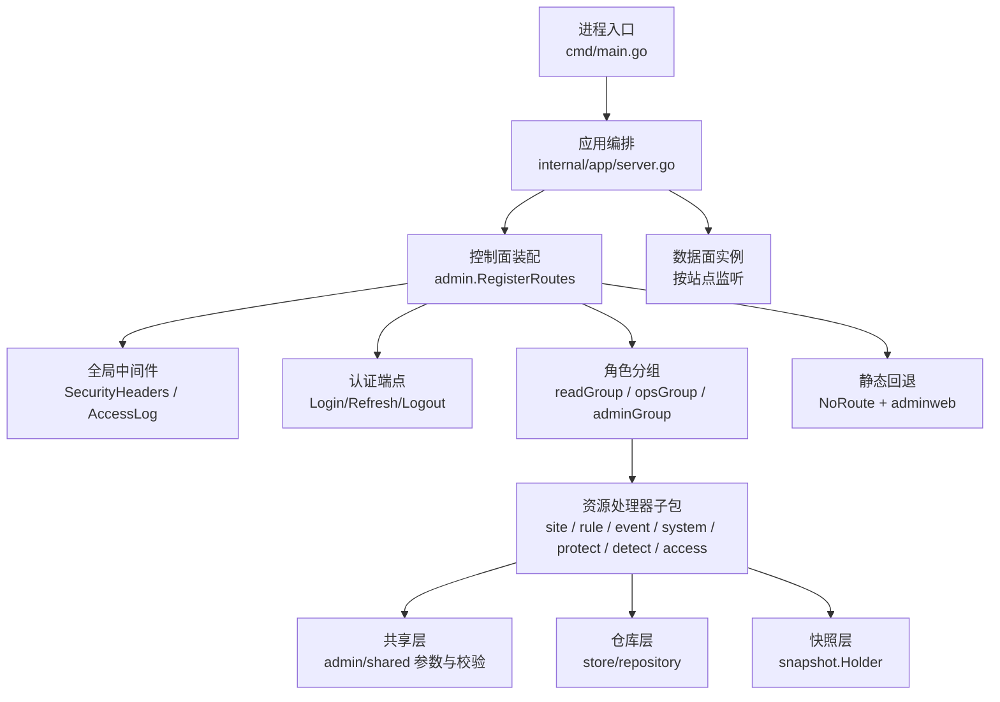
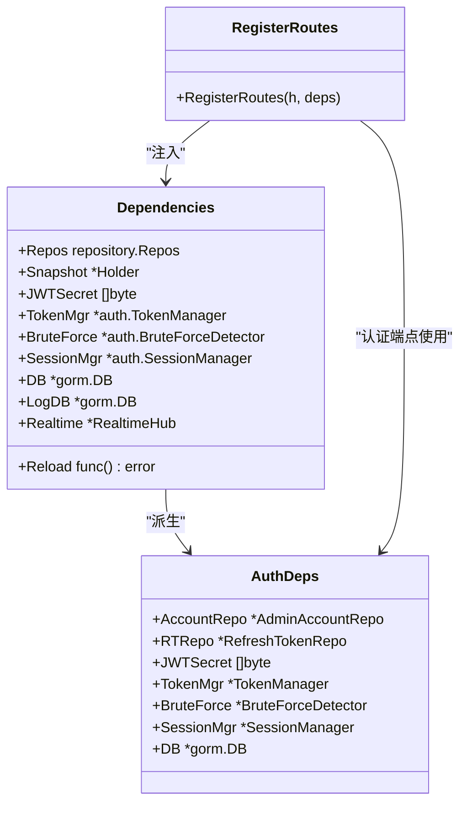
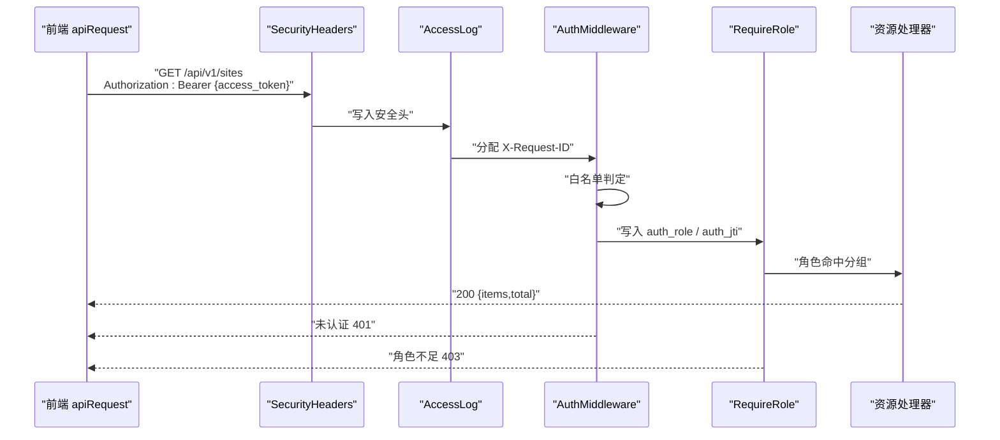
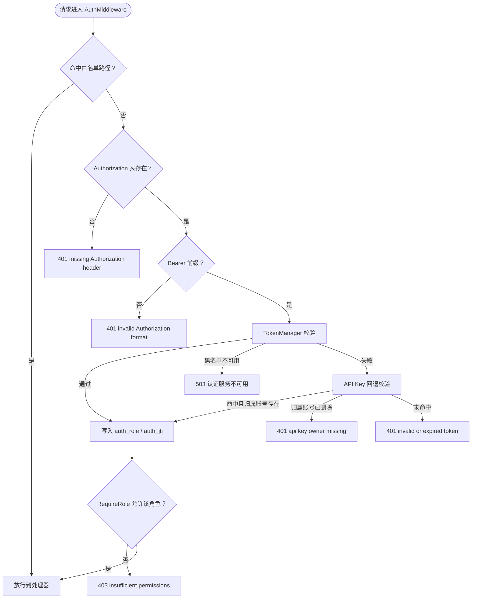
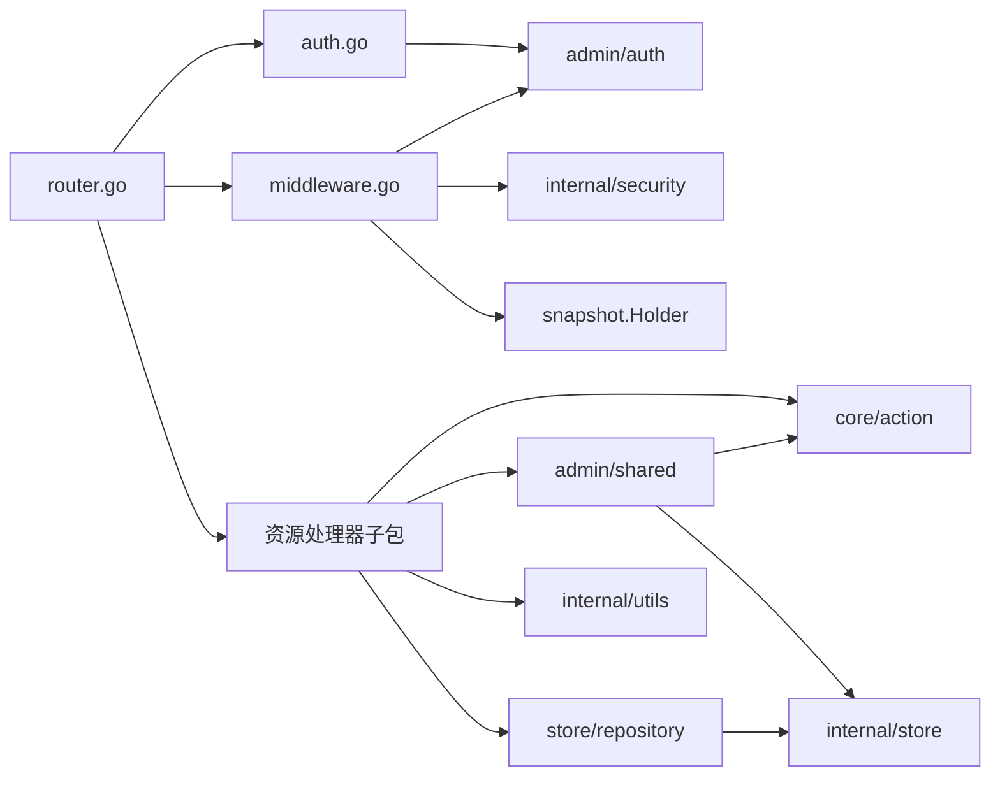

# REST API 设计规范

> [返回 管理 API 系统](../管理 API 系统.md)

<cite>
**本文档引用的文件**
- [router.go](file://internal/admin/router.go)
- [auth.go](file://internal/admin/auth.go)
- [auth_helpers.go](file://internal/admin/auth_helpers.go)
- [middleware.go](file://internal/admin/middleware.go)
- [jwt.go](file://internal/admin/auth/jwt.go)
- [session.go](file://internal/admin/auth/session.go)
- [apikey.go](file://internal/admin/system/apikey/apikey.go)
- [helpers.go](file://internal/admin/shared/helpers.go)
- [action.go](file://internal/core/action/action.go)
- [utils.go](file://internal/utils/utils.go)
- [api.ts](file://frontend/lib/api.ts)
- [API 端点参考.md](file://docs/管理 API 系统/REST API 设计规范/API 端点参考.md)
- [认证授权机制.md](file://docs/管理 API 系统/REST API 设计规范/认证授权机制.md)
- [请求响应格式规范.md](file://docs/管理 API 系统/REST API 设计规范/请求响应格式规范.md)
- [路由设计规范.md](file://docs/管理 API 系统/REST API 设计规范/路由设计规范.md)
- [错误处理机制.md](file://docs/管理 API 系统/REST API 设计规范/错误处理机制.md)
</cite>

## 目录

1. [简介](#简介)
2. [项目结构](#项目结构)
3. [核心组件](#核心组件)
4. [架构总览](#架构总览)
5. [详细组件分析](#详细组件分析)
6. [依赖关系分析](#依赖关系分析)
7. [性能考虑](#性能考虑)
8. [故障排查指南](#故障排查指南)
9. [结论](#结论)
10. [附录](#附录)

## 简介

本篇是 My-OpenWaf **控制面（管理后台）REST API 的设计规范总览**，回答三个问题：接口按什么原则组织、一次请求经过哪些层次、以及具体细节去哪一篇看。

本篇**不承载**端点清单、载荷字段表、鉴权实现与错误码明细——这些已由五篇子文档分工覆盖，见[附录](#附录)的职责索引。全部内容以 `internal/admin/router.go` 的注册语句、`internal/admin/middleware.go` 的中间件实现与 `frontend/lib/api.ts` 的调用侧契约为准，不使用推测值。

**章节来源**
- [router.go:89-440](file://internal/admin/router.go#L89-L440)
- [api.ts:531-637](file://frontend/lib/api.ts#L531-L637)

## 项目结构

控制面 API 由一个 Hertz 实例承载，路由注册集中在 `RegisterRoutes(h, deps)` 一处，处理器按资源域拆到子包。管理实例与数据面实例分离，静态资源由管理实例的 `NoRoute` 回退托管。

**图表来源**
- [router.go:89-126](file://internal/admin/router.go#L89-L126)
- [router.go:439-465](file://internal/admin/router.go#L439-L465)

| 路径 | 职责 | 语言 | 代表文件 | 对外暴露 |
|------|------|:----:|----------|----------|
| `internal/admin/`（根） | 路由装配、认证 handler、中间件、管理员账号 | Go | `router.go` | `RegisterRoutes`、`Dependencies`、`AuthDeps` |
| `internal/admin/auth/` | 令牌签发校验、会话、暴力破解 | Go | `jwt.go` | `TokenManager`、`SessionManager`、`BruteForceDetector` |
| `internal/admin/shared/` | 请求绑定、字段校验、配置读写工具 | Go | `helpers.go` | `ParseUintParam`、`Validate*`、`LoadProtectionConfig` |
| `internal/admin/site/` | 站点、监听器、错误页、站点级观测 | Go | `site.go` | 站点类端点处理器 |
| `internal/admin/rule/` | 自定义规则、应用路由规则、录制资源 | Go | `rule.go` | 规则类端点处理器 |
| `internal/admin/event/` | 安全事件、访问日志、指纹、请求追踪、误报 | Go | `security.go` | 事件类端点处理器 |
| `internal/admin/system/` | 设置、证书、策略、插件、备份、实时推送等 | Go | `settings.go` | 系统类端点处理器 |
| `internal/admin/protect/` | 保护配置、bot、验证码、链式、阻断、升级 | Go | `helpers.go` | 保护类端点处理器 |
| `internal/admin/detect/` | CVE 规则与 OWASP 规则管理 | Go | `cverules`、`owasprules` | 检测类端点处理器 |
| `internal/admin/access/` | 站点访问控制 | Go | `access` 子包 | 访问控制端点处理器 |
| `internal/core/action/` | 判定动作与内部状态码取值域 | Go | `action.go` | `Type`、`Result`、`InternalCode` |
| `internal/utils/` | 分页换算与解析工具 | Go | `utils.go` | `Paginate`、`SlicePage` |
| `internal/security/` | 客户端 IP 解析与可信代理校验 | Go | `clientip.go` | `ResolveClientIP`、`ValidateTrustedCIDR` |
| `frontend/lib/` | 调用侧统一封装与类型契约 | TypeScript | `api.ts` | `apiRequest`、`get`、`post` |

**技术栈矩阵**

| 层次 | 选型 | 所在位置 | 承担职责 | 备注 |
|------|------|----------|----------|------|
| HTTP 框架 | CloudWego Hertz | `internal/admin/router.go` | 路由、中间件、请求上下文 | 控制面与数据面各一实例 |
| 服务语言 | Go | `internal/admin/**` | 处理器与领域逻辑 | 按资源域分子包 |
| 令牌库 | `golang-jwt/jwt/v5` | `internal/admin/auth/jwt.go` | HS256 签发与校验 | 校验 issuer 与 audience |
| ORM | GORM | `internal/store/repository` | 数据访问 | 主库与日志库分离 |
| 前端语言 | TypeScript | `frontend/lib`、`frontend/app` | 页面与调用侧契约 | 统一 `apiRequest` 封装 |
| 前端框架 | Next.js（SPA） | `frontend/` | 控制台界面 | 静态资源由管理实例托管 |
| 请求 ID | `google/uuid` | `internal/admin/middleware.go` | 生成 `X-Request-ID` | 每条请求唯一 |

**章节来源**
- [router.go:12-56](file://internal/admin/router.go#L12-L56)
- [router.go:60-87](file://internal/admin/router.go#L60-L87)
- [middleware.go:150-170](file://internal/admin/middleware.go#L150-L170)

## 核心组件

| 组件 | 位置 | 职责 | 核心符号 | 规模（行） |
|------|------|------|----------|:----------:|
| 路由装配 | `internal/admin/router.go:89` | 注册全部端点并挂载中间件 | `RegisterRoutes` | 465 |
| 依赖容器 | `internal/admin/router.go:60` | 集中注入仓储、管理器与回调 | `Dependencies` | 28 |
| 认证依赖容器 | `internal/admin/auth.go:18` | 注入认证相关依赖 | `AuthDeps` | 9 |
| 认证中间件 | `internal/admin/middleware.go:42` | JWT 优先、API Key 回退 | `AuthMiddleware` | 82 |
| 角色中间件 | `internal/admin/middleware.go:127` | 角色白名单判定 | `RequireRole` | 22 |
| 安全头中间件 | `internal/admin/middleware.go:172` | 固定安全头 + 快照驱动头 | `SecurityHeaders` | 22 |
| 访问日志中间件 | `internal/admin/middleware.go:150` | 请求 ID 与耗时记录 | `AccessLog` | 21 |
| 令牌管理器 | `internal/admin/auth/jwt.go:45` | 签发、校验、轮换、吊销 | `TokenManager` | 372 |
| 共享校验层 | `internal/admin/shared/helpers.go` | 参数解析与字段归一化 | `ParseUintParam`、`Validate*` | 593 |
| 调用侧客户端 | `frontend/lib/api.ts:531` | 统一请求、刷新、错误归一 | `apiRequest`、`ApiError` | 1439 |

**图表来源**
- [router.go:60-104](file://internal/admin/router.go#L60-L104)
- [auth.go:17-26](file://internal/admin/auth.go#L17-L26)

**章节来源**
- [router.go:60-120](file://internal/admin/router.go#L60-L120)
- [auth.go:17-26](file://internal/admin/auth.go#L17-L26)
- [middleware.go:42-192](file://internal/admin/middleware.go#L42-L192)

## 架构总览

一次受控请求的完整层次：全局中间件 → 组级鉴权 → 组级角色 → 处理器 → 仓库/快照 → 统一 JSON 响应。

**图表来源**
- [router.go:91-126](file://internal/admin/router.go#L91-L126)
- [middleware.go:42-147](file://internal/admin/middleware.go#L42-L147)
- [api.ts:531-637](file://frontend/lib/api.ts#L531-L637)

**架构分层表**

| 层 | 组成 | 核心职责 | 允许依赖 | 禁止依赖 | 代表位置 |
|----|------|----------|----------|----------|----------|
| 接入层 | 前端 SPA、反向代理 | 展示、携带令牌与 Cookie | 应用层 | 领域层内部实现 | `frontend/lib/api.ts` |
| 装配层 | `RegisterRoutes`、`Dependencies` | 注册端点、注入依赖 | 中间件、处理器 | 仓库内部 SQL | `internal/admin/router.go` |
| 中间件层 | 安全头、访问日志、鉴权、角色 | 协议级横切控制 | `auth` 包、快照 | 资源处理器 | `internal/admin/middleware.go` |
| 处理器层 | 各资源子包 | 参数绑定、校验、编排 | `shared`、`repository`、`snapshot` | 接入层 | `internal/admin/*/` |
| 共享层 | 绑定与校验工具、响应结构 | 字段归一化与契约收敛 | `store` 模型 | 处理器 | `internal/admin/shared/` |
| 数据层 | 仓库、模型、迁移 | 持久化与聚合 | GORM、SQLite | 处理器、中间件 | `internal/store/` |

**章节来源**
- [middleware.go:42-192](file://internal/admin/middleware.go#L42-L192)
- [router.go:89-126](file://internal/admin/router.go#L89-L126)

## 详细组件分析

### 设计原则

| 原则 | 在控制面的落地方式 | 证据 |
|------|--------------------|------|
| 单一入口装配 | 所有端点在 `RegisterRoutes` 一处注册，不存在分散的 `init()` 注册 | `router.go:89` |
| 依赖显式注入 | 处理器一律通过闭包接收仓储与回调，不读全局变量 | `router.go:118-122` |
| 方法集最小化 | 只用 GET 与 POST，写操作以 `POST + 动作后缀` 表达，免去代理与 CORS 的额外方法配置 | 实测 GET 100 / POST 117 / PUT 0 / DELETE 0 |
| 权限按组声明 | 角色约束写在分组上（`readGroup`/`opsGroup`/`adminGroup`），不在单个端点重复 | `router.go:124-126` |
| 无副作用写形态 | 只解析用户提交文本、不触碰库存私钥的解析类接口允许留在只读组 | `router.go:136-138` |
| 执行用户代码需写权限 | 插件校验与试运行虽不改配置，仍置于 `opsGroup` | `router.go:298-305` |
| 响应不缓存 | `/api/v1/` 前缀响应统一 `Cache-Control: no-store` | `middleware.go:180-186` |
| 令牌不落地明文 | 刷新令牌仅存 SHA-256 摘要，API Key 仅存 bcrypt 哈希 | `jwt.go:338-358` |

**章节来源**
- [router.go:89-138](file://internal/admin/router.go#L89-L138)
- [router.go:298-305](file://internal/admin/router.go#L298-L305)
- [middleware.go:172-192](file://internal/admin/middleware.go#L172-L192)
- [jwt.go:338-358](file://internal/admin/auth/jwt.go#L338-L358)

### 资源建模与 HTTP 方法语义

控制面的资源路径由"资源集合 + 可选 ID 段 + 可选动作后缀"三段构成。下表为方法语义约定，具体端点条目见[API 端点参考](API 端点参考.md)。

| 形态 | 方法 | 语义 | 成功状态 | 实例 |
|------|:----:|------|:--------:|------|
| 资源集合读取 | GET | 列表 + 分页 | 200 | `/api/v1/sites` |
| 单资源读取 | GET | 详情 | 200 | `/api/v1/sites/:id` |
| 资源新建 | POST | 创建集合成员 | 201 | `/api/v1/sites` |
| 资源更新 | POST + `/update` | 替代 PUT | 200 | `/api/v1/sites/:id/update` |
| 资源删除 | POST + `/delete` | 替代 DELETE | 204 或 200 | `/api/v1/sites/:id/delete` |
| 状态动作 | POST + `/start`、`/stop`、`/toggle` | 显式状态迁移 | 200 | `/api/v1/sites/:id/start` |
| 聚合统计 | GET + `/stats` | 只读聚合 | 200 | `/api/v1/security-events/stats` |
| 时间序列 | GET + `/timeline` | 只读分桶 | 200 | `/api/v1/security-events/timeline` |
| 批量写入 | POST + `/batch` | 一次提交多条 | 200 | `/api/v1/cve-rules/batch` |
| 外部同步 | POST + `/sync` | 拉取远端数据源 | 200 | `/api/v1/threat-intel-feeds/:id/sync` |
| 语法校验 | POST + `/validate` | 不落库的校验 | 200 | `/api/v1/rules/validate` |
| 试运行 | POST + `/test`、`/dry-run` | 合成请求试跑 | 200 | `/api/v1/rules/test` |
| 导入导出 | POST + `/import`、GET + `/export` | 批量搬运 | 200 | `/api/v1/rules/export` |
| 覆盖重置 | POST + `/reset` | 回到继承全局 | 200 | `/api/v1/owasp-rules/:id/reset` |

> [!WARNING]
> 控制面**不注册** PUT 与 DELETE。任何按 REST 惯例书写 `PUT /api/v1/sites/:id` 或 `DELETE /api/v1/rules/:id` 的调用都会被 `NoRoute` 回退拦截并返回 `404 {"error":"endpoint not found"}`。

**章节来源**
- [router.go:127-415](file://internal/admin/router.go#L127-L415)
- [router.go:448-456](file://internal/admin/router.go#L448-L456)

### 权限分组模型

三个角色常量在 `internal/admin/auth` 定义、`store/auth` 为真源，分组通过 `RequireRole` 变长参数声明允许集合。

| 分组 | 允许角色 | 典型能力 | 判定实现 |
|------|----------|----------|----------|
| `readGroup` | `admin`、`operator`、`readonly` | 列表、详情、统计、配置读取 | `RequireRole(RoleAdmin, RoleOperator, RoleReadonly)` |
| `opsGroup` | `admin`、`operator` | 资源增删改、重载、插件执行 | `RequireRole(RoleAdmin, RoleOperator)` |
| `adminGroup` | `admin` | 系统设置写入、账号与令牌、备份恢复 | `RequireRole(RoleAdmin)` |
| 无角色中间件 | 任意已认证身份 | `auth/me`、`auth/change-password`、`auth/sessions` | 仅 `AuthMiddleware` |
| 白名单 | 无需身份 | `health`、`auth/login`、`auth/refresh`、`auth/logout` | 路径前缀直接放行 |

**图表来源**
- [middleware.go:42-121](file://internal/admin/middleware.go#L42-L121)
- [middleware.go:127-147](file://internal/admin/middleware.go#L127-L147)
- [router.go:124-126](file://internal/admin/router.go#L124-L126)

**章节来源**
- [middleware.go:42-147](file://internal/admin/middleware.go#L42-L147)
- [jwt.go:20-25](file://internal/admin/auth/jwt.go#L20-L25)
- [router.go:124-126](file://internal/admin/router.go#L124-L126)
- [router.go:255-256](file://internal/admin/router.go#L255-L256)
- [router.go:372-373](file://internal/admin/router.go#L372-L373)

### 端点规模与核对口径

端点条目不在本篇复述，此处给出用于回归核对的聚合口径。任何端点增删都应同步刷新[API 端点参考](API 端点参考.md)与本表。

| 核对项 | 实测值 | 统计方式 |
|--------|:------:|----------|
| 注册语句总数 | 217 | `router.go` 中 `h.` / `api.` / 三个分组变量的注册调用 |
| GET 端点 | 100 | 按方法计数 |
| POST 端点 | 117 | 按方法计数 |
| PUT / DELETE 端点 | 0 / 0 | 控制面未注册 |
| 鉴权白名单端点 | 4 | `health` + 三个 `auth` 写端点 |
| 免鉴权的数据面端点 | 3 | `/__owaf/*` 与 `/.well-known/*` |
| 组外 WebSocket 端点 | 1 | `realtime/ws` 走票据鉴权 |
| 管理实例静态回退 | 1 | `NoRoute` 处理非 `/api/` 路径 |

**章节来源**
- [router.go:89-440](file://internal/admin/router.go#L89-L440)
- [middleware.go:46-53](file://internal/admin/middleware.go#L46-L53)

### 前后端契约一致性

调用侧 `frontend/lib/api.ts` 是唯一封装入口，规范以它的实际行为为准。

| 契约点 | 后端行为 | 前端行为 | 一致性要求 |
|--------|----------|----------|------------|
| 认证头 | 要求 `Bearer {access_token}` | 有令牌即附加 `Authorization` | 二者格式必须逐字一致 |
| Cookie 携带 | 刷新令牌 HttpOnly + SameSite=Lax | `credentials: "include"` | 跨域部署需同源或显式策略 |
| 空响应 | 删除类返回 204/205 | 204/205 不调用 `response.json()` | 新增空响应端点须遵循 |
| 非 JSON 响应 | 文本或空体 | 解析失败降级为 `{text}` | 不得返回无语言标识文本 |
| 401 | 中间件与处理器各自返回 | 自动刷新一次并重试 | 刷新端点自身必须排除重试 |
| 403 | `RequireRole` 返回 | 抛出 `ApiError` 供 UI 显示 | 文案不得暴露内部实现 |
| 429 | 暴力破解锁定返回 `retry_after_secs` | 抛出并展示 | 上下文字段名固定 |
| 分页 | `Paginate` 钳制 `page_size ≤ 200` | 站点资源最多聚合 10 页 | 前端不得请求超限页长 |
| 令牌存储 | 不返回 refresh 原文 | access token 存 localStorage | refresh 仅在 HttpOnly Cookie |

**章节来源**
- [api.ts:531-637](file://frontend/lib/api.ts#L531-L637)
- [api.ts:27-35](file://frontend/lib/api.ts#L27-L35)
- [utils.go:8-41](file://internal/utils/utils.go#L8-L41)
- [auth_helpers.go:23-38](file://internal/admin/auth_helpers.go#L23-L38)

## 依赖关系分析

控制面内部依赖单向：装配层 → 中间件/处理器 → 共享层 → 仓库与快照层，无反向依赖。

**图表来源**
- [router.go:12-56](file://internal/admin/router.go#L12-L56)
- [middleware.go:3-19](file://internal/admin/middleware.go#L3-L19)
- [helpers.go:1-22](file://internal/admin/shared/helpers.go#L1-L22)

**依赖矩阵表**（`✓` 存在依赖，`—` 无依赖，`✗` 违规依赖）

| 调用方 ↓ / 被调方 → | admin/auth | admin/shared | store | repository | snapshot | utils | security |
|---------------------|:----------:|:------------:|:-----:|:----------:|:--------:|:-----:|:--------:|
| router（装配） | ✓ | — | ✓ | ✓ | ✓ | — | — |
| middleware | ✓ | — | ✓ | ✓ | ✓ | — | ✓ |
| auth handlers | ✓ | — | ✓ | ✓ | — | — | — |
| 资源处理器 | — | ✓ | ✓ | ✓ | ✓ | ✓ | ✓ |
| shared | — | — | ✓ | ✓ | — | ✓ | — |
| store / repository | — | — | — | — | — | ✓ | — |
| utils / security | — | — | ✓ | — | — | — | — |

矩阵中无 `✗`：不存在下层反向依赖上层的记录。`security` 依赖 `store` 是因为 XFF 模式常量与头名白名单定义在 `store` 层。

**章节来源**
- [router.go:12-56](file://internal/admin/router.go#L12-L56)
- [middleware.go:3-19](file://internal/admin/middleware.go#L3-L19)
- [helpers.go:1-22](file://internal/admin/shared/helpers.go#L1-L22)
- [utils.go:1-41](file://internal/utils/utils.go#L1-L41)

## 性能考虑

**问题**：控制面读端点数量远多于写端点，且事件与访问日志类端点直接扫库；令牌吊销检查若走数据库会在每个请求上产生额外查询。

**优化**：黑名单与会话采用 `sync.Map`/`map` 内存结构加定时清理，认证路径无数据库往返；分页参数在 `utils.Paginate` 内一次性钳制，避免超大 `page` 造成偏移溢出与全表扫描；写端点通过 `reload` 回调驱动快照重载，读端点直接读快照而非重算配置。

**效果**：认证中间件的热路径为常数级内存查找；列表端点单次最多返回 200 条；配置生效不需要重启管理实例。

| 指标 | 取值 | 来源 |
|------|------|------|
| 访问令牌有效期 | 15 分钟 | `auth.AccessTTL` |
| 刷新令牌有效期 | 7 天 | `auth.RefreshTTL` |
| 黑名单清理周期 | 10 分钟 | `cleanupLoop` |
| 会话清理周期 | 5 分钟 | `SessionManager.cleanupLoop` |
| 会话活跃落库最小间隔 | 30 秒 | `UpdateLastActive` |
| 单页条数上限 | 200 | `utils.MaxPageSize` |

**章节来源**
- [jwt.go:36-42](file://internal/admin/auth/jwt.go#L36-L42)
- [jwt.go:302-323](file://internal/admin/auth/jwt.go#L302-L323)
- [session.go:171-191](file://internal/admin/auth/session.go#L171-L191)
- [session.go:329-354](file://internal/admin/auth/session.go#L329-L354)
- [utils.go:8-41](file://internal/utils/utils.go#L8-L41)
- [middleware.go:150-170](file://internal/admin/middleware.go#L150-L170)

## 故障排查指南

本篇只负责"先定位到哪一层"，各层的具体排查条目归对应子文档。

| 症状 | 首先判定的层面 | 验证手段 | 深入文档 |
|------|----------------|----------|----------|
| `404 endpoint not found` | 端点是否存在 / 方法是否为 POST 动作 | 按端点总表逐字核对方法与路径 | [API 端点参考](API 端点参考.md) |
| `401` 且刷新成功仍失败 | 鉴权链与令牌归属 | 确认令牌来自当前密钥且未被吊销 | [认证授权机制](认证授权机制.md) |
| `403 access denied` | 角色分组 | 比对端点所在分组与账号角色 | [路由设计规范](路由设计规范.md) |
| `429 retry_after_secs` | 登录侧防护 | 查看锁定剩余与失败计数 | [认证授权机制](认证授权机制.md) |
| `503 认证服务不可用` | 黑名单持久化 | 检查主库可用性与加载重试 | [认证授权机制](认证授权机制.md) |
| 响应体字段缺失或类型不符 | 载荷契约 | 对照统一包装与字段表 | [请求响应格式规范](请求响应格式规范.md) |
| 配置写入后不生效 | 重载链 | 确认处理器是否触发 `reload` | [错误处理机制](错误处理机制.md) |
| 日志无法关联到具体请求 | 请求 ID | 取响应头 `X-Request-ID` | [错误处理机制](错误处理机制.md) |

**章节来源**
- [router.go:448-456](file://internal/admin/router.go#L448-L456)
- [middleware.go:85-147](file://internal/admin/middleware.go#L85-L147)
- [auth.go:49-58](file://internal/admin/auth.go#L49-L58)
- [api.ts:562-633](file://frontend/lib/api.ts#L562-L633)

## 结论

控制面 API 的一致性来自三个收敛点：**单一装配入口**（217 个端点全部在 `RegisterRoutes` 注册）、**按组声明的权限模型**（三个角色分组替代逐端点判权）、**最小方法集**（GET/POST 两法覆盖全部语义）。共享校验层把字段归一化收敛到 `internal/admin/shared`，调用侧把鉴权与错误归一收敛到 `apiRequest`，两端各自只有一处契约源。

优势：新增端点只需在对应分组追加注册语句并同步端点表；权限调整只改分组白名单；前后端契约核对成本被压缩到两张表。

待推进：控制面尚无 OpenAPI 产物，端点表仍靠人工与代码同步；`adminGroup` 与 `opsGroup` 的角色粒度只到分组级，缺少资源属主维度的细粒度授权。二者均属当前需求之外，本篇不做设计预留。

**章节来源**
- [本节为总结，无需特定文件来源]

## 附录

### 子文档职责索引

| 文档 | 职责边界 | 承载的关键表 |
|------|----------|--------------|
| [API 端点参考](API 端点参考.md) | 端点清单与权限归属 | 端点总表（217 条）、请求参数表、响应字段表、端点错误码表 |
| [认证授权机制](认证授权机制.md) | 令牌签发校验、会话、暴力破解、RBAC | 认证端点表、令牌配置表、角色矩阵、认证错误码表 |
| [请求响应格式规范](请求响应格式规范.md) | 载荷结构、分页、字段类型与校验 | 统一响应包装表、分页参数表、动作取值表、校验规则表 |
| [路由设计规范](路由设计规范.md) | 版本、命名、分组注册、方法约定、静态回退 | 中间件链表、路由分组表、命名约定表、路径参数表 |
| [错误处理机制](错误处理机制.md) | 错误载荷、日志字段、恢复策略 | 错误码总表、错误载荷字段表、日志字段表、恢复策略表 |

**章节来源**
- [本节为总结，无需特定文件来源]

### 术语表

| 术语 | 英文 | 含义 | 易混 | 出处 |
|------|------|------|------|------|
| 访问令牌 | access token | 短期 JWT，随请求携带 | 与刷新令牌混称"token" | `jwt.go:103` |
| 刷新令牌 | refresh token | 长期凭据，HttpOnly Cookie 承载 | 与 API Key 混用场景 | `auth.go:106-121` |
| JTI | JWT ID | 令牌唯一标识，吊销依据 | 与会话 ID 混同 | `jwt.go:360-364` |
| 黑名单 | token blacklist | 已撤销 JTI 集合 | 与会话移除混为一谈 | `jwt.go:246-286` |
| 管理端令牌 | API Key | 自动化调用的长期凭据 | 与访问令牌混淆 | `apikey.go:46-82` |
| 快照 | snapshot | 运行时配置只读视图 | 与数据库当前值混淆 | `router.go:65` |
| 重载 | reload | 把库中配置重建为快照 | 与进程重启混淆 | `router.go:119` |
| 请求 ID | `X-Request-ID` | 单次请求关联键 | 与业务 `request_id` 混淆 | `middleware.go:152-154` |

**章节来源**
- [jwt.go:103-364](file://internal/admin/auth/jwt.go#L103-L364)
- [auth.go:106-121](file://internal/admin/auth.go#L106-L121)
- [apikey.go:46-82](file://internal/admin/system/apikey/apikey.go#L46-L82)
- [middleware.go:152-154](file://internal/admin/middleware.go#L152-L154)
