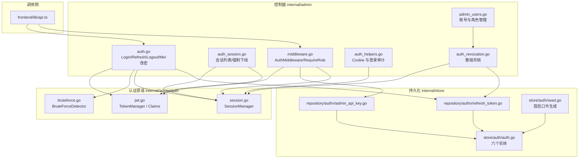
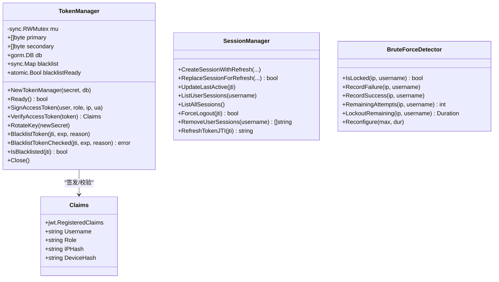
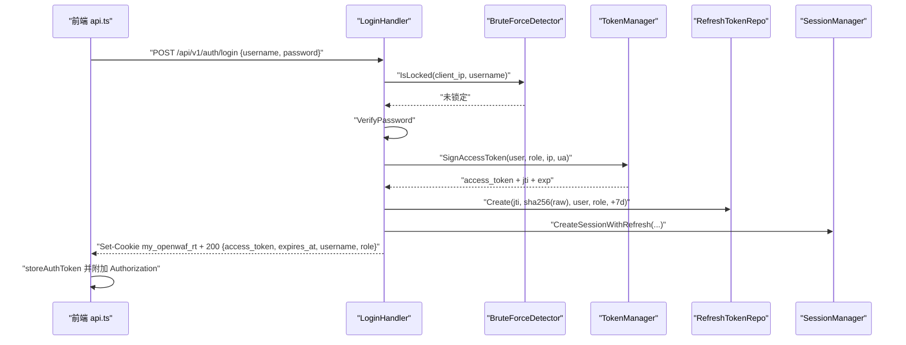
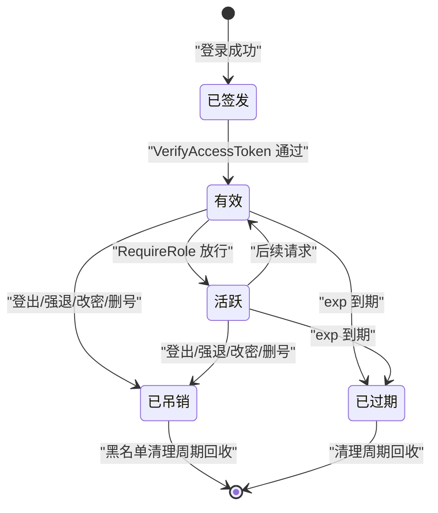
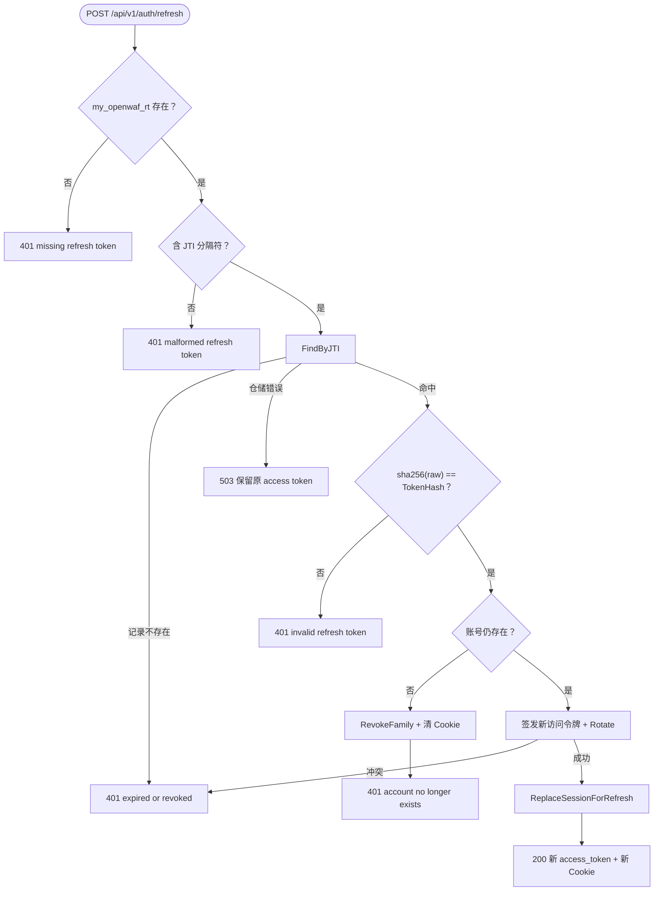
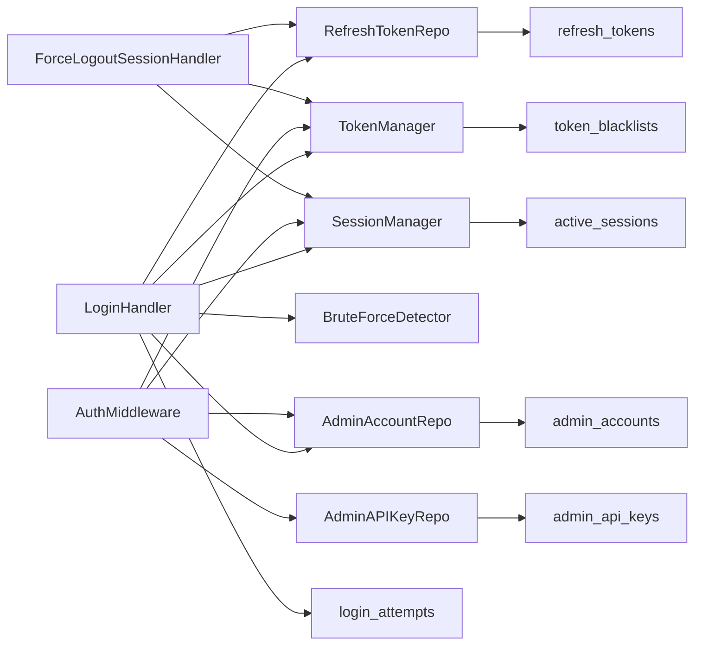

# 认证授权机制

> [返回 管理 API 系统](../管理 API 系统.md)

<cite>
**本文档引用的文件**
- [router.go](file://internal/admin/router.go)
- [auth.go](file://internal/admin/auth.go)
- [auth_helpers.go](file://internal/admin/auth_helpers.go)
- [auth_session.go](file://internal/admin/auth_session.go)
- [auth_revocation.go](file://internal/admin/auth_revocation.go)
- [admin_users.go](file://internal/admin/admin_users.go)
- [middleware.go](file://internal/admin/middleware.go)
- [jwt.go](file://internal/admin/auth/jwt.go)
- [session.go](file://internal/admin/auth/session.go)
- [bruteforce.go](file://internal/admin/auth/bruteforce.go)
- [apikey.go](file://internal/admin/system/apikey/apikey.go)
- [admin_api_key.go](file://internal/store/repository/authn/admin_api_key.go)
- [refresh_token.go](file://internal/store/repository/authn/refresh_token.go)
- [auth.go（store/auth 模型）](file://internal/store/auth/auth.go)
- [seed.go](file://internal/store/auth/seed.go)
- [api.ts](file://frontend/lib/api.ts)
- [REST API 设计规范.md](file://docs/管理 API 系统/REST API 设计规范/REST API 设计规范.md)
- [API 端点参考.md](file://docs/管理 API 系统/REST API 设计规范/API 端点参考.md)
</cite>

## 目录

1. [简介](#简介)
2. [项目结构](#项目结构)
3. [核心组件](#核心组件)
4. [架构总览](#架构总览)
5. [详细组件分析](#详细组件分析)
6. [依赖关系分析](#依赖关系分析)
7. [性能考虑](#性能考虑)
8. [故障排查指南](#故障排查指南)
9. [结论](#结论)
10. [附录](#附录)

## 简介

本篇描述 My-OpenWaf 控制面的**身份认证与权限判定**实现：短期访问令牌（JWT HS256）、长期刷新令牌（HttpOnly Cookie + 服务端摘要存储）、管理端静态令牌（API Key）、活跃会话跟踪、暴力破解防护与三角色 RBAC。

本篇只覆盖鉴权与授权侧的行为与取值。端点条目见[API 端点参考](API 端点参考.md)，载荷字段格式见[请求响应格式规范](请求响应格式规范.md)，中间件在路由链中的位置见[路由设计规范](路由设计规范.md)。

安全前提：所有令牌、口令与密钥在本文档中一律以 `{占位}` 形式出现，不写真实值。

**章节来源**
- [jwt.go:1-372](file://internal/admin/auth/jwt.go#L1-L372)
- [middleware.go:30-147](file://internal/admin/middleware.go#L30-L147)

## 项目结构

认证能力分布在两个层次：`internal/admin/auth/` 提供与 HTTP 无关的令牌与会话原语，`internal/admin/` 根提供 handler 与中间件；持久化模型在 `internal/store/auth/`。

**图表来源**
- [jwt.go:44-59](file://internal/admin/auth/jwt.go#L44-L59)
- [session.go:27-36](file://internal/admin/auth/session.go#L27-L36)
- [bruteforce.go:9-17](file://internal/admin/auth/bruteforce.go#L9-L17)
- [middleware.go:42-42](file://internal/admin/middleware.go#L42-L42)
- [auth_revocation.go:4-30](file://internal/admin/auth_revocation.go#L4-L30)

**模块清单表**

| 模块 | 路径 | 职责 | 核心符号 | 规模（行） | 测试 |
|------|------|------|----------|:----------:|:----:|
| 令牌 | `internal/admin/auth/jwt.go` | 签发、校验、密钥轮换、吊销 | `TokenManager` | 372 | 有 |
| 会话 | `internal/admin/auth/session.go` | 活跃会话跟踪与强制下线 | `SessionManager` | 354 | 有 |
| 防暴力 | `internal/admin/auth/bruteforce.go` | 失败计数与锁定 | `BruteForceDetector` | 204 | 有 |
| 认证 handler | `internal/admin/auth.go` | 登录、刷新、登出、me、改密 | `LoginHandler` 等 | 352 | 有 |
| 会话 handler | `internal/admin/auth_session.go` | 会话列表、强制下线 | `ListSessionsHandler` | 89 | 有 |
| 中间件 | `internal/admin/middleware.go` | 鉴权与角色判定 | `AuthMiddleware`、`RequireRole` | 334 | 有 |
| Cookie 与审计 | `internal/admin/auth_helpers.go` | 刷新 Cookie、登录尝试落库 | `setRefreshCookie` | 75 | 有 |
| 整链吊销 | `internal/admin/auth_revocation.go` | 账号级凭据全量失效 | `revokeUserCredentials` | 28 | 有 |
| 账号管理 | `internal/admin/admin_users.go` | 账号增删改与角色变更 | `CreateAdminUser` | 246 | 有 |
| 令牌仓储 | `internal/store/repository/authn/` | API Key 与刷新令牌持久化 | `AdminAPIKeyRepo`、`RefreshTokenRepo` | 345 | 部分 |

**章节来源**
- [jwt.go:1-372](file://internal/admin/auth/jwt.go#L1-L372)
- [session.go:1-354](file://internal/admin/auth/session.go#L1-L354)
- [bruteforce.go:1-204](file://internal/admin/auth/bruteforce.go#L1-L204)
- [admin_api_key.go:1-80](file://internal/store/repository/authn/admin_api_key.go#L1-L80)
- [refresh_token.go:16-134](file://internal/store/repository/authn/refresh_token.go#L16-L134)

## 核心组件

`TokenManager` 是签发与校验的唯一入口，`SessionManager` 是会话视图的唯一真源，`BruteForceDetector` 只服务于登录端点。三者均由 `Dependencies` 构造并经 `AuthDeps` 派发到认证 handler。

**图表来源**
- [jwt.go:27-59](file://internal/admin/auth/jwt.go#L27-L59)
- [jwt.go:67-156](file://internal/admin/auth/jwt.go#L67-L156)
- [session.go:52-272](file://internal/admin/auth/session.go#L52-L272)
- [bruteforce.go:63-171](file://internal/admin/auth/bruteforce.go#L63-L171)

**Claims 字段表**

| 字段 | JSON 键 | 类型 | 恒返回 | 说明 |
|------|---------|------|:------:|------|
| `ID` | `jti` | string | 是 | 16 字节随机数的十六进制，吊销依据 |
| `Issuer` | `iss` | string | 是 | 固定 `my-openwaf` |
| `Audience` | `aud` | string 数组 | 是 | 固定 `my-openwaf-admin` |
| `Subject` | `sub` | string | 是 | 用户名 |
| `ExpiresAt` | `exp` | NumericDate | 是 | 签发时刻 + 15 分钟 |
| `IssuedAt` | `iat` | NumericDate | 是 | 签发时刻 |
| `Username` | `username` | string | 是 | 与 `sub` 同值，便于解析 |
| `Role` | `role` | string | 是 | 空角色按 `admin` 兜底 |
| `IPHash` | `ip_hash` | string | 否 | 客户端 IP 的 SHA-256 前 8 字节 |
| `DeviceHash` | `device_hash` | string | 否 | User-Agent 的 SHA-256 前 8 字节 |

**章节来源**
- [jwt.go:27-42](file://internal/admin/auth/jwt.go#L27-L42)
- [jwt.go:103-127](file://internal/admin/auth/jwt.go#L103-L127)
- [jwt.go:354-372](file://internal/admin/auth/jwt.go#L354-L372)
- [auth.go:85-89](file://internal/admin/auth.go#L85-L89)

## 架构总览

登录到受控调用的完整链路如下，刷新令牌全程只在 HttpOnly Cookie 与服务端之间往返，不进入响应体。

**图表来源**
- [auth.go:33-128](file://internal/admin/auth.go#L33-L128)
- [jwt.go:103-127](file://internal/admin/auth/jwt.go#L103-L127)
- [api.ts:200-205](file://frontend/lib/api.ts#L200-L205)

**令牌生命周期状态图**

**图表来源**
- [jwt.go:129-156](file://internal/admin/auth/jwt.go#L129-L156)
- [jwt.go:246-286](file://internal/admin/auth/jwt.go#L246-L286)
- [jwt.go:302-323](file://internal/admin/auth/jwt.go#L302-L323)
- [auth_revocation.go:4-28](file://internal/admin/auth_revocation.go#L4-L28)

**章节来源**
- [auth.go:33-128](file://internal/admin/auth.go#L33-L128)
- [jwt.go:129-156](file://internal/admin/auth/jwt.go#L129-L156)

## 详细组件分析

### 访问令牌签发与校验

签发使用 HS256 与主密钥；校验先试主密钥，失败回退备用密钥，从而支持轮换过渡期。校验强制约束签名算法、issuer 与 audience，签名算法非 HMAC 时直接拒绝。

黑名单不可用时认证**保持 fail closed**：`ensureBlacklistReady` 以 1 秒退避重试加载，重试期间返回 `ErrTokenBlacklistUnavailable`，中间件据此返回 `503` 而不是放行。

| 环节 | 实现位置 | 判定 | 失败结果 |
|------|----------|------|----------|
| 算法约束 | `verifyWithKey` | 签名方法必须为 HMAC | `unexpected signing method` |
| issuer/audience | `jwt.WithIssuer`/`WithAudience` | 与常量一致 | 解析错误 |
| 密钥选择 | `VerifyAccessToken` | 主密钥失败再试备用密钥 | 签名无效 |
| 黑名单就绪 | `ensureBlacklistReady` | 已加载或 `db == nil` | `503` |
| 吊销检查 | `IsBlacklisted` | JTI 不在黑名单 | `token has been revoked` |

**章节来源**
- [jwt.go:129-201](file://internal/admin/auth/jwt.go#L129-L201)
- [jwt.go:158-182](file://internal/admin/auth/jwt.go#L158-L182)
- [middleware.go:69-90](file://internal/admin/middleware.go#L69-L90)

### 刷新令牌轮换与整链撤销

刷新令牌由 16 字节 JTI 与 32 字节原文组成，服务端只存原文的 SHA-256 摘要。每次刷新执行 `Rotate`：以 `jti = oldJTI AND revoked = false AND expires_at > now` 为条件把旧行置为已撤销并写入 `replaced_by`，同时创建新行；条件不满足即视为已被并发轮换，返回 `ErrRefreshTokenUnavailable`，handler 转为 `401`。

登出与强制下线不撤销单个 JTI，而是 `RevokeFamily` 撤销整条轮换链——浏览器发出登出请求前可能已完成一次刷新，只撤销请求携带的 JTI 会留下可用后继令牌。

**图表来源**
- [auth.go:131-240](file://internal/admin/auth.go#L131-L240)
- [refresh_token.go:88-118](file://internal/store/repository/authn/refresh_token.go#L88-L118)
- [jwt.go:338-358](file://internal/admin/auth/jwt.go#L338-L358)

**章节来源**
- [auth.go:131-240](file://internal/admin/auth.go#L131-L240)
- [refresh_token.go:16-134](file://internal/store/repository/authn/refresh_token.go#L16-L134)
- [jwt.go:338-358](file://internal/admin/auth/jwt.go#L338-L358)

### Cookie 属性与往返兼容

刷新 Cookie 名为 `my_openwaf_rt`，值为 `{jti}.{raw}`。分隔符选用点号而非冒号：Hertz 写 Cookie 走 `url.QueryEscape`，读回时不解码，冒号会被写成 `%3A` 而导致刷新恒定报 `malformed refresh token`。旧浏览器仍持有的 `%3A` 形态由兼容分支处理。

| 属性 | 取值 | 依据 |
|------|------|------|
| Name | `my_openwaf_rt` | `refreshCookieName` |
| 值格式 | `{jti}.{raw}` | `refreshCookieSeparator = '.'` |
| Path | `/` | 覆盖含 refresh 在内的全部请求 |
| Max-Age | 604800 秒（7 天） | `auth.RefreshTTL` |
| HttpOnly | 是 | 不暴露给脚本 |
| SameSite | `Lax` | 跨站重定向仍携带 |
| Secure | 由连接协议决定 | `https`/`h3` 为真，回环反代读 `X-Forwarded-Proto` |
| 清除方式 | 同名空值 + Max-Age `-1` | `clearRefreshCookie` |
| 旧格式兼容 | `%3A` 分隔符 | 兼容早于改动的登录会话 |

**章节来源**
- [auth_helpers.go:14-61](file://internal/admin/auth_helpers.go#L14-L61)
- [jwt.go:36-42](file://internal/admin/auth/jwt.go#L36-L42)
- [middleware.go:315-334](file://internal/admin/middleware.go#L315-L334)

### 会话管理

会话以 access JTI 为键在内存维护，同时落 `active_sessions` 表；`refresh_jti` 只保留在服务端，序列化为 `json:"-"`，不出现在任何管理端响应中。

| 行为 | 方法 | 关键约束 |
|------|------|----------|
| 登记 | `CreateSessionWithRefresh` | 内存与库双写，回填自增 ID |
| 刷新轮换 | `ReplaceSessionForRefresh` | 按 `refresh_jti` 就地替换，不累积行 |
| 活跃更新 | `UpdateLastActive` | 距上次落库 ≥ 30 秒才写库 |
| 本人列表 | `ListUserSessions` | 过滤 `expires_at > now` |
| 全量列表 | `ListAllSessions` | 仅 admin 通过 `?all=true` 触达 |
| 强制下线 | `ForceLogout` | 返回是否原本存在，据此决定 `404` |
| 账号级移除 | `RemoveUserSessions` | 返回 JTI 列表供批量拉黑 |
| 排序 | `sortSessionInfos` | `last_active_at` 降序，同值按 `jti` 升序 |
| 过期回收 | `cleanupLoop` | 每 5 分钟清内存与库 |

**章节来源**
- [session.go:14-25](file://internal/admin/auth/session.go#L14-L25)
- [session.go:52-191](file://internal/admin/auth/session.go#L52-L191)
- [session.go:205-288](file://internal/admin/auth/session.go#L205-L288)
- [session.go:290-354](file://internal/admin/auth/session.go#L290-L354)
- [auth_session.go:13-89](file://internal/admin/auth_session.go#L13-L89)
- [auth.go:70-82](file://internal/store/auth/auth.go#L70-L82)

### 暴力破解防护

计数按两个维度同时记录：纯 IP（全局速率）与 `IP|用户名`（定向爆破）。锁定判定先查 IP 级，再查 IP+用户名级。

`isLockedKey` 必须保持只读：它只在 `RLock` 下执行，若在此处写 `map`，并发读者会触发 `concurrent map writes` 使进程崩溃。已过期锁定记录因此故意留在原地，由下次失败或清理协程回收。

| 参数 | 默认 | 可配置 | 语义 |
|------|:----:|:------:|------|
| `maxFailures` | 5 | 是（`Reconfigure`） | 达到即锁定，非法值回落 5 |
| `lockoutDur` | 15 分钟 | 是（`Reconfigure`） | 锁定时长，非法值回落 15 分钟 |
| 清理周期 | 5 分钟 | 否 | 遍历回收空闲记录 |
| 回收阈值 | `2 × lockoutDur` | 否 | 距最后一次失败超过即删除 |
| `remaining_attempts` 上报 | ≤ 3 时上报 | 否 | 避免精确枚举锁定阈值 |
| 成功登录 | 删除 IP+用户名 记录 | 否 | 不删除纯 IP 记录 |

**章节来源**
- [bruteforce.go:9-42](file://internal/admin/auth/bruteforce.go#L9-L42)
- [bruteforce.go:44-94](file://internal/admin/auth/bruteforce.go#L44-L94)
- [bruteforce.go:96-171](file://internal/admin/auth/bruteforce.go#L96-L171)
- [bruteforce.go:185-204](file://internal/admin/auth/bruteforce.go#L185-L204)
- [auth.go:49-74](file://internal/admin/auth.go#L49-L74)

### 管理端令牌（API Key）

API Key 是 32 字节随机数的十六进制明文，仅在创建响应中出现一次，落库为 bcrypt 哈希与前 8 字符索引前缀。校验走前缀快路径，无前缀的历史令牌回退全表比对；命中即更新 `last_used_at`。

令牌的**身份与权限一律取自所属 `AdminAccount`**，不再无条件赋予 admin 角色；归属账号被删除时该令牌立即失效并返回 `401 api key owner account no longer exists`。

**章节来源**
- [admin_api_key.go:43-100](file://internal/store/repository/authn/admin_api_key.go#L43-L100)
- [middleware.go:92-121](file://internal/admin/middleware.go#L92-L121)
- [apikey.go:46-90](file://internal/admin/system/apikey/apikey.go#L46-L90)
- [auth.go:9-25](file://internal/store/auth/auth.go#L9-L25)

### RBAC 角色与账号生命周期

角色常量真源在 `internal/store/auth`，`internal/admin/auth` 镜像一份供本包引用。`RequireRole` 以变长参数构造允许集合，未写入 `auth_role` 时判 `403 access denied: no role`。

| 角色 | 常量 | 读端点 | 写端点（ops） | 系统级写入（admin） | 账号与令牌 | 全量会话 |
|------|------|:------:|:-------------:|:-------------------:|:----------:|:--------:|
| `admin` | `RoleAdmin` | ✓ | ✓ | ✓ | ✓ | ✓ |
| `operator` | `RoleOperator` | ✓ | ✓ | ✗ | ✗ | ✗ |
| `readonly` | `RoleReadonly` | ✓ | ✗ | ✗ | ✗ | ✗ |

账号变更必须伴随凭据吊销：角色变更 reason 为 `role_changed`、管理员改密为 `password_changed`、删除账号为 `account_deleted`、本人改密为 `password_changed`。吊销由 `revokeUserCredentials` 统一执行：撤销该账号全部刷新令牌、移除全部会话、逐个拉黑 access JTI，并把首个错误上报。

**章节来源**
- [auth.go:84-89](file://internal/store/auth/auth.go#L84-L89)
- [jwt.go:20-25](file://internal/admin/auth/jwt.go#L20-L25)
- [middleware.go:127-147](file://internal/admin/middleware.go#L127-L147)
- [admin_users.go:130-145](file://internal/admin/admin_users.go#L130-L145)
- [admin_users.go:185-198](file://internal/admin/admin_users.go#L185-L198)
- [admin_users.go:235-245](file://internal/admin/admin_users.go#L235-L245)
- [auth_revocation.go:4-28](file://internal/admin/auth_revocation.go#L4-L28)
- [auth.go:305-352](file://internal/admin/auth.go#L305-L352)

### 前端认证集成

访问令牌存于 `localStorage`（键 `token` 与 `token_expires_at`），跨标签页通过 storage 事件同步；刷新使用 Web Locks 加 localStorage 兜底锁，避免多标签页并发消费一次性刷新令牌。

`apiRequest` 在 `401` 且路径非 `login/refresh/logout` 时进入恢复分支，按四种情形分别处理。

| 情形 | 判定 | 动作 |
|------|------|------|
| 其他标签页已轮换 | 本地令牌已变化 | 直接用新令牌重试，不消费刷新凭据 |
| 刷新成功且令牌一致 | `refresh.ok` | 用新令牌重试一次 |
| 刷新成功但已被替换 | 登出或重新登录发生 | 抛 `ApiError(401, "会话已变更，请重试")` |
| 刷新返回未授权 | `reason = unauthorized` | 清令牌、跳转 `/login`、抛 `ApiError(401)` |
| 刷新服务不可用 | 5xx 或网络失败 | 保留原 `401` 语义并附 `refresh_status: unavailable` |

**章节来源**
- [api.ts:27-55](file://frontend/lib/api.ts#L27-L55)
- [api.ts:186-216](file://frontend/lib/api.ts#L186-L216)
- [api.ts:439-518](file://frontend/lib/api.ts#L439-L518)
- [api.ts:520-637](file://frontend/lib/api.ts#L520-L637)

## 依赖关系分析

认证链依赖仓储与两个持久化实体集合：刷新令牌表与黑名单表决定吊销是否跨重启生效，会话表决定重启后会话视图是否连续。

**图表来源**
- [auth.go:17-26](file://internal/admin/auth.go#L17-L26)
- [middleware.go:42-121](file://internal/admin/middleware.go#L42-L121)
- [auth_session.go:38-88](file://internal/admin/auth_session.go#L38-L88)
- [auth.go:60-83](file://internal/store/auth/auth.go#L60-L83)

**实体字段表**

| 实体 | 关键字段 | 唯一/索引 | 敏感处理 |
|------|----------|-----------|----------|
| `AdminAccount` | `username`、`password_hash`、`role` | `username` 唯一索引 | `password_hash` 为 `json:"-"` |
| `AdminAPIKey` | `user_id`、`name`、`prefix`、`token_hash`、`last_used_at` | `user_id` 索引、`prefix` 索引 | `token_hash` 与 `prefix` 均 `json:"-"` |
| `RefreshToken` | `jti`、`token_hash`、`username`、`role`、`expires_at`、`revoked`、`replaced_by` | `jti` 唯一索引 | `token_hash` 为 `json:"-"` |
| `TokenBlacklist` | `jti`、`expires_at`、`reason` | `jti` 唯一索引、`expires_at` 索引 | 无明文凭据 |
| `ActiveSession` | `username`、`jti`、`refresh_jti`、`ip`、`user_agent`、`device_info`、时间戳 | `jti` 唯一索引 | `refresh_jti` 为 `json:"-"` |
| `LoginAttempt` | `username`、`ip`、`success`、`user_agent` | 三列索引 | 不记录口令 |

**章节来源**
- [auth.go:15-82](file://internal/store/auth/auth.go#L15-L82)
- [admin_api_key.go:16-67](file://internal/store/repository/authn/admin_api_key.go#L16-L67)
- [seed.go:26-45](file://internal/store/auth/seed.go#L26-L45)

## 性能考虑

认证热路径不访问数据库：黑名单用 `sync.Map`，会话用受 `RWMutex` 保护的 `map`。写库压力通过两处节流控制——会话活跃时间按 30 秒最小间隔落库，刷新令牌轮换采用就地替换而非追加行，避免每次刷新新增一条会话记录。

过期回收由三个独立周期承担：黑名单 10 分钟、会话 5 分钟、暴力破解记录 5 分钟（回收阈值两倍锁定时长）。`CleanExpired(64)` 在登录与刷新成功后顺带执行，批量上限固定为 64。

首次启动时 `SeedDefaults` 为 `admin` 账号生成 16 字节随机口令并仅在本次输出，不落日志；系统不预置任何 API Key。

**章节来源**
- [jwt.go:302-323](file://internal/admin/auth/jwt.go#L302-L323)
- [session.go:171-191](file://internal/admin/auth/session.go#L171-L191)
- [session.go:329-354](file://internal/admin/auth/session.go#L329-L354)
- [bruteforce.go:185-204](file://internal/admin/auth/bruteforce.go#L185-L204)
- [auth.go:115-115](file://internal/admin/auth.go#L115-L115)
- [seed.go:26-45](file://internal/store/auth/seed.go#L26-L45)

## 故障排查指南

| 症状 | 原因 | 排查动作 | 处置 |
|------|------|----------|------|
| `401 missing Authorization header` | 调用未带令牌 | 检查 `apiRequest` 是否附加 `Bearer {access_token}` | 重新登录或修正请求头 |
| `401 invalid Authorization format` | 缺少 `Bearer ` 前缀 | 打印请求头原值 | 按格式重发 |
| `401 invalid or expired token` | 签名不符、过期、或 API Key 未命中 | 核对密钥轮换时间与 `exp` | 刷新或重签 |
| `503 authentication service unavailable` | 黑名单持久化未就绪 | 查主库连通与 `ErrTokenBlacklistUnavailable` 日志 | 等待退避重试成功 |
| `401 api key owner account no longer exists` | 令牌归属账号被删 | 查 `admin_api_keys.user_id` 对应账号 | 重新签发令牌 |
| `401 refresh token expired or revoked` | 轮换链已撤销或并发轮换冲突 | 查 `refresh_tokens.revoked` 与 `replaced_by` | 重新登录 |
| `401 malformed refresh token` | Cookie 值无分隔符 | 核对 `{jti}.{raw}` 与旧 `%3A` 兼容分支 | 清 Cookie 后重登 |
| `403 access denied: insufficient permissions` | 角色低于分组要求 | 比对 `auth_role` 与分组白名单 | 调整角色 |
| `429` + `retry_after_secs` | 失败次数达阈值 | 查 `LockoutRemaining` 与 `login_attempts` | 等待锁定结束 |
| 重启后仍被旧令牌访问 | 吊销未落库 | 查 `token_blacklists` 是否含该 JTI | 检查 `BlacklistTokenChecked` 错误 |

**章节来源**
- [middleware.go:55-121](file://internal/admin/middleware.go#L55-L121)
- [auth.go:36-58](file://internal/admin/auth.go#L36-L58)
- [auth.go:138-181](file://internal/admin/auth.go#L138-L181)
- [auth_helpers.go:44-61](file://internal/admin/auth_helpers.go#L44-L61)
- [bruteforce.go:157-171](file://internal/admin/auth/bruteforce.go#L157-L171)
- [jwt.go:251-286](file://internal/admin/auth/jwt.go#L251-L286)

## 结论

控制面认证采用"短期 JWT + 一次性轮换刷新令牌 + 归属账号化的 API Key"三轨结构，服务端只保存摘要与哈希，凭据原文除一次性展示外不落任何输出。吊销语义以整链撤销为准，覆盖登出、强退、改密与删号四条路径，避免旧浏览器凭后继刷新令牌恢复会话。

优势：认证热路径无数据库往返；密钥轮换有备用密钥过渡；黑名单不可用时 fail closed，不会静默放过已吊销令牌。

已知边界：会话视图以内存为主、数据库为辅，多实例部署时各实例视图不互通；角色只到分组粒度。二者是当前规模的合理取舍，本篇不做扩展设计。

**章节来源**
- [本节为总结，无需特定文件来源]

## 附录

### 认证端点请求参数表

| 参数 | 位置 | 类型 | 必填 | 约束 | 默认 | 示例 | 说明 |
|------|:----:|------|:----:|------|------|------|------|
| `username` | body | string | 是 | 非空 | — | `{username}` | 登录名，未命中统一 401 |
| `password` | body | string | 是 | 非空 | — | `{password}` | 口令，任何响应不回显 |
| `old_password` | body | string | 是 | 非空 | — | `{old_password}` | 本人改密校验 |
| `new_password` | body | string | 是 | ≥ 8 字符 | — | `{new_password}` | 不足 8 位返回 400 |
| `jti` | body | string | 是 | 非空 | — | `{jti}` | 强制下线目标会话 |
| `my_openwaf_rt` | cookie | string | 条件 | `{jti}.{raw}` | 无 | `{jti}.{raw}` | 刷新凭据 |
| `Authorization` | header | string | 条件 | `Bearer {access_token}` | 无 | `Bearer {access_token}` | 受控端点必填 |
| `all` | query | string | 否 | 仅 `true` 且角色为 admin | 不生效 | `true` | 全量会话视图 |
| `password`（账号建） | body | string | 是 | ≥ 8 字符 | — | `{password}` | 管理员建号初始口令 |
| `role` | body | string | 否 | `admin`/`operator`/`readonly` | `readonly` | `operator` | 非法值返回 400 枚举提示 |

**章节来源**
- [auth.go:28-31](file://internal/admin/auth.go#L28-L31)
- [auth.go:319-334](file://internal/admin/auth.go#L319-L334)
- [auth_session.go:41-48](file://internal/admin/auth_session.go#L41-L48)
- [admin_users.go:33-70](file://internal/admin/admin_users.go#L33-L70)
- [auth_helpers.go:14-21](file://internal/admin/auth_helpers.go#L14-L21)

### 认证响应字段表

| 端点 | 字段 | 类型 | 恒返回 | 可为空 | 说明 |
|------|------|------|:------:|:------:|------|
| 登录/刷新 | `access_token` | string | 是 | 否 | HS256 JWT |
| 登录/刷新 | `expires_at` | int64 | 是 | 否 | Unix 秒 |
| 登录/刷新 | `username` | string | 是 | 否 | 账号名 |
| 登录/刷新 | `role` | string | 是 | 否 | 空角色兜底为 `admin` |
| 登录失败 | `error` | string | 是 | 否 | 凭据无效时不区分账号存在性 |
| 登录失败 | `remaining_attempts` | int | 否 | — | 仅 1–3 时返回 |
| 锁定 | `retry_after_secs` | int | 是 | 否 | 锁定剩余秒数 |
| `auth/me` | `username` | string | 是 | 是 | 无上下文时为空值 |
| `auth/sessions` | `sessions[]` | array | 是 | 否 | 空结果返回空数组 |
| `api-keys` 创建 | `token` | string | 是 | 否 | 一次性明文，此后不再返回 |
| `api-keys` 创建 | `user_id` / `username` | — | 是 | 否 | 归属账号 |

**章节来源**
- [auth.go:52-75](file://internal/admin/auth.go#L52-L75)
- [auth.go:122-127](file://internal/admin/auth.go#L122-L127)
- [auth.go:293-303](file://internal/admin/auth.go#L293-L303)
- [auth_session.go:17-33](file://internal/admin/auth_session.go#L17-L33)
- [apikey.go:77-82](file://internal/admin/system/apikey/apikey.go#L77-L82)

### 令牌与策略配置表

| 配置项 | 取值 | 来源 | 说明 |
|--------|------|------|------|
| `AccessTTL` | 15 分钟 | `jwt.go:37` | 访问令牌有效期 |
| `RefreshTTL` | 7 天 | `jwt.go:38` | 刷新令牌与 Cookie 有效期 |
| `Issuer` | `my-openwaf` | `jwt.go:40` | 校验强制匹配 |
| `Audience` | `my-openwaf-admin` | `jwt.go:41` | 校验强制匹配 |
| 签名算法 | HS256 | `jwt.go:124` | 非 HMAC 直接拒绝 |
| JTI 长度 | 16 字节随机数 | `jwt.go:360-364` | 十六进制 32 字符 |
| 刷新原文长度 | 32 字节随机数 | `jwt.go:345-349` | 十六进制 64 字符 |
| IP/设备指纹哈希 | SHA-256 前 8 字节 | `jwt.go:366-372` | 短哈希，不可逆 |
| API Key 长度 | 32 字节随机数 | `admin_api_key.go:50-55` | 十六进制，仅一次展示 |
| API Key 前缀索引 | 前 8 字符 | `admin_api_key.go:60-60` | 校验快路径 |
| 口令最小长度 | 8 字符 | `auth.go:331`、`admin_users.go:60` | 建号与改密同口径 |
| 会话落库节流 | 30 秒 | `session.go:181` | 活跃时间最小写库间隔 |

**章节来源**
- [jwt.go:36-42](file://internal/admin/auth/jwt.go#L36-L42)
- [jwt.go:124-124](file://internal/admin/auth/jwt.go#L124-L124)
- [jwt.go:338-372](file://internal/admin/auth/jwt.go#L338-L372)
- [admin_api_key.go:43-60](file://internal/store/repository/authn/admin_api_key.go#L43-L60)
- [auth.go:327-334](file://internal/admin/auth.go#L327-L334)
- [admin_users.go:56-63](file://internal/admin/admin_users.go#L56-L63)
- [session.go:171-191](file://internal/admin/auth/session.go#L171-L191)

### 认证侧错误码表

| HTTP | 触发条件 | 错误载荷 | 出处 |
|:----:|----------|----------|------|
| 400 | 登录请求体无法绑定 | `请求体格式无效` | `auth.go:41-43` |
| 400 | 改密缺少旧/新口令 | `old_password and new_password are required` | `auth.go:327-329` |
| 400 | 新口令短于 8 字符 | `new password must be at least 8 characters` | `auth.go:331-333` |
| 400 | 强制下线缺少 `jti` | `jti is required` | `auth_session.go:45-47` |
| 400 | 账号角色不在枚举内 | `role must be one of: admin, operator, readonly` | `admin_users.go:67-69` |
| 401 | 凭据校验失败 | `invalid credentials` | `auth.go:60-76` |
| 401 | 缺少 Authorization 头 | `missing Authorization header` | `middleware.go:56-59` |
| 401 | Bearer 前缀缺失 | `invalid Authorization format, use Bearer {token}` | `middleware.go:62-66` |
| 401 | JWT 与 API Key 均未命中 | `invalid or expired token` | `middleware.go:98-101` |
| 401 | 令牌归属账号已删除 | `api key owner account no longer exists` | `middleware.go:111-114` |
| 403 | 角色不满足分组 | `access denied: insufficient permissions` | `middleware.go:140-143` |
| 403 | 上下文无角色 | `access denied: no role` | `middleware.go:133-137` |
| 403 | 改密旧口令错误 | `current password is incorrect` | `auth.go:336-338` |
| 403 | API Key 创建时找不到当前账号 | `current account not found` | `apikey.go:53-56` |
| 404 | 目标会话不存在 | `session not found` | `auth_session.go:58-61` |
| 409 | 管理员账号重名 | `username already exists` | `admin_users.go:72-75` |
| 429 | 登录失败达到阈值 | `retry_after_secs` | `auth.go:50-57` |
| 500 | 令牌生成或落库失败 | `token generation failed` / `token storage failed` | `auth.go:101-114` |
| 500 | 吊销链失败 | `logout completed but access token revocation failed` | `auth.go:281-285` |
| 503 | 认证依赖或黑名单不可用 | `authentication service unavailable` | `auth.go:36-39`、`middleware.go:85-88` |

**章节来源**
- [auth.go:36-114](file://internal/admin/auth.go#L36-L114)
- [auth.go:281-338](file://internal/admin/auth.go#L281-L338)
- [auth_session.go:45-85](file://internal/admin/auth_session.go#L45-L85)
- [admin_users.go:67-75](file://internal/admin/admin_users.go#L67-L75)
- [apikey.go:48-75](file://internal/admin/system/apikey/apikey.go#L48-L75)
- [middleware.go:55-143](file://internal/admin/middleware.go#L55-L143)
