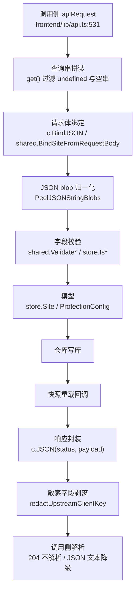
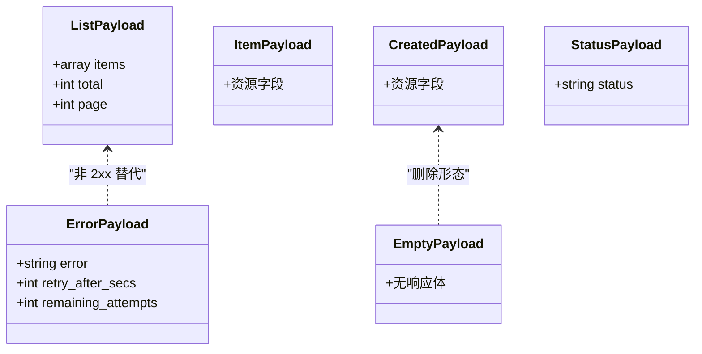
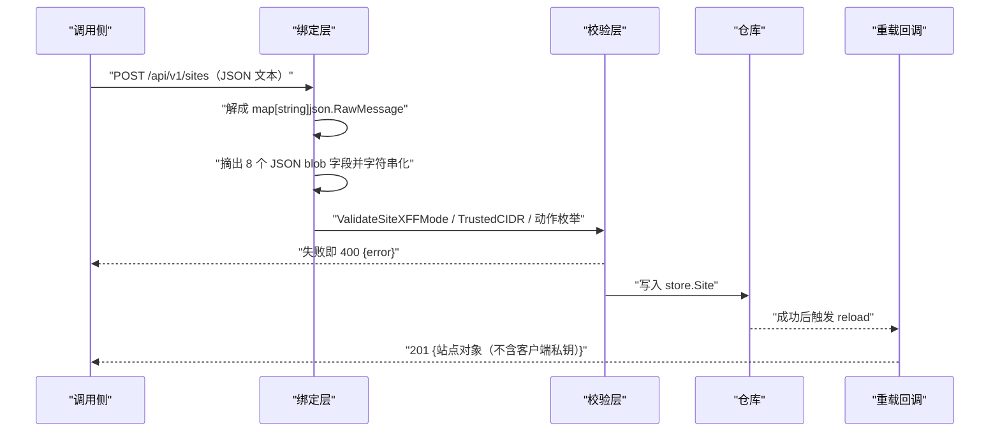
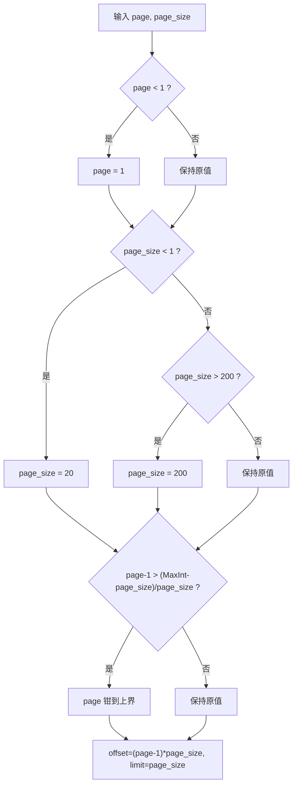
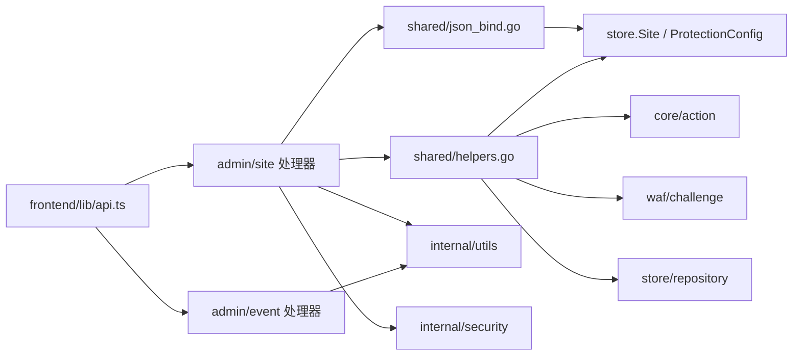

# 请求响应格式规范

> [返回 管理 API 系统](../管理 API 系统.md)

<cite>
**本文档引用的文件**
- [json_bind.go](file://internal/admin/shared/json_bind.go)
- [helpers.go](file://internal/admin/shared/helpers.go)
- [utils.go](file://internal/utils/utils.go)
- [site.go](file://internal/store/site.go)
- [protection.go](file://internal/store/protection.go)
- [action.go](file://internal/core/action/action.go)
- [compiler.go](file://internal/core/rules/compiler.go)
- [captcha.go](file://internal/waf/challenge/captcha.go)
- [clientip.go](file://internal/security/clientip.go)
- [site.go（处理器）](file://internal/admin/site/site.go)
- [security.go](file://internal/admin/event/security.go)
- [access.go](file://internal/admin/event/access.go)
- [rule.go](file://internal/admin/rule/rule.go)
- [admin_users.go](file://internal/admin/admin_users.go)
- [apikey.go](file://internal/admin/system/apikey/apikey.go)
- [auth.go（控制面）](file://internal/admin/auth.go)
- [auth.go（store/auth 模型）](file://internal/store/auth/auth.go)
- [auth_session.go](file://internal/admin/auth_session.go)
- [api.ts](file://frontend/lib/api.ts)
- [table-pagination.tsx](file://frontend/components/table-pagination.tsx)
- [REST API 设计规范.md](file://docs/管理 API 系统/REST API 设计规范/REST API 设计规范.md)
- [API 端点参考.md](file://docs/管理 API 系统/REST API 设计规范/API 端点参考.md)
- [错误处理机制.md](file://docs/管理 API 系统/REST API 设计规范/错误处理机制.md)
</cite>

## 目录

1. [简介](#简介)
2. [项目结构](#项目结构)
3. [核心组件](#核心组件)
4. [架构总览](#架构总览)
5. [详细组件分析](#详细组件分析)
6. [依赖关系分析](#依赖关系分析)
7. [性能考虑](#性能考虑)
8. [故障排查指南](#故障排查指南)
9. [结论](#结论)
10. [附录](#附录)

## 简介

本篇定义控制面 REST API 的**载荷契约**：请求参数如何传递与解析、响应如何包装、字段命名与类型约定、分页与排序机制、以及请求体字段的校验规则与失败语义。

端点条目见[API 端点参考](API 端点参考.md)，鉴权头与令牌字段来源见[认证授权机制](认证授权机制.md)，错误载荷的日志与恢复策略见[错误处理机制](错误处理机制.md)。示例中的密钥、令牌与口令一律写作 `{占位}`。

**章节来源**
- [json_bind.go:1-174](file://internal/admin/shared/json_bind.go#L1-L174)
- [utils.go:1-100](file://internal/utils/utils.go#L1-L100)

## 项目结构

载荷处理由三层协作：共享绑定与校验层负责把 JSON 收敛为模型，处理器层负责编排与响应封装，调用侧 `api.ts` 负责把响应还原为 TypeScript 值。



**图表来源**
- [json_bind.go:93-174](file://internal/admin/shared/json_bind.go#L93-L174)
- [api.ts:642-657](file://frontend/lib/api.ts#L642-L657)
- [site.go:59-63](file://internal/admin/site/site.go#L59-L63)
- [api.ts:609-637](file://frontend/lib/api.ts#L609-L637)

**结构表**

| 路径 | 职责 | 代表符号 | 对外暴露 |
|------|------|----------|----------|
| `internal/admin/shared/json_bind.go` | JSON blob 字段摘取与三态归一化 | `BindSiteFromRequestBody`、`PeelJSONStringBlobs` | 绑定入口 |
| `internal/admin/shared/helpers.go` | 路径参数解析与字段校验 | `ParseUintParam`、`Validate*` | 校验规则 |
| `internal/utils/utils.go` | 分页换算与切片分页 | `Paginate`、`SlicePage` | `offset/limit` |
| `internal/store/site.go` | 站点模型与 JSON 标签 | `Site`、`XFFMode*` | 字段契约 |
| `internal/store/protection.go` | 全局保护配置模型 | `ProtectionConfig` | 字段契约 |
| `internal/core/action/action.go` | 判定动作与状态码取值域 | `Type`、`Result` | 枚举契约 |
| `frontend/lib/api.ts` | 调用侧封装与类型守卫 | `get`、`post`、`ApiError` | 消费契约 |

**章节来源**
- [json_bind.go:12-91](file://internal/admin/shared/json_bind.go#L12-L91)
- [helpers.go:81-84](file://internal/admin/shared/helpers.go#L81-L84)
- [utils.go:8-41](file://internal/utils/utils.go#L8-L41)
- [site.go:17-22](file://internal/store/site.go#L17-L22)

## 核心组件

响应没有统一信封结构体：成功响应按资源形态返回不同 JSON 形状，错误响应固定为单层对象。因此"响应包装形态表"是契约的实际载体。



**图表来源**
- [security.go:50-54](file://internal/admin/event/security.go#L50-L54)
- [access.go:68-68](file://internal/admin/event/access.go#L68-L68)
- [auth.go:122-127](file://internal/admin/auth.go#L122-L127)
- [admin_users.go:82-86](file://internal/admin/admin_users.go#L82-L86)
- [apikey.go:148-148](file://internal/admin/system/apikey/apikey.go#L148-L148)

**响应包装形态表**

| 形态 | 状态码 | 载荷形状 | 实例端点 | 依据 |
|------|:------:|----------|----------|------|
| 列表 | 200 | `{"items":[...],"total":n,"page":p}` | `/security-events` | `security.go:50` |
| 列表（无 page） | 200 | `{"items":[...],"total":n}` | `/sites` | `site.go` 列表返回 |
| 列表（仅 items） | 200 | `{"items":[...]}` | `/admin-users` | `admin_users.go:29` |
| 详情 | 200 | 资源对象本体 | `/sites/:id` | 处理器直接返回模型 |
| 创建 | 201 | 新建对象或关键字段子集 | `/admin-users`、`/api-keys` | `admin_users.go:82` |
| 删除 | 204 | 无响应体 | `/api-keys/:id/delete` | `apikey.go:148` |
| 状态动作 | 200 | `{"status":"ok"}` | `/auth/logout` | `auth.go:289` |
| 聚合 | 200 | 统计对象 | `/security-events/stats` | 处理器聚合结果 |
| 错误 | 4xx/5xx | `{"error":"..."}` | 全部端点 | `middleware.go:57` |
| 错误（带上下文） | 429/401 | `{"error":...,"retry_after_secs":n}` | `/auth/login` | `auth.go:52-75` |

**章节来源**
- [security.go:50-54](file://internal/admin/event/security.go#L50-L54)
- [access.go:68-68](file://internal/admin/event/access.go#L68-L68)
- [admin_users.go:22-88](file://internal/admin/admin_users.go#L22-L88)
- [apikey.go:77-82](file://internal/admin/system/apikey/apikey.go#L77-L82)
- [auth.go:122-127](file://internal/admin/auth.go#L122-L127)

## 架构总览

一次写请求从绑定到响应的形态变化如下。



**图表来源**
- [json_bind.go:104-174](file://internal/admin/shared/json_bind.go#L104-L174)
- [site.go:36-63](file://internal/admin/site/site.go#L36-L63)

**数据流转换表**

| 阶段 | 起点形态 | 转换动作 | 终点形态 | 位置 | 敏感处理 |
|------|----------|----------|----------|------|----------|
| 调用侧发起 | 参数对象 | 过滤 `undefined`/空串后编码查询串 | `?k=v&k2=v2` | `api.ts:642` | 不记录令牌到日志 |
| 请求体绑定 | JSON 文本 | 解为原始 map 并摘取 blob | `map[string]json.RawMessage` | `json_bind.go:95` | 未知字段按模型忽略 |
| 字段归一化 | 数组/对象值 | 字符串化并校验结构 | 文本列值 | `json_bind.go:31-63` | `skip_path_by_phase` 逐阶段校验 |
| 三态收敛 | `null`/空串/有值 | 指针置空或写入归一值 | `*string` 或 `nil` | `json_bind.go:148-172` | `nil` 表示取消覆盖 |
| 枚举校验 | 用户提交动作 | `action.Normalize` + 白名单 | 规范动作或拒绝 | `helpers.go:104-136` | 无 |
| 持久化 | 模型 | GORM 写库 | 数据库行 | `store/repository` | 口令与密钥哈希存储 |
| 响应封装 | 模型 | 指针字段 `omitempty` | JSON 对象 | `site.go` 处理器 | 客户端私钥置空 |
| 调用侧还原 | 响应字节 | 204 跳过解析，JSON 失败降级 `{text}` | TS 值或 `ApiError` | `api.ts:609-633` | 错误文案不外泄内部细节 |

**章节来源**
- [json_bind.go:12-174](file://internal/admin/shared/json_bind.go#L12-L174)
- [helpers.go:104-136](file://internal/admin/shared/helpers.go#L104-L136)
- [api.ts:609-657](file://frontend/lib/api.ts#L609-L657)
- [site.go:36-63](file://internal/admin/site/site.go#L36-L63)

## 详细组件分析

### 请求参数传递方式

三类位置各有固定解析入口，解析失败一律返回 `400` 并携带 `error`。

| 位置 | 解析方式 | 失败语义 | 典型端点 |
|------|----------|----------|----------|
| 路径 `:id` | `shared.ParseUintParam` → `strconv.ParseUint(.., 10, 64)` | `400 invalid id` | `/sites/:id` |
| 路径 `:key` | `c.Param("key")` 直接取字符串 | 未命中即 `500`/空值 | `/settings/:key` |
| 路径 `:ip` | 参数值传入升级链状态查询 | 非法 IP 查不到记录 | `/escalation/status/:ip` |
| 查询 `page` | `strconv.Atoi`，缺省按 0 处理再由 `Paginate` 兜底 | 无错误，钳制 | 全部列表端点 |
| 查询 `page_size` | 同上，钳到 `1..200` | 无错误，钳制 | 全部列表端点 |
| 查询过滤项 | `c.Query(name)`，空串视为不过滤 | 无错误，忽略 | `/security-events` |
| 查询时间 | `time.Parse(time.RFC3339, ..)` | 解析失败即忽略该条件 | `since`/`until` |
| 查询枚举 | `securityEventAggregateHours` 严格校验 | `400 hours must be between 1 and 720` | `*/stats`、`*/timeline` |
| 请求体 | `c.BindJSON(&body)` | `400 请求体格式无效` 或 `400 <绑定错误>` | 全部写端点 |
| 请求头 | `c.GetHeader("Authorization")` | `401` | 全部受控端点 |
| Cookie | `c.Cookie("my_openwaf_rt")` | `401 missing refresh token` | `/auth/refresh` |

> [!NOTE]
> 布尔型查询参数以字符串比较实现：`c.Query("all") == "true"`。传 `1` 或 `TRUE` 均不生效。

**章节来源**
- [helpers.go:81-84](file://internal/admin/shared/helpers.go#L81-L84)
- [utils.go:8-41](file://internal/utils/utils.go#L8-L41)
- [security.go:27-130](file://internal/admin/event/security.go#L27-L130)
- [access.go:17-57](file://internal/admin/event/access.go#L17-L57)
- [auth.go:40-44](file://internal/admin/auth.go#L40-L44)
- [auth_session.go:27-31](file://internal/admin/auth_session.go#L27-L31)

### 分页机制与排序规则

`Paginate` 只做下界回落与上界钳制，同时防止极大 `page` 造成 `offset` 溢出为负数。



**图表来源**
- [utils.go:26-41](file://internal/utils/utils.go#L26-L41)

**分页参数表**

| 参数 | 位置 | 类型 | 必填 | 约束 | 默认 | 示例 | 说明 |
|------|:----:|------|:----:|------|------|------|------|
| `page` | query | int | 否 | `< 1` 回落 1；上界按页长留余量 | `1` | `2` | 页码 |
| `page_size` | query | int | 否 | `1..200`；`< 1` 回落 20 | `20` | `50` | 页长 |
| `offset` | — | int | — | 由 `Paginate` 计算 | `0` | `20` | 不出现在请求中 |
| `limit` | — | int | — | 等于 `page_size` | `20` | `50` | 不出现在请求中 |
| `def` | — | int | — | 调用方按数据类别给出 | 各异 | `20` | `SlicePage` 参数 |
| `cap` | — | int | — | 调用方按数据类别给出 | 各异 | `200` | `SlicePage` 参数 |

排序约定：仓库层列表以 `id ASC` 为主键序返回；内存切片分页保持上游给定顺序，不做二次排序。

**章节来源**
- [utils.go:8-100](file://internal/utils/utils.go#L8-L100)
- [security.go:41-54](file://internal/admin/event/security.go#L41-L54)

### 字段命名与类型约定

控制面 JSON 键**一律为 snake_case**，由模型 `json` 标签决定，不是驼峰。前端类型定义与标签逐字对齐。

| 类型 | Go 形态 | JSON 形态 | 空值表达 | 实例 |
|------|---------|-----------|----------|------|
| 字符串 | `string` | 字符串 | `""` | `host` |
| 可选字符串 | `*string` | 字符串或省略 | `null` 或字段缺失 | `challenge_action` |
| 布尔 | `bool` | `true`/`false` | 恒有值 | `tls_enabled` |
| 整型 | `int`/`uint` | 数字 | `0` | `priority` |
| 无符号指针 | `*uint` | 数字或 `null` | `null` | `policy_id` |
| 时间（模型） | `time.Time` | RFC3339 字符串 | `"0001-01-01T00:00:00Z"` | `created_at` |
| 时间指针 | `*time.Time` | RFC3339 或省略 | `null` | `last_used_at` |
| 过期时间（令牌） | `time.Time` | **Unix 秒整数** | 恒有值 | 登录响应 `expires_at` |
| JSON blob | `string` | 提交对象/数组，落库为文本 | `""` | `cc_rules` |
| 哈希口令 | `string` | 不出现（`json:"-"`） | — | `password_hash` |

**章节来源**
- [site.go:44-93](file://internal/store/site.go#L44-L93)
- [auth.go:15-25](file://internal/store/auth/auth.go#L15-L25)
- [auth.go:122-127](file://internal/admin/auth.go#L122-L127)

### JSON blob 字段与归一化规则

以下字段在模型中以字符串存储，但前端常以数组或对象下发，绑定层必须先摘取再解析，否则结构体绑定必然失败。

| 归属 | 字段 | 归一化函数 | 附加校验 |
|------|------|------------|----------|
| 站点 | `cache_rules` | `PeelJSONStringBlobs` | 无 |
| 站点 | `custom_error_pages` | `PeelJSONStringBlobs` | 无 |
| 站点 | `upstream_urls` | `PeelJSONStringBlobs` | 无 |
| 站点 | `cipher_suites` | `PeelJSONStringBlobs` | 无 |
| 站点 | `dynamic_js_paths` | `PeelJSONStringBlobs` | 无 |
| 站点 | `cc_rules` | `PeelJSONStringBlobs` | `ValidateCCRules` |
| 站点 | `client_ip_header_order` | `PeelJSONStringBlobs` | `ValidateClientIPHeaderOrder` |
| 站点 | `skip_path_by_phase` | `PeelJSONStringBlobs` | `ValidateSkipPathByPhase` |
| 保护配置 | `cc_rules` | `PeelJSONStringBlobs` | `ValidateCCRules` |
| 保护配置 | `owasp_modules` | `PeelJSONStringBlobs` | 无 |
| 保护配置 | `chain_steps` | `PeelJSONStringBlobs` | 无 |
| 保护配置 | `escalation_steps` | `PeelJSONStringBlobs` | 无 |
| 保护配置 | `category_sensitivity` | `PeelJSONStringBlobs` | 无 |
| 保护配置 | `owasp_rules_config` | `PeelJSONStringBlobs` | 无 |
| 保护配置 | `cve_rules_config` | `PeelJSONStringBlobs` | 无 |
| 保护配置 | `skip_path_by_phase` | `PeelJSONStringBlobs` | `ValidateSkipPathByPhase` |

`StringifyJSONishField` 的归一化口径：空串与 `null` 归一为空串；以 `[` 或 `{` 开头原样保留；以 `"` 开头则再解一层字符串；其余按原文。

**章节来源**
- [json_bind.go:12-91](file://internal/admin/shared/json_bind.go#L12-L91)
- [json_bind.go:104-147](file://internal/admin/shared/json_bind.go#L104-L147)
- [helpers.go:158-243](file://internal/admin/shared/helpers.go#L158-L243)

### 三态与继承语义

站点级 nullable 字段遵循同一套语义：不传即保留原值，`null` 即取消覆盖回到继承全局。

| 字段 | Go 形态 | 缺省（不传） | `null` | 空串 | 有效值 |
|------|---------|:------------:|:------:|:----:|:------:|
| `challenge_action` | `*string` | 保留原值 | 置 `nil`（继承） | 视为非法 | 4 个质询动作 |
| `captcha_type` | `*string` | 保留原值 | 置 `nil`（继承） | 视为非法 | 4 个验证码类型 |
| `anti_replay_cookie_mode` | `*string` | 保留原值 | 置 `nil`（继承） | 置 `nil`（继承） | `standard`/`dual` |
| `skip_path_by_phase` | `*string` | 保留原值 | 置 `nil` | 校验失败 | 阶段→路径数组 |

前端必须把这类字段表达为"继承全局 / 覆盖启用 / 覆盖关闭"三态，不得把空值误存为 `false` 或空对象。

**章节来源**
- [json_bind.go:148-172](file://internal/admin/shared/json_bind.go#L148-L172)
- [site.go:68-74](file://internal/store/site.go#L68-L74)
- [helpers.go:273-294](file://internal/admin/shared/helpers.go#L273-L294)
- [helpers.go:403-414](file://internal/admin/shared/helpers.go#L403-L414)

### 枚举与校验规则表

| 校验函数 | 合法取值 | 空值语义 | 失败结果 |
|----------|----------|----------|----------|
| `ValidateRuleAction` | 除 `allow`、`tag` 外的全部判定动作 | 空串合法（继承默认） | `("", false)` |
| `ValidateActionWithoutRedirectTarget` | 上一项再排除 `redirect` | 同上 | `("", false)` |
| `ValidateActionWithRedirectTarget` | `redirect` 时 `redirect_to` 必须非空 | 同上 | `("", false)` |
| `ValidateChallengeAction` | `challenge`、`captcha_challenge`、`shield_challenge`、`chain_challenge` | 空串表示继承 | `("", false)` |
| `ValidateGlobalChallengeAction` | 同上 | 空串按默认 `challenge` | `false` |
| `ValidateAntiReplayAction` | 4 个质询动作 + `intercept` | 空串合法 | `("", false)` |
| `ValidateAntiReplayCookieMode` | `standard`、`dual` | 视 `allowEmpty` 而定 | `("", false)` |
| `ValidateCaptchaType` | `math`、`click`、`slide`、`rotate` | 空串合法（继承全局） | `("", false)` |
| `ValidateGlobalCaptchaType` | 同上 | 不合法 | 错误文本含枚举提示 |
| `ValidateCCRuleAction` | 含 `captcha`、`block`、`log_only` 等遗留别名 | 不合法 | `("", false)` |
| `ValidateBotScoreThreshold` | `1..100` | 不合法 | `false` |
| `ValidateSkipPathByPhase` | 阶段键合法且路径非空 | 不合法 | 错误文本 |
| `ValidateCCRules` | 数组、`DisallowUnknownFields`、条件与窗口阈值合法 | 空串合法 | 错误文本 |
| `ValidateClientIPHeaderOrder` | 头名白名单且不重复 | 空串合法 | `false` |
| `ValidateTrustedCIDR` | 逗号分隔的前缀或地址 | 空串合法 | `false` |
| `ValidateSiteTLSCertificate` | `tls_enabled` 时 `cert_id` 必须有效 | — | `TLS-enabled site requires cert_id` |

**章节来源**
- [helpers.go:86-160](file://internal/admin/shared/helpers.go#L86-L160)
- [helpers.go:158-260](file://internal/admin/shared/helpers.go#L158-L260)
- [helpers.go:273-320](file://internal/admin/shared/helpers.go#L273-L320)
- [helpers.go:403-415](file://internal/admin/shared/helpers.go#L403-L415)
- [captcha.go:38-51](file://internal/waf/challenge/captcha.go#L38-L51)
- [clientip.go:198-235](file://internal/security/clientip.go#L198-L235)

### 判定动作与响应状态码取值域

`action` 包是动作枚举的唯一真源，规则、保护配置与安全事件的 `action` 字段共用同一取值域；旧名经 `Normalize` 收敛。

| 动作 | 规范值 | 终止管道 | 默认状态码 | 终端优先级 | 记录安全事件 |
|------|--------|:--------:|:----------:|:----------:|:------------:|
| `allow` | `allow` | 否 | 0 | 0 | 否 |
| `observe` | `observe` | 否 | 0 | 10 | 是 |
| `redirect` | `redirect` | 是 | 302 | 50 | 是 |
| `challenge` | `challenge` | 是 | 403 | 60 | 是 |
| `captcha_challenge` | `captcha_challenge` | 是 | 403 | 60 | 是 |
| `shield_challenge` | `shield_challenge` | 是 | 403 | 60 | 是 |
| `chain_challenge` | `chain_challenge` | 是 | 403 | 60 | 是 |
| `rate_limit` | `rate_limit` | 是 | 429 | 70 | 是 |
| `intercept` | `intercept` | 是 | 403 | 80 | 是 |
| `drop` | `drop` | 是（不发响应） | 0 | 90 | 是 |
| `tag` | `tag` | 否 | 0 | 0 | 否 |
| `block`（遗留） | 归一为 `intercept` | 是 | 403 | 80 | 是 |
| `log_only`（遗留） | 归一为 `observe` | 否 | 0 | 10 | 是 |

> [!NOTE]
> 规则级 `status_code` 非零时覆盖默认值，由 `EffectiveStatusCode` 生效；`drop` 不发送任何 HTTP 响应。

**章节来源**
- [action.go:8-26](file://internal/core/action/action.go#L8-L26)
- [action.go:28-45](file://internal/core/action/action.go#L28-L45)
- [action.go:86-124](file://internal/core/action/action.go#L86-L124)
- [action.go:167-179](file://internal/core/action/action.go#L167-L179)
- [action.go:260-312](file://internal/core/action/action.go#L260-L312)

### 规则模式与合成请求契约

`/rules/test` 的请求体字段与 `ParsePattern` 的解析口径共同构成试跑契约。

| 字段 | 类型 | 必填 | 约束 | 说明 |
|------|------|:----:|------|------|
| `pattern` | string | 是 | 已知前缀 `kind:arg`，或 `{` 开头的复合 JSON | `kind` 为空即 `400 invalid pattern` |
| `client_ip` | string | 否 | `net.ParseIP` 可解析 | 解析失败视为空 IP |
| `method` | string | 否 | — | 合成请求方法 |
| `path` | string | 否 | — | 合成请求路径 |
| `query` | string | 否 | — | 合成查询串 |
| `headers` | map | 否 | 键值对 | 合成请求头 |
| `body` | string | 否 | 转为字节切片 | 合成请求体 |

响应字段：`matched`（布尔）、`kind`（解析出的匹配器类别）、`arg`（模式参数）。复合 JSON 的 `kind` 固定为 `compound`；`*_wildcard` 前缀的参数保留空白，其余类型会裁剪首尾空白。

**章节来源**
- [rule.go:210-265](file://internal/admin/rule/rule.go#L210-L265)
- [compiler.go:146-170](file://internal/core/rules/compiler.go#L146-L170)

## 依赖关系分析



**图表来源**
- [json_bind.go:1-10](file://internal/admin/shared/json_bind.go#L1-L10)
- [helpers.go:1-22](file://internal/admin/shared/helpers.go#L1-L22)

**外部依赖表**

| 依赖 | 用途 | 使用方 | 缺失影响 |
|------|------|--------|----------|
| Hertz `app.RequestContext` | 绑定、查询、响应 | 全部处理器 | 无法解析请求 |
| GORM 标签 | 决定列与默认值，间接影响字段语义 | `store` 模型 | 契约漂移 |
| `net/netip` | 可信 CIDR 校验 | `security.ValidateTrustedCIDR` | 站点保存失败 |
| `encoding/json` | blob 摘取与 `DisallowUnknownFields` | `json_bind`、`ValidateCCRules` | 校验绕过 |
| `challenge` 枚举 | 验证码类型白名单 | `shared.ValidateCaptchaType` | 动作校验失效 |

**章节来源**
- [helpers.go:1-22](file://internal/admin/shared/helpers.go#L1-L22)
- [clientip.go:1-15](file://internal/security/clientip.go#L1-L15)
- [json_bind.go:3-10](file://internal/admin/shared/json_bind.go#L3-L10)

## 性能考虑

分页上限 200 与调用侧最多聚合 10 页共同限制单次响应体量；事件与访问日志过滤条件直接下推到 SQL，靠 `id` 主键序返回避免排序开销。统计与时间线端点的聚合窗口被限制在 720 小时内，防止全表扫描。绑定层对 JSON blob 采用"先摘取再解析"，避免结构体绑定失败带来的重试成本。

**章节来源**
- [utils.go:8-100](file://internal/utils/utils.go#L8-L100)
- [security.go:17-37](file://internal/admin/event/security.go#L17-L37)
- [api.ts:27-31](file://frontend/lib/api.ts#L27-L31)
- [json_bind.go:93-120](file://internal/admin/shared/json_bind.go#L93-L120)

## 故障排查指南

| 症状 | 原因 | 处置 |
|------|------|------|
| `400 请求体格式无效` | JSON 语法错误或字段类型不符 | 逐字段对照模型标签类型 |
| `400 invalid id` | 路径参数非数字 | 使用 `:id` 的数字主键 |
| `400 invalid pattern` | 模式缺少已知前缀冒号结构 | 按 `kind:arg` 或复合 JSON 书写 |
| `400 hours must be between 1 and 720` | 统计窗口越界或非法 | 落在 `1..720` |
| `400 skip_path_by_phase must be a JSON object` | 提交了数组或字符串 | 改为阶段到路径数组的对象 |
| `400 invalid cc rules` | 含未知字段或多值 JSON | 删除未知字段，仅保留一个数组 |
| `TLS-enabled site requires cert_id` | 开启 TLS 未选证书 | 补 `cert_id` |
| `invalid anti_replay_cookie_mode` | 取值不在 `standard`/`dual` | 改为合法值或 `null` |
| 列表页为空但 `total > 0` | `page` 超界被钳制或切片越界 | 回到第 1 页核对页长 |
| 站点保存后 blob 字段丢失 | 未走 `BindSiteFromRequestBody` | 使用站点专用绑定入口 |
| 覆盖字段被意外清空 | 把"不传"当成"传 null" | 保持不传，取消覆盖才传 `null` |

**章节来源**
- [site.go:22-33](file://internal/admin/site/site.go#L22-L33)
- [json_bind.go:44-63](file://internal/admin/shared/json_bind.go#L44-L63)
- [json_bind.go:157-171](file://internal/admin/shared/json_bind.go#L157-L171)
- [helpers.go:86-101](file://internal/admin/shared/helpers.go#L86-L101)
- [helpers.go:158-243](file://internal/admin/shared/helpers.go#L158-L243)
- [security.go:27-37](file://internal/admin/event/security.go#L27-L37)
- [rule.go:230-242](file://internal/admin/rule/rule.go#L230-L242)

## 结论

控制面载荷契约的三个特征是：**无信封**（成功形态随资源语义变化，错误固定单层 `error`）、**snake_case 逐字对齐**（模型标签即前端类型，不做大小写转换）、**三态明确**（不传、`null`、有值分别对应保留、继承、覆盖）。校验集中在 `shared` 层完成，使处理器的绑定分支只需报告失败而不重复定义规则。

改进方向：`items`/`total`/`page` 三者目前由各处理器手工拼装，存在返回字段不一致的情况，收敛到一个共享响应结构是低风险的局部改动；本篇不做全库改造。

**章节来源**
- [本节为总结，无需特定文件来源]

## 附录

### 载荷示例

列表响应（`GET /api/v1/security-events?page=1&page_size=2`）：

```json
{
  "items": [
    {
      "id": 1,
      "request_id": "{request_id}",
      "action": "intercept",
      "phase": "request",
      "category": "sqli",
      "client_ip": "{client_ip}",
      "host": "example.invalid",
      "path": "/search",
      "created_at": "2026-01-01T00:00:00Z"
    }
  ],
  "total": 137,
  "page": 1
}
```

创建与删除（`POST /api/v1/admin-users` 与 `POST /api/v1/api-keys/:id/delete`）：

```json
{
  "id": 3,
  "username": "{username}",
  "role": "operator"
}
```

错误响应（`POST /api/v1/auth/login` 触发锁定）：

```json
{
  "error": "account temporarily locked due to too many failed attempts",
  "retry_after_secs": 812
}
```

站点覆盖字段（`POST /api/v1/sites/:id/update` 的三态提交）：

```json
{
  "host": "example.invalid",
  "upstream_urls": ["http://127.0.0.1:8080"],
  "challenge_action": null,
  "captcha_type": "slide",
  "anti_replay_cookie_mode": "dual",
  "skip_path_by_phase": {
    "request": ["/health"]
  }
}
```

**章节来源**
- [security.go:50-54](file://internal/admin/event/security.go#L50-L54)
- [admin_users.go:82-86](file://internal/admin/admin_users.go#L82-L86)
- [auth.go:52-57](file://internal/admin/auth.go#L52-L57)
- [json_bind.go:104-172](file://internal/admin/shared/json_bind.go#L104-L172)

### 调用侧错误处理约定

| 场景 | 调用侧行为 | 依据 |
|------|------------|------|
| 204/205 | 跳过 `response.json()`，值为 `null` | `api.ts:611` |
| JSON 头但空体 | 文本为空即 `null`，不抛解析异常 | `api.ts:614-617` |
| 非 JSON 响应 | 包装为 `{text}` | `api.ts:618-621` |
| 非 2xx | 取 `data.error`，缺失则用 `请求失败: {status}` | `api.ts:623-633` |
| 401 | 先尝试刷新一次并重试 | `api.ts:562-607` |
| 刷新不可用 | 保留原 401 并附 `refresh_status: unavailable` | `api.ts:600-604` |
| 查询参数 | 过滤 `undefined` 与空串后再编码 | `api.ts:646-655` |

**章节来源**
- [api.ts:562-657](file://frontend/lib/api.ts#L562-L657)

### 客户端类型与分页组件

调用侧以 `AuthRole`、`AuthTokenResponse`、`AuthSessionInfo` 与 `ApiError` 四类声明约束契约消费；分页组件按 `page_size` 与 `total` 计算页数，与后端 `Paginate` 的 200 上限一致。

**章节来源**
- [api.ts:75-130](file://frontend/lib/api.ts#L75-L130)
- [table-pagination.tsx](file://frontend/components/table-pagination.tsx)
