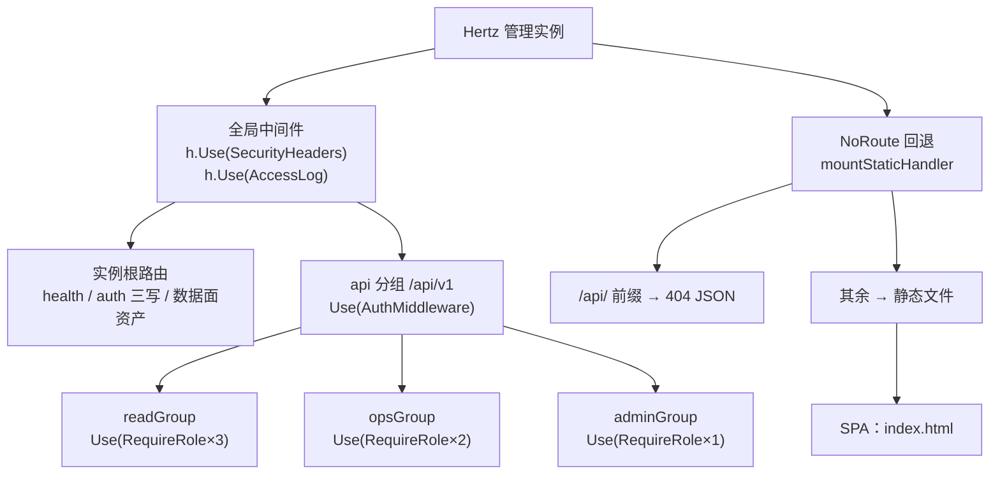
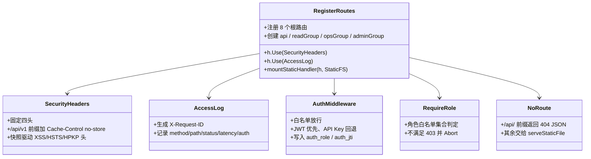
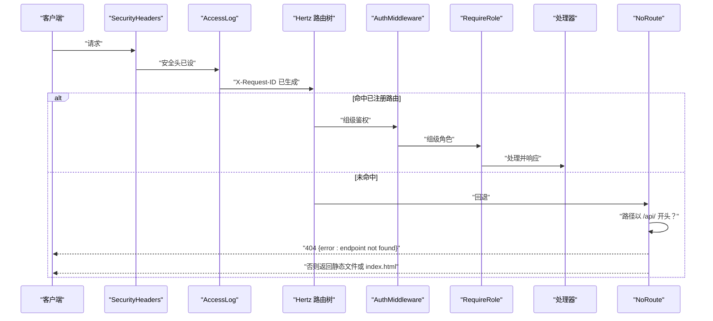
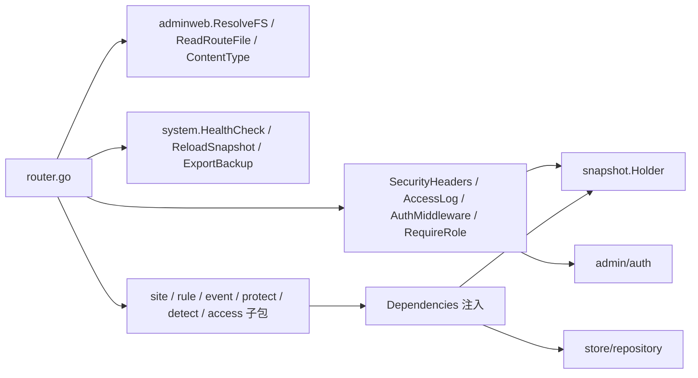
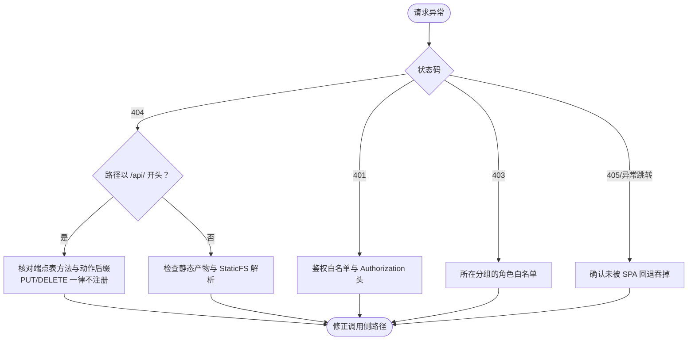

# 路由设计规范

> [返回 管理 API 系统](../管理 API 系统.md)

<cite>
**本文档引用的文件**
- [router.go](file://internal/admin/router.go)
- [middleware.go](file://internal/admin/middleware.go)
- [auth.go](file://internal/admin/auth.go)
- [jwt.go](file://internal/admin/auth/jwt.go)
- [static.go](file://internal/core/adminweb/static.go)
- [embed.go](file://internal/core/adminweb/embed.go)
- [site.go](file://internal/admin/site/site.go)
- [rule.go](file://internal/admin/rule/rule.go)
- [security.go](file://internal/admin/event/security.go)
- [admin_users.go](file://internal/admin/admin_users.go)
- [api.ts](file://frontend/lib/api.ts)
- [REST API 设计规范.md](file://docs/管理 API 系统/REST API 设计规范/REST API 设计规范.md)
- [API 端点参考.md](file://docs/管理 API 系统/REST API 设计规范/API 端点参考.md)
- [认证授权机制.md](file://docs/管理 API 系统/REST API 设计规范/认证授权机制.md)
</cite>

## 目录

1. [简介](#简介)
2. [项目结构](#项目结构)
3. [核心组件](#核心组件)
4. [架构总览](#架构总览)
5. [详细组件分析](#详细组件分析)
6. [依赖关系分析](#依赖关系分析)
7. [性能考虑](#性能考虑)
8. [故障排查指南](#故障排查指南)
9. [结论](#结论)
10. [附录](#附录)

## 简介

本篇定义控制面 API 的**路由组织规则**：版本前缀、资源命名、动作后缀、分组注册机制、中间件链顺序、静态段与路径参数的优先级约束，以及未命中路由的 SPA 回退策略。

端点条目与权限归属见[API 端点参考](API 端点参考.md)，鉴权判定细节见[认证授权机制](认证授权机制.md)。本篇不重复端点清单，只描述路由层的结构与约束。

**章节来源**
- [router.go:89-465](file://internal/admin/router.go#L89-L465)
- [middleware.go:42-192](file://internal/admin/middleware.go#L42-L192)

## 项目结构

控制面路由全部注册在同一个 Hertz 实例上，与数据面实例分离；静态资源在同一实例通过 `NoRoute` 回退提供。



**图表来源**
- [router.go:91-126](file://internal/admin/router.go#L91-L126)
- [router.go:439-465](file://internal/admin/router.go#L439-L465)

**路由分组表**

| 分组变量 | 挂载路径 | 中间件 | 允许角色 | 注册语句数 | 代码位置 |
|----------|----------|--------|----------|:----------:|----------|
| `h`（实例根） | 无 | 仅全局两个 | 无（公开） | 8 | `router.go:94-107`、`router.go:418-437` |
| `api` | `/api/v1` | `AuthMiddleware` | 任意已认证 | 4 | `router.go:109-116` |
| `readGroup` | `/api/v1`（空前缀子组） | `+ RequireRole(admin, operator, readonly)` | 三角色 | 92 | `router.go:124-253` |
| `opsGroup` | `/api/v1`（空前缀子组） | `+ RequireRole(admin, operator)` | 两角色 | 87 | `router.go:255-370` |
| `adminGroup` | `/api/v1`（空前缀子组） | `+ RequireRole(admin)` | 单角色 | 26 | `router.go:372-416` |
| `h.NoRoute` | 全部未命中 | 全局两个 | 无 | 1 | `router.go:448-455` |

三个权限子组都以 `api.Group("")` 创建，即共享 `/api/v1` 前缀但携带不同的角色白名单，因此同一资源集合的读端点与写端点可以落在不同角色组而路径风格保持一致。

**章节来源**
- [router.go:109-126](file://internal/admin/router.go#L109-L126)
- [router.go:255-256](file://internal/admin/router.go#L255-L256)
- [router.go:372-373](file://internal/admin/router.go#L372-L373)

## 核心组件

路由层由四个部分组成：装配入口、中间件链、命名与动作约定、静态回退。



**图表来源**
- [router.go:89-126](file://internal/admin/router.go#L89-L126)
- [middleware.go:42-192](file://internal/admin/middleware.go#L42-L192)
- [router.go:448-455](file://internal/admin/router.go#L448-L455)

**中间件链表**

| 序 | 中间件 | 挂载位置 | 作用 | 短路响应 | 代码位置 |
|:--:|--------|----------|------|----------|----------|
| 1 | `SecurityHeaders` | `h.Use` | 固定安全头、`/api/v1` 禁缓存、按快照补 XSS/HSTS/HPKP | 无 | `middleware.go:172-192` |
| 2 | `AccessLog` | `h.Use` | 分配 `X-Request-ID`，响应后记录耗时与状态 | 无 | `middleware.go:150-170` |
| 3 | `AuthMiddleware` | `api.Use` | 白名单判定、JWT 校验、API Key 回退、写入认证上下文 | `401` / `503` | `middleware.go:42-123` |
| 4 | `RequireRole` | 各子组 `Use` | 角色白名单判定 | `403` | `middleware.go:127-147` |
| 5 | 单点 `RequireRole` | 路由参数位 | 仅 `force-logout` 在注册语句内联角色中间件 | `403` | `router.go:116` |
| 6 | 处理器 | 路由末位 | 业务处理与响应封装 | `400`–`500` | 各子包 |

`SecurityHeaders` 在 `Cache-Control` 上同时于 `c.Next` 前后设置，确保任何 handler 遗漏响应头时认证相关响应仍不被缓存。

**章节来源**
- [middleware.go:42-192](file://internal/admin/middleware.go#L42-L192)
- [router.go:91-116](file://internal/admin/router.go#L91-L116)

## 架构总览



**图表来源**
- [router.go:91-92](file://internal/admin/router.go#L91-L92)
- [router.go:448-465](file://internal/admin/router.go#L448-L465)
- [middleware.go:42-147](file://internal/admin/middleware.go#L42-L147)

**章节来源**
- [router.go:448-465](file://internal/admin/router.go#L448-L465)

## 详细组件分析

### 版本控制策略

单一版本前缀 `/api/v1`，健康检查与认证写端点虽在实例根注册，路径仍写作 `/api/v1/...`，保证前缀一致；数据面资产与 ACME 应答路径则有意不带版本前缀。

| 前缀 | 用途 | 实例 | 依据 |
|------|------|:----:|------|
| `/api/v1/` | 全部控制面 API | 管理实例 | `router.go:109` |
| `/api/v1/auth/` | 认证与会话 | 管理实例 | `router.go:105-116` |
| `/__owaf/` | 挑战脚本资产（PoW） | 管理实例 | `router.go:418-423` |
| `/.well-known/` | ACME HTTP-01 应答 | 管理实例 | `router.go:425-437` |
| 站点域名根 | 业务流量 | 数据面实例 | 站点监听器，独立实例 |

**章节来源**
- [router.go:94-107](file://internal/admin/router.go#L94-L107)
- [router.go:109-109](file://internal/admin/router.go#L109-L109)
- [router.go:418-437](file://internal/admin/router.go#L418-L437)

### 资源命名约定与路径设计原则

| 模式 | 语义 | 实例 |
|------|------|------|
| 复数资源集合 | 集合级读写 | `/sites`、`/rules`、`/policies` |
| 连字符资源段 | 多词资源名统一连字符 | `/ip-lists`、`/cve-rules`、`/page-templates` |
| `/:id` | 单资源定位 | `/sites/:id` |
| `/:id/<动作>` | 单资源上的动作 | `/sites/:id/start` |
| `/<子资源>` | 从属集合 | `/sites/:id/listeners` |
| `/:childId/<动作>` | 从属资源动作 | `/sites/:id/listeners/:lid/delete` |
| `/stats` | 只读聚合 | `/cve-rules/stats` |
| `/timeline` | 只读时间序列 | `/security-events/timeline` |
| `/status` | 只读运行状态 | `/cve-feed/status` |
| `/config` | 只读配置 + 同名写入 | `/captcha/config` |
| `/export`、`/import` | 批量搬运 | `/rules/export` |
| `NoRoute` | SPA 与静态回退 | 非 `/api/` 全部路径 |

命名约束的实测例外：`/request/:request_id` 用单数（单请求追踪语义），`/settings/:key` 用键而非数字 ID，`/protection/:id/sensitivity` 的 `:id` 为站点 ID。

**章节来源**
- [router.go:109-252](file://internal/admin/router.go#L109-L252)
- [router.go:418-437](file://internal/admin/router.go#L418-L437)
- [site.go:69-130](file://internal/admin/site/site.go#L69-L130)
- [security.go:39-56](file://internal/admin/event/security.go#L39-L56)

### HTTP 方法使用规范

| 方法 | 用途 | 状态码 | 实测条目 |
|:----:|------|:------:|:--------:|
| GET | 列表、详情、统计、时间线、状态、导出 | 200 | 100 |
| POST | 新建 | 201 | 见各资源表 |
| POST | 更新（`/update`）、删除（`/delete`） | 200 / 204 | 见各资源表 |
| POST | 状态动作与运维动作 | 200 | 见各资源表 |
| PUT | 未使用 | — | 0 |
| DELETE | 未使用 | — | 0 |

不注册 PUT/DELETE 的直接后果：任何按 REST 惯例发起的 `PUT`/`DELETE` 请求都会走到 `NoRoute`，`/api/` 前缀下返回 `404` 而不是 `405`。调用侧必须按 POST 动作后缀书写。

```json
{
  "error": "endpoint not found"
}
```

**章节来源**
- [router.go:127-415](file://internal/admin/router.go#L127-L415)
- [router.go:448-456](file://internal/admin/router.go#L448-L456)

### 路由注册机制

注册顺序遵循"全局中间件 → 公开端点 → 认证端点 → 分组 → 分组内公开端点 → 静态回退"。

1. `h.Use(SecurityHeaders)`、`h.Use(AccessLog)`：全局生效，先于任何路由匹配。
2. `h.GET("/api/v1/health", ...)`：在鉴权分组创建之前注册，因此不受 `AuthMiddleware` 影响。
3. 三个认证写端点同样注册在实例根上，配合中间件白名单实现免鉴权。
4. `api := h.Group("/api/v1")` + `api.Use(AuthMiddleware(...))`：此后所有子分组自动继承鉴权。
5. 三个权限子组用空前缀创建，只追加各自的角色中间件。
6. `adminGroup` 内仍可注册 GET（`backup/export`、`certificates/acme/status`），分组语义是"角色要求"而非"写操作"。
7. 实例根还承载 `realtime/ws` 与两个 `__owaf` 资产端点，均在鉴权分组之外。
8. 最后调用 `mountStaticHandler` 注册 `NoRoute`。

**章节来源**
- [router.go:91-126](file://internal/admin/router.go#L91-L126)
- [router.go:202-208](file://internal/admin/router.go#L202-L208)
- [router.go:380-398](file://internal/admin/router.go#L380-L398)
- [router.go:418-440](file://internal/admin/router.go#L418-L440)

### 静态段与路径参数的优先级约束

Hertz 路由树对静态段与参数段有固定优先级，注册顺序不能倒置，否则 `stats`、`requests` 这类语义会被 `:id` 吞掉。

| 冲突对 | 必须胜出方 | 位置 | 回归测试 |
|--------|------------|------|----------|
| `/lua-plugins/stats` 与 `/lua-plugins/:id` | `stats` | `router.go:162-163` | `TestLuaPluginStatsRouteBeatsIDParam` |
| `/js-plugins/stats`、`/runtime` 与 `/js-plugins/:id` | 静态段 | `router.go:165-167` | 同族约定 |
| `/security-events/stats`、`/timeline`、`/requests` 与 `/:id` | 静态段 | `router.go:170-175` | `TestSecurityEventRequestsRouteBeatsIDParam` |
| `/policies/default` 与 `/policies/:id` | `default` | `router.go:141-142` | 读端点分组 |
| `/certificates/acme/config` 与 `/certificates/:id` | `acme/*` | `router.go:134`、`router.go:271` | 读端点分组 |
| `/rules/templates`、`/export` 与 `/rules/:id` | 静态段 | `router.go:146-147` | 读端点分组 |

新增静态段时必须与同层 `:id` 端点一起核对，并在路由测试中补一条优先级断言。

**章节来源**
- [router.go:140-147](file://internal/admin/router.go#L140-L147)
- [router.go:159-175](file://internal/admin/router.go#L159-L175)
- [router.go:267-271](file://internal/admin/router.go#L267-L271)

### 路径参数表

| 参数 | 位置 | 类型 | 必填 | 解析方式 | 失败结果 |
|------|:----:|------|:----:|----------|----------|
| `id` | path | uint | 是 | `shared.ParseUintParam` | `400 invalid id` |
| `key` | path | string | 是 | `c.Param("key")` | 未命中返回空值或 `500` |
| `lid` | path | uint | 是 | 与 `id` 同法 | `400 invalid id` |
| `rid` | path | uint | 是 | 与 `id` 同法 | `400 invalid id` |
| `pid` | path | uint | 是 | 与 `id` 同法 | `400 invalid id` |
| `uid` | path | uint | 是 | 与 `id` 同法 | `400 invalid id` |
| `policyId` | path | uint | 是 | 与 `id` 同法 | `400 invalid id` |
| `type` | path | string | 是 | `c.Param("type")` 作模板类型 | 未知类型返回空 |
| `request_id` | path | string | 是 | `c.Param("request_id")` | 未命中返回空 |
| `ip` | path | string | 是 | 参数值直传升级链管理器 | 查不到即空状态 |
| `token` | path | string | 是 | `strings.TrimSpace(c.Param("token"))` | 空串直接 `404` 无响应体 |

`/.well-known/acme-challenge/:token` 是唯一在路由闭包内自行判定并直接写状态码的端点：空 token 返回 `404`，命中返回 `text/plain` 的 `200`，未命中同样 `404`。

**章节来源**
- [router.go:425-437](file://internal/admin/router.go#L425-L437)
- [router.go:179-179](file://internal/admin/router.go#L179-L179)
- [router.go:234-237](file://internal/admin/router.go#L234-L237)
- [admin_users.go:96-102](file://internal/admin/admin_users.go#L96-L102)
- [rule.go:222-234](file://internal/admin/rule/rule.go#L222-L234)

### 静态文件处理与 SPA 回退

`mountStaticHandler` 先解析资源来源：`StaticFS` 非空则读磁盘目录，否则使用内嵌产物树；解析失败时**直接返回**，即不注册 `NoRoute`，此时所有未命中路由由 Hertz 默认行为处理。

`routeCandidates` 的候选生成顺序决定回退质量：

| 步 | 候选形态 | 适用场景 |
|:--:|----------|----------|
| 1 | 原始路径本身 | 精确静态资源 |
| 2 | Next.js RSC 变体（`__next.*.txt` 还原） | 客户端导航数据 |
| 3 | 动态路由段替换为 `_` | 导出期占位段 |
| 4 | 以 `/` 结尾时补 `xxx/index.html` | 目录式路由 |
| 5 | 无扩展名时补 `xxx/index.html` 与 `xxx.html` | 页面路由 |
| 6 | 全无扩展名兜底 `index.html` | SPA 深链 |

命中后由 `ContentType` 按扩展名映射响应类型；未命中返回纯文本 `not found` 与 `404`。

| 情形 | 状态码 | `Content-Type` | 响应体 |
|------|:------:|----------------|--------|
| `/api/` 前缀未命中 | 404 | `application/json` | `{"error":"endpoint not found"}` |
| 静态资源命中 | 200 | 按扩展名映射 | 文件字节 |
| `.html` | 200 | `text/html; charset=utf-8` | 页面 |
| `.js` | 200 | `application/javascript` | 脚本 |
| `.css` / `.json` / `.svg` / `.png` / `.ico` / `.woff2` | 200 | 各自类型 | 资源 |
| 未知扩展名 | 200 | `application/octet-stream` | 原样字节 |
| 全部候选未命中 | 404 | 无（纯文本） | `not found` |

**章节来源**
- [router.go:442-465](file://internal/admin/router.go#L442-L465)
- [static.go:10-52](file://internal/core/adminweb/static.go#L10-L52)
- [static.go:54-120](file://internal/core/adminweb/static.go#L54-L120)
- [embed.go:1-31](file://internal/core/adminweb/embed.go#L1-L31)

### 路由安全约束

安全头由全局中间件统一注入，路由层不再逐端点设置；`/api/v1/` 前缀的响应无论成功失败都禁缓存，避免策略、日志与账号元数据被浏览器或中间代理复用。

| 约束 | 实现 | 覆盖范围 |
|------|------|----------|
| `X-Content-Type-Options: nosniff` | `SecurityHeaders` | 全部响应 |
| `X-Frame-Options: DENY` | `SecurityHeaders` | 全部响应 |
| `Referrer-Policy: strict-origin-when-cross-origin` | `SecurityHeaders` | 全部响应 |
| `Content-Security-Policy`（含 `unsafe-inline`） | `SecurityHeaders` | 全部响应 |
| `Cache-Control: no-store` | 路径前缀判定 + 认证 handler 各自写入 | `/api/v1/` |
| `X-Request-ID` | `AccessLog` 生成 UUID | 全部响应 |
| `Strict-Transport-Security` | 快照开关 + 协议为 `https`/`h3` | 条件注入 |
| `X-XSS-Protection`、HPKP 两态 | 快照开关 | 条件注入 |
| 鉴权白名单 | 四个路径精确匹配 | `health` 与三个 `auth` 写端点 |

**章节来源**
- [middleware.go:172-192](file://internal/admin/middleware.go#L172-L192)
- [middleware.go:204-313](file://internal/admin/middleware.go#L204-L313)
- [middleware.go:315-334](file://internal/admin/middleware.go#L315-L334)
- [auth.go:35-35](file://internal/admin/auth.go#L35-L35)

## 依赖关系分析



**图表来源**
- [router.go:12-58](file://internal/admin/router.go#L12-L58)
- [router.go:442-465](file://internal/admin/router.go#L442-L465)

调用侧 `api.ts` 对路由前缀的假设：`API_BASE = "/api/v1"`，且仅对 `/auth/login`、`/auth/refresh`、`/auth/logout` 三条相对路径豁免自动刷新，与后端白名单逐字一致。任一侧改动都必须同步另一侧。

**章节来源**
- [api.ts:27-27](file://frontend/lib/api.ts#L27-L27)
- [api.ts:520-526](file://frontend/lib/api.ts#L520-L526)
- [middleware.go:46-53](file://internal/admin/middleware.go#L46-L53)

## 性能考虑

路由为纯静态注册，无运行时构建开销；分组共享中间件实例，避免逐端点重复构造角色集合。`RequireRole` 在构造期把角色变长参数预转成 `map[string]bool`，判定为常数时间。

`NoRoute` 回退对每个未命中请求做多次 `fs.ReadFile` 尝试，候选数量随路径段数增长；把明确属于 API 的未命中提前短路（`/api/` 前缀判定）可避免无谓的文件系统探测。

**章节来源**
- [middleware.go:127-147](file://internal/admin/middleware.go#L127-L147)
- [router.go:448-456](file://internal/admin/router.go#L448-L456)
- [static.go:20-28](file://internal/core/adminweb/static.go#L20-L28)

## 故障排查指南



**图表来源**
- [router.go:448-456](file://internal/admin/router.go#L448-L456)
- [middleware.go:46-53](file://internal/admin/middleware.go#L46-L53)
- [middleware.go:127-147](file://internal/admin/middleware.go#L127-L147)

| 症状 | 原因 | 处置 |
|------|------|------|
| `404 {"error":"endpoint not found"}` | 方法用了 PUT/DELETE 或漏掉动作后缀 | 改为 `POST .../update` 或 `/delete` |
| `404 {"error":"endpoint not found"}` | 静态段被 `:id` 抢先注册 | 把静态段端点前移并补测试 |
| `404 not found`（纯文本） | 前端深链无对应导出产物 | 确认候选生成命中 `index.html` |
| 未命中路由无回退 | `StaticFS` 解析失败导致未注册 `NoRoute` | 检查静态目录参数与内嵌产物 |
| `401 missing Authorization header` | 端点不在白名单但未带令牌 | 补 `Bearer {access_token}` |
| `403 access denied` | 分组角色要求高于当前角色 | 换角色或按分组调整端点位置 |
| 管理端响应被缓存 | 绕过 `SecurityHeaders` 的自定义响应 | 确认路径仍在 `/api/v1/` 前缀下 |

**章节来源**
- [router.go:442-456](file://internal/admin/router.go#L442-L456)
- [static.go:10-17](file://internal/core/adminweb/static.go#L10-L17)
- [middleware.go:55-143](file://internal/admin/middleware.go#L55-L143)

## 结论

控制面路由的可预测性来自三条硬规则：**所有端点集中注册**、**权限只由分组决定**、**只用 GET/POST 两种方法**。由此带来的收益是新增端点无需考虑中间件装配与 CORS 方法预检；代价是更新与删除必须以后缀形式表达，且调用方容易因套用 REST 惯例而拿到 `404` 而非 `405`。

静态段与参数段的优先级冲突由注释与命名测试锁定，属于必须持续维护的约定：任何新增 `stats`/`requests`/`default` 类端点都应与同层 `:id` 端点一起核对。

**章节来源**
- [本节为总结，无需特定文件来源]

## 附录

### 动作后缀清单

| 后缀 | 语义 | 实例路径 |
|------|------|----------|
| `/update` | 更新单资源 | `/sites/:id/update` |
| `/delete` | 删除单资源 | `/rules/:id/delete` |
| `/start`、`/stop` | 运行态启停 | `/sites/:id/start` |
| `/toggle` | 布尔开关切换 | `/js-plugins/:id/toggle` |
| `/reset` | 清除覆盖回到默认 | `/cve-rules/:id/reset` |
| `/patch` | 单条补齐 | `/cve-rules/:id/patch` |
| `/batch` | 批量写入 | `/owasp-rules/batch` |
| `/sync` | 外部数据源同步 | `/threat-intel-feeds/:id/sync` |
| `/import`、`/export` | 批量搬运 | `/rules/import` |
| `/validate` | 语法校验不落库 | `/lua-plugins/validate` |
| `/test` | 合成请求试跑 | `/rules/test` |
| `/dry-run` | 执行用户代码不落库 | `/js-plugins/dry-run` |
| `/preview` | 渲染预览 | `/page-templates/:type/preview` |
| `/seed` | 写入预置集合 | `/preset-bot-whitelist/seed` |
| `/clear` | 清空集合 | `/sites/:id/recorded-resources/clear` |
| `/apply`、`/renew` | ACME 生命周期 | `/certificates/acme/apply` |
| `/apply-to-sites` | 批量绑定站点 | `/certificates/:id/apply-to-sites` |
| `/set-default`、`/default` | 默认项设置与读取（同处理函数） | `/policies/:id/set-default` |
| `/force-logout` | 强制下线 | `/auth/sessions/force-logout` |
| `/status` | 运行状态查询 | `/upstreams/status` |
| `/stats` | 聚合统计 | `/bot-stats` |
| `/timeline` | 时间序列 | `/security-events/timeline` |

**章节来源**
- [router.go:127-415](file://internal/admin/router.go#L127-L415)

### 路由测试清单

路由层的行为约束由 `internal/admin` 包内测试固定，改动注册顺序前应优先运行相关用例。

| 测试文件 | 覆盖点 |
|----------|--------|
| `router_test.go` | 分组注册与端点可达性 |
| `middleware_test.go` | 白名单、JWT/API Key、角色判定 |
| `auth_login_test.go` | 登录、锁定与令牌签发响应形态 |
| `auth_session_test.go` | 会话列表与强制下线 |
| `auth_revocation_test.go` | 整链吊销 |
| `backup_session_revoke_test.go` | 备份导入后会话失效 |
| `protection_routes_test.go` | 保护类端点分组与读写权限边界 |

清单取自 `internal/admin` 目录下的测试文件枚举，覆盖对象为本篇描述的注册结构。

**章节来源**
- [router.go:89-440](file://internal/admin/router.go#L89-L440)
- [middleware.go:42-192](file://internal/admin/middleware.go#L42-L192)

### 交叉引用

| 主题 | 归属文档 |
|------|----------|
| 端点清单与权限归属 | [API 端点参考](API 端点参考.md) |
| 鉴权与角色判定实现 | [认证授权机制](认证授权机制.md) |
| 载荷字段与分页 | [请求响应格式规范](请求响应格式规范.md) |
| 错误载荷与日志 | [错误处理机制](错误处理机制.md) |
| 分层与命名总则 | [REST API 设计规范](REST API 设计规范.md) |

**章节来源**
- [本节为总结，无需特定文件来源]
