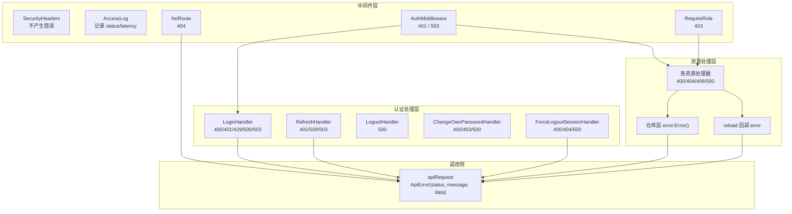
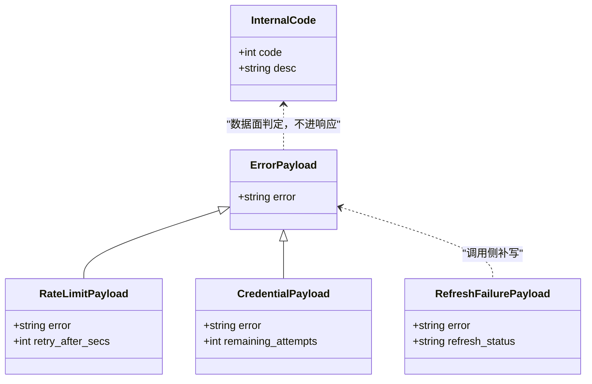
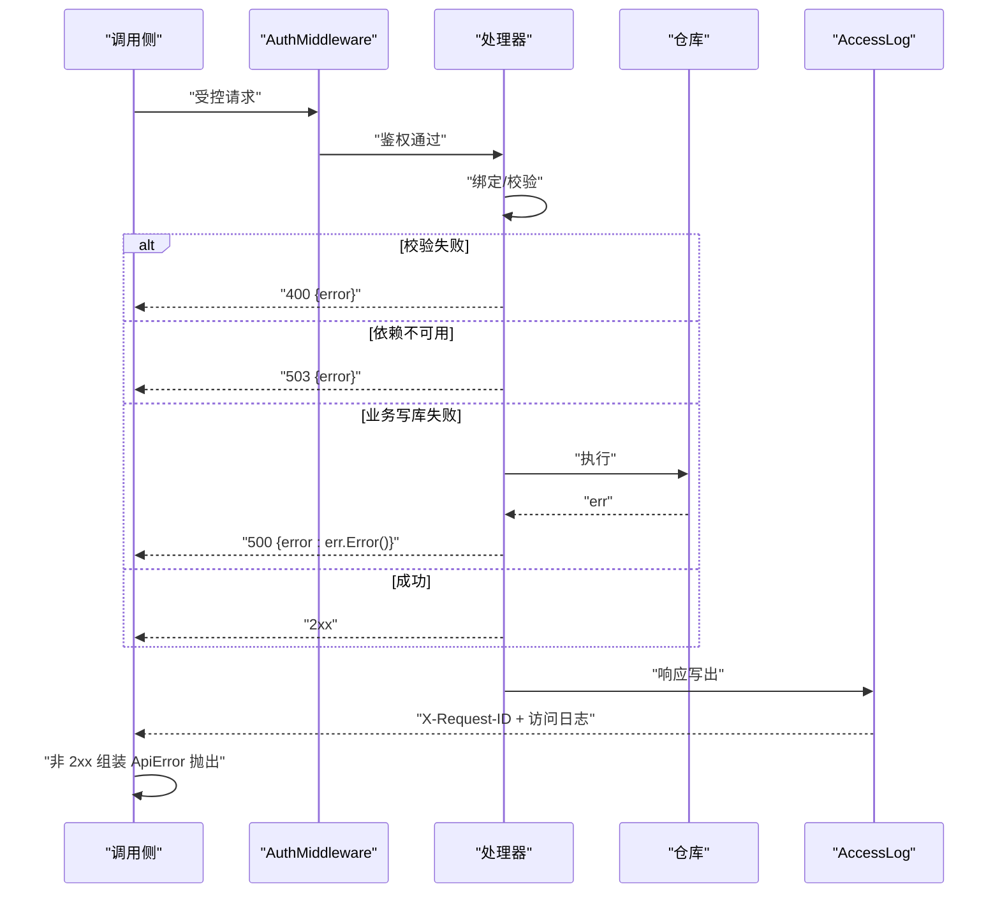
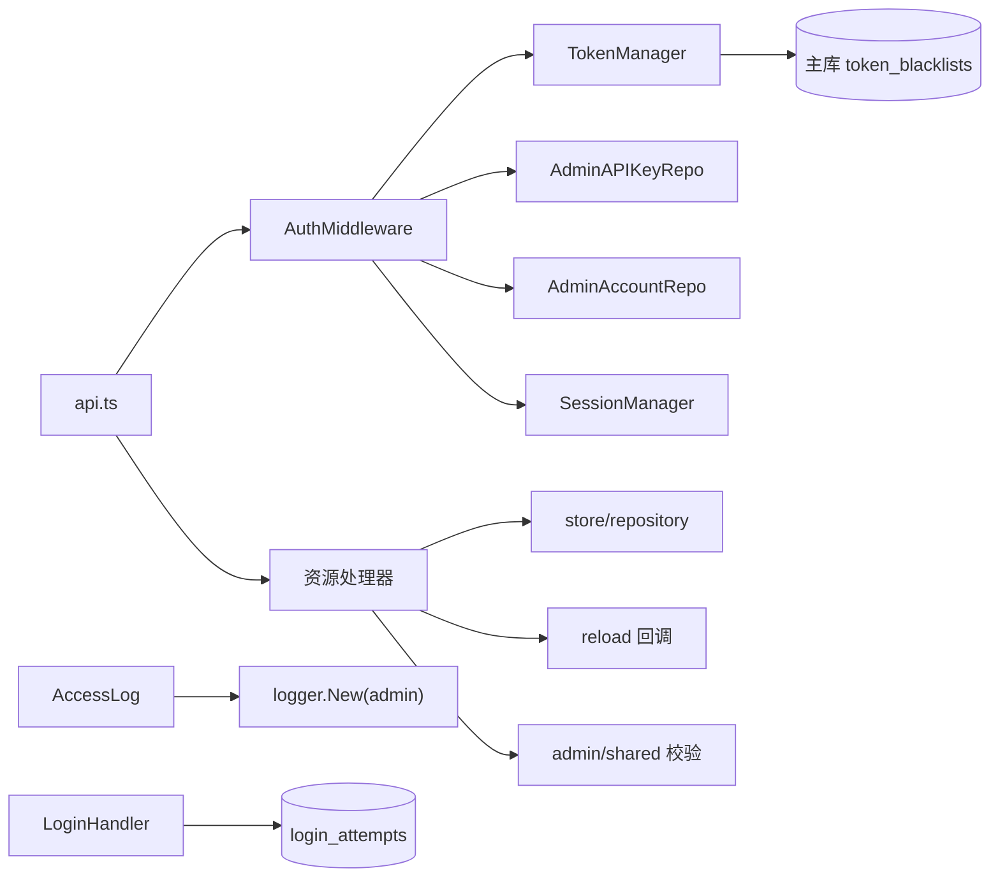
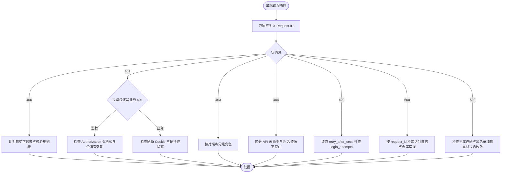

# 错误处理机制

> [返回 管理 API 系统](../管理 API 系统.md)

<cite>
**本文档引用的文件**
- [router.go](file://internal/admin/router.go)
- [middleware.go](file://internal/admin/middleware.go)
- [auth.go](file://internal/admin/auth.go)
- [auth_helpers.go](file://internal/admin/auth_helpers.go)
- [auth_session.go](file://internal/admin/auth_session.go)
- [auth_revocation.go](file://internal/admin/auth_revocation.go)
- [admin_users.go](file://internal/admin/admin_users.go)
- [apikey.go](file://internal/admin/system/apikey/apikey.go)
- [jwt.go](file://internal/admin/auth/jwt.go)
- [bruteforce.go](file://internal/admin/auth/bruteforce.go)
- [refresh_token.go](file://internal/store/repository/authn/refresh_token.go)
- [site.go](file://internal/admin/site/site.go)
- [rule.go](file://internal/admin/rule/rule.go)
- [security.go](file://internal/admin/event/security.go)
- [settings.go](file://internal/admin/system/settings.go)
- [action.go](file://internal/core/action/action.go)
- [logger.go](file://internal/pkg/logger/logger.go)
- [api.ts](file://frontend/lib/api.ts)
- [REST API 设计规范.md](file://docs/管理 API 系统/REST API 设计规范/REST API 设计规范.md)
- [请求响应格式规范.md](file://docs/管理 API 系统/REST API 设计规范/请求响应格式规范.md)
</cite>

## 目录

1. [简介](#简介)
2. [项目结构](#项目结构)
3. [核心组件](#核心组件)
4. [架构总览](#架构总览)
5. [详细组件分析](#详细组件分析)
6. [依赖关系分析](#依赖关系分析)
7. [性能考虑](#性能考虑)
8. [故障排查指南](#故障排查指南)
9. [结论](#结论)
10. [附录](#附录)

## 简介

本篇描述控制面错误如何产生、如何表达、如何被记录与如何恢复。控制面**没有专用错误类型体系**：所有错误都以单层 JSON 对象 `{"error": "<文本>"}` 表达，靠 HTTP 状态码区分语义，靠可选上下文字段（`retry_after_secs`、`remaining_attempts`）补充判定依据。

因此本篇的重点不是"有哪些错误类"，而是"哪些分支产出哪个状态码与哪段文本、日志里能看到什么、失败后系统怎么退"。载荷字段格式见[请求响应格式规范](请求响应格式规范.md)，端点条目见[API 端点参考](API 端点参考.md)。

**章节来源**
- [middleware.go:55-143](file://internal/admin/middleware.go#L55-L143)
- [auth.go:36-114](file://internal/admin/auth.go#L36-L114)
- [api.ts:623-633](file://frontend/lib/api.ts#L623-L633)

## 项目结构

错误产生点分布在四个层次，各层职责清晰且不重叠。



**图表来源**
- [middleware.go:42-170](file://internal/admin/middleware.go#L42-L170)
- [router.go:448-456](file://internal/admin/router.go#L448-L456)
- [auth.go:33-352](file://internal/admin/auth.go#L33-L352)
- [api.ts:531-637](file://frontend/lib/api.ts#L531-L637)

**模块分布表**

| 层次 | 位置 | 产生的状态码 | 是否写日志 |
|------|------|--------------|------------|
| 全局中间件 | `middleware.go:150-192` | 无 | 是（访问日志） |
| 鉴权中间件 | `middleware.go:42-123` | 401、503 | 是 |
| 角色中间件 | `middleware.go:127-147` | 403 | 是 |
| 路由回退 | `router.go:448-465` | 404 | 是 |
| 认证处理器 | `auth.go`、`auth_session.go` | 400、401、403、404、429、500、503 | 是（登录尝试落库） |
| 账号处理器 | `admin_users.go` | 400、403、404、409、500 | 是 |
| 令牌处理器 | `apikey.go` | 400、401、403、404、500 | 是 |
| 资源处理器 | `internal/admin/*/` | 400、404、409、500 | 是 |
| 调用侧 | `api.ts:531-637` | 抛 `ApiError` | 开发模式打印请求 |

**章节来源**
- [middleware.go:42-192](file://internal/admin/middleware.go#L42-L192)
- [router.go:442-465](file://internal/admin/router.go#L442-L465)
- [auth.go:33-352](file://internal/admin/auth.go#L33-L352)
- [admin_users.go:22-245](file://internal/admin/admin_users.go#L22-L245)

## 核心组件

错误载荷只有一个基类字段 `error`，其余为按场景附加的上下文字段。



**图表来源**
- [auth.go:52-75](file://internal/admin/auth.go#L52-L75)
- [middleware.go:55-101](file://internal/admin/middleware.go#L55-L101)
- [api.ts:623-633](file://frontend/lib/api.ts#L623-L633)
- [action.go:323-340](file://internal/core/action/action.go#L323-L340)

**错误载荷字段表**

| 字段 | 类型 | 出现条件 | 来源 | 说明 |
|------|------|----------|------|------|
| `error` | string | 所有非 2xx | 各处理器与中间件 | 唯一必现字段 |
| `retry_after_secs` | int | 登录被锁定（429） | `LockoutRemaining` | 锁定剩余秒数 |
| `remaining_attempts` | int | 凭据错误且余量 1–3（401） | `RemainingAttempts` | 不暴露完整阈值 |
| `refresh_status` | string | 调用侧补写 | `api.ts:589`、`api.ts:630` | `unauthorized`/`unavailable` |
| 文本 `not found` | 纯文本 | 静态资源全部候选未命中 | `router.go:461` | 非 JSON |

```json
{
  "error": "invalid credentials",
  "remaining_attempts": 2
}
```

```json
{
  "error": "account temporarily locked due to too many failed attempts",
  "retry_after_secs": 742
}
```

**章节来源**
- [auth.go:50-75](file://internal/admin/auth.go#L50-L75)
- [bruteforce.go:135-171](file://internal/admin/auth/bruteforce.go#L135-L171)
- [api.ts:581-633](file://frontend/lib/api.ts#L581-L633)
- [router.go:458-465](file://internal/admin/router.go#L458-L465)

## 架构总览



**图表来源**
- [middleware.go:150-170](file://internal/admin/middleware.go#L150-L170)
- [site.go:76-95](file://internal/admin/site/site.go#L76-L95)
- [api.ts:623-637](file://frontend/lib/api.ts#L623-L637)

**章节来源**
- [middleware.go:127-170](file://internal/admin/middleware.go#L127-L170)
- [api.ts:531-637](file://frontend/lib/api.ts#L531-L637)

## 详细组件分析

### 错误分支与状态码归属

控制面错误分支可穷举为五类，每类的判定位置与产出固定。

| 类别 | 判定位置 | 状态码 | 文本样例 |
|------|----------|:------:|----------|
| 协议级（缺头/格式/凭据） | `AuthMiddleware` | 401 | `missing Authorization header` |
| 依赖未就绪 | `AuthMiddleware`、认证处理器 | 503 | `authentication service unavailable` |
| 授权不足 | `RequireRole` | 403 | `access denied: insufficient permissions` |
| 路由未命中 | `NoRoute` | 404 | `endpoint not found` |
| 输入非法 | 各处理器绑定与校验分支 | 400 | `请求体格式无效` |
| 状态冲突 | 账号与令牌处理器 | 404 / 409 | `session not found`、`username already exists` |
| 下游失败 | 处理器业务分支 | 500 | `token storage failed` |

**章节来源**
- [middleware.go:55-143](file://internal/admin/middleware.go#L55-L143)
- [router.go:448-456](file://internal/admin/router.go#L448-L456)
- [auth.go:36-114](file://internal/admin/auth.go#L36-L114)
- [admin_users.go:40-88](file://internal/admin/admin_users.go#L40-L88)
- [auth_session.go:45-85](file://internal/admin/auth_session.go#L45-L85)

### 认证类错误码表

| HTTP | 触发条件 | 错误文本 | 出处 |
|:----:|----------|----------|------|
| 400 | 登录请求体无法绑定 | `请求体格式无效` | `auth.go:41` |
| 400 | 改密缺旧/新口令 | `old_password and new_password are required` | `auth.go:328` |
| 400 | 新口令短于 8 字符 | `new password must be at least 8 characters` | `auth.go:332` |
| 400 | 强退缺少 `jti` | `jti is required` | `auth_session.go:46` |
| 401 | 凭据校验失败 | `invalid credentials` | `auth.go:71` |
| 401 | 无 Authorization 头 | `missing Authorization header` | `middleware.go:57` |
| 401 | 非 Bearer 格式 | `invalid Authorization format, use Bearer <token>` | `middleware.go:64` |
| 401 | JWT 与 API Key 均失败 | `invalid or expired token` | `middleware.go:99` |
| 401 | 令牌归属账号已删除 | `api key owner account no longer exists` | `middleware.go:112` |
| 401 | 刷新 Cookie 缺失 | `missing refresh token` | `auth.go:140` |
| 401 | 刷新 Cookie 无分隔符 | `malformed refresh token` | `auth.go:146` |
| 401 | 刷新记录不存在或已撤销 | `refresh token expired or revoked` | `auth.go:153`、`auth.go:219` |
| 401 | 摘要不匹配 | `invalid refresh token` | `auth.go:166` |
| 401 | 刷新时账号已删除 | `refresh token account no longer exists` | `auth.go:180` |
| 403 | 改密旧口令错误 | `current password is incorrect` | `auth.go:337` |
| 403 | 无角色上下文 | `access denied: no role` | `middleware.go:135` |
| 403 | 角色不在白名单 | `access denied: insufficient permissions` | `middleware.go:141` |
| 404 | 目标会话不存在 | `session not found` | `auth_session.go:51`、`auth_session.go:59` |
| 429 | 失败次数达到阈值 | `account temporarily locked ...` + `retry_after_secs` | `auth.go:52-55` |
| 500 | 令牌生成失败 | `token generation failed` | `auth.go:102`、`auth.go:108` |
| 500 | 刷新令牌落库失败 | `token storage failed` | `auth.go:112`、`auth.go:222` |
| 500 | 账号查询异常 | `account lookup failed` | `auth.go:184` |
| 500 | 登出撤销刷新链失败 | `logout failed to revoke refresh token` | `auth.go:263` |
| 500 | 登出拉黑访问令牌失败 | `logout completed but access token revocation failed` | `auth.go:283` |
| 500 | 口令更新失败 | `failed to update password` | `auth.go:342` |
| 500 | 改密后吊销失败 | `password changed but credential revocation failed` | `auth.go:347` |
| 500 | 强退拉黑失败 | `session removed but access token revocation failed` | `auth_session.go:65` |
| 500 | 强退撤销刷新链失败 | `session removed but refresh token revocation failed` | `auth_session.go:74`、`auth_session.go:81` |
| 503 | 认证依赖未装配 | `authentication service unavailable` | `auth.go:37`、`auth.go:135` |
| 503 | 黑名单持久化不可用 | `authentication service unavailable` | `middleware.go:86` |
| 503 | 刷新仓储暂时不可用 | `authentication service unavailable` | `auth.go:158` |

**章节来源**
- [auth.go:36-285](file://internal/admin/auth.go#L36-L285)
- [auth.go:305-352](file://internal/admin/auth.go#L305-L352)
- [auth_session.go:41-88](file://internal/admin/auth_session.go#L41-L88)
- [middleware.go:55-143](file://internal/admin/middleware.go#L55-L143)

### 资源类错误码表

| HTTP | 触发条件 | 错误文本 | 出处 |
|:----:|----------|----------|------|
| 400 | 路径参数非数字 | `invalid id` | `admin_users.go:99` |
| 400 | 账号名为空/超长 | `username is required`、`username must be at most 64 characters` | `admin_users.go:49`、`admin_users.go:53` |
| 400 | 口令为空/过短 | `password is required`、`password must be at least 8 characters` | `admin_users.go:57`、`admin_users.go:61` |
| 400 | 角色不在枚举内 | `role must be one of: admin, operator, readonly` | `admin_users.go:68` |
| 400 | 降级最后一个 admin | `cannot demote the last admin user` | `admin_users.go:125` |
| 400 | 删除本人账号 | `cannot delete your own account` | `admin_users.go:218` |
| 400 | 删除最后一个 admin | `cannot delete the last admin user` | `admin_users.go:229` |
| 401 | 创建令牌时无身份上下文 | `unauthenticated` | `apikey.go:50` |
| 403 | 当前账号查不到 | `current account not found` | `apikey.go:55` |
| 403 | 管理员改他人口令 | `can only change your own password` | `admin_users.go:182` |
| 400 | 令牌名超 128 字节 | `name exceeds 128 bytes` | `apikey.go:69` |
| 404 | 令牌 ID 非法或不存在的删除 | `invalid id`、`not found` | `apikey.go:137`、`apikey.go:141` |
| 409 | 账号重名 | `username already exists` | `admin_users.go:73` |
| 400 | 规则模式无法解析 | `invalid pattern` | `rule.go:232` |
| 400 | 模式编译为空 | `pattern compiled to no rules` | `rule.go:240` |
| 500 | 仓库读写错误 | 直接透传 `err.Error()` | `site.go:79-81`、`admin_users.go:79` |
| 404 | `/api/` 前缀未命中 | `endpoint not found` | `router.go:451` |

> [!WARNING]
> 资源类 500 分支把仓库错误原文写入 `error` 字段，可能包含 SQL 片段或约束名。这是可观察到的现状：认证类分支使用固定文案，资源类分支没有。若需收紧，应在仓库与处理器之间加一层文案映射，而不是逐个端点改写。

**章节来源**
- [admin_users.go:40-245](file://internal/admin/admin_users.go#L40-L245)
- [apikey.go:46-148](file://internal/admin/system/apikey/apikey.go#L46-L148)
- [rule.go:222-263](file://internal/admin/rule/rule.go#L222-L263)
- [site.go:76-95](file://internal/admin/site/site.go#L76-L95)
- [router.go:448-456](file://internal/admin/router.go#L448-L456)

### 内部判定码与响应码的分离

控制面错误使用标准 HTTP 码；数据面判定使用 1xxx 内部码，二者互不替换。内部码只进日志与指标，**不会发送给客户端**。

| 内部码 | 动作 | 描述 | 对应 HTTP |
|:------:|------|------|:---------:|
| 1000 | `drop` | TCP 立即断开，不发响应 | 无 |
| 1001 | `intercept` | WAF 拦截 | 403 |
| 1002 | `rate_limit` | 速率限制 | 429 |
| 1003 | `challenge` | JS 挑战 | 403 |
| 1004 | `captcha_challenge` | 图形验证码 | 403 |
| 1005 | `shield_challenge` | 5 秒盾 | 403 |
| 1006 | `chain_challenge` | 链式验证 | 403 |
| 1007 | `redirect` | 安全重定向 | 302 |
| 1008 | `observe` | 仅观察，放行 | 无 |
| 1009 | — | IP 信誉拦截 | 403 |
| 1010 | — | 防重放拦截 | 403 |
| 1011 | — | 机器人检测拦截 | 403 |
| 1012 | — | 维护模式 | 503 |
| 1013 | — | 响应升级 | 视配置 |
| 1014 | — | 文件上传拦截 | 403 |
| 1015 | — | 语义检测拦截 | 403 |

`1009`–`1015` 由非规则动作的子系统产生，`InternalCode` 不为它们做动作映射，因此"动作"列为空；描述取自 `internalCodeDescs`。

**章节来源**
- [action.go:317-340](file://internal/core/action/action.go#L317-L340)
- [action.go:342-393](file://internal/core/action/action.go#L342-L393)
- [action.go:283-312](file://internal/core/action/action.go#L283-L312)

### 错误日志与请求关联

`AccessLog` 为每条请求生成 UUID 并写入响应头 `X-Request-ID` 与上下文 `request_id`，响应后输出一条结构化日志，字段集合固定。

| 日志字段 | 类型 | 来源 | 用途 |
|----------|------|------|------|
| `request_id` | string | `uuid.NewString()` | 跨端关联主键 |
| `method` | string | 请求方法 | 定位动作类型 |
| `path` | string | 请求路径 | 定位端点 |
| `status` | int | 响应状态码 | 判定失败层 |
| `latency` | Duration | `time.Since(start)` | 性能与超时分析 |
| `auth` | any | 上下文 `auth_method` | 区分 jwt / api_key |
| `section` | string | `logger.New("admin")` | 模块归属 |

日志消息固定为 `request`，级别为 `Info`；失败响应不额外提高级别，判定依据全在 `status` 字段。登录尝试另有一张审计表，字段为 `username`、`ip`、`success`、`user_agent`、`created_at`，成功与失败都记录，且**不记录口令**。

**章节来源**
- [middleware.go:150-170](file://internal/admin/middleware.go#L150-L170)
- [logger.go:68-70](file://internal/pkg/logger/logger.go#L68-L70)
- [router.go:90-90](file://internal/admin/router.go#L90-L90)
- [auth_helpers.go:63-75](file://internal/admin/auth_helpers.go#L63-L75)
- [auth.go:56-83](file://internal/admin/auth.go#L56-L83)

### 错误恢复策略

恢复机制集中在认证链，遵循两条原则：**可退避的不改判语义**、**撤销必须整链**。

| 场景 | 策略 | 实现 | 副作用 |
|------|------|------|--------|
| 黑名单加载失败 | 1 秒退避重试，期间 `503` | `ensureBlacklistReady` | 不会永久拒绝认证 |
| 刷新仓储不可用 | 返回 `503` 而非 `401` | `auth.go:156-159` | 客户端保留当前访问令牌 |
| 刷新令牌并发轮换 | `Rotate` 条件更新失败即 `401` | `refresh_token.go:88-118` | 不清除共享 Cookie |
| 账号被删除时刷新 | 撤销整条轮换链 + 清 Cookie + `401` | `auth.go:175-181` | 后继令牌一并失效 |
| 登出 | 撤销整链，再按 Authorization 拉黑访问 JTI | `auth.go:243-290` | 撤销失败返回 `500` |
| 强制下线 | 移除会话 + 拉黑 + 撤销链（旧会话按账号全量撤销） | `auth_session.go:55-87` | 每步失败都有独立文案 |
| 账号变更 | 撤销刷新 + 移除全部会话 + 逐个拉黑，首个错误上报 | `revokeUserCredentials` | 角色/口令/删除同一路径 |
| 备份导入 | 失效 CVE 快照与 OWASP 读快照，吊销全部访问控制会话 | `router.go:382-388` | 失败仅记日志不回滚 |
| 调用侧 401 | 刷新一次并重试；不可用时保留原 `401` 语义 | `api.ts:562-607` | 不重复消费一次性刷新令牌 |

**章节来源**
- [jwt.go:158-182](file://internal/admin/auth/jwt.go#L158-L182)
- [auth.go:150-231](file://internal/admin/auth.go#L150-L231)
- [auth.go:243-290](file://internal/admin/auth.go#L243-L290)
- [auth_session.go:55-87](file://internal/admin/auth_session.go#L55-L87)
- [auth_revocation.go:4-28](file://internal/admin/auth_revocation.go#L4-L28)
- [refresh_token.go:88-118](file://internal/store/repository/authn/refresh_token.go#L88-L118)
- [router.go:380-388](file://internal/admin/router.go#L380-L388)
- [api.ts:562-607](file://frontend/lib/api.ts#L562-L607)

### 调用侧错误处理约定

| 情形 | 调用侧动作 | 抛出的 `ApiError` |
|------|------------|-------------------|
| 本地令牌已被其他标签页更新 | 直接用新令牌重试 | 不抛 |
| 刷新成功且令牌一致 | 用新令牌重试一次 | 不抛 |
| 刷新成功但令牌已被替换 | 不重试业务请求 | `401 会话已变更，请重试` |
| 刷新返回未授权 | 清令牌并跳转 `/login` | `401 会话已过期，请重新登录` + `refresh_status` |
| 刷新服务不可用 | 保留原始 `401` 语义 | 原始状态码 + `refresh_status: unavailable` |
| 其他非 2xx | 取 `error` 字段 | 原状态码 + 原载荷 |
| 响应无 `error` 字段 | 兜底文案 | `请求失败: {status}` |
| 204/205 | 跳过 JSON 解析 | 不抛 |

**章节来源**
- [api.ts:562-637](file://frontend/lib/api.ts#L562-L637)

## 依赖关系分析



**图表来源**
- [middleware.go:42-121](file://internal/admin/middleware.go#L42-L121)
- [jwt.go:288-300](file://internal/admin/auth/jwt.go#L288-L300)
- [auth_helpers.go:63-75](file://internal/admin/auth_helpers.go#L63-L75)
- [router.go:96-110](file://internal/admin/router.go#L96-L110)

**章节来源**
- [middleware.go:42-121](file://internal/admin/middleware.go#L42-L121)
- [auth.go:17-26](file://internal/admin/auth.go#L17-L26)

## 性能考虑

错误路径本身不引入额外开销：状态码与文案在处理器分支内一次写入，`AccessLog` 仅在响应后输出一条日志。吊销类操作把多个写库步骤串成一次请求内完成，代价是失败时无法回滚，因此采用"首个错误上报、后续步骤继续执行"的口径，保证吊销覆盖面最大化而不是快速失败。

`CleanExpired(64)` 挂在登录与刷新成功路径上顺带执行，避免独立定时任务；批量上限固定 64，防止一次请求触发大范围删除。

**章节来源**
- [middleware.go:150-170](file://internal/admin/middleware.go#L150-L170)
- [auth_revocation.go:4-28](file://internal/admin/auth_revocation.go#L4-L28)
- [auth.go:115-115](file://internal/admin/auth.go#L115-L115)
- [auth.go:225-225](file://internal/admin/auth.go#L225-L225)

## 故障排查指南



**图表来源**
- [middleware.go:150-170](file://internal/admin/middleware.go#L150-L170)
- [auth.go:36-160](file://internal/admin/auth.go#L36-L160)
- [bruteforce.go:157-171](file://internal/admin/auth/bruteforce.go#L157-L171)

**排查用参数表**

| 参数 | 位置 | 类型 | 必填 | 用途 |
|------|:----:|------|:----:|------|
| `X-Request-ID` | 响应头 | string | 恒有 | 关联访问日志与用户反馈 |
| `request_id` | 日志字段 | string | 是 | 同上，检索主键 |
| `status` | 日志字段 | int | 是 | 判定失败层 |
| `auth` | 日志字段 | string | 可空 | 区分 jwt / api_key |
| `latency` | 日志字段 | Duration | 是 | 超时与慢查询定位 |
| `jti` | 令牌声明 | string | 是 | 查询 `token_blacklists` |
| `refresh_status` | 调用侧载荷 | string | 否 | 判定是凭据失效还是服务不可用 |
| `retry_after_secs` | 响应体 | int | 条件 | 锁定剩余时间 |

**章节来源**
- [middleware.go:150-170](file://internal/admin/middleware.go#L150-L170)
- [api.ts:581-633](file://frontend/lib/api.ts#L581-L633)
- [jwt.go:274-286](file://internal/admin/auth/jwt.go#L274-L286)

## 结论

控制面错误处理的优点是**表达统一**（单层 `error` + 标准 HTTP 码）、**认证侧文案固定**（不泄露账号存在性）、**吊销语义完备**（整链撤销覆盖登出、强退、改密、删号四条路径），以及**认证依赖故障可退避而不失守**。

两点客观缺口：资源类 500 直接把仓库错误原文返回客户端；访问日志对所有状态码统一用 `Info` 级别，错误与成功在级别上不可区分，只能靠 `status` 字段过滤。前者属输出面收紧问题，后者属可观测性粒度问题，均需按当前需求决定是否处理。

**章节来源**
- [本节为总结，无需特定文件来源]

## 附录

### 错误文案与端点归属索引

| 端点 | 可能状态码集合 | 处理位置 |
|------|----------------|----------|
| `POST /api/v1/auth/login` | 400、401、429、500、503 | `auth.go:33` |
| `POST /api/v1/auth/refresh` | 401、500、503 | `auth.go:131` |
| `POST /api/v1/auth/logout` | 500 | `auth.go:243` |
| `GET /api/v1/auth/me` | 无错误分支 | `auth.go:293` |
| `POST /api/v1/auth/change-password` | 400、401、403、500、503 | `auth.go:305` |
| `GET /api/v1/auth/sessions` | 无错误分支（依赖缺失返回空列表） | `auth_session.go:13` |
| `POST /api/v1/auth/sessions/force-logout` | 400、404、500 | `auth_session.go:38` |
| `POST /api/v1/admin-users` | 400、409、500 | `admin_users.go:40` |
| `POST /api/v1/admin-users/:id/update-role` | 400、404、500 | `admin_users.go:95` |
| `POST /api/v1/admin-users/:id/update-password` | 400、403、404、500 | `admin_users.go:149` |
| `POST /api/v1/admin-users/:id/delete` | 400、404、500 | `admin_users.go:201` |
| `POST /api/v1/api-keys` | 400、401、403、500 | `apikey.go:46` |
| `POST /api/v1/api-keys/:id/delete` | 400、404、500 | `apikey.go:133` |
| `POST /api/v1/rules/test` | 400 | `rule.go:222` |
| `GET /api/v1/sites` | 500 | `site.go:76` |
| 全部受控端点 | 401、403、503 | `middleware.go:42` |
| 全部未命中端点 | 404 | `router.go:448` |

**章节来源**
- [auth.go:33-352](file://internal/admin/auth.go#L33-L352)
- [auth_session.go:13-89](file://internal/admin/auth_session.go#L13-L89)
- [admin_users.go:40-245](file://internal/admin/admin_users.go#L40-L245)
- [apikey.go:46-148](file://internal/admin/system/apikey/apikey.go#L46-L148)
- [rule.go:222-263](file://internal/admin/rule/rule.go#L222-L263)
- [site.go:76-95](file://internal/admin/site/site.go#L76-L95)
- [middleware.go:42-147](file://internal/admin/middleware.go#L42-L147)
- [router.go:448-456](file://internal/admin/router.go#L448-L456)

### 未在本篇覆盖的错误面

| 主题 | 归属 |
|------|------|
| 数据面拦截页 HTML 与自定义模板渲染 | 阻断与页面模板相关文档 |
| 事件写入与归档的缓冲丢弃策略 | 观测与日志子系统文档 |
| 限流窗口与 `429` 的数据面判定 | 速率限制相关文档 |
| 载荷字段级校验规则全表 | [请求响应格式规范](请求响应格式规范.md) |

**章节来源**
- [REST API 设计规范.md](file://docs/管理 API 系统/REST API 设计规范/REST API 设计规范.md)
