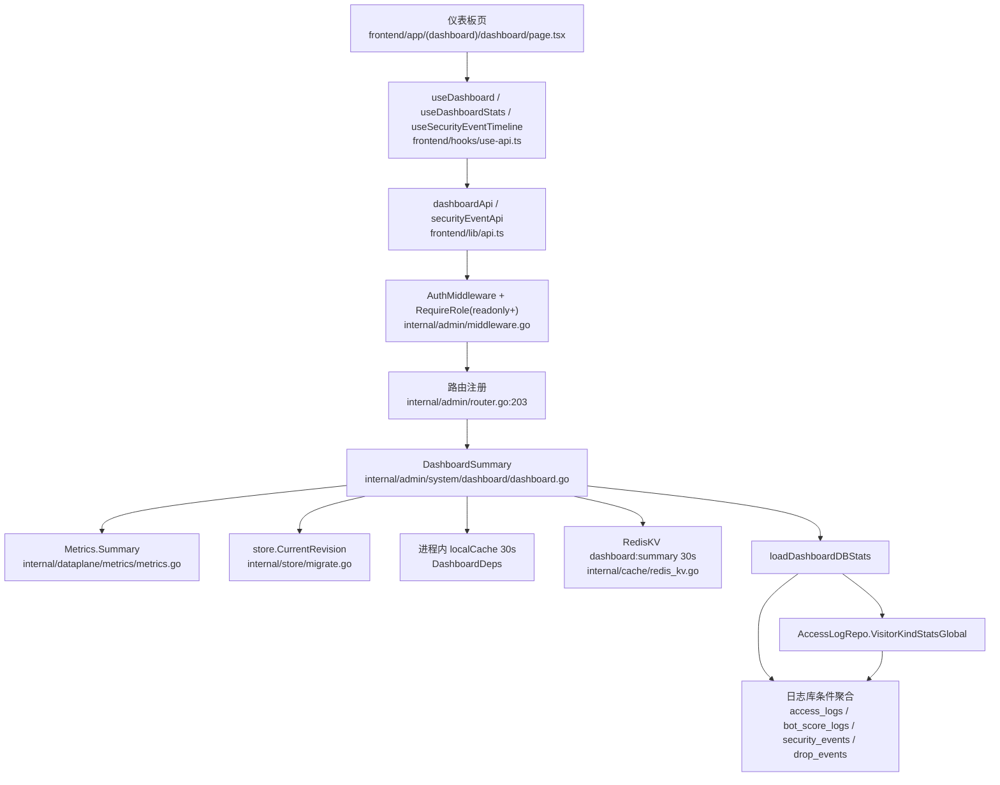
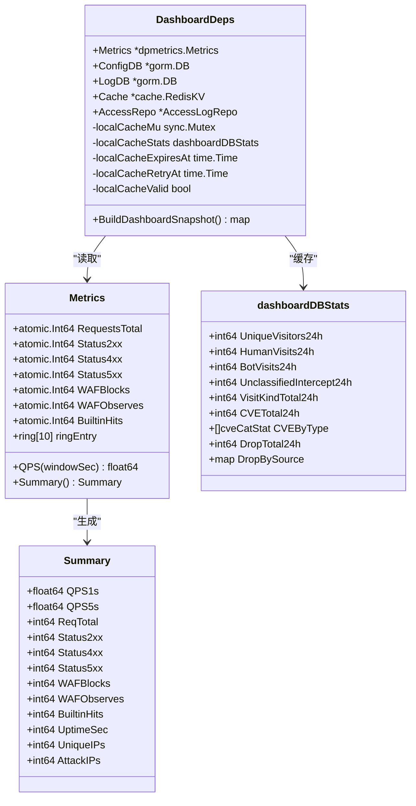
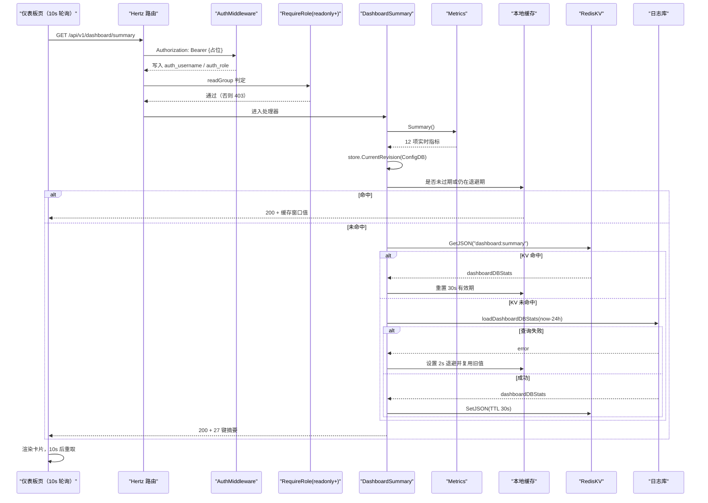
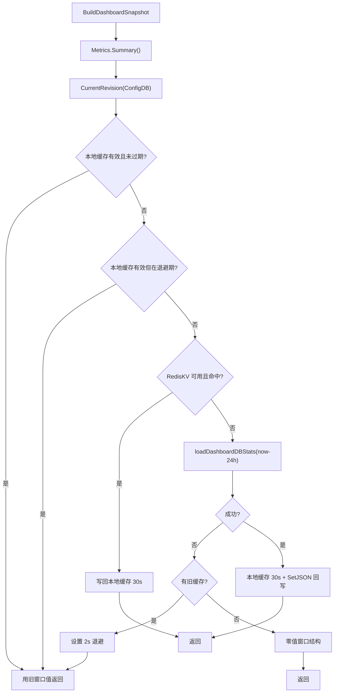
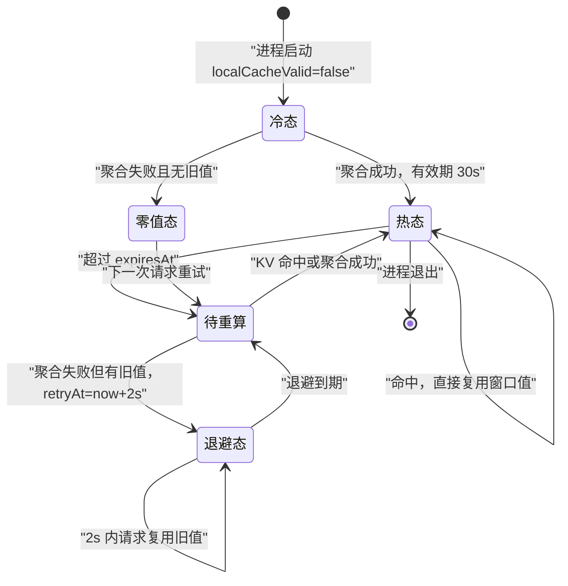
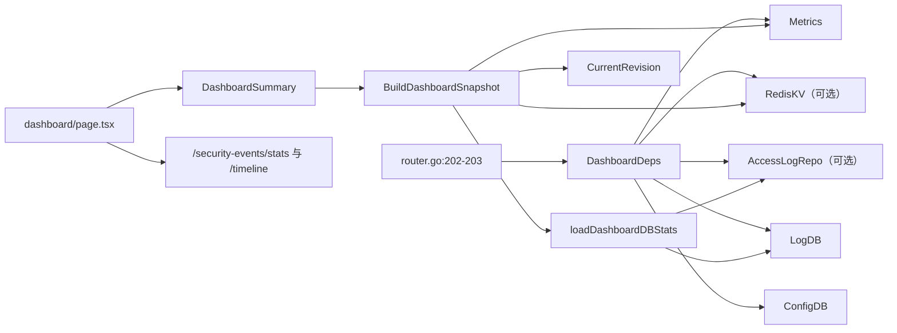
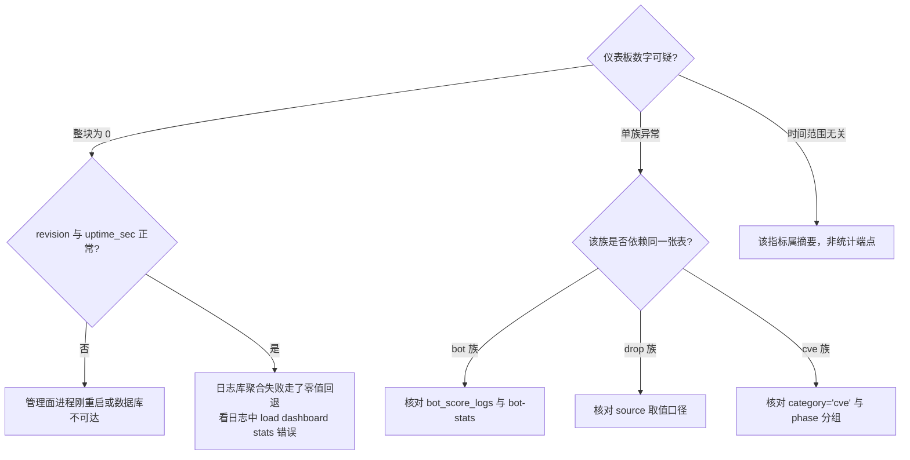

# 仪表板 API

> [返回 管理 API 系统](管理 API 系统.md)

<cite>
**本文档引用的文件**
- [router.go](file://internal/admin/router.go)
- [dashboard.go](file://internal/admin/system/dashboard/dashboard.go)
- [metrics.go](file://internal/dataplane/metrics/metrics.go)
- [redis_kv.go](file://internal/cache/redis_kv.go)
- [migrate.go](file://internal/store/migrate.go)
- [access_log.go](file://internal/store/repository/access_log.go)
- [events.go](file://internal/store/events.go)
- [security.go](file://internal/admin/event/security.go)
- [security_event_aggregate_cache.go](file://internal/store/repository/security_event_aggregate_cache.go)
- [middleware.go](file://internal/admin/middleware.go)
- [api.ts](file://frontend/lib/api.ts)
- [use-api.ts](file://frontend/hooks/use-api.ts)
- [types.ts](file://frontend/lib/types.ts)
- [page.tsx](file://frontend/app/(dashboard)/dashboard/page.tsx)
</cite>

## 目录

1. [简介](#简介)
2. [项目结构](#项目结构)
3. [核心组件](#核心组件)
4. [架构总览](#架构总览)
5. [详细组件分析](#详细组件分析)
6. [依赖关系分析](#依赖关系分析)
7. [性能考虑](#性能考虑)
8. [故障排查指南](#故障排查指南)
9. [结论](#结论)
10. [附录](#附录)

## 简介

仪表板 API 提供单点聚合摘要 `GET /api/v1/dashboard/summary`，把「进程内实时计数」与「日志库 24 小时窗口统计」两类异质指标合并成一个响应，供首页一次拉取。处理器在 `internal/admin/system/dashboard/`（286 行），实时计数来自 `internal/dataplane/metrics`（161 行），窗口统计来自日志库的条件聚合。

必须建立的核心口径是**两套指标不可混用**：

- `qps_*`、`requests_total`、`status_2xx`、`waf_blocks` 等来自进程内 `atomic` 计数器，重启归零、不随页面时间范围变化。
- `*_24h` 系列来自日志库固定 24 小时窗口的 SQL 聚合，同样不受页面时间范围影响。
- 页面上会随 1h/6h/24h/168h 切换而变化的数字，全部来自另一组端点 `GET /security-events/stats` 与 `GET /security-events/timeline`。

因此 `GET /dashboard/summary` 不接受任何查询参数，`hours`、`since`、`until` 对它无效；把这三者当成本端点参数是旧文档的错误描述。

**章节来源**
- [router.go:202-203](file://internal/admin/router.go#L202-L203)
- [dashboard.go:37-41](file://internal/admin/system/dashboard/dashboard.go#L37-L41)
- [dashboard.go:90-122](file://internal/admin/system/dashboard/dashboard.go#L90-L122)
- [page.tsx:259-269](file://frontend/app/(dashboard)/dashboard/page.tsx#L259-L269)

## 项目结构

仪表板摘要的数据来源横跨数据面计数器、日志库聚合表、配置库版本号与 Redis KV 四层，前端消费集中在一个页面与两个 hook。

| 层 | 路径 | 行数 | 职责 |
|----|------|-----:|------|
| 路由 | `internal/admin/router.go` | 465 | `dashDeps` 构造与 `readGroup` 注册 |
| 处理器 | `internal/admin/system/dashboard/dashboard.go` | 286 | 摘要装配、两级缓存、降级回退 |
| 计数 | `internal/dataplane/metrics/metrics.go` | 161 | 原子计数器、QPS 环形缓冲、IP 去重 |
| 仓储 | `internal/store/repository/access_log.go` | 1010 | `VisitorKindStatsGlobal` 访客分类聚合 |
| 缓存 | `internal/cache/redis_kv.go` | — | `Available`/`GetJSON`/`SetJSON` 可选 KV |
| 版本 | `internal/store/migrate.go` | — | `CurrentRevision` 读配置代次 |
| 模型 | `internal/store/events.go` | 278 | `AccessLog` 的 `visitor_fusion_*` 列 |
| 前端 | `frontend/app/(dashboard)/dashboard/page.tsx` | 1200 | 摘要轮询、时间范围切换、图表渲染 |
| 前端 | `frontend/hooks/use-api.ts` | 1530 | `useDashboard`（10 秒）与 `useDashboardStats`（30 秒） |



**图表来源**
- [router.go:202-203](file://internal/admin/router.go#L202-L203)
- [dashboard.go:37-41](file://internal/admin/system/dashboard/dashboard.go#L37-L41)
- [dashboard.go:124-164](file://internal/admin/system/dashboard/dashboard.go#L124-L164)
- [dashboard.go:211-286](file://internal/admin/system/dashboard/dashboard.go#L211-L286)
- [metrics.go:146-161](file://internal/dataplane/metrics/metrics.go#L146-L161)
- [api.ts:956-958](file://frontend/lib/api.ts#L956-L958)

**章节来源**
- [router.go:202-203](file://internal/admin/router.go#L202-L203)
- [dashboard.go:19-41](file://internal/admin/system/dashboard/dashboard.go#L19-L41)
- [metrics.go:13-33](file://internal/dataplane/metrics/metrics.go#L13-L33)

## 核心组件

| 组件 | 类型 | 定义位置 | 说明 |
|------|------|----------|------|
| `DashboardDeps` | 依赖结构 | `dashboard.go:19-31` | 指标、双库、KV、访问日志仓储 + 5 个本地缓存字段 |
| `dashboardCacheKey` | 常量 | `dashboard.go:33` | `dashboard:summary` |
| `dashboardCacheTTL` | 常量 | `dashboard.go:34` | 30 秒 |
| `dashboardCacheFailureBackoff` | 常量 | `dashboard.go:35` | 失败退避 2 秒 |
| `DashboardSummary` | 处理器 | `dashboard.go:37-41` | 无参直返快照，永不返回错误码 |
| `dashboardDBStats` | 聚合结构 | `dashboard.go:48-67` | 14 个窗口字段，全部 snake_case |
| `buildDashboardResponse` | 装配函数 | `dashboard.go:90-122` | 合并实时摘要、代次与窗口统计为 27 键 |
| `BuildDashboardSnapshot` | 编排函数 | `dashboard.go:124-164` | 缓存命中判定、冷读、失败回退 |
| `loadDashboardDBStats` | 查询函数 | `dashboard.go:211-286` | 6 组聚合，任一失败即整体报错 |
| `Metrics` | 计数器 | `metrics/metrics.go:13-31` | 7 个 `atomic.Int64` + 10 槽环形缓冲 + IP 去重集 |



**图表来源**
- [dashboard.go:19-67](file://internal/admin/system/dashboard/dashboard.go#L19-L67)
- [dashboard.go:124-164](file://internal/admin/system/dashboard/dashboard.go#L124-L164)
- [metrics.go:13-33](file://internal/dataplane/metrics/metrics.go#L13-L33)
- [metrics.go:131-161](file://internal/dataplane/metrics/metrics.go#L131-L161)

**章节来源**
- [dashboard.go:19-67](file://internal/admin/system/dashboard/dashboard.go#L19-L67)
- [metrics.go:13-33](file://internal/dataplane/metrics/metrics.go#L13-L33)

## 架构总览

摘要装配是「先本地缓存、再 Redis、最后落库聚合」的三级读取，且失败时逐级回退而非报错。这里的「重载」指缓存重载与配置代次读取，本端点不修改配置，因此不触发配置快照重载链路。



**图表来源**
- [router.go:124-125](file://internal/admin/router.go#L124-L125)
- [router.go:202-203](file://internal/admin/router.go#L202-L203)
- [middleware.go:42-141](file://internal/admin/middleware.go#L42-L141)
- [dashboard.go:37-41](file://internal/admin/system/dashboard/dashboard.go#L37-L41)
- [dashboard.go:124-164](file://internal/admin/system/dashboard/dashboard.go#L124-L164)
- [redis_kv.go:71-181](file://internal/cache/redis_kv.go#L71-L181)
- [migrate.go:162-168](file://internal/store/migrate.go#L162-L168)

仪表板页实际消费三个端点，权限同为 readonly+：

| 端点 | 注册行 | 权限 | 页面用途 | 刷新口径 |
|------|-------:|------|----------|----------|
| `GET /api/v1/dashboard/summary` | 203 | readonly+ | 实时卡与 24 小时窗口卡 | `useDashboard` 10 秒 |
| `GET /api/v1/security-events/stats` | 170 | readonly+ | 随时间范围变化的窗口指标 | `useDashboardStats` 30 秒 |
| `GET /api/v1/security-events/timeline` | 171 | readonly+ | 拦截趋势与迷你折线 | 无轮询，随参数重取 |

**章节来源**
- [router.go:170-171](file://internal/admin/router.go#L170-L171)
- [router.go:203](file://internal/admin/router.go#L203)
- [use-api.ts:534-540](file://frontend/hooks/use-api.ts#L534-L540)
- [use-api.ts:574-578](file://frontend/hooks/use-api.ts#L574-L578)

## 详细组件分析

### 端点总表

| 方法 | 路径 | 权限 | 处理器 | 注册行 | 说明 |
|------|------|------|--------|-------:|------|
| GET | `/api/v1/dashboard/summary` | readonly+ | `dashboard.DashboardSummary` | 203 | 唯一摘要端点，无查询参数，永不返回 4xx/5xx |
| GET | `/api/v1/security-events/stats` | readonly+ | `event.SecurityEventStats` | 170 | `hours` 1–720，缺省 24 |
| GET | `/api/v1/security-events/timeline` | readonly+ | `event.SecurityEventTimeline` | 171 | 返回 `{buckets,hours}` |

`DashboardDeps` 在路由注册时一次性构造，注入的是 `deps.Metrics`、`deps.DB`（配置库）、`deps.LogDB`（日志库）、`deps.Cache`（可为 nil）与 `r.AccessLog`（`router.go:202`）。KV 不可用时整套摘要仍可返回，属可选依赖。

**章节来源**
- [router.go:202-203](file://internal/admin/router.go#L202-L203)
- [dashboard.go:19-41](file://internal/admin/system/dashboard/dashboard.go#L19-L41)
- [security.go:260-293](file://internal/admin/event/security.go#L260-L293)

### 请求参数表

`GET /dashboard/summary` 无路径参数、无查询参数、无请求体；以下参数属于配套端点，混用是本页最常见的误读来源。

| 端点 | 参数 | 位置 | 类型 | 必填 | 约束与默认 |
|------|------|------|------|:----:|------------|
| `GET /dashboard/summary` | — | — | — | — | 不接受任何参数，多余的 query 被忽略 |
| `GET /security-events/stats` | `hours` | query | int | 否 | 缺省 24；合法区间 1–720，越界 400 |
| `GET /security-events/timeline` | `hours` | query | int | 否 | 同上，仅统计终止类动作 |

前端时间范围选择器的取值与映射：

| 选项 | 提交值 | 说明 |
|------|-------:|------|
| 1 小时 | 1 | 传给两个配套端点 |
| 6 小时 | 6 | 同上 |
| 24 小时 | 24 | 默认选中 |
| 7 天 | 168 | `hours = 168`，仍在上限内 |

**章节来源**
- [security.go:17-37](file://internal/admin/event/security.go#L17-L37)
- [page.tsx:187-191](file://frontend/app/(dashboard)/dashboard/page.tsx#L187-L191)
- [page.tsx:400-411](file://frontend/app/(dashboard)/dashboard/page.tsx#L400-L411)

### 响应字段表

`GET /dashboard/summary` 返回 27 个顶层键，按数据来源分为三族。

实时计数族（进程内 `atomic`，重启归零）：

| 字段 | 类型 | 来源 | 说明 |
|------|------|------|------|
| `qps_1s` / `qps_5s` | float64 | `metrics.go:146-161` | 10 槽环形缓冲按秒窗口近似 |
| `requests_total` | int64 | `RecordRequest` | 进程累计入站请求 |
| `status_2xx` | int64 | `RecordStatus` | 2xx 响应数 |
| `errors_upstream_4xx` / `errors_upstream_5xx` | int64 | `RecordStatus` | 注意键名带 `errors_upstream_` 前缀，实为「本进程发出的 4xx/5xx 响应」计数 |
| `waf_blocks` / `waf_observes` | int64 | `RecordWAFBlock/Observe` | 终止与非终止判定 |
| `builtin_hits` | int64 | `RecordBuiltinHit` | 内置规则命中 |
| `uptime_sec` | int64 | `UptimeSeconds` | 自 `startTime` 起秒数 |
| `unique_ips` / `attack_ips` | int64 | `RecordClientIP/AttackIP` | 进程生命周期内去重集合大小 |
| `revision` | uint64 | `store.CurrentRevision` | 配置代次，用于判断快照是否已重载 |

日志库窗口族（固定 24 小时，`*_24h` 后缀）：

| 字段 | 类型 | 聚合方式 | 口径提醒 |
|------|------|----------|----------|
| `unique_visitors_24h` | int64 | `DISTINCT client_ip` | 与 `unique_ips` 同义但窗口不同 |
| `human_visits_24h` / `bot_visits_24h` / `unclassified_intercept_24h` | int64 | `AccessLogRepo.VisitorKindStatsGlobal` | 三类正向枚举 |
| `visit_kind_total_24h` | int64 | 同上 | 三类之和与之差额为其他非安全动作，前端必须单独标注 |
| `visitor_fusion_https_released_total_24h` | int64 | 单条 `CASE` 聚合 | 仅统计 `visitor_fusion_evidence_sufficient = true` |
| `visitor_fusion_human_24h` / `visitor_fusion_bot_24h` / `visitor_fusion_unknown_24h` | int64 | 同上 | 与访客分类族口径不同，不可互相校验 |
| `bot_total_24h` / `bot_blocked_24h` / `bot_high_risk_24h` | int64 | `bot_score_logs` 条件聚合 | `blocked` 取 `action IN ('block','drop')` |
| `cve_total_24h` | int64 | `security_events` 且 `category = 'cve'` | — |
| `cve_by_type_24h` | []`{category,count}` | `SELECT phase AS category, COUNT(*) GROUP BY phase` | 名为「类型」实为按阶段分组，见下方缺陷说明 |
| `drop_total_24h` | int64 | `drop_events` 计数 | — |
| `drop_by_source_24h` | map | 四个短名 `bot`/`cve`/`rule`/`ip_reputation` | 与 `drop_events.source` 实际取值不一致，详见 [阻断策略 API](阻断策略 API.md) |

```json
{
  "qps_1s": 128.4,
  "qps_5s": 121.06,
  "requests_total": 1842230,
  "status_2xx": 1800112,
  "errors_upstream_4xx": 27410,
  "errors_upstream_5xx": 1421,
  "waf_blocks": 9820,
  "waf_observes": 1183,
  "builtin_hits": 6412,
  "uptime_sec": 86412,
  "unique_ips": 30864,
  "attack_ips": 1823,
  "revision": 137,
  "unique_visitors_24h": 27310,
  "human_visits_24h": 120455,
  "bot_visits_24h": 902,
  "unclassified_intercept_24h": 982,
  "visit_kind_total_24h": 122041,
  "visitor_fusion_https_released_total_24h": 118004,
  "visitor_fusion_human_24h": 112300,
  "visitor_fusion_bot_24h": 4021,
  "visitor_fusion_unknown_24h": 1683,
  "bot_total_24h": 12840,
  "bot_blocked_24h": 640,
  "bot_high_risk_24h": 210,
  "cve_total_24h": 512,
  "cve_by_type_24h": [{ "category": "cve_detection", "count": 512 }],
  "drop_total_24h": 742,
  "drop_by_source_24h": {
    "bot": 0,
    "cve": 0,
    "rule": 0,
    "ip_reputation": 37
  }
}
```

**章节来源**
- [dashboard.go:48-122](file://internal/admin/system/dashboard/dashboard.go#L48-L122)
- [dashboard.go:166-286](file://internal/admin/system/dashboard/dashboard.go#L166-L286)
- [metrics.go:131-144](file://internal/dataplane/metrics/metrics.go#L131-L144)
- [migrate.go:162-168](file://internal/store/migrate.go#L162-L168)
- [access_log.go:116-143](file://internal/store/repository/access_log.go#L116-L143)
- [types.ts:745-780](file://frontend/lib/types.ts#L745-L780)

### 错误码表

本端点刻意不做参数校验、不向上抛错，因此错误码表分「摘要端点自身」与「配套端点」两段。

| 状态码 | 触发条件 | 响应体 | 依据 |
|-------:|----------|--------|------|
| 401 | 缺失或非法 Authorization 头 | `{"error":"missing Authorization header"}` | `middleware.go:57`、`middleware.go:99` |
| 403 | 角色不在 readonly 及以上 | `{"error":"access denied: insufficient permissions"}` | `middleware.go:127-142` |
| 200 | Redis KV 不可用 | 正常摘要，窗口值来自冷读或旧缓存 | `dashboard.go:139-145` |
| 200 | 日志库聚合失败且存在旧缓存 | 正常摘要 + 2 秒退避 | `dashboard.go:147-152` |
| 200 | 日志库聚合失败且无旧缓存 | 正常摘要，窗口族全部为 0 | `dashboard.go:153` |
| 400 | `hours` 非 1–720（配套端点） | `{"error":"hours must be between 1 and 720"}` | `security.go:27-37` |
| 500 | 配套统计端点仓储失败（配套端点） | `{"error":"<错误文本>"}` | `security.go:267-272` |

「全 0 摘要」是可观测性上的陷阱：它看起来像真实零流量。区分方法是看 `revision` 与 `uptime_sec` 是否正常、以及窗口族是否整体同时为 0，单族为 0 更可能是真实无命中。

**章节来源**
- [dashboard.go:124-164](file://internal/admin/system/dashboard/dashboard.go#L124-L164)
- [security.go:27-37](file://internal/admin/event/security.go#L27-L37)
- [security.go:260-274](file://internal/admin/event/security.go#L260-L274)
- [middleware.go:57-142](file://internal/admin/middleware.go#L57-L142)

### 缓存分层与降级



**图表来源**
- [dashboard.go:124-164](file://internal/admin/system/dashboard/dashboard.go#L124-L164)
- [dashboard.go:211-286](file://internal/admin/system/dashboard/dashboard.go#L211-L286)
- [redis_kv.go:71-181](file://internal/cache/redis_kv.go#L71-L181)

两级缓存的分工是明确的：本地缓存用 `sync.Mutex` 保护、TTL 与 Redis 一致（30 秒），作用是同进程多请求共享；Redis KV 作用是跨实例共享，键固定 `dashboard:summary`，值只缓存 `dashboardDBStats`（不含实时计数），因此实时部分始终是最新值。



**图表来源**
- [dashboard.go:26-31](file://internal/admin/system/dashboard/dashboard.go#L26-L31)
- [dashboard.go:124-164](file://internal/admin/system/dashboard/dashboard.go#L124-L164)

锁的粒度值得注意：`BuildDashboardSnapshot` 在整段编排期间持有 `localCacheMu`，意味着冷读期间的并发请求会串行等待同一次聚合，而不是各自重复扫库。这是有意的单飞设计，代价是冷读期间的尾延迟。

**章节来源**
- [dashboard.go:19-35](file://internal/admin/system/dashboard/dashboard.go#L19-L35)
- [dashboard.go:124-164](file://internal/admin/system/dashboard/dashboard.go#L124-L164)

### 指标计算口径

四组聚合的 SQL 形态决定了前端必须标注的差额：

| 族 | 查询形态 | 关键点 |
|----|----------|--------|
| 访客分类 | `AccessLogRepo.VisitorKindStatsGlobal(since)` | 正向枚举 `waf_action`，未知值不归入任何一类 |
| 访客融合 | 单条 `CASE` 四列聚合 | 仅统计证据充分（`visitor_fusion_evidence_sufficient = true`）的行 |
| Bot 判定 | `COUNT(*)` + 两个 `CASE` | `blocked` 含 legacy `block` |
| CVE 与 Drop | `WHERE category = 'cve'` 分组 / 四个短名 `CASE` | 分组列取 `phase` |

两处实测缺陷需要在读数时明确知晓，本篇只记录不改码：

- `cve_by_type_24h` 的 SQL 是 `SELECT phase AS category, COUNT(*) ... GROUP BY phase`，而过滤条件已把 `category` 限定为 `cve`，同一族事件的 `phase` 恒为 `cve_detection`，因此该数组实际只有一个桶，饼图无区分度。
- `drop_by_source_24h` 用 `bot`/`cve`/`rule`/`ip_reputation` 四个短名匹配 `source` 列，而写入侧存的是阶段名（`bot_detection`、`cve_detection`、`owasp_default`、`signature` 等），故除 `ip_reputation` 外三列长期为 0，`drop_total_24h` 仍准确。

**章节来源**
- [dashboard.go:166-209](file://internal/admin/system/dashboard/dashboard.go#L166-L209)
- [dashboard.go:211-286](file://internal/admin/system/dashboard/dashboard.go#L211-L286)
- [access_log.go:116-150](file://internal/store/repository/access_log.go#L116-L150)
- [events.go:119-125](file://internal/store/events.go#L119-L125)

### QPS 环形缓冲

实时计数中唯一「看起来像时序」的是 QPS，它不是历史序列而是近似滑窗：

| 参数 | 取值 | 依据 |
|------|------|------|
| 槽位数 | 10（`qpsRingSize`） | `metrics.go:33` |
| 每槽内容 | 秒级时间戳 + 计数 | `metrics.go:35-38` |
| 写入策略 | 同秒累加，跨秒前进一格并覆写 | `metrics.go:48-62` |
| 读取策略 | 累加 `now-ts < windowSec` 的槽，除以窗口秒数 | `metrics.go:111-125` |
| 竞态处理 | 良性竞态，最坏略微多计 | `metrics.go:56` 注释 |
| 上限 | 可查询窗口最大 10 秒 | 由槽位数决定 |

前端每 10 秒采样一次 `qps_5s`（缺回退 `qps_1s`），把采样点累积成最多 60 点的本地序列用于画面积图——序列由浏览器拼装，服务端不保存历史。

**章节来源**
- [metrics.go:33-62](file://internal/dataplane/metrics/metrics.go#L33-L62)
- [metrics.go:111-125](file://internal/dataplane/metrics/metrics.go#L111-L125)
- [page.tsx:64-64](file://frontend/app/(dashboard)/dashboard/page.tsx#L64)
- [page.tsx:196-214](file://frontend/app/(dashboard)/dashboard/page.tsx#L196-L214)

### 前端调用点

| 调用方 | 位置 | 消费端点 | 说明 |
|--------|------|----------|------|
| `dashboardApi.getSummary` | `lib/api.ts:956-958` | `GET /dashboard/summary` | 无参 |
| `useDashboard` | `hooks/use-api.ts:574-578` | 同上 | SWR `refreshInterval: 10000` |
| `useDashboardStats` | `hooks/use-api.ts:534-540` | `GET /security-events/stats` | SWR `refreshInterval: 30000`，带 `hours` |
| `useSecurityEventTimeline` | `hooks/use-api.ts:542-546` | `GET /security-events/timeline` | 随 `hours` 重取 |
| 仪表板页装配 | `app/(dashboard)/dashboard/page.tsx:185-191` | 三个 hook | `timeRange` 默认 `"24"` |
| QPS 序列 | `page.tsx:193-214` | 采样 `qps_5s` | `MAX_QPS_POINTS = 60` |
| 窗口指标区 | `page.tsx:259-269` | `statsData` | 源码注释明确区分两套口径 |
| 代次展示 | `page.tsx:1192-1194` | `revision` | 页脚显示配置代次 |

时间桶字段名是前端适配点：后端返回 `{bucket:"2026-10-17 09:00", count}`，页面取末尾 `HH:mm` 作轴标签，不能按 ISO 解析（`page.tsx:235-248`）。

**章节来源**
- [api.ts:956-958](file://frontend/lib/api.ts#L956-L958)
- [use-api.ts:534-546](file://frontend/hooks/use-api.ts#L534-L546)
- [use-api.ts:574-578](file://frontend/hooks/use-api.ts#L574-L578)
- [page.tsx:185-269](file://frontend/app/(dashboard)/dashboard/page.tsx#L185-L269)
- [page.tsx:1192-1194](file://frontend/app/(dashboard)/dashboard/page.tsx#L1192-L1194)

## 依赖关系分析

| 依赖方 | 被依赖方 | 依赖性质 | 失败表现 |
|--------|----------|----------|----------|
| 路由装配 | `DashboardDeps` 五字段 | 构造期注入 | KV 与访问日志仓储均可为 nil |
| `BuildDashboardSnapshot` | `dpmetrics.Metrics` | 进程内原子读 | 无失败路径，缺指标为 0 |
| `BuildDashboardSnapshot` | `ConfigDB` | 读 `config_revisions` | 出错时 `rev` 为 0，仍返回 200 |
| `loadDashboardDBStats` | `LogDB` 四张表 | 窗口聚合 | 任一失败上抛，触发缓存回退 |
| `loadDashboardDBStats` | `AccessLogRepo` | 访客分类聚合 | 仓储为 nil 时四字段保持 0 |
| `BuildDashboardSnapshot` | `cache.RedisKV` | 可选跨实例缓存 | `Available()` 为假则跳过 |
| 仪表板页 | `securityEventApi.getStats`/`getTimeline` | 窗口口径指标 | 400 时窗口区为空 |



**图表来源**
- [router.go:202-203](file://internal/admin/router.go#L202-L203)
- [dashboard.go:19-31](file://internal/admin/system/dashboard/dashboard.go#L19-L31)
- [dashboard.go:124-286](file://internal/admin/system/dashboard/dashboard.go#L124-L286)
- [page.tsx:185-191](file://frontend/app/(dashboard)/dashboard/page.tsx#L185-L191)

**章节来源**
- [dashboard.go:19-31](file://internal/admin/system/dashboard/dashboard.go#L19-L31)
- [dashboard.go:211-286](file://internal/admin/system/dashboard/dashboard.go#L211-L286)
- [router.go:202-203](file://internal/admin/router.go#L202-L203)

## 性能考虑

- 30 秒双层缓存把首页轮询成本与聚合成本解耦：10 秒轮询命中本地缓存即可返回，冷读每 30 秒最多一次。
- 三组窗口统计各自被压缩为单条条件聚合（`CASE`），避免 N 次往返；访客融合四列合并为一条查询正是为此。
- 冷读期间由互斥锁串行化，同刻并发请求共享一次扫描，不会放大数据库压力。
- 失败退避 2 秒，避免日志库异常时被前端 10 秒轮询持续打穿。
- QPS 计算是 O(10) 定长扫描，写入路径只有原子加法与一次时间戳比较，热路径开销可忽略。
- IP 去重集是进程生命周期内的无界 `map`，高基数场景下会持续增长，属可观测性换取内存的已知取舍。
- 摘要值只缓存 `dashboardDBStats`，实时计数每次现取，因此不会出现「缓存把 QPS 冻结 30 秒」的假象。

[本节为总结，无需特定文件来源]

## 故障排查指南

| 症状 | 原因 | 排查 | 方案 |
|------|------|------|------|
| 切换时间范围后卡片数字不动 | 该卡片来自摘要，窗口固定 24 小时 | 看字段是否带 `_24h` | 时间范围只作用于统计与时间线区 |
| 窗口族整体突然全 0 | 聚合失败且无旧缓存 | 检查日志库可达性与 `uptime_sec` | 恢复日志库后等一轮 TTL |
| `bot_visits_24h` 恒为 0 | Bot 判定未启用或无评分行 | 查 `GET /api/v1/bot-stats` | 属真实零值，非故障 |
| 三类访客数之和小于总数 | 差额是其他非安全动作 | 读 `visit_kind_total_24h` | 前端须标注差额 |
| CVE 饼图只有一个扇区 | `cve_by_type_24h` 按阶段分组 | 见「指标计算口径」 | 已知缺陷，按总量展示 |
| 阻断来源三项为 0 | `source` 短名与阶段名不一致 | `GET /api/v1/drop-events` 看真实值 | 见 [阻断策略 API](阻断策略 API.md) |
| QPS 与流量监控对不上 | 环形缓冲为近似滑窗且 10 秒封顶 | 比对 `requests_total` 增速 | 以 `qps_5s` 为参考量级 |
| `revision` 不随配置变更 | 重载未成功 | 查 `POST /api/v1/reload` 结果 | 先修重载再看代次 |



**图表来源**
- [dashboard.go:124-164](file://internal/admin/system/dashboard/dashboard.go#L124-L164)
- [dashboard.go:211-286](file://internal/admin/system/dashboard/dashboard.go#L211-L286)
- [access_log.go:116-143](file://internal/store/repository/access_log.go#L116-L143)

**章节来源**
- [dashboard.go:124-164](file://internal/admin/system/dashboard/dashboard.go#L124-L164)
- [dashboard.go:166-286](file://internal/admin/system/dashboard/dashboard.go#L166-L286)
- [metrics.go:111-125](file://internal/dataplane/metrics/metrics.go#L111-L125)

## 结论

仪表板 API 用「一个无参端点 + 两个窗口端点」承担首页全部数据，代价是首页必须清楚区分三族口径：进程内原子计数、固定 24 小时日志窗口、可调 1–720 小时窗口。本篇把这层区分写成了字段族的来源表，因为旧文档把 `hours`、`since`、`until` 当作摘要端点参数、把 5 秒轮询当作刷新口径，都会直接导致读数错误。

实测的两处聚合缺陷（CVE 分组列、drop 来源短名）属代码侧问题，本文只登记不修改。下一步若要让这两族可用，最小改动是把分组列换成 `severity` 或 `rule_id_str`、把来源匹配换成阶段名集合，并同步前端标签；在那之前，仪表盘应把这两块按「仅总量可信」呈现。

[本节为总结，无需特定文件来源]

## 附录

### 缓存与轮询参数速查

| 参数 | 取值 | 来源 |
|------|------|------|
| Redis KV 键 | `dashboard:summary` | `dashboard.go:33` |
| 本地与 KV TTL | 30 秒 | `dashboard.go:34` |
| 失败退避 | 2 秒 | `dashboard.go:35` |
| 摘要轮询 | 10 秒 | `use-api.ts:574-578` |
| 统计轮询 | 30 秒 | `use-api.ts:534-540` |
| QPS 槽位数 | 10 | `metrics.go:33` |
| 前端 QPS 历史点数 | 60 | `page.tsx:64` |
| 窗口上限 | 720 小时 | `security.go:19` |

**章节来源**
- [dashboard.go:33-35](file://internal/admin/system/dashboard/dashboard.go#L33-L35)
- [metrics.go:33-33](file://internal/dataplane/metrics/metrics.go#L33-L33)
- [security.go:17-37](file://internal/admin/event/security.go#L17-L37)
- [use-api.ts:534-578](file://frontend/hooks/use-api.ts#L534-L578)
- [page.tsx:64-64](file://frontend/app/(dashboard)/dashboard/page.tsx#L64)

### 配套统计端点响应

`GET /api/v1/security-events/stats?hours=24` 返回的快照结构（详见 [安全事件 API](安全事件 API.md)）：

```json
{
  "total": 1874,
  "hours": 24,
  "categories": [{ "category": "sqli", "count": 420 }],
  "top_ips": [{ "client_ip": "203.0.113.10", "count": 37 }],
  "top_paths": [{ "path": "/jobRead", "count": 128 }],
  "top_rules": [{ "rule_id_str": "owasp:sqli:001", "count": 96 }],
  "top_countries": [{ "country": "US", "count": 210 }],
  "intercepts": 640,
  "observes": 118,
  "requests": 1502,
  "challenges": 27
}
```

前端对这四张 Top 榜的处理约束来自源码注释：`categories` 是未截断的完整分组，可作为真实聚合值；其余四项被限制为 10 条，其长度不能当作总数。

**章节来源**
- [security_event_aggregate_cache.go:170-259](file://internal/store/repository/security_event_aggregate_cache.go#L170-L259)
- [page.tsx:259-269](file://frontend/app/(dashboard)/dashboard/page.tsx#L259-L269)

### 相关文档

- 摘要数据来源：[机器人保护 API](机器人保护 API.md)、[阻断策略 API](阻断策略 API.md)、[安全事件 API](安全事件 API.md)
- 指标暴露与监控：[监控与可观测性](../监控与可观测性/监控与可观测性.md)
- 前端刷新机制：[REST API 设计规范](REST API 设计规范/REST API 设计规范.md)

[本节为通用指导，无需特定文件来源]

### 验证命令

读取摘要并确认无参行为（附加 `hours` 不改变结果）：

```bash
curl -s -H "Authorization: Bearer {占位}" \
  "http://127.0.0.1:8080/api/v1/dashboard/summary"

curl -s -H "Authorization: Bearer {占位}" \
  "http://127.0.0.1:8080/api/v1/dashboard/summary?hours=6"
```

对比窗口口径与代次：

```bash
curl -s -H "Authorization: Bearer {占位}" \
  "http://127.0.0.1:8080/api/v1/security-events/stats?hours=1"

go test ./internal/admin/system/dashboard/...
```

[本节为通用指导，无需特定文件来源]
