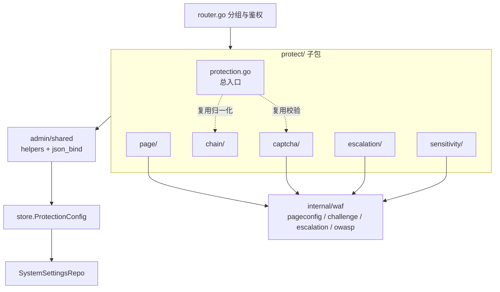
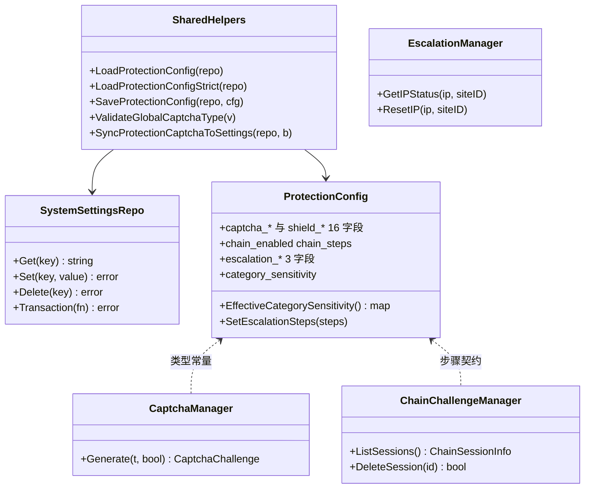
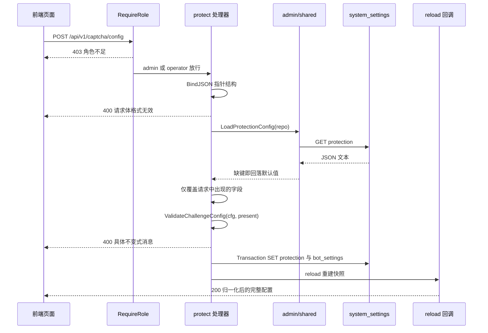
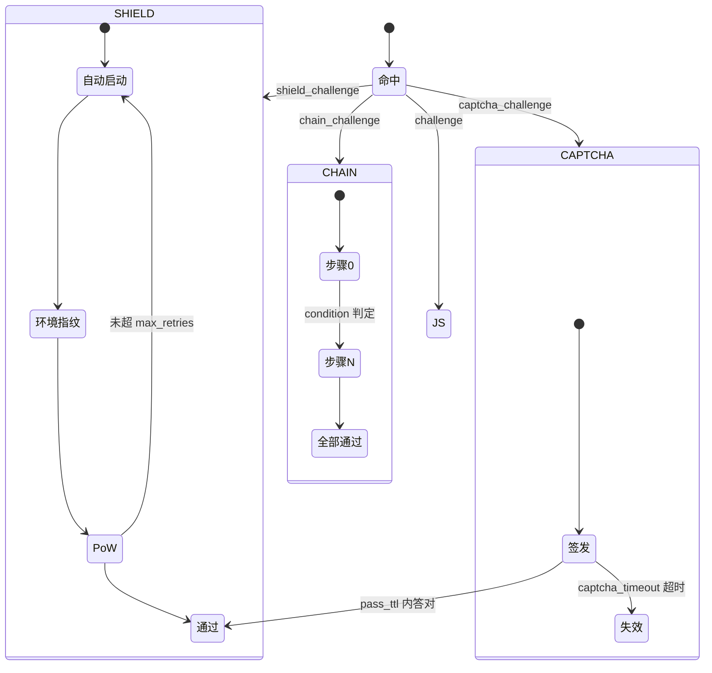
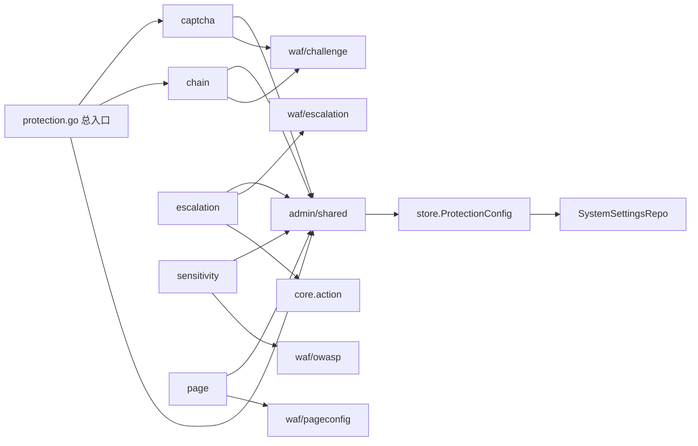
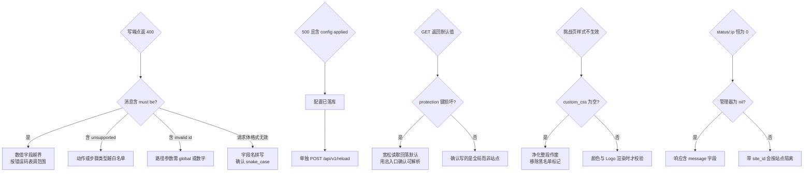

# 保护配置 API

> [返回 管理 API 系统](管理 API 系统.md)

<cite>
**本文档引用的文件**
- [router.go](file://internal/admin/router.go)
- [protection.go](file://internal/admin/protect/protection.go)
- [captcha.go](file://internal/admin/protect/captcha/captcha.go)
- [chain.go](file://internal/admin/protect/chain/chain.go)
- [escalation.go](file://internal/admin/protect/escalation/escalation.go)
- [sensitivity.go](file://internal/admin/protect/sensitivity/sensitivity.go)
- [page_templates.go](file://internal/admin/protect/page/page_templates.go)
- [helpers.go](file://internal/admin/shared/helpers.go)
- [json_bind.go](file://internal/admin/shared/json_bind.go)
- [middleware.go](file://internal/admin/middleware.go)
- [site.go](file://internal/admin/site/site.go)
- [protection.go](file://internal/store/protection.go)
- [config.go](file://internal/waf/pageconfig/config.go)
- [captcha.go](file://internal/waf/challenge/captcha.go)
- [chain.go](file://internal/waf/challenge/chain.go)
- [escalation.go](file://internal/waf/escalation/escalation.go)
- [owasp.go](file://internal/waf/owasp/owasp.go)
- [action.go](file://internal/core/action/action.go)
- [build.go](file://internal/snapshot/build.go)
- [api.ts](file://frontend/lib/api.ts)
- [types.ts](file://frontend/lib/types.ts)
- [protection_routes_test.go](file://internal/admin/protection_routes_test.go)
</cite>

## 目录

1. [简介](#简介)
2. [项目结构](#项目结构)
3. [核心组件](#核心组件)
4. [架构总览](#架构总览)
5. [详细组件分析](#详细组件分析)
6. [依赖关系分析](#依赖关系分析)
7. [性能考虑](#性能考虑)
8. [故障排查指南](#故障排查指南)
9. [结论](#结论)
10. [附录](#附录)

## 简介

保护配置 API 覆盖 `internal/admin/protect/` 下五个此前零文档的子包：`captcha/`（256 行）、`chain/`（161 行）、`escalation/`（168 行）、`page/`（255 行）、`sensitivity/`（92 行），以及总配置入口 `protection.go`（351 行）。它们共同管理「命中 WAF 动作之后发生什么」这段配置：用哪种验证码、是否叠加 5 秒盾、链式挑战按什么顺序推进、灵敏度按类别怎么分档、命中累计后如何逐级升档、以及挑战页与拦截页的品牌呈现。

五个子包一共注册 19 个端点，总入口再加 2 个，合计 **21 个端点**（实测 readGroup 10 个 GET、opsGroup 11 个 POST）。全部写操作只有 POST，路径形态为 `/xxx/config`、`/page-templates/:type`、`/{id}/reset`、`/escalation/status/:ip/reset`、`/chain/sessions/:id/delete`，全库无 PUT/DELETE 路由，请求与响应字段一律 snake_case。

本篇与已完成两篇是同级互补：`protection.go` 里的 bot 开关、CC 规则、drop 阈值分别由 [机器人保护 API](机器人保护 API.md) 与 [阻断策略 API](阻断策略 API.md) 负责，本篇不复制其表格，只划清「谁写哪个键、谁同步谁」。鉴权中间件与重载语义见 [REST API 设计规范](REST API 设计规范/REST API 设计规范.md)。

**章节来源**
- [router.go:109](file://internal/admin/router.go#L109)
- [router.go:124-125](file://internal/admin/router.go#L124-L125)
- [router.go:255-256](file://internal/admin/router.go#L255-L256)

## 项目结构

protect 层是典型的「薄处理器 + 厚共享校验」结构：处理器只做绑定、局部字段合并与状态码映射，跨字段不变式全部下沉到 `internal/admin/shared/` 与 `internal/store/protection.go`。



**图表来源**
- [router.go:229-252](file://internal/admin/router.go#L229-L252)
- [router.go:330-343](file://internal/admin/router.go#L330-L343)
- [protection.go:11-16](file://internal/admin/protect/protection.go#L11-L16)

| 模块 | 路径 | 行数 | 职责边界 | 落库键 |
|------|------|:----:|----------|--------|
| 总入口 | `internal/admin/protect/protection.go` | 351 | 全字段读写与跨字段校验编排 | `protection` |
| 验证码与 5 秒盾 | `internal/admin/protect/captcha/` | 256 | 16 个质询字段读写、测试图签发 | `protection` 加 `bot_settings` |
| 链式挑战 | `internal/admin/protect/chain/` | 161 | 步骤序列归一化、进行中会话运维 | `protection` |
| 逐级升级 | `internal/admin/protect/escalation/` | 168 | 阈值阶梯与 IP 运行时状态运维 | `protection` |
| 灵敏度 | `internal/admin/protect/sensitivity/` | 92 | 按 OWASP 类别分档读写 | `protection` |
| 页面模板 | `internal/admin/protect/page/` | 255 | 三类页面品牌与文案、预览 | `page_template_*` |

**章节来源**
- [captcha.go:1-256](file://internal/admin/protect/captcha/captcha.go#L1-L256)
- [chain.go:1-161](file://internal/admin/protect/chain/chain.go#L1-L161)
- [escalation.go:1-168](file://internal/admin/protect/escalation/escalation.go#L1-L168)
- [sensitivity.go:1-92](file://internal/admin/protect/sensitivity/sensitivity.go#L1-L92)
- [page_templates.go:1-255](file://internal/admin/protect/page/page_templates.go#L1-L255)

## 核心组件

五个子包的依赖注入形态一致：工厂函数接收仓储指针与可选的 reload 回调，返回 `app.HandlerFunc`。运行时管理器（`CaptchaManager`、`ChainChallengeManager`、`EscalationManager`）以指针注入且允许为 nil，此时端点必须降级返回而不是 panic。



**图表来源**
- [helpers.go:21-78](file://internal/admin/shared/helpers.go#L21-L78)
- [protection.go:13-117](file://internal/store/protection.go#L13-L117)
- [chain.go:137-161](file://internal/admin/protect/chain/chain.go#L137-L161)

| 组件 | 入口符号 | 注入依赖 | 依赖可为 nil |
|------|----------|----------|:------------:|
| 配置读写（四子包） | `Get{Captcha,Chain,Escalation,Sensitivity}Config` 与对应 `Update…` | 仓储加 reload | 否 |
| 测试签发 | `captcha.TestCaptcha` | 仓储加 `CaptchaManager` | 是，返 503 |
| 链式运维 | `chain.ListChainSessions` / `DeleteChainSession` | `ChainChallengeManager` | 列表是，删除 404 |
| 升级运维 | `escalation.GetEscalationIPStatus` / `ResetEscalationIPStatus` | `EscalationManager` | 是，返零值或静默成功 |
| 页面模板 | `page.GetPageTemplates` 等 6 个 | 仓储加 reload | reload 可为 nil |
| 总入口 | `protect.GetProtectionSettings` / `PutProtectionSettings` | 仓储加 reload | 否 |

**章节来源**
- [captcha.go:55-60](file://internal/admin/protect/captcha/captcha.go#L55-L60)
- [chain.go:137-161](file://internal/admin/protect/chain/chain.go#L137-L161)
- [escalation.go:114-155](file://internal/admin/protect/escalation/escalation.go#L114-L155)
- [page_templates.go:22-56](file://internal/admin/protect/page/page_templates.go#L22-L56)

## 架构总览

一次保护配置写入的生命周期是固定五段：绑定 → 读现有配置 → 字段级合并 → 全量校验 → 落库加重载。任何一段失败都不会留下半成品，但「已落库、重载失败」是唯一不可自动回滚的窗口。



**图表来源**
- [router.go:255-256](file://internal/admin/router.go#L255-L256)
- [captcha.go:115-206](file://internal/admin/protect/captcha/captcha.go#L115-L206)
- [helpers.go:21-78](file://internal/admin/shared/helpers.go#L21-L78)

| 阶段 | 失败表现 | 是否已改库 | 恢复手段 |
|------|----------|:----------:|----------|
| 绑定 | 400 `请求体格式无效` | 否 | 修正载荷重发 |
| 读现有配置 | 宽松回落默认值，严格返 500 | 否 | 修复 `protection` 键 JSON |
| 字段合并 | 不报错，缺字段即保留原值 | 否 | 无 |
| 校验 | 400 具体不变式消息 | 否 | 按消息调整取值 |
| 落库 | 500 携带仓储错误 | 事务整体回滚 | 查库连接与权限 |
| 重载 | 500 `config applied but reload failed` | **是** | `POST /api/v1/reload` |

**章节来源**
- [captcha.go:117-204](file://internal/admin/protect/captcha/captcha.go#L117-L204)
- [chain.go:97-134](file://internal/admin/protect/chain/chain.go#L97-L134)
- [escalation.go:39-103](file://internal/admin/protect/escalation/escalation.go#L39-L103)
- [protection.go:256-298](file://internal/admin/protect/protection.go#L256-L298)

## 详细组件分析

### 端点总表

21 个端点逐条取自 `internal/admin/router.go` 的注册行。分组决定最小可达角色：readGroup 允许 readonly，opsGroup 需 operator 及以上。

| # | 方法 | 路径 | 分组 | 处理器 | 注册行 |
|:-:|:----:|------|:----:|--------|:------:|
| 1 | GET | `/api/v1/protection-settings` | read | `protect.GetProtectionSettings` | 152 |
| 2 | POST | `/api/v1/protection-settings` | ops | `protect.PutProtectionSettings` | 287 |
| 3 | GET | `/api/v1/captcha/config` | read | `captcha.GetCaptchaConfig` | 229 |
| 4 | POST | `/api/v1/captcha/config` | ops | `captcha.UpdateCaptchaConfig` | 330 |
| 5 | POST | `/api/v1/captcha/test` | ops | `captcha.TestCaptcha` | 331 |
| 6 | GET | `/api/v1/chain/config` | read | `chain.GetChainConfig` | 231 |
| 7 | GET | `/api/v1/chain/sessions` | read | `chain.ListChainSessions` | 232 |
| 8 | POST | `/api/v1/chain/config` | ops | `chain.UpdateChainConfig` | 337 |
| 9 | POST | `/api/v1/chain/sessions/:id/delete` | ops | `chain.DeleteChainSession` | 338 |
| 10 | GET | `/api/v1/protection/:id/sensitivity` | read | `sensitivity.GetSensitivityConfig` | 234 |
| 11 | POST | `/api/v1/protection/:id/sensitivity` | ops | `sensitivity.UpdateSensitivityConfig` | 340 |
| 12 | GET | `/api/v1/protection/:id/escalation` | read | `escalation.GetEscalationConfig` | 236 |
| 13 | POST | `/api/v1/protection/:id/escalation` | ops | `escalation.UpdateEscalationConfig` | 342 |
| 14 | GET | `/api/v1/escalation/status/:ip` | read | `escalation.GetEscalationIPStatus` | 237 |
| 15 | POST | `/api/v1/escalation/status/:ip/reset` | ops | `escalation.ResetEscalationIPStatus` | 343 |
| 16 | GET | `/api/v1/page-templates` | read | `page.GetPageTemplates` | 250 |
| 17 | GET | `/api/v1/page-templates/:type` | read | `page.GetPageTemplate` | 251 |
| 18 | GET | `/api/v1/page-templates/:type/preview` | read | `page.PreviewPageTemplate` | 252 |
| 19 | POST | `/api/v1/page-templates/:type` | ops | `page.UpdatePageTemplate` | 333 |
| 20 | POST | `/api/v1/page-templates/:type/reset` | ops | `page.ResetPageTemplate` | 334 |
| 21 | POST | `/api/v1/page-templates/:type/preview` | ops | `page.PreviewPageTemplateDraft` | 335 |

`POST /api/v1/certificates/parse` 已证明「POST 不等于写」的先例存在于 readGroup；本组 `POST /api/v1/page-templates/:type/preview` 同理——它渲染草稿但不落库，放 opsGroup 只为与 GET 同名路径区分方法，不是权限要求。

**章节来源**
- [router.go:152](file://internal/admin/router.go#L152)
- [router.go:229-252](file://internal/admin/router.go#L229-L252)
- [router.go:287](file://internal/admin/router.go#L287)
- [router.go:330-343](file://internal/admin/router.go#L330-L343)

### 请求参数表

写端点统一用指针字段表达「本次是否携带该字段」，因此局部更新与全量覆盖天然区分；非指针的 `captcha_type` 用「空串即保留」达成同一效果。

| 端点 | 字段 | 类型 | 必填 | 取值域 |
|------|------|------|:----:|--------|
| `POST /captcha/config` | `captcha_enabled` `shield_enabled` | `*bool` | 否 | true/false |
| | `captcha_type` | `string` | 否 | math/click/slide/rotate |
| | `captcha_timeout` `captcha_pass_ttl` | `*int` | 否 | 各自 > 0 |
| | `shield_timeout_secs` `shield_auto_start_delay` `shield_max_retries` | `*int` | 否 | > 0 |
| | `shield_difficulty` | `*int` | 否 | 1–7 闭区间 |
| | `shield_env_strictness` | `*int` | 否 | 0/1/2 |
| | `shield_require_http2` `shield_require_http3` `shield_allow_http1` | `*bool` | 否 | true/false |
| | `shield_enable_js_challenge` `shield_enable_env_check` `shield_enable_devtools` | `*bool` | 否 | true/false |
| `POST /captcha/test` | `captcha_type` | `string` | 否 | 四类之一，空则取全局值再回落 `math` |
| `POST /chain/config` | `chain_enabled` `chain_steps` | `*bool` / RawMessage | 否 | 开关与步骤数组，见下方约束 |
| `POST /protection/:id/sensitivity` | `category_sensitivity` | map | 否 | 18 类别映射 6 档，整体替换 |
| `POST /protection/:id/escalation` | `escalation_enabled` | `*bool` | 否 | true/false |
| | `escalation_window_secs` | `*int` | 否 | > 0 秒 |
| | `escalation_steps` | 数组 | 否 | 阈值严格递增，整体替换 |
| `POST /page-templates/:type` | 请求体 | 三类页面结构之一 | 是 | 由 `:type` 决定，缺字段回落默认值 |
| `GET /escalation/status/:ip` | `site_id` | 查询参数 | 否 | 无符号整数，缺省为 0 |

链式步骤的 `condition` 白名单只有六个取值：空串、`all`、`env_score>30`、`env_score<30`、`score>50`、`score>80`；`match` 是兼容别名，仅在 `condition` 非法或缺失时被采用。非 `captcha` 步骤上的 `captcha_type` 被强制清空，`captcha` 步骤的 `condition` 被强制改写为 `all`——设计意图是验证码不得被环境分数条件跳过。

`:id` 路径参数在 `sensitivity` 与 `escalation` 两组端点上只做格式校验：值必须是 `global` 或可解析的无符号整数，否则 400 `invalid id`；校验之后**并不参与配置寻址**，两个处理器始终读写全局 `protection` 键，不做站点查询。这是本篇实测到的第一个真实缺口。

**章节来源**
- [captcha.go:35-52](file://internal/admin/protect/captcha/captcha.go#L35-L52)
- [captcha.go:123-182](file://internal/admin/protect/captcha/captcha.go#L123-L182)
- [chain.go:46-119](file://internal/admin/protect/chain/chain.go#L46-L119)
- [escalation.go:41-89](file://internal/admin/protect/escalation/escalation.go#L41-L89)

### 响应字段表

`captchaConfigResponse` 与请求侧字段同名但类型从指针变为值，因此 GET 永远返回完整 16 个质询字段，不存在「未配置」的空洞；默认值见附录速查表，此处不重复。

| 端点 | 字段 | JSON 类型 | 来源 | 说明 |
|------|------|:---------:|------|------|
| `GET /captcha/config` | `captcha_*` 4 字段 | boolean/string/number | `ProtectionConfig` | 开关、类型、超时、通过有效期 |
| `GET /captcha/config` | `shield_*` 12 字段 | boolean/number | 同上 | 难度、时限、协议与检测开关 |
| `POST /captcha/test` | `session_id` | string | `CaptchaChallenge` | 仅预览用途 |
| | `captcha_type` `type` `prompt` | string | 归一化值与签发器回填值 | 题面与两种类型标识 |
| | `master_img` `thumb_img` | string | `CaptchaChallenge` | 底图与拖拽块图 |
| | `width` `height` `timeout` `pass_ttl` | number | 签发值与全局配置 | 画布尺寸与真实时限 |
| | `fallback` | boolean | 常量 false | 未走降级分支 |
| `GET /chain/config` | `chain_enabled` | boolean | `ProtectionConfig` | 默认 false |
| `GET /chain/config` | `chain_steps` | array | 归一化 JSON | 空值输出 `[]` 而非 null |
| `GET /chain/sessions` | `items` | array | `ChainSessionInfo[]` | `id`/`current_step`/`step_count`/`original_url`/`started_at` |
| `GET /chain/sessions` | `total` | number | `len(items)` | 进程内会话数 |
| `POST /chain/sessions/:id/delete` | `message` | string | 常量 | `session cleared` |
| `GET /protection/:id/sensitivity` | `category_sensitivity` | object | `EffectiveCategorySensitivity` | 已合并 legacy `owasp_modules` |
| `GET /protection/:id/escalation` | `escalation_enabled` `escalation_window_secs` | boolean/number | `ProtectionConfig` | 默认 false 与 60 |
| | `escalation_steps` | array | `GetEscalationSteps` | nil 输出 `[]` |
| `GET /escalation/status/:ip` | `ip` | string | 路径参数 | 原样回显 |
| | `hit_count` `current_step` `action` | number/string | `getCount` 与 `GetCurrentLevel` | 命中数、当前档位（JSON 名与配置档位同名）、生效动作 |
| `GET /page-templates` | `captcha` `challenge` `block` | object | 三类 `*PageConfig` | 各为公共 7 字段加 3 或 4 个专属字段 |
| `POST /page-templates/:type` | `status` | string | 常量 `ok` | 不回显配置体 |

`GET` 与 `POST` 的 `/page-templates/:type/preview` 返回 `text/html; charset=utf-8` 而非 JSON，前端必须按文本读取。管理器为 nil 时有两条「200 但非数据」的降级路径：`GET /escalation/status/:ip` 返回零值加 `message` 字段，`GET /chain/sessions` 返回空数组，前端不得把它们当作「无命中」。

**章节来源**
- [captcha.go:16-33](file://internal/admin/protect/captcha/captcha.go#L16-L33)
- [captcha.go:242-254](file://internal/admin/protect/captcha/captcha.go#L242-L254)
- [chain.go:14-44](file://internal/admin/protect/chain/chain.go#L14-L44)
- [escalation.go:31-36](file://internal/admin/protect/escalation/escalation.go#L31-L36)
- [config.go:23-63](file://internal/waf/pageconfig/config.go#L23-L63)

### 错误码表

| 状态码 | 消息（原样） | 触发条件 | 出处 |
|:------:|--------------|----------|------|
| 400 | `请求体格式无效` | JSON 无法绑定到指针结构 | captcha.go:119、chain.go:104、escalation.go:54、sensitivity.go:66、protection.go:102 |
| 400 | `请求体格式无效: {解析错误}` | 页面模板 JSON 与目标结构不符 | page_templates.go:69/78/87/177/185/193 |
| 400 | `{字段} must be greater than 0` | `captcha_timeout`、`captcha_pass_ttl`、`shield_timeout_secs`、`shield_auto_start_delay`、`shield_max_retries` 显式携带且 ≤ 0 | captcha.go:70/73/79/82/85 |
| 400 | `shield_difficulty must be between 1 and 7` | 显式携带且越界 | captcha.go:76 |
| 400 | `shield_env_strictness must be one of: 0, 1, 2` | 显式携带且越界 | captcha.go:88 |
| 400 | `captcha_type must be one of: math, click, slide, rotate` | 落库或合并值非法 | helpers.go:152 |
| 400 | `invalid captcha_type` | 测试签发携带未知类型 | captcha.go:228 |
| 400 | `chain_steps contains unsupported step type or captcha_type` | 步骤类型或验证码类型越白名单 | chain.go:114、protection.go:198 |
| 400 | `invalid id` | `:id` 既非 `global` 也非无符号整数 | escalation.go:22/44、sensitivity.go:42/60 |
| 400 | `escalation_window_secs must be positive` | 显式携带且 ≤ 0 | escalation.go:58 |
| 400 | `step threshold must be positive` | 任一阈值 ≤ 0 | escalation.go:64 |
| 400 | `unsupported escalation action` | 动作不在六个允许值内 | escalation.go:71 |
| 400 | `steps must have increasing thresholds` | 阈值非严格递增 | escalation.go:75 |
| 400 | `invalid sensitivity level for {类别}: {值}` | 灵敏度档位无法归一化 | sensitivity.go:73 |
| 400 | `invalid page type[, must be one of: captcha, challenge, block]` | `:type` 越界；读写与 reset 带取值提示，两个预览端点不带 | page_templates.go:48/94/127/160/199 |
| 400 | `ip required` | `:ip` 为空 | escalation.go:118/142 |
| 400 | `invalid site_id` | 查询参数无法转 uint | escalation.go:164 |
| 400 | `invalid basic auth password` | `basic_auth_password` 非字符串 | protection.go:109 |
| 400 | `invalid config` | 合并或反序列化进 `ProtectionConfig` 失败 | protection.go:133/142 |
| 400 | `invalid action` | 动作字段或全局质询动作非法 | protection.go:230/243 |
| 400 | `invalid anti_replay_cookie_mode` | Cookie 模式非 standard/dual | protection.go:247 |
| 400 | `skip_path_by_phase must be a JSON object` | 跳过路径不是对象 | json_bind.go:47 |
| 400 | `skip_path_by_phase contains an unsupported phase` | 出现九个键之外的 phase | json_bind.go:51 |
| 400 | `skip_path_by_phase paths must be non-empty strings` | 空数组或空白路径 | json_bind.go:54/58 |
| 400 | `invalid cc rules: {错误}` | CC 规则结构与契约不符 | helpers.go:180/184/191-235 |
| 403 | 角色不足 | readonly 访问 opsGroup | middleware.go:127-132 |
| 404 | `session not found` | 链式会话 id 不存在或管理器为 nil | chain.go:156 |
| 500 | 仓储原始错误 | `SaveProtectionConfig`/`Set`/`Delete` 失败 | captcha.go:197、chain.go:122、escalation.go:91、sensitivity.go:83、page_templates.go:99/132 |
| 500 | `config applied but reload failed: {错误}` | 已落库、快照重载失败 | captcha.go:201、chain.go:126、escalation.go:95、sensitivity.go:87、page_templates.go:105/138、protection.go:295 |
| 500 | `captcha generation failed: {错误}` | 签发器返回错误 | captcha.go:239 |
| 500 | `failed to {save,reset} page template: {错误}` | 页面模板写库或删键失败 | page_templates.go:99/132 |
| 500 | `invalid protection configuration` | 严格读取现库配置失败 | protection.go:22/138 |
| 503 | `captcha manager not initialized` | `CaptchaManager` 未注入 | captcha.go:212 |

**章节来源**
- [captcha.go:63-91](file://internal/admin/protect/captcha/captcha.go#L63-L91)
- [chain.go:97-161](file://internal/admin/protect/chain/chain.go#L97-L161)
- [escalation.go:17-168](file://internal/admin/protect/escalation/escalation.go#L17-L168)
- [sensitivity.go:37-92](file://internal/admin/protect/sensitivity/sensitivity.go#L37-L92)
- [page_templates.go:36-204](file://internal/admin/protect/page/page_templates.go#L36-L204)

### 质询语义与三类挑战动作

配置字段必须按 WAF 动作触发语义理解，而不是按 HTTP 状态码理解：`captcha_challenge` 展示所配置的验证码类型，`shield_challenge` 展示 5 秒盾自动流程，`chain_challenge` 按 `chain_steps` 顺序推进，`challenge` 是未指定细分类型时的兜底渲染。



**图表来源**
- [captcha.go:16-52](file://internal/admin/protect/captcha/captcha.go#L16-L52)
- [chain.go:19-95](file://internal/admin/protect/chain/chain.go#L19-L95)
- [action.go:13-21](file://internal/core/action/action.go#L13-L21)

| 动作 | 渲染依据 | 关键字段 | 未知值处理 |
|------|----------|----------|------------|
| `captcha_challenge` | `captcha_type` | `captcha_timeout`、`captcha_pass_ttl` | `IsValidCaptchaType` 拒绝 |
| `shield_challenge` | `shield_difficulty` 等 11 字段 | `shield_max_retries`、`shield_env_strictness` | 严格度限定 0/1/2 |
| `chain_challenge` | `chain_steps` 顺序 | `type`、`condition`、`captcha_type` | 越界整批拒绝 |
| `challenge` | 兜底 JS 挑战页 | `challenge_action`（全局） | 空串合法，回落 challenge |
| `redirect` | 不在本组配置动作内 | `redirect_to` | `ValidateActionWithoutRedirectTarget` 拒绝 |

四个质询动作在 `TerminalPriority` 上同档，因此同一请求命中多个时以**先出现者**为准；配置端不会因「更高级」而重排它们。

**章节来源**
- [captcha.go:19-31](file://internal/admin/protect/captcha/captcha.go#L19-L31)
- [chain.go:69-88](file://internal/admin/protect/chain/chain.go#L69-L88)
- [helpers.go:270-293](file://internal/admin/shared/helpers.go#L270-L293)

### 灵敏度：6 档与 18 类别

灵敏度是 **6 档**，不是常见的 5 档。档位对应命中分数阈值，数字越大越宽松。

| 档位 | 别名（会被归一化） | 阈值 | 语义 |
|------|-------------------|:----:|------|
| `off` | `none` | 停用 | 该类别完全不检测 |
| `low` | `low` | 7 | 仅高置信命中 |
| `mid` | `medium` | 4 | 默认档 |
| `high` | `high` | 3 | 由 2 放宽到 3 以减少误报 |
| `very_high` | `very-high`、`veryhigh` | 2 | 激进 |
| `strict` | `strict` | 1 | 最严，任何命中都算 |

类别键取 OWASP 的 18 个枚举值：`sqli`、`webshell`、`revshell`、`xss`、`path_traversal`、`ssrf`、`cmd_injection`、`xxe`、`ldap_injection`、`file_upload`、`protocol_violation`、`nosql_injection`、`template_injection`、`jndi_injection`、`crlf_injection`、`expression_language`、`deserialization`、`graphql_injection`。

三处归一化实现必须放在一起看：管理侧 `sensitivity.normalizeSensitivityLevel`、存储侧 `store.normalizeProtectionSensitivityLevel`、引擎侧 `owasp.normalizeSensitivityLevel` 取值集合一致；任一处漂移就会出现「管理端接受、引擎按默认档执行」的静默降级。

写入侧还有一个不可逆动作：`UpdateSensitivityConfig` 保存类别覆盖后把 `owasp_modules` 强制置为 `"{}"`，因为 `category_sensitivity` 是 UI 的权威来源，模块级 legacy 字段必须让位。读取侧的 `EffectiveCategorySensitivity` 则反向合并——先铺 `owasp_modules`，再用 `category_sensitivity` 覆盖同名键，因此 GET 响应可能包含继承自 legacy 的条目，不能据此推断「我配了哪些」。

**章节来源**
- [sensitivity.go:18-91](file://internal/admin/protect/sensitivity/sensitivity.go#L18-L91)
- [protection.go:206-295](file://internal/store/protection.go#L206-L295)
- [owasp.go:846-898](file://internal/waf/owasp/owasp.go#L846-L898)
- [owasp.go:13-30](file://internal/waf/owasp/owasp.go#L13-L30)

### 页面模板与 CSS 净化边界

页面模板是唯一不写 `protection` 键的子包，三类配置各占一个 `system_settings` 键：`page_template_captcha`、`page_template_challenge`、`page_template_block`。

`UpdatePageTemplate` 的关键约束是**必须持久化清洗后的配置**：直接存原始请求体会让 `sanitizePageCSS` 形同虚设，`expression()`、`javascript:` 等载荷会原样渲染进挑战页与拦截页。因此三类载荷都走「解析、`SanitizeCSS`、重新序列化、`Set`」，而不是原样落库。`SanitizeCSS` 是黑名单整段作废策略：命中 13 个标记之一（`</style`、`<`、`>`、`expression(`、`javascript:`、`vbscript:`、`url(`、`@import`、`behavior:`、`binding:`、`-moz-binding`、`/*`、反斜杠）即整段 `custom_css` 变空串，不做部分保留。

`ResetPageTemplate` 走 `repo.Delete(settingKey)`，删键而非写空对象，下一次读取由 `Parse*PageConfig` 回落到 `Default*PageConfig`；两者语义等价但存储形态不同。

另一条边界是净化时机不对称：`custom_css` 在**写入时**净化，而 `primary_color`、`bg_gradient`、`logo_url` 在**渲染时**才由 `SafePrimaryColor`、`SafeBackground`、`SafeLogoURL` 校验。因此含非法颜色值的模板能通过 POST 落库、GET 也原样返回，只在渲染那一刻被替换为默认值——不能以「保存成功」证明取值合法。

**章节来源**
- [page_templates.go:15-145](file://internal/admin/protect/page/page_templates.go#L15-L145)
- [page_templates.go:206-223](file://internal/admin/protect/page/page_templates.go#L206-L223)
- [config.go:10-63](file://internal/waf/pageconfig/config.go#L10-L63)
- [config.go:124-228](file://internal/waf/pageconfig/config.go#L124-L228)

### 总入口与分片端点的边界

`PutProtectionSettings` 是唯一的「全量加局部」双形态入口：先把请求体绑成 `map[string]json.RawMessage`，摘出 8 个 JSON blob 字段（`cc_rules`、`owasp_modules`、`chain_steps`、`escalation_steps`、`category_sensitivity`、`owasp_rules_config`、`cve_rules_config`、`skip_path_by_phase`），再把剩下的标量反序列化进 `ProtectionConfig`，最后逐一回填 blob。原因是这些字段在 Go 里是 `string`、在前端是对象或数组，一次性反序列化会因类型不匹配整体失败。

| 维度 | 分片端点（五个子包） | 总入口 `protection-settings` |
|------|----------------------|------------------------------|
| 读写范围 | 单一子域若干字段 | 全部字段 |
| 读取容错 | `LoadProtectionConfig`，缺键回落默认 | `LoadProtectionConfigStrict`，返 500 |
| blob 处理 | 各自归一化函数 | `PeelJSONStringBlobs` |
| 落库方式 | captcha 用事务，其余直接 `SaveProtectionConfig` | 事务加多键同步 |
| 双投影同步 | 仅 captcha 同步 `bot_settings` | 同步 5 处投影 |
| 密码字段 | 不涉及 | 响应剔除、空值不落库 |

`skip_path_by_phase` 的三态处理最容易写错：总入口在 peel 之前先记录原始 token，用来区分 JSON `null`（清除全局配置）与空字符串（非法，400 拒绝），因为 `StringifyJSONishField` 会把两者都规范成空串、丢失原始语义。合法 phase 键只有九个：`ip_reputation`、`anti_replay`、`acl`、`lua_pre`、`owasp_default`、`cve_detection`、`bot_detection`、`browser_sign`、`rate_limit`；`signature` 与 `custom` 不在其中，因为它们是用户自建规则，直接停用规则即可。

**章节来源**
- [protection.go:18-175](file://internal/admin/protect/protection.go#L18-L175)
- [protection.go:204-300](file://internal/admin/protect/protection.go#L204-L300)
- [json_bind.go:14-77](file://internal/admin/shared/json_bind.go#L14-L77)
- [protection.go:326-410](file://internal/store/protection.go#L326-L410)

### 与相邻两篇的划界

| 字段或键 | 权威篇目 | 本篇职责 |
|----------|----------|----------|
| `bot_detection_enabled`、`score_threshold` | 机器人保护 API | 仅在总入口事务说明同步方向 |
| `browser_sign_*`、`anti_replay_*` | 机器人保护 API | 仅列 Cookie 模式校验入口 |
| `drop_policy` 四字段、`auto_ban_*`、`cc_rules` | 阻断策略 API | 仅说明同步与校验入口 |
| `captcha_*`、`shield_*`、`chain_*`、`escalation_*` | **本篇** | 完整覆盖 |
| `category_sensitivity`、`owasp_modules`、`page_template_*` | **本篇** | 完整覆盖，并说明 legacy 清空原因 |

**章节来源**
- [protection.go:234-287](file://internal/admin/protect/protection.go#L234-L287)
- [helpers.go:362-398](file://internal/admin/shared/helpers.go#L362-L398)

### 前端契约对应

前端类型与后端结构逐字段对齐：`CaptchaConfig` 16 个字段与 `captchaConfigResponse` 同集，`CaptchaConfigPatch` 用 `Partial<>` 表达局部更新，与后端指针字段语义一致；`ChainConfig.chain_steps` 是 `ChainStepConfig[]`，`condition` 与 `captcha_type` 均可选；`EscalationConfig` 与 `EscalationStepDef` 一一对应；`SensitivityConfig.category_sensitivity` 是 `Record<string, string>`；`ChainSessionsResponse` 的契约注释明确写「来自后端 ChainSessionInfo」。调用点集中在 `frontend/lib/api.ts` 的 879-891（总入口、灵敏度、升级及状态）、977-995（captcha、chain）、1147-1155（页面模板），预览端点因返回 HTML 需经 `unwrapTextResponse` 取文本。

**章节来源**
- [api.ts:879-891](file://frontend/lib/api.ts#L879-L891)
- [types.ts:1270-1416](file://frontend/lib/types.ts#L1270-L1416)

## 依赖关系分析



**图表来源**
- [protection.go:11-16](file://internal/admin/protect/protection.go#L11-L16)
- [protection.go:187-202](file://internal/admin/protect/protection.go#L187-L202)
- [escalation.go:9-15](file://internal/admin/protect/escalation/escalation.go#L9-L15)

| 依赖方 | 被依赖方 | 形态 | 可空 |
|--------|----------|------|:----:|
| captcha | `shared.Load/SaveProtectionConfig` | 函数调用 | 否 |
| captcha | `challenge.CaptchaManager` | 注入指针 | 是，503 |
| chain | `challenge.ChainStepConfig` | 类型契约 | 否 |
| chain | `challenge.ChainChallengeManager` | 注入指针 | 是，空列表或 404 |
| escalation | `action.Normalize` 与 `utils.ParseUint` | 白名单与校验 | 否 |
| escalation | `escalation.EscalationManager` | 注入指针 | 是，零值 |
| sensitivity | `ProtectionConfig` 的 Effective/Set 方法 | 模型方法 | 否 |
| page | `pageconfig.Parse*`、`SanitizeCSS` 与预览渲染 | 解析、净化、渲染 | 否 |
| protection.go | `captcha.ValidateChallengeConfig`、`chain.NormalizeChainStepPayload` | 跨子包复用 | 否 |
| 全部写端点 | `reload` 回调 | 注入函数 | page 允许 nil |

`protection.go` 反向依赖 `captcha` 与 `chain` 两个子包的导出函数做跨字段校验，使总入口与分片端点共享同一套不变式，这是避免「两个入口两套规则」的关键设计。

**章节来源**
- [captcha.go:9-13](file://internal/admin/protect/captcha/captcha.go#L9-L13)
- [chain.go:9-12](file://internal/admin/protect/chain/chain.go#L9-L12)
- [sensitivity.go:9-12](file://internal/admin/protect/sensitivity/sensitivity.go#L9-L12)
- [page_templates.go:9-13](file://internal/admin/protect/page/page_templates.go#L9-L13)

## 性能考虑

这组端点全部是低频配置读写，不在请求路径上，性能关注点应放在写入触发的快照重载，以及运维端点对进程内状态的直接读取。

- **问题**：每个写端点都调用 `reload()`，同一页面保存多个子域会触发多次全量快照重建。**优化**：前端按 `invalidateKeys` 批量失效、单表单次提交，避免逐字段保存。**效果**：一次提交对应一次代次递增。
- **问题**：`PutProtectionSettings` 先做一次 `LoadProtectionConfigStrict`，保存路径上的 `SaveProtectionConfig` 内部还会再读一次。**优化**：总入口自行完成校验与序列化，落库走 `txRepo.Set("protection", …)` 而非再次调用 `SaveProtectionConfig`。**效果**：全量保存只有两次 `GET protection`。
- **问题**：`GET /chain/sessions` 会拷贝全部会话快照。**优化**：保持运维查询定位，不放进轮询周期。**效果**：管理端口负载不随数据面 QPS 变化。

**章节来源**
- [protection.go:136-144](file://internal/admin/protect/protection.go#L136-L144)
- [protection.go:256-297](file://internal/admin/protect/protection.go#L256-L297)

## 故障排查指南



**图表来源**
- [escalation.go:125-135](file://internal/admin/protect/escalation/escalation.go#L125-L135)
- [escalation.go:157-168](file://internal/admin/protect/escalation/escalation.go#L157-L168)
- [captcha.go:63-91](file://internal/admin/protect/captcha/captcha.go#L63-L91)
- [config.go:148-163](file://internal/waf/pageconfig/config.go#L148-L163)

| 症状 | 根因 | 排查动作 | 处理方案 |
|------|------|----------|----------|
| `:id` 传站点数字后配置不生效 | 两个子包只写全局 `protection` 键 | 查 `system_settings` 是否变化 | 站点级走站点接口 |
| `shield_difficulty` 保存后仍旧值 | 字段名写成驼峰被忽略 | 抓请求体确认 snake_case | 改用 `shield_difficulty` |
| `GET /captcha/config` 全默认值 | 现库 `protection` JSON 解析失败 | 用 `GET /protection-settings`，它返 500 | 修复或删键重建 |
| 验证码类型改不了 | 请求侧只认非空字符串 | 检查是否传空串 | 传四类合法值之一 |
| 链式步骤保存报 400 | 步骤类型或验证码类型越界 | 只允许 `env`/`pow`/`captcha` | 按白名单重写数组 |
| 链式步骤保存后 condition 变了 | captcha 步骤被强制 `all` | 读响应体核对 | 属预期，勿绕过 |
| 灵敏度 GET 返回比配置多 | 合并了 legacy `owasp_modules` | 查该字段是否非空 | 再 POST 一次即可清空 |
| 页面模板保存成功但颜色无效 | 颜色在渲染时才校验 | 用 preview 端点实测 | 换成合法颜色写法 |
| reset 后仍是自定义样式 | 浏览器缓存 HTML | 直连 preview 端点验证 | 强制刷新 |
| 保存后数据面未生效 | reload 失败 | 响应 500 且含 `config applied` | 单独调 `POST /api/v1/reload` |
| `escalation/status/:ip` 恒 0 | 管理器未初始化 | 看响应是否含 `message` | 按启动链路修复 |

关于 reload 失败窗口：`UpdateCaptchaConfig` 的事务能一起回滚 `protection` 与 `bot_settings`，但 reload 在事务之外，失败即「配置已生效、快照仍旧」；`chain`、`escalation`、`sensitivity` 三个写端点走 `SaveProtectionConfig` 无事务，但它们在 reload 前也只写一个键，实际影响面相同。处理顺序固定为重试 `POST /api/v1/reload`，不要再发一次写入请求。

另有两处本篇实测到的冗余：`protection.go` 的 `validateCCRuleActions`（335-351）只被 `protection_extra_test.go` 使用，生产路径实际依赖 `shared.ValidateCCRules`；`page_templates.go` 的 `indexCaseInsensitive`（225-255）只被同包测试使用，生产路径已由 `pageconfig.SanitizeCSS` 承担。两者是第二实现，不构成行为缺口。

**章节来源**
- [escalation.go:17-47](file://internal/admin/protect/escalation/escalation.go#L17-L47)
- [sensitivity.go:37-63](file://internal/admin/protect/sensitivity/sensitivity.go#L37-L63)
- [captcha.go:123-140](file://internal/admin/protect/captcha/captcha.go#L123-L140)
- [chain.go:55-95](file://internal/admin/protect/chain/chain.go#L55-L95)
- [protection.go:335-351](file://internal/admin/protect/protection.go#L335-L351)

## 结论

本篇补齐了 `internal/admin/protect/` 五个零文档子包与总入口的完整契约：21 个端点、五个子包 932 行加总入口 351 行处理器代码，字段取自结构体逐字段、取值域取自校验分支、状态码取自每个 `c.JSON` 调用。

- **KISS**：五个子包统一为「工厂函数加指针绑定、局部合并、单一校验、落库重载」五段式，未为任一子包额外引入抽象层。
- **DRY**：跨字段不变式集中在 `admin/shared` 与 `store/protection.go`，总入口复用 `captcha.ValidateChallengeConfig` 与 `chain.NormalizeChainStepPayload` 保持两个入口一套规则；同时如实登记灵敏度归一化的三份同构实现与两处只被测试使用的第二实现。
- **YAGNI**：未把 `:id` 补成站点作用域（那需要站点仓储与合并语义），只写清它「校验但不使用」的现状。
- **单一职责**：页面模板独立于 `protection` 键，各子包只管本子域字段，配置读写与运行时运维分列不同端点。

遗留项按优先级：一是 `:id` 的站点作用域语义需要产品决策（删除参数或实现继承合并）；二是灵敏度归一化三处实现应收敛为单一导出函数；三是颜色与 Logo 建议向 `custom_css` 看齐改为写入时净化，消除「保存成功但渲染回落」的认知落差。

**章节来源**
- [protection.go:1-351](file://internal/admin/protect/protection.go#L1-L351)
- [sensitivity.go:14-63](file://internal/admin/protect/sensitivity/sensitivity.go#L14-L63)

## 附录

### 默认值速查

| 字段 | 默认值 | 字段 | 默认值 |
|------|:------:|------|:------:|
| `captcha_enabled` | false | `captcha_type` | `math` |
| `captcha_timeout` | 120 | `captcha_pass_ttl` | 120 |
| `shield_enabled` | false | `shield_difficulty` | 4 |
| `shield_timeout_secs` | 30 | `shield_auto_start_delay` | 800 |
| `shield_max_retries` | 3 | `shield_env_strictness` | 1 |
| `shield_require_http2` | false | `shield_require_http3` | false |
| `shield_allow_http1` | true | `shield_enable_js_challenge` | true |
| `shield_enable_env_check` | true | `shield_enable_devtools` | true |
| `chain_enabled` | false | `chain_steps` | 空，输出 `[]` |
| `escalation_enabled` | false | `escalation_window_secs` | 60 |
| `escalation_steps` | 空，输出 `[]` | `challenge_action` | `challenge` |
| `builtin_owasp_enabled` | false | `builtin_owasp_sensitivity` | `mid` |
| `builtin_owasp_on_hit` | `intercept` | `anti_replay_cookie_mode` | `standard` |
| `category_sensitivity` | `{}` | `owasp_modules` | `{}`，被灵敏度端点清空 |

四个开关（`captcha_enabled`、`shield_enabled`、`chain_enabled`、`escalation_enabled`）在 `DefaultProtectionConfig` 的字面量中不出现，即零值 false；`builtin_owasp_enabled` 同理为 false。站点级 `AttackProtectionConfig` 的 `OWASPEnabled` 却默认 true，因此「站点继承」与「全局缺省」不是同一档位，不能从全局默认推断站点行为。

**章节来源**
- [protection.go:159-203](file://internal/store/protection.go#L159-L203)
- [protection.go:460-476](file://internal/store/protection.go#L460-L476)

### 站点级三态与本篇的关系

本篇五个子包写入的都是全局 `protection` 键，站点级覆盖走另一条路径，但三态规则必须一并理解，否则会把「继承」误存成「关闭」。

| 站点字段 | 类型 | nil 语义 | 从属清理 |
|----------|:----:|:--------:|----------|
| `owasp_enabled` | `*bool` | 继承全局 | 清空 `owasp_sensitivity`、`owasp_action` |
| `cve_enabled` | `*bool` | 继承全局 | 清空 `cve_action` |
| `rate_limit_enabled` | `*bool` | 继承全局 | 窗口与配额归 0、动作清空 |
| `anti_replay_enabled` | `*bool` | 继承全局 | 无（Cookie 模式独立三态） |
| `anti_replay_cookie_mode` | `*string` | 继承全局 | 无 |
| `challenge_action` | `*string` | 继承全局 | 无父开关，不需清理 |
| `captcha_type`（站点） | `*string` | 继承全局 | 同上 |
| `skip_path_by_phase` | `*string` | 继承全局 | `"{}"` 表示覆盖为空 |

合并只发生在快照构建阶段：`build.go:725-734` 中站点 `OWASPEnabled` 非 nil 才写入，且仅在站点字符串非空时才覆盖灵敏度与动作。因此清空站点字段等价于回到继承，而不是回到默认值。

**章节来源**
- [site.go:505-523](file://internal/admin/site/site.go#L505-L523)
- [build.go:715-760](file://internal/snapshot/build.go#L715-L760)

### 请求与响应示例

链式载荷经服务端归一化后，第三个步骤的 `condition` 会被补成 `all`，前两个步骤的 `captcha_type` 会被删除；升级步骤的动作允许 `intercept`、`drop`、`challenge`、`captcha_challenge`、`shield_challenge`、`chain_challenge` 六种，`redirect` 与 `rate_limit` 会被 400 拒绝。凭据字段在任何响应中都不出现：`buildProtectionResponse` 显式执行 `delete(out, "basic_auth_password")`。

```json
{
  "captcha_enabled": true,
  "captcha_type": "slide",
  "shield_enabled": true,
  "shield_difficulty": 5,
  "shield_env_strictness": 2
}
```

```json
{
  "chain_enabled": true,
  "chain_steps": [
    {"type": "env", "condition": "env_score>30"},
    {"type": "pow"},
    {"type": "captcha", "captcha_type": "click"}
  ]
}
```

**章节来源**
- [chain.go:69-88](file://internal/admin/protect/chain/chain.go#L69-L88)
- [escalation.go:61-78](file://internal/admin/protect/escalation/escalation.go#L61-L78)

### 相关文档

| 文档 | 关系 |
|------|------|
| [管理 API 系统](管理 API 系统.md) | 上级总览与端点分组统计 |
| [REST API 设计规范](REST API 设计规范/REST API 设计规范.md) | 中间件链、POST-only 约定 |
| [错误处理机制](REST API 设计规范/错误处理机制.md) | 状态码与错误载荷通用语义 |
| [机器人保护 API](机器人保护 API.md) | `bot_settings` 双投影的另一端 |
| [阻断策略 API](阻断策略 API.md) | `drop_policy` 双投影的另一端 |
| [站点管理 API](站点管理 API.md) | 站点级三态覆盖的写入入口 |
| [策略管理 API](策略管理 API.md) | 策略级 `AttackProtectionConfig` 载体 |
| [挑战与验证](../WAF 引擎系统/挑战与验证/挑战与验证.md) | 配置的消费方与运行时状态机 |
| [OWASP 检测配置与管理](../安全防护功能/OWASP 检测/配置与管理.md) | 灵敏度阈值的引擎侧落地 |

[本节为索引，无需特定文件来源]

### 验证命令

```bash
# 五个子包与总入口的单元与契约测试
go test ./internal/admin/protect/...

# 总入口写端点的「落库加重载」端到端断言
go test ./internal/admin/ -run TestProtectionSettingsPostRouteUpdatesProtectionAndReloads

# 端点注册与路由树回归
go test ./internal/admin/ -run TestRouter

# 灵敏度档位与阈值映射
go test ./internal/waf/owasp/ -run Sensitivity
```

**章节来源**
- [protection_routes_test.go:434](file://internal/admin/protection_routes_test.go#L434)
- [router.go:229-252](file://internal/admin/router.go#L229-L252)
