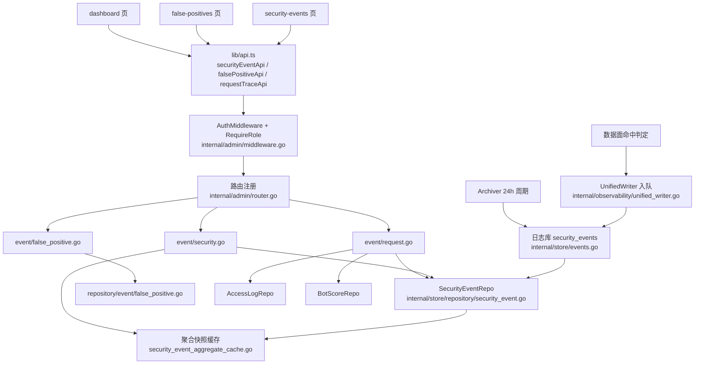
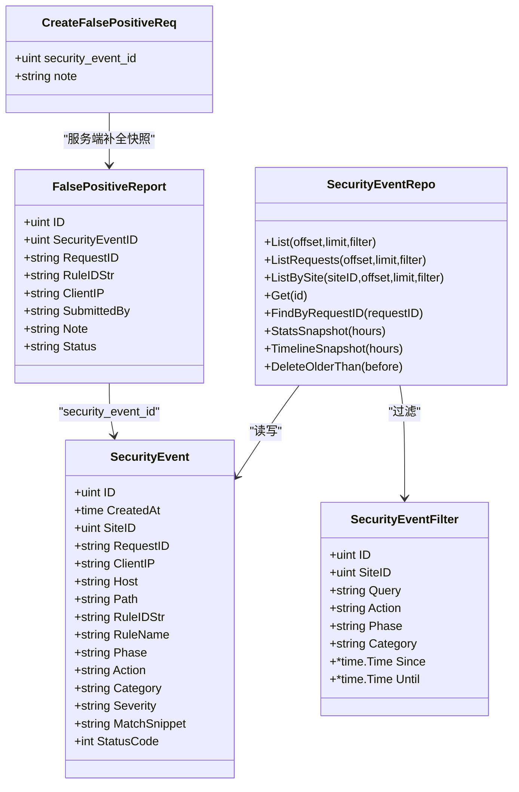
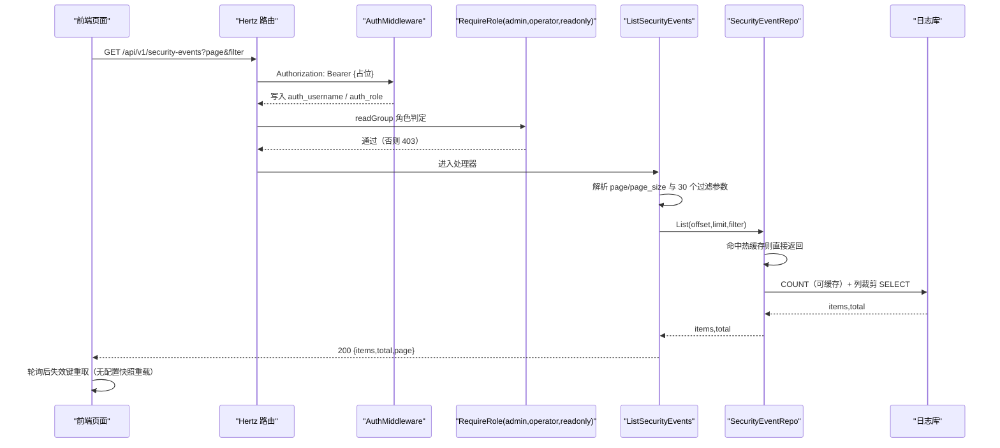
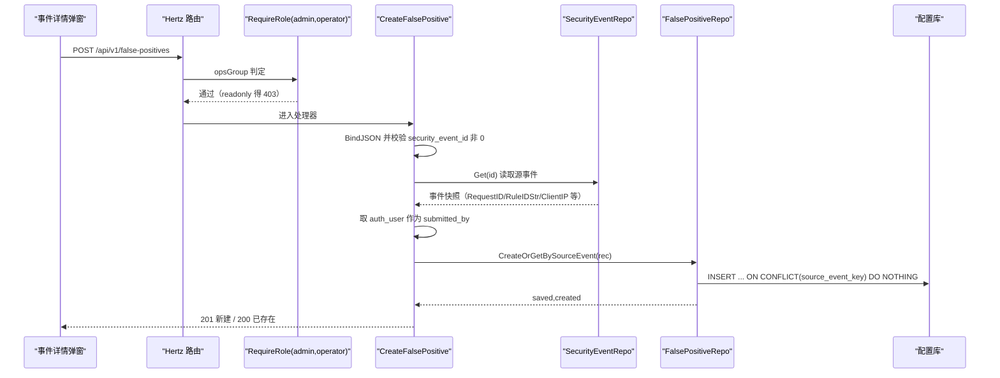
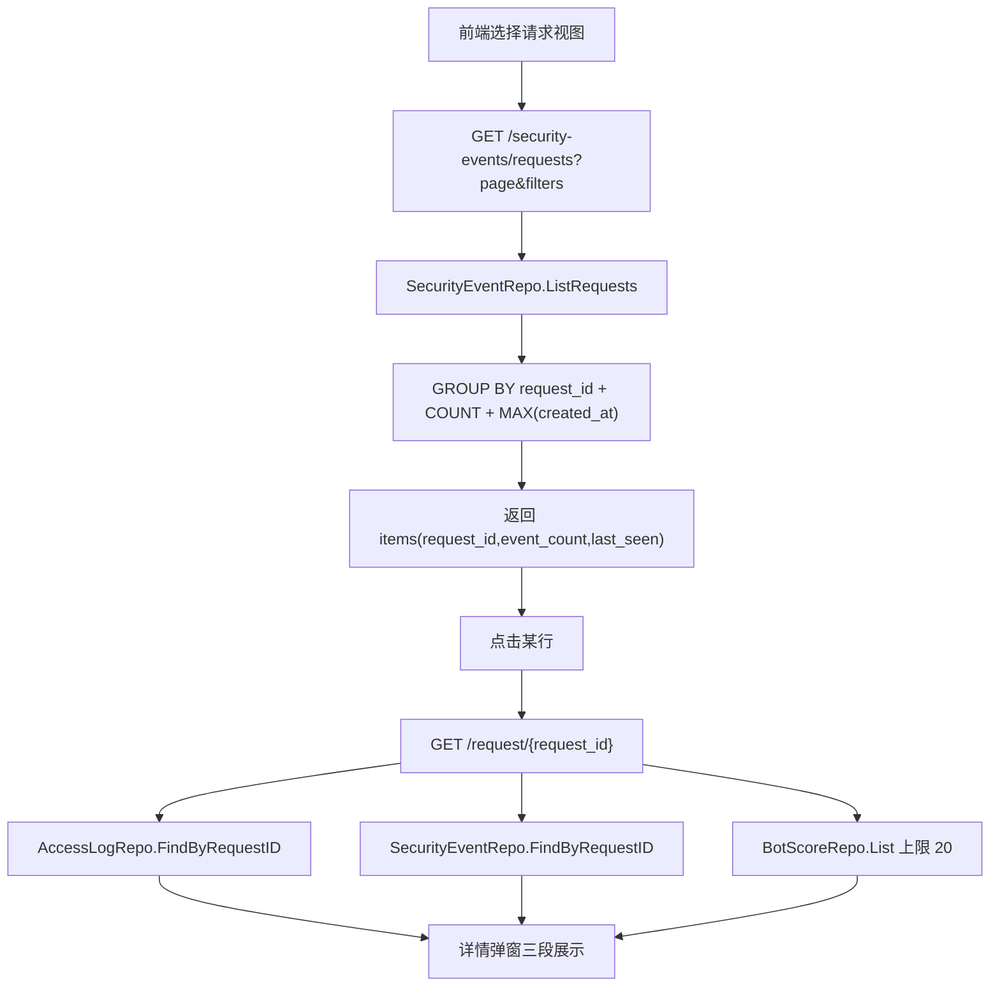
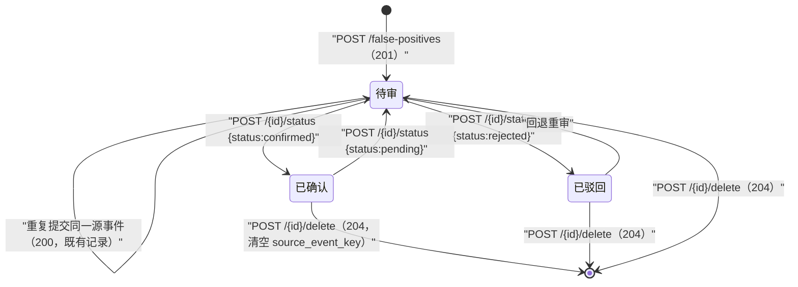

# 安全事件 API

> [返回 管理 API 系统](管理 API 系统.md)

<cite>
**本文档引用的文件**
- [router.go](file://internal/admin/router.go)
- [security.go](file://internal/admin/event/security.go)
- [false_positive.go](file://internal/admin/event/false_positive.go)
- [request.go](file://internal/admin/event/request.go)
- [security_event.go](file://internal/store/repository/security_event.go)
- [repository.go](file://internal/store/repository/repository.go)
- [security_event_aggregate_cache.go](file://internal/store/repository/security_event_aggregate_cache.go)
- [false_positive.go](file://internal/store/repository/event/false_positive.go)
- [events.go](file://internal/store/events.go)
- [false_positive.go](file://internal/store/falsepositive/false_positive.go)
- [middleware.go](file://internal/admin/middleware.go)
- [action.go](file://internal/core/action/action.go)
- [phases.go](file://internal/core/rules/phases.go)
- [unified_writer.go](file://internal/observability/unified_writer.go)
- [archiver.go](file://internal/observability/archiver.go)
- [api.ts](file://frontend/lib/api.ts)
- [use-api.ts](file://frontend/hooks/use-api.ts)
- [page.tsx](file://frontend/app/(dashboard)/security-events/page.tsx)
- [request-aggregate-view.tsx](file://frontend/app/(dashboard)/security-events/components/request-aggregate-view.tsx)
- [security-event-detail-dialog.tsx](file://frontend/components/security-event-detail-dialog.tsx)
- [page.tsx](file://frontend/app/(dashboard)/false-positives/page.tsx)
- [page.tsx](file://frontend/app/(dashboard)/dashboard/page.tsx)
</cite>

## 目录

1. [简介](#简介)
2. [项目结构](#项目结构)
3. [核心组件](#核心组件)
4. [架构总览](#架构总览)
5. [详细组件分析](#详细组件分析)
6. [依赖关系分析](#依赖关系分析)
7. [性能考虑](#性能考虑)
8. [故障排查指南](#故障排查指南)
9. [结论](#结论)
10. [附录](#附录)

## 简介

安全事件 API 覆盖两组资源：`security_events` 的查询、统计、时间线与请求级聚合，以及 `false_positives` 误报反馈的提交与审查。处理器在 `internal/admin/event/`（`security.go` 293 行、`false_positive.go` 171 行、`request.go` 72 行），仓储在 `internal/store/repository/security_event.go`（725 行）与聚合缓存 `security_event_aggregate_cache.go`（344 行）。

三条口径先确立：本组写操作只有 POST 且仅三条（`POST /false-positives`、`POST /false-positives/:id/status`、`POST /false-positives/:id/delete`，最后一条仅 admin）；安全事件不由管理面产生，数据面命中后经 `UnifiedWriter` 异步落库，本 API 只读，因此除误报反馈外没有配置快照重载环节；挑战类动作必须按 WAF action 语义解释——`captcha_challenge` 展示配置的验证码类型、`shield_challenge` 走 5 秒盾流程、`chain_challenge` 展示链式步骤，不能统一描述为「403 拦截页」。

**章节来源**
- [router.go:169-182](file://internal/admin/router.go#L169-L182)
- [router.go:365-366](file://internal/admin/router.go#L365-L366)
- [router.go:415](file://internal/admin/router.go#L415)
- [action.go:18-21](file://internal/core/action/action.go#L18-L21)

## 项目结构

安全事件链路跨数据面写入、日志库仓储与管理面处理器三层，前端消费点分散在四个页面与两处预览组件。

| 层 | 路径 | 行数 | 职责 |
|----|------|-----:|------|
| 路由 | `internal/admin/router.go` | 465 | 13 个端点注册与三档权限分组 |
| 处理器 | `internal/admin/event/security.go` | 293 | 列表、详情、统计、时间线、请求级聚合、站点作用域 |
| 处理器 | `internal/admin/event/false_positive.go` | 171 | 误报反馈 CRUD 与状态审查 |
| 处理器 | `internal/admin/event/request.go` | 72 | 按 `request_id` 拼装全链路追踪 |
| 仓储 | `internal/store/repository/security_event.go` | 725 | 过滤、分页、COUNT 缓存、热缓存、TopN |
| 仓储 | `internal/store/repository/security_event_aggregate_cache.go` | 344 | 统计与时间线快照缓存 |
| 仓储 | `internal/store/repository/event/false_positive.go` | 118 | 幂等创建、状态更新、软删清键 |
| 模型 | `internal/store/events.go` | 278 | `SecurityEvent`、`AccessLog`、`BotScoreLog` 列定义 |
| 模型 | `internal/store/falsepositive/false_positive.go` | 43 | 误报反馈表与冗余快照字段 |
| 观测 | `internal/observability/unified_writer.go` | 1198 | 事件异步入队与批量落库 |
| 观测 | `internal/observability/archiver.go` | 529 | 24 小时周期按保留期清理 |
| 前端 | `frontend/app/(dashboard)/security-events/` | 769 + 子组件 | 列表、筛选、详情弹窗、请求级聚合视图 |



**图表来源**
- [router.go:169-185](file://internal/admin/router.go#L169-L185)
- [router.go:365-366](file://internal/admin/router.go#L365-L366)
- [router.go:415](file://internal/admin/router.go#L415)
- [unified_writer.go:566-574](file://internal/observability/unified_writer.go#L566-L574)
- [security.go:39-293](file://internal/admin/event/security.go#L39-L293)

**章节来源**
- [router.go:169-185](file://internal/admin/router.go#L169-L185)
- [security.go:17-37](file://internal/admin/event/security.go#L17-L37)
- [api.ts:913-958](file://frontend/lib/api.ts#L913-L958)

## 核心组件

| 组件 | 类型 | 定义位置 | 说明 |
|------|------|----------|------|
| `SecurityEventFilter` | 过滤结构 | `repository/security_event.go:53-79` | 26 个字段，含 10 个 TLS 指纹维度 |
| `securityEventFilterFromQuery` | 解析函数 | `event/security.go:89-138` | 全局列表的参数入口，站点列表不复用 |
| `securityEventListColumns` | 列清单 | `repository/security_event.go:98-107` | 列表排除体积大的审计载荷列 |
| `SecurityEventStatsSnapshot` | 聚合结构 | `repository/security_event_aggregate_cache.go:170-182` | 12 字段，TopN 固定 10 |
| `TimelineBucket` | 时间桶 | `repository/security_event.go:590-593` | `bucket` + `count`，按小时分桶 |
| `SecurityEventRequest` | 请求级聚合 | `repository/security_event.go:164-168` | `request_id`、`event_count`、`last_seen` |
| `CreateFalsePositiveReq` | 请求结构 | `event/false_positive.go:43-46` | 只接受事件 ID 与备注，快照字段由后端读取 |
| `FalsePositiveReport` | 数据模型 | `store/falsepositive/false_positive.go:16-43` | 冗余源事件关键字段，`source_event_key` 唯一去重 |
| `GetRequestTrace` | 处理器 | `event/request.go:33-72` | 访问日志 + 安全事件 + Bot 评分三视图 |



**图表来源**
- [events.go:15-76](file://internal/store/events.go#L15-L76)
- [security_event.go:53-79](file://internal/store/repository/security_event.go#L53-L79)
- [security_event.go:109-352](file://internal/store/repository/security_event.go#L109-L352)
- [false_positive.go:16-43](file://internal/store/falsepositive/false_positive.go#L16-L43)
- [false_positive.go:43-106](file://internal/admin/event/false_positive.go#L43-L106)

**章节来源**
- [security_event.go:53-107](file://internal/store/repository/security_event.go#L53-L107)
- [security_event_aggregate_cache.go:170-182](file://internal/store/repository/security_event_aggregate_cache.go#L170-L182)
- [false_positive.go:16-43](file://internal/store/falsepositive/false_positive.go#L16-L43)

## 架构总览

读路径的关键是「列裁剪 + 两级缓存 + 聚合快照」，写路径（仅误报反馈）的关键是「服务端补全快照 + 唯一键幂等」。



**图表来源**
- [router.go:124-125](file://internal/admin/router.go#L124-L125)
- [router.go:169](file://internal/admin/router.go#L169)
- [middleware.go:42-141](file://internal/admin/middleware.go#L42-L141)
- [security.go:39-56](file://internal/admin/event/security.go#L39-L56)
- [security_event.go:109-133](file://internal/store/repository/security_event.go#L109-L133)

误报反馈的写路径把源事件快照读取放在服务端，客户端无法伪造上下文：



**图表来源**
- [router.go:255-256](file://internal/admin/router.go#L255-L256)
- [router.go:365](file://internal/admin/router.go#L365)
- [false_positive.go:52-106](file://internal/admin/event/false_positive.go#L52-L106)
- [false_positive.go:31-49](file://internal/store/repository/event/false_positive.go#L31-L49)

**章节来源**
- [security.go:39-56](file://internal/admin/event/security.go#L39-L56)
- [false_positive.go:52-106](file://internal/admin/event/false_positive.go#L52-L106)
- [security_event.go:109-133](file://internal/store/repository/security_event.go#L109-L133)

## 详细组件分析

### 端点总表

| 方法 | 路径 | 权限 | 处理器 | 注册行 | 说明 |
|------|------|------|--------|-------:|------|
| GET | `/api/v1/security-events` | readonly+ | `event.ListSecurityEvents` | 169 | 事件分页列表 |
| GET | `/api/v1/security-events/stats` | readonly+ | `event.SecurityEventStats` | 170 | 滚动窗口聚合快照 |
| GET | `/api/v1/security-events/timeline` | readonly+ | `event.SecurityEventTimeline` | 171 | 按小时终止事件时间线 |
| GET | `/api/v1/security-events/requests` | readonly+ | `event.ListSecurityEventRequests` | 174 | 请求级聚合，`total` 是去重请求数 |
| GET | `/api/v1/security-events/:id` | readonly+ | `event.GetSecurityEvent` | 175 | 单事件全列详情 |
| GET | `/api/v1/request/:request_id` | readonly+ | `event.GetRequestTrace` | 179 | 访问日志 + 事件 + Bot 评分 |
| GET | `/api/v1/sites/:id/security-events` | readonly+ | `event.ListSiteSecurityEvents` | 180 | 站点作用域列表 |
| GET | `/api/v1/sites/:id/security-events/stats` | readonly+ | `event.SiteSecurityEventStats` | 181 | 站点作用域聚合 |
| GET | `/api/v1/sites/:id/security-events/timeline` | readonly+ | `event.SiteSecurityEventTimeline` | 182 | 站点作用域时间线 |
| GET | `/api/v1/false-positives` | readonly+ | `event.ListFalsePositives` | 185 | 反馈分页，可按状态过滤 |
| POST | `/api/v1/false-positives` | admin/operator | `event.CreateFalsePositive` | 365 | 幂等提交，201/200 |
| POST | `/api/v1/false-positives/:id/status` | admin/operator | `event.UpdateFalsePositiveStatus` | 366 | 状态审查 |
| POST | `/api/v1/false-positives/:id/delete` | admin | `event.DeleteFalsePositive` | 415 | 软删并清空幂等键，204 |

静态段 `stats`、`timeline`、`requests` 必须排在 `:id` 之前，Hertz 路由树静态优先，否则 `GET /security-events/stats` 会被当作 `:id` 命中并返回 400（`router.go:172-175` 的注释即为此约束）。

**章节来源**
- [router.go:169-185](file://internal/admin/router.go#L169-L185)
- [router.go:365-366](file://internal/admin/router.go#L365-L366)
- [router.go:415](file://internal/admin/router.go#L415)

### 请求参数表

全局列表的过滤参数（`security.go:89-138`），全部可选：

| 参数 | 位置 | 类型 | 必填 | 说明 |
|------|------|------|:----:|------|
| `page` / `page_size` | query | int | 否 | 缺省 1 / 20，经 `utils.Paginate` 归一 |
| `q` | query | string | 否 | 全文模糊匹配（`Query` 字段） |
| `id` / `rule_id` / `site_id` | query | uint | 否 | 非数值被忽略而非报错 |
| `request_id` | query | string | 否 | 精确匹配 |
| `action` / `phase` / `category` | query | string | 否 | 精确匹配，取值见下方两张取值表 |
| `client_ip` / `host` / `path` / `query_string` | query | string | 否 | IP 精确，其余模糊 |
| `rule_id_str` | query | string | 否 | 内置规则 ID（带 `owasp:`/`cve:` 前缀） |
| `tls_version` / `tls_sni` / `tls_alpn` / `tls_ja3_hash` / `tls_ja4` | query | string | 否 | TLS 指纹维度 |
| `tls_cipher_suites` / `tls_extensions` / `tls_curves` / `tls_point_formats` / `header_order` | query | string | 否 | 指纹组合维度 |
| `since` / `until` | query | string | 否 | RFC3339，解析失败即忽略 |

统计与时间线端点只接受窗口参数：

| 参数 | 位置 | 类型 | 必填 | 约束 |
|------|------|------|:----:|------|
| `hours` | query | int | 否 | 缺省 24；必须 1–720（`24*30`），越界返回 400 |

站点作用域列表不接受 `id`、`rule_id`、`rule_id_str`、`site_id` 四个参数，其余口径与全局列表一致（`security.go:156-208`）。误报反馈端点参数：

| 端点 | 参数 | 位置 | 类型 | 必填 | 约束 |
|------|------|------|------|:----:|------|
| `GET /false-positives` | `page` | query | int | 否 | 小于 1 归 1 |
| `GET /false-positives` | `page_size` | query | int | 否 | 1–200，越界回落 20 |
| `GET /false-positives` | `status` | query | string | 否 | 空则不过滤 |
| `POST /false-positives` | `security_event_id` | body | uint | 是 | 0 触发 400 |
| `POST /false-positives` | `note` | body | string | 否 | 落库上限 `size:2000` |
| `POST /false-positives/:id/status` | `id` | path | uint | 是 | 非数值 400 |
| `POST /false-positives/:id/status` | `status` | body | string | 是 | 仅 `pending`/`confirmed`/`rejected` |
| `POST /api/v1/request/:request_id` | `request_id` | path | string | 是 | 空值 400 |

提交误报反馈的载荷示例（不含任何源事件字段，快照一律由服务端读取）：

```json
{
  "security_event_id": 90312,
  "note": "该路径为内部报表导出，union 参数为白名单字段"
}
```

**章节来源**
- [security.go:27-37](file://internal/admin/event/security.go#L27-L37)
- [security.go:89-138](file://internal/admin/event/security.go#L89-L138)
- [security.go:156-208](file://internal/admin/event/security.go#L156-L208)
- [false_positive.go:20-46](file://internal/admin/event/false_positive.go#L20-L46)
- [false_positive.go:111-148](file://internal/admin/event/false_positive.go#L111-L148)
- [request.go:33-40](file://internal/admin/event/request.go#L33-L40)

### 响应字段表

`GET /security-events` 与站点作用域列表返回 `{items,total,page}`。列表项做了列裁剪：`request_headers`、`request_body_preview`、`references` 不出现在列表，只在 `GET /security-events/:id` 与 `FindByRequestID` 的详情视图返回（`security_event.go:98-107`）。

| 字段 | 类型 | 出现端点 | 说明 |
|------|------|----------|------|
| `id` | uint | 列表/详情 | 主键，`idx_se_site_created_id` 第三优先列 |
| `created_at` | time | 列表/详情 | 事件时间 |
| `site_id` | uint | 列表/详情 | 站点作用域键 |
| `request_id` | string | 列表/详情/追踪 | 与访问日志、Bot 评分对齐的唯一关联键 |
| `client_ip` / `host` / `path` / `query_string` / `method` / `user_agent` | string | 列表/详情 | 请求标识六元组 |
| `rule_id` / `rule_id_str` | uint / string | 列表/详情 | 数值 ID 与字符串 ID 并存 |
| `rule_name` / `rule_desc` | string | 列表/详情 | 来自内置注册表的可解释信息 |
| `match_score` / `match_snippet` / `match_part` | int / string / string | 列表/详情 | 累计分值、脱敏片段、命中部位 |
| `severity` / `cvss_score` / `cwe_type` / `source` | string / float / string / string | 列表/详情 | CVE 命中的危险度明细 |
| `references` | text | 仅详情 | CVE 参考链接，SQL 保留字，需引号标识符选择 |
| `phase` / `action` / `category` / `match_desc` | string | 列表/详情 | 判定结果四要素 |
| `request_headers` / `request_body_preview` / `request_body_truncated` / `request_size` | text / text / bool / int64 | 仅详情（后两项列表也有） | 审计载荷 |
| `tls_*` 10 列 + `header_order` | string / text | 列表/详情 | TLS 指纹证据 |
| `tls_sni_presence` | string | 列表/详情 | `AfterFind` 派生字段，不入库 |
| `geo_country` / `geo_city` / `status_code` | string / string / int | 列表/详情 | 地理与响应码 |

`GET /security-events/stats` 返回 `SecurityEventStatsSnapshot`：

| 字段 | 类型 | 说明 |
|------|------|------|
| `total` | int64 | 窗口内事件行数 |
| `hours` | int | 回显实际生效窗口 |
| `categories` | []CategoryStat | 完整 GROUP BY，未截断 |
| `top_ips` / `top_paths` / `top_rules` / `top_countries` | [] | 各自上限 10，长度不代表总数 |
| `intercepts` | int64 | 命中 `terminalSecurityEventActions` 的行数 |
| `observes` | int64 | `action = 'observe'` 行数 |
| `requests` | int64 | `COUNT(DISTINCT request_id)` |
| `challenges` | int64 | 命中 `challengeSecurityEventActions` 行数 |

时间线返回 `{buckets:[{bucket,count}],hours}`，只统计终止类动作。请求级聚合返回 `{items:[{request_id,event_count,last_seen}],total,page}`。误报反馈返回 `FalsePositiveReport`，其中 `source_event_key` 与 `deleted_at` 标记 `json:"-"`，任何响应都不返回。

**章节来源**
- [events.go:15-76](file://internal/store/events.go#L15-L76)
- [security_event.go:81-107](file://internal/store/repository/security_event.go#L81-L107)
- [security_event.go:164-168](file://internal/store/repository/security_event.go#L164-L168)
- [security_event.go:442-593](file://internal/store/repository/security_event.go#L442-L593)
- [security_event_aggregate_cache.go:170-259](file://internal/store/repository/security_event_aggregate_cache.go#L170-L259)
- [false_positive.go:16-43](file://internal/store/falsepositive/false_positive.go#L16-L43)

### 错误码表

| 状态码 | 触发条件 | 响应体 | 依据 |
|-------:|----------|--------|------|
| 400 | `hours` 非 1–720 | `{"error":"hours must be between 1 and 720"}` | `security.go:27-37` |
| 400 | `:id` 路径参数非数值 | `{"error":"invalid id"}` | `security.go:142-145` |
| 400 | `request_id` 为空 | `{"error":"request_id is required"}` | `request.go:35-39` |
| 400 | `security_event_id` 为 0 | `{"error":"security_event_id required"}` | `false_positive.go:59-62` |
| 400 | 反馈请求体非法 JSON | `{"error":"<绑定错误>"}` | `false_positive.go:55-58` |
| 400 | `status` 不在三值集合 | `{"error":"status must be pending/confirmed/rejected"}` | `false_positive.go:131-136` |
| 403 | readonly 调用反馈写端点 | `{"error":"access denied: insufficient permissions"}` | `middleware.go:127-142` |
| 403 | operator 调用反馈删除 | 同上 | `router.go:415` |
| 404 | 事件 ID 不存在 | `{"error":"event not found"}` | `security.go:147-151` |
| 404 | 站点不存在 | `{"error":"site not found"}` | `security.go:163-166` |
| 404 | 源安全事件不存在 | `{"error":"security event not found"}` | `false_positive.go:64-68` |
| 404 | 反馈记录不存在 | `{"error":"false positive not found"}` | `false_positive.go:138-141` |
| 500 | 仓储查询失败 | `{"error":"<错误文本>"}` | `security.go:46-49`、`security.go:201-204` |

反馈删除成功返回 204 空体（`false_positive.go:169`），不带响应载荷。

**章节来源**
- [security.go:27-37](file://internal/admin/event/security.go#L27-L37)
- [security.go:39-208](file://internal/admin/event/security.go#L39-L208)
- [false_positive.go:52-171](file://internal/admin/event/false_positive.go#L52-L171)
- [request.go:33-72](file://internal/admin/event/request.go#L33-L72)
- [middleware.go:127-142](file://internal/admin/middleware.go#L127-L142)

### 动作与阶段取值表

`action` 的取值集合就是 WAF 动作枚举，统计口径分成两组（`security_event.go:617-618`）：

| 动作 | 终止优先级 | 默认状态码 | 是否终止类 | 是否挑战类 | 客户端看到什么 |
|------|-----------:|-----------:|:----------:|:----------:|----------------|
| `observe` | 10 | 0 | 否 | 否 | 请求透传，仅记录 |
| `redirect` | 50 | 302 | 是 | 否 | 跳转 `redirect_to` |
| `challenge` | 60 | 403 | 是 | 是 | JS 挑战兜底页 |
| `captcha_challenge` | 60 | 403 | 是 | 是 | 展示配置的验证码类型（`math`/`click`/`slide`/`rotate`） |
| `shield_challenge` | 60 | 403 | 是 | 是 | 5 秒盾流程（CAPTCHA + PoW + 环境指纹） |
| `chain_challenge` | 60 | 403 | 是 | 是 | 链式步骤序列，逐步推进 |
| `rate_limit` | 70 | 429 | 是 | 否 | 限流响应 |
| `intercept` | 80 | 403 | 是 | 否 | 拦截页 |
| `drop` | 90 | 无响应 | 是 | 否 | 连接被 RST，无任何 HTTP 响应 |

`phase` 取值即引擎阶段名，与事件里看到的检测来源一致：

| 阶段 | 定义行 | 典型类别 |
|------|--------|----------|
| `ip_reputation` | `phases.go:356` | IP 信誉 |
| `anti_replay` | `phases.go:1251` | 防重放 |
| `acl` | `phases.go:146` | 黑白名单 |
| `owasp_default` | `phases.go:616` | sqli、xss、path_traversal 等 |
| `cve_detection` | `phases.go:742` | CVE 命中，附 `severity`/`cvss_score` |
| `bot_detection` | `phases.go:488` | 恶意/可疑 Bot |
| `browser_sign` | `phases.go:1351` | 浏览器签名校验失败 |
| `rate_limit` | `phases.go:314` | 请求与错误率限流 |
| `signature` / `custom` | `phases.go:167`、`phases.go:188` | 自定义规则 |

`block` 与 `log_only` 是遗留别名，经 `action.Normalize` 映射为 `intercept` 与 `observe`；历史数据里仍可能看到旧值，前端展示需先归一化。

**章节来源**
- [security_event.go:617-618](file://internal/store/repository/security_event.go#L617-L618)
- [action.go:8-26](file://internal/core/action/action.go#L8-L26)
- [action.go:28-45](file://internal/core/action/action.go#L28-L45)
- [action.go:88-119](file://internal/core/action/action.go#L88-L119)
- [action.go:283-307](file://internal/core/action/action.go#L283-L307)
- [phases.go:146-1351](file://internal/core/rules/phases.go#L146-L1351)

### 请求级聚合与全链路追踪

`/security-events` 与 `/security-events/requests` 共用同一套筛选解析，避免两个列表的过滤面漂移；差别在聚合粒度与 `total` 语义：

| 端点 | 行粒度 | `total` 含义 | 用途 |
|------|--------|--------------|------|
| `GET /security-events` | 事件 | 事件条数 | 攻击明细审计 |
| `GET /security-events/requests` | 请求 | 去重请求数 | 一次请求命中多条规则时的收敛视图 |
| `GET /request/:request_id` | 请求 | — | 访问日志 + 事件 + Bot 评分三视图 |



**图表来源**
- [security.go:64-81](file://internal/admin/event/security.go#L64-L81)
- [security_event.go:164-194](file://internal/store/repository/security_event.go#L164-L194)
- [request.go:33-72](file://internal/admin/event/request.go#L33-L72)

`GetRequestTrace` 允许 `botScoreRepo` 为 nil，此时 `bot_scores` 返回空数组而不影响另两块数据；上限 20 条只是防御异常重复写入把响应撑大，正常一请求只有一条评分记录。

**章节来源**
- [security.go:64-81](file://internal/admin/event/security.go#L64-L81)
- [request.go:12-72](file://internal/admin/event/request.go#L12-L72)
- [security_event.go:164-194](file://internal/store/repository/security_event.go#L164-L194)

### 误报反馈审查流程

反馈状态是这条链路唯一的业务状态机，且删除会释放幂等键：



**图表来源**
- [false_positive.go:81-105](file://internal/admin/event/false_positive.go#L81-L105)
- [false_positive.go:119-148](file://internal/admin/event/false_positive.go#L119-L148)
- [false_positive.go:153-171](file://internal/admin/event/false_positive.go#L153-L171)
- [false_positive.go:99-118](file://internal/store/repository/event/false_positive.go#L99-L118)

三处实现细节决定了这条状态机的可靠性：

| 细节 | 位置 | 作用 |
|------|------|------|
| `source_event_key = "security-event:<id>"` 唯一索引 + `ON CONFLICT DO NOTHING` | `false_positive.go:80-95`、`false_positive.go:36-48` | 同事件重复提交返回既有记录而非报错 |
| 删除前置空 `source_event_key` | `false_positive.go:102-118` | 允许同一源事件重新提交反馈 |
| 状态更新以「再查一次存在性」判定 | `false_positive.go:79-97` | 驱动返回 0 受影响行时不误判为不存在 |

**章节来源**
- [false_positive.go:80-105](file://internal/admin/event/false_positive.go#L80-L105)
- [false_positive.go:31-118](file://internal/store/repository/event/false_positive.go#L31-L118)
- [false_positive.go:119-171](file://internal/admin/event/false_positive.go#L119-L171)

### 事件写入与保留

事件由数据面产生，管理面只读：

| 环节 | 实现 | 关键参数 |
|------|------|----------|
| 入队 | `unified_writer.go:566-574` | 高频通道 `EventBufferSize` |
| 落库 | `security_event.go:383-409` | `CreateInBatches(items, 100)` |
| 列表缓存 | `security_event.go:109-163` | Redis 热缓存 + COUNT 缓存 |
| 聚合缓存 | `security_event_aggregate_cache.go:184-208` | 按 `(kind,scoped,siteID,hours)` 键 |
| 清理 | `security_event.go:410-433` | 分批删除，保留期由归档器决定 |
| 保留期 | `archiver.go:26-57` | `security_event_retention_days` 默认 30 天，周期 24 小时 |

冗余快照字段（`rule_id_str`、`category`、`client_ip`、`host`、`path`、`match_desc`）被复制进反馈记录，因此源事件被归档后反馈仍可完整审查（`false_positive.go:13-14` 的模型注释）。

**章节来源**
- [unified_writer.go:566-574](file://internal/observability/unified_writer.go#L566-L574)
- [security_event.go:109-163](file://internal/store/repository/security_event.go#L109-L163)
- [security_event.go:383-433](file://internal/store/repository/security_event.go#L383-L433)
- [archiver.go:26-57](file://internal/observability/archiver.go#L26-L57)
- [false_positive.go:13-43](file://internal/store/falsepositive/false_positive.go#L13-L43)

### 前端调用点

| 调用方 | 位置 | 消费的端点 | 说明 |
|--------|------|------------|------|
| `useSecurityEvents` | `hooks/use-api.ts:522-526` | `GET /security-events` | 安全事件页主列表 |
| `useSecurityEventStats` | `hooks/use-api.ts:528-532` | `GET /security-events/stats` | 统计卡 |
| `useDashboardStats` | `hooks/use-api.ts:534-540` | `GET /security-events/stats` | 仪表板窗口指标，`refreshInterval` 30 秒 |
| `useSecurityEventTimeline` | `hooks/use-api.ts:542-546` | `GET /security-events/timeline` | 拦截趋势 |
| `useSecurityEventRequests` | `hooks/use-api.ts:554-558` | `GET /security-events/requests` | 请求级聚合视图 |
| `useRequestTrace` | `hooks/use-api.ts:568-572` | `GET /request/:request_id` | 详情弹窗全链路 |
| `useFalsePositives` 等四个 | `hooks/use-api.ts:1293-1330` | 误报反馈四端点 | 失效键 `false-positives` |
| 安全事件页 | `app/(dashboard)/security-events/page.tsx:134`、`:198` | 列表 + 单事件详情 | 行点击拉全列详情 |
| 请求聚合视图 | `security-events/components/request-aggregate-view.tsx:55` | `GET /security-events/requests` | 按请求收敛 |
| 事件详情弹窗 | `components/security-event-detail-dialog.tsx:360`、`:469` | 追踪 + 提交反馈 | 「这是误报」入口 |
| 误报反馈页 | `app/(dashboard)/false-positives/page.tsx:90-97` | 列表 + 状态 + 删除 | 审查工作流 |
| 仪表板页 | `app/(dashboard)/dashboard/page.tsx:190-191` | 时间线 + 统计 | 随时间范围联动，另见 [仪表板 API](仪表板 API.md) |

详情必须二次请求：列表接口为控制响应体积极意排除了 `request_headers` 与 `request_body_preview`，前端不能假设列表项已含全部字段。

**章节来源**
- [api.ts:913-951](file://frontend/lib/api.ts#L913-L951)
- [api.ts:1270-1285](file://frontend/lib/api.ts#L1270-L1285)
- [use-api.ts:522-572](file://frontend/hooks/use-api.ts#L522-L572)
- [use-api.ts:1293-1330](file://frontend/hooks/use-api.ts#L1293-L1330)
- [page.tsx:134-198](file://frontend/app/(dashboard)/security-events/page.tsx#L134-L198)
- [request-aggregate-view.tsx:55](file://frontend/app/(dashboard)/security-events/components/request-aggregate-view.tsx#L55)
- [security-event-detail-dialog.tsx:360-469](file://frontend/components/security-event-detail-dialog.tsx#L360-L469)
- [page.tsx:90-97](file://frontend/app/(dashboard)/false-positives/page.tsx#L90-L97)
- [page.tsx:190-191](file://frontend/app/(dashboard)/dashboard/page.tsx#L190-L191)

## 依赖关系分析

| 依赖方 | 被依赖方 | 依赖性质 | 失败表现 |
|--------|----------|----------|----------|
| `event/security` | `SecurityEventRepo` | 只读查询与聚合 | 500 |
| `event/security` | `SiteRepo` | 站点作用域存在性 | 400/404 |
| `event/false_positive` | `SecurityEventRepo` | 读源事件快照 | 404 |
| `event/false_positive` | `FalsePositiveRepo` | 幂等写与状态更新 | 400/404/500 |
| `event/request` | `AccessLogRepo`、`SecurityEventRepo`、`BotScoreRepo` | 三视图拼装 | 500；Bot 仓储可为 nil |
| `SecurityEventRepo` | Redis 热缓存 / COUNT 缓存 | 可选加速 | 不可用时直查数据库 |
| `SecurityEventRepo` | 聚合快照缓存 | 单飞合并冷读 | 并发冷读被合并为一对查询 |
| 前端页面 | `lib/api.ts` 三个导出对象 | 唯一 HTTP 出口 | 401 触发令牌刷新 |

`event` 包不依赖任何配置写入路径，因此安全事件与误报反馈的变更不会触发配置快照重载；这与站点、策略类资源形成清晰边界。两个库的分工是：`SecurityEventRepo`、`AccessLogRepo`、`BotScoreRepo`、`DropEventRepo` 全部建在 `logDB` 上，`FalsePositiveRepo` 建在配置库 `db` 上（`repository.go:73-86`）。因此真正跨库的是 `POST /false-positives`——它从日志库读源事件快照、向配置库写反馈记录；`GET /request/:request_id` 反而只读日志库的三张表。

**章节来源**
- [security.go:1-15](file://internal/admin/event/security.go#L1-L15)
- [false_positive.go:1-14](file://internal/admin/event/false_positive.go#L1-L14)
- [request.go:1-16](file://internal/admin/event/request.go#L1-L16)
- [security_event.go:14-51](file://internal/store/repository/security_event.go#L14-L51)
- [repository.go:73-86](file://internal/store/repository/repository.go#L73-L86)

## 性能考虑

- 列表用 `securityEventListColumns` 排除审计大列，配合 Redis 热缓存把「宽文本 + 高频轮询」的开销压在缓存层。
- `COUNT` 结果按过滤条件组合缓存，写入路径（含异步批量提交）都会失效对应前缀，避免总数漂移。
- 统计与时间线走单飞聚合缓存，同窗口的并发请求只触发一次真实扫描；TopN 固定 10，聚合成本不随流量线性增长。
- 时间线只统计终止类动作，桶按小时聚合，跨 30 天窗口的分组集合有界。
- `hours` 上限 720 是硬性护栏，避免把 30 天全表扫描当成常规轮询参数。
- `since`/`until` 与 `hours` 属两套窗口口径：列表用绝对时间，聚合用相对小时，混用会让统计卡与列表看起来互相矛盾。
- 保留期默认 30 天且按批删除，归档周期 24 小时，历史查询命中已清理区间时返回空列表而非错误。

[本节为总结，无需特定文件来源]

## 故障排查指南

| 症状 | 原因 | 排查 | 方案 |
|------|------|------|------|
| 列表看不到请求头/请求体 | 列表列裁剪 | 调 `GET /security-events/:id` | 详情视图二次请求 |
| 统计类别数与 Top 列表长度不符 | TopN 固定 10 | 看 `categories` 长度 | 前端须分别标注口径 |
| `hours=1000` 报 400 | 超过 720 上限 | 核对参数 | 分段查询或改用 `since`/`until` |
| 时间线为 0 但有拦截 | 时间线只算终止类动作 | 查 `intercepts` 字段 | 用动作过滤复核 |
| 站点列表过滤参数无效 | 站点端点不支持 `id`/`rule_id`/`rule_id_str`/`site_id` | 换用全局端点加 `site_id` | 保持筛选面一致 |
| `GET /security-events/stats` 返回 400 `invalid id` | 静态段被 `:id` 抢先注册 | 检查路由注册顺序 | 静态段必须排在 `:id` 之前 |
| 重复提交反馈返回 200 而非 201 | 幂等命中既有记录 | 比对 `id` 是否相同 | 视为成功，勿重试 |
| 删除同事件再提交失败后又成功 | 删除会清空幂等键 | 查 `source_event_key` | 正常行为 |
| 事件缺失 | 异步队列缓冲满或已归档清理 | 查写入器统计与保留期 | 扩大缓冲或缩短轮询 |

**章节来源**
- [security_event.go:81-163](file://internal/store/repository/security_event.go#L81-L163)
- [security_event_aggregate_cache.go:210-328](file://internal/store/repository/security_event_aggregate_cache.go#L210-L328)
- [security.go:156-208](file://internal/admin/event/security.go#L156-L208)
- [router.go:170-175](file://internal/admin/router.go#L170-L175)
- [false_positive.go:95-105](file://internal/admin/event/false_positive.go#L95-L105)
- [unified_writer.go:566-574](file://internal/observability/unified_writer.go#L566-L574)

## 结论

安全事件 API 的设计重心是「大表可读」：列裁剪、两级缓存、单飞聚合、窗口上限四道机制，让高频轮询不至于把日志库拖垮。误报反馈则刻意做成最小写面——客户端只能提交事件 ID 与备注，快照字段一律服务端补全，既防止伪造上下文，也让同一源事件的重复提交天然幂等。

两处易被误读的地方已在本篇定口径：统计里的 TopN 列表长度不是总数，`requests` 与 `total` 单位不同；挑战类事件必须按 `captcha_challenge`/`shield_challenge`/`chain_challenge` 各自的渲染语义解释，不能统称拦截页。下一步若要扩展告警能力，应新增只读聚合端点而不是在处理器里内联通知逻辑。

[本节为总结，无需特定文件来源]

## 附录

### 响应示例

列表响应（字段已截取，实际返回见「响应字段表」）：

```json
{
  "items": [
    {
      "id": 90312,
      "created_at": "2026-10-17T09:12:33Z",
      "site_id": 3,
      "request_id": "b1c2d3e4f5a6",
      "client_ip": "203.0.113.10",
      "host": "app.example.internal",
      "path": "/jobRead",
      "rule_id_str": "cve:CVE-2024-23897",
      "rule_name": "Jenkins CLI 任意文件读取",
      "phase": "cve_detection",
      "action": "drop",
      "category": "cve_general",
      "severity": "critical",
      "cvss_score": 9.8,
      "match_part": "url",
      "status_code": 0
    }
  ],
  "total": 1874,
  "page": 1
}
```

统计响应：

```json
{
  "total": 1874,
  "hours": 24,
  "categories": [{ "category": "cve_general", "count": 512 }],
  "top_ips": [{ "client_ip": "203.0.113.10", "count": 37 }],
  "top_paths": [{ "path": "/jobRead", "count": 128 }],
  "top_rules": [{ "rule_id_str": "cve:CVE-2024-23897", "count": 96 }],
  "top_countries": [{ "country": "US", "count": 210 }],
  "intercepts": 640,
  "observes": 118,
  "requests": 1502,
  "challenges": 27
}
```

时间线响应：

```json
{
  "buckets": [{ "bucket": "2026-10-17 09:00", "count": 41 }],
  "hours": 24
}
```

**章节来源**
- [security.go:39-56](file://internal/admin/event/security.go#L39-L56)
- [security_event_aggregate_cache.go:170-182](file://internal/store/repository/security_event_aggregate_cache.go#L170-L182)
- [security_event.go:590-593](file://internal/store/repository/security_event.go#L590-L593)
- [events.go:15-76](file://internal/store/events.go#L15-L76)

### 字段脱敏与展示约定

安全事件与访问日志的请求头、请求体列属于审计载荷，展示时必须遵循库内已有的处理：`match_snippet` 与 `request_body_preview` 在写入前按长度上限截断并脱敏，`request_body_truncated` 标记是否被截；`Authorization`、`Cookie`、`Set-Cookie`、API key 类敏感值不得原样出现在响应与前端渲染里，列表默认不带这两列正是为此。

**章节来源**
- [events.go:36-57](file://internal/store/events.go#L36-L57)
- [security_event.go:98-107](file://internal/store/repository/security_event.go#L98-L107)

### 相关文档

- 事件产生侧：[阻断机制](../安全防护功能/阻断机制.md)、[机器人检测阶段](../WAF 引擎系统/处理阶段详解/机器人检测阶段.md)
- 同域端点契约：[阻断策略 API](阻断策略 API.md)、[机器人保护 API](机器人保护 API.md)、[仪表板 API](仪表板 API.md)
- 访问日志与请求追踪：[API 端点参考](REST API 设计规范/API 端点参考.md)

[本节为通用指导，无需特定文件来源]

### 验证命令

按窗口读取统计与时间线：

```bash
curl -s -H "Authorization: Bearer {占位}" \
  "http://127.0.0.1:8080/api/v1/security-events/stats?hours=24"

curl -s -H "Authorization: Bearer {占位}" \
  "http://127.0.0.1:8080/api/v1/security-events/timeline?hours=168"
```

提交一条误报反馈（预期 201），并核对越界窗口被拒：

```bash
curl -s -X POST -H "Authorization: Bearer {占位}" \
  -H "Content-Type: application/json" \
  -d '{"security_event_id":90312,"note":"内部报表导出路径"}' \
  http://127.0.0.1:8080/api/v1/false-positives

curl -s -o /dev/null -w "%{http_code}\n" \
  -H "Authorization: Bearer {占位}" \
  "http://127.0.0.1:8080/api/v1/security-events/stats?hours=0"

go test ./internal/admin/event/... ./internal/store/repository/...
```

[本节为通用指导，无需特定文件来源]
