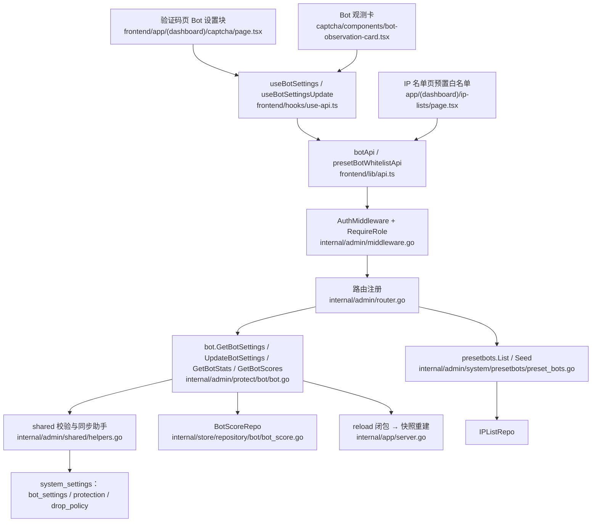
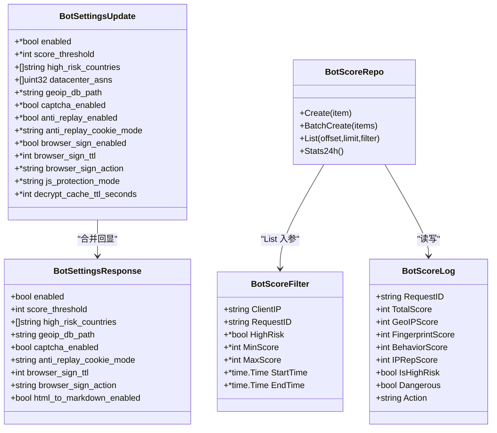
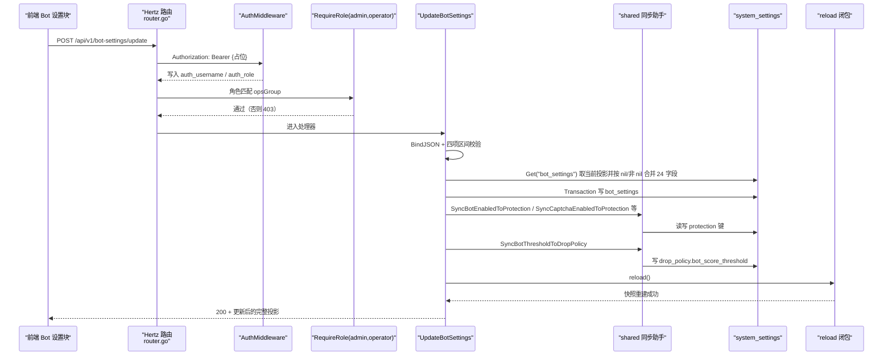
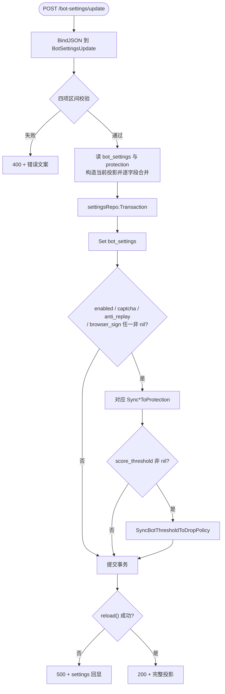
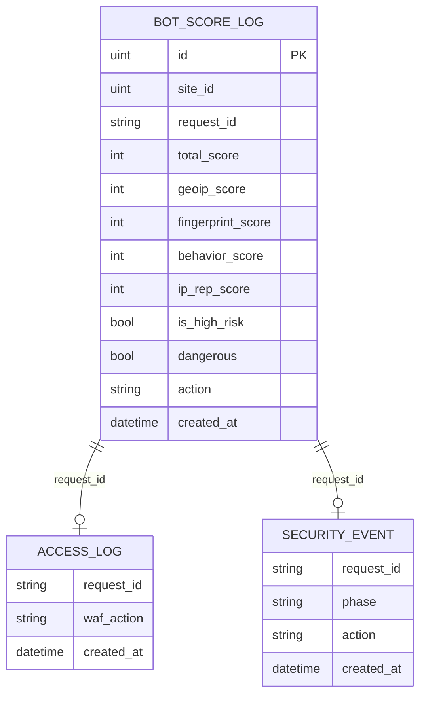
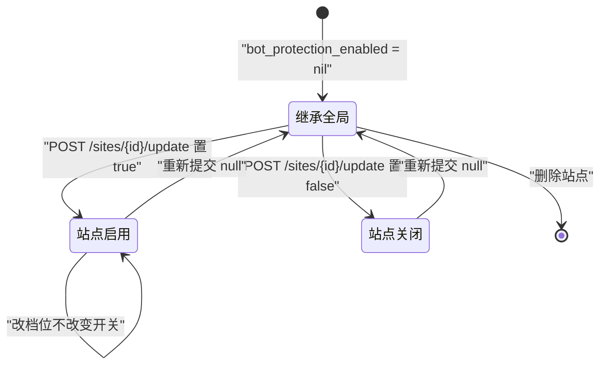
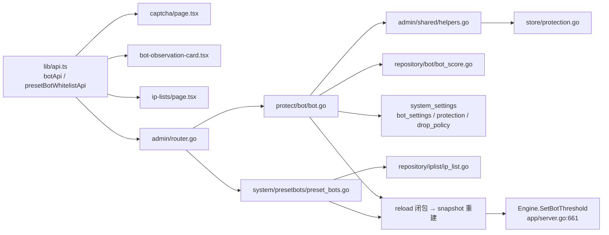
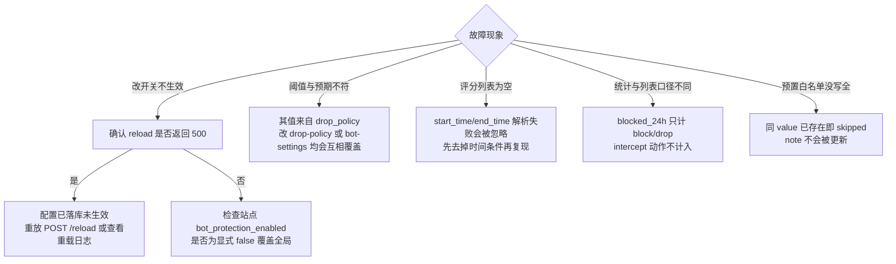

# 机器人保护 API

> [返回 管理 API 系统](管理 API 系统.md)

<cite>
**本文档引用的文件**
- [router.go](file://internal/admin/router.go)
- [bot.go](file://internal/admin/protect/bot/bot.go)
- [helpers.go](file://internal/admin/shared/helpers.go)
- [preset_bots.go](file://internal/admin/system/presetbots/preset_bots.go)
- [bot_score.go](file://internal/store/repository/bot/bot_score.go)
- [events.go](file://internal/store/events.go)
- [protection.go](file://internal/store/protection.go)
- [site.go](file://internal/store/site.go)
- [site.go](file://internal/admin/site/site.go)
- [build.go](file://internal/snapshot/build.go)
- [bot.go](file://internal/waf/bot/bot.go)
- [phases.go](file://internal/core/rules/phases.go)
- [action.go](file://internal/core/action/action.go)
- [processor.go](file://internal/waf/dynamic/processor.go)
- [server.go](file://internal/app/server.go)
- [middleware.go](file://internal/admin/middleware.go)
- [access.go](file://internal/admin/event/access.go)
- [api.ts](file://frontend/lib/api.ts)
- [use-api.ts](file://frontend/hooks/use-api.ts)
- [page.tsx](file://frontend/app/(dashboard)/captcha/page.tsx)
- [bot-observation-card.tsx](file://frontend/app/(dashboard)/captcha/components/bot-observation-card.tsx)
- [page.tsx](file://frontend/app/(dashboard)/ip-lists/page.tsx)
</cite>

## 目录

1. [简介](#简介)
2. [项目结构](#项目结构)
3. [核心组件](#核心组件)
4. [架构总览](#架构总览)
5. [详细组件分析](#详细组件分析)
6. [依赖关系分析](#依赖关系分析)
7. [性能考虑](#性能考虑)
8. [故障排查指南](#故障排查指南)
9. [结论](#结论)
10. [附录](#附录)

## 简介

机器人保护 API 负责三件事：全局 Bot 检测配置的读写、Bot 评分日志的查询与聚合、预置搜索引擎爬虫白名单的预览与注入。处理器实现在 `internal/admin/protect/bot/`（338 行）与 `internal/admin/system/presetbots/`（118 行），路由注册全部集中在 `internal/admin/router.go`。本篇只描述 Bot 这一资源专属的契约：端点、字段、校验区间、错误回显与双投影同步。通用错误码语义、命名规范、中间件链见 [REST API 设计规范](REST API 设计规范/REST API 设计规范.md)，不在本篇重复。

三条硬性口径必须先建立：写操作只有 POST，本组唯一的写端点是 `POST /api/v1/bot-settings/update` 与 `POST /api/v1/preset-bot-whitelist/seed`，全库不存在 PUT/DELETE 路由；`bot_settings`、`protection`、`drop_policy` 是同一份 Bot 开关的三个投影，写入由处理器在同一事务内互相同步，不存在第二配置源；站点级 `bot_protection_enabled` 是 `*bool` 三态指针，`nil` 表示继承全局，不是「关闭」。

**章节来源**
- [router.go:315](file://internal/admin/router.go#L315)
- [router.go:369](file://internal/admin/router.go#L369)
- [bot.go:17-42](file://internal/admin/protect/bot/bot.go#L17-L42)

## 项目结构

Bot 保护 API 的代码分布在控制面处理器、共享校验助手、评分仓储、模型与运行时装配五处，前端调用点集中在验证码页与 IP 名单页。

| 层 | 路径 | 行数 | 职责 |
|----|------|-----:|------|
| 路由 | `internal/admin/router.go` | 465 | 6 个 Bot 相关端点注册与权限分组 |
| 处理器 | `internal/admin/protect/bot/bot.go` | 338 | `BotSettingsUpdate` 读写、评分统计与分页查询 |
| 处理器 | `internal/admin/system/presetbots/preset_bots.go` | 118 | 预置爬虫白名单预览与注入 IP 白名单 |
| 共享 | `internal/admin/shared/helpers.go` | 593 | `BotSettingsResponse`、阈值与 Cookie 模式校验、六个同步函数 |
| 仓储 | `internal/store/repository/bot/bot_score.go` | 139 | `BotScoreFilter`、分页列表、24 小时聚合 |
| 模型 | `internal/store/events.go` | 278 | `BotScoreLog` 表结构与派生钩子 |
| 模型 | `internal/store/protection.go` | 476 | `ProtectionConfig` 默认值与 `BotProtectionConfig` |
| 快照 | `internal/admin/site/site.go` + `internal/snapshot/build.go` | 671 / 1644 | 站点三态从属清理与合并 |
| 运行时 | `internal/app/server.go` | 2121 | `loadDropPolicy`、reload 链回灌阈值与开关 |
| 前端 | `frontend/app/(dashboard)/captcha/page.tsx` | 1916 | Bot 设置块与局部字段合并 |
| 前端 | `frontend/app/(dashboard)/captcha/components/bot-observation-card.tsx` | 346 | 评分统计与最近记录观测卡 |



**图表来源**
- [router.go:188](file://internal/admin/router.go#L188)
- [router.go:216-218](file://internal/admin/router.go#L216-L218)
- [router.go:315](file://internal/admin/router.go#L315)
- [bot.go:113-276](file://internal/admin/protect/bot/bot.go#L113-L276)
- [helpers.go:309-413](file://internal/admin/shared/helpers.go#L309-L413)
- [api.ts:963-971](file://frontend/lib/api.ts#L963-L971)

**章节来源**
- [router.go:188-218](file://internal/admin/router.go#L188-L218)
- [bot.go:1-15](file://internal/admin/protect/bot/bot.go#L1-L15)
- [bot_score.go:11-32](file://internal/store/repository/bot/bot_score.go#L11-L32)

## 核心组件

| 组件 | 类型 | 定义位置 | 说明 |
|------|------|----------|------|
| `BotSettingsUpdate` | 请求体结构 | `protect/bot/bot.go:17-42` | 24 个字段，标量全部为指针以区分「未提交」与「显式 false/0」 |
| `BotSettingsResponse` | 响应体结构 | `admin/shared/helpers.go:568-593` | 读写共用投影，标量为值类型 |
| `defaultBotSettingsResponse` | 构造函数 | `protect/bot/bot.go:44-74` | 以 `protection` 为权威源回填，阈值兜底 60，再被 `drop_policy` 覆盖 |
| `GetBotSettings` / `UpdateBotSettings` | 处理器 | `protect/bot/bot.go:76-276` | 读回落默认投影；写为「校验 → 合并 → 事务三投影 → reload」 |
| `GetBotStats` / `GetBotScores` | 处理器 | `protect/bot/bot.go:278-338` | 24 小时聚合；13 个查询参数解析为 `BotScoreFilter` |
| `BotScoreFilter` | 仓储过滤结构 | `repository/bot/bot_score.go:17-32` | 精确/模糊条件混合，模糊项用 `LIKE %v%` |
| `BotScoreLog` | 数据模型 | `store/events.go:250-278` | 总分 + 五个分项 + 高风险 + 危险标记 |
| `presetBotEntries` | 内置清单 | `presetbots/preset_bots.go:24-40` | 8 条长期稳定爬虫网段 |



**图表来源**
- [bot.go:17-42](file://internal/admin/protect/bot/bot.go#L17-L42)
- [helpers.go:568-593](file://internal/admin/shared/helpers.go#L568-L593)
- [bot_score.go:17-60](file://internal/store/repository/bot/bot_score.go#L17-L60)
- [events.go:250-278](file://internal/store/events.go#L250-L278)

**章节来源**
- [bot.go:17-42](file://internal/admin/protect/bot/bot.go#L17-L42)
- [bot_score.go:17-96](file://internal/store/repository/bot/bot_score.go#L17-L96)

## 架构总览

Bot 配置的读路径是「blob + 权威投影回填」，写路径是「校验 → 合并 → 单事务三投影 → reload」。下面这条链路以更新为例，覆盖鉴权、角色分组、落库与快照重载：



**图表来源**
- [router.go:255-256](file://internal/admin/router.go#L255-L256)
- [router.go:315](file://internal/admin/router.go#L315)
- [middleware.go:42-141](file://internal/admin/middleware.go#L42-L141)
- [bot.go:113-276](file://internal/admin/protect/bot/bot.go#L113-L276)
- [helpers.go:321-499](file://internal/admin/shared/helpers.go#L321-L499)
- [server.go:660-661](file://internal/app/server.go#L660-L661)

权限分组决定端点可达性，本组端点落在两个分组：

| 分组 | 注册位置 | 允许角色 | 本组端点 |
|------|----------|----------|----------|
| `readGroup` | `router.go:124-125` | admin、operator、readonly | `GET /bot-settings`、`GET /bot-stats`、`GET /bot-scores`、`GET /preset-bot-whitelist` |
| `opsGroup` | `router.go:255-256` | admin、operator | `POST /bot-settings/update`、`POST /preset-bot-whitelist/seed` |

API Key 请求的角色取归属账号的角色，不是默认按 admin 处理，详见 [认证授权机制](REST API 设计规范/认证授权机制.md)。

**章节来源**
- [router.go:124-125](file://internal/admin/router.go#L124-L125)
- [router.go:255-256](file://internal/admin/router.go#L255-L256)
- [middleware.go:103-141](file://internal/admin/middleware.go#L103-L141)

## 详细组件分析

### 端点总表

| 方法 | 路径 | 权限 | 处理器 | 注册行 | 说明 |
|------|------|------|--------|-------:|------|
| GET | `/api/v1/bot-settings` | readonly+ | `bot.GetBotSettings` | 216 | 读 Bot 投影，异常时回落默认值 |
| GET | `/api/v1/bot-stats` | readonly+ | `bot.GetBotStats` | 217 | `BotScoreLog` 24 小时聚合 |
| GET | `/api/v1/bot-scores` | readonly+ | `bot.GetBotScores` | 218 | 评分日志分页查询，返回 `{items,total}` |
| GET | `/api/v1/preset-bot-whitelist` | readonly+ | `presetbots.ListPresetBotWhitelist` | 188 | 只读预览内置 8 条爬虫网段，不写库 |
| POST | `/api/v1/bot-settings/update` | admin/operator | `bot.UpdateBotSettings` | 315 | 部分更新 + 三投影同步 + reload |
| POST | `/api/v1/preset-bot-whitelist/seed` | admin/operator | `presetbots.SeedBotWhitelist` | 369 | 去重后写入 IP 白名单并 reload |

关联但归属其他篇的端点：`GET /api/v1/protection-settings`（152）与 `POST /api/v1/protection-settings`（287）是 `bot_detection_enabled` 的另一读写入口；`GET /api/v1/request/:request_id`（179）在同一响应里附带该请求的 Bot 评分记录；`GET /api/v1/fingerprints`（178）由 `event.ListTLSFingerprints` 提供 TLS 指纹聚合列表。

**章节来源**
- [router.go:152](file://internal/admin/router.go#L152)
- [router.go:178-188](file://internal/admin/router.go#L178-L188)
- [router.go:216-218](file://internal/admin/router.go#L216-L218)
- [router.go:287](file://internal/admin/router.go#L287)
- [router.go:315](file://internal/admin/router.go#L315)
- [router.go:369](file://internal/admin/router.go#L369)
- [access.go:87-112](file://internal/admin/event/access.go#L87-L112)

### 请求参数表

`GET /bot-scores` 的查询参数全部可选，未识别值被静默忽略而非报错：

| 参数 | 位置 | 类型 | 必填 | 约束与解析口径 |
|------|------|------|:----:|----------------|
| `page` | query | int | 否 | 缺省 1 |
| `page_size` | query | int | 否 | 缺省 20，经 `utils.Paginate` 归一 |
| `ip` | query | string | 否 | `client_ip = ?` 精确匹配 |
| `request_id` | query | string | 否 | 精确匹配，用于与访问日志对齐 |
| `host` / `path` / `user_agent` / `tls_sni` | query | string | 否 | `LIKE %v%` 模糊匹配 |
| `ja3_hash` / `ja4` | query | string | 否 | `tls_ja3_hash = ?`、`tls_ja4 = ?` 精确匹配 |
| `high_risk` | query | bool | 否 | `strconv.ParseBool` 成功才生效 |
| `min_score` / `max_score` | query | int | 否 | `total_score >= / <= ?` |
| `start_time` / `end_time` | query | string | 否 | RFC3339，解析失败即忽略该条件 |

`POST /bot-settings/update` 的请求体字段与校验区间：

| 字段 | 类型 | 必填 | 校验 | 依据 |
|------|------|:----:|------|------|
| `enabled` | *bool | 否 | 非 nil 时同步 `protection.bot_detection_enabled` | `bot.go:150-152`、`bot.go:230-236` |
| `score_threshold` | *int | 否 | 1–100，越界 400 | `bot.go:120-123`、`helpers.go:309-312` |
| `high_risk_countries` | []string | 否 | nil 保留原值，非 nil 整体替换 | `bot.go:156-158` |
| `datacenter_asns` | []uint32 | 否 | 同上 | `bot.go:159-161` |
| `vpn_proxy_asns` | []uint32 | 否 | 同上 | `bot.go:162-164` |
| `geoip_db_path` | *string | 否 | 空串表示沿用 `MY_OPENWAF_GEOIP_DB` | `bot.go:165-167` |
| `captcha_enabled` | *bool | 否 | 权威源是 `protection.captcha_enabled`，读取时回填 | `bot.go:88-90`、`bot.go:146-147` |
| `dynamic_protection_enabled` | *bool | 否 | 仅落 `bot_settings` | `bot.go:171-173` |
| `html_obfuscation` / `js_obfuscation` / `image_watermark` | *bool | 否 | 仅落 `bot_settings` | `bot.go:174-182` |
| `anti_replay_enabled` | *bool | 否 | 同步 `protection.anti_replay_enabled` | `bot.go:242-246` |
| `anti_replay_cookie_mode` | *string | 否 | 仅 `standard`/`dual`，空串被拒（`allowEmpty=false`） | `bot.go:132-139`、`helpers.go:400-413` |
| `browser_sign_enabled` | *bool | 否 | 与 TTL/动作任一非 nil 即整体同步到 protection | `bot.go:252-256` |
| `browser_sign_ttl` | *int | 否 | 仅 `>0` 才写入，`<=0` 保留原值 | `bot.go:192-194` |
| `browser_sign_action` | *string | 否 | 非空才写入；取值 `observe`/`challenge`/`intercept` | `bot.go:195-197`、`protection.go:115-116` |
| `html_to_markdown_enabled` | *bool | 否 | 仅落 `bot_settings` | `bot.go:198-200` |
| `js_protection_mode` | *string | 否 | `""`/`all`/`paths`，否则 400 | `bot.go:124-127`、`processor.go:60-63` |
| `decrypt_cache_ttl_seconds` | *int | 否 | 0–1800，越界 400 | `bot.go:128-131`、`processor.go:45-58` |
| `js_obfuscation_paths` / `image_watermark_paths` / `watermark_text` / `exclude_record_headers` | 数组或字符串 | 否 | nil 保留原值 | `bot.go:201-218` |

载荷示例（字段名为实测 snake_case，仅提交两项）：

```json
{
  "enabled": true,
  "score_threshold": 75,
  "high_risk_countries": ["US", "NL"],
  "datacenter_asns": [16509, 14061],
  "anti_replay_cookie_mode": "dual"
}
```

**章节来源**
- [bot.go:17-42](file://internal/admin/protect/bot/bot.go#L17-L42)
- [bot.go:113-218](file://internal/admin/protect/bot/bot.go#L113-L218)
- [bot.go:289-338](file://internal/admin/protect/bot/bot.go#L289-L338)
- [bot_score.go:98-139](file://internal/store/repository/bot/bot_score.go#L98-L139)
- [helpers.go:309-413](file://internal/admin/shared/helpers.go#L309-L413)
- [processor.go:45-63](file://internal/waf/dynamic/processor.go#L45-L63)
- [protection.go:115-116](file://internal/store/protection.go#L115-L116)

### 响应字段表

`GET /bot-settings` 与 `POST /bot-settings/update` 成功时都回显完整的 `BotSettingsResponse`：

| 字段 | 类型 | 默认值 | 说明 |
|------|------|--------|------|
| `enabled` | bool | `false` | 与 `protection.bot_detection_enabled` 双向同步 |
| `score_threshold` | int | 60 | 若 `drop_policy.bot_score_threshold > 0` 则以其为准 |
| `high_risk_countries` | []string | — | ISO 3166-1 alpha-2 大写代码 |
| `datacenter_asns` | []uint32 | — | 数据中心 ASN 清单 |
| `vpn_proxy_asns` | []uint32 | — | VPN/代理出口 ASN 清单 |
| `geoip_db_path` | string | "" | 空串表示沿用环境变量库 |
| `captcha_enabled` | bool | `false` | 读取时以 `protection` 覆盖 blob 中的旧投影 |
| `dynamic_protection_enabled`、`html_obfuscation`、`js_obfuscation`、`image_watermark` | bool | `false` | 动态保护总开关与三个子能力 |
| `anti_replay_enabled` | bool | `false` | 5 秒盾之外的防重放开关 |
| `anti_replay_cookie_mode` | string | `standard` | `standard` 或 `dual` |
| `browser_sign_enabled` | bool | `false` | 浏览器签名校验开关 |
| `browser_sign_ttl` / `browser_sign_action` | int / string | 300 / `challenge` | 签名 cookie 有效期与校验失败动作（`observe`/`challenge`/`intercept`） |
| `html_to_markdown_enabled` | bool | `false` | HTML→Markdown 协商转换 |
| `js_obfuscation_paths` / `js_protection_mode` | []string / string | omitempty | 定向混淆路径；`all` 或 `paths` |
| `decrypt_cache_ttl_seconds` | int | omitempty | 客户端密钥缓存 TTL |
| `image_watermark_paths` / `watermark_text` / `exclude_record_headers` | 数组或字符串 | omitempty | 水印与审计头排除项 |

`GET /bot-stats` 返回 `BotScoreStats` 四字段；`GET /bot-scores` 返回 `{items,total}`，`items` 元素为 `BotScoreLog` 全列。

| 统计字段 | 类型 | 口径 |
|----------|------|------|
| `total_24h` | int64 | 窗口内评分日志行数 |
| `blocked_24h` | int64 | `action IN ('block','drop')` 的行数 |
| `high_risk_24h` | int64 | `is_high_risk = 1` 的行数 |
| `avg_score_24h` | float64 | `AVG(total_score)`，空集为 0 |

`blocked_24h` 使用 `block` 与 `drop` 两个值，其中 `block` 是 `action.Normalize` 会映射为 `intercept` 的遗留别名，因此该口径统计的是「历史上以 block 落库 + 以 drop 落库」两类，不等同于当前 `intercept` 动作计数。

**章节来源**
- [helpers.go:568-593](file://internal/admin/shared/helpers.go#L568-L593)
- [bot.go:44-74](file://internal/admin/protect/bot/bot.go#L44-L74)
- [bot_score.go:62-96](file://internal/store/repository/bot/bot_score.go#L62-L96)
- [events.go:250-278](file://internal/store/events.go#L250-L278)
- [action.go:28-45](file://internal/core/action/action.go#L28-L45)

### 错误码表

本组只列 Bot 资源专属触发条件；通用 401/403/429 语义见 [错误处理机制](REST API 设计规范/错误处理机制.md)。

| 状态码 | 触发条件 | 响应体 | 依据 |
|-------:|----------|--------|------|
| 400 | `bot-settings/update` 请求体非法 JSON | `{"error":"<绑定错误>"}` | `bot.go:116-119` |
| 400 | `score_threshold` 不在 1–100 | `{"error":"score_threshold must be between 1 and 100"}` | `bot.go:120-123` |
| 400 | `js_protection_mode` 非 `all`/`paths` | `{"error":"js_protection_mode must be one of: all, paths"}` | `bot.go:124-127` |
| 400 | `decrypt_cache_ttl_seconds` 不在 0–1800 | `{"error":"decrypt_cache_ttl_seconds must be between 0 and 1800"}` | `bot.go:128-131` |
| 400 | `anti_replay_cookie_mode` 非法或为空串 | `{"error":"invalid anti_replay_cookie_mode"}` | `bot.go:132-139` |
| 403 | readonly 角色调用写端点 | `{"error":"access denied: insufficient permissions"}` | `middleware.go:127-142` |
| 500 | 序列化或事务写库失败 | `{"error":"<错误文本>"}` | `bot.go:220-266` |
| 500 | 已落库但快照重载失败 | `{"error":"config applied but reload failed: …","settings":{…}}` | `bot.go:268-273` |
| 500 | `bot-stats`/`bot-scores` 仓储查询失败 | `{"error":"<错误文本>"}` | `bot.go:280-285`、`bot.go:331-335` |
| 500 | 预置白名单已写入但 reload 失败 | `{"error":"seeded but reload failed: …","result":{…}}` | `preset_bots.go:95-98` |

「落库成功但 reload 失败」刻意回显 500 并附带已生效配置，是为了让调用方知道数据库状态已变更、不能靠重试回滚。

**章节来源**
- [bot.go:113-273](file://internal/admin/protect/bot/bot.go#L113-L273)
- [bot.go:278-335](file://internal/admin/protect/bot/bot.go#L278-L335)
- [preset_bots.go:61-100](file://internal/admin/system/presetbots/preset_bots.go#L61-L100)
- [middleware.go:127-142](file://internal/admin/middleware.go#L127-L142)

### 双投影同步与配置写入

`bot_settings` 只是投影之一，`protection` 才是引擎读取的权威源，`drop_policy` 是运行时阈值的实际来源。`UpdateBotSettings` 在同一事务里按「本次是否提交该字段」决定同步范围，避免部分更新把旧投影写回。



**图表来源**
- [bot.go:113-276](file://internal/admin/protect/bot/bot.go#L113-L276)
- [helpers.go:321-499](file://internal/admin/shared/helpers.go#L321-L499)

阈值同步是双向的：`POST /bot-settings/update` 经 `SyncBotThresholdToDropPolicy` 写 `drop_policy`，而 `POST /drop-policy/update` 经 `SyncDropThresholdToBotSettings` 回写 `bot_settings.score_threshold`，两个页面共用同一个阈值，细节见 [阻断策略 API](阻断策略 API.md)。

运行时读取顺序是「代码默认 → 环境变量 → `drop_policy` 落库值」：`loadDropPolicy` 用 `drop_policy` 覆盖 `core.DefaultDropConfig()`，reload 链再把 `enabled` 交给 `DropExecutor.Reconfigure`、把 `bot_score_threshold` 交给 `Engine.SetBotThreshold`。因此 Bot 页改阈值后必须 reload 成功才生效。

**章节来源**
- [bot.go:141-273](file://internal/admin/protect/bot/bot.go#L141-L273)
- [helpers.go:309-347](file://internal/admin/shared/helpers.go#L309-L347)
- [helpers.go:445-520](file://internal/admin/shared/helpers.go#L445-L520)
- [server.go:660-661](file://internal/app/server.go#L660-L661)
- [server.go:1415-1448](file://internal/app/server.go#L1415-L1448)

### 评分判定与数据模型

`BotScoreLog` 是评分判定的落库形态，由数据面在 Bot 阶段写入。阶段名实测为 `bot_detection`，行为分使用与限流同源但带 `|bot` 后缀的独立窗口键，避免同一请求被计两次。

| 字段 | 类型 | 说明 |
|------|------|------|
| `site_id` / `request_id` | uint / string | 站点与请求关联键，`request_id` 可与访问日志、安全事件对齐 |
| `client_ip` / `host` / `path` / `user_agent` | string | 请求标识四元组 |
| `tls_ja3_hash` / `tls_ja4` / `tls_version` / `tls_sni` / `tls_alpn` / `header_order` | string | TLS 与头部指纹证据 |
| `total_score` | int | 汇总分，索引列 |
| `ua_score` / `geoip_score` / `fingerprint_score` / `behavior_score` / `ip_rep_score` | int | 五个分项 |
| `is_high_risk` | bool | `total >= 80` 或 `geoip >= 40` 或 `ip_rep >= 25` |
| `dangerous` / `danger_reasons` | bool / string | 与分数正交的危险判定及其原因清单 |
| `action` | string | 该请求最终动作 |
| `details` | text | 判定细节 JSON |



**图表来源**
- [events.go:78-129](file://internal/store/events.go#L78-L129)
- [events.go:15-76](file://internal/store/events.go#L15-L76)
- [events.go:250-278](file://internal/store/events.go#L250-L278)

`GET /api/v1/request/:request_id`（`router.go:179`）把三者拼成一次请求的全链路视图，Bot 评分上限 20 条。若需从分数反查命中的动作，`action` 字段与 `terminalSecurityEventActions` 的取值集合一致，包括 `intercept`、`drop`、`rate_limit`、`challenge`、`captcha_challenge`、`shield_challenge`、`chain_challenge`、`redirect`。

**章节来源**
- [bot.go:289-338](file://internal/admin/protect/bot/bot.go#L289-L338)
- [router.go:179](file://internal/admin/router.go#L179)
- [events.go:250-278](file://internal/store/events.go#L250-L278)
- [phases.go:488-512](file://internal/core/rules/phases.go#L488-L512)

### 站点级三态继承

站点覆盖由 `store.Site` 的字段表达，写入前后各有一道处理：

| 字段 | 类型 | 三态语义 | 从属清理 |
|------|------|----------|----------|
| `bot_protection_enabled` | `*bool` | `nil` 继承全局、`true` 强制启用、`false` 强制关闭 | 父开关为 nil 时本身即继承 |
| `bot_protection_level` | string | 仅在父开关非 nil 时有意义 | `clearInheritedProtectionOverrides` 在 nil 时清空为 `""` |
| 动作类字段（`challenge_action`、`captcha_type`） | `*string` | 独立三态指针，无父开关 | 不做从属清理 |



**图表来源**
- [site.go:59-77](file://internal/store/site.go#L59-L77)
- [site.go:490-508](file://internal/admin/site/site.go#L490-L508)
- [build.go:707-713](file://internal/snapshot/build.go#L707-L713)

快照合并只在 `site.BotProtectionEnabled != nil` 时读取站点值覆盖 `ProtectionConfig.BotDetectionEnabled`，因此「继承 + 空档位」不会把全局开关顶掉。站点端点契约见 [站点管理 API](站点管理 API.md)。

**章节来源**
- [site.go:59-77](file://internal/store/site.go#L59-L77)
- [site.go:170-180](file://internal/admin/site/site.go#L170-L180)
- [site.go:270-280](file://internal/admin/site/site.go#L270-L280)
- [site.go:490-508](file://internal/admin/site/site.go#L490-L508)
- [build.go:707-713](file://internal/snapshot/build.go#L707-L713)

### 预置爬虫白名单

| 网段 | 备注 | 写入后的 `note` |
|------|------|-----------------|
| `66.249.64.0/19` | Google Googlebot | `[预置] Google Googlebot` |
| `40.77.167.0/24` | Microsoft Bingbot | `[预置] Microsoft Bingbot` |
| `207.46.13.0/24` | Microsoft Bingbot | `[预置] Microsoft Bingbot` |
| `180.76.15.0/24` | Baidu Spider | `[预置] Baidu Spider` |
| `42.236.10.0/24` | 360 Spider | `[预置] 360 Spider` |
| `5.45.192.0/22` | Yandex Bot | `[预置] Yandex Bot` |
| `123.126.68.0/24` | Sogou Spider | `[预置] Sogou Spider` |
| `40.114.240.0/24` | DuckDuckGo Bot | `[预置] DuckDuckGo Bot` |

`GET /preset-bot-whitelist` 只返回上述清单用于预览；`POST /preset-bot-whitelist/seed` 会先拉取现有白名单（上限 500 条）判重，命中的计入 `skipped`，未命中的以 `kind=whitelist`、`enabled=true` 新建并计入 `added` 与 `entries`，最后触发 reload。

```json
{
  "added": 3,
  "skipped": 5,
  "entries": [
    "180.76.15.0/24",
    "42.236.10.0/24",
    "5.45.192.0/22"
  ]
}
```

**章节来源**
- [preset_bots.go:24-40](file://internal/admin/system/presetbots/preset_bots.go#L24-L40)
- [preset_bots.go:61-118](file://internal/admin/system/presetbots/preset_bots.go#L61-L118)
- [api.ts:1300-1309](file://frontend/lib/api.ts#L1300-L1309)

### 前端调用点

| 调用方 | 位置 | 消费的端点 | 刷新口径 |
|--------|------|------------|----------|
| `useBotSettings` | `hooks/use-api.ts:486-488` | `GET /bot-settings` | 无轮询，失效键 `bot-settings` |
| `useBotSettingsUpdate` | `hooks/use-api.ts:874-877` | `POST /bot-settings/update` | 同时失效 `bot-settings`、`protection-settings`、`captcha-config` |
| `useBotStats` | `hooks/use-api.ts:1500-1502` | `GET /bot-stats` | SWR `refreshInterval` 30s |
| `useBotScores` | `hooks/use-api.ts:1509-1518` | `GET /bot-scores` | SWR `refreshInterval` 30s |
| `usePresetBotWhitelist` | `hooks/use-api.ts:920-925` | `GET /preset-bot-whitelist` | 弹窗打开时才请求 |
| `usePresetBotWhitelistSeed` | `hooks/use-api.ts:929-931` | `POST /preset-bot-whitelist/seed` | 失效 `ip-lists` |
| 验证码页 Bot 设置块 | `app/(dashboard)/captcha/page.tsx:723-724` | 读写两端 | 提交前读取并合并现有配置 |
| Bot 观测卡 | `captcha/components/bot-observation-card.tsx:101-106` | `bot-stats`、`bot-scores`、`drop-stats` | 高风险 Top10 |
| IP 名单页 | `app/(dashboard)/ip-lists/page.tsx:100-102` | 预置白名单预览与注入 | 确认后刷新列表 |

验证码页只维护 `BotEditableKey` 列出的 10 个字段，提交前先读现有 `bot_settings` 再合并，避免制造第二配置源；`geoip_db_path`、`bot_enabled`、`bot_threshold` 等键在本页以环境覆盖卡展示。

**章节来源**
- [use-api.ts:486-488](file://frontend/hooks/use-api.ts#L486-L488)
- [use-api.ts:874-877](file://frontend/hooks/use-api.ts#L874-L877)
- [use-api.ts:920-931](file://frontend/hooks/use-api.ts#L920-L931)
- [use-api.ts:1500-1518](file://frontend/hooks/use-api.ts#L1500-L1518)
- [page.tsx:145-156](file://frontend/app/(dashboard)/captcha/page.tsx#L145-L156)
- [page.tsx:723-724](file://frontend/app/(dashboard)/captcha/page.tsx#L723-L724)
- [bot-observation-card.tsx:16-106](file://frontend/app/(dashboard)/captcha/components/bot-observation-card.tsx#L16-L106)
- [page.tsx:100-102](file://frontend/app/(dashboard)/ip-lists/page.tsx#L100-L102)

## 依赖关系分析



**图表来源**
- [router.go:188-218](file://internal/admin/router.go#L188-L218)
- [router.go:315-369](file://internal/admin/router.go#L315-L369)
- [bot.go:113-276](file://internal/admin/protect/bot/bot.go#L113-L276)
- [preset_bots.go:61-100](file://internal/admin/system/presetbots/preset_bots.go#L61-L100)

| 依赖方 | 被依赖方 | 依赖性质 | 失败表现 |
|--------|----------|----------|----------|
| `protect/bot` | `shared.LoadProtectionConfig` | 读权威投影 | 配置非法时回落 `DefaultProtectionConfig()` |
| `protect/bot` | `shared.Validate*` 系列 | 区间校验 | 返回 400，不写库 |
| `protect/bot` | `SystemSettingsRepo.Transaction` | 三投影原子写 | 返回 500，整体回滚 |
| `protect/bot` | `reload` 闭包 | 快照生效 | 返回 500 且回显已生效配置 |
| `presetbots` | `IPListRepo` 与 `reload` 闭包 | 去重后新建并生效 | 返回 500 |
| `repository/bot` | `BotScoreLog` 表 | 只读聚合 | 缺表时返回 500 |
| 数据面 Bot 阶段 | `Engine.SetBotThreshold` | 运行阈值 | 阈值停留在上一次 reload 值 |

Bot 处理器不直接依赖数据面组件，全部通过 `system_settings` 键值与快照重建间接生效，这是控制面与数据面解耦的关键边界。

**章节来源**
- [helpers.go:21-78](file://internal/admin/shared/helpers.go#L21-L78)
- [bot.go:220-273](file://internal/admin/protect/bot/bot.go#L220-L273)
- [preset_bots.go:61-100](file://internal/admin/system/presetbots/preset_bots.go#L61-L100)
- [server.go:660-661](file://internal/app/server.go#L660-L661)

## 性能考虑

- 评分查询走 `COUNT + OFFSET/LIMIT` 两趟，`total_score`、`client_ip`、`request_id`、`tls_ja3_hash`、`tls_ja4`、`created_at` 均为索引列；`host`/`path`/`user_agent`/`tls_sni` 是前置通配的 `LIKE`，无法用索引，高流量站点应优先用精确条件。
- `bot-stats` 的 24 小时聚合是单条 `CASE` 汇总，一次扫描得出四个指标，前端 30 秒轮询的成本恒定。
- `defaultBotSettingsResponse` 在每次读取时都会解析 `drop_policy` 判断阈值覆盖，代价是两次键值读，换来的是两个页面阈值一致。
- 阈值与开关写入合并在同一事务，避免「开关已同步、阈值未同步」的中间态被 reload 捕获；预置白名单注入的一次性判重读取上限 500 条，条目规模固定为 8 条。
- Bot 行为分使用带 `|bot` 后缀的独立限流键，与限流阶段互不干扰，避免每请求被计两次导致阈值实际减半。

[本节为总结，无需特定文件来源]

## 故障排查指南



**图表来源**
- [bot.go:268-273](file://internal/admin/protect/bot/bot.go#L268-L273)
- [bot.go:44-74](file://internal/admin/protect/bot/bot.go#L44-L74)
- [bot.go:289-338](file://internal/admin/protect/bot/bot.go#L289-L338)
- [bot_score.go:62-96](file://internal/store/repository/bot/bot_score.go#L62-L96)
- [preset_bots.go:64-94](file://internal/admin/system/presetbots/preset_bots.go#L64-L94)

| 症状 | 原因 | 排查 | 方案 |
|------|------|------|------|
| 保存返回 400 且文案含 `between 1 and 100` | 阈值越界 | 核对提交值 | 取 1–100 区间；0 不合法 |
| 保存返回 400 `invalid anti_replay_cookie_mode` | 提交了空串 | 前端是否在合并时留下空值 | 只提交 `standard` 或 `dual`，或整体省略该字段 |
| 想关闭站点 Bot 但全局仍生效 | 站点字段为 `nil`（继承） | 读 `GET /sites/:id` 看 `bot_protection_enabled` 是否存在 | 显式置 `false` |
| `GET /bot-settings` 返回全默认值 | `bot_settings` 缺失或 JSON 非法 | 查 `system_settings` 的该键 | 重新提交一次 update 修复投影 |
| 高风险计数为 0 但确有拦截 | `is_high_risk` 判定门槛未达 | 比对 `total_score`/`geoip_score`/`ip_rep_score` | 用 `min_score` 或 `action` 条件复查 |
| 预置注入后列表无变化 | 网段已存在被跳过 | 看响应 `skipped` | 直接编辑既有条目备注 |

**章节来源**
- [bot.go:113-139](file://internal/admin/protect/bot/bot.go#L113-L139)
- [bot.go:44-111](file://internal/admin/protect/bot/bot.go#L44-L111)
- [bot_score.go:98-139](file://internal/store/repository/bot/bot_score.go#L98-L139)
- [preset_bots.go:61-94](file://internal/admin/system/presetbots/preset_bots.go#L61-L94)
- [site.go:490-508](file://internal/admin/site/site.go#L490-L508)

## 结论

Bot 保护 API 的复杂度不在端点数量（6 个），而在「一份语义、三处投影」：`bot_settings` 面向页面、`protection` 面向引擎、`drop_policy` 面向运行时阈值，同步全部收口在 `shared` 助手与单个事务里，因此不存在第二个配置源。两处易错点已在上文订正：站点级 `*bool` 的 `nil` 是继承而非关闭；`blocked_24h` 沿用 `block`/`drop` 两个历史值，不能直接当作当前拦截量。后续新增字段应继续走指针 + omitempty 的合并式契约，不引入新的配置键；若要把 `score_threshold` 收敛为单一权威源，应改造 `drop_policy` 读取侧而不是增加第三处同步。

[本节为总结，无需特定文件来源]

## 附录

### 动作取值表

Bot 相关配置可指向的动作，以及挑战类动作在页面侧的语义（同一口径贯穿全站挑战类配置）：

| 动作 | 内部码 | 默认响应码 | 终止优先级 | 页面语义 |
|------|-------:|-----------:|-----------:|----------|
| `observe` | 1008 | 0 | 10 | 仅记录，请求放行 |
| `redirect` | 1007 | 302 | 50 | 跳转 `redirect_to` |
| `challenge` | 1003 | 403 | 60 | JS 挑战兜底渲染 |
| `captcha_challenge` | 1004 | 403 | 60 | 展示配置的验证码类型（`math`/`click`/`slide`/`rotate`） |
| `shield_challenge` | 1005 | 403 | 60 | 走 5 秒盾流程（CAPTCHA + PoW + 环境指纹） |
| `chain_challenge` | 1006 | 403 | 60 | 展示链式步骤序列 |
| `rate_limit` | 1002 | 429 | 70 | 限流响应 |
| `intercept` | 1001 | 403 | 80 | 拦截页 |
| `drop` | 1000 | 0 | 90 | 立即关闭 TCP，不发送响应 |

`block` 与 `log_only` 是遗留别名，经 `Normalize` 分别映射为 `intercept` 与 `observe`；同一档动作同时命中时取先出现者。

**章节来源**
- [action.go:8-26](file://internal/core/action/action.go#L8-L26)
- [action.go:28-45](file://internal/core/action/action.go#L28-L45)
- [action.go:88-119](file://internal/core/action/action.go#L88-L119)
- [action.go:283-307](file://internal/core/action/action.go#L283-L307)
- [action.go:323-340](file://internal/core/action/action.go#L323-L340)

### 默认值与阈值速查

| 项 | 取值 | 来源 |
|----|------|------|
| `score_threshold` 投影兜底 | 60 | `protect/bot/bot.go:48` |
| `drop_policy.bot_score_threshold` 运行时默认 | 80 | `core.DefaultDropConfig` |
| `anti_replay_cookie_mode` / `browser_sign_ttl` / `browser_sign_action` | `standard` / 300 / `challenge` | `store/protection.go:196-201` |
| `bot_detection_enabled` 全局默认 | `false` | `store/protection.go:172` |
| `decrypt_cache_ttl_seconds` 上限 | 1800 | `waf/dynamic/processor.go:46` |
| `is_high_risk` 判定 | `total>=80` 或 `geoip>=40` 或 `ip_rep>=25` | `waf/bot/bot.go:802` |
| 单请求追踪 Bot 记录上限 | 20 | `admin/event/request.go:16` |

**章节来源**
- [bot.go:44-74](file://internal/admin/protect/bot/bot.go#L44-L74)
- [protection.go:159-202](file://internal/store/protection.go#L159-L202)
- [processor.go:45-58](file://internal/waf/dynamic/processor.go#L45-L58)
- [bot.go:802](file://internal/waf/bot/bot.go#L802)

### 相关文档

- 引擎侧评分构成与两阶段检测：[机器人检测](../安全防护功能/机器人检测.md)、[机器人检测阶段](../WAF 引擎系统/处理阶段详解/机器人检测阶段.md)、[阻断机制](../安全防护功能/阻断机制.md)
- 同域其他配置面：[阻断策略 API](阻断策略 API.md)、[系统设置 API](系统设置 API.md)、[策略管理 API](策略管理 API.md)

[本节为通用指导，无需特定文件来源]

### 验证命令

读回当前投影并确认阈值来源：

```bash
curl -s -H "Authorization: Bearer {占位}" \
  http://127.0.0.1:8080/api/v1/bot-settings
```

最小写请求（仅切换开关），预期返回 200 与完整投影：

```bash
curl -s -X POST -H "Authorization: Bearer {占位}" \
  -H "Content-Type: application/json" \
  -d '{"enabled":true}' \
  http://127.0.0.1:8080/api/v1/bot-settings/update
```

确认校验分支生效（预期 400 `score_threshold must be between 1 and 100`），并跑处理器单测：

```bash
curl -s -o /dev/null -w "%{http_code}\n" -X POST \
  -H "Authorization: Bearer {占位}" -H "Content-Type: application/json" \
  -d '{"score_threshold":0}' \
  http://127.0.0.1:8080/api/v1/bot-settings/update

go test ./internal/admin/protect/bot/... ./internal/admin/system/presetbots/...
```

[本节为通用指导，无需特定文件来源]
