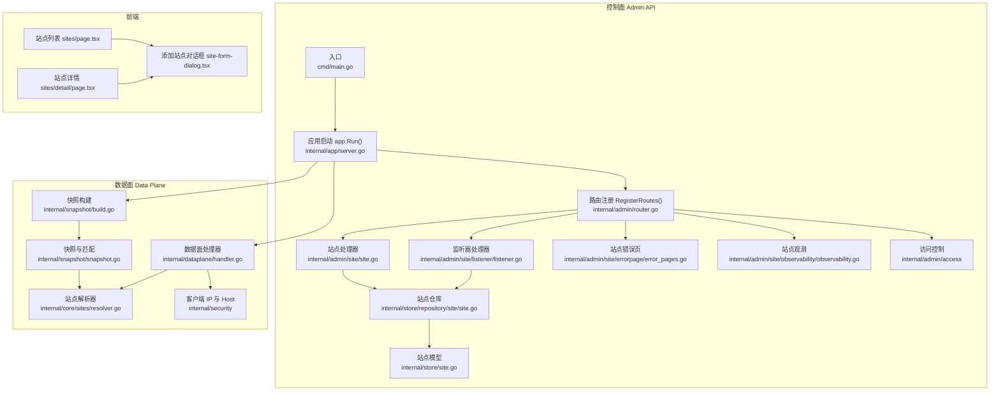
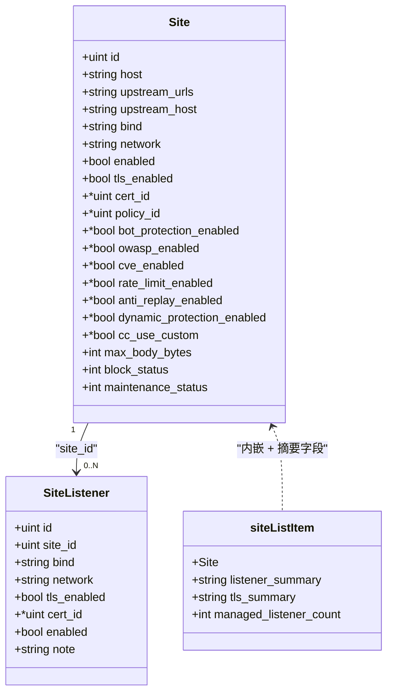
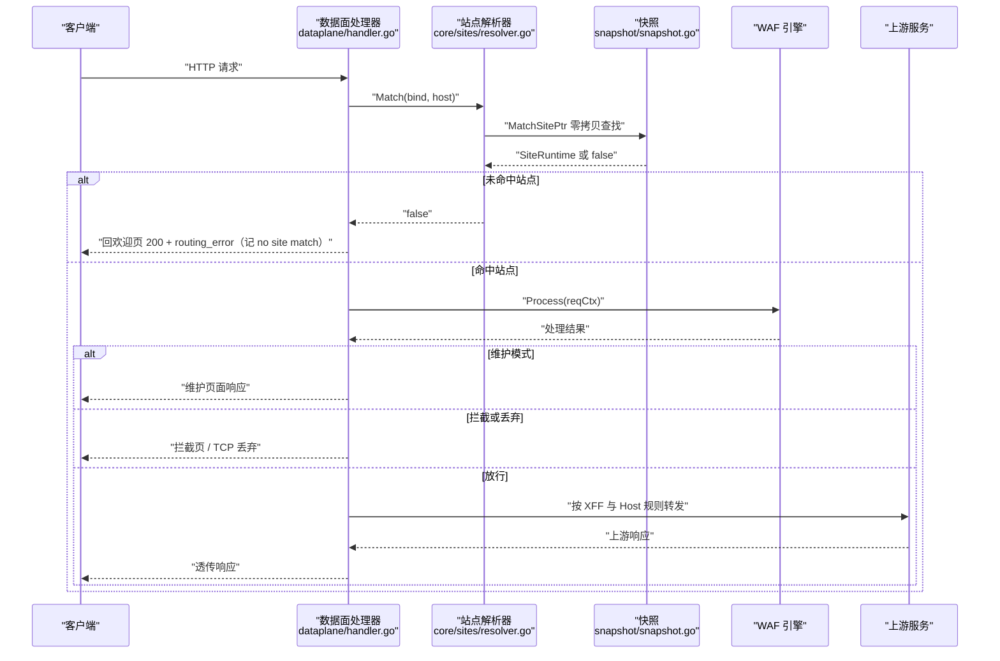
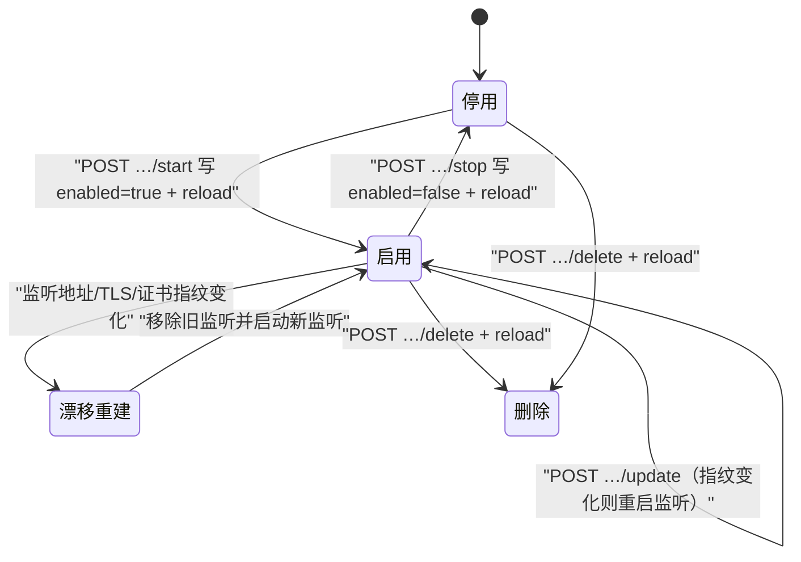
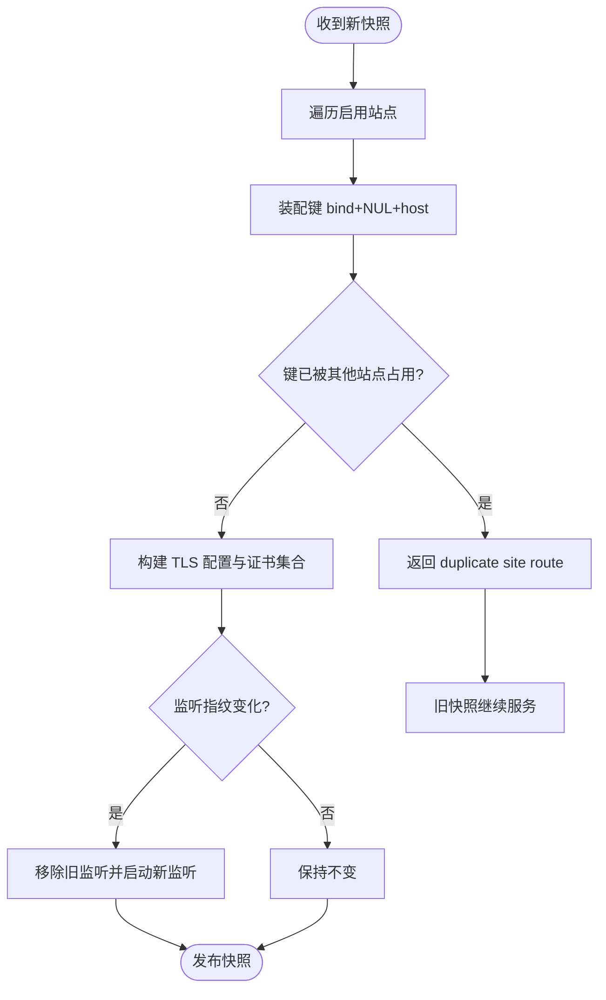
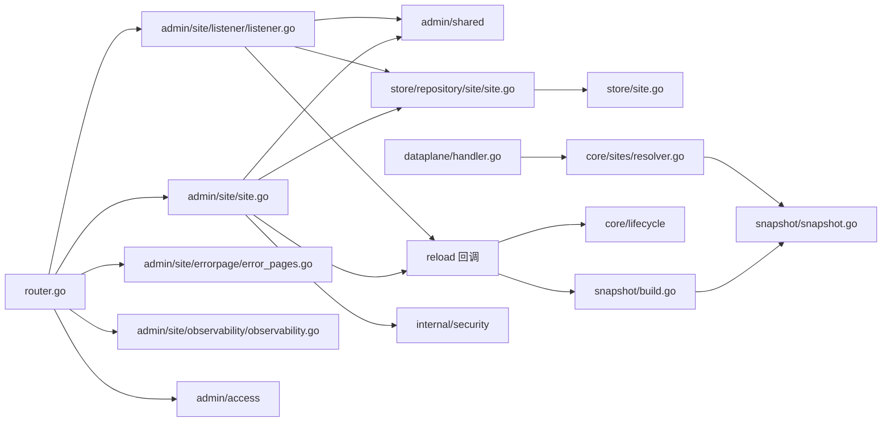

# 站点管理 API

> [返回 管理 API 系统](管理 API 系统.md)

<cite>
**本文档引用的文件**
- [main.go](file://cmd/main.go)
- [server.go](file://internal/app/server.go)
- [router.go](file://internal/admin/router.go)
- [middleware.go](file://internal/admin/middleware.go)
- [site.go](file://internal/admin/site/site.go)
- [listener.go](file://internal/admin/site/listener/listener.go)
- [error_pages.go](file://internal/admin/site/errorpage/error_pages.go)
- [observability.go](file://internal/admin/site/observability/observability.go)
- [site.go](file://internal/store/site.go)
- [site.go](file://internal/store/repository/site/site.go)
- [resolver.go](file://internal/core/sites/resolver.go)
- [snapshot.go](file://internal/snapshot/snapshot.go)
- [build.go](file://internal/snapshot/build.go)
- [handler.go](file://internal/dataplane/handler.go)
- [health.go](file://internal/core/health/health.go)
- [lifecycle.go](file://internal/core/lifecycle/lifecycle.go)
- [clientip.go](file://internal/security/clientip.go)
- [host.go](file://internal/security/host.go)
- [json_bind.go](file://internal/admin/shared/json_bind.go)
- [site_upstreams.go](file://internal/admin/shared/site_upstreams.go)
- [helpers.go](file://internal/admin/shared/helpers.go)
- [page.tsx](file://frontend/app/(dashboard)/sites/page.tsx)
- [detail page.tsx](file://frontend/app/(dashboard)/sites/detail/page.tsx)
- [site-form-dialog.tsx](file://frontend/app/(dashboard)/sites/components/site-form-dialog.tsx)
</cite>

## 目录

1. [简介](#简介)
2. [项目结构](#项目结构)
3. [核心组件](#核心组件)
4. [架构总览](#架构总览)
5. [详细组件分析](#详细组件分析)
6. [依赖关系分析](#依赖关系分析)
7. [性能考虑](#性能考虑)
8. [故障排查指南](#故障排查指南)
9. [结论](#结论)
10. [附录](#附录)

## 简介

站点管理 API 覆盖站点生命周期（创建、更新、启停、删除）、监听器多端口配置、站点级错误页、站点作用域观测数据、站点绑定的规则与应用路由，以及站点访问控制，共 44 个端点（42 个 `/sites*` + 2 个全局 `/error-pages*`）。

三条必须记住的行为事实：

1. **启停是持久化操作**。`StartSite`/`StopSite` 写 `site.Enabled` 到数据库并触发快照重载，不存在进程内状态缓存；`GET /sites/:id/status` 的状态由 `site.Enabled` 单一真源派生。
2. **私钥永不回显**。站点级上游 mTLS 客户端私钥在任何一个响应分支之前被 `redactUpstreamClientKey` 置 nil。
3. **站点级开关是三态**。`*bool` 字段的 `null` 表示继承全局，`true`/`false` 才是覆盖启用/覆盖关闭；父开关为 nil 时其从属字段被清空而不是置 0。

**章节来源**
- [site.go:586-670](file://internal/admin/site/site.go#L586-L670)
- [site.go:44-67](file://internal/admin/site/site.go#L44-L67)
- [site.go:490-508](file://internal/admin/site/site.go#L490-L508)
- [router.go:127-130](file://internal/admin/router.go#L127-L130)

## 项目结构

My-OpenWaf 采用控制面（Admin API）与数据面（Data Plane）分离的架构：控制面通过 Hertz 提供 REST API，负责站点的增删改查、启停与全局重载；数据面按快照为每个站点装配监听与路由，实现热启停与配置漂移检测。

**图表来源**
- [main.go:1-10](file://cmd/main.go#L1-L10)
- [server.go:234-305](file://internal/app/server.go#L234-L305)
- [router.go:127-130](file://internal/admin/router.go#L127-L130)
- [router.go:258-265](file://internal/admin/router.go#L258-L265)
- [site.go:76-142](file://internal/admin/site/site.go#L76-L142)
- [listener.go:21-56](file://internal/admin/site/listener/listener.go#L21-L56)

| 模块 | 路径 | 行数 | 职责 |
|------|------|-----:|------|
| 站点处理器 | `internal/admin/site/site.go` | 671 | 站点 CRUD、启停、状态、字段校验 |
| 监听器处理器 | `internal/admin/site/listener/listener.go` | 247 | 监听器 CRUD 与 legacy 提升 |
| 错误页处理器 | `internal/admin/site/errorpage/error_pages.go` | 195 | 站点错误页读写、默认页、预览 |
| 观测处理器 | `internal/admin/site/observability/observability.go` | 157 | 站点访问日志与丢弃事件 |
| 访问控制 | `internal/admin/access` | 1077 | 身份源、用户、路径规则 |
| 站点仓库 | `internal/store/repository/site/site.go` | 107 | 分页、证书关联、批量应用（同包 `site_listener.go` 另 107 行） |
| 站点模型 | `internal/store/site.go` | 2347（包） | Site/SiteListener/缓存与转发子结构 |
| 请求体绑定 | `internal/admin/shared/json_bind.go` | 174 | `BindSiteFromRequestBody` JSON blob 处理 |
| 上游校验 | `internal/admin/shared/site_upstreams.go` | 112 | 上游 URL 与 Host 模板校验 |
| 快照解析 | `internal/snapshot/snapshot.go` | 3071（包） | `MatchSite`/`MatchSitePtr` |

**章节来源**
- [site.go:1-671](file://internal/admin/site/site.go#L1-L671)
- [listener.go:1-247](file://internal/admin/site/listener/listener.go#L1-L247)
- [error_pages.go:1-195](file://internal/admin/site/errorpage/error_pages.go#L1-L195)
- [observability.go:1-157](file://internal/admin/site/observability/observability.go#L1-L157)
- [site.go:1-107](file://internal/store/repository/site/site.go#L1-L107)
- [json_bind.go:1-174](file://internal/admin/shared/json_bind.go#L1-L174)
- [site_upstreams.go:1-112](file://internal/admin/shared/site_upstreams.go#L1-L112)

## 核心组件

**图表来源**
- [site.go:38-149](file://internal/store/site.go#L38-L149)
- [site.go:248-261](file://internal/store/site.go#L248-L261)
- [site.go:69-74](file://internal/admin/site/site.go#L69-L74)

| 组件 | 关键实现 | 行为要点 |
|------|----------|----------|
| 列表摘要装配 | `site.go:101-137` | 站点存在显式监听时用监听绑定串覆盖 `listener_summary`，并把 `tls_summary` 改写为「多监听（含 HTTPS）」等中文摘要 |
| 默认值优先 | `site.go:164-171` | 先 `ApplyModelDefaults` 再绑定请求体，使「未提供」保留默认值、「显式 false/0」如实落库 |
| 紧凑模式同步 | `site.go:172-175` | 请求体含 `attack_protection_level` 时才执行 `ApplyProtectionModeOverrides` |
| 三态从属清理 | `site.go:175`、`site.go:490-508` | 父开关 nil 时清空从属档位与动作字段 |
| 监听器 legacy 提升 | `listener.go:95-114` | 首条显式监听会把 legacy 单 bind 配置一并持久化，之后快照兜底路径不再启用 |
| 私钥脱敏 | `site.go:62-67`、`site.go:244-245` | 在 reload 与任何响应分支之前清空 |

**章节来源**
- [site.go:69-137](file://internal/admin/site/site.go#L69-L137)
- [site.go:161-252](file://internal/admin/site/site.go#L161-L252)
- [site.go:460-508](file://internal/admin/site/site.go#L460-L508)
- [listener.go:18-121](file://internal/admin/site/listener/listener.go#L18-L121)

## 架构总览

下图展示请求进入数据面到站点处理的全链路：请求经数据面处理器解析站点，交由 WAF 引擎处理，再根据结果决定拦截、维护模式或转发至上游。

**图表来源**
- [handler.go:152-162](file://internal/dataplane/handler.go#L152-L162)
- [resolver.go:24-39](file://internal/core/sites/resolver.go#L24-L39)
- [snapshot.go:337-362](file://internal/snapshot/snapshot.go#L337-L362)

| 层次 | 端点数 | 权限组 | 处理器包 |
|------|-------:|--------|----------|
| 站点核心与状态 | 8 | readonly+ / admin+operator | `internal/admin/site` |
| 监听器 | 4 | readonly+ / admin+operator | `internal/admin/site/listener` |
| 站点错误页 | 4 | readonly+ / admin+operator | `internal/admin/site/errorpage` |
| 站点观测（访问日志、丢弃） | 4 | readonly+ | `internal/admin/site/observability` |
| 站点级安全事件 | 3 | readonly+ | `internal/admin/event` |
| 站点级规则与应用路由 | 6 | readonly+ / admin+operator | `internal/admin/rule` |
| 站点访问控制 | 10 | readonly+ / admin+operator | `internal/admin/access` |
| 全局错误页 | 2 | readonly+ / admin+operator | `internal/admin/site/errorpage` |
| **合计** | **44** | — | — |

**章节来源**
- [router.go:127-130](file://internal/admin/router.go#L127-L130)
- [router.go:180-200](file://internal/admin/router.go#L180-L200)
- [router.go:239-240](file://internal/admin/router.go#L239-L240)
- [router.go:258-265](file://internal/admin/router.go#L258-L265)
- [router.go:345-362](file://internal/admin/router.go#L345-L362)

## 详细组件分析

### 端点总表

| 方法 | 路径 | 权限 | 处理器 | 注册行 |
|------|------|------|--------|-------:|
| GET | `/api/v1/sites` | readonly+ | `site.ListSites` | 127 |
| GET | `/api/v1/sites/:id` | readonly+ | `site.GetSite` | 128 |
| GET | `/api/v1/sites/:id/status` | readonly+ | `site.GetSiteStatus` | 129 |
| GET | `/api/v1/sites/:id/listeners` | readonly+ | `listener.ListSiteListeners` | 130 |
| GET | `/api/v1/sites/:id/security-events` | readonly+ | `event.ListSiteSecurityEvents` | 180 |
| GET | `/api/v1/sites/:id/security-events/stats` | readonly+ | `event.SiteSecurityEventStats` | 181 |
| GET | `/api/v1/sites/:id/security-events/timeline` | readonly+ | `event.SiteSecurityEventTimeline` | 182 |
| GET | `/api/v1/sites/:id/access-logs` | readonly+ | `observability.ListSiteAccessLogs` | 189 |
| GET | `/api/v1/sites/:id/access-logs/stats` | readonly+ | `observability.SiteAccessLogStats` | 190 |
| GET | `/api/v1/sites/:id/drop-events` | readonly+ | `observability.ListSiteDropEvents` | 191 |
| GET | `/api/v1/sites/:id/drop-stats` | readonly+ | `observability.SiteDropStats` | 192 |
| GET | `/api/v1/sites/:id/rules` | readonly+ | `rule.ListSiteRules` | 193 |
| GET | `/api/v1/sites/:id/application-route-rules` | readonly+ | `rule.ListApplicationRouteRules` | 194 |
| GET | `/api/v1/sites/:id/recorded-resources` | readonly+ | `rule.ListRecordedResources` | 195 |
| GET | `/api/v1/sites/:id/access` | readonly+ | `access.GetAccessConfig` | 197 |
| GET | `/api/v1/sites/:id/access/providers` | readonly+ | `access.ListProviders` | 198 |
| GET | `/api/v1/sites/:id/access/users` | readonly+ | `access.ListUsers` | 199 |
| GET | `/api/v1/sites/:id/access/rules` | readonly+ | `access.ListPathRules` | 200 |
| GET | `/api/v1/sites/:id/error-pages` | readonly+ | `errorpage.GetSiteErrorPages` | 239 |
| GET | `/api/v1/error-pages/defaults` | readonly+ | `errorpage.GetDefaultErrorPages` | 240 |
| POST | `/api/v1/sites` | admin/operator | `site.CreateSite` | 258 |
| POST | `/api/v1/sites/:id/update` | admin/operator | `site.UpdateSite` | 259 |
| POST | `/api/v1/sites/:id/delete` | admin/operator | `site.DeleteSite` | 260 |
| POST | `/api/v1/sites/:id/start` | admin/operator | `site.StartSite` | 261 |
| POST | `/api/v1/sites/:id/stop` | admin/operator | `site.StopSite` | 262 |
| POST | `/api/v1/sites/:id/listeners` | admin/operator | `listener.CreateSiteListener` | 263 |
| POST | `/api/v1/sites/:id/listeners/:lid/update` | admin/operator | `listener.UpdateSiteListener` | 264 |
| POST | `/api/v1/sites/:id/listeners/:lid/delete` | admin/operator | `listener.DeleteSiteListener` | 265 |
| POST | `/api/v1/sites/:id/application-route-rules` | admin/operator | `rule.CreateApplicationRouteRule` | 345 |
| POST | `/api/v1/sites/:id/application-route-rules/:rid/update` | admin/operator | `rule.UpdateApplicationRouteRule` | 346 |
| POST | `/api/v1/sites/:id/application-route-rules/:rid/delete` | admin/operator | `rule.DeleteApplicationRouteRule` | 347 |
| POST | `/api/v1/sites/:id/recorded-resources/clear` | admin/operator | `rule.ClearRecordedResources` | 348 |
| POST | `/api/v1/sites/:id/error-pages` | admin/operator | `errorpage.UpdateSiteErrorPages` | 350 |
| POST | `/api/v1/error-pages/preview` | admin/operator | `errorpage.PreviewErrorPage` | 351 |
| POST | `/api/v1/sites/:id/access` | admin/operator | `access.SaveAccessConfig` | 353 |
| POST | `/api/v1/sites/:id/access/providers` | admin/operator | `access.CreateProvider` | 354 |
| POST | `/api/v1/sites/:id/access/providers/:pid/update` | admin/operator | `access.UpdateProvider` | 355 |
| POST | `/api/v1/sites/:id/access/providers/:pid/delete` | admin/operator | `access.DeleteProvider` | 356 |
| POST | `/api/v1/sites/:id/access/users` | admin/operator | `access.CreateUser` | 357 |
| POST | `/api/v1/sites/:id/access/users/:uid/update` | admin/operator | `access.UpdateUser` | 358 |
| POST | `/api/v1/sites/:id/access/users/:uid/delete` | admin/operator | `access.DeleteUser` | 359 |
| POST | `/api/v1/sites/:id/access/rules` | admin/operator | `access.CreatePathRule` | 360 |
| POST | `/api/v1/sites/:id/access/rules/:rid/update` | admin/operator | `access.UpdatePathRule` | 361 |
| POST | `/api/v1/sites/:id/access/rules/:rid/delete` | admin/operator | `access.DeletePathRule` | 362 |

站点核心与监听器、错误页、访问控制的写端点全部是 POST；`/sites/:id/update` 与 `/sites/:id/delete` 的后缀形式是为了避开 PUT/DELETE 在反向代理与 CORS 上的额外配置。

**章节来源**
- [router.go:127-130](file://internal/admin/router.go#L127-L130)
- [router.go:180-200](file://internal/admin/router.go#L180-L200)
- [router.go:239-240](file://internal/admin/router.go#L239-L240)
- [router.go:258-265](file://internal/admin/router.go#L258-L265)
- [router.go:345-362](file://internal/admin/router.go#L345-L362)

### 请求参数表

| 端点 | 参数 | 位置 | 类型 | 必填 | 约束与默认 |
|------|------|------|------|:----:|------------|
| `GET /sites` | `page` | query | int | 否 | 缺省 1 |
| `GET /sites` | `page_size` | query | int | 否 | 缺省 20 |
| `GET /sites/:id` | `id` | path | uint | 是 | 非数值 400 `invalid id` |
| `POST /sites` | `host` | body | string | 是 | `size:255;not null`，逗号分隔多域名 |
| `POST /sites` | `upstream_urls` | body | text | 是 | `shared.ValidateSiteUpstreamURLs` 逐个解析 |
| `POST /sites` | `upstream_host` | body | string | 否 | 支持域名、域名:端口与 Go template |
| `POST /sites` | `bind` | body | string | 是 | `:80`、`0.0.0.0:443` 形式 |
| `POST /sites` | `network` | body | string | 否 | 缺省 `tcp`，非法 400 `invalid network` |
| `POST /sites` | `tls_enabled` + `cert_id` | body | bool + *uint | 否 | `tls_enabled=true` 时 `cert_id` 必须指向已存在证书 |
| `POST /sites` | `min_tls_version`/`max_tls_version` | body | string | 否 | 空串=继承全局 TLS 默认 |
| `POST /sites` | `xff_mode` | body | string | 否 | 仅 `strip_all_and_set_remote`、`trust_outer_waf_cidr_then_take_leftmost` |
| `POST /sites` | `trusted_cidr` | body | text | 否 | `security.ValidateTrustedCIDR` 校验 |
| `POST /sites` | `client_ip_header_order` | body | text | 否 | 只允许 `x_forwarded_for`、`x_real_ip`、`forwarded` |
| `POST /sites` | `dynamic_js_mode` | body | string | 否 | 仅 `all`、`paths` |
| `POST /sites` | `dynamic_decrypt_cache_ttl` | body | int | 否 | 0–1800 秒 |
| `POST /sites` | `upstream_tls_client_cert_pem`/`_key_pem` | body | *string | 否 | 必须成对；单字段 ≤256 KiB |
| `POST /sites` | `cc_rules` | body | array 或字符串 | 否 | 显式给出即 `shared.ValidateCCRules` |
| `POST /sites/:id/update` | 各字段 | body | — | 否 | 先取原对象再绑定，缺省字段保留 |
| `POST /sites/:id/listeners` | `bind` | body | string | 是 | 缺失 400 `bind is required` |
| `POST /sites/:id/listeners/:lid/update` | `lid` | path | uint | 是 | 与 `id` 联合定位 |
| `POST /sites/:id/error-pages` | `custom_error_pages` | body | text | 是 | JSON 文本，空串等价「全部用默认页」 |

**章节来源**
- [site.go:161-252](file://internal/admin/site/site.go#L161-L252)
- [site.go:460-476](file://internal/admin/site/site.go#L460-L476)
- [site_upstreams.go:24-112](file://internal/admin/shared/site_upstreams.go#L24-L112)
- [clientip.go:198-240](file://internal/security/clientip.go#L198-L240)
- [listener.go:56-121](file://internal/admin/site/listener/listener.go#L56-L121)
- [site.go:16-25](file://internal/store/site.go#L16-L25)

### 响应字段表

`GET /api/v1/sites` 的每一项是内嵌 `Site` 加三个摘要字段：

| 字段 | 类型 | 来源 | 说明 |
|------|------|------|------|
| `items` | array | `site.go:140` | 当前页站点列表 |
| `total` | int64 | `site.go:140` | 满足条件的总数 |
| `listener_summary` | string | `site.go:111-123` | 无显式监听时为 `bind`，有则为各监听绑定用 ` / ` 连接 |
| `tls_summary` | string | `site.go:112-128` | `HTTP`/`HTTPS`，或「多监听（含 HTTPS）」「多监听（HTTP）」 |
| `managed_listener_count` | int | `site.go:113-136` | `ID>0` 的真实监听条数，不含 legacy 合成条目 |
| `host` | string | 模型 | 逗号分隔多域名 |
| `cert_id` | *uint | 模型 | 未配置时因 `omitempty` 不出键 |
| `policy_id` | *uint | 模型 | null 表示未绑定策略，运行时回落默认策略 |
| `upstream_tls_client_key_pem` | — | 被清空 | 任何响应中都不出现，指针字段置 nil 后 `omitempty` 省略 |
| `created_at`/`updated_at` | time | 模型 | GORM 自动维护 |
| `deleted_at` | — | `json:"-"` | 软删除列不外泄 |
| `listener_id`、`forwarding_profile_id`、`inherit_listener_cert` | — | 模型 | legacy 字段，`omitempty`，仅迁移兼容 |

`GET /api/v1/sites/:id/status` 返回 `{"id":N,"host":"...","status":"running|stopped"}`；`POST …/start` 与 `…/stop` 固定返回 `{"status":"running|stopped","message":"site started|site stopped"}`。监听器列表无显式记录时返回一条 `note:"legacy"` 的合成条目，`items` 与 `total` 同长度。

**章节来源**
- [site.go:69-74](file://internal/admin/site/site.go#L69-L74)
- [site.go:101-142](file://internal/admin/site/site.go#L101-L142)
- [site.go:586-670](file://internal/admin/site/site.go#L586-L670)
- [listener.go:38-49](file://internal/admin/site/listener/listener.go#L38-L49)
- [site.go:38-42](file://internal/store/site.go#L38-L42)

### 错误码表

| 状态码 | 触发条件 | 响应体关键字 | 依据 |
|-------:|----------|--------------|------|
| 400 | 路径 `id` 非数值 | `invalid id` | `site.go:146-149`、`site.go:256-259` |
| 400 | 站点 `id` 非数值（监听器端点） | `invalid site id` | `listener.go:23-26`、`listener.go:58-61` |
| 400 | `policy_id` 指向不存在策略 | `policy_id must reference an existing policy` | `site.go:176-178` |
| 400 | TLS 版本/套件/ALPN 非法 | 对应校验文案 | `site.go:180-191` |
| 400 | `network` 非法 | `invalid network` | `site.go:24-25`、`site.go:192-194` |
| 400 | XFF 模式非法 | `invalid xff_mode` | `site.go:460-468` |
| 400 | 可信 CIDR 非法 | `invalid trusted_cidr` | `site.go:469-471` |
| 400 | 客户端 IP 头顺序非法 | `invalid client_ip_header_order` | `site.go:472-474` |
| 400 | 动态 JS 模式或 TTL 越界 | `dynamic_js_mode must be one of: all, paths`、TTL 0–1800 | `site.go:29-30` |
| 400 | 上游 mTLS 证书与私钥不成对 | `…must be provided together` 或超 256 KiB | `site.go:31`、`site.go:50-57` |
| 400 | 启用 TLS 但证书缺失或配对失败 | `shared.ValidateSiteTLSCertificate` 文案 | `site.go:236-239` |
| 400 | 监听器 `bind` 缺失 | `bind is required` | `listener.go:86-89` |
| 401 | 缺失/非法 Authorization 头 | `missing Authorization header` | `middleware.go:56-67` |
| 403 | readonly 角色访问写端点 | `access denied: insufficient permissions` | `middleware.go:140-143` |
| 404 | 站点不存在 | `not found` / `site not found` | `site.go:152-154`、`site.go:593-596` |
| 500 | 数据库读写失败 | `{"error":"<文本>"}` | `site.go:82-84`、`site.go:240-242` |
| 500 | 已落库但 reload 失败 | `config applied but reload failed: …` + `item` | `site.go:246-249`、`listener.go:115-118` |

**章节来源**
- [site.go:23-57](file://internal/admin/site/site.go#L23-L57)
- [site.go:144-252](file://internal/admin/site/site.go#L144-L252)
- [site.go:460-508](file://internal/admin/site/site.go#L460-L508)
- [listener.go:21-121](file://internal/admin/site/listener/listener.go#L21-L121)
- [middleware.go:42-147](file://internal/admin/middleware.go#L42-L147)

### 站点启停与配置漂移

**图表来源**
- [site.go:586-643](file://internal/admin/site/site.go#L586-L643)
- [server.go:720-777](file://internal/app/server.go#L720-L777)
- [snapshot.go:474-487](file://internal/snapshot/snapshot.go#L474-L487)

`site.Enabled` 是运行状态唯一真源：`StartSite`、`StopSite` 通过写该字段实现，`UpdateSite` 也能改它。若额外维护进程内状态缓存，常规编辑改动 `enabled` 后状态接口就会返回陈旧值，因此实现里明确不保留缓存。

**章节来源**
- [site.go:644-670](file://internal/admin/site/site.go#L644-L670)
- [site.go:586-643](file://internal/admin/site/site.go#L586-L643)

### 站点级三态字段

| 字段 | 类型 | null（继承全局） | true（覆盖启用） | false（覆盖关闭） |
|------|------|------------------|------------------|-------------------|
| `bot_protection_enabled` | `*bool` | `bot_protection_level` 被清空 | 启用，档位生效 | 关闭，档位被清空 |
| `owasp_enabled` | `*bool` | `owasp_sensitivity`、`owasp_action` 清空 | 启用并采用站点档位 | 关闭并清空档位 |
| `cve_enabled` | `*bool` | `cve_action` 清空 | 启用 | 关闭并清空动作 |
| `rate_limit_enabled` | `*bool` | 窗口、阈值、动作全清空 | 启用站点阈值 | 关闭并清空 |
| `anti_replay_enabled` | `*bool` | 采用全局防重放 | 启用 | 关闭 |
| `anti_replay_cookie_mode` | `*string` | 继承全局 Cookie 模式 | — | — |
| `challenge_action`、`captcha_type` | `*string` | 继承全局质询策略 | 独立三态，无父开关 | 独立三态 |
| `dynamic_protection_enabled` | `*bool` | 继承全局动态保护 | 启用 | 关闭 |
| `cc_use_custom` | `*bool` | 使用全局 CC 规则 | 使用站点 `cc_rules` | 不使用 CC 自定义 |
| `skip_path_by_phase` | `*string` | 继承全局跳过路径 | `"{}"` 表示本站不跳过任何路径 | 非空 JSON 为该配置 |

前端的「继承全局 / 覆盖启用 / 覆盖关闭」三态选择必须原样映射为 `null`/`true`/`false`，把空值保存成 `false` 或 `0` 会把继承关系误判为关闭。

**章节来源**
- [site.go:60-100](file://internal/store/site.go#L60-L100)
- [site.go:129-141](file://internal/store/site.go#L129-L141)
- [site.go:490-508](file://internal/admin/site/site.go#L490-L508)
- [json_bind.go:80-174](file://internal/admin/shared/json_bind.go#L80-L174)

### 数据面：站点解析与监听

快照的站点查找用哈希键 `bind + NUL + host`，查找顺序为三级：精确 → `*.` 单级父域 → catch-all `*`；主机名是 IP 字面量时跳过通配两级，避免 IP 命中通配站点。同一键被不同站点争用不是「先到先得」，`registerSiteKeys` 直接返回 `duplicate site route` 并中止本次快照构建，同站点重复注册则幂等跳过。`MatchSite` 返回拷贝、`MatchSitePtr` 零拷贝返回指针，热路径使用后者。

**图表来源**
- [build.go:795-799](file://internal/snapshot/build.go#L795-L799)
- [snapshot.go:293-296](file://internal/snapshot/snapshot.go#L293-L296)
- [snapshot.go:337-362](file://internal/snapshot/snapshot.go#L337-L362)
- [snapshot.go:441-450](file://internal/snapshot/snapshot.go#L441-L450)
- [server.go:720-777](file://internal/app/server.go#L720-L777)

**章节来源**
- [snapshot.go:293-362](file://internal/snapshot/snapshot.go#L293-L362)
- [snapshot.go:441-487](file://internal/snapshot/snapshot.go#L441-L487)
- [build.go:795-799](file://internal/snapshot/build.go#L795-L799)
- [resolver.go:19-39](file://internal/core/sites/resolver.go#L19-L39)

### 客户端 IP 与 Host 处理

站点的 `xff_mode`、`trusted_cidr`、`client_ip_header_order`、`preserve_original_host` 四项决定数据面如何还原真实客户端 IP 与发给上游的 Host。写入侧只做合法性校验，实际解析在 `internal/security/clientip.go` 的 `ResolveClientIP`，出站头重建在 `internal/security/outbound.go`；Host 头规范化由 `security.NormalizeHostHeaderValue` 完成。

| 配置 | 取值 | 语义 |
|------|------|------|
| `xff_mode` | `strip_all_and_set_remote` | 丢弃所有 `X-Forwarded-For`，以直连地址为准 |
| `xff_mode` | `trust_outer_waf_cidr_then_take_leftmost` | 从可信 CIDR 之外取最左地址 |
| `client_ip_header_order` | `x_forwarded_for`/`x_real_ip`/`forwarded` 序列 | 按声明顺序尝试头 |
| `preserve_original_host` | bool | 保留原始 Host 还是改写为 `upstream_host` |
| `upstream_host` | 域名 / 域名:端口 / Go template | 上游 Host 头模板 |

**章节来源**
- [clientip.go:17-240](file://internal/security/clientip.go#L17-L240)
- [host.go:13-27](file://internal/security/host.go#L13-L27)
- [site.go:460-476](file://internal/admin/site/site.go#L460-L476)
- [site.go:38-52](file://internal/store/site.go#L38-L52)

### 健康检查与运行状态

管理监听器上提供三个进程级探针（不属于 `/api/v1` 资源端点，不计入上表）：`/healthz` 存活、`/readyz` 就绪、`/status` 运行摘要，另有 `/metrics` 暴露指标。就绪判定要求数据库可达且快照已加载，实现见 `Checker.Ready`。

**章节来源**
- [health.go:22-94](file://internal/core/health/health.go#L22-L94)
- [server.go:1053-1056](file://internal/app/server.go#L1053-L1056)
- [lifecycle.go:138-178](file://internal/core/lifecycle/lifecycle.go#L138-L178)

### 站点观测与错误页

观测端点均为只读：访问日志、访问日志统计、丢弃事件、丢弃统计；`internal/admin/site/observability/observability.go` 四个处理器都先校验站点存在再查询，避免对不存在站点做全表扫描。错误页端点中 `GET /error-pages/defaults` 返回内置默认页，`POST /error-pages/preview` 用请求体草稿渲染预览而不落库。

**章节来源**
- [observability.go:15-157](file://internal/admin/site/observability/observability.go#L15-L157)
- [error_pages.go:81-195](file://internal/admin/site/errorpage/error_pages.go#L81-L195)

### 前端交互与站点创建

站点列表页与详情页是管理面入口，详情页使用查询参数路由 `sites/detail/page.tsx?id=&tab=`（`useSearchParams` 读取 `id` 与 `tab`），不是动态段路由。添加站点对话框用 schema 校验 `host`、`upstreams`、`upstream_host`、`cert_id`，并复刻后端 `shared/site_upstreams.go` 允许的上游 scheme 白名单；只要任一监听项 `tls_enabled` 为真就强制要求 `cert_id`。提交走 `POST /api/v1/sites`，成功后由后端触发重载。列表页的视图偏好用 `useSyncExternalStore` 读取本地存储，避免静态导出下的水合级联渲染。认证封装统一处理 401、403、429，并在访问令牌过期时用刷新 Cookie 续签。

**章节来源**
- [site-form-dialog.tsx:51-107](file://frontend/app/(dashboard)/sites/components/site-form-dialog.tsx#L51-L107)
- [page.tsx:35-60](file://frontend/app/(dashboard)/sites/page.tsx#L35-L60)
- [detail page.tsx:79-89](file://frontend/app/(dashboard)/sites/detail/page.tsx#L79-L89)
- [site_upstreams.go:24-40](file://internal/admin/shared/site_upstreams.go#L24-L40)

## 依赖关系分析

**图表来源**
- [router.go:127-130](file://internal/admin/router.go#L127-L130)
- [router.go:258-265](file://internal/admin/router.go#L258-L265)
- [site.go:1-21](file://internal/admin/site/site.go#L1-L21)

| 上游 | 下游 | 依赖形式 | 缺失后果 |
|------|------|----------|----------|
| `admin/site` | `admin/shared` | 校验与绑定工具 | 校验绕过风险 |
| `admin/site` | `security.ValidateTrustedCIDR` | 输入校验 | 非法 CIDR 入库 |
| `admin/site` | `repository/site`、`repository/cert` | 数据访问 | 400/500 |
| `admin/site` | `reload` 回调 | 注入闭包 | 配置不生效 |
| `snapshot/build.go` | `store` 各仓库 | 快照聚合 | 站点或监听缺位 |
| `dataplane/handler.go` | `core/sites.Resolver` | 站点解析 | 回欢迎页 + `routing_error` |
| `core/lifecycle` | Hertz 监听器 | 启停编排 | 漂移后无法重启 |

**章节来源**
- [site.go:3-21](file://internal/admin/site/site.go#L3-L21)
- [handler.go:152-162](file://internal/dataplane/handler.go#L152-L162)
- [helpers.go:87-112](file://internal/admin/shared/helpers.go#L87-L112)

## 性能考虑

- 热重载与指纹检测使变更只重启受影响站点的监听，避免全量重启抖动。
- 列表接口对监听器做一次性批量查询（`ListEnabledBySites`）后在内存分组，避免 N+1。
- 数据面解析为哈希键三级查找，无 Trie 结构，站点规模增长对查找深度影响有限。
- 写端点每次都触发快照重建，批量改动应尽量合并到一次 `POST …/update`。

**章节来源**
- [site.go:87-99](file://internal/admin/site/site.go#L87-L99)
- [snapshot.go:293-362](file://internal/snapshot/snapshot.go#L293-L362)
- [server.go:720-777](file://internal/app/server.go#L720-L777)

## 故障排查指南

| 症状 | 成因 | 处置 |
|------|------|------|
| 访问站点返回欢迎页 | 未命中站点，记 `no site match` 并回 `routing_error` | 核对 `host` 与 `bind`，注意不是 404 |
| 保存站点报 `duplicate site route` | 两个站点争用同一 `bind+host` 键 | 调整 `bind` 或 `host` 后重建 |
| 停止站点仍在服务 | 监听器未随新快照收敛 | 看 `config applied but reload failed`，再 `POST /reload` |
| `GET /sites/:id/status` 与预期不符 | 状态源是 `enabled` 字段 | 直接读 `GET /sites/:id` 的 `enabled` |
| 上游 mTLS 握手失败 | 证书与私钥不成对 | 重新成对提交两字段 |
| 编辑后响应没有私钥可回填 | 属预期脱敏行为 | 需要修改时必须重新提交两字段 |
| 站点级开关像失效 | 传 `false` 与「不传」语义不同 | 用三态表核对 `null`/`true`/`false` |
| `/readyz` 失败 | 数据库不可达或快照未加载 | 检查启动迁移与重载日志 |
| 多监听只有一条生效 | legacy 字段仍被使用 | 显式创建监听器触发 legacy 提升 |

**章节来源**
- [handler.go:152-162](file://internal/dataplane/handler.go#L152-L162)
- [build.go:795-799](file://internal/snapshot/build.go#L795-L799)
- [site.go:586-670](file://internal/admin/site/site.go#L586-L670)
- [listener.go:95-114](file://internal/admin/site/listener/listener.go#L95-L114)
- [health.go:29-45](file://internal/core/health/health.go#L29-L45)

## 结论

站点管理 API 把「配置真源」压到数据库的 `Site`/`SiteListener` 两张表上，启停、状态、监听装配全部围绕 `enabled` 与快照代次展开，不留第二状态源。写路径的校验链长而确定，错误响应能定位到具体字段；三态字段与私钥脱敏是两处最容易被误用（或误读）的语义，配置与前端都应按「继承 / 覆盖启用 / 覆盖关闭」建模。

**章节来源**
- [本节为总结，无需特定文件来源]

## 附录

### 站点配置参数清单

| 分组 | 字段 | 默认值 | 说明 |
|------|------|--------|------|
| 基础 | `host` | — | 逗号分隔多域名 |
| 基础 | `upstream_urls` | — | 上游地址列表 |
| 基础 | `upstream_host` | 空 | 域名/域名:端口/Go template |
| 监听 | `bind` | — | `:80`、`0.0.0.0:443` |
| 监听 | `network` | `tcp` | 非法回落失败 |
| 监听 | `enabled` | `true` | 运行状态唯一真源 |
| TLS | `tls_enabled` | `false` | 开启必须带 `cert_id` |
| TLS | `min_tls_version`/`max_tls_version` | 空=继承全局 | 全局默认 TLS10/TLS13 |
| TLS | `cipher_suites` | 空 | 逗号分隔 |
| TLS | `alpn` | 空=继承全局 | 全局默认随 HTTP/2、HTTP/3 派生 |
| 保护 | `policy_id` | null | 回落默认策略 |
| 保护 | `bot_protection_level` | `medium` | 仅在 `bot_protection_enabled` 非 nil 时生效 |
| 保护 | `attack_protection_level` | `medium` | `protect`/`observe` 紧凑模式 |
| 客户端 IP | `xff_mode` | `strip_all_and_set_remote` | 两值枚举 |
| 客户端 IP | `trusted_cidr` | 空 | 逗号分隔 CIDR |
| 客户端 IP | `preserve_original_host` | `false` | Host 保留策略 |
| 上游 | `max_body_bytes` | 10485760 | 10 MiB |
| 上游 | `upstream_tls_skip_verify` | `false` | 生产不建议开启 |
| 上游 | `upstream_tls_server_name` | 空 | 显式 SNI |
| 维护 | `maintenance_enabled` | `false` | 命中返回维护页 |
| 维护 | `maintenance_status` | 503 | 可改写 |
| 拦截 | `block_status` | 403 | 自定义拦截状态码 |
| 错误页 | `custom_error_pages` | 空 | 空串与 `{}` 等价于全默认 |

**章节来源**
- [site.go:38-149](file://internal/store/site.go#L38-L149)
- [site.go:248-261](file://internal/store/site.go#L248-L261)

### 多站点支持与隔离

站点隔离由「监听绑定 + 快照键」两层实现：同一 `bind` 下按 host 区分站点，host 查找为哈希键三级匹配；每个站点的 TLS、转发、维护页与拦截页配置互相独立。上游转发按轮询选择地址，探活与延迟择优由 `internal/upstream` 的健康检查负责。

**章节来源**
- [snapshot.go:337-362](file://internal/snapshot/snapshot.go#L337-L362)
- [resolver.go:19-39](file://internal/core/sites/resolver.go#L19-L39)

### 字段命名与序列化约定

| 约定 | 口径 | 示例 |
|------|------|------|
| JSON 字段名 | `snake_case`（全库统一） | `upstream_urls`、`tls_enabled` |
| 三态开关 | `*bool`：`null` 继承、`true` 覆盖启用、`false` 覆盖关闭 | `owasp_enabled` |
| 可空外键 | `*uint` + `omitempty` | `cert_id`、`policy_id` |
| JSON blob | 库内字符串，请求可直接传对象/数组 | `cc_rules`、`cache_rules` |
| 机密 | 私钥响应零出现 | `upstream_tls_client_key_pem` 置 nil |
| 内部列 | `json:"-"` 不外泄 | `deleted_at`、DER/Key 运行时字段 |
| legacy 字段 | `omitempty` 保留兼容，不用于新配置 | `listener_id` |

**章节来源**
- [site.go:38-149](file://internal/store/site.go#L38-L149)
- [json_bind.go:14-110](file://internal/admin/shared/json_bind.go#L14-L110)

### 关联文档

- [规则管理 API](规则管理 API/规则管理 API.md)：`/sites/:id/rules` 的规则本体
- [安全事件 API](安全事件 API.md)：`/sites/:id/security-events` 的事件模型
- [证书管理 API](证书管理 API.md)：`cert_id` 指向的证书生命周期
- [策略管理 API](策略管理 API.md)：`policy_id` 绑定与默认策略回落
- [API 端点参考](REST API 设计规范/API 端点参考.md)：全量 217 端点清单

**章节来源**
- [本节为总结，无需特定文件来源]
