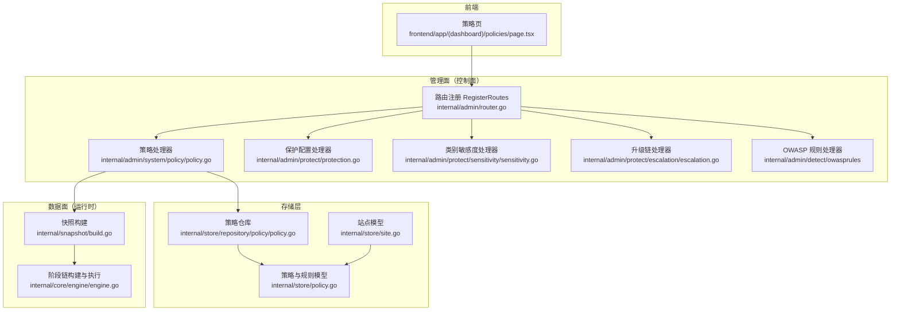
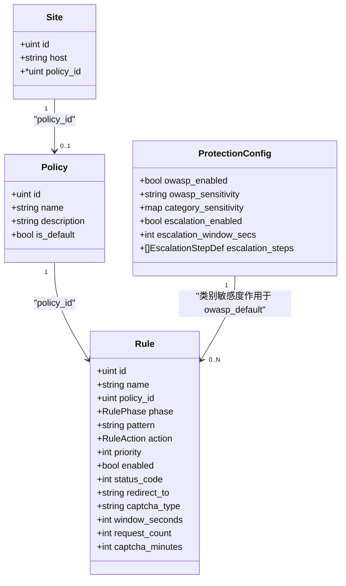
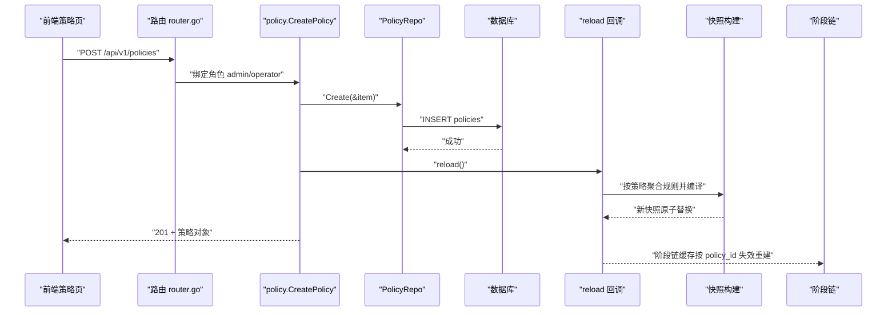
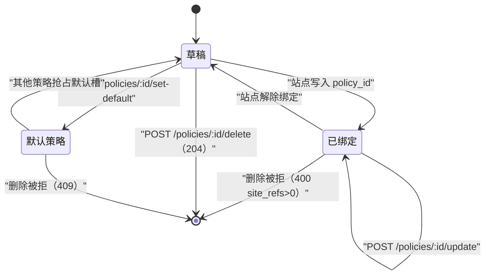
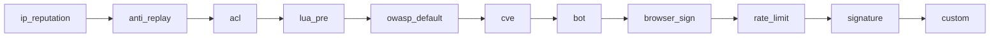
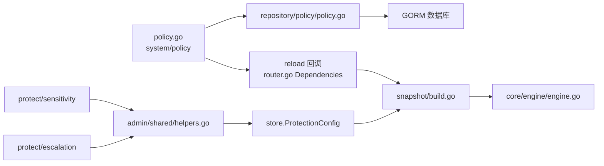

# 策略管理 API

> [返回 管理 API 系统](管理 API 系统.md)

<cite>
**本文档引用的文件**
- [router.go](file://internal/admin/router.go)
- [policy.go](file://internal/admin/system/policy/policy.go)
- [policy.go](file://internal/store/policy.go)
- [policy.go](file://internal/store/repository/policy/policy.go)
- [site.go](file://internal/store/site.go)
- [site.go](file://internal/admin/site/site.go)
- [protection.go](file://internal/admin/protect/protection.go)
- [sensitivity.go](file://internal/admin/protect/sensitivity/sensitivity.go)
- [escalation.go](file://internal/admin/protect/escalation/escalation.go)
- [engine.go](file://internal/core/engine/engine.go)
- [build.go](file://internal/snapshot/build.go)
- [page.tsx](file://frontend/app/(dashboard)/policies/page.tsx)
</cite>

## 目录

1. [简介](#简介)
2. [项目结构](#项目结构)
3. [核心组件](#核心组件)
4. [架构总览](#架构总览)
5. [详细组件分析](#详细组件分析)
6. [依赖关系分析](#依赖关系分析)
7. [性能考虑](#性能考虑)
8. [故障排查指南](#故障排查指南)
9. [结论](#结论)
10. [附录](#附录)

## 简介

策略管理 API 负责 WAF 检测规则的分组容器（Policy）、策略作用域的 OWASP 规则覆盖、以及全局保护配置（ProtectionConfig）的读写。策略本身不含检测逻辑，只作为规则的命名集合；站点通过 `policy_id` 关联策略，快照构建时按策略聚合规则并编译为运行时阶段链。

本篇覆盖 21 个端点，按职责分为五组：策略本体 8 个、策略作用域 OWASP 规则 5 个、全局保护配置 2 个、作用域化敏感度与升级链 4 个、IP 升级状态 2 个。规则本体（Rule CRUD、导入导出、验证测试）见 [规则管理 API](规则管理 API/规则管理 API.md)，全局 `owasp-rules` 与 `cve-rules` 端点分别在 [CVE 规则管理 API](CVE 规则管理 API.md) 与规则管理篇中说明。

**章节来源**
- [router.go:140-142](file://internal/admin/router.go#L140-L142)
- [router.go:226-227](file://internal/admin/router.go#L226-L227)
- [router.go:274-278](file://internal/admin/router.go#L274-L278)
- [policy.go:14-158](file://internal/admin/system/policy/policy.go#L14-L158)

## 项目结构

策略管理落在 `internal/admin/system/policy/` 子包（不是 `internal/admin/system/policy.go`，扁平布局已废弃），保护配置与类别敏感度、升级链分别落在 `internal/admin/protect/` 及其 `sensitivity/`、`escalation/` 子包。

**图表来源**
- [router.go:89-120](file://internal/admin/router.go#L89-L120)
- [policy.go:1-158](file://internal/admin/system/policy/policy.go#L1-L158)
- [sensitivity.go:1-92](file://internal/admin/protect/sensitivity/sensitivity.go#L1-L92)
- [escalation.go:1-168](file://internal/admin/protect/escalation/escalation.go#L1-L168)

| 模块 | 路径 | 行数 | 职责 |
|------|------|-----:|------|
| 路由注册 | `internal/admin/router.go` | 465 | 策略/保护端点注册与角色分组挂载 |
| 策略处理器 | `internal/admin/system/policy/policy.go` | 158 | 策略 CRUD、默认策略切换、引用计数拦截 |
| 保护配置处理器 | `internal/admin/protect/protection.go` | 351 | ProtectionConfig 读写与 JSON blob 展开 |
| 类别敏感度 | `internal/admin/protect/sensitivity/sensitivity.go` | 92 | 六档类别敏感度读写 |
| 升级链 | `internal/admin/protect/escalation/escalation.go` | 168 | 升级阈值链配置与 IP 状态查询/复位 |
| 策略仓库 | `internal/store/repository/policy/policy.go` | 93 | 分页查询、默认槽事务、引用计数 |
| 策略模型 | `internal/store/policy.go` | 97 | Policy/Rule/RulePhase/RuleAction 定义 |
| 快照构建 | `internal/snapshot/build.go` | 1644 | 按策略聚合规则、排序并编译为运行时结构 |
| 引擎 | `internal/core/engine/engine.go` | 646 | 11 阶段链构建与规则缓存 |

**章节来源**
- [policy.go:1-158](file://internal/admin/system/policy/policy.go#L1-L158)
- [protection.go:1-351](file://internal/admin/protect/protection.go#L1-L351)
- [sensitivity.go:1-92](file://internal/admin/protect/sensitivity/sensitivity.go#L1-L92)
- [escalation.go:1-168](file://internal/admin/protect/escalation/escalation.go#L1-L168)
- [policy.go:1-93](file://internal/store/repository/policy/policy.go#L1-L93)
- [policy.go:1-97](file://internal/store/policy.go#L1-L97)
- [build.go:1-1644](file://internal/snapshot/build.go#L1-L1644)
- [engine.go:1-646](file://internal/core/engine/engine.go#L1-L646)

## 核心组件

**图表来源**
- [policy.go:10-20](file://internal/store/policy.go#L10-L20)
- [policy.go:70-97](file://internal/store/policy.go#L70-L97)
- [site.go:76](file://internal/store/site.go#L76)

| 组件 | 关键实现 | 行为要点 |
|------|----------|----------|
| PolicyRepo | `List`/`Get`/`SetDefault`/`ReferenceCounts`/`IsDefault` | 列表按 `id ASC`；默认槽用唯一索引 `ux_policies_default_slot` 保证全局唯一 |
| 默认槽切换 | `policy.go:50-74` | 事务内先清空他行 `default_slot`，再置本行为 1；已是默认则直接返回 |
| 删除保护 | `policy.go:123-147` | 默认策略返回 409；仍被站点或规则引用返回 400 并回显 `site_refs`、`rule_refs` |
| 更新语义 | `policy.go:94-121` | 先 `Get` 再 `BindJSON(existing)`，请求体缺省字段保留原值，随后强制 `ID = 路径 ID` |
| IsDefault | `policy.go:22-25` | GORM `AfterFind` 钩子由 `default_slot==1` 派生，`default_slot` 本身 `json:"-"` 不出现在响应中 |

**章节来源**
- [policy.go:14-158](file://internal/admin/system/policy/policy.go#L14-L158)
- [policy.go:13-93](file://internal/store/repository/policy/policy.go#L13-L93)
- [policy.go:10-97](file://internal/store/policy.go#L10-L97)

## 架构总览

策略写入与运行时生效之间隔着一次快照重载：处理器只负责持久化与校验，`reload()` 由 `Dependencies.Reload` 注入，负责递增配置修订号、重建快照并协调数据面监听器。

**图表来源**
- [router.go:274](file://internal/admin/router.go#L274)
- [policy.go:75-92](file://internal/admin/system/policy/policy.go#L75-L92)
- [engine.go:461-548](file://internal/core/engine/engine.go#L461-L548)

| 端点分组 | 数量 | 权限组 | 注册区间 |
|----------|-----:|--------|----------|
| 策略本体 | 8 | readGroup / opsGroup | [router.go:140-142](file://internal/admin/router.go#L140-L142)、[router.go:274-278](file://internal/admin/router.go#L274-L278) |
| 策略作用域 OWASP 规则 | 5 | readGroup / opsGroup | [router.go:226-227](file://internal/admin/router.go#L226-L227)、[326-328](file://internal/admin/router.go#L326-L328) |
| 全局保护配置 | 2 | readGroup / opsGroup | [router.go:152](file://internal/admin/router.go#L152)、[287](file://internal/admin/router.go#L287) |
| 作用域敏感度与升级链 | 4 | readGroup / opsGroup | [router.go:234](file://internal/admin/router.go#L234)、[236](file://internal/admin/router.go#L236)、[340](file://internal/admin/router.go#L340)、[342](file://internal/admin/router.go#L342) |
| IP 升级状态 | 2 | readGroup / opsGroup | [router.go:237](file://internal/admin/router.go#L237)、[343](file://internal/admin/router.go#L343) |
| **合计** | **21** | — | — |

**章节来源**
- [router.go:140-152](file://internal/admin/router.go#L140-L152)
- [router.go:226-237](file://internal/admin/router.go#L226-L237)
- [router.go:274-287](file://internal/admin/router.go#L274-L287)
- [router.go:326-343](file://internal/admin/router.go#L326-L343)

## 详细组件分析

### 端点总表

| 方法 | 路径 | 权限 | 处理器 | 注册行 | 说明 |
|------|------|------|--------|-------:|------|
| GET | `/api/v1/policies` | readonly+ | `policy.ListPolicies` | 140 | 分页列表，返回 `items`、`total` |
| GET | `/api/v1/policies/default` | readonly+ | `policy.GetDefaultPolicy` | 141 | 取默认策略，无默认返回 404 |
| GET | `/api/v1/policies/:id` | readonly+ | `policy.GetPolicy` | 142 | 取单个策略 |
| POST | `/api/v1/policies` | admin/operator | `policy.CreatePolicy` | 274 | 新建并触发 reload |
| POST | `/api/v1/policies/:id/set-default` | admin/operator | `policy.SetDefaultPolicy` | 275 | 切换默认策略 |
| POST | `/api/v1/policies/:id/default` | admin/operator | `policy.SetDefaultPolicy` | 276 | 同一处理器的历史别名路径 |
| POST | `/api/v1/policies/:id/update` | admin/operator | `policy.UpdatePolicy` | 277 | 合并式更新 |
| POST | `/api/v1/policies/:id/delete` | admin/operator | `policy.DeletePolicy` | 278 | 引用检查后删除 |
| GET | `/api/v1/policies/:policyId/owasp-rules` | readonly+ | `owasprules.ListOWASPRulesFromRegistry` | 226 | 策略作用域规则视图 |
| GET | `/api/v1/policies/:policyId/owasp-rules/stats` | readonly+ | `owasprules.GetOWASPRuleStats` | 227 | 策略作用域规则统计 |
| POST | `/api/v1/policies/:policyId/owasp-rules/:id` | admin/operator | `owasprules.UpdateSingleOWASPRule` | 326 | 单条覆盖 |
| POST | `/api/v1/policies/:policyId/owasp-rules/:id/reset` | admin/operator | `owasprules.ResetOWASPRuleOverride` | 327 | 清除单条覆盖 |
| POST | `/api/v1/policies/:policyId/owasp-rules/batch` | admin/operator | `owasprules.BatchUpdateOWASPRules` | 328 | 批量覆盖 |
| GET | `/api/v1/protection-settings` | readonly+ | `protect.GetProtectionSettings` | 152 | 读全局 ProtectionConfig |
| POST | `/api/v1/protection-settings` | admin/operator | `protect.PutProtectionSettings` | 287 | 写全局 ProtectionConfig |
| GET | `/api/v1/protection/:id/sensitivity` | readonly+ | `sensitivity.GetSensitivityConfig` | 234 | 类别敏感度读取 |
| POST | `/api/v1/protection/:id/sensitivity` | admin/operator | `sensitivity.UpdateSensitivityConfig` | 340 | 类别敏感度写入 |
| GET | `/api/v1/protection/:id/escalation` | readonly+ | `protectescalation.GetEscalationConfig` | 236 | 升级链读取 |
| POST | `/api/v1/protection/:id/escalation` | admin/operator | `protectescalation.UpdateEscalationConfig` | 342 | 升级链写入 |
| GET | `/api/v1/escalation/status/:ip` | readonly+ | `protectescalation.GetEscalationIPStatus` | 237 | 指定 IP 当前升级档位 |
| POST | `/api/v1/escalation/status/:ip/reset` | admin/operator | `protectescalation.ResetEscalationIPStatus` | 343 | 复位指定 IP 升级状态 |

**章节来源**
- [router.go:140-142](file://internal/admin/router.go#L140-L142)
- [router.go:152](file://internal/admin/router.go#L152)
- [router.go:226-237](file://internal/admin/router.go#L226-L237)
- [router.go:274-287](file://internal/admin/router.go#L274-L287)
- [router.go:326-343](file://internal/admin/router.go#L326-L343)

### 请求参数表

| 端点 | 参数 | 位置 | 类型 | 必填 | 约束与默认 |
|------|------|------|------|:----:|------------|
| `GET /policies` | `page` | query | int | 否 | 缺省 1，非法按 1 处理 |
| `GET /policies` | `page_size` | query | int | 否 | 缺省 20 |
| `GET /policies/:id` | `id` | path | uint | 是 | 非数值返回 400 `invalid id` |
| `POST /policies` | `name` | body | string | 是 | `size:128;not null`，空值由数据库拒绝 |
| `POST /policies` | `description` | body | text | 否 | 缺省空串 |
| `POST /policies/:id/update` | `name`/`description` | body | string | 否 | 缺省字段保留库中原值 |
| `POST /protection-settings` | `cc_rules` | body | array 或字符串 | 否 | 对象/数组入库前转 JSON 字符串 |
| `POST /protection-settings` | `owasp_modules` | body | object 或字符串 | 否 | 同上；写入后被 `category_sensitivity` 取代 |
| `POST /protection-settings` | `basic_auth_password` | body | string | 否 | 纯空白时从请求体剔除，响应中永久删除该键 |
| `POST /protection/:id/sensitivity` | `id` | path | string | 是 | 只接受 `global` 或数值 ID，否则 400 |
| `POST /protection/:id/sensitivity` | `category_sensitivity` | body | map[string]string | 是 | 档位必须命中六档枚举 |
| `POST /protection/:id/escalation` | `escalation_window_secs` | body | int | 否 | 必须为正数 |
| `POST /protection/:id/escalation` | `escalation_steps` | body | array | 否 | `threshold` 递增且为正；动作限 6 类 |
| `GET /escalation/status/:ip` | `site_id` | query | uint | 否 | 缺省 0 表示全局作用域 |

**章节来源**
- [policy.go:14-158](file://internal/admin/system/policy/policy.go#L14-L158)
- [policy.go:10-20](file://internal/store/policy.go#L10-L20)
- [protection.go:96-120](file://internal/admin/protect/protection.go#L96-L120)
- [sensitivity.go:37-92](file://internal/admin/protect/sensitivity/sensitivity.go#L37-L92)
- [escalation.go:39-104](file://internal/admin/protect/escalation/escalation.go#L39-L104)

### 响应字段表

| 字段 | 类型 | 出现端点 | 说明 |
|------|------|----------|------|
| `items` | array | `GET /policies` | 策略数组，按 `id ASC` 排序 |
| `total` | int64 | `GET /policies` | 满足条件的总行数（非当前页行数） |
| `id` | uint | 策略详情/写响应 | 自增主键 |
| `name` | string | 策略详情/写响应 | 策略名 |
| `description` | string | 策略详情/写响应 | 备注文本 |
| `is_default` | bool | 策略详情/写响应 | 由 `default_slot` 派生，只读 |
| `default_slot` | — | — | 模型标记 `json:"-"`，任何响应都不返回 |
| `created_at`/`updated_at` | time | 策略详情/写响应 | GORM 自动维护 |
| `policy_id` | *uint | 站点端点 | 站点关联策略，nil 表示未绑定 |
| `site_refs`/`rule_refs` | int64 | `POST /policies/:id/delete` 失败响应 | 引用计数明细 |

策略写入成功一律回显持久化后的对象：`CreatePolicy` 返回 201 + 对象（`policy.go:90`），`UpdatePolicy`、`SetDefaultPolicy` 返回 200 + 对象（`policy.go:71`、`policy.go:119`），`DeletePolicy` 返回 204 空体（`policy.go:156`）。

**章节来源**
- [policy.go:24](file://internal/admin/system/policy/policy.go#L24)
- [policy.go:71](file://internal/admin/system/policy/policy.go#L71)
- [policy.go:90](file://internal/admin/system/policy/policy.go#L90)
- [policy.go:119](file://internal/admin/system/policy/policy.go#L119)
- [policy.go:145-156](file://internal/admin/system/policy/policy.go#L145-L156)
- [policy.go:18-19](file://internal/store/policy.go#L18-L19)

### 错误码表

| 状态码 | 触发条件 | 响应体 | 依据 |
|-------:|----------|--------|------|
| 400 | 路径 `id` 非数值 | `{"error":"invalid id"}` | `policy.go:31`、`policy.go:58`、`policy.go:97`、`policy.go:126` |
| 400 | 请求体 JSON 非法 | `{"error":"<绑定错误>"}` | `policy.go:78-80`、`policy.go:106-108` |
| 400 | 策略仍被站点或规则引用 | `{"error":"policy is still referenced","site_refs":N,"rule_refs":M}` | `policy.go:144-146` |
| 400 | 敏感度档位越界 | `{"error":"invalid sensitivity level for <类别>: <值>"}` | `sensitivity.go:72-75` |
| 400 | 升级窗口非正/阈值不递增/动作不支持 | 对应 `must be positive` 等文案 | `escalation.go:57-77` |
| 401 | 缺失或非法 Authorization 头 | `{"error":"missing Authorization header"}` | `AuthMiddleware` |
| 403 | 角色不含 readonly | `{"error":"access denied: insufficient permissions"}` | `RequireRole` |
| 404 | 策略不存在 | `{"error":"not found"}` | `policy.go:36`、`policy.go:102` |
| 404 | 默认策略未设置 | `{"error":"default policy not found"}` | `policy.go:48` |
| 409 | 删除默认策略 | `{"error":"default policy cannot be deleted"}` | `policy.go:135-137` |
| 500 | 数据库读写失败 | `{"error":"<错误文本>"}` | `policy.go:20`、`policy.go:83` |
| 500 | 已落库但 reload 失败 | `{"error":"config applied but reload failed: …","item":{…}}` | `policy.go:68`、`policy.go:87`、`policy.go:116` |

**章节来源**
- [policy.go:20-156](file://internal/admin/system/policy/policy.go#L20-L156)
- [sensitivity.go:72-75](file://internal/admin/protect/sensitivity/sensitivity.go#L72-L75)
- [escalation.go:57-77](file://internal/admin/protect/escalation/escalation.go#L57-L77)

### 策略生命周期与删除守卫

**图表来源**
- [policy.go:123-147](file://internal/admin/system/policy/policy.go#L123-L147)
- [policy.go:50-74](file://internal/store/repository/policy/policy.go#L50-L74)

删除前先跑两道守卫：`IsDefault` 命中返回 409；`ReferenceCounts` 统计 `store.Site` 与 `store.Rule` 的引用行数，任一非零返回 400。两道守卫都通过后将本会话的变更交回前端并触发 reload，避免删除仍被引用的策略导致规则集凭空消失。

**章节来源**
- [policy.go:123-158](file://internal/admin/system/policy/policy.go#L123-L158)
- [policy.go:76-93](file://internal/store/repository/policy/policy.go#L76-L93)

### 规则阶段与动作枚举

| 枚举族 | 取值 | 说明 |
|--------|------|------|
| `RulePhase` | `acl` | IP/CIDR 准入，终端动作可 allow |
| `RulePhase` | `rate_limit` | 内置限流阶段，规则 CRUD 不用于持久化自定义规则 |
| `RulePhase` | `owasp_default` | 内置 OWASP 阶段，同上 |
| `RulePhase` | `signature` | 特征匹配，用户可保存 |
| `RulePhase` | `custom` | 自定义匹配，用户可保存 |
| `RuleAction` | `allow` | 仅允许用于 `acl` |
| `RuleAction` | `intercept` `observe` `drop` | 拦截 / 只记录 / TCP 丢弃 |
| `RuleAction` | `challenge` `captcha_challenge` `shield_challenge` `chain_challenge` | 质询族，分别对应通用质询、验证码、5 秒盾、链式验证 |
| `RuleAction` | `redirect` `rate_limit` | 需 `redirect_to` / 需窗口参数 |
| `RuleAction` | `tag` | 模型中存在，持久化规则不支持 |
| legacy | `block` → `intercept`、`log_only` → `observe` | `NormalizeAction` 归一化（`policy.go:58-67`） |

运行时阶段链是 **11 个阶段**，按固定顺序构建，缺依赖或配置关闭时跳过：

**图表来源**
- [engine.go:467-530](file://internal/core/engine/engine.go#L467-L530)

`signature` 与 `custom` 由用户规则驱动，直接 `append` 入链而不参与按 phase 跳过路径的装饰；其余阶段命中跳过路径时由 `NewSkipByPathPhase` 包装（`engine.go:472-478`）。

**章节来源**
- [policy.go:27-67](file://internal/store/policy.go#L27-L67)
- [engine.go:461-548](file://internal/core/engine/engine.go#L461-L548)

### 类别敏感度六档

`GET`/`POST /api/v1/protection/:id/sensitivity` 读写 `category_sensitivity`。`:id` 只做合法性校验（`global` 或数值 ID），实际读写目标始终是全局 ProtectionConfig（`sensitivity.go:46`、`sensitivity.go:78`），站点或策略级覆盖由站点自身的 `*bool`/档位字段承担。

| 档位 | 归一化输入 | 阈值语义 |
|------|------------|----------|
| `off` | `off`、`none` | 该类别停用 |
| `low` | `low` | 阈值 7 |
| `mid` | `mid`、`medium` | 阈值 4（默认档） |
| `high` | `high` | 阈值 3 |
| `very_high` | `very_high`、`very-high`、`veryhigh` | 阈值 2 |
| `strict` | `strict` | 阈值 1 |

写入时 `OWASPModules` 被固定为 `"{}"`：`category_sensitivity` 是 UI 与快照的唯一真源，legacy 的模块级映射不再保留（`sensitivity.go:80-81`）。

**章节来源**
- [sensitivity.go:14-92](file://internal/admin/protect/sensitivity/sensitivity.go#L14-L92)

### 升级链与 IP 状态

`escalation_steps` 是阈值递增的阶梯数组，元素校验三件事：`threshold > 0`、后一档阈值严格大于前一档、动作限定在 `intercept`/`drop`/`challenge`/`captcha_challenge`/`shield_challenge`/`chain_challenge` 六类（`escalation.go:61-78`）。响应固定回显 `escalation_enabled`、`escalation_window_secs`、`escalation_steps` 三字段。

`GET /api/v1/escalation/status/:ip?site_id=` 返回指定 IP 当前档位与命中次数；当 `EscalationMgr` 未初始化时返回结构一致的零值对象并附 `message`，避免前端解析分支（`escalation.go:125-135`）。`POST …/reset` 调用 `ResetIP` 并返回文本确认。

**章节来源**
- [escalation.go:17-168](file://internal/admin/protect/escalation/escalation.go#L17-L168)
- [router.go:236-237](file://internal/admin/router.go#L236-L237)
- [router.go:342-343](file://internal/admin/router.go#L342-L343)

### 快照构建与策略继承

站点绑定策略后，其规则集即为该策略下规则的集合，按 `priority ASC, id ASC` 排序编译；这就是「策略继承」的全部语义——不存在多层策略嵌套，站点只保留一个 `policy_id`。未绑定（`policy_id` 为 nil 或 0）的站点回落到默认策略，因此默认策略承担全局兜底规则集（`build.go:266-273`）。规则引用了不存在的策略、或 `policy_id` 为 0 且策略表存在，快照构建直接报错而非静默丢弃（`build.go:122-131`）。

运行时规则缓存键为 `{siteID, policyID}`，阶段链缓存键为 `{policyID, siteID, antiReplayEnabled}`，再叠加保护配置、Lua 脚本、Lua 修订号与依赖四判据，任一变化即重建该键（`engine.go:34-64`、`engine.go:461`）。

| 构建步骤 | 位置 | 结果 |
|----------|------|------|
| 解析默认策略 | [build.go:55-71](file://internal/snapshot/build.go#L55-L71) | 取 `default_slot=1` 的策略 ID 作兜底 |
| 按策略分组规则 | [build.go:122-132](file://internal/snapshot/build.go#L122-L132) | `map[policyID][]Rule` |
| 组内排序 | [build.go:134-142](file://internal/snapshot/build.go#L134-L142) | `priority` 升序、同优先级按 `id` 升序 |
| 站点策略解析 | [build.go:266-273](file://internal/snapshot/build.go#L266-L273) | 有绑定用绑定的，否则用默认策略 |
| 编译规则 | [build.go:275](file://internal/snapshot/build.go#L275) | 编译产物 + 站点 CC 规则合并 |

**章节来源**
- [build.go:55-142](file://internal/snapshot/build.go#L55-L142)
- [build.go:266-275](file://internal/snapshot/build.go#L266-L275)
- [engine.go:34-64](file://internal/core/engine/engine.go#L34-L64)
- [engine.go:455-470](file://internal/core/engine/engine.go#L455-L470)
- [site.go:76](file://internal/store/site.go#L76)

### 前端策略页面

`frontend/app/(dashboard)/policies/page.tsx` 是策略列表与表单入口，调用 `GET/POST /api/v1/policies*`；页面仅展示策略名与默认标记，规则明细跳转至规则页并按 `policy_id` 过滤。站点绑定策略的入口在站点表单中，属站点管理 API 范畴。

**章节来源**
- [page.tsx:1-16](file://frontend/app/(dashboard)/policies/page.tsx#L1-L16)

## 依赖关系分析

**图表来源**
- [policy.go:1-158](file://internal/admin/system/policy/policy.go#L1-L158)
- [sensitivity.go:1-92](file://internal/admin/protect/sensitivity/sensitivity.go#L1-L92)
- [escalation.go:1-168](file://internal/admin/protect/escalation/escalation.go#L1-L168)

| 上游 | 下游 | 依赖形式 | 失败影响 |
|------|------|----------|----------|
| `system/policy` | `repository/policy` | 方法调用 | 查询/写入失败返回 500 |
| `system/policy` | `repository/site` | 删除守卫读引用计数 | 计数失败返回 500，删除中止 |
| `system/policy` | `reload` 回调 | 注入闭包 | 已落库但不生效，响应 500 且回显对象 |
| `protect/sensitivity` | `shared.Load/SaveProtectionConfig` | 键值读写 | 配置非法时返回 500 |
| `protect/escalation` | `waf/escalation.Manager` | 运行时状态 | 为 nil 时降级返回零值状态 |
| `snapshot/build.go` | `core/engine` | 编译产物 | 规则未编译则阶段缺位 |

**章节来源**
- [policy.go:123-147](file://internal/admin/system/policy/policy.go#L123-L147)
- [escalation.go:114-155](file://internal/admin/protect/escalation/escalation.go#L114-L155)

## 性能考虑

- 策略列表无过滤条件，仅分页；`total` 由 `Count` 单独统计，避免全表载入。
- 阶段链与规则编译结果按缓存键驻留，写少读多场景下 `reload` 只重建受影响的键。
- 每次策略写都会触发一次完整快照重建，批量调整规则应使用 `POST /rules/import` 合并为单次 reload。
- `escalation_steps` 与 `category_sensitivity` 存在同一 JSON blob 内，读取一次即得全量，避免逐类别请求。

**章节来源**
- [policy.go:13-23](file://internal/store/repository/policy/policy.go#L13-L23)
- [engine.go:455-470](file://internal/core/engine/engine.go#L455-L470)

## 故障排查指南

| 症状 | 原因 | 排查 | 处置 |
|------|------|------|------|
| `409 default policy cannot be deleted` | 目标是默认策略 | `GET /policies` 看 `is_default` | 先把默认槽切到别的应用再删 |
| `400 policy is still referenced` | 站点或规则仍指向该策略 | 响应体的 `site_refs`/`rule_refs` | 解除站点绑定或删除规则 |
| 规则改了但不生效 | reload 失败，变更已落库未进快照 | 后端日志 `config applied but reload failed` | 手工 `POST /api/v1/reload` 复现错误 |
| OWASP 覆盖丢失 | 又写了全局 `protection-settings` | 对比 `owasp_rules_config` | 用 `…/owasp-rules/:id/reset` 精确回退单条 |
| 敏感度写入报 400 | 档位不在六档枚举 | 检查 `category_sensitivity` 值 | 用 `medium` 等归一化可接受的写法 |
| 升级链 400 | 阈值未递增或动作不支持 | 逐条核对 `escalation_steps` | 阈值严格递增，动作限六类 |
| 站点级保护开关像是失效 | 传了 `false` 与「不传」语义不同 | 字段是 `*bool`，nil 才是继承 | 显式传 `true`/`false`，缺省即继承全局 |

**章节来源**
- [policy.go:130-147](file://internal/admin/system/policy/policy.go#L130-L147)
- [sensitivity.go:18-35](file://internal/admin/protect/sensitivity/sensitivity.go#L18-L35)
- [escalation.go:57-78](file://internal/admin/protect/escalation/escalation.go#L57-L78)
- [site.go:490-508](file://internal/admin/site/site.go#L490-L508)

## 结论

策略管理 API 的职责边界很清楚：策略是容器的名字，规则是检测的载体，ProtectionConfig 是内置阶段的开关与档位。删除守卫（409/400）与「落库成功但重载失败」的 500 回显设计，让控制面写入始终可判定、可回放。站点级三态字段与策略级覆盖分别落在不同存储位置，配置排障时应先确认作用域，再看具体档位。

**章节来源**
- [本节为总结，无需特定文件来源]

## 附录

### 端点速查

| 资源 | 只读端点 | 写端点 |
|------|----------|--------|
| 策略 | `/policies`、`/policies/default`、`/policies/:id` | `POST /policies`、`/policies/:id/update`、`/policies/:id/delete`、`/policies/:id/set-default`、`/policies/:id/default` |
| 策略作用域 OWASP | `/policies/:policyId/owasp-rules`、`…/stats` | `/policies/:policyId/owasp-rules/:id`、`…/reset`、`…/batch` |
| 保护配置 | `/protection-settings` | `POST /protection-settings` |
| 类别敏感度 | `/protection/:id/sensitivity` | `POST /protection/:id/sensitivity` |
| 升级链 | `/protection/:id/escalation`、`/escalation/status/:ip` | `POST /protection/:id/escalation`、`/escalation/status/:ip/reset` |

**章节来源**
- [router.go:140-152](file://internal/admin/router.go#L140-L152)
- [router.go:226-237](file://internal/admin/router.go#L226-L237)

### 字段命名与序列化约定

| 约定 | 口径 | 示例 |
|------|------|------|
| JSON 字段名 | `snake_case`（全库统一，非驼峰） | `policy_id`、`is_default` |
| 布尔三态 | 站点级为 `*bool`：`null`=继承全局、`true`=覆盖启用、`false`=覆盖关闭 | `owasp_enabled`、`cve_enabled` |
| 从属字段清理 | 父开关为 nil 时子字段被清空而非置 false/0 | `OWASPSensitivity`、`RateLimitWindow` |
| 内部列 | `json:"-"` 不外泄 | `default_slot`、`deleted_at` |
| 派生字段 | `AfterFind` 钩子计算，写入被忽略 | `is_default` |
| JSON blob | DB 存字符串，响应展开为对象/数组 | `cc_rules`、`chain_steps` |
| 缺省更新 | 先取原对象再绑定请求体，缺省字段保留 | `UpdatePolicy` |
| 机密 | 口令、令牌一律占位 | `{占位}` |

**章节来源**
- [policy.go:18-25](file://internal/store/policy.go#L18-L25)
- [site.go:76-100](file://internal/store/site.go#L76-L100)
- [site.go:490-508](file://internal/admin/site/site.go#L490-L508)
- [protection.go:29-92](file://internal/admin/protect/protection.go#L29-L92)

### 关联文档

- [站点管理 API](站点管理 API.md)：`policy_id` 绑定与站点级三态覆盖
- [规则管理 API](规则管理 API/规则管理 API.md)：规则 CRUD、DSL、导入导出
- [CVE 规则管理 API](CVE 规则管理 API.md)：`cve-rules` 端点族
- [API 端点参考](REST API 设计规范/API 端点参考.md)：全量 217 端点清单

**章节来源**
- [本节为总结，无需特定文件来源]
