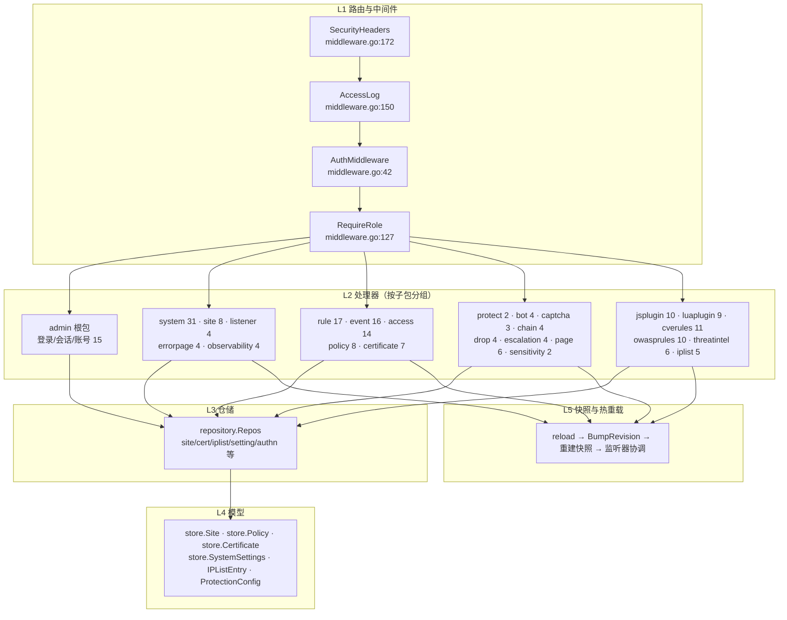
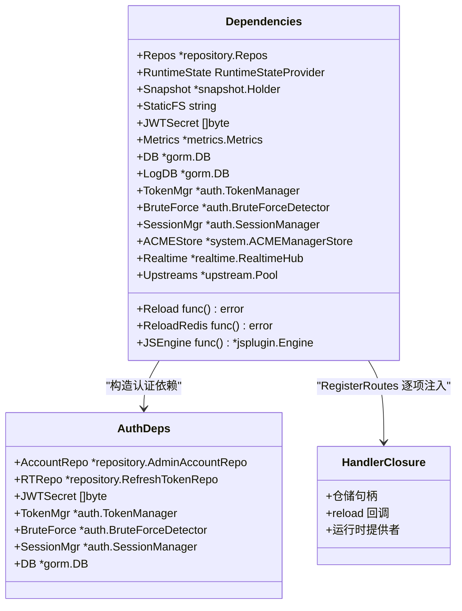
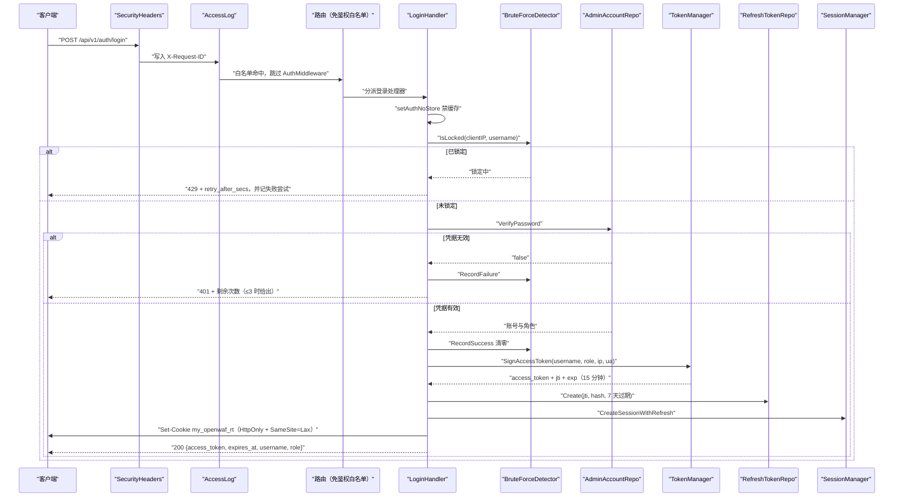
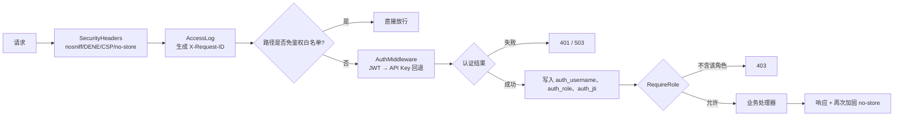
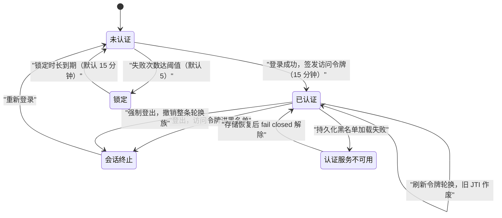
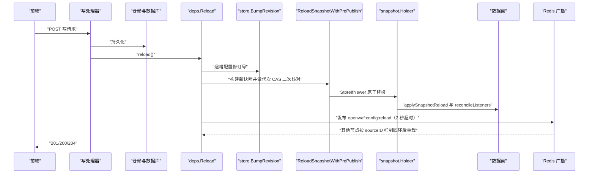
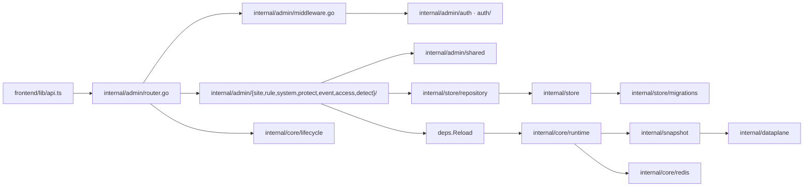
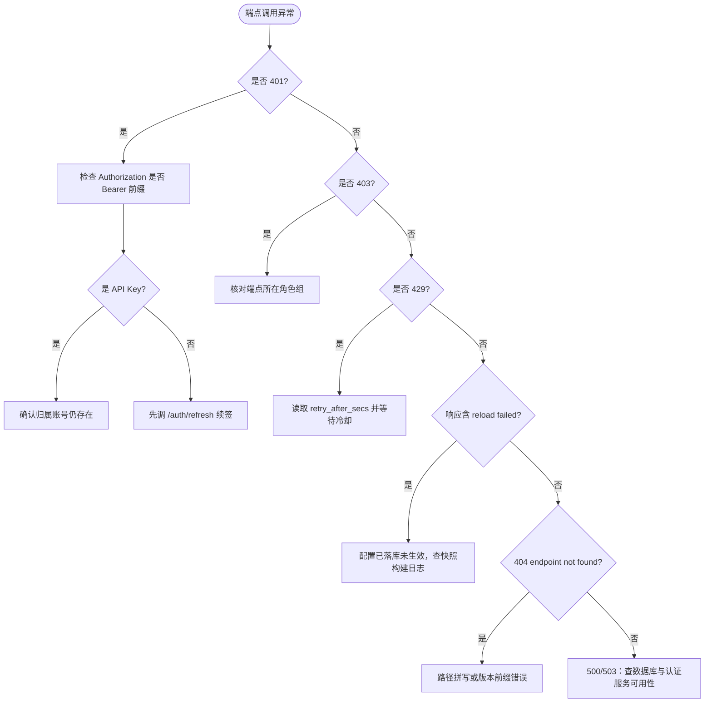

# 管理 API 系统

> [返回文档索引](../index.md)

<cite>
**本文档引用的文件**
- [router.go](file://internal/admin/router.go)
- [middleware.go](file://internal/admin/middleware.go)
- [auth.go](file://internal/admin/auth.go)
- [auth_helpers.go](file://internal/admin/auth_helpers.go)
- [auth_session.go](file://internal/admin/auth_session.go)
- [auth_revocation.go](file://internal/admin/auth_revocation.go)
- [admin_users.go](file://internal/admin/admin_users.go)
- [jwt.go](file://internal/admin/auth/jwt.go)
- [bruteforce.go](file://internal/admin/auth/bruteforce.go)
- [settings.go](file://internal/admin/system/settings.go)
- [helpers.go](file://internal/admin/shared/helpers.go)
- [json_bind.go](file://internal/admin/shared/json_bind.go)
- [server.go](file://internal/app/server.go)
- [site.go](file://internal/admin/site/site.go)
- [policy.go](file://internal/admin/system/policy/policy.go)
- [site.go](file://internal/store/site.go)
- [policy.go](file://internal/store/policy.go)
- [certificate.go](file://internal/store/certificate.go)
- [system.go](file://internal/store/system.go)
- [protection.go](file://internal/store/protection.go)
- [ip_list.go](file://internal/store/iplist/ip_list.go)
- [API 端点参考.md](file://docs/管理 API 系统/REST API 设计规范/API 端点参考.md)
- [REST API 设计规范.md](file://docs/管理 API 系统/REST API 设计规范/REST API 设计规范.md)
</cite>

## 目录

1. [简介](#简介)
2. [项目结构](#项目结构)
3. [核心组件](#核心组件)
4. [架构总览](#架构总览)
5. [详细组件分析](#详细组件分析)
6. [依赖关系分析](#依赖关系分析)
7. [性能考虑](#性能考虑)
8. [故障排查指南](#故障排查指南)
9. [结论](#结论)
10. [附录](#附录)

## 简介

管理 API 系统是 My-OpenWaf 控制面（Admin Control Plane）的唯一入口，基于 Hertz 提供版本化 REST 接口（`/api/v1`），由 `internal/admin.RegisterRoutes` 集中注册。实测端点 **217 个**：GET 100、POST 117、PUT 0、DELETE 0——写操作一律用 POST 加动作后缀表达，以规避 PUT/DELETE 在反向代理与 CORS 上的额外配置成本。

本篇是**域索引与全局约定**载体：分层结构、鉴权与权限模型、端点分组统计、跨端点统一的响应与错误约定。具体资源的参数、字段与用例分属各子文档，本篇不重复其细节。

| 维度 | 取值 |
|------|------|
| Web 框架 | CloudWeGo Hertz |
| 版本前缀 | `/api/v1` |
| 注册入口 | `internal/admin/router.go:89` |
| 端点总数 | 217（GET 100 / POST 117 / PUT 0 / DELETE 0） |
| 角色 | `admin`、`operator`、`readonly` |
| 认证方式 | 短期 JWT（Bearer）与 API Key（同为 Bearer 前缀） |
| 字段命名 | `snake_case` |
| 静态与 SPA | `NoRoute` 回退，`/api/` 前缀返回 404 JSON |

**章节来源**
- [router.go:89-440](file://internal/admin/router.go#L89-L440)
- [middleware.go:42-147](file://internal/admin/middleware.go#L42-L147)
- [jwt.go:19-40](file://internal/admin/auth/jwt.go#L19-L40)

## 项目结构

系统采用五层结构，层间依赖单向：路由与中间件 → 处理器 → 仓储 → 模型；旁路为快照与热重载层、前端 SDK 层。



**图表来源**
- [router.go:89-126](file://internal/admin/router.go#L89-L126)
- [router.go:372-416](file://internal/admin/router.go#L372-L416)
- [middleware.go:42-200](file://internal/admin/middleware.go#L42-L200)
- [server.go:1063](file://internal/app/server.go#L1063)

| 层 | 位置 | 职责 | 禁止事项 |
|----|------|------|----------|
| 路由与中间件 | `internal/admin/router.go`、`middleware.go` | 端点注册、认证、角色、安全头、访问日志 | 不写业务判断 |
| 处理器 | `internal/admin/<域>/` 子包 | 参数校验、持久化、触发重载 | 早期扁平 handler 文件布局已废弃，不存在对应文件 |
| 仓储 | `internal/store/repository/` | CRUD、分页、聚合统计 | 不感知 HTTP |
| 模型 | `internal/store/` | 字段、默认值、三态与派生 | 不含请求体绑定逻辑 |
| 快照与重载 | `internal/snapshot/`、`internal/core/`、`internal/app/` | 代次校验、原子替换、监听器协调 | 不由处理器直接构建快照 |
| 前端 SDK | `frontend/lib/api.ts` | 统一 fetch、令牌刷新、错误处理 | 不绕过类型定义拼 URL |

**章节来源**
- [router.go:12-56](file://internal/admin/router.go#L12-L56)
- [router.go:89-440](file://internal/admin/router.go#L89-L440)
- [middleware.go:42-200](file://internal/admin/middleware.go#L42-L200)

## 核心组件

`Dependencies` 是控制面的唯一注入点，路由注册只从它取依赖，不在处理器内部自行构造。



**图表来源**
- [router.go:60-105](file://internal/admin/router.go#L60-L105)

| 组件 | 位置 | 行号 | 说明 |
|------|------|-----:|------|
| `Dependencies` | `internal/admin/router.go` | 60-87 | 控制面依赖容器 |
| `RegisterRoutes` | `internal/admin/router.go` | 89-440 | 全部端点注册与分组挂载 |
| `AuthMiddleware` | `internal/admin/middleware.go` | 42-123 | JWT 优先、API Key 回退 |
| `RequireRole` | `internal/admin/middleware.go` | 127-147 | 角色白名单校验 |
| `AccessLog` | `internal/admin/middleware.go` | 150-170 | 请求 ID、耗时、认证方式 |
| `SecurityHeaders` | `internal/admin/middleware.go` | 172-192 | 安全头与 `no-store` |
| `AuthDeps` | `internal/admin/auth.go` | 16-25 | 认证处理器依赖 |
| `TokenManager` | `internal/admin/auth/jwt.go` | 45-66 | 签发、校验、轮换、黑名单 |
| `BruteForceDetector` | `internal/admin/auth/bruteforce.go` | 10-43 | 失败计数与锁定 |
| `SessionManager` | `internal/admin/auth/session.go` | 28-59 | 会话表与活跃时间 |

处理器全部以「依赖入参 → 返回 `app.HandlerFunc` 闭包」的工厂形式注册，例如 `site.CreateSite(r.Site, r.Certificate, reload)`；`JSEngine` 采用函数而非实例注入，使每次 dry-run 都能读到重载后的当前 runtime（`router.go:83-86`）。

**章节来源**
- [router.go:60-120](file://internal/admin/router.go#L60-L120)
- [middleware.go:42-192](file://internal/admin/middleware.go#L42-L192)
- [auth.go:16-33](file://internal/admin/auth.go#L16-L33)
- [jwt.go:45-66](file://internal/admin/auth/jwt.go#L45-L66)
- [bruteforce.go:10-43](file://internal/admin/auth/bruteforce.go#L10-L43)

## 架构总览

以下序列图展示一次典型登录：防暴力破解检查、凭据校验、访问令牌与刷新令牌签发、会话登记与 Cookie 写入。



**图表来源**
- [auth.go:33-127](file://internal/admin/auth.go#L33-L127)
- [router.go:91-107](file://internal/admin/router.go#L91-L107)
- [middleware.go:46-53](file://internal/admin/middleware.go#L46-L53)
- [jwt.go:100-130](file://internal/admin/auth/jwt.go#L100-L130)

响应载荷形状（已脱敏）：

```json
{
  "access_token": "{访问令牌}",
  "expires_at": 1730000000,
  "username": "admin",
  "role": "admin"
}
```

请求体仅两个字段：

```json
{
  "username": "admin",
  "password": "{口令}"
}
```

**章节来源**
- [auth.go:26-30](file://internal/admin/auth.go#L26-L30)
- [auth.go:112-127](file://internal/admin/auth.go#L112-L127)
- [auth_helpers.go:14-32](file://internal/admin/auth_helpers.go#L14-L32)

## 详细组件分析

### 中间件链与请求处理

`SecurityHeaders` 与 `AccessLog` 挂在全实例（`h.Use`），因此对所有路径生效；`AuthMiddleware` 只挂在 `/api/v1` 组；`RequireRole` 按组追加。



**图表来源**
- [middleware.go:42-192](file://internal/admin/middleware.go#L42-L192)
- [router.go:91-110](file://internal/admin/router.go#L91-L110)

| 顺序 | 中间件 | 挂载点 | 关键副作用 |
|:----:|--------|--------|------------|
| 1 | `SecurityHeaders` | `h.Use` | `X-Content-Type-Options`、`X-Frame-Options`、`Referrer-Policy`、`Content-Security-Policy`；`/api/v1/` 前后各写一次 `Cache-Control: no-store` |
| 2 | `AccessLog` | `h.Use` | 生成 UUID 作为 `X-Request-ID`，记录方法、路径、状态、耗时、认证方式 |
| 3 | `AuthMiddleware` | `api` 组 | 白名单跳过；JWT 优先，命中则更新会话活跃时间；回退 API Key |
| 4 | `RequireRole` | 各资源组 | 无角色 403；角色不在集合内 403 |
| 5 | 组内单点角色 | 个别端点 | 如 `POST /auth/sessions/force-logout` 单独要求 `admin` |

白名单只有四条路径：`/api/v1/health`、`/api/v1/auth/login`、`/api/v1/auth/refresh`、`/api/v1/auth/logout`（`middleware.go:47-53`）。`/__owaf/pow.wasm`、`/__owaf/pow_glue.js`、`/api/v1/realtime/ws`、`/.well-known/acme-challenge/:token` 注册在 Hertz 根实例上，不经 `AuthMiddleware`。

**章节来源**
- [middleware.go:42-192](file://internal/admin/middleware.go#L42-L192)
- [router.go:418-437](file://internal/admin/router.go#L418-L437)

### 认证与令牌模型



**图表来源**
- [auth.go:33-127](file://internal/admin/auth.go#L33-L127)
- [auth.go:200-240](file://internal/admin/auth.go#L200-L240)
- [jwt.go:36-66](file://internal/admin/auth/jwt.go#L36-L66)
- [bruteforce.go:27-95](file://internal/admin/auth/bruteforce.go#L27-L95)

| 参数 | 取值 | 依据 |
|------|------|------|
| 访问令牌有效期 | 15 分钟 | `jwt.go:37` |
| 刷新令牌有效期 | 7 天 | `jwt.go:38` |
| 签发者 / 受众 | `my-openwaf` / `my-openwaf-admin` | `jwt.go:40-41` |
| 签名算法 | HS256 | `jwt.go:124` |
| 令牌内声明 | `username`、`role`、`ip_hash`、`device_hash` | `jwt.go:28-34` |
| 刷新 Cookie 名 | `my_openwaf_rt` | `auth_helpers.go:15` |
| Cookie 属性 | `Path=/`、`SameSite=Lax`、`HttpOnly`、`Secure` 跟随协议 | `auth_helpers.go:26-31` |
| Cookie 值形态 | `{JTI}.{原始刷新令牌}`，库内只存哈希 | `auth.go:121` |
| 暴力破解默认阈值 | 5 次 / 锁定 15 分钟 | `bruteforce.go:28-33` |
| 阈值可配来源 | `ProtectionConfig.LoginMaxAttempts`、`LoginLockoutMinutes` | `server.go:630`、`server.go:657` |
| 密钥轮换 | 主密钥签名，校验失败回退备用密钥 | `jwt.go:131-140` |
| 黑名单不可用 | 返回 503，认证 fail closed | `jwt.go:63`、`middleware.go:85-88` |

API Key 的身份与权限都取自其**归属账号**：`middleware.go:103-120` 会用 `key.UserID` 反查 `AdminAccount`，账号不存在直接 401，角色取账号角色而非固定 `admin`。旧文档中「API Key 默认视为 admin」的描述已作废。

**章节来源**
- [jwt.go:28-67](file://internal/admin/auth/jwt.go#L28-L67)
- [jwt.go:100-140](file://internal/admin/auth/jwt.go#L100-L140)
- [middleware.go:85-121](file://internal/admin/middleware.go#L85-L121)
- [bruteforce.go:27-95](file://internal/admin/auth/bruteforce.go#L27-L95)
- [auth_helpers.go:14-40](file://internal/admin/auth_helpers.go#L14-L40)
- [auth.go:112-125](file://internal/admin/auth.go#L112-L125)
- [server.go:630](file://internal/app/server.go#L630)

### RBAC 权限模型与端点分布

角色常量在 `internal/admin/auth/jwt.go:22-24` 从 `internal/store/auth` 镜像而来，取值 `admin`、`operator`、`readonly`。注册时按四个组挂载：

| 分组 | 中间件 | 端点数 | 允许角色 |
|------|--------|-------:|----------|
| `h`（Hertz 根） | 仅 `SecurityHeaders` + `AccessLog` | 8 | 任意（含公开） |
| `api` | 追加 `AuthMiddleware` | 4 | 任意已认证 |
| `readGroup` | 追加 `RequireRole(admin, operator, readonly)` | 92 | 三角色 |
| `opsGroup` | 追加 `RequireRole(admin, operator)` | 87 | admin / operator |
| `adminGroup` | 追加 `RequireRole(admin)` | 26 | 仅 admin |
| **合计** | — | **217** | — |

处理器包归属（按实际注册语句统计，合计 217）：

| 处理器包 | 端点数 | 负责资源 |
|----------|-------:|----------|
| `internal/admin/system` | 31 | 设置、健康、网络/TLS/HTTP2/Redis/日志/运行时配置、ACME、备份、重载 |
| `internal/admin/rule` | 17 | 自定义规则、站点规则、应用路由规则、录制资源 |
| `internal/admin/event` | 16 | 安全事件、访问日志、TLS 指纹、请求追踪、误报反馈 |
| `internal/admin`（根包） | 15 | 登录/刷新/登出/me/改密/会话/强退 7 + 管理员账号 5 + 内联闭包 3 |
| `internal/admin/access` | 14 | 站点访问控制：身份源、用户、路径规则 |
| `internal/admin/detect/cverules` | 11 | CVE 规则 |
| `internal/admin/system/jsplugin` | 10 | JS 插件 |
| `internal/admin/detect/owasprules` | 10 | OWASP 规则 |
| `internal/admin/system/luaplugin` | 9 | Lua 插件 |
| `internal/admin/site` | 8 | 站点 CRUD 与启停 |
| `internal/admin/system/policy` | 8 | 策略 |
| `internal/admin/system/certificate` | 7 | 证书 |
| `internal/admin/system/threatintel` | 6 | 威胁情报订阅源与同步日志 |
| `internal/admin/protect/page` | 6 | 页面模板 |
| `internal/admin/system/iplist` | 5 | IP 黑白名单 |
| `internal/admin/site/listener` | 4 | 站点监听器 |
| `internal/admin/site/errorpage` | 4 | 站点错误页 |
| `internal/admin/site/observability` | 4 | 站点访问日志与丢弃事件 |
| `internal/admin/protect/bot` | 4 | Bot 设置与统计 |
| `internal/admin/protect/chain` | 4 | 链式验证 |
| `internal/admin/protect/drop` | 4 | 阻断策略与事件 |
| `internal/admin/protect/escalation` | 4 | 响应升级链 |
| `internal/admin/protect/captcha` | 3 | 验证码配置与测试 |
| `internal/admin/system/apikey` | 3 | 管理令牌 |
| `internal/admin/protect` | 2 | 保护配置读写 |
| `internal/admin/protect/sensitivity` | 2 | 类别敏感度 |
| `internal/admin/system/presetbots` | 2 | 预置爬虫白名单 |
| `internal/admin/system/realtime` | 2 | 实时票据与 WebSocket |
| `internal/admin/system/dashboard` | 1 | 仪表盘汇总 |
| `internal/admin/system/upstream` | 1 | 上游连接池状态 |

`internal/admin` 根包的 3 个内联闭包是 PoW WASM 下发、PoW glue JS 下发与 ACME HTTP-01 应答；它们直接注册在 Hertz 根实例上。

**章节来源**
- [router.go:94-126](file://internal/admin/router.go#L94-L126)
- [router.go:255-256](file://internal/admin/router.go#L255-L256)
- [router.go:372-374](file://internal/admin/router.go#L372-L374)
- [router.go:418-437](file://internal/admin/router.go#L418-L437)
- [jwt.go:19-40](file://internal/admin/auth/jwt.go#L19-L40)

### 响应与错误约定

管理面统一以 `map` 直接序列化，没有全局响应包装器：列表返回 `{"items":…, "total":…}`，错误返回 `{"error":"…"}`，删除成功返回 204 空体。

| 约定 | 口径 | 依据 |
|------|------|------|
| 列表信封 | `items` + `total`，多数再带 `page` | `settings.go:105`、`iplist.go:40`、`certificate.go:66` |
| 分页入参 | `page` 缺省 1、`page_size` 缺省 20，由 `utils.Paginate` 归一 | `site.go:78-80` |
| 排序 | 各自固定列序，如策略 `id ASC`、名单 `id DESC` | `policy.go:19`、`ip_list.go:29` |
| 删除成功 | `204` + `nil` | `iplist.go:210`、`policy.go:156` |
| 写后重载失败 | `500` + `config applied but reload failed` + 回显 `item` | `site.go:246-248`、`policy.go:68` |
| 错误文案 | 少数校验用中文（如「请求体格式无效」） | `certificate.go:133`、`acme.go:464` |
| 未匹配 API 路径 | `NoRoute` 对 `/api/` 前缀返回 `404 {"error":"endpoint not found"}` | `router.go:448-455` |

```json
{
  "error": "config applied but reload failed: snapshot build error",
  "item": {
    "id": 3,
    "host": "example.com",
    "enabled": true
  }
}
```

| 状态码 | 语义 | 典型成因 |
|-------:|------|----------|
| 200 | 查询或更新成功 | — |
| 201 | 创建成功 | 资源已入库并触发重载 |
| 204 | 删除成功 | 空响应体 |
| 400 | 参数或校验失败 | ID 非数值、枚举越界、PEM 不配对、受保护键写入 |
| 401 | 未认证 | 缺 Authorization、格式非 Bearer、令牌无效或密钥归属账号已删 |
| 403 | 权限不足 | 角色不在 `RequireRole` 集合内 |
| 404 | 资源不存在 | 含内部设置键被屏蔽的情形 |
| 409 | 状态冲突 | 删除默认策略、用户名重复 |
| 429 | 频率或锁定 | 登录失败过多，附 `retry_after_secs` |
| 500 | 服务端错误 | 数据库异常、重载失败 |
| 503 | 依赖不可用 | 认证服务或黑名单存储不可用 |

**章节来源**
- [settings.go:105](file://internal/admin/system/settings.go#L105)
- [router.go:442-465](file://internal/admin/router.go#L442-L465)
- [site.go:240-250](file://internal/admin/site/site.go#L240-L250)
- [policy.go:64-68](file://internal/admin/system/policy/policy.go#L64-L68)
- [auth.go:49-58](file://internal/admin/auth.go#L49-L58)
- [middleware.go:85-101](file://internal/admin/middleware.go#L85-L101)

### 配置写入与热重载闭环

所有写端点共享同一条生效链路，注册时以 `reload := deps.Reload` 注入（`router.go:119`）。



**图表来源**
- [router.go:119](file://internal/admin/router.go#L119)
- [router.go:313](file://internal/admin/router.go#L313)
- [settings.go:202-210](file://internal/admin/system/settings.go#L202-L210)

少数端点不走全局重载：`POST /log-config` 仅落库、`POST /certificates/acme/config` 由 ACME 管理器缓存键在下轮读取时重建、`POST /redis-config` 走独立的 `ReloadRedis`。这三处例外在各自子文档中说明。

**章节来源**
- [settings.go:161-210](file://internal/admin/system/settings.go#L161-L210)
- [router.go:390-398](file://internal/admin/router.go#L390-L398)

### 静态资源与 SPA 回退

`mountStaticHandler` 用 `NoRoute` 实现：`/api/` 前缀返回 JSON 404，其余路径按路由文件解析静态资源并以推导出的 Content-Type 返回；解析失败回 `404 not found`。静态目录由 `Dependencies.StaticFS` 指定，缺省走内嵌资源解析。

**章节来源**
- [router.go:439-465](file://internal/admin/router.go#L439-L465)

## 依赖关系分析



**图表来源**
- [router.go:12-58](file://internal/admin/router.go#L12-L58)
- [router.go:439-456](file://internal/admin/router.go#L439-L456)

| 依赖方 | 被依赖方 | 性质 | 变更影响面 |
|--------|----------|------|------------|
| 全部处理器 | `admin/shared` | 校验、绑定、同步工具 | 跨端点一致性 |
| 全部写处理器 | `deps.Reload` | 注入闭包 | 配置生效 |
| `admin/auth` | `store/auth` 模型与仓储 | 账号、刷新令牌 | 登录可用性 |
| `admin/system` | `store.SystemSettings` | 键值配置 | 全局配置 |
| `admin/site` | `store.Site`、`SiteListener` | 站点配置 | 数据面路由 |
| `admin/system/certificate` | `store.Certificate` | TLS 材料 | 监听器 TLS |
| `admin/system/iplist` | `store/iplist` | 访问控制 | IP 信誉阶段 |
| `admin` | `internal/security` | 客户端 IP 与 Host | 认证与审计准确性 |

**章节来源**
- [router.go:12-58](file://internal/admin/router.go#L12-L58)
- [helpers.go:23-63](file://internal/admin/shared/helpers.go#L23-L63)
- [json_bind.go:14-94](file://internal/admin/shared/json_bind.go#L14-L94)

## 性能考虑

- 登录失败计数与锁定为进程内并发映射，按 `(clientIP, username)` 归并；阈值与锁定时长随保护配置热更新。
- 会话活跃时间在每个已认证请求上更新，属 O(1) 内存操作，不引入数据库写入放大。
- 写端点会触发完整快照重建，批量改动应在一次请求内提交；`POST /rules/import` 与 `POST /preset-bot-whitelist/seed` 就是为此提供的合并入口。
- 访问日志记录统一在 `AccessLog` 完成，含耗时与认证方式，便于定位慢端点而不必逐处理器埋点。
- `/api/v1/` 全部 `no-store`，牺牲缓存换取认证接口不因遗漏单个 handler 而被中间缓存复用。

**章节来源**
- [middleware.go:150-192](file://internal/admin/middleware.go#L150-L192)
- [bruteforce.go:44-95](file://internal/admin/auth/bruteforce.go#L44-L95)
- [settings.go:202-210](file://internal/admin/system/settings.go#L202-L210)

## 故障排查指南



**图表来源**
- [middleware.go:46-147](file://internal/admin/middleware.go#L46-L147)
- [auth.go:49-75](file://internal/admin/auth.go#L49-L75)
- [router.go:448-455](file://internal/admin/router.go#L448-L455)

| 症状 | 定位线索 | 处置 |
|------|----------|------|
| 恒定 401 | 访问日志的 `auth` 字段为空 | 确认头格式与令牌有效期（15 分钟） |
| 刷新后仍 401 | 会话被强退或令牌进黑名单 | 重新登录；黑名单失效属预期 |
| 登录 429 | 响应 `retry_after_secs` | 等待冷却，或调整登录安全策略 |
| 503 | 响应 `authentication service unavailable` | 持久化黑名单加载失败，恢复存储 |
| 保存成功但未生效 | `config applied but reload failed` | 用 `POST /reload` 复现并看快照诊断 |
| 跨节点不一致 | Redis 未配置或广播超时 | 核对 `redis-config` 的 `enabled` 与 `password_set` |
| 找不到端点 | 响应 `endpoint not found` | 对照 [API 端点参考](REST API 设计规范/API 端点参考.md) 的 217 条清单 |

**章节来源**
- [middleware.go:46-147](file://internal/admin/middleware.go#L46-L147)
- [auth.go:40-75](file://internal/admin/auth.go#L40-L75)
- [settings.go:202-210](file://internal/admin/system/settings.go#L202-L210)

## 结论

管理 API 的复杂度集中在两处：一是「四组角色 × 三十个处理器包」的注册矩阵，靠集中注册与统一信封保持稳定；二是「写库即重载」的一致性承诺，靠代次校验与显式失败回显保持可判定。新增端点时应遵循的既有约束是：只注册 GET 与 POST、字段用 `snake_case`、写操作必须走 `deps.Reload`、机密不进响应、站点级可空字段保持三态语义。

**章节来源**
- [本节为总结，无需特定文件来源]

## 附录

### 子文档索引

| 分类 | 文档 | 覆盖内容 |
|------|------|----------|
| 基础规范 | [REST API 设计规范](REST API 设计规范/REST API 设计规范.md) | 版本控制、资源命名、方法约定、安全策略 |
| 基础规范 | [API 端点参考](REST API 设计规范/API 端点参考.md) | 217 端点全量清单与权限归属 |
| 基础规范 | [认证授权机制](REST API 设计规范/认证授权机制.md) | JWT、刷新令牌、API Key、RBAC、暴力破解防护 |
| 基础规范 | [请求响应格式规范](REST API 设计规范/请求响应格式规范.md) | 信封结构、分页、排序、错误码 |
| 基础规范 | [路由设计规范](REST API 设计规范/路由设计规范.md) | 前缀、静态段与参数段、SPA 回退 |
| 基础规范 | [错误处理机制](REST API 设计规范/错误处理机制.md) | 错误类型、日志、降级与恢复 |
| 核心资源 | [站点管理 API](站点管理 API.md) | 站点、监听器、错误页、站点观测、访问控制 |
| 核心资源 | [规则管理 API](规则管理 API/规则管理 API.md) | 规则 CRUD、验证测试、导入导出 |
| 核心资源 | [策略管理 API](策略管理 API.md) | 策略、策略作用域 OWASP、保护配置 |
| 安全防护 | [证书管理 API](证书管理 API.md) | 证书 CRUD、ACME 申请与续期 |
| 安全防护 | [IP 黑白名单管理 API](IP 黑白名单管理 API.md) | 名单、预置白名单、威胁情报订阅 |
| 安全防护 | [机器人保护 API](机器人保护 API.md) | Bot 设置、评分与统计 |
| 安全防护 | [阻断策略 API](阻断策略 API.md) | 丢弃策略与事件 |
| 安全防护 | [CVE 规则管理 API](CVE 规则管理 API.md) | CVE 规则与源同步 |
| 监控运维 | [安全事件 API](安全事件 API.md) | 事件查询、统计、时间线 |
| 监控运维 | [仪表板 API](仪表板 API.md) | 汇总指标与运行时摘要 |
| 监控运维 | [系统设置 API](系统设置 API.md) | 键值设置、结构化配置、备份恢复、账号与令牌 |

**章节来源**
- [router.go:127-416](file://internal/admin/router.go#L127-L416)

### 数据模型速查

| 模型 | 位置 | 关键内容 |
|------|------|----------|
| `Site` | `internal/store/site.go:38` | 域名、上游、监听、TLS、三态保护开关、维护与拦截页 |
| `SiteListener` | `internal/store/site.go:248` | 站点多监听绑定与独立 TLS 材料 |
| `Policy` | `internal/store/policy.go:10` | 规则命名容器与默认槽 |
| `Rule` | `internal/store/policy.go:70` | 阶段、模式 DSL、动作、优先级、规则级限频 |
| `Certificate` | `internal/store/certificate.go:19` | PEM 对、来源、域名、到期与自动续期 |
| `IPListEntry` | `internal/store/iplist/ip_list.go:17` | 黑/白名单、动作、站点作用域、订阅源派生 |
| `SystemSettings` | `internal/store/system.go:4` | 唯一键值配置 |
| `ConfigRevision` | `internal/store/system.go:31` | 单调递增快照修订号 |
| `ProtectionConfig` | `internal/store/protection.go:13` | 限流、OWASP、维护、Bot、自动封禁、CC、CVE、登录安全 |

`ProtectionConfig` 的 JSON 键与 Go 字段并非同名：例如 OWASP 用 `builtin_owasp_enabled`/`builtin_owasp_sensitivity`/`builtin_owasp_on_hit`，限流用 `request_ratelimit_*` 与 `error_ratelimit_*` 两组。

**章节来源**
- [site.go:38-149](file://internal/store/site.go#L38-L149)
- [site.go:248-261](file://internal/store/site.go#L248-L261)
- [policy.go:10-97](file://internal/store/policy.go#L10-L97)
- [certificate.go:19-39](file://internal/store/certificate.go#L19-L39)
- [ip_list.go:9-30](file://internal/store/iplist/ip_list.go#L9-L30)
- [system.go:4-34](file://internal/store/system.go#L4-L34)
- [protection.go:13-60](file://internal/store/protection.go#L13-L60)

### 端点资源分布统计

| 资源段 | 端点数 | 主要子文档 |
|--------|-------:|------------|
| `/sites*` | 42 | [站点管理 API](站点管理 API.md) |
| `/policies*` | 13 | [策略管理 API](策略管理 API.md) |
| `/certificates*` | 12 | [证书管理 API](证书管理 API.md) |
| `/rules*` | 10 | [规则管理 API](规则管理 API/规则管理 API.md) |
| `/js-plugins*` | 10 | 扩展与插件系统 |
| `/cve-rules*` + `/cve-feed*` | 11 | [CVE 规则管理 API](CVE 规则管理 API.md) |
| `/lua-plugins*` | 9 | 扩展与插件系统 |
| `/settings*` | 6 | [系统设置 API](系统设置 API.md) |
| `/page-templates*` | 6 | 安全防护功能 |
| `/ip-lists*` + `/preset-bot-whitelist*` | 7 | [IP 黑白名单管理 API](IP 黑白名单管理 API.md) |
| `/threat-intel*` | 6 | [IP 黑白名单管理 API](IP 黑白名单管理 API.md) |
| `/security-events*` + `/access-logs*` + `/fingerprints` + `/request/:request_id` | 9 | [安全事件 API](安全事件 API.md) |
| `/settings` 之外的结构化配置族 | 18 | [系统设置 API](系统设置 API.md) |
| `/admin-users*` + `/api-keys*` + `/backup*` | 10 | [系统设置 API](系统设置 API.md) |
| `/auth*` + `/health` | 8 | [认证授权机制](REST API 设计规范/认证授权机制.md) |
| `/false-positives*` | 4 | [安全事件 API](安全事件 API.md) |
| `/chain*` + `/captcha*` | 7 | 安全防护功能 |
| `/protection*` + `/escalation*` | 8 | [策略管理 API](策略管理 API.md) |
| `/bot-*` + `/preset-bot*` | 6 | [机器人保护 API](机器人保护 API.md) |
| `/drop-*` | 4 | [阻断策略 API](阻断策略 API.md) |
| `/dashboard` + `/upstreams/status` + `/realtime*` | 4 | [仪表板 API](仪表板 API.md) |
| `/reload` | 1 | [系统设置 API](系统设置 API.md) |
| `/error-pages*` | 2 | [站点管理 API](站点管理 API.md) |
| `/__owaf/*` + `/.well-known/*` | 3 | 挑战与 ACME 应答，不经鉴权 |
| **合计** | **217** | — |

**章节来源**
- [router.go:94-437](file://internal/admin/router.go#L94-L437)
- [API 端点参考.md:53-60](file://docs/管理 API 系统/REST API 设计规范/API 端点参考.md#L53-L60)

### 字段命名与序列化约定

| 约定 | 口径 | 反例（禁止） |
|------|------|--------------|
| JSON 字段名 | `snake_case` | `upstreamUrls` |
| 站点级布尔 | `*bool` 三态：`null` 继承全局、`true` 覆盖启用、`false` 覆盖关闭 | 把空值存成 `false`/`0` |
| 可空外键 | `*uint` + `omitempty` | 用 `0` 表示未设置 |
| 内部列 | `json:"-"` | 让 `deleted_at`、`default_slot` 外泄 |
| 派生字段 | `AfterFind` 计算且只读 | 接受客户端传入 |
| JSON blob | 库内字符串、响应展开为对象/数组 | 前端直接拼字符串入库 |
| 机密 | 响应零出现，示例用 `{占位}` | 回显私钥、令牌、口令 |
| 写方法 | 一律 POST | 新增 PUT/DELETE 端点 |

**章节来源**
- [site.go:60-100](file://internal/store/site.go#L60-L100)
- [policy.go:18-25](file://internal/store/policy.go#L18-L25)
- [json_bind.go:14-110](file://internal/admin/shared/json_bind.go#L14-L110)
- [router.go](file://internal/admin/router.go#L94-L437)
