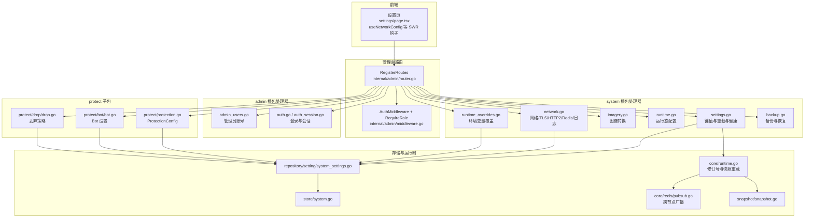
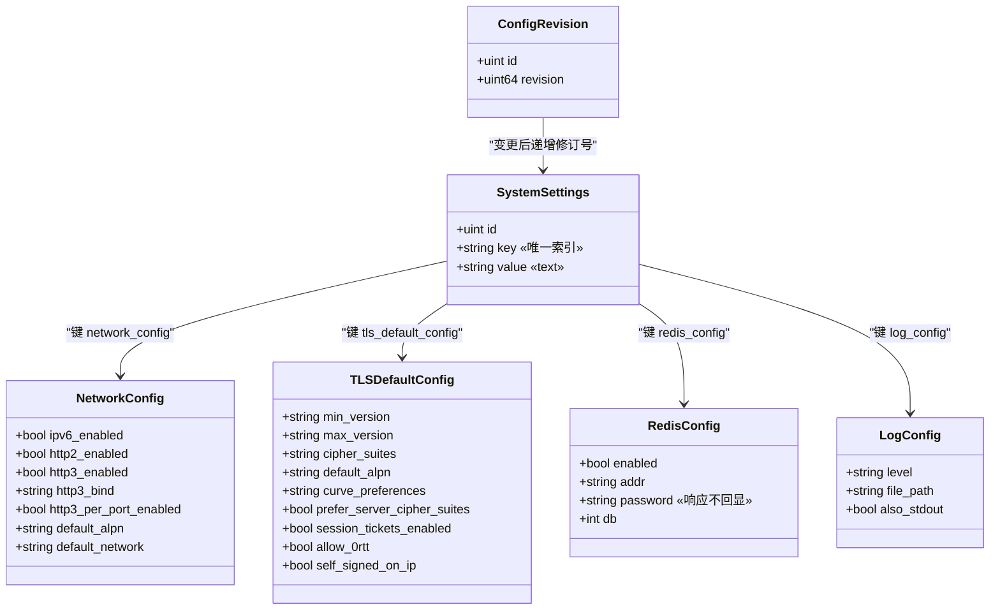
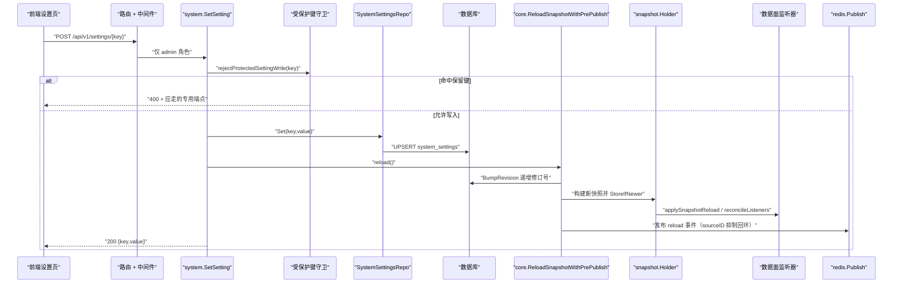
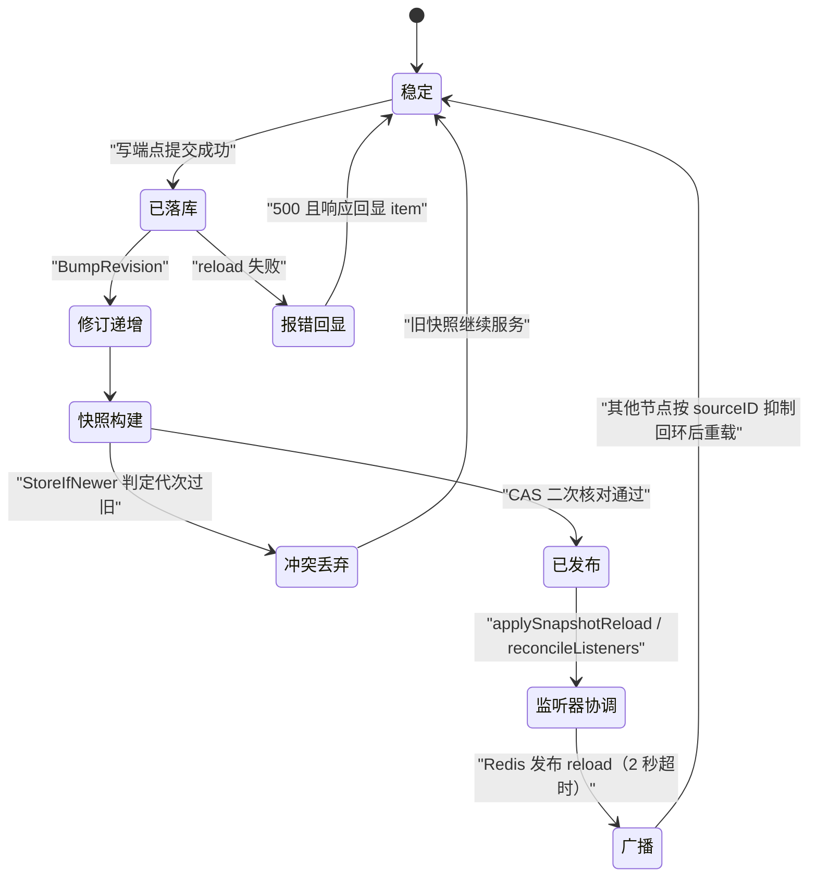
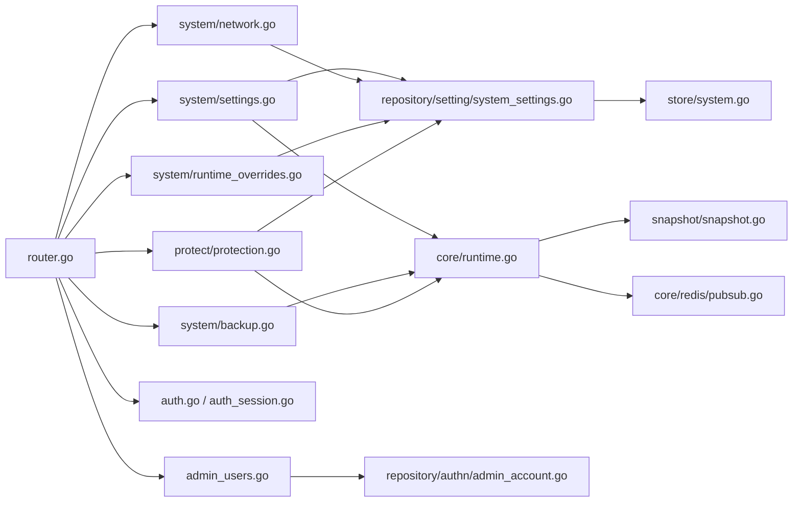

# 系统设置 API

> [返回 管理 API 系统](管理 API 系统.md)

<cite>
**本文档引用的文件**
- [router.go](file://internal/admin/router.go)
- [settings.go](file://internal/admin/system/settings.go)
- [network.go](file://internal/admin/system/network.go)
- [imagery.go](file://internal/admin/system/imagery.go)
- [runtime.go](file://internal/admin/system/runtime.go)
- [runtime_overrides.go](file://internal/admin/system/runtime_overrides.go)
- [backup.go](file://internal/admin/system/backup.go)
- [apikey.go](file://internal/admin/system/apikey/apikey.go)
- [admin_users.go](file://internal/admin/admin_users.go)
- [auth.go](file://internal/admin/auth.go)
- [auth_session.go](file://internal/admin/auth_session.go)
- [middleware.go](file://internal/admin/middleware.go)
- [protection.go](file://internal/admin/protect/protection.go)
- [bot.go](file://internal/admin/protect/bot/bot.go)
- [drop.go](file://internal/admin/protect/drop/drop.go)
- [system.go](file://internal/store/system.go)
- [migrate.go](file://internal/store/migrate.go)
- [runtime.go](file://internal/core/runtime.go)
- [pubsub.go](file://internal/core/redis/pubsub.go)
- [snapshot.go](file://internal/snapshot/snapshot.go)
- [http2.go](file://internal/snapshot/http2.go)
- [system_settings.go](file://internal/store/repository/setting/system_settings.go)
- [admin_account.go](file://internal/store/repository/authn/admin_account.go)
- [auth_revocation.go](file://internal/admin/auth_revocation.go)
- [settings page.tsx](file://frontend/app/(dashboard)/settings/page.tsx)
</cite>

## 目录

1. [简介](#简介)
2. [项目结构](#项目结构)
3. [核心组件](#核心组件)
4. [架构总览](#架构总览)
5. [详细组件分析](#详细组件分析)
6. [依赖关系分析](#依赖关系分析)
7. [性能考虑](#性能考虑)
8. [故障排查指南](#故障排查指南)
9. [结论](#结论)
10. [附录](#附录)

## 简介

系统设置 API 是控制面的配置入口，覆盖四件事：键值型系统设置的读写、结构化配置（网络/TLS/HTTP2/Redis/日志/图像转换/运行时覆盖）的专用端点、管理面自身的账号与令牌治理、以及配置快照的手动重载与整体备份恢复。共 38 个端点。

一条贯穿性规则：**受专用端点管辖的键不能通过通用 `/settings` 写入**。`system/settings.go` 维护 `protectedSettingKeys` 与 `internalSettingKeys` 两张表，命中即返回 400 并把应走的端点回显给调用方，避免同一份配置出现第二真源。

**章节来源**
- [settings.go:13-58](file://internal/admin/system/settings.go#L13-L58)
- [router.go:149-150](file://internal/admin/router.go#L149-L150)

## 项目结构

处理器分布在 `internal/admin/system/` 根包与其 `apikey/`、`dashboard/` 等子包，管理面账号与会话端点在 `internal/admin` 根包（`admin_users.go`、`auth.go`、`auth_session.go`）。早期扁平 handler 文件布局已废弃，旧文档中按单文件命名的处理器路径已全部作废。

**图表来源**
- [router.go:89-126](file://internal/admin/router.go#L89-L126)
- [router.go:149-214](file://internal/admin/router.go#L149-L214)
- [router.go:375-406](file://internal/admin/router.go#L375-L406)
- [settings.go:1-216](file://internal/admin/system/settings.go#L1-L216)

| 模块 | 路径 | 行数 | 职责 |
|------|------|-----:|------|
| 键值设置与重载 | `internal/admin/system/settings.go` | 216 | 设置 CRUD、受保护键拦截、reload、健康检查 |
| 网络与 TLS 配置 | `internal/admin/system/network.go` | 818 | 网络/HTTP2/日志/TLS 默认/Redis 配置读写与校验 |
| 图像转换 | `internal/admin/system/imagery.go` | 127 | ACME 之外的图像处理开关 |
| 运行态配置 | `internal/admin/system/runtime.go` | 972 | 只读运行态快照与 TLS 能力矩阵 |
| 环境变量覆盖 | `internal/admin/system/runtime_overrides.go` | 334 | 覆盖表三态读写与诊断 |
| 备份恢复 | `internal/admin/system/backup.go` | 166 | 配置导出/导入与凭据掩码 |
| 管理令牌 | `internal/admin/system/apikey/apikey.go` | 150 | API 密钥列表/创建/删除 |
| 管理员账号 | `internal/admin/admin_users.go` | 246 | 账号 CRUD 与凭据撤销 |
| 认证与会话 | `internal/admin/auth.go`、`auth_session.go` | 352、89 | 登录、改密、会话列表、强制登出 |
| 中间件 | `internal/admin/middleware.go` | 334 | 认证、角色、访问日志、安全响应头 |
| 账号仓库 | `internal/store/repository/authn/admin_account.go` | 85 | 账号创建、角色统计、口令哈希排除 |
| 设置页 | `frontend/app/(dashboard)/settings/page.tsx` | 918 | 以 SWR 钩子读写网络/TLS/Redis/日志/运行态配置 |

**章节来源**
- [settings.go:1-216](file://internal/admin/system/settings.go#L1-L216)
- [network.go:1-818](file://internal/admin/system/network.go#L1-L818)
- [runtime.go:1-972](file://internal/admin/system/runtime.go#L1-L972)
- [runtime_overrides.go:1-334](file://internal/admin/system/runtime_overrides.go#L1-L334)
- [backup.go:1-166](file://internal/admin/system/backup.go#L1-L166)
- [apikey.go:1-150](file://internal/admin/system/apikey/apikey.go#L1-L150)
- [admin_users.go:1-246](file://internal/admin/admin_users.go#L1-L246)
- [middleware.go:1-334](file://internal/admin/middleware.go#L1-L334)
- [admin_account.go:1-85](file://internal/store/repository/authn/admin_account.go#L1-L85)
- [page.tsx:1-40](file://frontend/app/(dashboard)/settings/page.tsx#L1-L40)

## 核心组件

**图表来源**
- [system.go:4-34](file://internal/store/system.go#L4-L34)
- [network.go:26-77](file://internal/admin/system/network.go#L26-L77)

| 配置族 | 存储键 | 读取端点 | 写入端点 | 是否触发 reload |
|--------|--------|----------|----------|:---------------:|
| 通用键值 | 任意（非保留键） | `GET /settings` | `POST /settings`、`POST /settings/:key[/update]` | 是 |
| 网络协议 | `network_config` | `GET /network-config` | `POST /network-config` | 是 |
| TLS 默认 | `tls_default_config` | `GET /tls-config` | `POST /tls-config` | 是 |
| HTTP/2 | `http2_config` | `GET /http2-config` | `POST /http2-config` | 是 |
| 日志 | `log_config` | `GET /log-config` | `POST /log-config` | 否 |
| Redis | `redis_config` | `GET /redis-config` | `POST /redis-config` | 走 `ReloadRedis` |
| 图像转换 | `image_transform` | `GET /image-transform` | `POST /image-transform` | 是 |
| 运行态覆盖 | `runtime_config_overrides` | `GET /runtime-config/env-overrides` | `POST /runtime-config/env-overrides` | 是 |
| 保护配置 | `protection` | `GET /protection-settings` | `POST /protection-settings` | 是 |
| Bot 设置 | `bot_settings` | `GET /bot-settings` | `POST /bot-settings/update` | 是 |
| 丢弃策略 | `drop_policy` | `GET /drop-policy` | `POST /drop-policy/update` | 是 |
| ACME 配置 | `acme_config` | `GET /certificates/acme/config` | `POST /certificates/acme/config` | 否 |

日志与 ACME 配置两个写入端点的签名不含 `reload`：`UpdateLogConfig(repo)` 只落库（`network.go:266`），`UpdateACMEConfig(repo)` 由 `ACMEManagerStore` 在下次 `Manager()` 读取时按配置缓存键自动重建（`acme.go:182-190`）。

**章节来源**
- [system.go:4-34](file://internal/store/system.go#L4-L34)
- [network.go:26-84](file://internal/admin/system/network.go#L26-L84)
- [network.go:266](file://internal/admin/system/network.go#L266)
- [settings.go:18-34](file://internal/admin/system/settings.go#L18-L34)

## 架构总览

**图表来源**
- [settings.go:161-182](file://internal/admin/system/settings.go#L161-L182)
- [migrate.go:141-150](file://internal/store/migrate.go#L141-L150)
- [runtime.go:211-274](file://internal/core/runtime.go#L211-L274)
- [snapshot.go:474-487](file://internal/snapshot/snapshot.go#L474-L487)

| 权限组 | 端点数 | 中间件 | 覆盖能力 |
|--------|-------:|--------|----------|
| 公开 | 1 | `SecurityHeaders` + `AccessLog` | `GET /api/v1/health` |
| `api`（仅认证） | 4 | 追加 `AuthMiddleware` | `auth/me`、改本人口令、会话列表 |
| readonly+ | 13 | 追加 `RequireRole(admin, operator, readonly)` | 全部设置读取、API 密钥列表、账号列表 |
| admin/operator | 1 | 追加 `RequireRole(admin, operator)` | `POST /reload` |
| 仅 admin | 19 | 追加 `RequireRole(admin)` | 设置写入、备份恢复、结构化配置写入、账号与令牌治理 |
| **合计** | **38** | — | — |

`POST /api/v1/auth/sessions/force-logout` 在 `api` 组内额外挂了 `RequireRole(auth.RoleAdmin)`，因此逻辑上属「仅 admin」，统计中计入 admin 组。

**章节来源**
- [router.go:94-116](file://internal/admin/router.go#L94-L116)
- [router.go:149-214](file://internal/admin/router.go#L149-L214)
- [router.go:313](file://internal/admin/router.go#L313)
- [router.go:375-406](file://internal/admin/router.go#L375-L406)
- [middleware.go:42-147](file://internal/admin/middleware.go#L42-L147)

## 详细组件分析

### 端点总表

| 方法 | 路径 | 权限 | 处理器 | 注册行 |
|------|------|------|--------|-------:|
| GET | `/api/v1/health` | 公开 | `system.HealthCheck` | 94 |
| GET | `/api/v1/auth/me` | 已认证 | `MeHandler` | 112 |
| POST | `/api/v1/auth/change-password` | 已认证 | `ChangeOwnPasswordHandler` | 113 |
| GET | `/api/v1/auth/sessions` | 已认证 | `ListSessionsHandler` | 115 |
| POST | `/api/v1/auth/sessions/force-logout` | 仅 admin | `ForceLogoutSessionHandler` | 116 |
| GET | `/api/v1/settings` | readonly+ | `system.ListSettings` | 149 |
| GET | `/api/v1/settings/:key` | readonly+ | `system.GetSetting` | 150 |
| GET | `/api/v1/api-keys` | readonly+ | `adminapikey.ListAPIKeys` | 205 |
| GET | `/api/v1/admin-users` | readonly+ | `ListAdminUsers` | 207 |
| GET | `/api/v1/network-config` | readonly+ | `system.GetNetworkConfig` | 208 |
| GET | `/api/v1/tls-config` | readonly+ | `system.GetTLSDefaultConfig` | 209 |
| GET | `/api/v1/tls-cipher-suites` | readonly+ | `system.ListCipherSuites` | 210 |
| GET | `/api/v1/http2-config` | readonly+ | `system.GetHTTP2Config` | 211 |
| GET | `/api/v1/image-transform` | readonly+ | `system.GetImageTransformConfig` | 212 |
| GET | `/api/v1/redis-config` | readonly+ | `system.GetRedisConfig` | 213 |
| GET | `/api/v1/log-config` | readonly+ | `system.GetLogConfig` | 214 |
| GET | `/api/v1/runtime-config` | readonly+ | `system.GetRuntimeConfig` | 246 |
| GET | `/api/v1/runtime-config/env-overrides` | readonly+ | `system.ListRuntimeConfigOverrides` | 247 |
| POST | `/api/v1/reload` | admin/operator | `system.ReloadSnapshot` | 313 |
| POST | `/api/v1/settings` | 仅 admin | `system.CreateSetting` | 375 |
| POST | `/api/v1/settings/:key` | 仅 admin | `system.SetSetting` | 376 |
| POST | `/api/v1/settings/:key/update` | 仅 admin | `system.SetSetting` | 377 |
| POST | `/api/v1/settings/:key/delete` | 仅 admin | `system.DeleteSetting` | 378 |
| GET | `/api/v1/backup/export` | 仅 admin | `system.ExportBackup` | 381 |
| POST | `/api/v1/backup/import` | 仅 admin | `system.ImportBackup` | 382 |
| POST | `/api/v1/network-config` | 仅 admin | `system.UpdateNetworkConfig` | 390 |
| POST | `/api/v1/runtime-config/env-overrides` | 仅 admin | `system.UpdateRuntimeConfigOverrides` | 391 |
| POST | `/api/v1/http2-config` | 仅 admin | `system.UpdateHTTP2Config` | 392 |
| POST | `/api/v1/image-transform` | 仅 admin | `system.UpdateImageTransformConfig` | 393 |
| POST | `/api/v1/redis-config` | 仅 admin | `system.UpdateRedisConfig` | 394 |
| POST | `/api/v1/log-config` | 仅 admin | `system.UpdateLogConfig` | 395 |
| POST | `/api/v1/tls-config` | 仅 admin | `system.UpdateTLSDefaultConfig` | 396 |
| POST | `/api/v1/api-keys` | 仅 admin | `adminapikey.CreateAPIKey` | 400 |
| POST | `/api/v1/api-keys/:id/delete` | 仅 admin | `adminapikey.DeleteAPIKey` | 401 |
| POST | `/api/v1/admin-users` | 仅 admin | `CreateAdminUser` | 403 |
| POST | `/api/v1/admin-users/:id/update-password` | 仅 admin | `UpdateAdminPassword` | 404 |
| POST | `/api/v1/admin-users/:id/update-role` | 仅 admin | `UpdateAdminRole` | 405 |
| POST | `/api/v1/admin-users/:id/delete` | 仅 admin | `DeleteAdminUser` | 406 |

全部写端点为 POST，PUT 与 DELETE 方法在管理面注册为零，因此上表方法列没有第三种取值。

**章节来源**
- [router.go:94-116](file://internal/admin/router.go#L94-L116)
- [router.go:149-214](file://internal/admin/router.go#L149-L214)
- [router.go:246-247](file://internal/admin/router.go#L246-L247)
- [router.go:313](file://internal/admin/router.go#L313)
- [router.go:375-406](file://internal/admin/router.go#L375-L406)

### 受保护键与专用端点

通用 `/settings` 写入前的守卫由两张表决定（`settings.go:13-34`）：

| 键 | 类别 | 应走端点 |
|----|------|----------|
| `jwt_secret` | 内部键（不可读写） | — |
| `seed.api_key_initialized` | 内部键 | — |
| `protection` | 受保护 | `/api/v1/protection-settings` |
| `bot_settings` | 受保护 | `/api/v1/bot-settings/update` |
| `drop_policy` | 受保护 | `/api/v1/drop-policy/update` |
| `redis_config` | 受保护 | `/api/v1/redis-config` |
| `runtime_config_overrides` | 受保护 | `/api/v1/runtime-config/env-overrides` |
| `hpkp_enabled` / `hpkp_value` | 受保护 | `/api/v1/protection-settings` |
| `hpkp_report_only_enabled` / `hpkp_report_only_value` | 受保护 | `/api/v1/protection-settings` |
| `network_config` | 受保护 | `/api/v1/network-config` |
| `http2_config` | 受保护 | `/api/v1/http2-config` |
| `log_config` | 受保护 | `/api/v1/log-config` |
| `tls_default_config` | 受保护 | `/api/v1/tls-config` |
| `acme_config` | 受保护 | `/api/v1/certificates/acme/config` |

内部键在读取侧也被抹掉：`ListSettings` 过滤后才返回，`GetSetting` 对内部键直接返回 404（`settings.go:143-146`），因此 `jwt_secret` 的值不可能从设置接口取得。

**章节来源**
- [settings.go:13-58](file://internal/admin/system/settings.go#L13-L58)
- [settings.go:83-107](file://internal/admin/system/settings.go#L83-L107)
- [settings.go:140-155](file://internal/admin/system/settings.go#L140-L155)
- [system.go:11-27](file://internal/store/system.go#L11-L27)

### 请求参数表

| 端点 | 参数 | 位置 | 类型 | 必填 | 约束与默认 |
|------|------|------|------|:----:|------------|
| `GET /settings` | — | — | — | — | 无分页，返回全部非内部键 |
| `POST /settings` | `key` | body | string | 是 | 空值 400 `key is required` |
| `POST /settings` | `value` | body | string | 否 | 原样落库，可为空串 |
| `POST /settings/:key/update` | `value` | body | string | 是 | 缺 `value` 键按空串处理 |
| `POST /reload` | — | — | — | — | 无请求体 |
| `POST /network-config` | 7 字段 | body | 混合 | 否 | `default_alpn` 未显式给出时按 HTTP/2、HTTP/3 开关派生 |
| `POST /tls-config` | 9 字段 | body | 混合 | 否 | `allow_0rtt` 为指针，未提供即不落值 |
| `POST /http2-config` | 12 字段 | body | int/bool | 是 | 逐项区间校验，越界 400 |
| `POST /redis-config` | `enabled`/`addr`/`password`/`db` | body | 混合 | 否 | `password` 缺省表示不改写；会先连通性探测 |
| `POST /log-config` | `level`/`file_path`/`also_stdout` | body | 混合 | 否 | 不触发 reload |
| `POST /runtime-config/env-overrides` | 覆盖表 | body | map | 是 | 按注册表的类型与区间校验 |
| `POST /backup/import` | `replace_mode` | body | bool | 否 | 真则先清空配置表再导入 |
| `POST /api-keys` | `name` | body | string | 否 | 空则 `unnamed`；上限 128 字节 |
| `POST /admin-users` | `username`/`password`/`role` | body | string | 是/是/否 | 用户名 ≤64；口令 ≥8；角色缺省 `readonly` |
| `POST /admin-users/:id/update-role` | `role` | body | string | 是 | 降级最后一个 admin 会被拒绝 |

**章节来源**
- [settings.go:109-137](file://internal/admin/system/settings.go#L109-L137)
- [network.go:95-170](file://internal/admin/system/network.go#L95-L170)
- [network.go:312-412](file://internal/admin/system/network.go#L312-L412)
- [network.go:586-618](file://internal/admin/system/network.go#L586-L618)
- [runtime_overrides.go:255-334](file://internal/admin/system/runtime_overrides.go#L255-L334)
- [backup.go:117-140](file://internal/admin/system/backup.go#L117-L140)
- [apikey.go:46-80](file://internal/admin/system/apikey/apikey.go#L46-L80)
- [admin_users.go:40-88](file://internal/admin/admin_users.go#L40-L88)

### 响应字段表

`GET /api/v1/runtime-config` 是唯一把「运行态真相」整体摊开的端点：

| 字段 | 类型 | 说明 |
|------|------|------|
| `revision` | uint64 | 当前生效快照的修订号 |
| `config_diagnostics` | array | 快照构建期诊断条目 |
| `db_driver` | string | 数据库驱动 |
| `db_dsn` / `log_db_dsn` | string | 经 `maskDSN` 掩码后的连接串 |
| `redis_enabled` / `redis_addr` / `redis_db` | 混合 | 来自运行时状态与覆盖链 |
| `admin_bind` / `admin_static_dir` / `data_dir` | string | 管理面绑定与静态目录 |
| `cve_enabled` / `cve_feed_enabled` / `cve_feed_interval` | 混合 | CVE 子系统运行态 |
| `drop_enabled` | bool | 由设置行与运行时状态合并派生 |
| `hsts_enabled` / `xss_protection_enabled` / `expect_ct_*` / `hpkp_*` | 混合 | 安全响应头运行态 |
| `response_compression_*` / `brotli_enabled` | 混合 | 压缩协商运行态 |
| `upstream_transport_pools` | object | HTTP/h2c/HTTP3 传输与客户端池计数 |
| `tls_capabilities` | array | 每项含 `key`、`label`、`status`、`detail`、`missing` |
| `source` / `editable` / `restart_required` | 固定值 | 分别为 `runtime`、`false`、`false` |

`GET /api/v1/redis-config` 返回 `RedisConfigResponse`：不含 `password` 真值，只给 `password_set`、`redis_password_set` 布尔标记，并附 `source` 与 `restart_required`。
`GET /api/v1/runtime-config/env-overrides` 返回 `groups`、`items`、`warnings`、`stored` 四段；`items[]` 中 `sensitive` 为真的键其 `env_value`、`value`、`effective_value` 均不回显真值，改由 `secret_set` 表示是否已配置。

**章节来源**
- [runtime.go:85-200](file://internal/admin/system/runtime.go#L85-L200)
- [network.go:59-77](file://internal/admin/system/network.go#L59-L77)
- [network.go:524-537](file://internal/admin/system/network.go#L524-L537)
- [runtime_overrides.go:30-110](file://internal/admin/system/runtime_overrides.go#L30-L110)

### 错误码表

| 状态码 | 触发条件 | 响应体关键字 | 依据 |
|-------:|----------|--------------|------|
| 400 | 请求体 JSON 非法 | `{"error":"<绑定错误>"}` | `settings.go:116-119` |
| 400 | `key` 为空 | `key is required` | `settings.go:121-123` |
| 400 | 写内部键 | `internal setting cannot be managed via this endpoint` | `settings.go:42-48` |
| 400 | 写受保护键 | `setting is managed by a dedicated endpoint` + `endpoint` | `settings.go:49-56` |
| 400 | HTTP/2 参数越界 | `http2 … must be between …` | `network.go:586-618` |
| 400 | Redis 地址非法或探测失败 | `validateRedisConfig`/`probeRedisConfig` 文本 | `network.go:538-576` |
| 400 | 备份版本缺失或过高 | `missing or invalid backup version`、`unsupported backup version` | `backup.go:122-130` |
| 400 | 用户名/口令/角色不合规 | `password must be at least 8 characters` 等 | `admin_users.go:48-70` |
| 401 | 令牌无效或 API 密钥归属账号已删 | `invalid or expired token`、`api key owner account no longer exists` | `middleware.go:99`、`middleware.go:112` |
| 403 | 角色不足 | `access denied: insufficient permissions` | `middleware.go:141` |
| 404 | 设置键不存在或为内部键 | `setting not found` | `settings.go:144-150` |
| 409 | 用户名重复 | `username already exists` | `admin_users.go:73` |
| 500 | 落库或 reload 失败 | `config applied but reload failed: …` | `settings.go:133`、`settings.go:177` |
| 503 | JWT 黑名单不可用 | `authentication service unavailable` | `middleware.go:86` |

**章节来源**
- [settings.go:42-180](file://internal/admin/system/settings.go#L42-L180)
- [network.go:538-618](file://internal/admin/system/network.go#L538-L618)
- [backup.go:122-145](file://internal/admin/system/backup.go#L122-L145)
- [admin_users.go:48-115](file://internal/admin/admin_users.go#L48-L115)
- [middleware.go:79-147](file://internal/admin/middleware.go#L79-L147)

### 配置项与默认值

`load*Config` 系列在键缺失或 JSON 解析失败时回落内置默认值，因此 GET 永远返回完整结构：

| 配置项 | 默认值 | 派生规则 |
|--------|--------|----------|
| `ipv6_enabled` | `false` | — |
| `http2_enabled` | `true` | 参与 ALPN 派生 |
| `http3_enabled` | `true` | 参与 ALPN 派生；关闭时 `http3_bind` 不生效 |
| `http3_bind` | `:443` | 为空或非法时回落 `:443` |
| `http3_per_port_enabled` | `false` | — |
| `default_alpn` | 由开关派生 | 未显式提供时 `DefaultALPNForProtocolSwitches(http2, http3)` |
| `default_network` | `tcp` | 非法值归一化失败回落 `tcp` |
| `min_version` / `max_version` | `TLS10` / `TLS13` | 空串回落同名默认 |
| `curve_preferences` | `X25519,CurveP256,CurveP384` | 空串回落 |
| `prefer_server_cipher_suites` | `true` | — |
| `session_tickets_enabled` | `true` | 指针缺省即 true，显式 `false` 才关闭 |
| `allow_0rtt` | 不落值 | 指针缺省不写入 |
| `self_signed_on_ip` | `true` | IP 直访时按需生成自签证书 |
| `read_timeout_seconds` | 60 | HTTP/2 族 |
| `max_concurrent_streams` | 100 | 区间上限见 `MaxHTTP2ConcurrentStreams` |
| `max_read_frame_size` | 65536 | `64 << 10` |
| `idle_timeout_seconds` | 180 | — |
| `max_upload_buffer_per_connection` | 524288 | `512 << 10` |
| `max_upload_buffer_per_stream` | 262144 | `256 << 10` |
| `max_header_bytes` | 1048576 | `1 << 20` |
| `max_header_fields` | 100 | — |
| `max_handlers` | 0 | 0 表示不限制 |
| `max_queued_control_frames` | 10000 | — |
| `level`（日志） | 取进程当前级别 | 空串回落 `logger.GetLevel()` |

**章节来源**
- [network.go:620-702](file://internal/admin/system/network.go#L620-L702)
- [network.go:757-768](file://internal/admin/system/network.go#L757-L768)
- [http2.go:18-48](file://internal/snapshot/http2.go#L18-L48)
- [network.go:26-56](file://internal/admin/system/network.go#L26-L56)

### 热重载与跨节点同步

**图表来源**
- [migrate.go:141-150](file://internal/store/migrate.go#L141-L150)
- [runtime.go:211-274](file://internal/core/runtime.go#L211-L274)
- [snapshot.go:474-487](file://internal/snapshot/snapshot.go#L474-L487)
- [pubsub.go:16-116](file://internal/core/redis/pubsub.go#L16-L116)

Redis 频道为 `openwaf:config:reload`，发布带 2 秒超时，消息内含来源节点 ID 用于抑制回环；未配置 Redis 时该步骤整体跳过，不影响本机生效。

**章节来源**
- [pubsub.go:16](file://internal/core/redis/pubsub.go#L16)
- [pubsub.go:77](file://internal/core/redis/pubsub.go#L77)
- [pubsub.go:114-116](file://internal/core/redis/pubsub.go#L114-L116)
- [runtime.go:211-274](file://internal/core/runtime.go#L211-L274)

### 备份与恢复

导出走 `store.ExportBackup`，返回 `Content-Disposition: attachment` 的 JSON；导入在事务中执行，失败整体回滚，成功后按顺序执行失效回调再 `reload()`。router.go 的接线在失效回调里同时做三件事：CVE 规范快照失效、OWASP 读快照失效、`dataplane.RevokeAllAccessSessions()` 撤销数据面访问会话——库里删掉用户不会让旧令牌失效，因此导入必须当作一次权限重置。

导入成功返回 `status`、`replace_mode`、`sites`、`certificates`、`rules`、`ip_entries` 六字段，仅统计条数，不回填内容。

**章节来源**
- [backup.go:30-48](file://internal/admin/system/backup.go#L30-L48)
- [backup.go:117-166](file://internal/admin/system/backup.go#L117-L166)
- [router.go:382-388](file://internal/admin/router.go#L382-L388)

### 管理令牌与账号

API 密钥必须挂在某个账号下：`CreateAPIKey` 从中间件写入的 `auth_username` 反查账号 ID，取不到账号即 401/403，系统不存在无主令牌；明文 token 只在创建的本次响应中出现一次，此后列表接口只回显元数据。

账号治理的三条撤销动作（改密、改角色、删除）都会调用 `revokeUserCredentials`，把该用户的访问令牌与刷新链一并作废；角色降级还会先统计 admin 人数，避免把最后一个管理员降级导致无人可管理。

**章节来源**
- [apikey.go:26-80](file://internal/admin/system/apikey/apikey.go#L26-L80)
- [admin_users.go:95-201](file://internal/admin/admin_users.go#L95-L201)
- [auth_revocation.go:1-28](file://internal/admin/auth_revocation.go#L1-L28)
- [admin_account.go:14-81](file://internal/store/repository/authn/admin_account.go#L14-L81)
- [middleware.go:103-121](file://internal/admin/middleware.go#L103-L121)

### 脱敏矩阵

| 对象 | 出现位置 | 处理方式 |
|------|----------|----------|
| `redis_config` 的 `password` | `GET /settings`、`GET /settings/:key`、备份导出 | JSON 内该键替换为 `[redacted]` |
| `jwt_secret`、`seed.api_key_initialized` | 全部读取路径 | 整行过滤 / 404 |
| DSN | `GET /runtime-config` | `maskDSN` 掩码后输出 |
| 敏感环境变量键 | `GET /runtime-config/env-overrides` | `sensitive=true` 时不回显真值，仅 `secret_set` |
| API 密钥明文 | 仅创建响应一次 | 列表与后续读取不含明文 |
| 管理员口令哈希 | `GET /admin-users` | 模型 `json:"-"` 排除 |
| 威胁情报认证头 | 列表（非 admin 角色） | 保留前 4 位加 `***` |
| OAuth `client_secret` | 备份导出 | 掩码后写入备份，换机导入需重新录入 |
| 示例值 | 本文所有围栏与表格 | 一律写作 `{占位}` |

**章节来源**
- [settings.go:60-92](file://internal/admin/system/settings.go#L60-L92)
- [runtime.go:160-170](file://internal/admin/system/runtime.go#L160-L170)
- [runtime_overrides.go:30-80](file://internal/admin/system/runtime_overrides.go#L30-L80)
- [backup.go:38-88](file://internal/admin/system/backup.go#L38-L88)
- [apikey.go:76-80](file://internal/admin/system/apikey/apikey.go#L76-L80)
- [admin_users.go:21-31](file://internal/admin/admin_users.go#L21-L31)

## 依赖关系分析

**图表来源**
- [router.go:89-126](file://internal/admin/router.go#L89-L126)
- [settings.go:1-216](file://internal/admin/system/settings.go#L1-L216)
- [network.go:1-120](file://internal/admin/system/network.go#L1-L120)

| 上游 | 下游 | 依赖形式 | 缺失后果 |
|------|------|----------|----------|
| `system/settings.go` | `SystemSettingsRepo` | 键值读写 | 500 |
| `system/settings.go` | `reload` 回调 | 注入闭包 | 已落库不生效 |
| `system/network.go` | `snapshot` 归一化函数 | ALPN/网络/HTTP2 规范化 | 回落默认值 |
| `system/backup.go` | `store.ExportBackup`/`ImportBackup` | 事务导入 | 400/500 |
| `system/backup.go` | `threatintel.MaskAuthHeaderValue` | 凭据掩码 | 备份泄露面扩大 |
| `admin_users.go` | `revokeUserCredentials` | 凭据撤销 | 旧令牌继续可用 |
| `middleware.go` | `auth.TokenManager` | JWT 校验 | 黑名单不可用时 503 |

**章节来源**
- [backup.go:56-88](file://internal/admin/system/backup.go#L56-L88)
- [network.go:620-660](file://internal/admin/system/network.go#L620-L660)
- [middleware.go:42-147](file://internal/admin/middleware.go#L42-L147)

## 性能考虑

- 每次写操作都会 bump 修订号并重建快照，批量调整应在一次请求内提交完整结构，而不是逐键写入。
- `GET /settings` 无分页，返回全部非内部键；键数量可控，但前端不应把它当轮询接口。
- `runtime-config` 会读取传输池统计与 TLS 能力矩阵，属较重的只读端点，适合排障时按需调用。
- Redis 配置写入包含一次同步连通性探测，失败即拒绝写入，避免把不可达地址落库后反复重载。
- 备份导入在单事务中完成，配置表规模越大事务持锁越久，建议在低峰执行。

**章节来源**
- [network.go:554-576](file://internal/admin/system/network.go#L554-L576)
- [backup.go:117-166](file://internal/admin/system/backup.go#L117-L166)
- [runtime.go:155-200](file://internal/admin/system/runtime.go#L155-L200)

## 故障排查指南

| 症状 | 成因 | 处置 |
|------|------|------|
| 写 `/settings` 返回 400 且带 `endpoint` | 该键由专用端点管辖 | 按响应提示改用专用端点 |
| 改 `jwt_secret` 返回 404 | 内部键读取也被屏蔽 | 该键不经 API 管理，属启动期解析 |
| 设置保存成功但行为没变 | reload 失败 | 看响应是否 `config applied but reload failed`，再 `POST /reload` 复现 |
| 多节点只有一台生效 | Redis 未配置或广播超时 | 检查 `redis-config` 的 `enabled` 与 `password_set` |
| `tls-config` 保存报 400 | HTTP/2 或版本参数越界 | 按 `must be between` 文本调整区间 |
| 日志级别改了不生效 | `log-config` 不触发 reload | 该端点只落库，级别由进程读取 |
| 导入备份后旧登录仍有效？ | 会话在数据面内存/Redis | 导入已内置撤销全部访问会话，若异常请核对日志 |
| 最后一个 admin 无法降级 | 保护逻辑 | 先新建 admin 账号再降级 |
| 备份里没有订阅令牌 | 导出即掩码 | 目标环境重新录入凭据，属预期行为 |

**章节来源**
- [settings.go:41-58](file://internal/admin/system/settings.go#L41-L58)
- [network.go:266-300](file://internal/admin/system/network.go#L266-L300)
- [backup.go:117-166](file://internal/admin/system/backup.go#L117-L166)
- [admin_users.go:118-140](file://internal/admin/admin_users.go#L118-L140)

## 结论

系统设置 API 的核心价值在「单一真源」：通用键值端点主动放弃对结构化配置的写入权，把每类配置固定到一个专用端点；运行态另有只读的 `runtime-config` 与 `env-overrides` 用于核对真实生效值。写路径统一以 reload 收尾，失败时不回滚落库而是显式回显对象，让「已保存但未生效」成为可判定状态而非静默不一致。

**章节来源**
- [本节为总结，无需特定文件来源]

## 附录

### 端点能力速查

| 能力 | 端点 | 权限 |
|------|------|------|
| 键值读 | `GET /settings`、`GET /settings/:key` | readonly+ |
| 键值写 | `POST /settings`、`POST /settings/:key`、`…/update`、`…/delete` | 仅 admin |
| 结构化配置 | `network-config`、`tls-config`、`http2-config`、`log-config`、`redis-config`、`image-transform` | 读 readonly+ / 写仅 admin |
| 运行态核对 | `runtime-config`、`runtime-config/env-overrides` | readonly+（写仅 admin） |
| 手动重载 | `POST /reload` | admin/operator |
| 备份恢复 | `backup/export`、`backup/import` | 仅 admin |
| 令牌与账号 | `api-keys*`、`admin-users*` | 读 readonly+ / 写仅 admin |
| 会话治理 | `auth/sessions`、`auth/sessions/force-logout` | 已认证 / 仅 admin |
| 健康 | `GET /health` | 公开 |

**章节来源**
- [router.go:94-116](file://internal/admin/router.go#L94-L116)
- [router.go:149-214](file://internal/admin/router.go#L149-L214)
- [router.go:375-406](file://internal/admin/router.go#L375-L406)

### 字段命名与序列化约定

| 约定 | 口径 | 示例 |
|------|------|------|
| JSON 字段名 | `snake_case`（全库统一） | `http3_bind`、`renew_before_days` |
| 布尔三态 | 配置体指针字段：缺键=不改、`true`=启用、`false`=关闭 | `allow_0rtt`、`session_tickets_enabled` |
| 派生默认 | 缺键时由其他开关派生，不写死常量 | `default_alpn` 由 HTTP/2、HTTP/3 派生 |
| 只读标记 | 响应固定字段表明不可编辑 | `editable=false`、`source="runtime"` |
| 区间边界 | 显式 `null` 而非省略键，便于前端判定 | `min`、`max` |
| 机密 | 真值零出现，示例用占位 | `{REDIS 口令}`、`{DSN}` |

**章节来源**
- [network.go:26-56](file://internal/admin/system/network.go#L26-L56)
- [runtime_overrides.go:44-52](file://internal/admin/system/runtime_overrides.go#L44-L52)
- [runtime.go:188-196](file://internal/admin/system/runtime.go#L188-L196)

### 关联文档

- [证书管理 API](证书管理 API.md)：`acme_config` 键的专用端点
- [策略管理 API](策略管理 API.md)：`protection` 键的保护配置语义
- [机器人保护 API](机器人保护 API.md)：`bot_settings` 键
- [阻断策略 API](阻断策略 API.md)：`drop_policy` 键
- [认证授权机制](REST API 设计规范/认证授权机制.md)：JWT 与 API 密钥校验细节

**章节来源**
- [本节为总结，无需特定文件来源]
